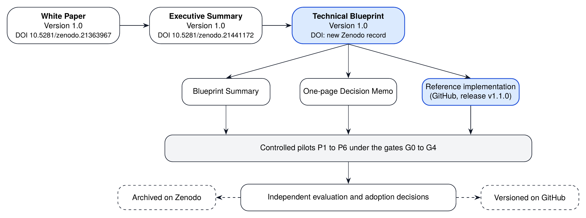
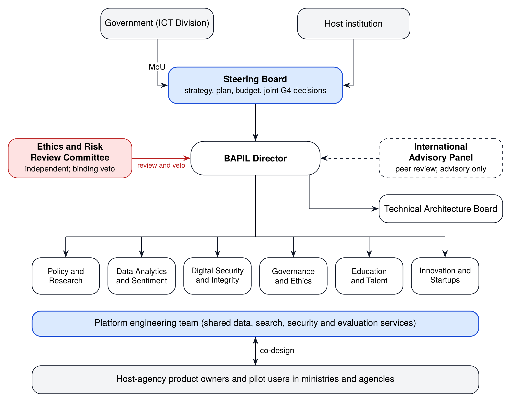
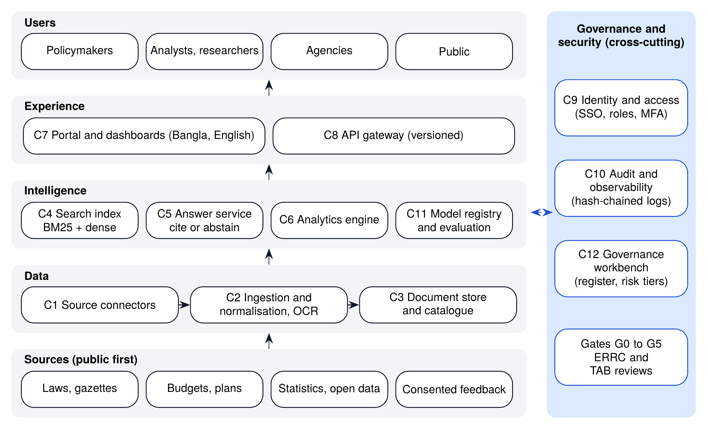
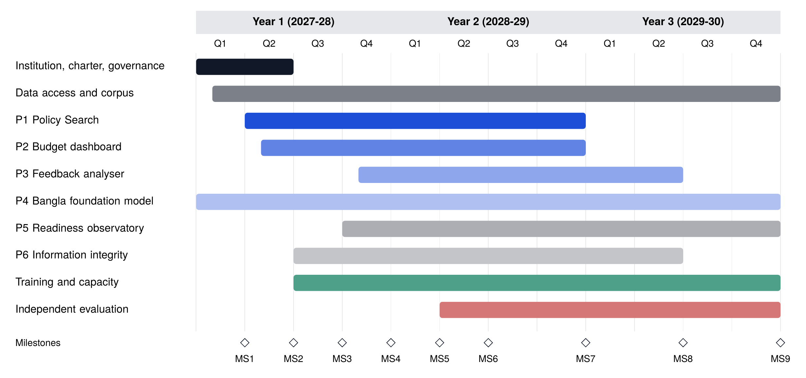
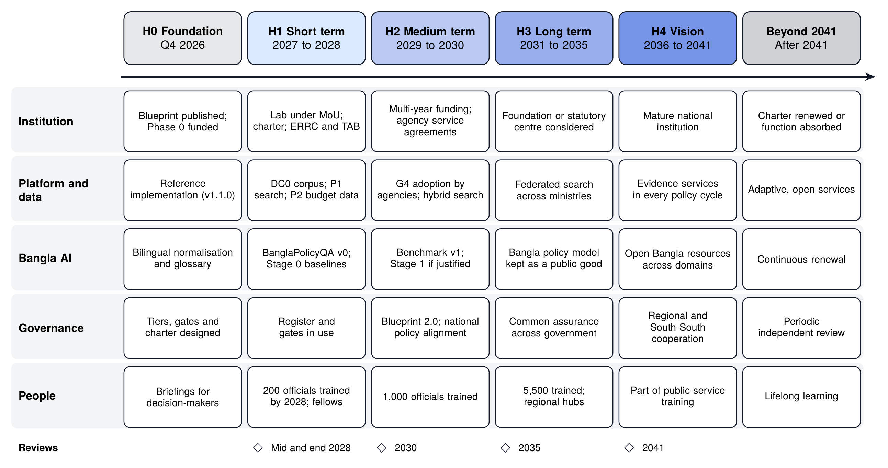

# Bangladesh AI Policy & Innovation Lab (BAPIL)

## Blueprint Summary

### Summary of the BAPIL Technical Blueprint (Version 1.0)

**Version 1.0**

**Md Naim Hassan Saykat**

Independent Researcher, Bangladesh  
ORCID: <https://orcid.org/0009-0007-5270-3970>

October 2026

**Blueprint DOI:** DOI to be assigned on publication  
**White Paper DOI:** <https://doi.org/10.5281/zenodo.21363967>  
**Executive Summary DOI:** <https://doi.org/10.5281/zenodo.21441172>  
**Repository:** <https://github.com/md-naim-hassan-saykat/bapil>

---

*This summary presents the main design choices, safeguards, delivery plan, strategic roadmap to 2041 and decisions set out in the BAPIL Technical Blueprint (five parts, 21 chapters, 23 annexes). Figure and table numbers follow the full Blueprint. The Blueprint and this summary are independent research documents and do not represent any official position. BAPIL is a proposal: no institution has been created and no funding has been approved.*

\newpage

# 1. What BAPIL Is, and Why Now

The Bangladesh AI Policy & Innovation Lab (BAPIL) is a proposed independent research and policy-intelligence platform that helps Bangladesh use artificial intelligence for evidence-based policymaking, responsible AI governance, Bangla-language technology and public-sector innovation. The White Paper (Version 1.0) set out the vision; the Technical Blueprint turns it into a buildable plan.

\looseness=-1 The timing is favourable. Bangladesh replaced its 2025 data ordinances with the Personal Data Protection Act, 2026 and the National Data Management Act, 2026, gazetted on 10 April 2026 (some provisions await notification), replaced its cyber-security ordinance with an Act on the same date and amended it in July 2026 to remove an online gambling section, released a draft National AI Policy 2026-2030 for consultation in January 2026 and a revised draft in February 2026, and announced that drafting of a national AI policy would begin in the fourth quarter of 2026 [1, 2, 3, 4, 5, 6, 7, 8, 9]. A concrete, open blueprint with working code can be a technical input to that process.

{width=68%}

*Figure 1. The BAPIL document family: from the White Paper to a tested implementation and controlled pilots.*

# 2. What the Blueprint Specifies

1. **26 requirements** (functional, non-functional and governance), each traced to components, code and tests.
2. **An institution:** a university-anchored lab with a government MoU, a multi-stakeholder Steering Board, an independent Ethics and Risk Review Committee (ERRC) whose veto binds as far as the host’s statutes allow, and a Technical Architecture Board.
3. **A reference architecture** of twelve open, replaceable components.
4. **Data rules:** four data classes, a public-data-first policy and an inventory of official sources.
5. **A trustworthy AI design:** bilingual search and answers in which every sentence cites an official source, with abstention when evidence is weak.
6. **An open benchmark,** BanglaPolicyQA, and a staged, evidence-gated path to a Bangla Policy Foundation Model.
7. **Six pilots** with users, data, risk tier, scope and exit criteria.
8. **Security and hosting** in Bangladesh, with controls for AI-specific threats.
9. **An assurance system:** risk tiers T0 to T3, lifecycle gates G0 to G5, model cards and a public transparency register.
10. **A small, tested reference implementation** (a research prototype, not a production system) issued on GitHub with the Blueprint, a 36-month delivery plan, staffing and training, financing and procurement clauses, a logical framework, KPIs, a risk register and a research agenda.
11. **A strategic roadmap for 2026 to 2041 and beyond,** with five horizons, indicative targets, scenarios and fixed review points.
12. **Six decisions** for the authorities.
13. **Evidence and readiness annexes:** the evidence status of every key claim, budget reconciliation and scenarios, an evaluation protocol with sample sizes, the status and limits of each governance body, the preconditions for starting, risk monitoring, and a register of unresolved items.

\newpage

# 3. Institution and Governance

*Figure 3. Proposed institutional and governance model (Option C: university-anchored lab with a government MoU).*

A hybrid model (Option C in the Blueprint) combines academic independence with a direct channel to government. Successful tools are transferred to the responsible agency through a documented adoption decision; BAPIL never operates production government systems.

# 4. Architecture and AI Design

*Figure 4. BAPIL reference architecture: twelve components in four layers, with cross-cutting governance and security.*

The core service is a **bilingual, citation-grounded policy search and answer system** over officially published documents: laws, gazettes, budgets, plans and statistics. Text is normalised for Bangla, queries are expanded across Bangla and English, passages are retrieved and checked, and an answer is given only when evidence is sufficient. Every query, source and output is written to a tamper-evident audit log. Models are open-weight and, for any non-public data, hosted in Bangladesh.

\newpage

# 5. Pilot Portfolio

| Pilot | Data | Tier | First result (month of the plan) |
|---|---|---|---|
| **P1** Bangladesh Policy Search Engine | Public documents | T1 or T2 | Pilot with 30 or more users in two to three agencies (12) |
| **P2** Budget Intelligence Dashboard | Published budget documents | T2 (public dashboard) | Five fiscal years of allocations as open data (12) |
| **P3** Citizen Feedback Analyser | Consented, de-identified submissions | T2 | Aggregate summaries of one consultation after a DPIA (18) |
| **P4** Bangla Policy Foundation Model, Stages 0 and 1 | Governed public corpus | T1 | BanglaPolicyQA benchmark v0 and baselines (9) |
| **P5** National AI Readiness Observatory | Public indicators | T2 (public report) | Indicator framework (15) and first report (24) |
| **P6** Information-integrity research | Public research datasets | T2 | Methods review (24); no monitoring of individuals |

# 6. Safeguards

* **Public data first;** names that already appear in published documents, such as gazette notices, are searchable only as part of those documents and are never profiled or aggregated; other personal data only with consent, a DPIA and ERRC approval (BAPIL’s own rule, stricter than the law); sensitive personal data never.
* **Advice, not decisions;** a person reviews every output in advisory use, and no system decides about individuals.
* **No surveillance;** social scoring, mass biometric surveillance and profiling of political or religious opinions are prohibited by charter.
* **Risk tiers and gates** decide how much control a system needs and when it may move forward.
* **Openness:** code, benchmarks, evaluation reports and the transparency register are published.

**Table 39.** Risk tiers and the minimum controls each tier requires

| Tier | Typical systems | Minimum required controls | Who approves |
|---------------|------------------------|------------------------------------|---------------|
| **T0** Prohibited | Social scoring; mass or indiscriminate biometric surveillance; profiling people’s political or religious opinions; deceptive synthetic media of real people; manipulation exploiting vulnerabilities | Not built, not piloted, not supported by BAPIL under any arrangement | Excluded by charter |
| **T1** Low | Research tools and search over public documents; internal dashboards of published data | AI system record; model or data card; evaluation report; audit logging; public listing in the transparency register | Unit lead and TAB |
| **T2** Limited | Advisory tools used by officials; public dashboards, reports and other public-facing information tools; aggregate analysis of de-identified feedback | All T1 controls plus: ERRC review; red-team test; human review of every output in use (for public dashboards and reports, review of every release); user training; incident procedure; quarterly monitoring report | ERRC (Steering Board consulted) |
| **T3** High | Any system that informs decisions about specific people or entities, processes personal data at scale, or is used in enforcement | BAPIL does not build T3 operational systems. Research only, with: DPIA, legal review, independent audit, ERRC approval, and a published impact assessment | ERRC (binding) and host-agency legal review |

\newpage

# 7. Delivery Plan (36 Months)

*Figure 12. Indicative 36-month delivery roadmap (Month 1 is the first month in which the MoU, the host agreement and Year 1 funding are all in place, after Phase 0; indicative Month 1: July 2027).*

* **Phase 0, about six months before month 1:** host selected through an open call; independent legal review and costing study; data access confirmed. Then MoU, host agreement and Year 1 funding in place.
* **Month 3:** Director appointed; Steering Board, ERRC and TAB in place; charter adopted.
* **Month 6:** Phase 2 work plan and budget updated; data access agreements signed; benchmark protocol agreed.
* **Month 12:** P1 pilot running with 30 or more users; P2 open budget dataset published; 100 officials trained.
* **Month 24:** adoption decisions on P1 and P2 with host agencies; first AI readiness report; 300 officials trained.
* **Month 36:** final independent evaluation; sustainability plan; Blueprint 2.0.

\newpage

# 8. Strategic Roadmap 2026-2041 and Beyond

*Figure 13. Strategic roadmap, 2026 to 2041 and beyond: horizons, workstreams and review points.*

The 36-month plan is the first step of a longer strategy that connects BAPIL’s pilots to the national AI policy cycle and to Bangladesh’s long-term development goals, including the existing plans to 2041, which may be revised [1, 10, 11].

* **H0 Foundation (Q4 2026):** publish the Blueprint and code; brief the authorities; offer input to national AI policy drafting; fund Phase 0.
* **H1 Short term (2027 to 2028):** prove value with public data; Phase 0, then the pilots; P1 and P2 pass their pilot gates; about 200 officials trained; mid-term evaluation.
* **H2 Medium term (2029 to 2030):** agencies adopt successful tools; benchmark v1; Blueprint 2.0; contribution to the post-2030 national AI policy; about 1,000 officials trained.
* **H3 Long term (2031 to 2035):** a national policy-intelligence network on shared standards; common assurance methods across government; regional training hubs; decision on institutional form.
* **H4 Vision (2036 to 2041):** evidence services embedded in policy cycles; open Bangla language resources across domains; regional and South-South cooperation; independent review in 2041.
* **Beyond 2041:** the charter is renewed only if the 2041 review confirms continuing public value; otherwise BAPIL closes or merges, with open archives preserved.

Targets are indicative and revised at fixed reviews (2027, 2028, 2029, 2030, 2035 and 2041) and whenever a major event occurs. In every scenario, the core (governed corpus, cited search, benchmark and governance) is protected, and safeguards never weaken as BAPIL grows.

**Table 45.** Strategic horizons, 2026 to 2041 and beyond

| Horizon | Period | Strategic aim | Priority actions | Institutional form | Signal to move on |
|--------------|----------|----------------------|----------------------------------|-------------------|---------------------|
| **H0** Foundation | Q4 2026 | Prepare a safe, open start | Publish this Blueprint and code; brief the ICT Division and custodians; offer input to national AI policy drafting; fund Phase 0 | Independent research initiative | Decisions D1 and D5 taken |
| **H1** Short term | 2027 to 2028 | Prove value with public data | Phase 0 (first half of 2027): host selection, legal review and costing; then charter, ERRC and register; P1 and P2 pilots; BanglaPolicyQA v0; 200 officials trained; mid-term evaluation | University-anchored lab under MoU (Option C) | P1 and P2 pass G3; positive mid-term evaluation |
| **H2** Medium term | 2029 to 2030 | Adopt, scale and align with national policy | G4 adoption of P1 and P2 by agencies; BPFM Stage 1 if justified; benchmark v1; Blueprint 2.0; align with the national AI policy cycle ending 2030 | Lab with multi-year core funding; agency service agreements | Tools in operational use; sustained funding agreed |
| **H3** Long term | 2031 to 2035 | Build a national policy-intelligence network | Federated search across ministries and divisions; Bangla policy model maintained as a public good; standard assurance used across government; regional training hubs | Consider an independent public-interest foundation (Option D) or statutory centre | Assurance methods used beyond BAPIL; network in most ministries |
| **H4** Vision | 2036 to 2041 | Trusted AI-enabled policy system for a knowledge economy | Evidence services embedded in policy cycles; open Bangla language resources across domains; regional and South-South cooperation; contribution to Bangladesh’s long-term development goals and the SDGs | Mature national institution with international partnerships | Independent review at 2041 confirms public value |
| **Beyond 2041** | After 2041 | Keep the capability adaptive and accountable | Periodic renewal of mission and charter; sunset or merger if the function is fully absorbed by government; preserve open archives | Determined by the 2041 review | Charter renewal decision |

*Note.* Horizons H1 and H2 correspond to the 36-month roadmap of Chapter 15 (Phase 0 in the first half of 2027; indicative Month 1 in July 2027). Later horizons are strategic intentions, reviewed at the points in Table 48.

\newpage

# 9. People, Resources and Financing

The core team grows from about 9 to 19 full-time equivalents over three years. Pilot computing needs are modest (two to three servers and two GPU inference servers, doubled in Year 2 for staging and recovery), with any model adaptation using shared national compute. An indicative budget built from stated assumptions comes to about Tk 20.4 crore over 36 months (Tk 4.7, 7.5 and 8.2 crore in Years 1 to 3, about USD 1.65 million), including 8% annual escalation, host overheads and a 5% contingency, with people at about half of the total. Low and high scenarios give about Tk 17.9 and 25.3 crore. Some costs are not yet included (engagement events, survey data collection, travel, open-access fees and staff computers); with an allowance for them and a 10% contingency, the estimate is about Tk 22.2 crore. It is a planning estimate, not approved funding; a preparatory Phase 0 (about Tk 0.44 crore, before month 1) runs an independent feasibility and costing study that confirms or replaces each assumption. Year 1 relies on the government budget and one development partner; funding then diversifies, with a growing share of core public funding and agency service agreements over time; no single non-government funder provides more than 30% of the budget. Model procurement clauses protect data, guarantee the right to evaluate and prevent lock-in.

The first stage is deliberately small: it is costed from a staffing plan, and a new lab could not recruit or spend a much larger sum well before its usefulness has been measured. It is also distinct from the Tk 200 to 250 crore AI Innovation Fund proposed in the draft national AI policy [1] and from the Tk 192.66 crore KOICA-supported AI hub project, a skills programme that aims to train 865 specialists, whose graduates BAPIL’s posts and fellowships could employ [12]. If the pilots pass Gate G4 and the final evaluation is positive, a costed national scale-up in Years 4 to 8 (four divisional university nodes, analysts in agencies, a Bangla language-data team, more fellowships and training for 5,000 more officials) would cost about Tk 218.9 crore and create about 118 direct posts by Year 8, or about Tk 239 crore over eight years with the 36-month plan (Blueprint Annex W). It is not requested now; each tranche would follow a gate decision. One integrated pathway (Blueprint Annex W, Figure 16 and Tables 71 and 72) shows for each stage the institutional form, the government’s role, posts, budget and funding by source; government would provide about 47% of the 36-month budget and, with agency service agreements, about two-thirds of the scale-up. Staff are employed by the host institution on fixed-term contracts, not as civil servants; permanent posts would follow only if BAPIL later becomes a foundation or a statutory centre (Blueprint Section 6.3).

# 10. Reference Implementation and Research

The repository contains a tested, dependency-free Python implementation of the core ideas: Bangla normalisation, bilingual BM25 search, cited extractive answers with abstention, risk-tier assessment, an AI system register with transparency export, evaluation metrics and a hash-chained audit log, with a command line and a small JSON API. Continuous-integration workflows are configured to run the tests and rebuild the published documents from source. It has not been deployed or tested with users; the evaluation thresholds in the Blueprint are proposed targets, with a measurement protocol, not results. A research agenda of six questions, from Bangla retrieval to institutional design, leads to open datasets, evaluation reports and peer-reviewed publications, starting with a journal manuscript on the framework planned for 2027.

\newpage

# 11. Decisions Requested

**Table 57.** Decisions requested from the relevant authorities

| No. | Decision | Responsible authority | Timing |
|------|--------------------------------------------|------------------------|-------------|
| D1 | Accept this Blueprint as a technical input to the national AI policy drafting process | Ministry of Posts, Telecommunications and Information Technology (ICT Division) | Q4 2026 |
| D2 | After Phase 0: approve the 12-month Phase 1 pilot, agree an MoU with the selected host institution, and commit Year 1 funding (about Tk 4.7 crore, Table 50, as confirmed by the Phase 0 costing study) | ICT Division and host institution | End of Phase 0 |
| D3 | Authorise structured bulk access to already-public document collections and nominate data custodians | Legislative and Parliamentary Affairs Division, Finance Division, Planning Commission, BBS, a2i | During Phase 0 |
| D4 | Nominate Steering Board members, and agree that ERRC members are selected through an open call by an independent nominations panel | ICT Division and host institution (Steering Board); independent panel (ERRC) | During Phase 0 |
| D5 | Fund and commission Phase 0 (about Tk 0.44 crore, about six months): an open host call, an independent legal review, an independent feasibility and costing study, and confirmation of data access; name a government focal point | ICT Division or a development partner | Within 90 days |
| D6 | Confirm guardrails: no deployment beyond class A without a G4 decision, and no use in prohibited categories | Steering Board | At charter adoption |

*Note.* In time, D1 and D5 come first; D3 and D4 are prepared during Phase 0; D2 follows Phase 0 and D6 the adoption of the charter. None of these decisions creates a statutory body or gives BAPIL legal powers. The approvals and agreements needed before month 1 are listed in Annex T (Table 65).

# Resources

**Technical Blueprint DOI:** DOI to be assigned on publication  
**White Paper DOI:** <https://doi.org/10.5281/zenodo.21363967>  
**Executive Summary DOI:** <https://doi.org/10.5281/zenodo.21441172>  
**GitHub Repository:** <https://github.com/md-naim-hassan-saykat/bapil>

# References

References are numbered in the order in which they are first cited, and only references cited in this document are listed. Entries marked with an asterisk (\*) are taken from the bibliography of the BAPIL White Paper (Version 1.0).

[1] THE DAILY STAR.
Draft AI policy targets innovation, better public services[EB/OL].
Dhaka: The Daily Star, 2026-01-26[2026-10-20].
Available:
<https://www.thedailystar.net/business/economy/news/draft-ai-policy-targets-innovation-better-public-services-4090431>

[2] THE DAILY OBSERVER.
Rehan Asif Asad outlines govt’s five priorities for ICT, telecom[EB/OL].
Dhaka: The Daily Observer, 2026-08-10[2026-10-20].
Available:
<https://observerbd.com/news/587314>

[3] THE FINANCIAL EXPRESS.
Bangladesh amends cybersecurity law, drops online gambling clause[EB/OL].
Dhaka: The Financial Express, 2026-06-30[2026-10-22].
Available:
<https://thefinancialexpress.com.bd/sci-tech/bangladesh-amends-cybersecurity-law-drops-online-gambling-clause>

[4] AI POLICY FOR BANGLADESH (aipolicy.gov.bd).
Bangladesh National AI Policy 2026-2030, Draft v2, February 9, 2026[EB/OL].
Dhaka, 2026-02-09[2026-10-22].
Available:
<https://aipolicy.gov.bd/docs/national-ai-policy-bangladesh-2026-2030-draft-v2.0.pdf>

[5] LEGISLATIVE AND PARLIAMENTARY AFFAIRS DIVISION.
২০২৬ সনে প্রণীত আইনসমূহ (Acts enacted in 2026)[EB/OL].
Dhaka: Legislative and Parliamentary Affairs Division, 2026[2026-10-22].
Available:
<https://legislativediv.gov.bd/pages/static-pages/69df4f84e252a315b7e6b8db>

[6] GOVERNMENT OF THE PEOPLE’S REPUBLIC OF BANGLADESH.
Personal Data Protection Act, 2026 (Act No. 63 of 2026)[S/OL].
Bangladesh Gazette, Extraordinary, 2026-04-10. Copy published by the ICT Division[2026-10-22].
Available:
<https://objectstorage.ap-dcc-gazipur-1.oraclecloud15.com/n/axvjbnqprylg/b/V2Ministry/o/office-ictd/2026/3/1c355c6a-cc9c-42a0-b07f-e0876b89dc9d.pdf>

[7] GOVERNMENT OF THE PEOPLE’S REPUBLIC OF BANGLADESH.
National Data Management Act, 2026 (Act No. 80 of 2026)[S/OL].
Bangladesh Gazette, Extraordinary, 2026-04-10. Copy published by the ICT Division[2026-10-22].
Available:
<https://objectstorage.ap-dcc-gazipur-1.oraclecloud15.com/n/axvjbnqprylg/b/V2Ministry/o/office-ictd/2026/3/ab68f686-1ba9-4c04-85ad-83f0982f7b4e.pdf>

[8] GOVERNMENT OF THE PEOPLE’S REPUBLIC OF BANGLADESH.
Cyber Security Act, 2026 (Act No. 81 of 2026)[S/OL].
Bangladesh Gazette, Extraordinary, 2026-04-10. Copy published by the ICT Division[2026-10-22].
Available:
<https://objectstorage.ap-dcc-gazipur-1.oraclecloud15.com/n/axvjbnqprylg/b/V2Ministry/o/office-ictd/2026/3/31737fbf-7a0b-4437-b479-a20cd0e06e69.pdf>

[9] GOVERNMENT OF THE PEOPLE’S REPUBLIC OF BANGLADESH.
Cyber Security (Amendment) Act, 2026 (Act No. 99 of 2026)[S/OL].
Bangladesh Gazette, Extraordinary, 2026-07-01. Copy published by the ICT Division[2026-10-22].
Available:
<https://objectstorage.ap-dcc-gazipur-1.oraclecloud15.com/n/axvjbnqprylg/b/V2Ministry/o/office-ictd/2026/8/541cfcb6-8c7f-40fd-b54b-3185c236ce95.pdf>

[10] \* GENERAL ECONOMICS DIVISION (GED), PLANNING COMMISSION, GOVERNMENT OF BANGLADESH.
Making Vision 2041 a Reality: Perspective Plan of Bangladesh 2021–2041[EB/OL].
Dhaka: Planning Commission, Government of Bangladesh, 2020[2026-10-22].
Available:
<https://oldweb.lged.gov.bd/uploadeddocument/unitpublication/1/1049/vision%202021-2041.pdf>

[11] \* INFORMATION AND COMMUNICATION TECHNOLOGY (ICT) DIVISION, GOVERNMENT OF THE PEOPLE’S REPUBLIC OF BANGLADESH.
Smart Bangladesh: ICT Master Plan 2041 (Draft)[EB/OL].
Dhaka: ICT Division, Government of the People’s Republic of Bangladesh, undated[2026-10-22].
Available: 
<https://objectstorage.ap-dcc-gazipur-1.oraclecloud15.com/n/axvjbnqprylg/b/V2Ministry/o/office-moa/2024/12/a01255f61d29443eabbf948ef97c290e.pdf>

[12] \* THE BUSINESS STANDARD (TBS).
Govt to establish AI hub with Tk192.66cr project backed by Koica[EB/OL].
Dhaka: The Business Standard, 2026[2026-10-22].
Available:
<https://www.tbsnews.net/tech/govt-establish-ai-hub-tk19266cr-project-backed-koica-1462206>

---

© 2026 Md Naim Hassan Saykat. Licensed under CC BY 4.0.
