# বাংলাদেশ এআই পলিসি অ্যান্ড ইনোভেশন ল্যাব (BAPIL)

## টেকনিক্যাল ব্লুপ্রিন্ট

### কাঠামো থেকে বাস্তবায়ন: বাংলাদেশে এআই নীতি-বুদ্ধিমত্তা সক্ষমতার জন্য প্রাতিষ্ঠানিক নকশা, রেফারেন্স স্থাপত্য, শাসনব্যবস্থা, বাস্তবায়ন পরিকল্পনা ও ২০৪১ পর্যন্ত কৌশলগত রোডম্যাপ

**সংস্করণ ১.০**

**মোঃ নাঈম হাসান সৈকত**

স্বাধীন গবেষক, বাংলাদেশ  
ORCID: <https://orcid.org/0009-0007-5270-3970>

অক্টোবর ২০২৬

**ব্লুপ্রিন্টের DOI:** প্রকাশের সময় নির্ধারিত হবে  
**হোয়াইট পেপারের DOI:** <https://doi.org/10.5281/zenodo.21363967>  
**নির্বাহী সারসংক্ষেপের DOI:** <https://doi.org/10.5281/zenodo.21441172>  
**গিটহাব রিপোজিটরি:** <https://github.com/md-naim-hassan-saykat/bapil>

---

## বাংলা সংস্করণ (Version 1.0)

> **এই নথিটি *Bangladesh AI Policy & Innovation Lab (BAPIL): Technical Blueprint (Version 1.0)*-এর বাংলা সংস্করণ। ইংরেজি সংস্করণটি মূল ও প্রামাণ্য নথি। দুই সংস্করণের মধ্যে কোনো ব্যাখ্যাগত অসঙ্গতি বা অনুবাদজনিত পার্থক্য দেখা দিলে ইংরেজি সংস্করণটি চূড়ান্ত হিসেবে গণ্য হবে।**

---

*এই টেকনিক্যাল ব্লুপ্রিন্ট BAPIL হোয়াইট পেপারকে (সংস্করণ ১.০) একটি বাস্তবায়নযোগ্য পরিকল্পনায় রূপান্তর করে। এতে প্রতিষ্ঠান, জনবল ও দক্ষতা, রেফারেন্স স্থাপত্য, ডেটা ও এআই নকশা, শাসন ও আশ্বাস-ব্যবস্থা, গিটহাবে একটি পরীক্ষিত রেফারেন্স বাস্তবায়ন, ৩৬ মাসের বাস্তবায়ন পরিকল্পনা, ২০২৬ থেকে ২০৪১ ও তার পরবর্তী সময়ের কৌশলগত রোডম্যাপ এবং সংশ্লিষ্ট কর্তৃপক্ষের কাছে প্রত্যাশিত সিদ্ধান্তসমূহ নির্দিষ্ট করা হয়েছে। নথিটি মন্ত্রণালয়, সরকারি সংস্থা, কারিগরি দল, বিশ্ববিদ্যালয়, নাগরিক সমাজ ও উন্নয়ন সহযোগীদের জন্য প্রস্তুত করা হয়েছে।*

\newpage

# কপিরাইট ও লাইসেন্স

**বাংলাদেশ এআই পলিসি অ্যান্ড ইনোভেশন ল্যাব (BAPIL): টেকনিক্যাল ব্লুপ্রিন্ট**

**সংস্করণ:** ১.০  
**প্রকাশের তারিখ:** অক্টোবর ২০২৬

© ২০২৬ মোঃ নাঈম হাসান সৈকত।

অন্যথায় উল্লেখ না থাকলে, এই নথিটি **Creative Commons Attribution 4.0 International (CC BY 4.0)** লাইসেন্সের অধীনে প্রকাশিত। যথাযথ কৃতিত্ব প্রদান, লাইসেন্সের লিংক উল্লেখ এবং কোনো পরিবর্তন করা হলে তা নির্দেশ করার শর্তে বাণিজ্যিক ব্যবহারসহ যেকোনো উদ্দেশ্যে এটি বিনিময় ও পরিমার্জন করা যাবে।

লাইসেন্স: <https://creativecommons.org/licenses/by/4.0/>

অধ্যায় ১১-এ বর্ণিত রেফারেন্স বাস্তবায়নের সোর্স কোড রিপোজিটরির `LICENSE` ফাইলে উল্লিখিত MIT লাইসেন্সের অধীনে প্রকাশিত। চিত্র ও সারণিগুলো রিপোজিটরির উৎস-ফাইল থেকে তৈরি এবং একই CC BY 4.0 লাইসেন্সে LaTeX, PDF ও PNG আকারে উপলব্ধ।

\newpage

# নথির তথ্য

| বিষয় | তথ্য |
|---|---|
| **নথির শিরোনাম** | বাংলাদেশ এআই পলিসি অ্যান্ড ইনোভেশন ল্যাব (BAPIL): টেকনিক্যাল ব্লুপ্রিন্ট |
| **সংস্করণ** | ১.০ |
| **প্রকাশের তারিখ** | অক্টোবর ২০২৬ |
| **লেখক** | মোঃ নাঈম হাসান সৈকত |
| **অধিভুক্তি** | স্বাধীন গবেষক, বাংলাদেশ |
| **ORCID** | <https://orcid.org/0009-0007-5270-3970> |
| **ভাষা** | বাংলা (মূল ইংরেজি সংস্করণের সঙ্গে প্রকাশিত) |
| **নথির ধরন** | টেকনিক্যাল ব্লুপ্রিন্ট |
| **কাঠামো** | পাঁচটি অংশ, ২১টি অধ্যায়, ২৩টি সংযুক্তি, ৭০টি সারণি ও ১৫টি চিত্র |
| **প্রমাণগত অবস্থা** | অক্টোবর ২০২৬-এ প্রধান দাবিগুলো উৎসের সঙ্গে মিলিয়ে যাচাইকৃত (সংযুক্তি ত); অমীমাংসিত বিষয় সংযুক্তি ফ-তে |
| **লাইসেন্স** | Creative Commons Attribution 4.0 International (CC BY 4.0) |
| **ব্লুপ্রিন্টের DOI** | প্রকাশের সময় নির্ধারিত হবে |
| **ভিত্তি** | হোয়াইট পেপার, সংস্করণ ১.০: <https://doi.org/10.5281/zenodo.21363967> |
| **সহযোগী নথি** | নির্বাহী সারসংক্ষেপ, সংস্করণ ১.০: <https://doi.org/10.5281/zenodo.21441172> |
| **রিপোজিটরি** | <https://github.com/md-naim-hassan-saykat/bapil> (রিলিজ v1.1.0) |

## উদ্ধৃতি

Saykat, M. N. H. (2026). *Bangladesh AI Policy & Innovation Lab (BAPIL): Technical Blueprint* (Version 1.0). Zenodo. প্রকাশের সময় নির্ধারিত হবে

## দায়স্বীকার

এই ব্লুপ্রিন্টটি লেখকের ব্যক্তিগত সক্ষমতায় প্রস্তুত একটি স্বাধীন গবেষণা ও নীতি-নকশা বিষয়ক নথি। এটি বাংলাদেশ সরকার, কোনো মন্ত্রণালয়, সংস্থা, বিশ্ববিদ্যালয় বা অন্য কোনো প্রতিষ্ঠানের সরকারি অবস্থান প্রকাশ করে না। BAPIL যে প্রেক্ষাপটে কাজ করবে তা বর্ণনার জন্যই কেবল বিভিন্ন প্রতিষ্ঠান, আইন ও কর্মসূচির নাম উল্লেখ করা হয়েছে; এর মাধ্যমে কোনো সমর্থন, অংশীদারিত্ব বা চুক্তি বোঝানো হয়নি। আইনগত বর্ণনাগুলো পরিকল্পনার উদ্দেশ্যে প্রস্তুত সারসংক্ষেপ, আইনি পরামর্শ নয়। ব্যয়, জনবল ও দীর্ঘমেয়াদি লক্ষ্যগুলো নির্দেশক পরিকল্পনা-অনুমান, যা একটি সম্ভাব্যতা সমীক্ষার মাধ্যমে যাচাই এবং প্রতিটি কৌশলগত পর্যালোচনায় সংশোধন করা হবে। কোনো অর্থ চাওয়া, অনুমোদিত বা প্রতিশ্রুত হয়নি, এবং এখানে বর্ণিত কোনো শাসন-সংস্থা গঠিত হয়নি।

## এই ব্লুপ্রিন্ট কীভাবে পড়বেন

ব্লুপ্রিন্টটি পাঁচটি অংশে বিন্যস্ত। সীমিত সময়ের পাঠকেরা নিচের পথগুলো অনুসরণ করতে পারেন:

* **সিদ্ধান্তগ্রহণকারী:** এক নজরে ব্লুপ্রিন্ট, অধ্যায় ১৬ (২০৪১ পর্যন্ত কৌশলগত রোডম্যাপ) এবং অধ্যায় ২১ (সিদ্ধান্ত)।
* **কর্মসূচি ব্যবস্থাপক:** অতিরিক্তভাবে অধ্যায় ৩, ৫, ৬, ১২, ১৫, ১৭, ১৮ ও ১৯।
* **কারিগরি দল:** অংশ ৩ (অধ্যায় ৭ থেকে ১১), সঙ্গে সংযুক্তি ক, গ, ট, ড ও দ।
* **আইন, শাসন ও নৈতিকতা বিশেষজ্ঞ:** অধ্যায় ৮, ১৩ ও ১৪, সঙ্গে সংযুক্তি খ, ঙ, চ, জ, ঝ, ঞ, ধ ও ন।
* **গবেষক ও বিশ্ববিদ্যালয়:** অধ্যায় ৯, ১১ ও ২০, সঙ্গে সংযুক্তি ট।
* **উন্নয়ন সহযোগী ও আর্থিক পর্যালোচক:** অধ্যায় ২, ১৬, ১৭ ও ১৮, সঙ্গে সংযুক্তি থ, ন ও ব।
* **প্রমাণ যাচাইকারী পর্যালোচক:** সংযুক্তি ত, যেখানে প্রতিটি প্রধান দাবির অবস্থা বলা আছে, এবং সংযুক্তি ফ, যেখানে অমীমাংসিত বিষয়ের তালিকা আছে।

**আবশ্যিক (must)**, **উচিত (should)** ও **পারে (may)** শব্দগুলো তাদের প্রচলিত নির্দেশমূলক অর্থে ব্যবহৃত: *আবশ্যিক* চিহ্নিত প্রয়োজনীয়তা নকশার একটি শর্ত, *উচিত* একটি জোরালো সুপারিশ, এবং *পারে* ঐচ্ছিক।

সংযুক্তিগুলো বাংলা বর্ণক্রমে চিহ্নিত: ক (প্রয়োজনীয়তা অনুসরণযোগ্যতা), খ (ঝুঁকি-স্তর প্রশ্নমালা), গ (টেমপ্লেট), ঘ (DOI নীতিমালা), ঙ (খসড়া সনদ), চ (ERRC-এর কার্যপরিধি), ছ (স্টিয়ারিং বোর্ড ও TAB-এর কার্যপরিধি), জ (DPIA টেমপ্লেট), ঝ (ডেটা-বিনিময় চুক্তির রূপরেখা), ঞ (গেট চেকলিস্ট), ট (টীকাকরণ নির্দেশিকা), ঠ (শব্দকোষ), ড (রেফারেন্স বাস্তবায়নের ধাপে ধাপে প্রদর্শন), ঢ (জাতীয় এআই নীতির উপাদানে অবদান), ণ (পাইলট P1-এর প্রথম বছরের কর্মপরিকল্পনা), ত (প্রমাণগত অবস্থা ও দাবি যাচাই), থ (বাজেটের মিলকরণ, ব্যয়ের ধরন ও পরিস্থিতি), দ (মূল্যায়ন প্রটোকল ও রিলিজ-গেট), ধ (শাসন-সংস্থা, অবস্থা ও সুরক্ষা), ন (পূর্বশর্ত, অনুমোদন ও কাজের প্যাকেজ), প (ঝুঁকি পর্যবেক্ষণ) ও ফ (অমীমাংসিত বিষয়)। ইংরেজি সংস্করণে এগুলো যথাক্রমে Annex A থেকে V।

## এই ব্লুপ্রিন্ট ও এর উপকরণগুলোর অবস্থা

এই ব্লুপ্রিন্ট একটি প্রস্তাব। যা বিদ্যমান আর যা পরিকল্পিত, তার মধ্যে বিভ্রান্তি এড়াতে সারণিটি রচনার সময় প্রতিটি উপাদানের অবস্থা জানায়। লেখার দাবিগুলো একইভাবে সংযুক্তি ত-তে সেখানে সংজ্ঞায়িত লেবেল (যাচাইকৃত তথ্য, উৎস-প্রতিবেদিত তথ্য, গবেষণা-ফলাফল, লেখকের বিশ্লেষণ, নকশাগত সুপারিশ, পরিকল্পনা-অনুমান, প্রস্তাবিত লক্ষ্য, অযাচাইকৃত দাবি ও ভবিষ্যৎ মাইলফলক) দিয়ে শ্রেণিবদ্ধ করা হয়েছে।

| উপাদান | রচনার সময়ের অবস্থা (অক্টোবর ২০২৬) |
|---|---|
| প্রতিষ্ঠান, স্টিয়ারিং বোর্ড, ERRC ও TAB | নকশাগত সুপারিশ। কিছুই অনুমোদিত, গঠিত বা অর্থায়িত হয়নি |
| আইনগত বিশ্লেষণ | সংবাদমাধ্যমের প্রতিবেদন ও মাধ্যমিক আইনি ভাষ্যের ভিত্তিতে সারাংশ। গেজেটভুক্ত পাঠ ও তার কার্যকারিতা-বিধান পর্যালোচিত হয়নি; বাংলাদেশের যোগ্য আইনজীবীর নিশ্চিতকরণ প্রয়োজন |
| রেফারেন্স বাস্তবায়ন | গবেষণা-প্রোটোটাইপ (প্যাকেজ সংস্করণ ০.১.০); Python 3.13-এ স্থানীয়ভাবে ৪৯টি ইউনিট পরীক্ষা উত্তীর্ণ। এই ব্লুপ্রিন্টের সঙ্গে রিপোজিটরি রিলিজ v1.1.0-এ প্রকাশের জন্য নির্ধারিত; রিলিজটি <https://github.com/md-naim-hassan-saykat/bapil/releases>-এ তালিকাভুক্ত কি না পাঠক যাচাই করতে পারেন। তালিকাভুক্ত না থাকলে কোডটি এখনো প্রকাশ্য নয়। উৎপাদন-ব্যবস্থা নয়; ব্যবহারকারীদের সঙ্গে পরীক্ষিত নয় |
| BanglaPolicyQA বেঞ্চমার্ক | পরিকল্পিত। প্রটোকল ও টীকাকরণ নির্দেশিকা আছে; কোনো প্রশ্ন লেখা হয়নি |
| মূল্যায়নের সীমা | প্রস্তাবিত লক্ষ্য। কোনো পাইলট-ফলাফল নেই |
| পাইলট P1 থেকে P6 | প্রস্তাবিত |
| বাজেট | উল্লিখিত অনুমান থেকে হিসাবকৃত পরিকল্পনা-প্রাক্কলন; দরপত্র নয় এবং অনুমোদিত অর্থ নয় |
| দীর্ঘমেয়াদি লক্ষ্য (২০২৮ থেকে ২০৪১) | প্রস্তাবিত লক্ষ্য, প্রতিটি কৌশলগত পর্যালোচনায় সংশোধিত হবে |

যেসব বিষয় অমীমাংসিত রয়ে গেছে, দায়িত্বপ্রাপ্ত ও সমাধানের উপায়সহ সেগুলোর তালিকা সংযুক্তি ফ-তে (সারণি ৬৮) দেওয়া আছে।


\newpage

# এক নজরে ব্লুপ্রিন্ট

**সমস্যা।** বাংলাদেশের আইন, গেজেট, বাজেট, পরিকল্পনা ও পরিসংখ্যান অনেক ওয়েবসাইটে ও বিভিন্ন ফরম্যাটে প্রকাশিত হয়, প্রায়ই স্ক্যানকৃত বাংলা PDF আকারে। কর্মকর্তা ও গবেষকেরা এসব উৎস খুঁজে পেতে, যাচাই করতে ও উদ্ধৃত করতে তাঁদের সময়ের বড় অংশ ব্যয় করেন। একই সময়ে দেশটি ডেটার জন্য নতুন আইনি কাঠামো ও একটি জাতীয় এআই নীতি প্রতিষ্ঠা করছে, কিন্তু সরকারি খাতে এআই ব্যবস্থা পরিচালনার কোনো কার্যকর পদ্ধতি এবং নীতি অনুসন্ধানের জন্য কোনো উন্মুক্ত বাংলা বেঞ্চমার্ক নেই।

**প্রস্তাব।** বাংলাদেশ এআই পলিসি অ্যান্ড ইনোভেশন ল্যাব (BAPIL) হবে আইসিটি বিভাগের সঙ্গে একটি সমঝোতা স্মারকের অধীনে একটি বিশ্ববিদ্যালয়-ভিত্তিক ল্যাব। এটি উন্মুক্ত, দ্বিভাষিক সরঞ্জাম নির্মাণ করবে, যা কর্মকর্তাদের সরকারি প্রমাণ খুঁজে পেতে ও উদ্ধৃত করতে সাহায্য করবে; সরকারি খাতের এআই নিরাপদে পরিচালনার প্রয়োজনীয় পদ্ধতি উন্নয়ন ও প্রকাশ করবে; এবং উভয়ের ব্যবহারে মানুষকে প্রশিক্ষণ দেবে।

**প্রথমে কী নির্মিত হবে।** প্রথম বছরে BAPIL একটি দ্বিভাষিক নীতি অনুসন্ধান সরঞ্জাম (পাইলট P1), যার উত্তর সরকারি উৎস উদ্ধৃত করবে অথবা বিরত থাকবে এমনভাবে নকশা করা, এবং উদ্ধৃতির নির্ভুলতা অন্তত ০.৯৫ লক্ষ্যমাত্রার বিপরীতে পরিমাপ করা হবে; উন্মুক্ত ডেটা হিসেবে পাঁচ বছরের বাজেট বরাদ্দ (P2); উন্মুক্ত BanglaPolicyQA বেঞ্চমার্ক (P4); একটি স্বাধীন নৈতিকতা ও ঝুঁকি পর্যালোচনা কমিটিসহ একটি সনদ; এআই ব্যবস্থার একটি জনসমক্ষে স্বচ্ছতা নিবন্ধন; এবং ১০০ কর্মকর্তার প্রশিক্ষণ সরবরাহ করবে।

**ঝুঁকি কীভাবে নিয়ন্ত্রিত হয়।** প্রথমে উন্মুক্ত ডেটা; পরামর্শ, সিদ্ধান্ত নয়; কোনো নজরদারি নয়। প্রতিটি ব্যবস্থাকে একটি ঝুঁকি-স্তরে (T0 নিষিদ্ধ থেকে T3 উচ্চ) স্থাপন করা হয় এবং সামনে এগোনোর আগে জীবনচক্র-গেট (G0 থেকে G5) পার হতে হয়। T2 ও T3 স্তরের কাজে নৈতিকতা ও ঝুঁকি পর্যালোচনা কমিটির বাধ্যতামূলক ভেটো-ক্ষমতা রয়েছে।

**যা ইতিমধ্যে বিদ্যমান, আর যা নেই।** মূল উপাদানগুলোর (দ্বিভাষিক প্রমিতকরণ ও অনুসন্ধান, বিরতিসহ উদ্ধৃতিযুক্ত উত্তর, ঝুঁকি-স্তর মূল্যায়ন, এআই ব্যবস্থা নিবন্ধন, মূল্যায়ন এবং হস্তক্ষেপ-শনাক্তযোগ্য নিরীক্ষা লগ) একটি ছোট, পরীক্ষিত রেফারেন্স বাস্তবায়ন এই ব্লুপ্রিন্টের সঙ্গে গিটহাব রিলিজ v1.1.0-এ প্রকাশিত হয় এবং ব্লুপ্রিন্টের Zenodo রেকর্ডের সঙ্গে সংরক্ষিত হয়; সেই রিলিজ প্রকাশের পরই রেকর্ডটি প্রকাশ করা হয় (সংযুক্তি ঘ)। এটি একটি গবেষণা-প্রোটোটাইপ, উৎপাদন-ব্যবস্থা নয়। প্রতিষ্ঠান, পাইলট, বেঞ্চমার্ক ও অর্থায়ন এখনো নেই; এগুলোই এই ব্লুপ্রিন্টের প্রস্তাব।

**দীর্ঘমেয়াদি দৃষ্টি।** একটি কৌশলগত রোডম্যাপ পাঁচটি দিগন্ত নির্ধারণ করে: ভিত্তি (চতুর্থ ত্রৈমাসিক ২০২৬), স্বল্পমেয়াদি (২০২৭ থেকে ২০২৮), মধ্যমেয়াদি (২০২৯ থেকে ২০৩০), দীর্ঘমেয়াদি (২০৩১ থেকে ২০৩৫) ও রূপকল্প (২০৩৬ থেকে ২০৪১), এরপর ২০৪১-এর পর সনদ নবায়নের সিদ্ধান্ত। এটি জাতীয় এআই নীতিচক্র ও ২০৪১-এর জাতীয় পরিকল্পনার সঙ্গে সামঞ্জস্যপূর্ণ এবং নির্ধারিত সময়ে ও বড় কোনো ঘটনা ঘটলে পর্যালোচিত হয়।

**ব্যয় কত হতে পারে।** উল্লিখিত অনুমানের ভিত্তিতে তৈরি নির্দেশক বাজেট ৩৬ মাসে প্রায় ২০.৪ কোটি টাকা (নিম্ন ও উচ্চ পরিস্থিতিতে ১৭.৯ থেকে ২৫.৩ কোটি টাকা)। এটি একটি সম্ভাব্যতা সমীক্ষায় নিশ্চিতযোগ্য পরিকল্পনা-প্রাক্কলন, অনুমোদিত অর্থ নয় (অধ্যায় ১৭ ও সংযুক্তি থ)। এতে ইচ্ছাকৃতভাবে শুধু প্রথম পর্যায়ের অর্থ ধরা হয়েছে: পাইলট সফল হলে বছর ৪ থেকে ৮-এর জন্য একটি ব্যয়-নির্ধারিত জাতীয় সম্প্রসারণ (প্রায় ২১৮.৯ কোটি টাকা, প্রত্যক্ষ পদ বেড়ে প্রায় ১১৮টি) সংযুক্তি ব-তে দেওয়া হয়েছে; এটি এখন অনুরোধ করা হচ্ছে না।

**কর্তৃপক্ষের কাছে কী চাওয়া হচ্ছে।** ছয়টি সিদ্ধান্ত (অধ্যায় ২১): জাতীয় এআই নীতি প্রণয়নে ব্লুপ্রিন্টকে কারিগরি উপকরণ হিসেবে গ্রহণ; ১২ মাসের প্রথম ধাপের পাইলট অনুমোদন; ইতিমধ্যে প্রকাশিত নথিতে একসঙ্গে প্রবেশাধিকার অনুমোদন; স্টিয়ারিং বোর্ডে সদস্য মনোনয়ন এবং নৈতিকতা কমিটির জন্য একটি স্বাধীন বাছাই-প্রক্রিয়ায় সম্মতি; একটি সম্ভাব্যতা ও ব্যয়-নিরূপণ সমীক্ষার নির্দেশ; এবং সুরক্ষাসীমা নিশ্চিত করা।

\newpage

## সংক্ষিপ্ত রূপ (Acronyms)

\begingroup\renewcommand{\bapiltablestretch}{1.05}

| সংক্ষিপ্ত রূপ | পূর্ণরূপ |
|----------|----------|
| ADP | বার্ষিক উন্নয়ন কর্মসূচি (Annual Development Programme) |
| ADR | স্থাপত্য-সিদ্ধান্ত রেকর্ড (Architecture Decision Record) |
| AIA | অ্যালগরিদমিক প্রভাব মূল্যায়ন (Algorithmic Impact Assessment) |
| API | অ্যাপ্লিকেশন প্রোগ্রামিং ইন্টারফেস |
| BAPIL | বাংলাদেশ এআই পলিসি অ্যান্ড ইনোভেশন ল্যাব |
| BBS | বাংলাদেশ পরিসংখ্যান ব্যুরো |
| BCC | বাংলাদেশ কম্পিউটার কাউন্সিল |
| BM25 | Okapi Best Matching 25 র‍্যাংকিং ফাংশন |
| BPFM | বাংলা নীতি ফাউন্ডেশন মডেল |
| CI | ধারাবাহিক সমন্বয় (Continuous Integration) |
| CSF | সাইবার নিরাপত্তা কাঠামো (NIST) |
| DCAT | ডেটা ক্যাটালগ ভোকাবুলারি (W3C) |
| DOI | ডিজিটাল অবজেক্ট আইডেন্টিফায়ার |
| DPIA | উপাত্ত সুরক্ষা প্রভাব মূল্যায়ন (Data Protection Impact Assessment) |
| EGDI | ই-গভর্নমেন্ট উন্নয়ন সূচক (E-Government Development Index) |
| ERRC | নৈতিকতা ও ঝুঁকি পর্যালোচনা কমিটি (Ethics and Risk Review Committee) |
| FTE | পূর্ণকালীন সমতুল্য (Full-Time Equivalent) |
| GPU | গ্রাফিক্স প্রসেসিং ইউনিট |
| KOICA | কোরিয়া আন্তর্জাতিক সহযোগিতা সংস্থা (কোইকা) |
| KPI | মূল কর্মদক্ষতা সূচক |
| LLM | বৃহৎ ভাষা মডেল (Large Language Model) |
| LoRA | লো-র‍্যাংক অ্যাডাপটেশন |
| MFA | বহু-উপাদান প্রমাণীকরণ (Multi-Factor Authentication) |
| MoU | সমঝোতা স্মারক |
| MRR | গড় বিপরীত র‍্যাংক (Mean Reciprocal Rank) |
| nDCG | প্রমিত হ্রাসকৃত ক্রমপুঞ্জিত লাভ (Normalised Discounted Cumulative Gain) |
| NDMA | জাতীয় উপাত্ত ব্যবস্থাপনা আইন, ২০২৬ |
| NLP | প্রাকৃতিক ভাষা প্রক্রিয়াকরণ |
| NRDEX | জাতীয় দায়িত্বশীল ডেটা বিনিময় (National Responsible Data Exchange) |
| OCR | অপটিক্যাল ক্যারেক্টার রিকগনিশন |
| PDPA | ব্যক্তিগত উপাত্ত সুরক্ষা আইন, ২০২৬ |
| RACI | দায়িত্বপ্রাপ্ত, জবাবদিহিকারী, পরামর্শপ্রাপ্ত, অবহিত |
| RAG | উদ্ধার-সমৃদ্ধ উৎপাদন (Retrieval-Augmented Generation) |
| RPO | পুনরুদ্ধার-বিন্দুর লক্ষ্য (Recovery Point Objective) |
| RTI | তথ্য অধিকার |
| RTO | পুনরুদ্ধার-সময়ের লক্ষ্য (Recovery Time Objective) |
| SBOM | সফটওয়্যার উপাদান তালিকা (Software Bill of Materials) |
| SSO | একক সাইন-অন |
| SWOT | শক্তি, দুর্বলতা, সুযোগ, হুমকি |
| TAB | কারিগরি স্থাপত্য বোর্ড (Technical Architecture Board) |
| VAT | মূল্য সংযোজন কর (ভ্যাট) |
| WCAG | ওয়েব কনটেন্ট অ্যাক্সেসিবিলিটি নির্দেশিকা |

\endgroup

\newpage

# সূচিপত্র

\newpage

# চিত্রের তালিকা

# সারণির তালিকা

\newpage

# অংশ ১: ভিত্তি

*কেন এখনই একটি ব্লুপ্রিন্ট প্রয়োজন, বাংলাদেশ কোথায় দাঁড়িয়ে, কাদের সম্পৃক্ত হতে হবে এবং ব্যবস্থাটিকে কী করতে হবে।*

# অধ্যায় ১: উদ্দেশ্য, পরিসর ও পদ্ধতি

## ১.১ কেন এখনই একটি ব্লুপ্রিন্ট

BAPIL হোয়াইট পেপার (সংস্করণ ১.০) একটি রূপকল্প উপস্থাপন করেছিল: একটি স্বাধীন গবেষণা ও নীতি-বুদ্ধিমত্তা প্ল্যাটফর্ম, যা প্রমাণভিত্তিক নীতিনির্ধারণ, দায়িত্বশীল এআই শাসন, বাংলা ভাষা প্রযুক্তি ও সরকারি খাতের উদ্ভাবনে কৃত্রিম বুদ্ধিমত্তা (এআই) ব্যবহারে বাংলাদেশকে সহায়তা করবে [১, ২, ৩, ৪, ৫]। নির্বাহী সারসংক্ষেপ এই রূপকল্পকে জ্যেষ্ঠ নীতিনির্ধারকদের জন্য সংক্ষিপ্ত আকারে তুলে ধরেছিল। উভয় নথি ইচ্ছাকৃতভাবে ধারণা, নীতিমালা ও উদাহরণমূলক পাইলটের স্তরে সীমাবদ্ধ ছিল।

এই ব্লুপ্রিন্ট পরবর্তী প্রশ্নের উত্তর দেয়: **ঠিক কী নির্মাণ করা হবে, কে করবে, কোন নিয়মে, কোন ক্রমে, কী সম্পদে এবং সাফল্যের কী প্রমাণসহ?** এটি হোয়াইট পেপারের প্রতিটি উপাদানকে প্রয়োজনীয়তা, প্রাতিষ্ঠানিক ব্যবস্থা, কারিগরি উপাদান, ডেটা-নিয়ম, আশ্বাস-প্রক্রিয়া, বাস্তবায়ন পরিকল্পনা, দীর্ঘমেয়াদি কৌশল এবং কর্তৃপক্ষের সিদ্ধান্তে রূপান্তর করে।

সময়টি গুরুত্বপূর্ণ। ২০২৫ ও ২০২৬ সালে বাংলাদেশ নতুন উপাত্ত সুরক্ষা ও উপাত্ত ব্যবস্থাপনা কাঠামো গ্রহণ করেছে, প্রথমে অধ্যাদেশের মাধ্যমে এবং পরে, প্রতিবেদন অনুযায়ী, সংসদের আইনের মাধ্যমে, এবং সাইবার নিরাপত্তা আইন সংশোধন করেছে [৬, ৭, ৮, ৯]। কোন বিধান কবে থেকে বলবৎ, তা এখনো নিশ্চিত করতে হবে (অধ্যায় ১৪)। জাতীয় এআই নীতি ২০২৬-২০৩০-এর একটি খসড়া জানুয়ারি ২০২৬-এ জন-পরামর্শের জন্য প্রকাশিত হয়েছিল [১০, ১১], এবং একটি সংশোধিত খসড়া (সংস্করণ ২.০, তারিখ ৯ ফেব্রুয়ারি ২০২৬) জাতীয় এআই নীতির সরকারি পোর্টালে প্রকাশ করা হয় [১২]। আগস্ট ২০২৬-এ সরকার ঘোষণা করে যে সরকার, বেসরকারি খাত, একাডেমিয়া ও গবেষকদের সমন্বয়ে একটি যৌথ দল ২০২৬ সালের চতুর্থ ত্রৈমাসিকে জাতীয় এআই নীতির খসড়া প্রণয়ন শুরু করবে [১৩, ১৪]; সেই প্রক্রিয়া ২০২৬ সালের খসড়াগুলোর ওপর ভিত্তি করে এগোবে কি না, তা নিশ্চিত হয়নি। কার্যকর কোডসহ একটি সুনির্দিষ্ট ও উন্মুক্ত লাইসেন্সপ্রাপ্ত ব্লুপ্রিন্ট সেই প্রক্রিয়ায় কারিগরি উপকরণ হিসেবে কাজে লাগতে পারে, আর ২০৪১ পর্যন্ত বিস্তৃত একটি রোডম্যাপ স্বল্পমেয়াদি পাইলটগুলোকে প্রেক্ষিত পরিকল্পনা ২০৪১ ও আইসিটি মাস্টারপ্ল্যান ২০৪১-এর দীর্ঘমেয়াদি লক্ষ্যের সঙ্গে যুক্ত করতে সাহায্য করতে পারে [১৫, ১৬]।

## ১.২ BAPIL নথি-পরিবার

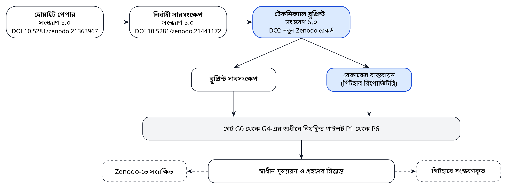

*চিত্র ১। BAPIL নথি-পরিবার: হোয়াইট পেপার থেকে পরীক্ষিত বাস্তবায়ন ও নিয়ন্ত্রিত পাইলট পর্যন্ত।*

**সারণি ১।** BAPIL নথি-পরিবার ও স্থায়ী শনাক্তকারী (Persistent Identifier)

| নথি/উপকরণ | সংস্করণ | উদ্দেশ্য | প্রধান পাঠক | শনাক্তকারী |
|---------------|-----------|--------------------------|-------------------|---------------------|
| **হোয়াইট পেপার** | ১.০ (রিপোজিটরি রিলিজ v1.0.1) | ধারণাগত কাঠামো, আন্তর্জাতিক শিক্ষা, ২০৪১ পর্যন্ত রূপকল্প | সকল অংশীজন | 10.5281/zenodo.21363967 |
| **নির্বাহী সারসংক্ষেপ** | ১.০ | হোয়াইট পেপারের সংক্ষিপ্ত সার | জ্যেষ্ঠ নীতিনির্ধারক | 10.5281/zenodo.21441172 |
| **টেকনিক্যাল ব্লুপ্রিন্ট** (এই নথি) | ১.০ | বাস্তবায়নযোগ্য নকশা: প্রতিষ্ঠান, স্থাপত্য, ডেটা, শাসন, বাস্তবায়ন পরিকল্পনা | মন্ত্রণালয়, সংস্থা, কারিগরি দল, অংশীদার | প্রকাশের সময় নির্ধারিত DOI |
| **ব্লুপ্রিন্ট সারসংক্ষেপ** | ১.০ | ব্লুপ্রিন্টের সংক্ষিপ্ত সার | সিদ্ধান্তগ্রহণকারী | ব্লুপ্রিন্টের একই রেকর্ড |
| **রেফারেন্স বাস্তবায়ন** | ০.১.০ (এই ব্লুপ্রিন্টের সঙ্গে রিপোজিটরি রিলিজ v1.1.0-এ প্রকাশের জন্য নির্ধারিত) | ইউনিট পরীক্ষাসহ ব্লুপ্রিন্টের মূল উপাদানের গবেষণা-প্রোটোটাইপ; উৎপাদন-ব্যবস্থা নয় | প্রকৌশলী, গবেষক, নিরীক্ষক | গিটহাব রিপোজিটরি; রেকর্ডের সঙ্গে সংরক্ষিত |

## ১.৩ পরিপক্বতা শ্রেণি

পরীক্ষামূলক ব্যবস্থা ও সরকারি ব্যবস্থার মধ্যে বিভ্রান্তি এড়াতে ব্লুপ্রিন্টে তিনটি পরিপক্বতা শ্রেণি ব্যবহার করা হয়েছে। প্রতিটি শ্রেণির নিজস্ব ব্যবহারকারী, অনুমোদিত ডেটা ও অনুমোদন-পথ রয়েছে।

**সারণি ২।** এই ব্লুপ্রিন্টে ব্যবহৃত ব্যবস্থার পরিপক্বতা শ্রেণি

| শ্রেণি | সংজ্ঞা | ব্যবহারকারী | অনুমোদিত ডেটা | উদাহরণ | অনুমোদন |
|-------------|--------------------------|-----------------|-----------------|-------------------|------------------|
| **R** গবেষণা প্রোটোটাইপ | পদ্ধতি পরীক্ষার জন্য পরীক্ষামূলক ব্যবস্থা; এর ফলাফল কখনো সরকারি সিদ্ধান্তে ব্যবহৃত হয় না | BAPIL গবেষক ও গবেষণা অংশীদার | P0; ডেটা-বিনিময় চুক্তির অধীনে P1 | উন্মুক্ত মডেল দিয়ে বেঞ্চমার্ক পরীক্ষা | গেট G0 ও G1 |
| **A** পরামর্শমূলক সরঞ্জাম | কর্মকর্তারা একাধিক উৎসের একটি হিসেবে ব্যবহার করেন; প্রতিটি ফলাফল ব্যবহারের আগে একজন মানুষ পর্যালোচনা করেন | পাইলট সংস্থার কর্মকর্তা | P0 ও P1; শুধু পরিচয়-অপসারিত P2 | দুই থেকে তিনটি সংস্থায় নীতি অনুসন্ধান পাইলট | গেট G2 ও G3; T2 স্তরের জন্য ERRC অনুমোদন |
| **O** পরিচালনাগত ব্যবস্থা | সংস্থার কর্মপ্রবাহে সংযুক্ত; মালিকানা ও পরিচালনা সংস্থার, BAPIL-এর নয় | স্বাগতিক সংস্থার কর্মী এবং প্রযোজ্য ক্ষেত্রে জনসাধারণ | আইন ও সংস্থার অনুমোদন অনুযায়ী | সংস্থা-পরিচালিত অনুসন্ধান সেবা | স্বাগতিক সংস্থার আইনি পর্যালোচনাসহ গেট G4 |

BAPIL R ও A শ্রেণির ব্যবস্থা নির্মাণ করে। O শ্রেণির ব্যবস্থা কখনো BAPIL নয়, সংস্থাই পরিচালনা করে, এবং তা কেবল সংস্থার নিজস্ব আইনি পর্যালোচনাসহ G4 গ্রহণ-সিদ্ধান্তের পরে।

## ১.৪ হোয়াইট পেপারের সঙ্গে এই ব্লুপ্রিন্ট কী যোগ করে

হোয়াইট পেপারে ছয়টি স্থাপত্য-স্তর, একটি নীতি-বুদ্ধিমত্তা ড্যাশবোর্ড, একটি বাংলা নীতি ফাউন্ডেশন মডেল, একটি শাসন-কাঠামো, একটি পাঁচ বছরের রোডম্যাপ এবং পাঁচটি উদাহরণমূলক পাইলট বর্ণিত হয়েছিল। এই ব্লুপ্রিন্ট যোগ করে:

1. ভিত্তি-সূচক, সক্ষমতার ঘাটতি বিশ্লেষণ ও SWOT মূল্যায়নসহ একটি **পরিস্থিতি বিশ্লেষণ** (অধ্যায় ২)।
2. একটি **অংশীজন ও সম্পৃক্ততা পরিকল্পনা** (অধ্যায় ৩)।
3. আইডি, অগ্রাধিকার, পারসোনা, ব্যবহারকারী-গল্প এবং কোড ও পরীক্ষার সঙ্গে অনুসরণযোগ্যতাসহ **প্রয়োজনীয়তা** (অধ্যায় ৪, সংযুক্তি ক)।
4. মূল্যায়িত পরিচালন-মডেল, শাসন-সংস্থা, সিদ্ধান্তের অধিকার ও দায়িত্ব-ম্যাট্রিক্সসহ **প্রাতিষ্ঠানিক নকশা** (অধ্যায় ৫, সংযুক্তি ঙ থেকে ছ)।
5. জনবল, দক্ষতা-কাঠামো ও প্রশিক্ষণ পাঠ্যক্রমসহ একটি **জনবল ও সক্ষমতা পরিকল্পনা** (অধ্যায় ৬)।
6. বারোটি নামযুক্ত উপাদান, একটি API বিনির্দেশ ও স্থাপত্য-সিদ্ধান্ত রেকর্ডসহ **রেফারেন্স স্থাপত্য** (অধ্যায় ৭)।
7. **ডেটা-নিয়ম**: চার শ্রেণির ডেটা শ্রেণিবিন্যাস, উৎস-তালিকা, মেটাডেটা, মান, সংরক্ষণকাল এবং প্রথমে উন্মুক্ত ডেটা নীতি (অধ্যায় ৮, সংযুক্তি ঝ)।
8. **এআই ও ভাষা-নকশা**: দ্বিভাষিক, উদ্ধৃতিভিত্তিক উদ্ধার-প্রক্রিয়া, বাংলা টেক্সটের নিয়ম, একটি মূল্যায়ন বেঞ্চমার্ক, মডেল নির্বাচনের মানদণ্ড এবং বাংলা নীতি ফাউন্ডেশন মডেলের পর্যায়ভিত্তিক পথ (অধ্যায় ৯, সংযুক্তি ট)।
9. **অবকাঠামো, নিরাপত্তা ও ধারাবাহিকতার** বিনির্দেশ (অধ্যায় ১০)।
10. গবেষণা-প্রোটোটাইপ পর্যায়ের একটি **পরীক্ষিত রেফারেন্স বাস্তবায়ন**, যা এই ব্লুপ্রিন্টের সঙ্গে গিটহাবে প্রকাশিত হয় এবং রিলিজ প্রকাশের পর এর Zenodo রেকর্ডের সঙ্গে সংরক্ষিত হয় (অধ্যায় ১১; সংযুক্তি ঘ)।
11. ছয়টি পাইলটের **পূর্ণাঙ্গ বিনির্দেশ** (অধ্যায় ১২)।
12. একটি **পরিচালনাগত আশ্বাস-ব্যবস্থা**: ঝুঁকি-স্তর, জীবনচক্র-গেট, মানব-তত্ত্বাবধান, নথিভুক্তি ও কাঠামো-সংযোগ সারণি (অধ্যায় ১৩, সংযুক্তি খ, গ, জ ও ঞ)।
13. বলবৎ বা প্রণয়নাধীন বাংলাদেশি আইন ও নীতির সঙ্গে **আইনগত সামঞ্জস্য** (অধ্যায় ১৪)।
14. একটি **৩৬ মাসের বাস্তবায়ন পরিকল্পনা** এবং **২০২৬ থেকে ২০৪১ ও তার পরবর্তী সময়ের কৌশলগত রোডম্যাপ** (অধ্যায় ১৫ ও ১৬)।
15. **অর্থায়ন, ক্রয়, পরিবীক্ষণ ও মূল্যায়ন, ঝুঁকি ব্যবস্থাপনা এবং গবেষণা-কর্মসূচি** (অধ্যায় ১৭ থেকে ২০)।
16. কর্তৃপক্ষের জন্য **ছয়টি সিদ্ধান্ত** (অধ্যায় ২১)।
17. **প্রমাণ ও প্রস্তুতি-বিষয়ক সংযুক্তি:** প্রতিটি প্রধান দাবির অবস্থা, বাজেটের মিলকরণ ও পরিস্থিতি, মূল্যায়ন প্রটোকল, প্রতিটি শাসন-সংস্থার অবস্থা ও সীমা, সূচনার পূর্বশর্ত, ঝুঁকি পর্যবেক্ষণ এবং অমীমাংসিত বিষয়ের নিবন্ধন (সংযুক্তি ত থেকে ফ)।
18. **কর্মসংস্থান, দক্ষতা ও শর্তসাপেক্ষ জাতীয় সম্প্রসারণ:** পরিকল্পনাটি যে পদ, ফেলোশিপ ও প্রশিক্ষণ সৃষ্টি করে, এবং পাইলট সফল হলে বছর ৪ থেকে ৮-এর জন্য একটি ব্যয়-নির্ধারিত সম্প্রসারণ (সংযুক্তি ব)।

**সারণি ৩।** হোয়াইট পেপারের অধ্যায় থেকে ব্লুপ্রিন্টের অধ্যায়

| হোয়াইট পেপারের অধ্যায় (১.০) | ব্লুপ্রিন্টের অধ্যায় | ব্লুপ্রিন্ট যা যোগ করে |
|----------------------|----------------|------------------------------------|
| ২. কেন বাংলাদেশের এআই নীতি-বুদ্ধিমত্তা প্রয়োজন | ২, ৪ | ভিত্তি-সূচক, ঘাটতি বিশ্লেষণ, ব্যবহারকারী-চরিত্র ও পরীক্ষাযোগ্য প্রয়োজনীয়তা |
| ৩. বৈশ্বিক উদাহরণ | ৫, ১৩, ১৪ | দৃষ্টান্ত থেকে অভিযোজিত প্রাতিষ্ঠানিক পছন্দ ও নিয়ন্ত্রণ, কাঠামো-সংযোগ সারণিসহ |
| ৪. বাংলাদেশে এআই-এর বর্তমান চিত্র | ২, ৩, ১৪ | পরিস্থিতি বিশ্লেষণ, অংশীজন নিবন্ধন ও ২০২৬ সালের আইনি কাঠামো |
| ৫. BAPIL-এর রূপকল্প | ১, ১৬ | পরিসরের সীমারেখা, পরিপক্বতা শ্রেণি ও ২০২৬-২০৪১ কৌশলগত রোডম্যাপ |
| ৬. BAPIL-এর স্থাপত্য | ৭, ৮, ১০ | বারোটি নামযুক্ত উপাদান, ইন্টারফেস, ডেটা-নিয়ম, হোস্টিং ও নিরাপত্তা অঞ্চল |
| ৭. নীতি-বুদ্ধিমত্তা ড্যাশবোর্ড | ৭, ১২ | API বিনির্দেশ ও পাইলট বিনির্দেশ (P1, P2, P5) |
| ৮. বাংলা নীতি ফাউন্ডেশন মডেল | ৯, ১২ | বাংলা টেক্সটের নিয়ম, BanglaPolicyQA বেঞ্চমার্ক ও প্রমাণনির্ভর মডেল-পথ |
| ৯. এআই শাসন কাঠামো | ১৩, সংযুক্তি খ, ঙ থেকে ট | ঝুঁকি-স্তর, জীবনচক্র-গেট, সনদ, কার্যপরিধি ও চেকলিস্ট |
| ১০. জাতীয় নিরাপত্তা ও সাইবার নিরাপত্তা | ১০ | NIST CSF 2.0 সংযোগ, এআই-নির্দিষ্ট হুমকি, ঘটনার স্তর ও পুনরুদ্ধার-লক্ষ্য |
| ১১. এআই শিক্ষা ও মেধা | ৬ | জনবল পরিকল্পনা, দক্ষতা কাঠামো ও প্রশিক্ষণ পাঠ্যক্রম |
| ১২. স্টার্টআপ ইকোসিস্টেম | ৩, ১৭ | শিল্পখাতের সম্পৃক্ততা ও বাজার উন্মুক্ত রাখার ক্রয়-শর্ত |
| ১৩. সম্পদ ও অর্থায়ন | ১৭ | ব্যয়-মডেল, দিগন্তভিত্তিক অর্থায়ন-মিশ্রণ ও টেকসইতা পরিকল্পনা |
| ১৪. পাঁচ বছরের রোডম্যাপ | ১৫ | মাইলফলক, ডেলিভারেবল ও গেটসহ ৩৬ মাসের কর্মপরিকল্পনা |
| ১৫. দীর্ঘমেয়াদি রূপকল্প | ১৬ | ২০৪১ ও তার পরবর্তী সময় পর্যন্ত দিগন্ত, নির্দেশক লক্ষ্য, পরিস্থিতি ও পর্যালোচনা-সূচক |
| ১৬. ঝুঁকি, নৈতিকতা ও দায়িত্বশীল এআই | ১৩, ১৯ | ঝুঁকি নিবন্ধন, তাপ-মানচিত্র ও পরিচালনাগত নিশ্চয়তা |
| ১৭. কৌশলগত সুপারিশ | ২১ | কর্তৃপক্ষের জন্য ছয়টি সুনির্দিষ্ট সিদ্ধান্ত |
| পরিশিষ্ট ক. পাইলট প্রকল্প | ১২ | ব্যবহারকারী, ডেটা, স্তর, পরিসর ও উত্তরণ-মানদণ্ডসহ পূর্ণ বিনির্দেশ |

## ১.৫ পরিসর ও সীমারেখা

BAPIL একটি **গবেষণা, নীতি-বুদ্ধিমত্তা ও সক্ষমতা উন্নয়ন** উদ্যোগ হিসেবেই থাকবে। এটি নীতি প্রণয়ন করে না, নিয়ন্ত্রক ভূমিকা পালন করে না, পরিচালনাগত নিরাপত্তা-কার্যক্রম সম্পাদন করে না এবং সরকারি উৎপাদন-ব্যবস্থা পরিচালনা করে না। কোনো সরঞ্জাম কার্যকর প্রমাণিত হলে নথিভুক্ত গ্রহণ-সিদ্ধান্তের (গেট G4, অধ্যায় ১৩) মাধ্যমে তার মালিকানা সংশ্লিষ্ট সংস্থার কাছে হস্তান্তরিত হয়।

শুরু থেকেই তিনটি সীমারেখা নকশায় অন্তর্ভুক্ত:

* **প্রথমে উন্মুক্ত ডেটা।** পাইলটগুলো শুরু হয় ইতিমধ্যে সরকারিভাবে প্রকাশিত নথি ও পরিসংখ্যান দিয়ে। আইনগত ভিত্তি, উপাত্ত সুরক্ষা প্রভাব মূল্যায়ন এবং নৈতিক অনুমোদন ছাড়া ব্যক্তিগত ডেটা বর্জিত; সংবেদনশীল ব্যক্তিগত ডেটা সম্পূর্ণ বর্জিত (অধ্যায় ৮)।
* **পরামর্শ, সিদ্ধান্ত নয়।** প্রতিটি এআই-ফলাফল একজন মানুষের বিবেচনার জন্য প্রমাণমাত্র। BAPIL-এর কোনো ব্যবস্থা ব্যক্তিসংক্রান্ত সিদ্ধান্ত নেয় না বা স্বয়ংক্রিয় করে না (অধ্যায় ৪ ও ১৩)।
* **কোনো নজরদারি নয়।** সামাজিক স্কোরিং, গণ বা নির্বিচার বায়োমেট্রিক নজরদারি এবং মানুষের রাজনৈতিক বা ধর্মীয় মতের প্রোফাইলিং সনদ দ্বারা নিষিদ্ধ (স্তর T0, অধ্যায় ১৩)।

এই সীমারেখার মধ্যে ব্লুপ্রিন্টটি সক্ষমতার পূর্ণ জীবনকাল জুড়ে বিস্তৃত: ২০২৬ সালের শেষ দিকের প্রথম অবহিতকরণ থেকে তিন বছরের পাইলট কর্মসূচি হয়ে ২০৩০ থেকে ২০৪১ সালের মধ্যে উদ্ভূত সম্প্রসারণ, প্রাতিষ্ঠানিক রূপ ও টেকসইতার দীর্ঘমেয়াদি প্রশ্ন পর্যন্ত।

## ১.৬ পদ্ধতি

ব্লুপ্রিন্টটি ছয়টি ধাপে প্রস্তুত করা হয়েছে, যার প্রতিটি প্রকাশিত উৎস ও রিপোজিটরির সঙ্গে মিলিয়ে যাচাই করা যায়:

1. **BAPIL সিরিজের পর্যালোচনা।** হোয়াইট পেপার ও নির্বাহী সারসংক্ষেপের প্রতিটি অধ্যায়কে একটি নকশা-প্রশ্ন এবং এই ব্লুপ্রিন্টের যে অধ্যায় তার উত্তর দেয় তার সঙ্গে সংযুক্ত করা হয়েছে (সারণি ৩)।
2. **প্রেক্ষাপট পর্যালোচনা।** সরকারি ঘোষণা ও সংবাদমাধ্যমের প্রতিবেদন ব্যবহার করে ২০২৫ ও ২০২৬ সালের আইনগত ও নীতিগত পরিবর্তন পর্যালোচনা করা হয়েছে, এবং ডিজিটাল সরকার, সাইবার নিরাপত্তা ও এআই প্রস্তুতির সূচক সংগ্রহ করা হয়েছে (অধ্যায় ২)। লেখার সময় ২০২৬ সালের কয়েকটি আইনের গেজেটভুক্ত পূর্ণ পাঠ উপলব্ধ না থাকায় আইনগত বর্ণনাগুলো নিশ্চিতকরণসাপেক্ষ সারাংশ হিসেবে চিহ্নিত।
3. **রেফারেন্স কাঠামোর আলোকে নকশা।** প্রয়োজনীয়তা ও নিয়ন্ত্রণগুলো OECD এআই নীতিমালা, UNESCO সুপারিশ, NIST এআই ঝুঁকি ব্যবস্থাপনা কাঠামো, ISO/IEC 42001, ইইউ এআই আইন এবং কানাডার স্বয়ংক্রিয় সিদ্ধান্তগ্রহণ নির্দেশনা থেকে নির্ধারিত [১, ২, ৩, ১৭, ১৮, ১৯, ২০], এবং বাংলাদেশের খসড়া জাতীয় এআই নীতির শ্রেণির সঙ্গে খাপ খাওয়ানো [১০]।
4. **নকশার পরীক্ষা হিসেবে বাস্তবায়ন।** মূল ধারণাগুলো (দ্বিভাষিক অনুসন্ধান, বিরতিসহ উদ্ধৃতিযুক্ত উত্তর, ঝুঁকি-স্তর, নিবন্ধন, মূল্যায়ন ও নিরীক্ষা) কোডে বাস্তবায়ন ও পরীক্ষা করা হয়েছে। বাস্তবায়নে নকশার কোনো ঘাটতি ধরা পড়লে নকশা সংশোধন করা হয়েছে।
5. **পরিকল্পনা ও পর্যালোচনা।** বাস্তবায়ন, সম্পদ, ঝুঁকি ও দীর্ঘমেয়াদি কৌশল সুস্পষ্ট অনুমানসহ পরিকল্পিত, যাতে সম্ভাব্যতা সমীক্ষা ও কৌশলগত পর্যালোচনায় প্রতিটি যাচাই করা যায়।
6. **প্রমাণ যাচাই।** অক্টোবর ২০২৬-এ, প্রকাশের আগে, বাহ্যিক দাবিগুলো তাদের উৎসের সঙ্গে মিলিয়ে যাচাই, বাজেট তার খাতভিত্তিক অঙ্ক থেকে পুনরায় হিসাব এবং দাবিগুলো প্রমাণগত অবস্থা অনুযায়ী শ্রেণিবদ্ধ করা হয়েছে (সংযুক্তি ত)। সরকারি আইন-ডেটাবেস থেকে স্বয়ংক্রিয়ভাবে আইনের পাঠ সংগ্রহ করা যায়নি, তাই আইনগত বর্ণনাগুলো আইনজীবীর মাধ্যমে নিশ্চিতযোগ্য সারাংশ হিসেবেই রয়েছে।

## ১.৭ নকশার সারসংক্ষেপ

এক অনুচ্ছেদে: BAPIL প্রতিষ্ঠিত হবে **সরকারি সমঝোতা স্মারক ও বহু-অংশীজন স্টিয়ারিং বোর্ডসহ একটি বিশ্ববিদ্যালয়-ভিত্তিক ল্যাব** হিসেবে, সঙ্গে থাকবে **বাধ্যতামূলক ভেটো-ক্ষমতাসম্পন্ন একটি স্বাধীন নৈতিকতা ও ঝুঁকি পর্যালোচনা কমিটি** এবং একটি **কারিগরি স্থাপত্য বোর্ড**। এটি একটি **উন্মুক্ত, মডুলার প্ল্যাটফর্ম** নির্মাণ করবে, যার কেন্দ্রে থাকবে সরকারিভাবে প্রকাশিত নথির ওপর একটি **দ্বিভাষিক, উদ্ধৃতিভিত্তিক নীতি অনুসন্ধান ও উত্তর সেবা**। আন্তর্জাতিক কাঠামো ও বাংলাদেশের নতুন উপাত্ত-আইনের সঙ্গে সামঞ্জস্যপূর্ণ **ঝুঁকি-স্তর ও জীবনচক্র-গেটের** অধীনে ছয়টি পাইলট পরিচালিত হবে। একটি **৩৬ মাসের পরিকল্পনা** প্রথম বছরে একটি নীতি অনুসন্ধান পাইলট ও একটি উন্মুক্ত বাজেট ডেটাসেট, দ্বিতীয় বছরে মূল্যায়িত গ্রহণ-সিদ্ধান্ত, এবং তৃতীয় বছরে বাংলা ডোমেইন অভিযোজন বিষয়ে একটি নথিভুক্ত সিদ্ধান্ত (পর্যায় ১ যৌক্তিক প্রমাণিত হলে তবেই অভিযোজিত মডেল) ও ব্লুপ্রিন্ট ২.০ সরবরাহ করবে। এরপর একটি **কৌশলগত রোডম্যাপ** সক্ষমতাটিকে মধ্যমেয়াদি গ্রহণ (২০২৯ থেকে ২০৩০), একটি জাতীয় নীতি-বুদ্ধিমত্তা নেটওয়ার্ক (২০৩১ থেকে ২০৩৫) এবং ২০৪১ সালের মধ্যে একটি পরিণত ও আস্থাভাজন প্রতিষ্ঠানে নিয়ে যাবে। মূল উপাদানগুলোর একটি ছোট **রেফারেন্স বাস্তবায়ন** এই ব্লুপ্রিন্টের সঙ্গে প্রকাশিত; এটি একটি পরীক্ষিত গবেষণা-প্রোটোটাইপ, প্রয়োগকৃত কোনো ব্যবস্থা নয়।

\newpage

# অধ্যায় ২: পরিস্থিতি বিশ্লেষণ ও ভিত্তিরেখা

## ২.১ বিশ্লেষণের উদ্দেশ্য

একটি ব্লুপ্রিন্টের মান নির্ভর করে সূচনাবিন্দু সম্পর্কে তার বোঝাপড়ার ওপর। এই অধ্যায় BAPIL যেসব সক্ষমতার ওপর নির্ভরশীল সেগুলোতে বাংলাদেশের অবস্থান সংক্ষেপে তুলে ধরে: ডিজিটাল সরকার, ডেটা, সাইবার নিরাপত্তা, এআই প্রস্তুতি, বাংলা ভাষা প্রযুক্তি এবং আইনি কাঠামো। এরপর এটি BAPIL যে ঘাটতিগুলো পূরণের জন্য নকশাকৃত তা চিহ্নিত করে এবং বাস্তবায়নকে প্রভাবিত করবে এমন শক্তি, দুর্বলতা, সুযোগ ও হুমকি মূল্যায়ন করে। সূচকগুলো অধ্যায় ১৬-এর দীর্ঘমেয়াদি লক্ষ্যের ভিত্তিরেখা হিসেবেও কাজ করে।

## ২.২ ভিত্তি-সূচক

**সারণি ৪।** বাংলাদেশের নির্বাচিত ভিত্তি-সূচক

| সূচক | প্রতিবেদিত মান | BAPIL-এর জন্য তাৎপর্য | উৎস |
|-----------------------|----------------------------------|----------------------|---------|
| জাতিসংঘ ই-সরকার উন্নয়ন সূচক (EGDI), ২০২৪ | ১৯৩ দেশের মধ্যে ১০০তম, স্কোর ০.৬৫৭০ (২০২২ সালে ১১১তম); স্বল্পোন্নত দেশগুলোর মধ্যে সর্বোচ্চ EGDI | ভিত্তি হিসেবে ডিজিটাল সেবার কাঠামো বিদ্যমান | [৫, ২১] |
| আইটিইউ গ্লোবাল সাইবার সিকিউরিটি ইনডেক্স, ২০২৪ | শীর্ষ স্তরে অবস্থান প্রতিবেদিত | কাঠামো আছে; চাপের মধ্যে স্থিতিস্থাপকতা এখনো যাচাই প্রয়োজন | [২২, ২৩] |
| অক্সফোর্ড ইনসাইটস সরকারি এআই প্রস্তুতি সূচক, ২০২৩ | ৮২তম | শাসন, ডেটা ও সক্ষমতা স্তম্ভে উন্নতির সুযোগ | [২৪, ২৫] |
| বিশ্ববিদ্যালয়ে এআই কম্পিউটিং, ২০২৫ সালের অনুমান | জরিপকৃত বিভাগপ্রতি ২ থেকে ৫৫টি GPU; সরকারি বিশ্ববিদ্যালয়গুলো নিম্নপ্রান্তে | যৌথ জাতীয় কম্পিউটিং ব্যবহার; পাইলট মডেল ছোট রাখা | [২৫] |
| উপাত্ত সুরক্ষা ও উপাত্ত ব্যবস্থাপনা | এপ্রিল ২০২৬-এ ব্যক্তিগত উপাত্ত সুরক্ষা আইন, ২০২৬ ও জাতীয় উপাত্ত ব্যবস্থাপনা আইন, ২০২৬ পাস | প্রথমে উন্মুক্ত ডেটা নকশার স্পষ্ট আইনগত ভিত্তি | [৭, ৮] |
| জাতীয় এআই নীতি | খসড়া ২০২৬-২০৩০ জানুয়ারি ২০২৬-এ জন-পরামর্শে; ২০২৬-এর চতুর্থ ত্রৈমাসিক থেকে নতুন প্রণয়ন | কারিগরি উপকরণ দেওয়ার উপযুক্ত সময় | [১০, ১৪] |
| নেটওয়ার্ক স্থিতিস্থাপকতা | জুলাই ২০২৪-এর দেশব্যাপী বিপর্যয়ে একক ব্যর্থতা-বিন্দু উন্মোচিত | অফলাইন পরিচালনা, ব্যাকআপ ও পুনরুদ্ধারের পরিকল্পনা | [২৩] |

*টীকা।* সূচকগুলো ভিন্ন ভিন্ন বছরে ভিন্ন বিষয় পরিমাপ করে, তাই সরাসরি তুলনীয় নয়। মানগুলো উদ্ধৃত উৎসে যেমন প্রতিবেদিত তেমনই দেওয়া হয়েছে।

সূচকগুলো একটি সামঞ্জস্যপূর্ণ দিক নির্দেশ করে। বাংলাদেশের একটি উল্লেখযোগ্য ডিজিটাল সরকারি ভিত্তি রয়েছে: জাতিসংঘের ই-গভর্নমেন্ট জরিপ ২০২৪-এ দেশটি ১৯৩টির মধ্যে ১০০তম, যা ২০২২-এর তুলনায় এগারো ধাপ ওপরে [৫, ২১, ২৬], এবং জাতীয় পোর্টাল ও ইলেকট্রনিক নথি-ব্যবস্থা ব্যাপকভাবে ব্যবহৃত [২৭, ২৮]। সাইবার নিরাপত্তা কাঠামো জোরদার হয়েছে: আইটিইউ গ্লোবাল সাইবার সিকিউরিটি ইনডেক্স ২০২৪-এ বাংলাদেশ টিয়ার ১ রোল-মডেল দেশ হিসেবে চিহ্নিত, যদিও ভাষ্যকারেরা উল্লেখ করেন যে সূচকটি চাপের মধ্যে কাঠামোর কার্যকারিতার চেয়ে কাঠামোর অস্তিত্বই বেশি পরিমাপ করে [২২, ২৩, ২৯]। এআই প্রস্তুতি তুলনামূলক কম: ২০২৩ সালের সরকারি এআই প্রস্তুতি সূচকে বাংলাদেশ ৮২তম বলে প্রতিবেদিত, এবং বিশ্ববিদ্যালয়ের এআই বিভাগগুলো অত্যন্ত সীমিত GPU সক্ষমতার কথা জানায় [২৫]। ডেটার আইনি কাঠামো সম্প্রতি নবায়ন করা হয়েছে [৭, ৮], এবং জাতীয় এআই নীতির খসড়া প্রণয়ন চলছে [১০, ১৪]।

## ২.৩ ডিজিটাল সরকারের ভিত্তি

BAPIL শূন্য থেকে শুরু করছে না। গত পনেরো বছরে বাংলাদেশ মন্ত্রণালয়, বিভাগ ও মাঠ-পর্যায়ের দপ্তরের ওয়েবসাইটগুলোকে একত্রকারী একটি জাতীয় পোর্টাল [২৮]; প্রশাসনজুড়ে ব্যবহৃত একটি ইলেকট্রনিক নথি ও কর্মপ্রবাহ ব্যবস্থা (ই-নথি) [২৭]; একটি জাতীয় ডেটা সেন্টার; একটি উন্মুক্ত ডেটা পোর্টাল ও বাংলাদেশ পরিসংখ্যান ব্যুরোর নিয়মিত পরিসংখ্যান প্রকাশনা [৩০, ৩১]; এবং ডিজিটাল সেবাকেন্দ্রের একটি বিশাল নেটওয়ার্ক গড়ে তুলেছে। এসব ব্যবস্থা BAPIL-এর জন্য তিনভাবে গুরুত্বপূর্ণ। এগুলো P1-এ সূচিবদ্ধ সরকারি নথির প্রধান **উৎস**। এগুলো এমন **অবকাঠামো** (হোস্টিং, পরিচয়, নেটওয়ার্ক) সরবরাহ করে যা BAPIL-এর পুনরায় তৈরি না করে ব্যবহার করা উচিত। আর যাঁরা এগুলো নির্মাণ ও পরিচালনা করেছেন তাঁরা সরকারে ডিজিটাল পরিবর্তনের **অভিজ্ঞতাসম্পন্ন** একটি চর্চাকারী সম্প্রদায়, যাঁদের অভিজ্ঞতা BAPIL-এর পাইলট ও প্রশিক্ষণ কাজে লাগাতে পারে।

একই ভিত্তি দেখায় কোথায় কাজ প্রয়োজন। বিভিন্ন সাইটে নথির ফরম্যাট ও মেটাডেটা ভিন্ন; অনেক পুরোনো নথি শুধু স্ক্যান আকারে আছে; সরকারি ওয়েবসাইটের অনুসন্ধান-সুবিধা সীমিত ও কদাচিৎ দ্বিভাষিক; এবং এমন কোনো একক স্থান নেই যেখানে কোনো আইন বা পরিকল্পনার চলমান প্রামাণ্য সংস্করণ খুঁজে পাওয়া ও উদ্ধৃত করা যায়। একটি নিয়ন্ত্রিত কর্পাস ও উদ্ধৃতিযুক্ত অনুসন্ধান সেবা ঠিক এই ঘাটতিগুলোই মোকাবিলা করে।

## ২.৪ নীতি-প্রমাণের সমস্যা

BAPIL প্রথমে যে সমস্যার মোকাবিলা করে তা বাস্তব ও সাধারণ। একজন নীতি-বিশ্লেষককে যখন জানতে হয় কোনো বিষয়ে আইন কী বলে, চলমান পঞ্চবার্ষিক পরিকল্পনা কী অঙ্গীকার করেছিল, অথবা পাঁচ বছরে কোনো বাজেট-খাত কীভাবে বদলেছে, তখন সাধারণত তাঁকে:

* নিজস্ব কাঠামো ও অনুসন্ধান-সুবিধাসহ একাধিক সরকারি ওয়েবসাইটে খুঁজতে হয়;
* এমন স্ক্যানকৃত PDF খুলতে হয় যার টেক্সট, বিশেষত বাংলায়, নির্ভরযোগ্যভাবে অনুসন্ধান বা অনুলিপি করা যায় না;
* নথিটি চলমান সংস্করণ কি না, নাকি সংশোধিত বা প্রতিস্থাপিত হয়েছে, তা যাচাই করতে হয়;
* বাংলা ও ইংরেজি সংস্করণের মধ্যে পরিভাষা অনুবাদ বা মিলিয়ে নিতে হয়; এবং
* কোনো সংক্ষিপ্তসার বা নোটের জন্য উদ্ধৃতি হাতে লিপিবদ্ধ করতে হয়।

এই ধাপগুলোতে সময় লাগে এবং ভুল ঢুকে পড়ে। এগুলো নির্ভরযোগ্য এআই সরঞ্জাম নির্মাণকেও কঠিন করে, কারণ সেসব সরঞ্জাম পরিচ্ছন্ন, সংস্করণকৃত ও সুবর্ণিত টেক্সটের ওপর নির্ভরশীল। বাংলাদেশের উন্মুক্ত ডেটা নিয়ে গবেষণায় বিভিন্ন পোর্টালে অসামঞ্জস্যপূর্ণ মেটাডেটা, লাইসেন্স ও মানের কথা উঠে এসেছে [৩২, ৩৩]। তাই নকশাগত সাড়া হলো আরও উচ্চাভিলাষী কিছুর চেষ্টার আগে সরকারি নথির একটি নিয়ন্ত্রিত কর্পাস এবং সর্বদা উৎস দেখায় এমন একটি অনুসন্ধান সেবা দিয়ে শুরু করা।

## ২.৫ বাংলা ভাষা প্রযুক্তি

বাংলা বিশ্বের সর্বাধিক প্রচলিত ভাষাগুলোর একটি, তবু এআই-তে এটি এখনো সম্পদ-স্বল্প। বাংলাদেশ ও বিদেশের গবেষণা দলগুলো BanglaBERT, BanglaT5, বাংলায় অভিযোজিত উন্মুক্ত LLM এবং বৃহৎ মনোভাব-কর্পাসসহ শক্তিশালী মডেল ও ডেটাসেট তৈরি করেছে [৩৪, ৩৫, ৩৬, ৩৭]। নীতি-কাজের জন্য যা অনুপস্থিত তা সংকীর্ণতর ও সুনির্দিষ্ট: সরকারি নথিতে ভিত্তিস্থাপিত উত্তরসহ বাস্তব নীতি-প্রশ্ন থেকে নির্মিত একটি বেঞ্চমার্ক; স্ক্যানকৃত ও জন্মগতভাবে ডিজিটাল উৎস থেকে বাংলা টেক্সট প্রমিতকরণের সামঞ্জস্যপূর্ণ নিয়ম; এবং ইংরেজির তুলনায় বাংলা নীতি-টেক্সটে উন্মুক্ত মডেল কতটা ভালো কাজ করে তা দেখানো মূল্যায়ন-ফলাফল। BAPIL কীভাবে এই ঘাটতিগুলো পূরণ করে তা অধ্যায় ৯ ও সংযুক্তি ট-তে বর্ণিত।

## ২.৬ আইনগত ও নীতিগত প্রেক্ষাপট

আইনি কাঠামো অধ্যায় ১৪-এ বর্ণিত। সংক্ষেপে, মাধ্যমিক উৎসের প্রতিবেদন অনুযায়ী, ২০২৫ সালের অধ্যাদেশগুলোর স্থলাভিষিক্ত হয়েছে ব্যক্তিগত উপাত্ত সুরক্ষা আইন, ২০২৬ ও জাতীয় উপাত্ত ব্যবস্থাপনা আইন, ২০২৬; এগুলো ব্যক্তিগত ডেটার ওপর নাগরিকদের অধিকার স্বীকার করে এবং, অধ্যাদেশের বর্ণনা অনুযায়ী, একটি জাতীয় উপাত্ত ব্যবস্থাপনা কর্তৃপক্ষ ও একটি জাতীয় ডেটা বিনিময়ের বিধান রাখে [৬, ৭, ৮, ৩৮]। ২০২৫ সালের অধ্যাদেশে কিছু বিধান তাৎক্ষণিকভাবে কার্যকর হয়নি [৩৯], তাই কোন দায়িত্ব ইতিমধ্যে বলবৎ তা নিশ্চিত করতে হবে। সাইবার নিরাপত্তা অধ্যাদেশ এপ্রিল ২০২৬-এ আইনে রূপান্তরিত হয় এবং জুন ২০২৬-এ একটি সংশোধনী বিল পাস হয়; সেই সংশোধনীর বিষয়বস্তু নিয়ে প্রতিবেদনগুলো ভিন্ন, এবং জুলাই ২০২৬-এ আরেকটি খসড়া সংশোধনী পর্যালোচনাধীন ছিল [৮, ৯, ৪০, ৪১]। খসড়া জাতীয় এআই নীতিতে ঝুঁকির শ্রেণি, প্রভাব মূল্যায়ন, সংসদের আইনের মাধ্যমে গঠিতব্য একটি স্বাধীন তত্ত্বাবধান কমিটি, একটি বাংলাভিত্তিক জাতীয় LLM, কেন্দ্রীভূত কম্পিউটিং ও একটি উদ্ভাবন তহবিল প্রস্তাবিত [১০]। এগুলো একসঙ্গে প্রথমে উন্মুক্ত ডেটা নকশার আইনগত ভিত্তি এবং এমন একটি নীতিগত সুযোগ তৈরি করে যেখানে একটি পরীক্ষিত ব্লুপ্রিন্ট উপকারী হতে পারে।

## ২.৭ সক্ষমতার ঘাটতি বিশ্লেষণ

**সারণি ৫।** সক্ষমতার ঘাটতি বিশ্লেষণ

| সক্ষমতা | বর্তমান অবস্থা | ঘাটতি | ব্লুপ্রিন্টের সাড়া | অধ্যায় |
|-----------------|------------------------|------------------------|------------------------|--------|
| সরকারি নথিতে প্রবেশাধিকার | বহু সাইটে প্রকাশিত, প্রায়ই স্ক্যানকৃত PDF | বাংলা ও ইংরেজিতে একীভূত, অনুসন্ধানযোগ্য, উদ্ধৃতিযোগ্য সংগ্রহ নেই | নিয়ন্ত্রিত P0 কর্পাস ও নীতি অনুসন্ধান (P1) | ৮, ১২ |
| বাংলা ভাষা প্রযুক্তি | গবেষণা-মডেল ও ডেটাসেট বিদ্যমান [৩৪, ৩৫, ৩৬, ৩৭] | নীতি-ক্ষেত্রের বেঞ্চমার্ক নেই; OCR ও প্রমিতকরণ অসম | BanglaPolicyQA, প্রমিতকরণ নিয়ম, পর্যায়ভিত্তিক BPFM | ৯ |
| এআই শাসনের চর্চা | খসড়া নীতির শ্রেণি; নতুন উপাত্ত-আইন | ঝুঁকি-স্তর, গেট বা স্বচ্ছতা নিবন্ধনের কার্যকর ব্যবহার নেই | ঝুঁকি-স্তর, গেট, ERRC, নিবন্ধন | ১৩ |
| ডেটা তত্ত্বাবধান | উন্মুক্ত ডেটা পোর্টাল ও পরিসংখ্যান প্রকাশনা [৩০, ৩১] | মেটাডেটা, লাইসেন্স ও মানে অসামঞ্জস্য [৩২, ৩৩] | DCAT মেটাডেটা, মানের মাপকাঠি, NRDEX চুক্তি | ৮ |
| কম্পিউটিং | বিশ্ববিদ্যালয়ে দুষ্প্রাপ্য [২৫] | জনস্বার্থমূলক এআই-এর জন্য যৌথ ও নিয়ন্ত্রিত পরিবেশ নেই | পরিমিত পাইলট হোস্টিং; অভিযোজনে যৌথ জাতীয় কম্পিউটিং | ১০ |
| সরকারে দক্ষতা | ডিজিটাল সেবায় শক্তিশালী অভিজ্ঞতা | এআই সাক্ষরতা ও নিশ্চয়তা-দক্ষতা সীমিত | ছয়টি প্রশিক্ষণ কর্মসূচি ও ফেলোশিপ | ৬ |
| মূল্যায়ন-সংস্কৃতি | উৎপাদ-কেন্দ্রিক প্রকল্প প্রতিবেদন | এআই সরঞ্জামের প্রকাশিত ও পুনরুৎপাদনযোগ্য মূল্যায়ন কম | বেঞ্চমার্ক, KPI, স্বাধীন মূল্যায়ন, DOI | ১৮ |
| সমন্বয় | একাধিক জাতীয় ডিজিটাল ও এআই কর্মসূচি | দ্বৈততা ও অস্পষ্ট ভূমিকার ঝুঁকি | কর্মবিভাজনের সমঝোতা স্মারক ও অংশীজন পরিকল্পনা | ৩, ৫ |

BAPIL-এর প্রথম ধাপের জন্য তিনটি ঘাটতি সংকটপূর্ণ। **নথি প্রবেশাধিকারের ঘাটতি** সরকারি টেক্সটের ওপর কোনো নির্ভরযোগ্য এআই সরঞ্জাম নির্মাণে বাধা দেয়; **মূল্যায়নের ঘাটতির** অর্থ বাংলায় কোনো সরঞ্জাম কাজ করে কি না তা জানার কোনো অভিন্ন উপায় নেই; আর **শাসন-চর্চার ঘাটতির** অর্থ খসড়া নীতি থাকা সত্ত্বেও কোনো এআই ব্যবস্থা কখন ব্যবহারের জন্য নিরাপদ তা নির্ধারণের পরীক্ষিত কার্যপ্রণালী সংস্থাগুলোর নেই। রোডম্যাপের প্রথম বছর ছোট পরিসরে এই তিনটি ঘাটতি পূরণের জন্য নকশাকৃত।

## ২.৮ SWOT মূল্যায়ন

**সারণি ৬।** শক্তি, দুর্বলতা, সুযোগ ও হুমকি (SWOT)

| শ্রেণি | উপাদান |
|-------------|--------------------------------------------------------|
| **শক্তি** | বিস্তৃত ডিজিটাল সেবা-ব্যবস্থা (জাতীয় তথ্য বাতায়ন, ই-সেবা, ই-নথি); বৃহৎ পরিসরে ডিজিটাল রূপান্তরের অভিজ্ঞতা; বিপুল, তরুণ ও ডিজিটালভাবে সক্রিয় জনগোষ্ঠী; সক্রিয় বাংলা NLP গবেষক সম্প্রদায়; বিদ্যমান জাতীয় এআই কর্মসূচি |
| **দুর্বলতা** | বিক্ষিপ্ত ও প্রায়ই স্ক্যানকৃত সরকারি নথি; অসামঞ্জস্যপূর্ণ মেটাডেটা ও লাইসেন্স; দুষ্প্রাপ্য কম্পিউটিং; সীমিত এআই নিশ্চয়তা-দক্ষতা; স্বাধীন মূল্যায়ন কম; প্রকল্প-অর্থায়নের ওপর নির্ভরতা |
| **সুযোগ** | ২০২৬-এর চতুর্থ ত্রৈমাসিক থেকে জাতীয় এআই নীতি প্রণয়ন; নতুন উপাত্ত-আইন ও জাতীয় ডেটা বিনিময়; স্থানীয়ভাবে চালনাযোগ্য উন্মুক্ত-ওজন মডেল; বৃহৎ ভাষা হিসেবে বাংলার সম্ভাবনা; ডিজিটাল জনসম্পদে উন্নয়ন সহযোগীদের আগ্রহ |
| **হুমকি** | রাজনৈতিক ও প্রাতিষ্ঠানিক পরিবর্তন; ভুল তথ্য ও কৃত্রিম মিডিয়া; সাইবার আক্রমণ ও বিপর্যয়; বিক্রেতার উপর নির্ভরতা; দৃশ্যমান ব্যর্থতায় আস্থাক্ষয়; মেধা পাচার |

SWOT মূল্যায়ন চারটি কৌশলগত পছন্দে পৌঁছায়, যা পুরো ব্লুপ্রিন্টে প্রতিফলিত:

1. **শক্তির ওপর ভিত্তি করে নির্মাণ:** সমান্তরাল কাঠামো তৈরির বদলে বিদ্যমান ডিজিটাল সেবার অভিজ্ঞতা ও নতুন ডেটা আইন ব্যবহার।
2. **দুর্বলতা সরাসরি মোকাবিলা:** নথির মান ও বাংলা টেক্সট প্রক্রিয়াকরণকে প্রস্তুতিমূলক কাজ নয়, মূল কাজ হিসেবে বিবেচনা।
3. **সুযোগের সদ্ব্যবহার:** ২০২৬ সালের চতুর্থ ত্রৈমাসিক থেকে জাতীয় এআই নীতি প্রণয়নে ব্লুপ্রিন্টকে উপকরণ হিসেবে প্রস্তাব।
4. **হুমকি থেকে সুরক্ষা:** শুরু থেকেই প্রতিষ্ঠান-নিরপেক্ষ নকশা, কঠোর নিষিদ্ধ ব্যবহার ও ধারাবাহিকতা পরিকল্পনার মাধ্যমে প্রাতিষ্ঠানিক পরিবর্তন, ভুল তথ্যের ঝুঁকি ও অবকাঠামোগত বিপর্যয়ের জন্য প্রস্তুতি।

## ২.৯ আন্তর্জাতিক অভিজ্ঞতা থেকে শিক্ষা

হোয়াইট পেপার সিঙ্গাপুর, কোরিয়া, এস্তোনিয়া, যুক্তরাজ্য, ফিনল্যান্ড, সংযুক্ত আরব আমিরাত ও কানাডার এআই ও ডিজিটাল সরকার কৌশল পর্যালোচনা করেছিল [১৯, ৪২, ৪৩, ৪৪, ৪৫, ৪৬, ৪৭, ৪৮]। এই ব্লুপ্রিন্টে পাঁচটি শিক্ষা প্রয়োগ করা হয়েছে:

* **একটি সুনির্দিষ্ট সেবা দিয়ে শুরু।** সফল কর্মসূচিগুলো সাধারণ প্ল্যাটফর্মের বদলে একটি নির্দিষ্ট, দৃশ্যমান সেবা দিয়ে শুরু হয়েছিল। BAPIL শুরু করে নীতি অনুসন্ধান (P1) ও উন্মুক্ত বাজেট ডেটা (P2) দিয়ে।
* **শাসনকে কার্যকর করা।** নীতিমালা তখনই উপকারী হয় যখন তা দায়িত্বপ্রাপ্ত ও সময়সীমাসহ কার্যপ্রণালীতে রূপ নেয়, যেমন কানাডার অ্যালগরিদমিক প্রভাব মূল্যায়ন [১৯, ৪৯] ও সিঙ্গাপুরের মডেল এআই শাসন-কাঠামো [৪২, ৫০]। BAPIL-এর স্তর ও গেট এই পদ্ধতি অনুসরণ করে।
* **যৌথ অবকাঠামোয় বিনিয়োগ।** এস্তোনিয়ার এক্স-রোড একটি যৌথ, নিরাপদ ডেটা বিনিময় স্তরের মূল্য দেখায় [৫১]; BAPIL-এর উচিত নিজস্ব ব্যবস্থা তৈরির বদলে বাংলাদেশের জাতীয় ডেটা বিনিময় ব্যবহার করা।
* **ব্যাপক সাক্ষরতা গড়ে তোলা।** ফিনল্যান্ডের Elements of AI কোর্স দেখায় যে ব্যাপক এআই সাক্ষরতা অর্জনযোগ্য [৫২]; BAPIL-এর প্রশিক্ষণ কর্মসূচি T1 থেকে T6 একই নীতি কর্মকর্তাদের ক্ষেত্রে প্রয়োগ করে।
* **প্রকাশ ও শিক্ষা।** যুক্তরাজ্যের এআই প্লেবুক ও অনুরূপ নির্দেশিকা অভিজ্ঞতা বাড়ার সঙ্গে সংশোধিত হয় [৪৬]; BAPIL ব্যর্থতাসহ তার মূল্যায়ন প্রকাশ করে এবং নির্ধারিত সময়ে ব্লুপ্রিন্ট সংশোধন করে।

\newpage

# অধ্যায় ৩: অংশীজন ও সম্পৃক্ততা

## ৩.১ কেন সম্পৃক্ততা নকশার অংশ

নীতি-কাজের এআই সরঞ্জামের সাফল্য বা ব্যর্থতা নির্ভর করে যাঁরা এগুলো ব্যবহার করেন, পরিচালনা করেন এবং যাঁরা এগুলোর দ্বারা প্রভাবিত হন তাঁদের আস্থা ও অংশগ্রহণের ওপর। তাই সম্পৃক্ততাকে পরবর্তীকালের যোগাযোগ হিসেবে নয়, বরং নিজস্ব পরিকল্পনা, দায়িত্বপ্রাপ্ত ও উৎপাদসহ একটি নকশা-উপাদান হিসেবে বিবেচনা করা হয়। পরিকল্পনার তিনটি লক্ষ্য: পাইলটগুলো যেন বাস্তব নীতিগত চাহিদার উত্তর দেয় তা নিশ্চিত করা; যাঁরা প্রভাবিত হতে পারেন তাঁদের শাসনে কণ্ঠস্বর দেওয়া; এবং অন্যান্য জাতীয় কর্মসূচির সঙ্গে সমন্বয়, যাতে প্রচেষ্টার দ্বৈততা না ঘটে।

## ৩.২ অংশীজন-মানচিত্র

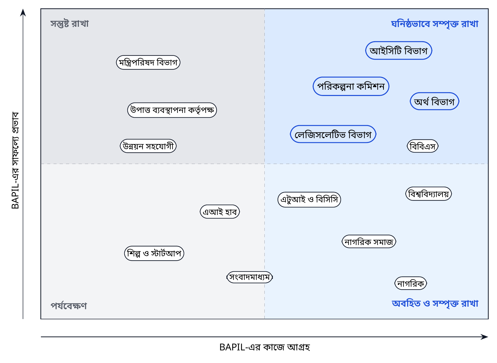

*চিত্র ২। প্রভাব ও আগ্রহভিত্তিক নির্দেশক অংশীজন-মানচিত্র, যা সম্পৃক্ততা পরিকল্পনায় ব্যবহৃত।*

মানচিত্রটি অংশীজনদের BAPIL-এর সাফল্যে তাঁদের প্রভাব এবং এর কাজে তাঁদের আগ্রহ অনুযায়ী বিন্যস্ত করে। ওপরের ডানদিকের অংশে থাকা অংশীজনেরা, যেমন আইসিটি বিভাগ, পরিকল্পনা কমিশন, অর্থ বিভাগ এবং লেজিসলেটিভ ও সংসদ বিষয়ক বিভাগ, স্টিয়ারিং বোর্ড, ডেটা-চুক্তি ও প্রোডাক্ট মালিকানার মাধ্যমে ঘনিষ্ঠভাবে সম্পৃক্ত থাকেন। উচ্চ প্রভাব কিন্তু তুলনামূলক কম প্রত্যক্ষ আগ্রহসম্পন্নরা, যেমন মন্ত্রিপরিষদ বিভাগ ও উপাত্ত ব্যবস্থাপনা কর্তৃপক্ষ, মাইলফলকভিত্তিক অবহিতকরণ ও ডেটা ব্যবহার বিষয়ে পরামর্শের মাধ্যমে সন্তুষ্ট থাকেন। বিশ্ববিদ্যালয়, নাগরিক সমাজ ও নাগরিকদের আগ্রহ উচ্চ, এবং ফেলোশিপ, ERRC সদস্যপদ, উন্মুক্ত পরামর্শ ও জনসমক্ষে স্বচ্ছতা নিবন্ধনের মাধ্যমে তাঁদের অবহিত ও সম্পৃক্ত রাখা হয়।

## ৩.৩ অংশীজন নিবন্ধন

**সারণি ৭।** অংশীজন নিবন্ধন

| অংশীজন | প্রধান আগ্রহ | BAPIL-এর জন্য ভূমিকা | সম্পৃক্ততার পদ্ধতি | পুনরাবৃত্তি |
|--------------------|-----------------------|------------------|------------------------|-----------|
| আইসিটি বিভাগ (ডাক, টেলিযোগাযোগ ও তথ্যপ্রযুক্তি মন্ত্রণালয়) | জাতীয় এআই নীতি, ডিজিটাল রূপান্তর | সমঝোতা স্মারকের অংশীদার, স্টিয়ারিং বোর্ডের সহ-সভাপতি | যৌথ পরিকল্পনা, ত্রৈমাসিক পর্যালোচনা | মাসিক |
| মন্ত্রিপরিষদ বিভাগ | সমগ্র সরকারের সমন্বয় | মন্ত্রণালয়গুলোকে একত্রিত করা | মাইলফলকে অবহিতকরণ | ষাণ্মাসিক |
| পরিকল্পনা কমিশন | পরিকল্পনা, প্রকল্প মূল্যায়ন, পরিবীক্ষণ | P1 ও P2-এর স্বাগতিক সংস্থা; ডেটা-রক্ষক | প্রোডাক্ট ওনারশিপ, সহ-নকশা | মাসিক |
| অর্থ বিভাগ | বাজেট স্বচ্ছতা ও বিশ্লেষণ | ডেটা-রক্ষক; P2-এর ব্যবহারকারী | ডেটা চুক্তি, ব্যবহারকারী পরীক্ষা | ত্রৈমাসিক |
| লেজিসলেটিভ ও সংসদ বিষয়ক বিভাগ | প্রামাণ্য আইনি পাঠ | আইন-কর্পাসের রক্ষক | একসঙ্গে প্রবেশাধিকারের চুক্তি | ত্রৈমাসিক |
| বাংলাদেশ পরিসংখ্যান ব্যুরো | সরকারি পরিসংখ্যান ও মেটাডেটা | ডেটা-রক্ষক; P5-এর অংশীদার | মেটাডেটা সামঞ্জস্য | ত্রৈমাসিক |
| এটুআই ও বাংলাদেশ কম্পিউটার কাউন্সিল | ডিজিটাল সেবা, তথ্য বাতায়ন, ডেটা সেন্টার | প্ল্যাটফর্ম ও হোস্টিং অংশীদার | কারিগরি কার্যদল | মাসিক |
| জাতীয় উপাত্ত ব্যবস্থাপনা কর্তৃপক্ষ | ডেটা নীতি ও সম্মতি | ডেটা ব্যবহারে নিয়ন্ত্রক ও উপদেষ্টা | DPIA ও চুক্তিতে পরামর্শ | প্রয়োজন অনুযায়ী |
| বাংলাদেশ এআই হাব | দক্ষতা, স্টার্টআপ, এআই গ্রহণ | পরিপূরক কর্মসূচি | কর্মবিভাজনের সমঝোতা স্মারক, যৌথ বেঞ্চমার্ক | ত্রৈমাসিক |
| বিশ্ববিদ্যালয় ও গবেষণা প্রতিষ্ঠান | গবেষণা, শিক্ষার্থী, প্রকাশনা | স্বাগতিক প্রতিষ্ঠান, অংশীদার, টীকাকার | ফেলোশিপ, যৌথ গবেষণা | নিরবচ্ছিন্ন |
| শিল্পখাত ও স্টার্টআপ | জনস্বার্থমূলক এআই-এর বাজার | প্রযুক্তি অংশীদার, গ্রহণকারী | উন্মুক্ত আহ্বান, শিল্প দিবস | ষাণ্মাসিক |
| নাগরিক সমাজ ও গণমাধ্যম | অধিকার, স্বচ্ছতা, জবাবদিহি | ERRC সদস্য, সমালোচনামূলক পর্যালোচক | উন্মুক্ত পরামর্শ, নিবন্ধন | ত্রৈমাসিক |
| উন্নয়ন সহযোগী | ডিজিটাল জনসম্পদ, সক্ষমতা | অর্থায়নকারী ও কারিগরি উপদেষ্টা | যৌথ কর্মপরিকল্পনা, পর্যালোচনা | ষাণ্মাসিক |
| নাগরিক | সহজলভ্য তথ্য, আস্থা | চূড়ান্ত উপকারভোগী | বাংলায় জনপ্রতিবেদন, মতামতের চ্যানেল | নিরবচ্ছিন্ন |

*টীকা।* কোনো প্রতিষ্ঠান তালিকাভুক্ত করা তার সম্ভাব্য ভূমিকা বর্ণনা করে; এর মাধ্যমে কোনো চুক্তি বা সমর্থন বোঝায় না।

## ৩.৪ পরামর্শ ও সম্পৃক্ততা পরিকল্পনা

**সারণি ৮।** ধাপভিত্তিক পরামর্শ ও সম্পৃক্ততা পরিকল্পনা

| ধাপ | উদ্দেশ্য | কার্যক্রম | উৎপাদ |
|----------------|----------------------------|--------------------------|----------------|
| প্রাক-সূচনা (২০২৬-এর চতুর্থ ত্রৈমাসিক থেকে ২০২৭-এর প্রথম ত্রৈমাসিক) | সিদ্ধান্তগ্রহণকারী ও বিশেষজ্ঞদের সঙ্গে ব্লুপ্রিন্ট যাচাই | আইসিটি বিভাগ ও ডেটা-রক্ষকদের অবহিতকরণ; বিশেষজ্ঞ গোলটেবিল; রিপোজিটরিতে জনমন্তব্যের সময় | মন্তব্য-লগ; ব্লুপ্রিন্ট ১.১ সংশোধনী |
| সূচনা (মাস ১ থেকে ৬) | ভূমিকা, ডেটা প্রবেশাধিকার ও সুরক্ষায় সম্মতি | সনদ বিষয়ে পরামর্শ; ERRC মনোনয়ন; ডেটা-রক্ষক কর্মশালা | গৃহীত সনদ; ডেটা প্রবেশাধিকার পরিকল্পনা |
| নির্মাণ (মাস ৪ থেকে ১৫) | বাস্তব ব্যবহারকারীদের সঙ্গে নকশা | সহ-নকশা অধিবেশন; বাংলা ও ইংরেজিতে ব্যবহারযোগ্যতা পরীক্ষা; মাসিক প্রদর্শনী | ব্যবহারকারী-পরীক্ষিত পাইলট; কাজের তালিকা প্রকাশিত |
| মূল্যায়ন (মাস ১২ থেকে ২৪) | কী কাজ করে তা শেখা | ব্যবহারকারী জরিপ; প্রমাণ-প্রাপ্তির সময় সমীক্ষা; ফলাফলের উন্মুক্ত পর্যালোচনা | DOI-সহ মূল্যায়ন প্রতিবেদন |
| সিদ্ধান্ত ও সম্প্রসারণ (মাস ২৪ থেকে ৩৬) | গ্রহণ ও পরবর্তী পদক্ষেপের সিদ্ধান্ত | স্বাগতিক সংস্থার সঙ্গে গ্রহণ-কর্মশালা; ব্লুপ্রিন্ট ২.০ বিষয়ে গণশুনানি | গ্রহণ-স্মারক; ব্লুপ্রিন্ট ২.০ |

সম্পৃক্ততা চারটি নীতি অনুসরণ করে:

* **ডিফল্টভাবে দ্বিভাষিক।** পরামর্শ-উপকরণ, সারাংশ ও প্রতিবেদন বাংলা ও ইংরেজিতে প্রকাশিত হয়।
* **ঢাকার বাইরে পৌঁছানো।** প্রতিটি ধাপে অন্তত একটি পরামর্শ ঢাকার বাইরে, অথবা বিভাগীয় বিশ্ববিদ্যালয় ও স্থানীয় প্রশাসনের অংশগ্রহণকারীদের নিয়ে অনলাইনে অনুষ্ঠিত হয়।
* **অন্তর্ভুক্তি।** পরামর্শে নারী-পুরুষের ভারসাম্য বজায় রাখা হয় এবং প্রতিবন্ধী ব্যক্তি, সংখ্যালঘু ও তরুণদের প্রতিনিধিত্বকারী সংগঠনগুলোকে অন্তর্ভুক্ত করা হয়।
* **প্রতিক্রিয়ার চক্র সম্পূর্ণ করা।** প্রতিটি পরামর্শ থেকে একটি প্রকাশিত মন্তব্য-লগ তৈরি হয়, যাতে কী উত্থাপিত হয়েছে এবং BAPIL কীভাবে সাড়া দিয়েছে তা লিপিবদ্ধ থাকে।

## ৩.৫ নাগরিক ও জনগোষ্ঠীর সম্পৃক্ততা

BAPIL-এর প্রথম ব্যবহারকারী কর্মকর্তা ও গবেষক হলেও এর চূড়ান্ত সুবিধাভোগী নাগরিকেরা, এবং এর কিছু কাজ (যেমন জন-পরামর্শ বিষয়ে P3 ও তথ্য-অখণ্ডতা বিষয়ে P6) নাগরিকদের সরাসরি স্পর্শ করে। তাই নাগরিক সম্পৃক্ততার তিনটি উপাদান। প্রথমত, **স্বচ্ছতা**: জনসমক্ষে নিবন্ধন, প্রতিটি পাইলটের সহজ বাংলায় সারাংশ এবং একটি বার্ষিক জনপ্রতিবেদন। দ্বিতীয়ত, **কণ্ঠস্বর**: সনদ ও ব্লুপ্রিন্ট ২.০ বিষয়ে উন্মুক্ত পরামর্শ, ERRC-তে নাগরিক সমাজের সদস্য এবং সমস্যা ও অভিযোগ জানানোর একটি জনমুখী মাধ্যম। তৃতীয়ত, **সুফল**: P2-এর বাজেট-ডেটার মতো উন্মুক্ত ডেটাসেট, এবং দীর্ঘ মেয়াদে সরকারি নথির ওপর জনমুখী অনুসন্ধান, যাতে নাগরিক, সাংবাদিক ও নাগরিক সমাজের সংগঠনগুলো কর্মকর্তাদের মতোই একই প্রামাণ্য পাঠ খুঁজে পেতে ও উদ্ধৃত করতে পারে।

## ৩.৬ জাতীয় কর্মসূচির সঙ্গে সমন্বয়

BAPIL বিদ্যমান কর্মসূচির পরিপূরক, এবং এগুলোর দ্বৈততা ঘটানো চলবে না। আইসিটি বিভাগের অধীনে বাংলাদেশ হাই-টেক পার্ক কর্তৃপক্ষের মাধ্যমে বাস্তবায়িতব্য কোইকা-সমর্থিত এআই দক্ষতা ও এআই হাব প্রকল্প দক্ষতা, স্টার্টআপ ও এআই গ্রহণে গুরুত্ব দেয়: এর কারিগরি সহায়তা প্রকল্প প্রস্তাব (১৯২.৬৬ কোটি টাকা) জুন ২০২৬-এ সরকারি অনুমোদনের অপেক্ষায় ছিল, এবং ২০২৬ থেকে ২০২৯ মেয়াদের জন্য ১৩ মিলিয়ন মার্কিন ডলারের একটি অনুদান-চুক্তি আগস্ট ২০২৬-এ স্বাক্ষরিত বলে প্রতিবেদিত [৫৩, ৫৪, ৫৫]; BAPIL গুরুত্ব দেয় নীতি-বুদ্ধিমত্তা, শাসন-পদ্ধতি ও উন্মুক্ত মূল্যায়নে। খসড়া জাতীয় এআই নীতিতে একটি বাংলাভিত্তিক জাতীয় LLM, জাতীয় ডেটা সেন্টারে কেন্দ্রীভূত কম্পিউটিং এবং একটি এআই উদ্ভাবন তহবিলের কথা রয়েছে [১০]; BAPIL-এর বেঞ্চমার্ক ও নিয়ন্ত্রিত কর্পাস এসব উদ্যোগে কাজে লাগতে পারে, এবং BAPIL-এর উচিত নিজস্ব বৃহৎ ক্লাস্টার নির্মাণের বদলে যৌথ জাতীয় কম্পিউটিং ব্যবহার করা। মাইলফলক MS2-এ BAPIL, এআই হাব ও অন্যান্য প্রাসঙ্গিক কর্মসূচির মধ্যে একটি সংক্ষিপ্ত কর্মবিভাজন-বিষয়ক সমঝোতা স্মারক স্বাক্ষরিত এবং প্রতি বছর পর্যালোচিত হওয়া উচিত।

\newpage

# অধ্যায় ৪: রূপকল্প থেকে প্রয়োজনীয়তা

## ৪.১ পদ্ধতি

প্রয়োজনীয়তাগুলো তিনটি উৎস থেকে নির্ধারণ করা হয়েছে: হোয়াইট পেপারের স্থাপত্য, ড্যাশবোর্ড, ফাউন্ডেশন মডেল ও শাসন-বিষয়ক অধ্যায়; হোয়াইট পেপার যেসব আন্তর্জাতিক কাঠামোকে রেফারেন্স হিসেবে গ্রহণ করেছিল [১, ২, ৩, ১৭, ১৮, ১৯]; এবং অধ্যায় ১৪-এ সংক্ষেপিত বাংলাদেশের আইনগত প্রেক্ষাপট। ব্যবহারকারীর চাহিদা পারসোনা ও ব্যবহারকারী-গল্প হিসেবে ধারণ করা হয়েছে। প্রতিটি প্রয়োজনীয়তা একবার বিবৃত, একটি আইডি ও অগ্রাধিকারসহ চিহ্নিত এবং যে উপাদান, কোড মডিউল ও পরীক্ষা তা পূরণ করে তার সঙ্গে সংযুক্ত (সংযুক্তি ক)।

## ৪.২ ব্যবহারকারী ও পারসোনা

ছয়টি পারসোনা প্রধান ব্যবহারকারী গোষ্ঠীর প্রতিনিধিত্ব করে। এগুলো হোয়াইট পেপারের বিশ্লেষণ ও অংশীজন নিবন্ধন থেকে গঠিত সমন্বিত চরিত্র; প্রথম ছয় মাসে সহ-নকশা সেশনের মাধ্যমে এগুলো যাচাই ও পরিমার্জিত হবে।

**সারণি ৯।** ব্যবহারকারী-চরিত্র (Persona)

| চরিত্র | লক্ষ্য | বর্তমান সমস্যা | সবচেয়ে গুরুত্বপূর্ণ প্রয়োজনীয়তা |
|-----------------|--------------------|------------------------|--------------------|
| **ক. নীতি-বিশ্লেষক**, পরিকল্পনা অনুবিভাগ | নিয়ন্ত্রক পাঠ ও অতীত অঙ্গীকার দ্রুত খুঁজে পাওয়া; সারসংক্ষেপে উদ্ধৃত করা | বহু ওয়েবসাইটে খোঁজা; স্ক্যানকৃত PDF; কোন সংস্করণ চলমান তা অনিশ্চিত | FR-01, FR-02, FR-03 |
| **খ. বাজেট বিশ্লেষক বা সাংবাদিক** | বছর ও মন্ত্রণালয়ভেদে বরাদ্দ তুলনা | PDF-এ আটকে থাকা সারণি; বছরভেদে অসামঞ্জস্যপূর্ণ শিরোনাম | FR-04, NFR-07 |
| **গ. জন-পরামর্শ পরিচালনাকারী**, মন্ত্রণালয় | হাজারো মতামত ন্যায্যভাবে বোঝা | হাতে পড়া; সংখ্যালঘু মত হারিয়ে যাওয়ার ঝুঁকি | FR-05, GR-03 |
| **ঘ. গবেষক**, বিশ্ববিদ্যালয় | বাস্তব নীতি-টেক্সটে বাংলা পদ্ধতির বেঞ্চমার্ক | উন্মুক্ত ক্ষেত্রভিত্তিক বেঞ্চমার্ক বা নিয়ন্ত্রিত কর্পাস নেই | FR-08, NFR-06 |
| **ঙ. জ্যেষ্ঠ কর্মকর্তা** | সুপারিশের পেছনের প্রমাণে আস্থা | এআই-ফলাফলের উৎস বা সীমাবদ্ধতা দেখা যায় না | NFR-08, GR-01 |
| **চ. নাগরিক বা নাগরিক সমাজের পর্যবেক্ষক** | জনস্বার্থমূলক গবেষণায় এআই-এর ব্যবহার জানা | এআই ব্যবস্থার কোনো জনসমক্ষে নিবন্ধন নেই | FR-09, GR-06 |

## ৪.৩ মূল প্রয়োজনীয়তা

প্রয়োজনীয়তাগুলো কার্যগত প্রয়োজনীয়তা (FR), অকার্যগত প্রয়োজনীয়তা (NFR) ও শাসনগত প্রয়োজনীয়তা (GR) হিসেবে বিন্যস্ত।

**সারণি ১০।** মূল প্রয়োজনীয়তা (কার্যগত, অ-কার্যগত ও শাসনগত)

| আইডি | প্রয়োজনীয়তা | অগ্রাধিকার |
|---------|----------------------------------------------|---------|
| FR-01 | নীতি-নথিতে দ্বিভাষিক (বাংলা ও ইংরেজি) অনুসন্ধান, যা বানানভেদ এবং বাংলা বা ইংরেজি অঙ্কের পার্থক্যে স্থিতিশীল | আবশ্যিক |
| FR-02 | উত্তর শুধু উদ্ধারকৃত উৎসের ভিত্তিতে, অনুচ্ছেদ-পর্যায়ের উদ্ধৃতিসহ; প্রমাণ অপর্যাপ্ত হলে ব্যবস্থা উত্তর দেওয়া থেকে বিরত থাকে | আবশ্যিক |
| FR-03 | প্রতিটি নথির উৎস-তথ্য (Provenance) সংরক্ষণ: উৎস URL, প্রকাশক, তারিখ, চেকসাম ও পুনর্ব্যবহারের শর্ত | আবশ্যিক |
| FR-04 | ডাউনলোডযোগ্য ডেটা ও পদ্ধতিগত টীকাসহ সূচক ও বাজেট ড্যাশবোর্ড | প্রয়োজনীয় |
| FR-05 | পরামর্শ-মতামতের সামষ্টিক বিশ্লেষণ (বিষয়, মনোভাব), কোনো ব্যক্তির প্রোফাইলিং ছাড়া | প্রয়োজনীয় |
| FR-06 | সকল এআই ব্যবস্থার নিবন্ধন: মালিক, উদ্দেশ্য, ঝুঁকি-স্তর, মডেল কার্ড ও অবস্থা | আবশ্যিক |
| FR-07 | যেকোনো নির্মাণের আগে এবং প্রতিটি জীবনচক্র-গেটে ঝুঁকি-স্তর মূল্যায়ন | আবশ্যিক |
| FR-08 | সংস্করণকৃত বেঞ্চমার্ক ও পুনরুৎপাদনযোগ্য প্রতিবেদনসহ মূল্যায়ন কাঠামো | আবশ্যিক |
| FR-09 | এআই ব্যবস্থা নিবন্ধন থেকে প্রস্তুত জনসমক্ষে স্বচ্ছতা নিবন্ধন | প্রয়োজনীয় |
| FR-10 | প্রোগ্রাম্যাটিক প্রবেশাধিকারের জন্য নথিভুক্ত ও সংস্করণকৃত API | প্রয়োজনীয় |
| NFR-01 | ভাষাগত সমতা: মূল মাপকাঠিতে বাংলার মান ইংরেজির তুলনায় ৫ পয়েন্টের মধ্যে | আবশ্যিক |
| NFR-02 | ডেটা-অবস্থান: P1 থেকে P3 ডেটা বাংলাদেশে স্বীকৃত স্থাপনায় সংরক্ষিত | আবশ্যিক |
| NFR-03 | NIST CSF 2.0 ও জিরো-ট্রাস্ট প্রবেশাধিকারের সঙ্গে সামঞ্জস্যপূর্ণ নকশাগত নিরাপত্তা | আবশ্যিক |
| NFR-04 | দ্বিতীয় বছরে পুনরুদ্ধার-স্থাপনা চালু হলে পাইলটে ৯৯% (কর্মঘণ্টায়); প্রথম বছরে অফলাইন ব্যাকআপসহ সর্বোচ্চ প্রচেষ্টা; সম্প্রসারিত পর্যায়ে ৯৯.৫% প্রাপ্যতা | প্রয়োজনীয় |
| NFR-05 | WCAG 2.2 AA মানের প্রবেশযোগ্যতা; মোবাইল ও স্বল্প-ব্যান্ডউইথে ব্যবহারযোগ্য | আবশ্যিক |
| NFR-06 | ডিফল্টভাবে উন্মুক্ত মানদণ্ড ও উন্মুক্ত সোর্স; একক বিক্রেতার উপর নির্ভরশীলতা নয় | আবশ্যিক |
| NFR-07 | পুনরুৎপাদনযোগ্যতা: সংস্করণকৃত কোড, ডেটা স্ন্যাপশট ও মূল্যায়ন প্রতিবেদন DOI-সহ সংরক্ষিত | আবশ্যিক |
| NFR-08 | ব্যাখ্যাযোগ্যতা: প্রতিটি ফলাফলে উৎস, আস্থার মাত্রা ও জানা সীমাবদ্ধতা প্রদর্শিত | আবশ্যিক |
| NFR-09 | কর্মক্ষমতা: অনুসন্ধানের p95 সর্বোচ্চ ৩ সেকেন্ড; উত্তরের p95 সর্বোচ্চ ১০ সেকেন্ড | প্রয়োজনীয় |
| NFR-10 | ব্যয়-স্বচ্ছতা: প্রতি ১,০০০ অনুসন্ধানের ব্যয় প্রতি ত্রৈমাসিকে প্রকাশ | ঐচ্ছিক |
| GR-01 | গুরুত্বপূর্ণ ফলাফলের মানব-পর্যালোচনা; এআই কখনো চূড়ান্ত সিদ্ধান্তগ্রহণকারী নয় | আবশ্যিক |
| GR-02 | স্তর-যাচাই (G0) ছাড়া কোনো নির্মাণ নয় এবং গেট-অনুমোদন (G2) ছাড়া কোনো পাইলট নয় | আবশ্যিক |
| GR-03 | ডেটা ন্যূনতমকরণ: প্রথমে জনসমক্ষে প্রকাশিত ডেটা; P2 বা P3 প্রক্রিয়াকরণের আগে DPIA | আবশ্যিক |
| GR-04 | অনুসন্ধান, ব্যবহৃত উৎস ও ফলাফলের হস্তক্ষেপ-শনাক্তযোগ্য নিরীক্ষা লগ | আবশ্যিক |
| GR-05 | নির্ধারিত সময়সীমার মধ্যে ঘটনা প্রতিবেদন ও প্রতিক্রিয়া | আবশ্যিক |
| GR-06 | নিষিদ্ধ ব্যবহার (স্তর T0) BAPIL সনদে বাদ দেওয়া | আবশ্যিক |

*টীকা।* অগ্রাধিকার MoSCoW রীতি অনুসরণ করে (আবশ্যিক, প্রয়োজনীয়, ঐচ্ছিক)। প্রয়োজনীয়তার আইডিগুলো সংযুক্তি ক-তে উপাদান, কোড মডিউল ও পরীক্ষার সঙ্গে সংযুক্ত করা হয়েছে।

## ৪.৪ অগ্রাধিকারমূলক ব্যবহারকারী-গল্প

ব্যবহারকারী-গল্প ব্যবহারকারীর দৃষ্টিকোণ থেকে প্রয়োজনীয়তা প্রকাশ করে এবং পরিমাপযোগ্য গ্রহণযোগ্যতার মানদণ্ড ধারণ করে। এগুলোই পাইলটের কাজের তালিকা এবং গেট G2 ও G3-এর গ্রহণযোগ্যতা পরীক্ষার ভিত্তি।

**সারণি ১১।** অগ্রাধিকারপ্রাপ্ত ব্যবহারকারী-গল্প ও গ্রহণযোগ্যতার মানদণ্ড

| আইডি | ব্যবহারকারী-গল্প | গ্রহণযোগ্যতার মানদণ্ড | প্রয়ো. |
|-------|----------------------------------|----------------------------------|---------|
| US-01 | নীতি-বিশ্লেষক হিসেবে আমি বাংলায় খুঁজি এবং প্রাসঙ্গিক ইংরেজি ও বাংলা অনুচ্ছেদ পাই | উভয় ভাষায় বেঞ্চমার্কের অন্তত ৮৫% প্রশ্নে শীর্ষ ১০ ফলাফলে সঠিক অনুচ্ছেদ থাকে | FR-01 |
| US-02 | বিশ্লেষক হিসেবে আমি এমন সংক্ষিপ্ত উত্তর পাই যার প্রতিটি বাক্য উৎসের সঙ্গে যুক্ত | উত্তরের ১০০% বাক্যে অনুচ্ছেদ-শনাক্তকারী; উদ্ধৃতির নির্ভুলতা কমপক্ষে ০.৯৫ | FR-02 |
| US-03 | বিশ্লেষক হিসেবে ব্যবস্থা না জানলে আমাকে তা জানানো হয় | উত্তরযোগ্য নয় এমন প্রশ্নে অন্তত ৯০% সঠিক বিরতি; কারণ প্রদর্শিত | FR-02 |
| US-04 | পর্যালোচক হিসেবে আমি দেখতে পারি নথি কোথা থেকে এসেছে এবং বদলেছে কি না | প্রতিটি অনুচ্ছেদ উৎস URL, তারিখ, চেকসামে পৌঁছায়; চেকসাম অমিলে সতর্কতা | FR-03 |
| US-05 | বাজেট বিশ্লেষক হিসেবে আমি এক ফাইলে পাঁচ বছরের বরাদ্দ ডাউনলোড করি | পদ্ধতিগত টীকাসহ CSV ও Parquet; ৯৯% নমুনায় মান উৎসের সঙ্গে মেলে | FR-04 |
| US-06 | পরামর্শ পরিচালনাকারী হিসেবে আমি ব্যক্তিকে উন্মোচিত না করেই বিষয় দেখি | প্রতিটি বিষয়ে অন্তত ২০টি মতামতের সামষ্টিক ফলাফল; ফলাফলে নাম বা যোগাযোগ-তথ্য নেই | FR-05 |
| US-07 | ERRC হিসেবে আমি প্রতিটি এআই ব্যবস্থা, তার স্তর ও গেটের অবস্থা দেখি | নিবন্ধনে ১০০% ব্যবস্থা তালিকাভুক্ত; প্রতি রিলিজে স্বয়ংক্রিয় রপ্তানি | FR-06, FR-09 |
| US-08 | নিরীক্ষক হিসেবে আমি যাচাই করতে পারি লগ পরিবর্তিত হয়নি | হ্যাশ-শৃঙ্খল যাচাই উত্তীর্ণ; যেকোনো সম্পাদনা, অপসারণ বা ক্রম-পরিবর্তন শনাক্ত | GR-04 |
| US-09 | ডেভেলপার হিসেবে আমি একটি নথিভুক্ত API ব্যবহার করি | উদাহরণসহ সংস্করণকৃত এন্ডপয়েন্ট; ভাঙনমূলক পরিবর্তন শুধু নতুন সংস্করণে | FR-10 |
| US-10 | ধীর সংযোগে মোবাইল ব্যবহারকারী হিসেবেও আমি খুঁজতে পারি | অনুসন্ধান পৃষ্ঠা ৫০০ কিলোবাইটের নিচে; 3G-তে ব্যবহারযোগ্য; WCAG 2.2 AA যাচাই উত্তীর্ণ | NFR-05 |

## ৪.৫ প্রয়োগকৃত নকশা-নীতি

হোয়াইট পেপারের নীতিমালা (মানবকেন্দ্রিক এআই, স্বচ্ছতা, দায়িত্বশীলতা, অন্তর্ভুক্তি, প্রমাণভিত্তিক সিদ্ধান্ত-সহায়তা ও সহযোগিতা) এই ব্লুপ্রিন্টে পাঁচটি প্রকৌশল-নিয়মে রূপ নেয়:

1. **উদ্ধৃতি নেই, দাবি নেই।** উদ্ধারকৃত কোনো অনুচ্ছেদের সঙ্গে সংযুক্ত করা যায় না এমন উৎপাদিত বিবৃতি দেখানো হয় না (FR-02)।
2. **বাংলা প্রথম সারির ভাষা।** প্রতিটি বৈশিষ্ট্য বাংলা ও ইংরেজিতে নির্দিষ্ট, পরীক্ষিত ও মূল্যায়িত হয়, পরিমাপযোগ্য সমতা-লক্ষ্যসহ (NFR-01)।
3. **ডিফল্টভাবে উন্মুক্ত।** কোড, বেঞ্চমার্ক, মূল্যায়ন প্রতিবেদন ও অসংবেদনশীল ডেটা স্থায়ী শনাক্তকারীসহ প্রকাশিত হয়; বন্ধ উপাদানের জন্য লিখিত যৌক্তিকতা প্রয়োজন (NFR-06, NFR-07)।
4. **কার্যকর ন্যূনতম ডেটা।** প্রতিটি পাইলট তার উদ্দেশ্য পূরণে সবচেয়ে কম সংবেদনশীল ডেটা-শ্রেণি ব্যবহার করে (GR-03)।
5. **সম্প্রসারণের আগে গেট।** নথিভুক্ত গেট পার না হয়ে কিছুই পরীক্ষা থেকে পরামর্শমূলক ব্যবহারে, বা পরামর্শমূলক থেকে পরিচালনাগত ব্যবহারে যায় না (GR-02)।

## ৪.৬ প্রয়োজনীয়তা ব্যবস্থাপনা

প্রয়োজনীয়তাগুলো কোডের পাশাপাশি রিপোজিটরিতে সংস্করণকৃত টেক্সট হিসেবে রাখা হয়। কোনো প্রয়োজনীয়তার পরিবর্তন একটি ইস্যুর মাধ্যমে প্রস্তাবিত হয়, কারিগরি স্থাপত্য বোর্ড (এবং শাসনগত প্রয়োজনীয়তা প্রভাবিত হলে ERRC) তা পর্যালোচনা করে এবং পরিবর্তন-লগে তা লিপিবদ্ধ হয়। প্রতিটি রিলিজে সংযুক্তি ক-এর অনুসরণযোগ্যতা ম্যাট্রিক্স পুনঃপ্রস্তুত করা হয়, যাতে প্রতিটি প্রয়োজনীয়তা তা পূরণকারী উপাদান, মডিউল ও পরীক্ষা পর্যন্ত অনুসরণ করা যায়।

\newpage

# অংশ ২: প্রতিষ্ঠান ও জনবল

*BAPIL কীভাবে গঠিত ও পরিচালিত হবে, কারা কাজ করবেন এবং কীভাবে জাতীয় সক্ষমতা গড়ে উঠবে।*

# অধ্যায় ৫: প্রাতিষ্ঠানিক নকশা ও শাসনব্যবস্থা

## ৫.১ পরিচালন-মডেলের বিকল্পসমূহ

পাঁচটি মানদণ্ডে চারটি পরিচালন-মডেল মূল্যায়ন করা হয়েছে: স্বাধীনতা, ডেটা প্রবেশাধিকার, নীতিতে প্রয়োগ, শুরুর গতি এবং টেকসইতা।

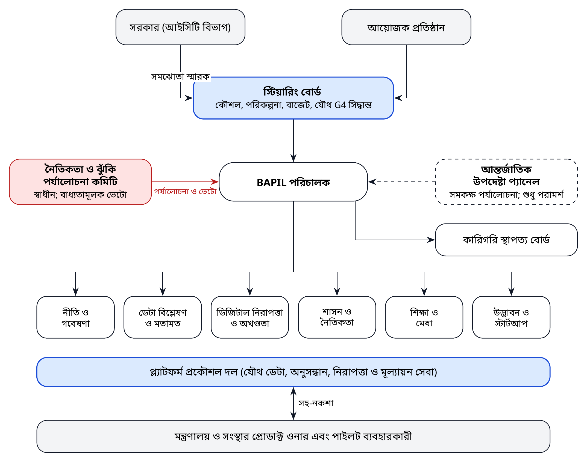

*চিত্র ৩। প্রস্তাবিত প্রাতিষ্ঠানিক ও শাসন-মডেল (বিকল্প গ: সরকারি সমঝোতা স্মারকসহ বিশ্ববিদ্যালয়-ভিত্তিক ল্যাব)।*

**সারণি ১২।** প্রাতিষ্ঠানিক পরিচালন-মডেলের বিকল্পসমূহের মূল্যায়ন

| বিকল্প | স্বাধীনতা | ডেটা প্রবেশাধিকার | নীতিতে প্রয়োগ | শুরুর গতি | টেকসইতা | সিদ্ধান্ত |
|--------------------------|-------------|-----------|-----------|-----------|--------------|----------------|
| **ক.** সরকারি সংস্থার অভ্যন্তরীণ ইউনিট | নিম্ন | উচ্চ | উচ্চ | মাঝারি | মাঝারি | প্রথম ধাপের জন্য সুপারিশকৃত নয় |
| **খ.** বিশ্ববিদ্যালয়ভিত্তিক গবেষণা কেন্দ্র | উচ্চ | নিম্ন | নিম্ন | উচ্চ | মাঝারি | আংশিক উপযুক্ত |
| **গ.** মিশ্র মডেল: সরকারি সমঝোতা স্মারক (MoU) ও বহু-অংশীজন বোর্ডসহ বিশ্ববিদ্যালয়-ভিত্তিক ল্যাব | উচ্চ | মাঝারি থেকে উচ্চ | মাঝারি থেকে উচ্চ | উচ্চ | মাঝারি থেকে উচ্চ | **সুপারিশকৃত** |
| **ঘ.** স্বাধীন অলাভজনক ফাউন্ডেশন | উচ্চ | নিম্ন থেকে মাঝারি | মাঝারি | নিম্ন | মাঝারি | পরবর্তী ধাপের বিকল্প |

*টীকা।* পাঁচটি মানদণ্ডে লেখকের গুণগত মূল্যায়ন; প্রথম ধাপের সম্ভাব্যতা সমীক্ষায় (ডেলিভারেবল D1.3) যাচাই করা হবে।

**প্রথম ধাপের জন্য বিকল্প গ সুপারিশকৃত।** একটি সরকারি বা বেসরকারি বিশ্ববিদ্যালয়ভিত্তিক ল্যাব একাডেমিক স্বাধীনতা, গবেষক নিয়োগ ও স্নাতকোত্তর শিক্ষার্থীদের সম্পৃক্ত করার সক্ষমতা এবং উন্মুক্ত গবেষণার একটি বিশ্বাসযোগ্য আবাস দেয়। আইসিটি বিভাগের (ডাক, টেলিযোগাযোগ ও তথ্যপ্রযুক্তি মন্ত্রণালয়) সঙ্গে একটি সমঝোতা স্মারক নীতিগত প্রশ্ন, ডেটা প্রবেশাধিকার চুক্তি এবং সফল সরঞ্জাম হস্তান্তরের একটি পথ তৈরি করে। একটি বহু-অংশীজন স্টিয়ারিং বোর্ড উভয় পক্ষকে জবাবদিহির আওতায় রাখে। বিকল্প ঘ, অর্থাৎ একটি স্বাধীন অলাভজনক ফাউন্ডেশন, হোয়াইট পেপারের পরিশিষ্ট গ-এর “পরিণত গবেষণা ইকোসিস্টেম” পর্যায়ের সঙ্গে সামঞ্জস্যপূর্ণ এবং ৩৬ মাসের পরিকল্পনার শেষে ও পুনরায় দীর্ঘমেয়াদি দিগন্তে (অধ্যায় ১৬) পুনর্বিবেচিত হবে।

## ৫.২ স্বাগতিক প্রতিষ্ঠান নির্বাচন

স্বাগতিক প্রতিষ্ঠান প্রকাশিত মানদণ্ড ও ভারের ভিত্তিতে একটি উন্মুক্ত আগ্রহপত্র-প্রক্রিয়ার মাধ্যমে নির্বাচিত হওয়া উচিত। একটি স্বাধীন প্যানেল প্রস্তাবগুলো স্কোর করবে; স্টিয়ারিং বোর্ড গঠিত হলে ফলাফল নিশ্চিত করবে। এর আগ পর্যন্ত আইসিটি বিভাগ এবং একাডেমিয়া ও নাগরিক সমাজের সদস্যদের নিয়ে একটি অন্তর্বর্তী প্যানেল নির্বাচন পরিচালনা করতে পারে।

**সারণি ১৩।** স্বাগতিক প্রতিষ্ঠান নির্বাচনের মানদণ্ড ও ভার

| মানদণ্ড | ভার | চাওয়া প্রমাণ |
|--------------------------------|--------|----------------------------------|
| এআই, NLP ও বাংলা ভাষা প্রযুক্তিতে গবেষণা-সক্ষমতা | ২০% | প্রকাশনা, ডেটাসেট, চলমান প্রকল্প, শিক্ষকদের প্রোফাইল |
| গবেষণা-নৈতিকতা ও উপাত্ত সুরক্ষার সক্ষমতা | ১৫% | কার্যকর নৈতিকতা কমিটি, উপাত্ত সুরক্ষা কর্মকর্তা, অতীত DPIA |
| BAPIL সনদ ও উন্মুক্ত প্রকাশনার প্রতি অঙ্গীকার | ১৫% | স্বাক্ষরিত অঙ্গীকারপত্র; উন্মুক্ত প্রবেশাধিকার ও উন্মুক্ত সোর্স নীতি |
| আর্থিক ব্যবস্থাপনা ও নিরীক্ষার রেকর্ড | ১৫% | নিরীক্ষিত হিসাব; সরকারি ও উন্নয়ন সহযোগীদের অনুদানে অভিজ্ঞতা |
| অবকাঠামো ও নিরাপদ স্থাপনা | ১০% | সার্ভার কক্ষ, নেটওয়ার্ক, ভৌত নিরাপত্তা, জাতীয় কম্পিউটিংয়ে প্রবেশাধিকার |
| আন্তঃবিষয়ক ব্যাপ্তি (আইন, অর্থনীতি, জননীতি) | ১০% | প্রাসঙ্গিক বিভাগ ও যৌথ কর্মসূচি |
| অন্তর্ভুক্তি ও প্রবেশাধিকার | ১০% | লিঙ্গসমতা পরিকল্পনা; ঢাকার বাইরের বিশ্ববিদ্যালয়ে সম্প্রসারণ |
| অবস্থান ও একত্রিত করার সক্ষমতা | ৫% | সরকার, শিল্পখাত ও নাগরিক সমাজের সভা আয়োজনের সক্ষমতা |

*টীকা।* একটি স্বাধীন প্যানেল স্কোর দেয়; স্টিয়ারিং বোর্ড ফলাফল নিশ্চিত করে। আহ্বান প্রকাশের আগে ভার সমন্বয় করা যেতে পারে।

আহ্বানটি সরকারি ও বেসরকারি বিশ্ববিদ্যালয় এবং বিশ্ববিদ্যালয়ের নেতৃত্বাধীন কনসোর্টিয়ামের জন্য উন্মুক্ত থাকা উচিত। একটি কনসোর্টিয়াম, উদাহরণস্বরূপ, একটি শক্তিশালী কম্পিউটার বিজ্ঞান বিভাগকে একটি আইন অনুষদ ও একটি নীতি-গবেষণা প্রতিষ্ঠানের সঙ্গে যুক্ত করতে পারে, এবং জাতীয় বিস্তারের জন্য ঢাকার বাইরের একটি বিশ্ববিদ্যালয়কে অন্তর্ভুক্ত করতে পারে।

## ৫.৩ শাসন-সংস্থাসমূহ

**সারণি ১৪।** শাসন-কাঠামোর সংস্থাসমূহ, গঠন ও সিদ্ধান্তের অধিকার

| সংস্থা | গঠন | প্রধান দায়িত্ব | সিদ্ধান্তের অধিকার |
|-----------------|--------------------------|----------------------------|----------------|
| **স্টিয়ারিং বোর্ড** | ৭ থেকে ৯ জন সদস্য: আইসিটি বিভাগ (সহ-সভাপতি), স্বাগতিক প্রতিষ্ঠান (সহ-সভাপতি), পরিকল্পনা কমিশন, একটি ডেটা-রক্ষক সংস্থা, একাডেমিয়া, নাগরিক সমাজ, শিল্পখাত; BAPIL পরিচালক সদস্য-সচিব | কৌশল, বার্ষিক পরিকল্পনা ও বাজেট; অংশীদারিত্ব অনুমোদন; স্বাগতিক সংস্থার সঙ্গে যৌথভাবে G4 গ্রহণ-সিদ্ধান্ত | পরিকল্পনা ও বাজেট অনুমোদন |
| **নৈতিকতা ও ঝুঁকি পর্যালোচনা কমিটি (ERRC)** | ৫ থেকে ৭ জন, সংখ্যাগরিষ্ঠ বহিঃস্থ: আইন ও মানবাধিকার, ডেটা সুরক্ষা, নৈতিকতা, বিষয়-বিশেষজ্ঞ, নাগরিক সমাজ, কারিগরি পর্যালোচক | G1, G2 ও G4-এ T2 ও T3 স্তরের ব্যবস্থা পর্যালোচনা; ঘটনা পর্যালোচনা; সিদ্ধান্তের সারাংশ প্রকাশ | পাইলট ও প্রয়োগে বাধ্যতামূলক ভেটো |
| **কারিগরি স্থাপত্য বোর্ড (TAB)** | প্রধান প্রকৌশলী, নিরাপত্তা প্রধান, দুইজন বহিঃস্থ কারিগরি পর্যালোচক | স্থাপত্য ও নিরাপত্তা মানদণ্ড; নকশা পর্যালোচনা; মডেল ও নির্ভরতা অনুমোদন | G1-এ নকশা অনুমোদন |
| **আন্তর্জাতিক উপদেষ্টা প্যানেল** | ব্যক্তিগত সক্ষমতায় আমন্ত্রিত বিশেষজ্ঞ | পদ্ধতি, বেঞ্চমার্ক ও শাসনব্যবস্থার সমকক্ষ পর্যালোচনা; আন্তর্জাতিক সংযোগ | শুধু পরামর্শমূলক |
| **পরিচালক ও ইউনিটসমূহ** | পরিচালক, হোয়াইট পেপারের ছয়টি বিষয়ভিত্তিক ইউনিট এবং একটি আন্তঃবিভাগীয় প্ল্যাটফর্ম প্রকৌশল দল | গবেষণা, পাইলট, প্রশিক্ষণ ও প্রকাশনা বাস্তবায়ন | অনুমোদিত পরিকল্পনার মধ্যে পরিচালনাগত সিদ্ধান্ত |
| **স্বাগতিক সংস্থার প্রোডাক্ট ওনার** | পাইলট পরিচালনাকারী প্রতিটি সংস্থার মনোনীত কর্মকর্তা | চাহিদা নির্ধারণ, পাইলট ব্যবহারকারী সংগ্রহ, G3 ও G4-এ গ্রহণ বা প্রত্যাখ্যান | নিজ সংস্থায় পাইলট গ্রহণ |

দুটি বৈশিষ্ট্য বিশেষভাবে উল্লেখযোগ্য। প্রথমত, **নৈতিকতা ও ঝুঁকি পর্যালোচনা কমিটির (ERRC)** T2 ও তদূর্ধ্ব স্তরের পাইলট ও প্রয়োগে বাধ্যতামূলক ভেটো-ক্ষমতা রয়েছে, এর সংখ্যাগরিষ্ঠ সদস্য বহিঃস্থ এবং একটি স্বাধীন মনোনয়ন প্যানেলের উন্মুক্ত আহ্বানে নির্বাচিত, এবং সিদ্ধান্তের সারাংশ প্রকাশে এটি বাধ্য (কার্যপরিধি সংযুক্তি চ-তে)। দ্বিতীয়ত, **স্বাগতিক সংস্থার প্রোডাক্ট ওনাররা** প্রতিটি পাইলট-সংস্থার মনোনীত কর্মকর্তা। তাঁরা চাহিদা নির্ধারণ করেন, ব্যবহারকারী সংগ্রহ করেন এবং ফলাফল গ্রহণ বা প্রত্যাখ্যান করেন, যাতে পাইলটগুলো কারিগরি কৌতূহলের বদলে বাস্তব প্রশ্নের উত্তর দেয়।

এসব সংস্থার সবই প্রস্তাবিত। কোনোটিরই সংবিধিবদ্ধ ক্ষমতা নেই: এগুলো সমঝোতা স্মারক, স্বাগতিক-চুক্তি ও সনদের মাধ্যমে গঠিত হবে, এবং এদের সিদ্ধান্ত সনদের মাধ্যমে BAPIL-কে বাধ্য করে, আর স্বাগতিককে কেবল ততটুকু বাধ্য করে যতটুকু স্বাগতিকের সংবিধি অনুমোদন করে ও স্বাগতিক-চুক্তিতে বলা থাকে; আইনের মাধ্যমে কাউকে বাধ্য করে না। স্বাগতিকের পরিচালনা পর্ষদ বহিঃস্থ কোনো কমিটির বাধ্যতামূলক ভেটো মেনে নিতে পারে কি না, তা স্বাগতিক-চুক্তি স্বাক্ষরের আগে আইনি পর্যালোচনায় (অনুচ্ছেদ ১৪.৩) নিশ্চিত করতে হবে; না পারলে স্বাগতিক-চুক্তিতে বলা থাকবে যে ERRC যে T2 বা T3 স্তরের ব্যবস্থা প্রত্যাখ্যান করেছে, স্বাগতিক তা নিয়ে অগ্রসর হবে না। এগুলো কোনো সংবিধিবদ্ধ সংস্থার বিকল্প নয়। বিশেষত, খসড়া জাতীয় এআই নীতি সংসদের আইনের মাধ্যমে যে স্বাধীন তত্ত্বাবধান কমিটি গঠনের প্রস্তাব করে, ERRC সেই কমিটি নয় [১০], এবং BAPIL-এর ডেটা-নিয়ম উপাত্ত সুরক্ষা ও উপাত্ত ব্যবস্থাপনা আইনের দায়িত্ব এবং সেসব আইনের অধীনে গঠিত কর্তৃপক্ষের তত্ত্বাবধানের পাশাপাশি প্রযোজ্য, কখনো তার বিকল্প নয়। সংযুক্তি ধ-তে প্রতিটি সংস্থার অবস্থা, নিয়োগ-প্রক্রিয়া, সিদ্ধান্তের অধিকার ও তার সীমা, প্রতিবেদনের ধারা এবং স্বার্থের দ্বন্দ্ব-সংক্রান্ত সুরক্ষা বর্ণিত।

## ৫.৪ সিদ্ধান্তের অধিকার ও জবাবদিহি

সুস্পষ্ট সিদ্ধান্তের অধিকার স্থবিরতা ও অনিয়ন্ত্রিত পদক্ষেপ উভয়ই প্রতিরোধ করে। নিচের দায়িত্ব-ম্যাট্রিক্স দেখায় প্রধান সিদ্ধান্তগুলোর ক্ষেত্রে কে দায়িত্বপ্রাপ্ত, কে জবাবদিহিকারী, কার সঙ্গে পরামর্শ করা হয় এবং কাকে অবহিত করা হয়। প্রতিটি সিদ্ধান্তের জবাবদিহি ঠিক একটি সংস্থার ওপর বর্তায়, ব্যতিক্রম কেবল G4, যেখানে স্টিয়ারিং বোর্ড ও স্বাগতিক সংস্থা যৌথভাবে জবাবদিহি করে, কারণ পরিচালনাগত সিদ্ধান্তের মালিক সংস্থাটি।

**সারণি ১৫।** দায়িত্ব-ম্যাট্রিক্স (R দায়িত্বপ্রাপ্ত, A জবাবদিহিকারী, C পরামর্শপ্রাপ্ত, I অবহিত)

| সিদ্ধান্ত বা কার্যক্রম | স্টিয়ারিং বোর্ড | ERRC | TAB | পরিচালক | ইউনিট | স্বাগতিক সংস্থা |
|------------------------------|--------|--------|--------|--------|--------|---------|
| বার্ষিক পরিকল্পনা ও বাজেট | A | C | C | R | C | I |
| সনদ সংশোধন | A | C | I | R | I | I |
| G0-তে স্তর যাচাই | I | I | C | A | R | C |
| G1-এ নকশা অনুমোদন | I | C | A | R | R | C |
| G2-তে পাইলট অনুমোদন (স্তর T2) | C | A | C | R | R | C |
| G4-এ গ্রহণের সিদ্ধান্ত | A | C | C | R | C | A |
| গুরুতর ঘটনার পর স্থগিতকরণ | I | A | C | R | R | C |
| মডেল ও নির্ভরতা নির্বাচন | I | I | A | C | R | I |
| ডেটা-বিনিময় চুক্তি | I | C | C | A | R | C |
| স্বচ্ছতা নিবন্ধন প্রকাশ | I | C | I | A | R | I |
| জ্যেষ্ঠ কর্মী নিয়োগ | A | I | I | R | I | I |
| ফলাফলের জনসমক্ষে প্রচার | I | C | I | A | R | C |

*টীকা।* G4-এ স্টিয়ারিং বোর্ড ও স্বাগতিক সংস্থা যৌথভাবে জবাবদিহিকারী: পরিচালনাগত সিদ্ধান্তের মালিক সংস্থা।

## ৫.৫ BAPIL সনদ

মাইলফলক MS1-এ স্টিয়ারিং বোর্ড একটি সনদ গ্রহণ করবে। একটি পূর্ণ খসড়া সংযুক্তি ঙ-তে দেওয়া হয়েছে। সনদে কমপক্ষে থাকতে হবে:

* অনুচ্ছেদ ১.৫-এর লক্ষ্য ও সীমারেখার বিবৃতি;
* T0 স্তরের নিষিদ্ধ ব্যবহারের তালিকা এবং এগুলো কখনো নির্মাণ বা সমর্থন না করার অঙ্গীকার;
* ERRC প্রতিষ্ঠা, এর স্বাধীনতা, ভেটো ও প্রকাশের দায়িত্ব;
* কোড, বেঞ্চমার্ক ও মূল্যায়ন প্রতিবেদনের উন্মুক্ত প্রকাশের অঙ্গীকার, শুধু লিখিতভাবে নথিভুক্ত নিরাপত্তা ও গোপনীয়তা-সংক্রান্ত ব্যতিক্রম সাপেক্ষে;
* কাজ শুরুর আগে প্রতিটি এআই ব্যবস্থাকে এআই ব্যবস্থা নিবন্ধনে নিবন্ধনের বাধ্যবাধকতা;
* বোর্ড সদস্য, কর্মী ও অংশীদার (বিক্রেতাসহ)-এর জন্য স্বার্থের সংঘাত-সংক্রান্ত নিয়ম;
* সফল সরঞ্জাম কীভাবে সংস্থার কাছে হস্তান্তরিত হবে এবং BAPIL কীভাবে সরে আসবে তার বিধান;
* এই ঘোষণা যে সনদ আইনের সীমার মধ্যে কার্যকর: কোনো আইন, নিয়ন্ত্রক বা স্বাগতিক প্রতিষ্ঠানের বিধি ভিন্ন কিছু চাইলে আইনগত প্রয়োজনীয়তাই প্রাধান্য পাবে।

## ৫.৬ ইউনিট ও কর্মপদ্ধতি

হোয়াইট পেপারের ছয়টি বিষয়ভিত্তিক ইউনিট (এআই নীতি ও গবেষণা; ডেটা বিশ্লেষণ ও জনমত; ডিজিটাল নিরাপত্তা ও ভুল তথ্য; এআই শাসন ও নৈতিকতা; এআই শিক্ষা ও মেধা; উদ্ভাবন ও স্টার্টআপ সহযোগিতা) গবেষণার সাংগঠনিক কাঠামো হিসেবে বহাল থাকবে। একটি আন্তঃবিভাগীয় **প্ল্যাটফর্ম প্রকৌশল দল** যৌথ সেবা (ডেটা, অনুসন্ধান, নিরাপত্তা, মূল্যায়ন) নির্মাণ ও পরিচালনা করবে, যাতে ইউনিটগুলো অবকাঠামোর দ্বৈততা না ঘটায়।

কাজ সংগঠিত হবে **পাইলটভিত্তিক প্রোডাক্ট দলে**: প্রতিটি পাইলটে থাকবেন স্বাগতিক সংস্থার একজন প্রোডাক্ট ওনার, BAPIL-এর একজন প্রধান, প্রকৌশলী, একজন শাসন-বিশ্লেষক এবং বাংলা বৈশিষ্ট্যের জন্য একজন ভাষা-সম্পাদক। দলগুলো স্বল্পমেয়াদি পুনরাবৃত্তিতে কাজ করবে, তাদের কাজের তালিকা ও মূল্যায়নের ফলাফল প্রকাশ করবে এবং অংশীদার সংস্থার জন্য উন্মুক্ত একটি মাসিক প্রদর্শনীতে উপস্থাপন করবে।

## ৫.৭ স্বাধীনতা, সততা ও স্বার্থের সংঘাত

একটি নীতি-বুদ্ধিমত্তা ল্যাব তখনই মূল্যবান যখন এর প্রমাণে আস্থা রাখা যায়। নিচের সুরক্ষাব্যবস্থাগুলো স্বাধীনতা রক্ষা করে:

* **সম্পাদকীয় স্বাধীনতা।** BAPIL-এর গবেষকেরা পদ্ধতি নির্ধারণ করেন এবং মূল্যায়নের ফলাফল প্রকাশ করেন, এমনকি যে ফলাফল কোনো অংশীদারের কাছে অপ্রীতিকর তাও। অংশীদারেরা প্রকাশের আগে মন্তব্য করতে পারেন, কিন্তু ভেটো দিতে পারেন না।
* **অর্থায়নের নিয়ম।** সরকার-বহির্ভূত কোনো একক অর্থদাতা বার্ষিক বাজেটের ৩০%-এর বেশি দেন না, এবং অর্থায়ন চুক্তি কোনো অর্থদাতাকে গবেষণার ফলাফল বা শাসনগত সিদ্ধান্তের ওপর নিয়ন্ত্রণ দিতে পারে না (অধ্যায় ১৭)।
* **ঘোষণা।** বোর্ড সদস্য, ERRC সদস্য, কর্মী ও চুক্তিভিত্তিক কর্মীরা প্রতি বছর এবং প্রতিটি প্রাসঙ্গিক সিদ্ধান্তের আগে স্বার্থ ঘোষণা করেন; ঘোষণাগুলোর সারাংশ একটি জনসমক্ষে নিবন্ধনে রাখা হয়।
* **বিক্রেতা-নিরপেক্ষতা।** BAPIL কোনো পণ্যকে সমর্থন করে না। বাণিজ্যিক সরঞ্জামের মূল্যায়ন একটি প্রকাশিত প্রটোকল অনুসরণ করে এবং পূর্ণাঙ্গভাবে প্রতিবেদিত হয়।
* **কর্মীদের সুরক্ষা।** কর্মীরা নিরাপত্তা, সততা বা অপব্যবহার-সংক্রান্ত উদ্বেগ প্রতিশোধের ভয় ছাড়াই সরাসরি ERRC সভাপতির কাছে উত্থাপন করতে পারেন।

## ৫.৮ সংস্থায় হস্তান্তর ও প্রস্থান

সফল সরঞ্জাম চিরকাল BAPIL-এর ওপর নির্ভরশীল থাকা উচিত নয়। কোনো সরঞ্জাম গেট G4 উত্তীর্ণ হলে স্বাগতিক সংস্থার সঙ্গে একটি হস্তান্তর পরিকল্পনা সম্মত হয়, যাতে থাকে: কোড, ডেটা ও অবকাঠামোর মালিকানা; কর্মী প্রশিক্ষণ ও দায়িত্ব হস্তান্তর; একটি রূপান্তরকালীন সময়ে (সাধারণত ছয় থেকে বারো মাস) সেবার মান ও সহায়তা; যে বাজেট-খাত থেকে সংস্থা সেবাটি পরিচালনা করবে; এবং বেঞ্চমার্ক ও স্বাধীন মূল্যায়নে BAPIL-এর চলমান ভূমিকা। কোড উন্মুক্ত থাকে, যাতে অন্য সংস্থাও তা পুনর্ব্যবহার করতে পারে। BAPIL নিজে বন্ধ হতে বাধ্য হলে সনদ অনুযায়ী উন্মুক্ত আর্কাইভ, বেঞ্চমার্ক ও কোড সংরক্ষিত হবে, চুক্তির অধীনে রক্ষিত ডেটা ফেরত দেওয়া বা মুছে ফেলা হবে, এবং অবশিষ্ট কোনো সেবার ব্যবহারকারীদের নোটিশ ও বিকল্প দেওয়া হবে।

## ৫.৯ প্রাতিষ্ঠানিক বিবর্তন

BAPIL পরিণত হওয়ার সঙ্গে সঙ্গে এর প্রাতিষ্ঠানিক রূপ বদলাবে বলে প্রত্যাশিত। মূল্য প্রমাণের জন্য বিকল্প গ যথাযথ; সরঞ্জাম গৃহীত হলে এবং অর্থায়ন স্থিতিশীল হলে স্টিয়ারিং বোর্ড বিবেচনা করবে BAPIL-এর একটি স্বাধীন জনস্বার্থ ফাউন্ডেশন (বিকল্প ঘ) বা সরকারের সঙ্গে যুক্ত একটি সংবিধিবদ্ধ কেন্দ্রে পরিণত হওয়া উচিত, নাকি এর কাজগুলো সংস্থাগুলোতে আত্তীকৃত হওয়া উচিত। সেই সিদ্ধান্তের মানদণ্ড (স্বাধীনতা, টেকসইতা, নীতিতে প্রয়োগ ও জন-আস্থা) এবং পর্যালোচনা-বিন্দুগুলো অধ্যায় ১৬-এ নির্ধারিত।

\newpage

# অধ্যায় ৬: জনবল, দক্ষতা ও সক্ষমতা

## ৬.১ সক্ষমতার চ্যালেঞ্জ

মেধা BAPIL-এর সবচেয়ে গুরুত্বপূর্ণ সম্পদ এবং একই সঙ্গে এর প্রধান ঝুঁকিগুলোর একটি (অধ্যায় ১৯-এ R7)। অভিজ্ঞ এআই প্রকৌশলী, বাংলা NLP বিশেষজ্ঞ ও এআই শাসন-চর্চাকারী দুর্লভ, এবং শিল্পখাত ও আন্তর্জাতিক সংস্থায় তাঁদের চাহিদা রয়েছে। একই সময়ে BAPIL-এর দীর্ঘমেয়াদি মূল্য এর নিজস্ব কর্মীদের চেয়ে বেশি নির্ভর করে সরকার, বিশ্ববিদ্যালয় ও নাগরিক সমাজে এটি যে দক্ষতা গড়ে তোলে তার ওপর। তাই এই অধ্যায়ে মূল দল ও জাতীয় সক্ষমতা কর্মসূচি উভয়ই আলোচিত।

## ৬.২ মূল দল

**সারণি ১৬।** নির্দেশক মূল জনবল পরিকল্পনা (পূর্ণকালীন সমতুল্য)

| ভূমিকা | মাস ১-১২ | মাস ১৩-২৪ | মাস ২৫-৩৬ |
|------------------------------------|------------|------------|------------|
| পরিচালক ও প্রধান গবেষক | ১ | ১ | ১ |
| নীতি-গবেষণা প্রধান ও বিশ্লেষক | ১ | ২ | ৩ |
| মেশিন লার্নিং ও বাংলা NLP প্রকৌশলী | ২ | ৩ | ৪ |
| ডেটা প্রকৌশলী | ১ | ২ | ২ |
| সফটওয়্যার ও প্ল্যাটফর্ম (DevSecOps) প্রকৌশলী | ১ | ২ | ২ |
| নিরাপত্তা প্রকৌশলী | ০.৫ | ১ | ১ |
| শাসন, আইন ও নৈতিকতা বিশ্লেষক | ১ | ১ | ২ |
| ব্যবহারকারী অভিজ্ঞতা ও প্রবেশযোগ্যতা নকশাকার | ০.৫ | ১ | ১ |
| কর্মসূচি ও অংশীদারিত্ব সমন্বয়ক | ১ | ১ | ১ |
| প্রশিক্ষণ ও প্রচার কর্মকর্তা | ০ | ১ | ২ |
| **মোট মূল জনবল** | **৯** | **১৫** | **১৯** |

*টীকা।* খণ্ডকালীন ERRC সদস্য, উপদেষ্টা, অতিথি ফেলো ও স্নাতকোত্তর শিক্ষার্থী অন্তর্ভুক্ত নয়। নির্দেশক ব্যয় সারণি ৪৯-এ; চূড়ান্ত ব্যয় সম্ভাব্যতা সমীক্ষায় (D1.3) নির্ধারিত হবে।

তিন বছরে দলটি প্রায় নয় থেকে উনিশ পূর্ণকালীন সমতুল্যে বৃদ্ধি পায়। বাংলা ভাষা-দক্ষতা মেশিন লার্নিং দলের মধ্যে অন্তর্ভুক্ত এবং খণ্ডকালীন ভাষা-সম্পাদকদের দ্বারা পরিপূরিত। অংশীদার বিশ্ববিদ্যালয়ের স্নাতকোত্তর ফেলোরা বেঞ্চমার্ক নির্মাণ, মূল্যায়ন ও গবেষণাপত্রে কাজ করেন, যা জাতীয় মেধাও গড়ে তোলে। প্রবাসী গবেষকেরা অতিথি ফেলোশিপের মাধ্যমে দূর থেকে অবদান রাখতে পারেন।

## ৬.৩ নিয়োগ ও ধরে রাখা

নিয়োগ প্রকাশিত কর্মবিবরণী, বৈচিত্র্যপূর্ণ সাক্ষাৎকার-প্যানেল ও নারী-পুরুষের ভারসাম্যের অঙ্গীকারসহ উন্মুক্ত, মেধাভিত্তিক প্রক্রিয়া অনুসরণ করে। দুর্লভ দক্ষতার প্রতিযোগিতায় টিকে থাকতে BAPIL-এর দেওয়া উচিত:

* স্বাগতিকের নিয়মের মধ্যে বিশ্ববিদ্যালয়ের গবেষণা-পদের সঙ্গে তুলনীয় এবং দুর্লভ দক্ষতার জন্য সমন্বিত বেতন;
* উন্মুক্ত প্রকাশনা ও কৃতিত্বসহ জনস্বার্থমূলক সমস্যায় অর্থবহ কাজ;
* সম্মেলনে অংশগ্রহণসহ গবেষণা ও পেশাগত উন্নয়নের সময়;
* নমনীয় ও দূরবর্তী কাজের ব্যবস্থা, যা প্রবাসী ও ঢাকার বাইরের অংশগ্রহণও সম্ভব করে; এবং
* বিশ্ববিদ্যালয়ের সঙ্গে যৌথ নিয়োগ ও সংস্থা থেকে প্রেষণ।

রিপোজিটরিতে ব্যবস্থা ও সিদ্ধান্ত নথিভুক্ত করে, গুরুত্বপূর্ণ পদে সহকারী মনোনয়ন দিয়ে এবং স্বাগতিক প্রতিষ্ঠানের সঙ্গে কোড ও ডেটার মালিকানা ভাগ করে মূল ব্যক্তির ওপর নির্ভরতা (R16) কমানো হয়।

## ৬.৪ দক্ষতা-কাঠামো

দক্ষতা-কাঠামো নির্ধারণ করে বিভিন্ন গোষ্ঠীর তিনটি স্তরে কী জানা প্রয়োজন: সচেতন, চর্চাকারী ও বিশেষজ্ঞ। এটি প্রশিক্ষণ নকশা, কর্মবিবরণী রচনা ও অগ্রগতি মূল্যায়নে ব্যবহৃত হয়।

**সারণি ১৭।** ভূমিকা-পরিবার ও স্তরভিত্তিক দক্ষতা কাঠামো

| ভূমিকা-পরিবার | সচেতন | চর্চাকারী | বিশেষজ্ঞ |
|--------------------|------------------------|------------------------|------------------------|
| জনপ্রশাসনের নেতৃত্ব | এআই কী পারে ও পারে না; ঝুঁকি-স্তর; কখন প্রমাণ চাইতে হবে | পাইলটে পৃষ্ঠপোষকতা; মূল্যায়ন প্রতিবেদন পড়া; ক্রয়-শর্ত প্রয়োগ | কৌশল নির্ধারণ; পর্যালোচনায় সভাপতিত্ব; উদ্ভাবন ও সুরক্ষার ভারসাম্য |
| নীতি-বিশ্লেষক | উদ্ধৃতিভিত্তিক অনুসন্ধান; উৎস যাচাই; বিরতি চেনা | প্রমাণ-প্রশ্ন নকশা; পক্ষপাত ও ঘাটতি শনাক্ত; সীমাবদ্ধতা অবহিত করা | সরঞ্জামের সহ-নকশা; বেঞ্চমার্ক নির্ধারণ; সহকর্মীদের প্রশিক্ষণ |
| শাসন, আইন ও নৈতিকতা কর্মী | ডেটা-শ্রেণি; নিষিদ্ধ ব্যবহার; DPIA-র মৌলিক ধারণা | স্তর মূল্যায়ন, DPIA ও গেট পর্যালোচনা পরিচালনা | ERRC-এর কাজে নেতৃত্ব; ব্যবস্থা নিরীক্ষা; জাতীয় নির্দেশিকা গঠন |
| ডেটা-তত্ত্বাবধায়ক | মেটাডেটা ও লাইসেন্স; ডেটা-শ্রেণি | মানের মাপকাঠি; ডেটা বিনিময়ের মাধ্যমে চুক্তি | ক্যাটালগ ও ডেটা-বিনিময় কাঠামো নকশা |
| ML ও NLP প্রকৌশলী | বাংলা টেক্সটের মৌলিক বিষয়; মূল্যায়নের মাপকাঠি | উদ্ধার ও মূল্যায়ন পাইপলাইন নির্মাণ; মডেল কার্ড লেখা | মডেল অভিযোজন; রেড-টিমিং; বেঞ্চমার্ক নকশায় নেতৃত্ব |
| প্ল্যাটফর্ম ও নিরাপত্তা প্রকৌশলী | অঞ্চল; গোপন তথ্য ব্যবস্থাপনা; লগ | কোড-হিসেবে অবকাঠামো; SBOM; ঘটনা-প্রতিক্রিয়া | জিরো-ট্রাস্ট নকশা; এআই ব্যবস্থার হুমকি-মডেলিং |

## ৬.৫ প্রশিক্ষণ পাঠ্যক্রম

**সারণি ১৮।** প্রশিক্ষণ পাঠ্যক্রম

| কর্মসূচি | লক্ষ্য-গোষ্ঠী | মূল মডিউল | মেয়াদ | ধরন | প্রথম বছরের লক্ষ্য |
|---------------------|-----------------|------------------------------|-----------|-----------|---------|
| **T1** জনপ্রশাসনের নেতৃত্বের জন্য এআই সাক্ষরতা | সচিব, সংস্থাপ্রধান | এআই-এর সক্ষমতা ও সীমা; ঝুঁকি-স্তর; ক্রয়; মূল্যায়ন পড়া | ১ দিন | সরাসরি | ৪০ |
| **T2** নীতি-বিশ্লেষকদের জন্য দায়িত্বশীল এআই | পাইলট ব্যবহারকারী ও বিশ্লেষক | উদ্ধৃতিভিত্তিক অনুসন্ধান; যাচাই; বিরতি; পক্ষপাত; উপাত্ত সুরক্ষার মৌলিক বিষয়; প্রম্পট-ইনজেকশন সচেতনতা | ৩ দিন | মিশ্র | ১০০ |
| **T3** এআই শাসন চর্চাকারী | শাসন ও আইন কর্মী, ERRC | স্তর মূল্যায়ন; DPIA; প্রভাব মূল্যায়ন; গেট পর্যালোচনা; নিরীক্ষা; স্বচ্ছতা | ৫ দিন | সরাসরি | ৩০ |
| **T4** ডেটা তত্ত্বাবধান | ডেটা-রক্ষক, প্রধান ডেটা কর্মকর্তা | মেটাডেটা; লাইসেন্স; মান; শ্রেণিবিন্যাস; ডেটা বিনিময় চুক্তি | ৩ দিন | মিশ্র | ৪০ |
| **T5** বাংলা NLP ও MLOps | সংস্থা ও বিশ্ববিদ্যালয়ের প্রকৌশলী | বাংলা টেক্সট প্রক্রিয়াকরণ; উদ্ধার; মূল্যায়ন; মডেল কার্ড; নিরাপদ প্রয়োগ | ১০ দিন | মিশ্র | ৩০ |
| **T6** BAPIL ফেলোশিপ | স্নাতকোত্তর ফেলো | মেন্টরিংসহ কোনো পাইলট বা বেঞ্চমার্কে গবেষণা-নিয়োজন | ৬ থেকে ১২ মাস | নিয়োজন | ১০ |

*টীকা।* সকল কোর্স-উপকরণ বাংলা ও ইংরেজিতে CC BY 4.0 লাইসেন্সে প্রকাশিত হয়। প্রথম বছরে ১০০ প্রশিক্ষিত কর্মকর্তার KPI-তে T2-এর অংশগ্রহণকারীরা গণ্য; T1 অবহিতকরণ ও বিশেষায়িত দল T3 থেকে T5 আলাদাভাবে গণ্য এবং বাজেটের বিশেষায়িত কোর্স-খাত থেকে অর্থায়িত (সারণি ৪৯)।

পাঠ্যক্রম তিনটি নকশা-নিয়ম অনুসরণ করে। প্রথমত, **প্রশিক্ষণে বাস্তব সরঞ্জাম ও বাস্তব নথি ব্যবহৃত হয়**, যাতে কর্মকর্তারা তাঁদের সামনে আসা নীতি-প্রশ্নেই অনুশীলন করেন। দ্বিতীয়ত, **প্রতিটি কর্মসূচি সীমাবদ্ধতা শেখায়**: অংশগ্রহণকারীরা শেখেন এআই ব্যবস্থা কীভাবে ও কেন ব্যর্থ হয়, বিরতি ও অনিশ্চয়তা কীভাবে চিনতে হয় এবং কখন কোনো ফলাফলের ওপর নির্ভর করা উচিত নয়। তৃতীয়ত, **উপকরণ উন্মুক্ত**: স্লাইড, অনুশীলনী ও রেকর্ডকৃত সেশন CC BY 4.0-এর অধীনে বাংলা ও ইংরেজিতে প্রকাশিত হয়, যাতে অন্য প্রতিষ্ঠানও তা পুনর্ব্যবহার করতে পারে।

## ৬.৬ ফেলোশিপ ও গবেষণা-সক্ষমতা

BAPIL ফেলোশিপ কর্মসূচি স্নাতকোত্তর শিক্ষার্থী ও কর্মজীবনের শুরুর দিকের গবেষকদের BAPIL কর্মী ও তাঁদের নিজ প্রতিষ্ঠানের যৌথ তত্ত্বাবধানে ছয় থেকে বারো মাসের জন্য পাইলট ও বেঞ্চমার্কের কাজে নিয়োজিত করে। ফেলোরা ডেটাসেট, মূল্যায়ন ও প্রকাশনায় অবদান রাখেন এবং অবদান অনুযায়ী লেখক হিসেবে কৃতিত্ব পান। অন্তত অর্ধেক ফেলোশিপ ঢাকার বাইরের বিশ্ববিদ্যালয়ের শিক্ষার্থীদের জন্য হওয়া উচিত, এবং কর্মসূচিতে নারী-পুরুষের ভারসাম্যের লক্ষ্য থাকা উচিত। দীর্ঘ মেয়াদে ফেলোরা এমন একটি নেটওয়ার্ক গড়ে তোলেন যাঁরা পদ্ধতিগুলোকে সরকার, একাডেমিয়া ও শিল্পখাতে নিয়ে যেতে পারেন।

## ৬.৭ কর্মীবাহিনীতে নারী-পুরুষের ভারসাম্য ও অন্তর্ভুক্তি

অন্যান্য দেশের মতো বাংলাদেশেও এআই দলগুলো প্রায়ই নারী-পুরুষের অনুপাতে ভারসাম্যহীন এবং ঢাকাকেন্দ্রিক। BAPIL সুস্পষ্ট লক্ষ্য নির্ধারণ করে: ৩৬ মাসের পরিকল্পনার শেষে কর্মী, ফেলো ও প্রশিক্ষণার্থীদের মধ্যে অন্তত ৪০% নারী; অন্তত অর্ধেক ফেলোশিপ ঢাকার বাইরের বিশ্ববিদ্যালয়ের শিক্ষার্থীদের জন্য; প্রবেশযোগ্য কর্মস্থল ও উপকরণ; এবং পরিচর্যাকারীদের জন্য সহায়ক নমনীয় কাজের ব্যবস্থা। অগ্রগতি বার্ষিক প্রতিবেদনে জানানো হয়। বৈচিত্র্য কেবল ন্যায্যতার বিষয় নয়: বিভিন্ন পটভূমির দল নির্দিষ্ট ব্যবহারকারী বা অঞ্চলের ক্ষেত্রে কোনো সরঞ্জাম কোথায় ব্যর্থ হয় তা লক্ষ করার সম্ভাবনা বেশি।

\newpage

# অংশ ৩: প্রযুক্তি

*প্ল্যাটফর্মের স্থাপত্য, ডেটা, এআই ও ভাষা-নকশা, অবকাঠামো ও নিরাপত্তা, এবং এগুলো পরীক্ষাকারী রেফারেন্স বাস্তবায়ন।*

# অধ্যায় ৭: রেফারেন্স কারিগরি স্থাপত্য

## ৭.১ ছয় স্তর থেকে বারোটি উপাদান

হোয়াইট পেপারের ছয়টি স্তর (ডেটা-উৎস, ডেটা ব্যবস্থাপনা, নীতি-বুদ্ধিমত্তা, জ্ঞান ব্যবস্থাপনা, সিদ্ধান্ত-সহায়তা, শাসন ও নিরাপত্তা) এখানে চারটি অনুভূমিক স্তর ও একটি সর্বস্তরীয় শাসন ও নিরাপত্তা-স্তম্ভে বিন্যস্ত বারোটি উপাদানে পরিমার্জিত হয়েছে।

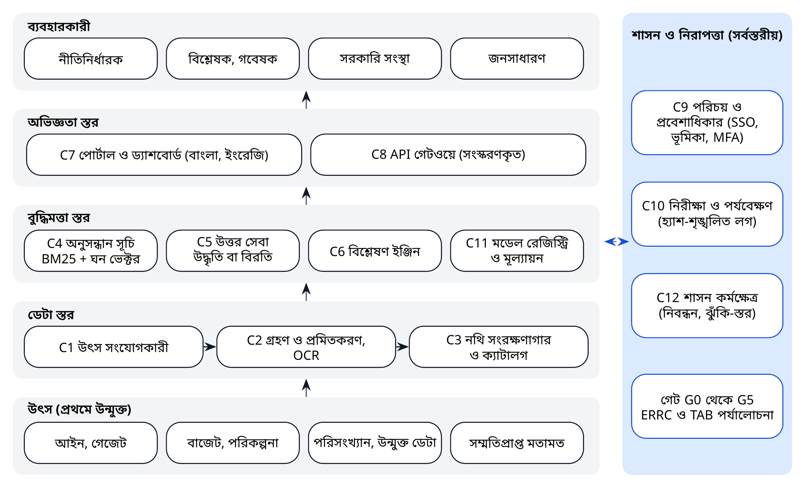

*চিত্র ৪। BAPIL রেফারেন্স স্থাপত্য: চার স্তরে বারোটি উপাদান, সঙ্গে সর্বস্তরীয় শাসন ও নিরাপত্তা।*

**সারণি ১৯।** রেফারেন্স স্থাপত্যের উপাদান ও সম্ভাব্য প্রযুক্তি

| আইডি | উপাদান | কাজ | সম্ভাব্য উন্মুক্ত প্রযুক্তি | রেফারেন্স বাস্তবায়ন |
|------|-------------------|------------------------------|--------------------------|----------------|
| C1 | উৎস সংযোগকারী | সাইটের শর্ত মেনে নির্ধারিত সময়ে জনসমক্ষে প্রকাশিত নথি সংগ্রহ; উৎস-তথ্য সংরক্ষণ | Python worker, Scrapy, cron বা Airflow | পরিকল্পিত |
| C2 | গ্রহণ ও প্রমিতকরণ | PDF ও HTML থেকে টেক্সট নিষ্কাশন, বাংলা OCR, ইউনিকোড প্রমিতকরণ, খণ্ডকরণ | Apache Tika [৫৬], Tesseract (ben, eng) [৫৭], নিজস্ব প্রমিতকারী | bapil.text, bapil.corpus |
| C3 | নথি সংরক্ষণাগার ও ক্যাটালগ | মূল নথি, নিষ্কাশিত টেক্সট ও DCAT-সামঞ্জস্যপূর্ণ মেটাডেটা, সংস্করণসহ | PostgreSQL [৫৮], MinIO (S3-সামঞ্জস্যপূর্ণ), CKAN [৫৯] | চেকসামসহ JSONL কর্পাস |
| C4 | অনুসন্ধান সূচি | শব্দভিত্তিক BM25 ও ঘন ভেক্টরের মিশ্র র‍্যাংকিং | OpenSearch [৬০], বা pgvector-সহ [৬১] PostgreSQL | bapil.search (BM25, দ্বিভাষিক) |
| C5 | উত্তর সেবা | উদ্ধার, উদ্ধৃতি, বিরত থাকা; উদ্ধৃতি যাচাইসহ ঐচ্ছিক LLM উৎপাদন | vLLM বা llama.cpp-এ চালিত উন্মুক্ত-ওজন LLM | bapil.answer (উদ্ধৃতিসহ নিষ্কাশনমূলক) |
| C6 | বিশ্লেষণ ইঞ্জিন | বাজেট নিষ্কাশন, সূচক, বিষয়-মডেল | Python, pandas, DuckDB | পরিকল্পিত |
| C7 | পোর্টাল ও ড্যাশবোর্ড | দ্বিভাষিক ও প্রবেশযোগ্য ব্যবহারকারী ইন্টারফেস | ওয়েব ফ্রেমওয়ার্ক; Apache Superset | পরিকল্পিত |
| C8 | API গেটওয়ে | সংস্করণকৃত REST API, কোটা, হার-সীমা | FastAPI, Kong | bapil.api (স্ট্যান্ডার্ড লাইব্রেরি) |
| C9 | পরিচয় ও প্রবেশাধিকার | একক সাইন-অন, ভূমিকাভিত্তিক প্রবেশাধিকার, বহু-উপাদান প্রমাণীকরণ | Keycloak | পরিকল্পিত |
| C10 | নিরীক্ষা ও পর্যবেক্ষণযোগ্যতা | হস্তক্ষেপ-শনাক্তযোগ্য লগ, মেট্রিক, ট্রেসিং | OpenTelemetry, Prometheus, Grafana | bapil.audit (হ্যাশ-শৃঙ্খলিত JSONL) |
| C11 | মডেল রেজিস্ট্রি ও মূল্যায়ন | মডেল কার্ড, সংস্করণকৃত মূল্যায়ন, বেঞ্চমার্ক | MLflow | bapil.evaluate |
| C12 | শাসন কর্মক্ষেত্র | এআই ব্যবস্থা নিবন্ধন, ঝুঁকি মূল্যায়ন, ঘটনা, স্বচ্ছতা নিবন্ধন | হালকা ওয়েব অ্যাপ্লিকেশন | bapil.risk, bapil.registry |

*টীকা।* প্রযুক্তিগুলো সম্ভাব্য বিকল্প, বাধ্যতামূলক নয়; চূড়ান্ত পছন্দ কারিগরি স্থাপত্য বোর্ড NFR-02, NFR-03 ও NFR-06 অনুযায়ী নির্ধারণ করবে।

## ৭.২ একটি অনুরোধ কীভাবে প্রবাহিত হয়

মূল সেবা হলো একটি নীতি-প্রশ্নের উদ্ধৃতিযুক্ত উত্তর। নিচের অনুক্রম দেখায় একটি অনুরোধ কীভাবে উপাদানগুলোর মধ্য দিয়ে যায় এবং কোথায় নিয়ন্ত্রণ প্রয়োগ হয়।

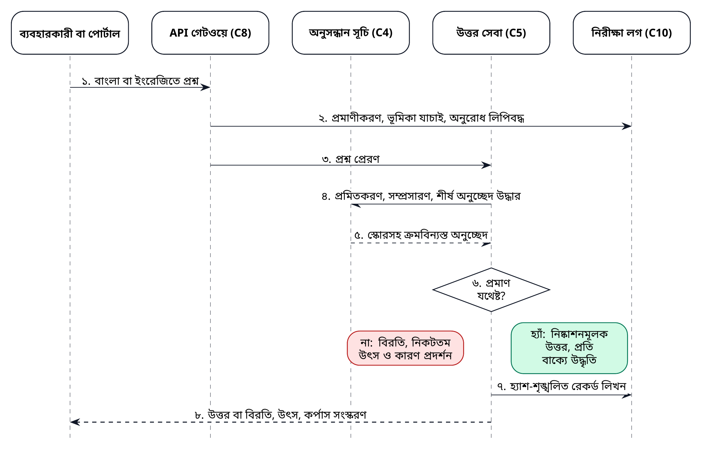

*চিত্র ৫। উদ্ধৃতিযুক্ত উত্তরের অনুরোধ-ক্রম: ব্যবহারকারীর প্রশ্ন থেকে নিরীক্ষা-রেকর্ড পর্যন্ত।*

আস্থার জন্য এই প্রবাহের তিনটি বৈশিষ্ট্য গুরুত্বপূর্ণ। প্রথমত, উত্তর সেবা কখনো প্রমাণ ছাড়া উত্তর দেয় না: শীর্ষ অনুচ্ছেদগুলো প্রশ্নটি যথেষ্ট ভালোভাবে ধারণ না করলে এটি বিরত থাকে এবং কারণসহ নিকটতম উৎস দেখায়। দ্বিতীয়ত, উত্তরের প্রতিটি বাক্যে যে অনুচ্ছেদ থেকে তা নেওয়া হয়েছে তার শনাক্তকারী থাকে, যাতে ব্যবহারকারী উৎসটি খুলে যাচাই করতে পারেন। তৃতীয়ত, প্রতিটি অনুরোধ, উদ্ধারকৃত অনুচ্ছেদ ও প্রতিক্রিয়া একটি হ্যাশ-শৃঙ্খলিত নিরীক্ষা লগে লেখা হয়, যাতে পরে যাচাই করা যায় ব্যবস্থাটি কী করেছিল।

## ৭.৩ ইন্টারফেস ও API বিনির্দেশ

প্রথম জনমুখী ইন্টারফেস একটি সংস্করণকৃত REST API (`/v1`)। ন্যূনতম এন্ডপয়েন্টগুলো রেফারেন্স বাস্তবায়নে (অধ্যায় ১১) ইতিমধ্যে বাস্তবায়িত। প্রতিটি প্রতিক্রিয়ায় কর্পাস সংস্করণ ও ব্যবহৃত অনুচ্ছেদের শনাক্তকারী থাকে, যাতে পরে ফলাফল পুনরুৎপাদন করা যায়।

**সারণি ২০।** API বিনির্দেশ (সংস্করণ ১)

| এন্ডপয়েন্ট | পদ্ধতি | প্যারামিটার | প্রতিক্রিয়া | ত্রুটি |
|-------------------|-------|--------------------|--------------------------|--------------|
| /v1/health | GET | নেই | status, version, corpus_version, documents, passages | নেই |
| /v1/search | GET | q (১ থেকে ৫০০ অক্ষর); k (১ থেকে ৫০, ডিফল্ট ১০) | query, corpus_version, results: pid, doc_id, heading, lang, score, matched_terms, text, provenance | ৪০০ অনুপস্থিত বা অবৈধ প্যারামিটার |
| /v1/answer | GET | q (১ থেকে ৫০০ অক্ষর) | abstained; confidence; evidence (top_score, coverage); উদ্ধৃতিসহ উত্তর-বাক্য; sources; corpus_version | ৪০০ অনুপস্থিত প্যারামিটার |
| /v1/risk/assess | POST | JSON প্রশ্নমালা (সংযুক্তি খ-এর স্কিমা) | system_id, tier, tier_name, total, reasons, controls, approver | ৪০০ অবৈধ প্রশ্নমালা; ৪০০ বডি ৬৪ কিলোবাইটের বেশি |
| সকল এন্ডপয়েন্ট |  |  | UTF-8 JSON; প্রতিটি অনুরোধ নিরীক্ষা-শৃঙ্খলে লগকৃত | ৪০৪ অজানা পথ |

API-এর নিয়ম: সংস্করণ পথের অংশ; ভাঙনসৃষ্টিকারী পরিবর্তন কেবল নতুন সংস্করণে আনা হয় এবং পুরোনো সংস্করণ অন্তত ছয় মাস রাখা হয়; সব টেক্সট UTF-8; ত্রুটির ক্ষেত্রে একটি বার্তাসহ JSON অবজেক্ট ফেরত দেওয়া হয়; এবং অনুরোধের বডির আকার সীমিত। উৎপাদন-পর্যায়ে API গেটওয়ের (C8) পেছনে থাকে, যা প্রমাণীকরণ, কোটা ও হার-সীমা যোগ করে।

## ৭.৪ স্থাপত্য-সিদ্ধান্ত রেকর্ড

কারিগরি স্থাপত্য বোর্ড প্রতিটি গুরুত্বপূর্ণ সিদ্ধান্ত রিপোজিটরিতে একটি স্থাপত্য-সিদ্ধান্ত রেকর্ড (ADR) হিসেবে নথিভুক্ত করে, যাতে প্রেক্ষাপট, সিদ্ধান্ত, বিবেচিত বিকল্প ও পরিণাম থাকে। প্রাথমিক সিদ্ধান্তগুলো:

**সারণি ২১।** প্রাথমিক স্থাপত্য-সিদ্ধান্ত রেকর্ড

| ADR | সিদ্ধান্ত | যৌক্তিকতা | বিবেচিত বিকল্প |
|---------|----------------------|-----------------------------|------------------------|
| ০০১ | উন্মুক্ত ইন্টারফেসসহ মডুলার সেবা | অন্যগুলো পুনর্লিখন ছাড়াই উপাদান প্রতিস্থাপনযোগ্য; নির্ভরশীলতা এড়ানো | একক অ্যাপ্লিকেশন; একক বিক্রেতার প্যাকেজ |
| ০০২ | উৎপাদনের আগে উদ্ধার | উত্তর সরকারি পাঠের সঙ্গে অনুসরণযোগ্য থাকে; উদ্ভাবিত বিষয়বস্তু কমে | শুধু উৎপাদনমূলক সহকারী; উদ্ধারবিহীন ফাইন-টিউনকৃত মডেল |
| ০০৩ | বাংলাদেশে হোস্টকৃত উন্মুক্ত-ওজন মডেল | ডেটা-অবস্থান; সংস্করণের ওপর নিয়ন্ত্রণ; বিদেশে ডেটা পাঠানো হয় না | সব ডেটা-শ্রেণির জন্য বাণিজ্যিক API মডেল |
| ০০৪ | শব্দভিত্তিক ও ঘন ভেক্টরের মিশ্র উদ্ধার | শব্দভিত্তিক অনুসন্ধান স্বচ্ছ ও সঠিক শব্দে শক্তিশালী; ঘন অনুসন্ধান সমার্থক প্রকাশ ধরে | শুধু ঘন; শুধু শব্দভিত্তিক |
| ০০৫ | শুধু-সংযোজনযোগ্য, হ্যাশ-শৃঙ্খলিত নিরীক্ষা লগ | ব্যবস্থা কী করেছে তার স্বাধীন যাচাই | সাধারণ অ্যাপ্লিকেশন লগ |
| ০০৬ | কন্টেইনার ও কোড-হিসেবে অবকাঠামো | পুনরুৎপাদনযোগ্য ও নিরীক্ষাযোগ্য পরিবেশ | হাতে কনফিগার করা সার্ভার |
| ০০৭ | প্রথমে প্রবেশযোগ্যতা ও স্বল্প ব্যান্ডউইথ | ঢাকার বাইরে ও মোবাইলে ব্যবহারকারীর কাছে পৌঁছানো | ডেস্কটপ-প্রধান ইন্টারফেস |
| ০০৮ | প্রথমে উন্মুক্ত ডেটা (P0) | শাসন পরিণত হওয়ার সময় গোপনীয়তা-ঝুঁকি ছাড়াই মূল্য সৃষ্টি | প্রশাসনিক রেকর্ড দিয়ে শুরু |

শব্দভিত্তিক BM25 উদ্ধার [৬২] বহুভাষিক ঘন এমবেডিংয়ের [৬৩] সঙ্গে সমন্বিত (ADR-004); স্বচ্ছ বিকল্প হিসেবে শব্দভিত্তিক উদ্ধার উপলব্ধ থাকে। পোর্টাল WCAG 2.2 লেভেল AA [৬৪] পূরণ করে (ADR-007)। প্রমাণ বদলালে ADR পুনর্বিবেচিত হয়, যেমন কোনো মডেল নির্বাচন পর্যালোচনা (সারণি ২৯) দেখালে যে ভিন্ন পদ্ধতি ভালো কাজ করে।

## ৭.৫ প্রবেশযোগ্যতা ও অন্তর্ভুক্তিমূলক নকশা

অনেক সম্ভাব্য ব্যবহারকারী ঢাকার বাইরে কাজ করেন, মোবাইল ব্যবহার করেন এবং ধীর বা অনির্ভরযোগ্য সংযোগের মুখোমুখি হন; কারও দৃষ্টি বা অন্য প্রতিবন্ধিতা রয়েছে। তাই পোর্টাল প্রথম রিলিজ থেকেই WCAG 2.2 লেভেল AA [৬৪] অনুযায়ী নকশাকৃত, নিচের সুনির্দিষ্ট অঙ্গীকারসহ:

* **ইন্টারফেসে বাংলা অগ্রাধিকার।** মেনু, সহায়তা-টেক্সট ও ত্রুটি-বার্তা বাংলা ও ইংরেজিতে লেখা, এবং ব্যবহারকারীর ভাষা-পছন্দ মনে রাখা হয়।
* **হালকা পৃষ্ঠা।** অনুসন্ধান পৃষ্ঠা ৫০০ কিলোবাইটের নিচে থাকে এবং 3G সংযোগে কাজ করে (US-10); ড্যাশবোর্ডের মতো ভারী বৈশিষ্ট্য শুধু অনুরোধে লোড হয়।
* **স্ক্রিন-রিডার সহায়তা।** যথাযথ শিরোনাম, লেবেল ও বিকল্প টেক্সট, এবং সঠিক ভাষা-ট্যাগ, যাতে স্ক্রিন-রিডার বাংলা ও ইংরেজি টেক্সট সঠিকভাবে উচ্চারণ করে।
* **বাংলা ইনপুট।** অনুসন্ধানে যেকোনো প্রচলিত কিবোর্ড বিন্যাসে টাইপ করা ইউনিকোড বাংলা গ্রহণ করা হয়, সঙ্গে রোমান হরফে লেখা বাংলাও, যা পরবর্তী সংস্করণে প্রতিবর্ণীকরণের বিকল্পের মাধ্যমে মেলানো হবে।
* **সহজ ভাষা।** উত্তর ও সীমাবদ্ধতা সহজ শব্দে ব্যাখ্যা করা হয়, এবং কারিগরি পরিভাষা শব্দকোষের সঙ্গে সংযুক্ত।

প্রতিটি রিলিজে স্বয়ংক্রিয় সরঞ্জাম দিয়ে এবং প্রতিটি পাইলটে অন্তত একবার প্রতিবন্ধী ব্যবহারকারীসহ ব্যবহারকারীদের নিয়ে প্রবেশযোগ্যতা পরীক্ষা করা হয়।

## ৭.৬ প্রযুক্তি-নির্বাচন

সারণি ১৯-এর সম্ভাব্য প্রযুক্তিগুলো উন্মুক্ত-সোর্স ও ব্যাপকভাবে ব্যবহৃত, যা ব্যয় কম রাখে, স্থানীয় দক্ষতাকে সহায়তা করে এবং একক বিক্রেতার ওপর নির্ভরতা এড়ায়। এগুলো সম্ভাব্য বিকল্প, প্রতিশ্রুতি নয়: সম্ভাব্যতা সমীক্ষা (ডেলিভারেবল D1.3) স্বাগতিকের অবকাঠামো, দক্ষতা ও সহায়তা-ব্যবস্থার আলোকে পছন্দগুলো নিশ্চিত করে। কোনো বাণিজ্যিক পণ্য বিবেচিত হলে তা অধ্যায় ১৭-এর ক্রয়-শর্তের আলোকে মূল্যায়িত হয়, যার মধ্যে BAPIL-এর বেঞ্চমার্কে মূল্যায়নের অধিকার ও সব ডেটাসহ প্রস্থানের অধিকার অন্তর্ভুক্ত।

\newpage

# অধ্যায় ৮: ডেটা স্থাপত্য ও ডেটা শাসন

## ৮.১ প্রথমে উন্মুক্ত ডেটা

মূল্য সৃষ্টির সবচেয়ে নিরাপদ ও দ্রুত পথ হলো রাষ্ট্র ইতিমধ্যে যে তথ্য প্রকাশের সিদ্ধান্ত নিয়েছে তা দিয়ে শুরু করা: আইন, গেজেট প্রজ্ঞাপন, বাজেট নথি, উন্নয়ন পরিকল্পনা, পরিসংখ্যান প্রকাশনা ও সংসদীয় কাগজপত্র। এই উপকরণ বিপুল, নীতি-কাজের জন্য গুরুত্বপূর্ণ, বিভিন্ন সাইট ও ফরম্যাটে ছড়িয়ে থাকায় কম ব্যবহৃত, এবং এর গোপনীয়তা-ঝুঁকি কম। তবে এটি ব্যক্তিগত ডেটামুক্ত নয়: গেজেট ও প্রজ্ঞাপনে ব্যক্তির নাম থাকে, যেমন নিয়োগ, বদলি, ভূমি অধিগ্রহণ ও শৃঙ্খলামূলক প্রজ্ঞাপনে। এ ধরনের অনুচ্ছেদ কেবল প্রকাশিত রূপেই সূচিবদ্ধ হয়, কখনো ব্যক্তির প্রোফাইল তৈরিতে একত্র করা হয় না এবং বিশ্লেষণ ও মডেল-প্রশিক্ষণ থেকে বাদ রাখা হয়। তথ্য অধিকার আইন, ২০০৯ ইতিমধ্যে স্বতঃপ্রণোদিত তথ্য প্রকাশের নীতি প্রতিষ্ঠা করেছে [৬৫]।

## ৮.২ ডেটার জীবনচক্র

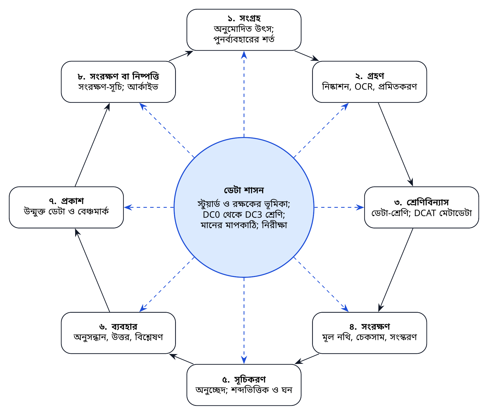

*চিত্র ৬। ডেটা শাসনের অধীনে ডেটার জীবনচক্র: সংগ্রহ থেকে সংরক্ষণ বা নিষ্পত্তি পর্যন্ত।*

জীবনচক্রের প্রতিটি ধাপের একজন দায়িত্বপ্রাপ্ত ও একটি নিয়ন্ত্রণ রয়েছে। নথি **সংগ্রহ** করা হয় কেবল অনুমোদিত উৎস থেকে, যাদের পুনর্ব্যবহারের শর্ত লিপিবদ্ধ। টেক্সট নিষ্কাশন, প্রয়োজনে OCR এবং প্রমিতকরণসহ এগুলো **গৃহীত** হয়। এগুলো একটি ডেটা-শ্রেণিতে **শ্রেণিবদ্ধ** এবং DCAT-সামঞ্জস্যপূর্ণ মেটাডেটা দিয়ে বর্ণিত হয়। মূল নথি চেকসাম ও সংস্করণ-ইতিহাসসহ **সংরক্ষিত** হয়। অনুসন্ধানের জন্য টেক্সট অনুচ্ছেদ হিসেবে **সূচিবদ্ধ** হয়। প্রবেশ-নিয়ন্ত্রণের অধীনে ডেটা অনুসন্ধান, উত্তর ও বিশ্লেষণে **ব্যবহৃত** হয়। অসংবেদনশীল ফলাফল উন্মুক্ত ডেটা ও বেঞ্চমার্ক হিসেবে **প্রকাশিত** হয়। সবশেষে রেকর্ডগুলো সংরক্ষণ-সূচি (সারণি ২৬) অনুযায়ী **সংরক্ষিত বা নিষ্পত্তি** করা হয়।

## ৮.৩ ডেটা শ্রেণিবিন্যাস

**সারণি ২২।** ডেটা শ্রেণিবিন্যাস ও ব্যবস্থাপনার নিয়ম

| শ্রেণি | বিবরণ | উদাহরণ | ব্যবস্থাপনার নিয়ম | পাইলটে ব্যবহার |
|--------------|--------------------|------------------------|----------------------------|---------------|
| **P0** উন্মুক্ত | সরকারিভাবে প্রকাশিত ও জনসাধারণের জন্য উদ্দিষ্ট | আইন, গেজেট, বাজেট নথি, পরিকল্পনা, পরিসংখ্যান প্রকাশনা | উৎস-তথ্য ও অখণ্ডতা যাচাই; উৎসের শর্ত সাপেক্ষে পুনর্ব্যবহার | হ্যাঁ |
| **P1** অভ্যন্তরীণ | অপ্রকাশিত, ব্যক্তিগত নয় এমন তথ্য | চুক্তির অধীনে বিনিময়কৃত খসড়া প্রতিবেদন, প্রশাসনিক মেটাডেটা | ডেটা-বিনিময় চুক্তি; ভূমিকাভিত্তিক প্রবেশাধিকার; বাংলাদেশে সংরক্ষণ | সীমিত, চুক্তির অধীনে |
| **P2** ব্যক্তিগত | ব্যক্তিকে শনাক্তযোগ্য তথ্য | নামসহ পরামর্শ-মতামত, জরিপের মাইক্রোডেটা | ব্যক্তিগত উপাত্ত সুরক্ষা আইন ২০২৬ অনুযায়ী আইনগত ভিত্তি; DPIA; বিশ্লেষণের আগে পরিচয়-অপসারণ; ERRC অনুমোদন | শুধু সম্মতিপ্রাপ্ত ও পরিচয়-অপসারিত |
| **P3** সংবেদনশীল বা সংরক্ষিত | সংবেদনশীল ব্যক্তিগত বা নিরাপত্তা-শ্রেণিভুক্ত তথ্য | স্বাস্থ্য, বায়োমেট্রিক, আর্থিক বা শিশুদের ডেটা; নিরাপত্তা-সংক্রান্ত ডেটা | BAPIL-এর কাজে বর্জিত | না |

প্রতিটি ডেটাসেট ও নথির শ্রেণি ক্যাটালগে (উপাদান C3) নথিভুক্ত হয় এবং অনুসন্ধানের সময় প্রবেশ-নিয়ন্ত্রণ স্তর (C9) তা প্রয়োগ করে। একটি ডেটাসেট তার সবচেয়ে সংবেদনশীল উপাদানের শ্রেণি গ্রহণ করে। কোনো ডেটাসেটকে নিম্নতর শ্রেণিতে নেওয়া, যেমন পরিচয়-অপসারণের মাধ্যমে, একটি নথিভুক্ত পদ্ধতি এবং শাসন-বিশ্লেষকের অনুমোদন, আর P2 ডেটার ক্ষেত্রে ERRC-এর অনুমোদন প্রয়োজন।

## ৮.৪ প্রাথমিক উৎস-তালিকা

**সারণি ২৩।** পাইলট কর্পাসের জন্য জনসমক্ষে প্রকাশিত ডেটা-উৎসের প্রাথমিক তালিকা

| উৎস | রক্ষক | বিষয়বস্তু | ফরম্যাট | শ্রেণি | প্রবেশাধিকার-সংক্রান্ত টীকা |
|---------------------|---------------------|----------------------|-----------|--------|-----------------------|
| বাংলাদেশের আইন (bdlaws.minlaw.gov.bd) | লেজিসলেটিভ ও সংসদ বিষয়ক বিভাগ | বাংলা ও ইংরেজিতে আইন ও অধ্যাদেশ | HTML | P0 | পুনর্ব্যবহারের শর্ত নিশ্চিত করা; একসঙ্গে রপ্তানির অনুরোধ (সিদ্ধান্ত D3) |
| বাংলাদেশ গেজেট (dpp.gov.bd) | মুদ্রণ ও প্রকাশনা অধিদপ্তর | গেজেট প্রজ্ঞাপন | PDF, প্রায়ই স্ক্যানকৃত | P0 | OCR-এর মান একটি বড় ঝুঁকি (R3) |
| জাতীয় বাজেট নথি (mof.gov.bd) | অর্থ বিভাগ | বাজেট বক্তৃতা, মধ্যমেয়াদি বাজেট কাঠামো, বরাদ্দ | PDF, স্প্রেডশিট | P0 | পাইলট P2-এর ভিত্তি |
| উন্নয়ন পরিকল্পনা (plancomm.gov.bd) | পরিকল্পনা কমিশন | পঞ্চবার্ষিক পরিকল্পনা, প্রেক্ষিত পরিকল্পনা, এডিপি | PDF, স্প্রেডশিট | P0 | পরিকল্পনা সংশোধনের মধ্যে সংস্করণ ব্যবস্থাপনা |
| সরকারি পরিসংখ্যান (bbs.gov.bd) | বাংলাদেশ পরিসংখ্যান ব্যুরো | বর্ষগ্রন্থ ও জরিপ প্রতিবেদন | PDF, স্প্রেডশিট | P0 | শুধু সামষ্টিক তথ্য; মাইক্রোডেটা বর্জিত |
| উন্মুক্ত সরকারি ডেটা (data.gov.bd) | আইসিটি বিভাগ ও এটুআই | যন্ত্র-পাঠযোগ্য ডেটাসেট | CSV, স্প্রেডশিট, API | P0 | ডেটাসেটভিত্তিক লাইসেন্স যাচাই |
| জাতীয় তথ্য বাতায়ন (bangladesh.gov.bd) | আইসিটি বিভাগ ও এটুআই | দপ্তরের তথ্য, সেবা, বিজ্ঞপ্তি | HTML | P0 | বিপুল পরিমাণ; মন্ত্রণালয়ভিত্তিক অগ্রাধিকার |
| জাতীয় সংসদ (parliament.gov.bd) | বাংলাদেশ জাতীয় সংসদ সচিবালয় | বিল, বিতর্ক, কমিটির প্রতিবেদন | PDF | P0 | স্ক্যানকৃত ও ডিজিটালের মিশ্রণ |
| ই-নথি রেকর্ড | এটুআই ও মন্ত্রণালয়সমূহ | প্রশাসনিক নথি | অভ্যন্তরীণ ব্যবস্থা | P1 থেকে P3 | পাইলটের আওতাবহির্ভূত |
| BAPIL প্রকাশনা (এই রিপোজিটরি) | BAPIL | হোয়াইট পেপার, নির্বাহী সারসংক্ষেপ, ব্লুপ্রিন্ট, গবেষণা | Markdown, PDF | P0 | রেফারেন্স বাস্তবায়নের প্রদর্শনী কর্পাস |

*টীকা।* গ্রহণের আগে প্রতিটি সংস্থার সঙ্গে রক্ষক ও প্রবেশাধিকারের শর্ত নিশ্চিত করতে হবে। কোনো উৎস তালিকাভুক্ত করা মানে তার রক্ষকের সঙ্গে কোনো চুক্তি বোঝায় না।

## ৮.৫ মেটাডেটা, উৎস-তথ্য ও অখণ্ডতা

কর্পাসের প্রতিটি নথির একটি মেটাডেটা রেকর্ড থাকে, যা W3C ডেটা ক্যাটালগ ভোকাবুলারি (DCAT) সংস্করণ ৩ [৬৬] ও FAIR নীতিমালার [৬৭] সঙ্গে সামঞ্জস্যপূর্ণ। ক্ষেত্রগুলো নিচে তালিকাভুক্ত; JSON স্কিমা রিপোজিটরিতে প্রকাশিত।

**সারণি ২৪।** নথির মেটাডেটা ক্ষেত্র (policy_document স্কিমা)

| ক্ষেত্র | বিবরণ | আবশ্যিক | উদাহরণ |
|----------------|-----------------------------------|---------|------------------------|
| id | কর্পাসের ভেতরে স্থায়ী শনাক্তকারী | হ্যাঁ | bd-act-2009-20 |
| title | প্রাপ্তিসাপেক্ষে বাংলা ও ইংরেজি শিরোনাম | হ্যাঁ | তথ্য অধিকার আইন, ২০০৯ |
| publisher | নথি প্রকাশকারী প্রতিষ্ঠান | হ্যাঁ | লেজিসলেটিভ ও সংসদ বিষয়ক বিভাগ |
| issuing_body | দলিল জারিকারী সংস্থা | না | জাতীয় সংসদ |
| document_type | আইন, অধ্যাদেশ, বিধি, গেজেট, বাজেট, পরিকল্পনা, পরিসংখ্যান, সংসদীয় কাগজ, নীতি, প্রতিবেদন | হ্যাঁ | act |
| date_issued | জারির তারিখ | হ্যাঁ | 2009-04-06 |
| version | সংস্করণ বা সংশোধনের অবস্থা | না | ২০২৬ পর্যন্ত সংশোধিত |
| language | টেক্সটের ভাষা | হ্যাঁ | bn, en |
| source_url | মূল নথি যেখান থেকে সংগৃহীত | হ্যাঁ | http://bdlaws.minlaw.gov.bd/... |
| retrieved | সংগ্রহের তারিখ | হ্যাঁ | 2027-02-01 |
| reuse_terms | লাইসেন্স বা পুনর্ব্যবহারের শর্ত | না | সরকারি প্রকাশনা; শর্ত নিশ্চিত |
| data_class | P0, P1 বা P2 | হ্যাঁ | P0 |
| sha256 | মূল ফাইলের চেকসাম | হ্যাঁ | ৬৪টি হেক্সাডেসিমাল অক্ষর |
| extraction | পদ্ধতি (জন্মগতভাবে ডিজিটাল বা OCR), মানের স্কোর, সরঞ্জাম | হ্যাঁ | ocr, 0.93, tesseract 5 |
| supersedes | আগের সংস্করণের শনাক্তকারী | না | bd-act-2009-20-v1 |

*টীকা।* উদাহরণগুলো দৃষ্টান্তমূলক। যন্ত্র-পাঠযোগ্য স্কিমা: implementation/schemas/policy_document.schema.json।

অখণ্ডতা তিনভাবে সুরক্ষিত হয়: চেকসাম সংরক্ষিত মূল নথির যেকোনো পরিবর্তন শনাক্ত করে; একটি পরিবর্তন-লগ প্রতিটি নতুন সংস্করণ নথিভুক্ত করে; এবং অনুমোদিত উৎসের তালিকা (অধ্যায় ১০) নথি কোথা থেকে আসতে পারে তা সীমিত করে।

## ৮.৬ ডেটার মান

ডেটার মান অনুমান করা হয় না, পরিমাপ করা হয়। নিচের প্রতিটি মাত্রার একটি মাপকাঠি ও পাইলট ধাপের একটি লক্ষ্য রয়েছে, এবং ফলাফল কর্পাসের রিলিজ-নোটে প্রতিবেদিত হয়।

**সারণি ২৫।** ডেটা-মানের মাত্রা, মাপকাঠি ও লক্ষ্য

| মাত্রা | মাপকাঠি | পাইলট লক্ষ্য |
|---------------|----------------------------------|--------------------|
| উৎস-তথ্য | পূর্ণ উৎস, তারিখ, চেকসাম ও পুনর্ব্যবহারের শর্তযুক্ত নথির অনুপাত | ১০০% |
| টেক্সটের নির্ভুলতা | হাতে-যাচাইকৃত নমুনায় OCR-এর অক্ষর-ত্রুটির হার | সূচিবদ্ধ পৃষ্ঠায় ৩%-এর নিচে |
| সম্পূর্ণতা | নির্ধারিত সংগ্রহের গৃহীত অংশ (যেমন বলবৎ সব আইন) | লক্ষ্য-সংগ্রহের অন্তত ৯০% |
| সময়োপযোগিতা | প্রকাশ থেকে অনুসন্ধানে প্রাপ্যতা পর্যন্ত দিনের মধ্যমা | পর্যবেক্ষিত উৎসে ৭ দিনের কম |
| সামঞ্জস্য | মেটাডেটা স্কিমায় বৈধ রেকর্ডের অনুপাত | ১০০% |
| অনন্যতা | শনাক্ত ও একীভূত দ্বৈত নথির অনুপাত | দ্বৈততা ১%-এর নিচে |
| ভাষাগত সমতা | যেখানে উভয় ভাষা আছে সেখানে বাংলা ও ইংরেজি শিরোনামযুক্ত নথির অনুপাত | অন্তত ৯৫% |

*টীকা।* পাইলট-লক্ষ্য। প্রতিটি কর্পাস রিলিজে কমপক্ষে ৫০ পৃষ্ঠার স্তরভিত্তিক নমুনায় দুজন যাচাইকারীর মাধ্যমে OCR-এর অক্ষর-ত্রুটির হার পরিমাপ করা হয়।

## ৮.৭ বাংলা টেক্সটের মান

সরকারি বাংলা টেক্সটের বড় অংশ স্ক্যানকৃত PDF আকারে প্রকাশিত। OCR ত্রুটি, অসামঞ্জস্যপূর্ণ ইউনিকোড এনকোডিং (যেমন “য়” বর্ণটি একটি কোড পয়েন্ট বা দুটি কোড পয়েন্টে লেখা) এবং বাংলা ও ইংরেজি অঙ্কের মিশ্রণ অনুসন্ধানের মানকে ক্ষতিগ্রস্ত করে। তাই গ্রহণ-উপাদান (ক) জন্মগতভাবে ডিজিটাল উৎসকে অগ্রাধিকার দেয়, (খ) ইউনিকোড প্রমিতকরণ ও অঙ্ক একীকরণ প্রয়োগ করে, (গ) প্রতিটি পৃষ্ঠার OCR-মানের স্কোর নথিভুক্ত করে, এবং (ঘ) নিম্নমানের পৃষ্ঠাগুলো মানব-সংশোধনের সারিতে পাঠায়। এসব সংশোধন নিজেই একটি উন্মুক্ত ডেটাসেটে পরিণত হয়, যা বৃহত্তর বাংলা NLP সম্প্রদায়ের জন্য উপকারী [৩৪, ৩৫]। বিস্তারিত নিয়ম অধ্যায় ৯-এ (সারণি ২৭) দেওয়া হয়েছে।

## ৮.৮ ডেটা-সংক্রান্ত ভূমিকা

সুস্পষ্ট ভূমিকা ডেটা শাসনকে বাস্তবে কার্যকর করে:

* **ডেটা-রক্ষক** হলো সেই সংস্থাগুলো যারা উৎস-ডেটা প্রকাশ বা ধারণ করে। তারা প্রবেশাধিকার বিষয়ে সিদ্ধান্ত নেয় এবং প্রামাণ্য সংস্করণের জন্য দায়িত্বশীল থাকে।
* **BAPIL-এর ডেটা প্রধান** কর্পাস, ক্যাটালগ, মানের মাপকাঠি ও ডেটা-চুক্তির জন্য জবাবদিহিকারী।
* প্রতিটি পাইলট দলের **ডেটা স্টুয়ার্ড** মেটাডেটা রক্ষণাবেক্ষণ, মান যাচাই ও সংশোধনের সারি ব্যবস্থাপনা করেন।
* **শাসন-বিশ্লেষক** ডেটা-শ্রেণি যাচাই করেন, প্রয়োজনে ERRC-এর সঙ্গে পুনঃশ্রেণিবিন্যাস অনুমোদন করেন এবং প্রক্রিয়াকরণের রেকর্ড রক্ষণাবেক্ষণ করেন।
* অংশীদার সংস্থায় উপাত্ত সুরক্ষা কাঠামোর অধীনে নিযুক্ত **প্রধান ডেটা কর্মকর্তারা** (২০২৫ সালের অধ্যাদেশে যে পদ-সংক্রান্ত বিধান তাৎক্ষণিকভাবে কার্যকর হয়নি [৩৯]) চুক্তি ও জাতীয় ডেটা বিনিময়ের ব্যবহার সমন্বয় করেন।

## ৮.৯ সংরক্ষণ ও নিষ্পত্তি

**সারণি ২৬।** নির্দেশক সংরক্ষণ-সূচি

| রেকর্ডের ধরন | সংরক্ষণকাল | নিষ্পত্তি বা সংরক্ষণাগার |
|--------------------------|-----------------------|--------------------------|
| মূল উন্মুক্ত নথি (P0) | অনির্দিষ্টকাল | চেকসামসহ সংরক্ষিত; বাতিল সংস্করণও রাখা হয় |
| নিষ্কাশিত টেক্সট ও সূচি | প্রতিস্থাপিত না হওয়া পর্যন্ত | মূল নথি থেকে পুনর্নির্মাণ; পুনরুৎপাদনের জন্য পুরোনো সূচি এক বছর রাখা হয় |
| নিরীক্ষা লগ (প্রশ্ন, উৎস, ফলাফল) | ৫ বছর | শুধু-পঠন আকারে সংরক্ষণ; এরপর মুছে ফেলা |
| লগে প্রশ্নের টেক্সট | ২ বছর | সামষ্টিক পরিসংখ্যানে সংক্ষেপিত |
| মূল পরামর্শ-মতামত (P2) | পরিচয়-অপসারণের ৯০ দিনের মধ্যে মুছে ফেলা | সনদসহ নিরাপদ অপসারণ |
| পরিচয়-অপসারিত বিশ্লেষণ-ডেটা | পাইলটের মেয়াদ এবং আরও ২ বছর | চুক্তি অনুযায়ী অপসারণ বা সংরক্ষণ |
| মডেল উপকরণ ও মূল্যায়ন প্রতিবেদন | ব্যবস্থার আয়ুষ্কাল এবং আরও ৩ বছর | লাইসেন্স অনুমতি দিলে Zenodo-তে সংরক্ষণ |
| ঘটনার রেকর্ড ও ERRC-এর সিদ্ধান্ত | ৭ বছর | সারাংশ প্রকাশিত; পূর্ণ রেকর্ড সংরক্ষিত |

*টীকা।* ব্যক্তিগত উপাত্ত সুরক্ষা আইন, ২০২৬, জাতীয় উপাত্ত ব্যবস্থাপনা আইন, ২০২৬ ও এগুলোর অধীনে জারিকৃত বিধিমালার আলোকে আইনি পর্যালোচনা সাপেক্ষ।

## ৮.১০ উন্মুক্ত ডেটা প্রকাশ

উন্মুক্ত উৎস থেকে BAPIL যে ডেটা তৈরি করে (যেমন P2-এর বাজেট ডেটাসেট, সংশোধিত OCR টেক্সট ও বেঞ্চমার্ক) তা মান-যাচাই সম্পন্ন হলে উন্মুক্ত ডেটা হিসেবে প্রকাশিত হয়। প্রতিটি রিলিজের একটি DOI, একটি ডেটাশিট, একটি লাইসেন্স (উৎস ভিন্ন কিছু দাবি না করলে CC BY 4.0), একটি পদ্ধতি-নোট ও একটি সংস্করণ নম্বর থাকে। ফাইলগুলো উন্মুক্ত ফরম্যাটে (সারণির জন্য CSV ও Parquet, টেক্সট ও টীকার জন্য JSON Lines) এবং বাংলা ও ইংরেজিতে একটি ডেটা-অভিধানসহ সরবরাহ করা হয়। ব্যবহারকারীদের প্রতিবেদিত ত্রুটি জনসমক্ষে লগ করা হয় এবং পরবর্তী সংস্করণে সংশোধিত হয়, আর পূর্ববর্তী সংস্করণগুলো উপলব্ধ থাকে, যাতে প্রকাশিত বিশ্লেষণ পুনরুৎপাদন করা যায়।

## ৮.১১ ডেটা প্রবেশাধিকার চুক্তি

যে ডেটা ইতিমধ্যে উন্মুক্ত নয়, তার প্রবেশাধিকার একটি লিখিত ডেটা-বিনিময় চুক্তি দ্বারা নিয়ন্ত্রিত, যাতে উদ্দেশ্য, ডেটা-শ্রেণি, সংরক্ষণকাল, নিরাপত্তা-নিয়ন্ত্রণ, অনুমোদিত ফলাফল ও নিরীক্ষার অধিকার উল্লেখ থাকে (রূপরেখা সংযুক্তি ঝ-তে)। ২০২৫ সালের উপাত্ত ব্যবস্থাপনা অধ্যাদেশে বর্ণিত জাতীয় ডেটা বিনিময় (NRDEX) [৬] আইনের অধীনে উপলব্ধ হলে BAPIL-এর উচিত দ্বিপাক্ষিক হস্তান্তরের বদলে সেটি ব্যবহার করা। গোপনীয় বিবরণ ছাড়া চুক্তিগুলো স্বচ্ছতা নিবন্ধনে তালিকাভুক্ত হয়।

## ৮.১২ ব্যক্তিগত ডেটা

প্রতিবেদন অনুযায়ী, ব্যক্তিগত উপাত্ত সুরক্ষা কাঠামো নাগরিকদের নিজ ব্যক্তিগত উপাত্তের ওপর অধিকার স্বীকার করে; এটি সম্মতিকে প্রক্রিয়াকরণের প্রধান ভিত্তি করে, তবে অন্যান্য নির্দিষ্ট ভিত্তিতেও প্রক্রিয়াকরণের সুযোগ রাখে এবং জাতীয় নিরাপত্তা, জনশৃঙ্খলা ও জনস্বার্থসহ বিস্তৃত অব্যাহতি রাখে; সংবেদনশীল ও শিশুদের ডেটাকে বাড়তি সুরক্ষা দেয়; এবং ডেটা-বিষয়ীরা তাঁদের ডেটাভিত্তিক স্বয়ংক্রিয় সিদ্ধান্ত সীমিত করতে পারেন [৬, ৭, ৬৮]; ব্যক্তিগত উপাত্ত সুরক্ষা (সংশোধন) অধ্যাদেশ, ২০২৬ অধ্যাদেশটির ডেটা দেশে রাখা-সংক্রান্ত বিধান পরিবর্তন করেছে [৬৯], এবং ভাষ্যকারদের মতে দেশে ডেটা রাখার বাধ্যবাধকতা ব্যাংকিং ও স্বাস্থ্যের মতো গুরুত্বপূর্ণ খাতে সীমিত [৭০]। ২০২৬ সালের আইনের কোন বিধান কবে থেকে বলবৎ, তা আইনি পর্যালোচনায় (অনুচ্ছেদ ১৪.৩) নিশ্চিত করতে হবে; ততদিন BAPIL কঠোরতর ব্যাখ্যা প্রয়োগ করবে। BAPIL-এর নকশা রক্ষণশীলভাবে, আইনের দাবির চেয়ে কঠোর সুরক্ষাসহ সাড়া দেয়: P2 ডেটা শুধু পাইলট P3-এ, শুধু সম্মতিসহ (এটি BAPIL-এর নিজস্ব নিয়ম, আইনগত বাধ্যবাধকতা নয়), শুধু DPIA-র পর (টেমপ্লেট সংযুক্তি জ-তে), শুধু পরিচয়-অপসারিত আকারে এবং শুধু সামষ্টিক ফলাফলের জন্য ব্যবহৃত হয়; P3 ডেটা কখনো ব্যবহৃত হয় না। কিছু ভাষ্যকার যুক্তি দিয়েছেন যে নতুন কাঠামো রাষ্ট্রের ডেটা প্রবেশাধিকারের জন্য বিস্তৃত সুযোগ রেখেছে [৭১]; তাই BAPIL-এর নিজস্ব সুরক্ষাব্যবস্থা শুধু আইনগত ন্যূনতম মানের ওপর নির্ভর করে না।

\newpage

# অধ্যায় ৯: এআই ও ভাষা-প্রযুক্তির নকশা

## ৯.১ নকশার লক্ষ্য

মূল কারিগরি লক্ষ্য হলো **সরকারি নথির ওপর একটি নির্ভরযোগ্য দ্বিভাষিক প্রশ্নোত্তর ও অনুসন্ধান সেবা**: ব্যবহারকারী বাংলা বা ইংরেজিতে প্রশ্ন করেন এবং সবচেয়ে প্রাসঙ্গিক অনুচ্ছেদগুলো পান, আর প্রমাণ যথেষ্ট হলে একটি সংক্ষিপ্ত উত্তর পান, যার প্রতিটি বাক্য তার উৎস নির্দেশ করে। প্রমাণ অপর্যাপ্ত হলে সেবাটি তা জানিয়ে দেয়।

## ৯.২ উদ্ধার-প্রক্রিয়া

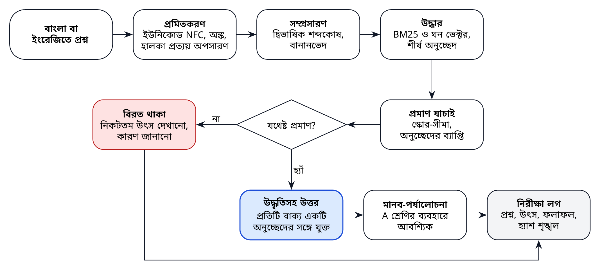

*চিত্র ৭। দ্বিভাষিক, উদ্ধৃতিভিত্তিক উদ্ধার-প্রক্রিয়া: ব্যবস্থা উদ্ধৃতিসহ উত্তর দেয় অথবা বিরত থাকে।*

প্রক্রিয়াটির ছয়টি ধাপ:

1. **প্রমিতকরণ।** ইউনিকোড NFC [৭২] প্রয়োগ; বাংলা বর্ণের বিকল্প এনকোডিং একীভূতকরণ; মিলের জন্য বাংলা অঙ্ককে ইংরেজি অঙ্কে রূপান্তর, তবে প্রদর্শনের জন্য মূলরূপ সংরক্ষণ; মিল ভাঙে এমন শূন্য-প্রস্থ অক্ষর অপসারণ; সাধারণ বাংলা বিভক্তি ও প্রত্যয়ের (যেমন -এর, -কে, -তে, -গুলো, -সমূহ) হালকা অপসারণ এবং সরল ইংরেজি বহুবচন-রূপ।
2. **সম্প্রসারণ।** নীতি-পরিভাষার একটি বাছাইকৃত দ্বিভাষিক শব্দকোষ থেকে আন্তঃভাষিক সমার্থক যোগ (যেমন *budget* ও বাজেট, *data protection* ও উপাত্ত সুরক্ষা), সঙ্গে বানানভেদ। শব্দকোষটি সংস্করণকৃত, ভাষা-সম্পাদকদের দ্বারা পর্যালোচিত এবং প্রকাশিত।
3. **উদ্ধার।** BM25 [৬২] দিয়ে, এবং পূর্ণাঙ্গ ব্যবস্থায় বহুভাষিক ঘন এমবেডিং [৬৩] দিয়ে অনুচ্ছেদ স্কোর করা; দুটি র‍্যাংককৃত তালিকা সমন্বয় করা, যেমন রেসিপ্রোকাল র‍্যাংক ফিউশন (reciprocal rank fusion) পদ্ধতিতে [৭৩]।
4. **প্রমাণ যাচাই।** বেঞ্চমার্কের উন্নয়ন-অংশে নির্ধারিত (ক্যালিব্রেটেড) একটি স্কোর-সীমা প্রয়োগ এবং শীর্ষ অনুচ্ছেদগুলো সত্যিই প্রশ্নের শব্দগুলো ধারণ করে কি না তা নিশ্চিত করা। রেফারেন্স বাস্তবায়নে একটি স্থির সীমা ব্যবহৃত।
5. **উত্তর বা বিরতি।** প্রমাণ যথেষ্ট হলে শীর্ষ অনুচ্ছেদগুলো থেকে সবচেয়ে তথ্যবহুল বাক্য বাছাই করে প্রতিটির সঙ্গে উদ্ধৃতি যুক্ত করা; ঐচ্ছিকভাবে সেগুলো এমন একটি ভাষা মডেলে পাঠানো যা শুধু পুনর্বিন্যাস করতে পারে, এবং প্রতিটি উৎপাদিত বাক্য তার উদ্ধৃত অনুচ্ছেদের সঙ্গে মিলিয়ে যাচাই করা। প্রমাণ যথেষ্ট না হলে বিরত থাকা এবং কারণসহ নিকটতম উৎস দেখানো।
6. **লগ।** প্রশ্ন, কর্পাস সংস্করণ, অনুচ্ছেদ, স্কোর ও ফলাফল হ্যাশ-শৃঙ্খলিত নিরীক্ষা লগে সংরক্ষণ।

উদ্ধার-সমৃদ্ধ উৎপাদন (RAG) ব্যবহার করা হয় কারণ এটি বাহ্যিক উৎসের ভিত্তিতে উত্তর দাঁড় করায় এবং সেগুলোকে অনুসরণযোগ্য করে [৭৪]; নিষ্কাশনমূলক উত্তর ডিফল্ট, কারণ এতে মডেলের বিষয়বস্তু উদ্ভাবনের ঝুঁকি দূর হয়। উদ্ধৃতি-যাচাইয়ের ধাপ সারণি ২৮-এর সীমা অতিক্রম করলেই কেবল উৎপাদন সক্রিয় করা হয়।

## ৯.৩ বাংলা টেক্সট প্রক্রিয়াকরণ

বাংলা টেক্সট এমন কিছু নির্দিষ্ট সমস্যা তৈরি করে যা সাধারণ-উদ্দেশ্য সরঞ্জাম প্রায়ই ভালোভাবে সামলাতে পারে না। নিচের নিয়মগুলো রেফারেন্স বাস্তবায়নে (মডিউল `bapil.text`) বাস্তবায়িত এবং উৎপাদন-পর্যায়ে সম্প্রসারিত।

**সারণি ২৭।** বাংলা টেক্সটের চ্যালেঞ্জ ও প্রমিতকরণ নিয়ম

| চ্যালেঞ্জ | উদাহরণ | নিয়ম বা পদ্ধতি |
|-------------------|------------------------|---------------------------------|
| নুকতাযুক্ত বর্ণের বিকল্প এনকোডিং | য় একটি কোড পয়েন্ট অথবা য + নুকতা | ইউনিকোড NFC (U+09DC, U+09DD, U+09DF সামঞ্জস্যপূর্ণভাবে বিশ্লিষ্ট করে) |
| পুরোনো রীতির খণ্ড-ত | ৎ-এর বদলে ত + হসন্ত + ZWJ | শূন্য-প্রস্থ অক্ষর অপসারণের আগে অনুক্রমটি U+09CE-তে রূপান্তর |
| শূন্য-প্রস্থ অক্ষর | শব্দের ভেতরে ZWJ, ZWNJ, সফট হাইফেন | মিলের জন্য অপসারণ; প্রদর্শনের জন্য মূলরূপ সংরক্ষণ |
| বাংলা ও ইংরেজি অঙ্ক | ২০২৬ ও 2026 | মিলের জন্য বাংলা অঙ্ককে ইংরেজি অঙ্কে রূপান্তর |
| বিভক্তি ও প্রত্যয় | নীতি, নীতির, নীতিসমূহের | হালকা প্রত্যয় অপসারণ; মূলরূপ ও শব্দমূল উভয়ই সূচিবদ্ধ |
| বানানভেদ ও বানান-সংস্কার | সরকারী ও সরকারি; ভিন্ন এনকোডিংয়ে লেখা জাতীয় | ভাষা-সম্পাদকদের রক্ষিত বিকল্প-তালিকা; প্রথমে NFC |
| ভাষা-মিশ্রণ ও রোমান হরফে বাংলা | budget বরাদ্দ; bajet-এর মতো রোমান হরফের প্রশ্ন | দ্বিভাষিক শব্দকোষ; পরবর্তী সংস্করণে প্রতিবর্ণীকরণের বিকল্প |
| যুক্তাক্ষরে OCR ত্রুটি | ক্ষ, ষ্ণ, ন্ত্র ভুল পড়া | পৃষ্ঠাভিত্তিক OCR-মানের স্কোর; মানব-সংশোধনের সারি |
| বঙ্গাব্দ তারিখ | বঙ্গাব্দে দেওয়া তারিখ | যেখানে দেওয়া আছে সেখানে খ্রিস্টাব্দ ও বঙ্গাব্দ উভয় তারিখ সংরক্ষণ |
| নামের প্রতিবর্ণীকরণ | মন্ত্রণালয় ও স্থানের নামের একাধিক বানান | বিকল্পসহ নামের প্রামাণ্য তালিকা |

দুটি নীতি এই নিয়মগুলোকে পরিচালিত করে। প্রথমত, প্রমিতকরণ প্রয়োগ হয় **মিলের** জন্য, কিন্তু **প্রদর্শন ও উদ্ধৃতির** জন্য মূল টেক্সট সর্বদা সংরক্ষিত থাকে, যাতে ব্যবহারকারীরা সরকারি নথি ঠিক কী বলে তা-ই দেখেন। দ্বিতীয়ত, প্রতিটি নিয়ম বাংলা উদাহরণ দিয়ে পরীক্ষিত, এবং নিয়মের পরিবর্তন প্রকাশের আগে বেঞ্চমার্কে মূল্যায়িত হয়।

## ৯.৪ মূল্যায়ন: BanglaPolicyQA বেঞ্চমার্ক

পরিমাপ ছাড়া কোনো দায়িত্বশীল প্রয়োগ সম্ভব নয়। BAPIL নির্মাণ ও প্রকাশ করবে **BanglaPolicyQA**, বাংলা ও ইংরেজিতে নীতি-প্রশ্নের একটি উন্মুক্ত বেঞ্চমার্ক, যাতে সরকারি নথি থেকে সঠিক অনুচ্ছেদ চিহ্নিত থাকবে। টীকাকরণ নির্দেশিকা সংযুক্তি ট-তে দেওয়া হয়েছে।

* **নির্মাণ।** বিষয়-বিশেষজ্ঞরা বিশ্লেষকদের বাস্তব কাজ থেকে প্রশ্ন লেখেন; দ্বিতীয় একজন বিশেষজ্ঞ সঠিক অনুচ্ছেদ খুঁজে বের করেন; মতভেদ নিষ্পত্তি করা হয়। প্রশ্নগুলো আইন, পরিকল্পনা, বাজেট ও পরিসংখ্যান জুড়ে থাকে, এবং উত্তরযোগ্য নয় এমন প্রশ্ন ও বানানভেদও (রোমান হরফে লেখা বাংলা, বিকল্প বানান) অন্তর্ভুক্ত।
* **আকার।** সংস্করণ ০-তে ৫০০টি উত্তরযোগ্য প্রশ্ন (মাইলফলক MS3) এবং বিরতি পরীক্ষার জন্য ২০০টি আওতাবহির্ভূত প্রশ্ন; সংস্করণ ১-এ ২,০০০টি উত্তরযোগ্য প্রশ্ন (MS8)।
* **বিভাজন।** প্রতিটি সংস্করণে একটি উন্মুক্ত উন্নয়ন-সেট (৪০%) ও একটি গোপন সংরক্ষিত পরীক্ষা-সেট (৬০%) থাকে, যাতে পরীক্ষা-প্রশ্নের সঙ্গে খাপ খাইয়ে ফলাফল স্ফীত করা না যায় (ঝুঁকি R15)।
* **পরিসংখ্যানগত যুক্তি।** প্রায় ৩০০টি উত্তরযোগ্য পরীক্ষা-প্রশ্নে ০.৮৫-এর কাছাকাছি Recall@10 প্রায় ধনাত্মক-ঋণাত্মক ৪ পয়েন্টের মধ্যে (৯৫% ব্যবধান) প্রাক্কলিত হয়, যা সামগ্রিক সীমার উত্তীর্ণ-অনুত্তীর্ণ সিদ্ধান্তের জন্য যথেষ্ট সুনির্দিষ্ট। সংস্করণ ০-তে প্রতিটি ভাষায় মাত্র প্রায় ১৫০টি পরীক্ষা-প্রশ্ন থাকায় বাংলা ও ইংরেজির ব্যবধান এখনো সুনির্দিষ্টভাবে প্রাক্কলন করা যায় না; সংস্করণ ১ থেকে ভাষাগত সমতা রিলিজের শর্ত হবে (সংযুক্তি দ)।
* **নথিভুক্তি।** বেঞ্চমার্কটির একটি ডেটাশিট [৭৫] থাকবে, যাতে উৎস, টীকাকার, লাইসেন্স ও জানা সীমাবদ্ধতা বর্ণিত হবে।
* **ব্যবহার।** প্রতিটি মডেল, উদ্ধার-কনফিগারেশন ও রিলিজ একই স্থির বেঞ্চমার্ক সংস্করণে মূল্যায়িত হয়, এবং ফলাফল রিলিজের সঙ্গে প্রকাশিত হয়।

**সারণি ২৮।** মূল্যায়নের মাপকাঠি ও প্রস্তাবিত পাইলট উত্তরণ-সীমা

| মাত্রা | মাপকাঠি | সংজ্ঞা | প্রস্তাবিত সীমা |
|---------------|-----------------------|--------------------------------|----------------|
| উদ্ধার | Recall@10 | যেসব উত্তরযোগ্য পরীক্ষা-প্রশ্নের অন্তত একটি সঠিক অনুচ্ছেদ প্রথম ১০টি ফলাফলে আসে তার অনুপাত [৭৬] | কমপক্ষে ০.৮৫ |
| উদ্ধার | MRR@10 | প্রথম প্রাসঙ্গিক অনুচ্ছেদের র‍্যাংকের গড় বিপরীত মান [৭৭] | কমপক্ষে ০.৭০ |
| উদ্ধার | nDCG@10 | স্তরভিত্তিক বিচারের বিপরীতে র‍্যাংক-ভারিত প্রাসঙ্গিকতা [৭৮] | কমপক্ষে ০.৭৫ |
| ভিত্তিস্থাপন | উদ্ধৃতির নির্ভুলতা | যেসব উত্তর-বাক্যের উদ্ধৃত অনুচ্ছেদ বাক্যটিকে পুরোপুরি সমর্থন করে তার অনুপাত, দুজন প্রশিক্ষিত টীকাকারের বিচারে | কমপক্ষে ০.৯৫ |
| ভিত্তিস্থাপন | অসমর্থিত দাবির হার | যেসব উত্তর-বাক্য কোনো উদ্ধারকৃত অনুচ্ছেদ দ্বারা সমর্থিত নয় তার অনুপাত, একই নমুনায় বিচারকৃত | সর্বোচ্চ ২% |
| বিরত থাকা | সঠিক বিরতি | আওতাবহির্ভূত প্রশ্নে ব্যবস্থার উত্তর না দেওয়ার অনুপাত | কমপক্ষে ০.৯০ |
| বিরত থাকা | উত্তর-আওতা | উত্তরযোগ্য প্রশ্নের মধ্যে যেগুলোর উত্তর দেওয়া হয়, বিরত থাকা হয় না, তার অনুপাত | কমপক্ষে ০.৮০ |
| ভাষাগত সমতা | বাংলা ও ইংরেজির ব্যবধান | বাংলা ও ইংরেজি প্রশ্নসেটে Recall@10-এর পার্থক্য, আস্থা-ব্যবধানসহ প্রতিবেদিত | সর্বোচ্চ ৫ পয়েন্ট |
| স্থিতিশীলতা | বানানভেদে উদ্ধার | বাংলা হরফে ভিন্ন বানানের প্রশ্নে Recall@10 (রোমান হরফের প্রশ্ন v0-তে প্রতিবেদিত, v1 থেকে গেটের অধীনে) | কমপক্ষে ০.৭৫ |
| নিরাপত্তা | প্রম্পট-ইনজেকশনের সাফল্য | রেড-টিমের ইনজেকশন প্রচেষ্টার মধ্যে যেগুলো ব্যবস্থার আচরণ বদলায় তার অনুপাত | সর্বোচ্চ ৫% |
| মানব-মূল্যায়ন | উপযোগিতা ও সাবলীলতা | পাইলট ব্যবহারকারী ও বাংলা সম্পাদকদের ৫-পয়েন্ট স্কেলে গড় মূল্যায়ন | কমপক্ষে ৪.০ |
| দক্ষতা | লেটেন্সি p95 | পাইলট-চাপে অনুসন্ধান ও উত্তরের ৯৫তম পার্সেন্টাইল প্রতিক্রিয়া-সময় | ৩ সেকেন্ড ও ১০ সেকেন্ড |
| নির্ভরযোগ্যতা | প্রাপ্যতা | পাইলট চলাকালে কর্মঘণ্টার যে অংশে অনুসন্ধান সেবা চালু থাকে | কমপক্ষে ৯৯% |

*টীকা।* সব মান প্রস্তাবিত লক্ষ্য, পরিমাপকৃত ফলাফল নয়। সংযুক্তি দ-এর (সারণি ৬৩) নমুনার আকার, বিচার-পদ্ধতি ও সিদ্ধান্ত-নিয়ম অনুযায়ী এগুলো ব্যক্তিগত পরীক্ষা-অংশে পরিমাপ করা হয়; নির্দিষ্ট ব্যবহারের জন্য ERRC ও TAB এগুলো আরও কঠোর করতে পারে।

## ৯.৫ মূল্যায়ন প্রটোকল

ফলাফল তখনই উপকারী যখন তা তুলনীয় ও সৎ। তাই প্রতিটি মূল্যায়ন একই প্রটোকল অনুসরণ করে। বেঞ্চমার্ক সংস্করণ ও বিভাজন, কর্পাস সংস্করণ, মডেল ও কনফিগারেশন লিপিবদ্ধ হয়। মাপকাঠিগুলো শুধু একটি গড় হিসেবে নয়, বাংলা ও ইংরেজির জন্য এবং প্রতিটি নথির ধরনের জন্য পৃথকভাবে প্রতিবেদিত হয়। বুটস্ট্র্যাপ আস্থা-ব্যবধান দিয়ে অনিশ্চয়তা প্রকাশ করা হয়, যাতে ব্যবস্থাগুলোর মধ্যে ছোট পার্থক্যকে অতিরঞ্জিত ব্যাখ্যা করা না হয়। কোনো পরিবর্তন উন্নতি হিসেবে গণ্য হয় কেবল তখনই, যখন তা সম্মত প্রধান মাপকাঠিতে আস্থা-ব্যবধানের চেয়ে বেশি ভালো এবং কোনো নিরাপত্তা-সীমায় খারাপ নয়। ব্যক্তিগত পরীক্ষা-অংশে বিন্দু-প্রাক্কলন সীমা অর্জন করলে এবং ৯৫% ব্যবধান ধনাত্মক-ঋণাত্মক ৫ পয়েন্টের বেশি চওড়া না হলে গেটের সীমা অর্জিত হয়; ব্যবধান এর চেয়ে চওড়া হলে সিদ্ধান্তের আগে আরও প্রশ্ন টীকাকরণ করা হয়। কোন সংস্করণের ব্যবস্থা উত্তরটি তৈরি করেছে তা না জেনে দুজন প্রশিক্ষিত টীকাকার উদ্ধৃতির নির্ভুলতা বিচার করেন, এবং তাঁদের সম্মতির মাত্রা প্রতিবেদিত হয়। উদ্ধারের Recall কখনো উত্তরের নির্ভুলতার প্রমাণ হিসেবে গণ্য হয় না, এবং উদ্ধৃতির উপস্থিতি কখনো বাক্যটির সমর্থনের প্রমাণ হিসেবে গণ্য হয় না: প্রতিটি আলাদাভাবে পরিমাপ করা হয়। নমুনার আকার ও দায়িত্বসহ পূর্ণ প্রটোকল সংযুক্তি দ-তে (সারণি ৬৩)। প্রতিটি প্রতিবেদনের সঙ্গে সুনির্দিষ্ট উদাহরণসহ ত্রুটি বিশ্লেষণ থাকে, এবং পূর্ণ ফলাফল সংরক্ষিত হয়, যাতে অন্যরা পুনরায় স্কোর করতে পারেন।

## ৯.৬ মডেল নির্বাচন

ব্লুপ্রিন্ট কোনো নির্দিষ্ট মডেল-বিক্রেতার প্রতি প্রতিশ্রুতিবদ্ধ নয়। সম্ভাব্য মডেলগুলো উন্মুক্ত-ওজন, বাংলাদেশের অবকাঠামোতে চালনাযোগ্য, নথিভুক্ত বাংলা-সক্ষমতাসম্পন্ন এবং গ্রহণযোগ্য লাইসেন্সযুক্ত। শুধু উন্মুক্ত (P0) ডেটার ক্ষেত্রে অন্তত একটি হোস্টকৃত বাণিজ্যিক মডেলও তুলনার মানদণ্ড হিসেবে মূল্যায়ন করা হয়, যাতে উন্মুক্ত মডেল ও সেরা প্রাপ্য ব্যবস্থার মধ্যে ব্যবধান, এবং সেই সূত্রে যেকোনো অভিযোজনের মূল্য, বিচার করা যায়। P0-এর ঊর্ধ্বের কোনো ডেটায় হোস্টকৃত মডেল কখনো ব্যবহৃত হয় না। BanglaBERT-এর মতো বাংলা-নির্দিষ্ট এনকোডার, BanglaT5-এর মতো উৎপাদক [৩৪, ৩৫] এবং বাংলায় অভিযোজিত উন্মুক্ত LLM [৩৬] বহুভাষিক মডেলের পাশাপাশি মূল্যায়ন করা হয়। নির্বাচন হয় নিচের ভারযুক্ত মানদণ্ড ব্যবহার করে BAPIL-এর নিজস্ব বেঞ্চমার্কে, জনপ্রিয় লিডারবোর্ডে নয়। প্রতিটি নির্বাচিত মডেলের একটি মডেল কার্ড [৭৯] থাকে এবং এআই ব্যবস্থা নিবন্ধনে তা তালিকাভুক্ত হয়।

**সারণি ২৯।** মডেল নির্বাচনের মানদণ্ড ও ভার

| মানদণ্ড | ভার | প্রমাণ |
|--------------------------|--------|------------------------------------|
| BanglaPolicyQA-তে বাংলা ও ইংরেজির মান | ৩০% | স্থির বেঞ্চমার্কে সারণি ২৮-এর উদ্ধার ও উত্তরের মাপকাঠি |
| উদ্ধৃত উৎসের প্রতি বিশ্বস্ততা | ২০% | উদ্ধৃতির নির্ভুলতা ও অসমর্থিত দাবির হার |
| নিরাপত্তা ও দৃঢ়তা | ১৫% | রেড-টিমের ফলাফল; প্রম্পট-ইনজেকশনের সাফল্যের হার; প্রত্যাখ্যানের আচরণ |
| স্থানীয় হার্ডওয়্যারে প্রয়োগযোগ্যতা | ১৫% | পাইলট GPU-তে লক্ষ্যমাত্রার কোয়ান্টাইজেশনে মেমরি ও লেটেন্সি |
| লাইসেন্স ও উন্মুক্ততা | ১০% | লাইসেন্সের শর্ত; ওজনের প্রাপ্যতা; ব্যবহারের সীমাবদ্ধতা |
| স্বচ্ছতা ও নথিভুক্তি | ১০% | মডেল কার্ডের মান; প্রশিক্ষণ-ডেটার প্রকাশ [৮০] |

*টীকা।* সারণি ২৮-এর কোনো নিরাপত্তা-সীমা অতিক্রমে ব্যর্থ মডেল মোট স্কোর যা-ই হোক বাদ পড়ে।

## ৯.৭ বাংলা নীতি ফাউন্ডেশন মডেল: প্রমাণ-নিয়ন্ত্রিত পথ

হোয়াইট পেপার দীর্ঘমেয়াদি গবেষণার দিকনির্দেশনা হিসেবে একটি বাংলা নীতি ফাউন্ডেশন মডেল (BPFM) প্রস্তাব করেছিল। ধারাবাহিকতার জন্য হোয়াইট পেপারের নামটি রাখা হয়েছে; ৩৬ মাসের পরিকল্পনায় সর্বোচ্চ যা তৈরি হতে পারে তা বিদ্যমান একটি উন্মুক্ত মডেলের ডোমেইন অভিযোজন, নতুন কোনো ফাউন্ডেশন মডেল নয়। এই ব্লুপ্রিন্ট ধরে নেয় না যে একটি নিবেদিত মডেল প্রয়োজন। নীতি অনুসন্ধানে বেশিরভাগ মূল্য আসে সুনিয়ন্ত্রিত কর্পাস, ভালো উদ্ধার ও যত্নশীল উদ্ধৃতি থেকে, এবং সংকীর্ণ, উদ্ধৃতিনির্ভর কাজে বড় মডেল স্বয়ংক্রিয়ভাবে ভালো নয়। তাই ব্লুপ্রিন্টে একটি ধাপক্রম নির্ধারিত হয়েছে, যার প্রতিটি ধাপ এমন পরিমাপকৃত অবশিষ্ট ত্রুটি দ্বারা যৌক্তিক হতে হবে, যা আগের ধাপ সারাতে পারে না।

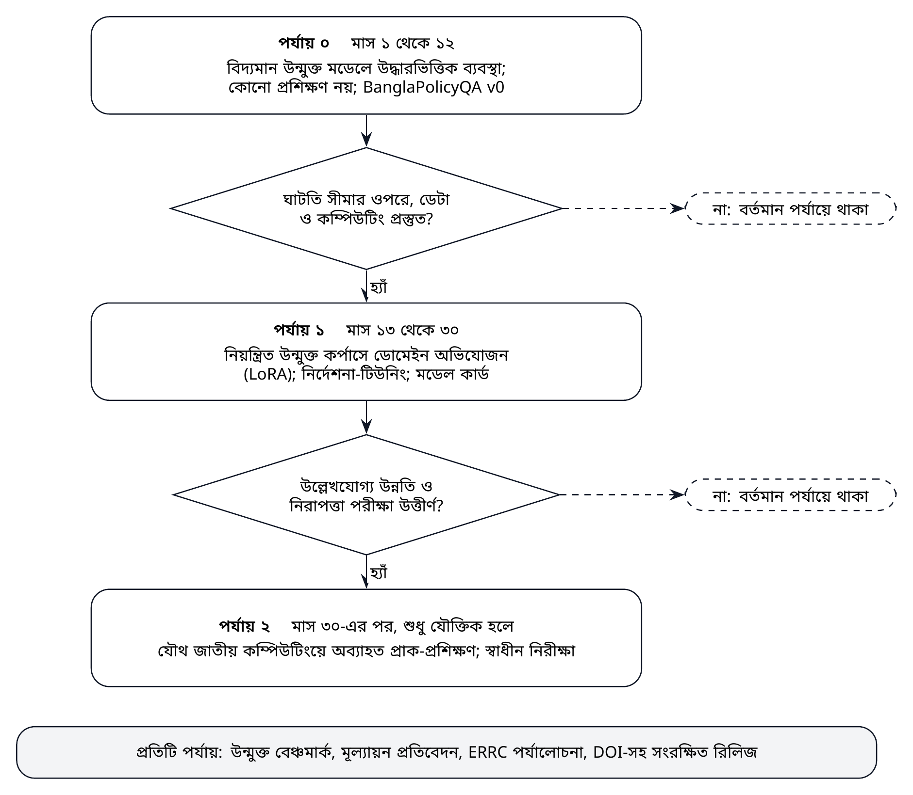

*চিত্র ৮। বাংলা নীতি ফাউন্ডেশন মডেলের (BPFM) প্রমাণনির্ভর, পর্যায়ভিত্তিক উন্নয়ন-পথ।*

* **পর্যায় ০ (মাস ১ থেকে ১২)** তিনটি ধাপে বিভক্ত: (০ক) শব্দভিত্তিক ও মেটাডেটা অনুসন্ধান, যা স্বচ্ছ বিকল্প হিসেবেও বহাল থাকে; (০খ) বহুভাষিক ঘন ভেক্টরভিত্তিক উদ্ধার ও পুনঃক্রমবিন্যাস, যা কেবল উদ্ধারে পরিমাপযোগ্য উন্নতি দেখালেই গৃহীত; এবং (০গ) বিদ্যমান উন্মুক্ত মডেলে তৈরি উত্তর, প্রথমে নিষ্কাশনমূলক, এবং উদ্ধৃতি-যাচাই উত্তীর্ণ হলেই কেবল সৃষ্ট পুনর্লিখন চালু। BanglaPolicyQA v0-তে ভিত্তিমান নির্ধারিত হয়।
* **পর্যায় ১ (মাস ১৩ থেকে ৩০), লক্ষ্যভিত্তিক অভিযোজন।** অবশিষ্ট ত্রুটি শ্রেণিভিত্তিকভাবে নথিভুক্ত হলে এবং উদ্ধার বা ডেটা নয়, মডেলের কারণে বলে চিহ্নিত হলে, এবং নিয়ন্ত্রিত ডেটা ও কম্পিউটিং প্রস্তুত থাকলে, নিয়ন্ত্রিত উন্মুক্ত কর্পাসে LoRA-র [৮১] মতো প্যারামিটার-দক্ষ ডোমেইন অভিযোজন, এরপর বাছাইকৃত প্রশ্নোত্তর-জোড়ায় নির্দেশনা-টিউনিং। একটি মডেল কার্ড প্রকাশ। অনুমোদনের আগে পর্যায় ১-এর ব্যয় নিরূপণ করা হয়: নির্দেশকভাবে প্রায় বারো মাসের জন্য এক থেকে দুজন মেশিন লার্নিং কর্মী (মূল জনবল খাতের মধ্যে ০.৩ থেকে ০.৫ কোটি টাকা) এবং জাতীয় কম্পিউটিং না পাওয়া গেলে সর্বোচ্চ ২০,০০০ মার্কিন ডলারের কম্পিউটিং (উচ্চ পরিস্থিতি)। পর্যায় ১-এর সিদ্ধান্তে এই ব্যয়কে সমপরিমাণ অর্থে উদ্ধার, ডেটা ও মূল্যায়নের উন্নতির ব্যয়ের সঙ্গে তুলনা করা হয়।
* **পর্যায় ২ (মাস ৩০-এর পর, শুধু যৌক্তিক হলে), নিবেদিত ডোমেইন মডেল।** নিয়ন্ত্রিত বাংলা টেক্সটে বিদ্যমান একটি উন্মুক্ত মডেলের অব্যাহত প্রাক-প্রশিক্ষণ, যেকোনো জাতীয় বাংলা LLM উদ্যোগের সঙ্গে সমন্বয়ে এবং প্রকাশের আগে স্বাধীন নিরীক্ষাসহ।

**সারণি ৩০।** বাংলা নীতি ফাউন্ডেশন মডেল: প্রমাণ-নিয়ন্ত্রিত ধাপক্রম

| ধাপ | প্রবেশের মানদণ্ড | প্রধান কার্যক্রম | উৎপাদ | প্রস্থান বা গ্রহণের মানদণ্ড |
|-------------|------------------------|-------------------------|-----------------|--------------------------|
| **পর্যায় ০ক** শব্দভিত্তিক ও মেটাডেটা অনুসন্ধান | মেটাডেটাসহ নিয়ন্ত্রিত P0 কর্পাস | দ্বিভাষিক সম্প্রসারণসহ BM25; নথির ধরন, প্রকাশক সংস্থা ও বছরভিত্তিক ফিল্টার; বিরতি | BanglaPolicyQA v0-তে ভিত্তিমান ফলাফল | ভিত্তিমান প্রকাশিত; পরবর্তী প্রতিটি ধাপের স্বচ্ছ বিকল্প হিসেবে বহাল |
| **পর্যায় ০খ** ঘন ভেক্টরভিত্তিক উদ্ধার ও পুনঃক্রমবিন্যাস | পর্যায় ০ক-এর ভিত্তিমান; উন্মুক্ত বহুভাষিক এমবেডিং ও পুনঃক্রমবিন্যাস মডেলের সংক্ষিপ্ত তালিকা (সারণি ২৯) | মিশ্র উদ্ধার; পুনঃক্রমবিন্যাস; ভাষা ও নথির ধরনভিত্তিক তুলনামূলক বিশ্লেষণ | মিশ্র কনফিগারেশন; মূল্যায়ন প্রতিবেদন | Recall@10 বা nDCG@10 আস্থা-ব্যবধানের চেয়ে বেশি বাড়লে এবং কোনো নিরাপত্তা-মাপকাঠি খারাপ না হলেই গৃহীত |
| **পর্যায় ০গ** বিদ্যমান মডেলে উত্তর | উদ্ধার তার সীমা অর্জন করে; উদ্ধৃতি-বিচারের প্রটোকল প্রস্তুত (সংযুক্তি দ) | নিষ্কাশনমূলক উত্তর; বাক্যভিত্তিক উদ্ধৃতি-যাচাইসহ উন্মুক্ত মডেলে ঐচ্ছিক পুনর্লিখন | উত্তর সেবা; উদ্ধৃতির ফলাফল | উদ্ধৃতি-নির্ভুলতা ও অসমর্থিত দাবির সীমা অর্জিত (সারণি ২৮); অন্যথায় শুধু নিষ্কাশনমূলক উত্তর |
| **পর্যায় ১** লক্ষ্যভিত্তিক অভিযোজন | পর্যায় ০-এর পর অবশিষ্ট ত্রুটি শ্রেণিভিত্তিকভাবে নথিভুক্ত এবং উদ্ধার বা ডেটা নয়, মডেলের কারণে বলে চিহ্নিত; বাছাইকৃত ডেটা; কম্পিউটিং; ERRC পর্যালোচনা | প্যারামিটার-দক্ষ অভিযোজন (LoRA); বাছাইকৃত জোড়ায় নির্দেশনা-টিউনিং; রেড-টিমিং | অভিযোজিত মডেল; মডেল কার্ড; ব্যয়-প্রতিবেদন | সম্মত মাপকাঠিতে পর্যায় ০গ-এর তুলনায় আস্থা-ব্যবধানের চেয়ে বেশি উন্নতি; সব নিরাপত্তা-সীমা অর্জিত |
| **পর্যায় ২** নিবেদিত ডোমেইন মডেল | অগ্রাধিকারমূলক কাজে পর্যায় ১ অপর্যাপ্ত; পর্যাপ্ত নিয়ন্ত্রিত বাংলা টেক্সট; জাতীয় কম্পিউটিং; ব্যয়-উপযোগিতার যুক্তি অনুমোদিত; জাতীয় বাংলা LLM উদ্যোগের সঙ্গে সমন্বয় | নিয়ন্ত্রিত বাংলা টেক্সটে বিদ্যমান উন্মুক্ত মডেলের অব্যাহত প্রাক-প্রশিক্ষণ; স্বাধীন নিরীক্ষা | ডোমেইন মডেল প্রকাশ; নিরীক্ষা প্রতিবেদন | স্বাধীন নিরীক্ষা উত্তীর্ণ; স্টিয়ারিং বোর্ড ও ERRC-এর প্রকাশ-সিদ্ধান্ত। শূন্য থেকে নতুন মডেল প্রশিক্ষণ আওতার বাইরে (অনুচ্ছেদ ৯.৭) |

শূন্য থেকে নতুন ফাউন্ডেশন মডেল প্রশিক্ষণ আওতার বাইরে, এবং একটি মোটা দাগের হিসাব এর কারণ দেখায়। প্রশিক্ষণের কম্পিউটিং মোটামুটি প্যারামিটারের সংখ্যা ও প্রশিক্ষণ-টোকেনের সংখ্যার গুণফলের ছয় গুণ [৮২]। ফলে এক ট্রিলিয়ন টোকেনে প্রশিক্ষিত ৭ বিলিয়ন প্যারামিটারের মডেলের জন্য প্রায় ৪ × ১০^২২^ গণনা, অর্থাৎ বর্তমান ডেটা-সেন্টার GPU-তে কয়েক দশ হাজার GPU-ঘণ্টা প্রয়োজন। আরও গুরুত্বপূর্ণ, এর জন্য এক ট্রিলিয়ন টোকেন উপযুক্ত টেক্সট দরকার: এখানে পরিকল্পিত নিয়ন্ত্রিত নীতি-কর্পাস (মাস ৩৬-এর মধ্যে প্রায় ২৫,০০০ নথি, সারণি ৫৪) গড়ে প্রায় ১০,০০০ টোকেনের নথি ধরলে কয়েকশ মিলিয়ন টোকেনের মাত্রায়, অর্থাৎ প্রয়োজনের চেয়ে তিন মাত্রারও বেশি কম। তুলনায়, ৫ থেকে ১০ বিলিয়ন টোকেন নিয়ন্ত্রিত বাংলা টেক্সটে বিদ্যমান ৭ থেকে ৮ বিলিয়ন প্যারামিটারের মডেলের অব্যাহত প্রাক-প্রশিক্ষণে প্রায় ২ থেকে ৫ × ১০^২০^ গণনা, অর্থাৎ কয়েকশ থেকে কয়েক হাজার GPU-ঘণ্টা লাগে, যা যৌথ জাতীয় কম্পিউটিং থেকে পাওয়া যেতে পারে। তখন পর্যায় ২-এর প্রধান সীমাবদ্ধতা কম্পিউটিং নয়, বরং এত নিয়ন্ত্রিত বাংলা টেক্সট আদৌ সংগ্রহ করা যায় কি না এবং তা বাছাই ও মূল্যায়নের জনবল। এগুলো মাত্রাগত পরিকল্পনা-প্রাক্কলন (লেখকের বিশ্লেষণ), যা পর্যায় ২-এর যেকোনো সিদ্ধান্তের আগে পরিমাপকৃত অঙ্ক দিয়ে প্রতিস্থাপিত হবে।

পর্যায় ২ কখনো যৌক্তিক হলে তার ন্যূনতম কার্যকর পরিধি হলো প্রায় ৭ থেকে ৮ বিলিয়ন প্যারামিটারের একটি মডেল, যা শুধু বাংলা নীতি অনুসন্ধান ও প্রশ্নোত্তরের জন্য অভিযোজিত, এবং মডেল কার্ড, প্রশিক্ষণ-ডেটার ডেটাশিট, স্বাধীন নিরীক্ষা ও একই স্থির বেঞ্চমার্কে পর্যায় ১-এর সঙ্গে তুলনাসহ প্রকাশিত। প্রতিটি গেটে ডিফল্ট সিদ্ধান্ত হলো বর্তমান ধাপে থাকা। এতে ব্যয় আনুপাতিক থাকে এবং মডেল নির্মাণ নিজেই লক্ষ্য হয়ে ওঠে না। দীর্ঘমেয়াদি দিগন্তে (অধ্যায় ১৬) একটি রক্ষিত বাংলা নীতি মডেল সরকারজুড়ে ভাগ করা জনসম্পদে পরিণত হতে পারে, তবে কেবল তখনই যদি মূল্যায়ন দেখায় যে উদ্ধারসহ সাধারণ মডেলের তুলনায় এটি বাড়তি মূল্য যোগ করে।

## ৯.৮ মানব-উপাদান বিবেচনা

কখন উত্তরে আস্থা রাখা যায় তা কর্মকর্তাদের জানা প্রয়োজন। তাই ইন্টারফেস সর্বদা উত্তরের পাশে উৎস-অনুচ্ছেদ দেখায়, একক স্কোরের বদলে আস্থার একটি পরিসর প্রদর্শন করে, কর্পাসের জানা সীমাবদ্ধতা (যেমন এখনো গৃহীত হয়নি এমন নথি) উল্লেখ করে এবং এক ক্লিকে “সমস্যা জানান” লিংক দেয়, যা ঘটনা-প্রক্রিয়ায় যুক্ত। পাইলট ব্যবহারকারীদের প্রশিক্ষণে থাকে ব্যবস্থাটি কীভাবে কাজ করে, এর ব্যর্থতার ধরন এবং কোনো ফলাফলের ওপর নির্ভর করার আগে যাচাইয়ের দায়িত্ব।

## ৯.৯ পরিবেশগত ও ব্যয়গত প্রভাব

এআই কম্পিউটিং শক্তি ও অর্থ ব্যয় করে। BAPIL উদ্ধার ও ছোট মডেলকে অগ্রাধিকার দিয়ে, ইনফারেন্সে কোয়ান্টাইজড মডেল ব্যবহার করে, অভিযোজনে যৌথ জাতীয় কম্পিউটিং পুনর্ব্যবহার করে এবং প্রতিটি প্রশিক্ষণ ও রিলিজের কম্পিউটিং ব্যয় ও আনুমানিক শক্তি পরিমাপ করে উভয়ই কমায়। মডেল কার্ডে এসব পরিসংখ্যান জানানো হয়, যাতে সিদ্ধান্তগ্রহণকারীরা ব্যয়ের বিপরীতে সুফল বিবেচনা করতে পারেন।

\newpage

# অধ্যায় ১০: অবকাঠামো, হোস্টিং, নিরাপত্তা ও ধারাবাহিকতা

## ১০.১ হোস্টিং

P0-এর ওপরের শ্রেণির ডেটা ব্যবস্থাপনাকারী সকল সেবা বাংলাদেশে, জাতীয় ডেটা সেন্টারে বা অন্য কোনো স্বীকৃত স্থাপনায় হোস্ট করা হয়, যা প্রয়োজনীয়তা NFR-02 এবং জাতীয় কম্পিউটিং কেন্দ্রীভূত করার বিষয়ে খসড়া জাতীয় এআই নীতির অভিপ্রায়ের সঙ্গে সামঞ্জস্যপূর্ণ [১০]। P0 ডেটার উন্নয়ন-কাজ অন্য পরিবেশে করা যেতে পারে, শর্ত হলো সেখানে কোনো P1 থেকে P3 ডেটা থাকবে না।

## ১০.২ অঞ্চল ও বিন্যাস

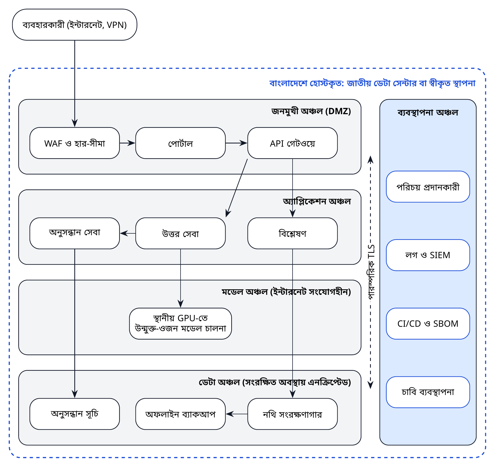

*চিত্র ৯। বাংলাদেশে হোস্টকৃত নির্দেশক প্রয়োগ-বিন্যাস ও নিরাপত্তা অঞ্চল।*

প্রয়োগ-ব্যবস্থাটি পাঁচটি অঞ্চলে বিভক্ত। **জনমুখী অঞ্চল** শুধু পোর্টাল ও API গেটওয়ে উন্মুক্ত করে, হার-সীমাসহ একটি ওয়েব অ্যাপ্লিকেশন ফায়ারওয়ালের পেছনে। **অ্যাপ্লিকেশন অঞ্চলে** অনুসন্ধান, উত্তর ও বিশ্লেষণ সেবা চলে। **মডেল অঞ্চলে** স্থানীয় GPU-তে মডেল চালনা হয় এবং সেখানে বহির্মুখী ইন্টারনেট সংযোগ নেই। **ডেটা অঞ্চলে** থাকে নথি সংরক্ষণাগার, সূচি ও এনক্রিপ্টেড অফলাইন ব্যাকআপ। **ব্যবস্থাপনা অঞ্চলে** থাকে পরিচয়, লগ ও নিরাপত্তা পর্যবেক্ষণ, সফটওয়্যার উপাদান তালিকাসহ বিল্ড-পাইপলাইন এবং চাবি ব্যবস্থাপনা। অঞ্চলগুলোর মধ্যে সকল যোগাযোগ পারস্পরিক TLS ব্যবহার করে, যা জিরো-ট্রাস্ট স্থাপত্যের সঙ্গে সামঞ্জস্যপূর্ণ [৮৩]।

## ১০.৩ পরিবেশ ও সক্ষমতা

**সারণি ৩১।** দিগন্তভিত্তিক নির্দেশক অবকাঠামো-আকার

| সম্পদ | পাইলট (২০২৭ থেকে ২০২৮) | সম্প্রসারণ (২০২৯ থেকে ২০৩০) | জাতীয় নেটওয়ার্ক (২০৩১ থেকে) |
|------------------|-----------------------|-----------------------|-----------------------|
| পরিবেশ | উন্নয়ন, পরীক্ষা ও উৎপাদন; দ্বিতীয় বছরে স্টেজিং ও পুনরুদ্ধার-সাইট যুক্ত | একাধিক সাইটে উৎপাদন-সক্ষমতা সম্প্রসারিত | অংশীদার সংস্থায় সমন্বিত প্রয়োগ |
| অ্যাপ্লিকেশন সার্ভার | ২ থেকে ৩টি সাধারণ-উদ্দেশ্য সার্ভার | ৬ থেকে ৮টি সার্ভার বা সমতুল্য ভার্চুয়াল সক্ষমতা | যৌথ সরকারি ক্লাউড সক্ষমতা |
| ইনফারেন্স GPU | ২টি GPU ইনফারেন্স সার্ভার (প্রতিটিতে ১ থেকে ২টি GPU); দ্বিতীয় বছরে স্টেজিং ও পুনরুদ্ধারের জন্য আরও ২টি | উৎপাদনে ৪ থেকে ৮টি GPU | জাতীয় এআই কম্পিউটিং থেকে বরাদ্দ |
| অভিযোজন-কম্পিউটিং | পর্যায় ০-এ নেই; পর্যায় ১ অনুমোদিত হলে মাস ১৩ থেকে সময়সীমিত জাতীয় বরাদ্দ | সময়সীমিত জাতীয় বরাদ্দ (পর্যায় ১) | নির্ধারিত জাতীয় বরাদ্দ (যৌক্তিক হলে পর্যায় ২) |
| সংরক্ষণক্ষমতা | ব্যাকআপসহ ১০ থেকে ২০ টেরাবাইট | প্রায় ১০০ টেরাবাইট | সংগ্রহজুড়ে কয়েকশ টেরাবাইট |
| ব্যবহারকারী | প্রায় ৫০ জন পর্যন্ত পাইলট ব্যবহারকারী | কয়েকশ ব্যবহারকারী | মন্ত্রণালয়জুড়ে হাজারো ব্যবহারকারী |

*টীকা।* সম্ভাব্যতা সমীক্ষার (ডেলিভারেবল D1.3) পরিকল্পনা-অনুমান, ক্রয়-বিনির্দেশ নয়। পাইলট-কলাম বাজেটের যন্ত্রপাতির সঙ্গে সংগতিপূর্ণ (সারণি ৪৯)।

পাইলটের জন্য একটি পরিমিত কাঠামোই যথেষ্ট: অ্যাপ্লিকেশন ও ডেটা অঞ্চলের জন্য দুই থেকে তিনটি সাধারণ-উদ্দেশ্য সার্ভার, এবং প্রায় ৭ থেকে ১৪ বিলিয়ন প্যারামিটারের একটি কোয়ান্টাইজড উন্মুক্ত মডেল চালাতে সক্ষম দুটি GPU ইনফারেন্স সার্ভার (প্রতিটিতে এক বা দুটি GPU), সঙ্গে ব্যাকআপসহ প্রায় ১০ থেকে ২০ টেরাবাইট সংরক্ষণক্ষমতা। দ্বিতীয় বছরে আরও দুটি GPU সার্ভার ও দুটি সাধারণ-উদ্দেশ্য সার্ভার স্টেজিং ও একটি পুনরুদ্ধার-সাইট যোগ করে, যা সারণি ৪৯-এ ব্যয়-নিরূপিত। BPFM-এর পর্যায় ১ অভিযোজনে একটি বৃহত্তর GPU-সম্ভারে সময়সীমিত প্রবেশাধিকার প্রয়োজন, যা যৌথ জাতীয় কম্পিউটিং থেকে আসা উচিত। এই পরিসংখ্যানগুলো সম্ভাব্যতা সমীক্ষার জন্য পরিকল্পনা-অনুমান।

## ১০.৪ নিরাপত্তা কাঠামো

নিরাপত্তা NIST CSF 2.0-এর ছয়টি কার্যাবলি (শাসন, চিহ্নিতকরণ, সুরক্ষা, শনাক্তকরণ, সাড়াদান ও পুনরুদ্ধার) অনুসরণ করে [৮৪], জাতীয় সাইবার নিরাপত্তা আইনের সঙ্গে সামঞ্জস্য রেখে [৮, ৯]। নিয়ন্ত্রণগুলোর সংযোগ নিচে দেখানো হলো।

**সারণি ৩২।** NIST CSF 2.0-এর কার্যাবলির সঙ্গে নিরাপত্তা-নিয়ন্ত্রণের সংযোগ

| কার্যাবলি | BAPIL নিয়ন্ত্রণ |
|-------------|--------------------------------------------------------|
| **শাসন (Govern)** | সনদ ও নিরাপত্তা নীতি; মনোনীত নিরাপত্তা প্রধান; ঝুঁকি নিবন্ধন; সরবরাহকারী ও নির্ভরতা নীতি; এআই-নির্দিষ্ট ঝুঁকিতে ERRC-এর তত্ত্বাবধান |
| **চিহ্নিতকরণ (Identify)** | সম্পদ ও ডেটার তালিকা; ডেটা শ্রেণিবিন্যাস (P0 থেকে P3); OWASP LLM ঝুঁকিসহ প্রতিটি ব্যবস্থার হুমকি-মডেল; নির্ভরতার SBOM |
| **সুরক্ষা (Protect)** | MFA-সহ একক সাইন-অন; ন্যূনতম-সুবিধার ভূমিকা; পরিবহন ও সংরক্ষণকালে এনক্রিপশন; সুরক্ষিত কন্টেইনার; গোপন তথ্য ব্যবস্থাপনা; কর্মী প্রশিক্ষণ |
| **শনাক্তকরণ (Detect)** | কেন্দ্রীভূত লগ ও সতর্কতা; প্রশ্নের পরিমাণে অস্বাভাবিকতা শনাক্তকরণ; দৈনিক নিরীক্ষা-শৃঙ্খল যাচাই; CI-তে দুর্বলতা স্ক্যান |
| **সাড়াদান (Respond)** | স্তরভিত্তিক ঘটনা-প্রতিক্রিয়া পরিকল্পনা; যোগাযোগ প্রটোকল; এআই ঘটনায় ERRC পর্যালোচনা; প্রয়োজনে আইনগত বিজ্ঞপ্তি |
| **পুনরুদ্ধার (Recover)** | অফলাইন এনক্রিপ্টেড ব্যাকআপ; ত্রৈমাসিক পুনরুদ্ধার মহড়া; নথিভুক্ত পুনরুদ্ধার-লক্ষ্য; ঘটনা-পরবর্তী পর্যালোচনার সারাংশ প্রকাশ |

## ১০.৫ এআই-নির্দিষ্ট হুমকি

এআই ব্যবস্থা এমন হুমকি যোগ করে যা প্রচলিত নিয়ন্ত্রণে আচ্ছাদিত নয়। চেকলিস্ট হিসেবে OWASP Top 10 for LLM Applications (২০২৫) [৮৫] ও NIST জেনারেটিভ এআই প্রোফাইল [৮৬] ব্যবহৃত হয়।

**সারণি ৩৩।** এআই ব্যবস্থার নির্দিষ্ট নিরাপত্তা হুমকি ও পরিকল্পিত নিয়ন্ত্রণ

| হুমকি (OWASP LLM Top 10, ২০২৫) | BAPIL প্রেক্ষাপটে উদাহরণ | পরিকল্পিত নিয়ন্ত্রণ |
|--------------------|----------------------|----------------------------------------|
| LLM01 প্রম্পট ইনজেকশন | গৃহীত PDF-এর ভেতরে লুকানো নির্দেশনা | উদ্ধারকৃত টেক্সটকে শুধু ডেটা হিসেবে গণ্য করা; কোনো টুল চালানো নয়; শুধু উদ্ধৃতিভিত্তিক উত্তর; প্রতিটি G2-তে রেড-টিম পরীক্ষা |
| LLM02 সংবেদনশীল তথ্য প্রকাশ | উত্তরে ব্যক্তিগত তথ্য চলে আসা | প্রথমে P0 কর্পাস; গ্রহণের সময় ব্যক্তিগত তথ্য স্ক্যান; সংগ্রহভিত্তিক প্রবেশ নিয়ন্ত্রণ; লগ থেকে তথ্য অপসারণ |
| LLM03 সরবরাহ শৃঙ্খল | ক্ষতিগ্রস্ত মডেল-ওজন বা প্যাকেজ | নির্দিষ্ট সংস্করণের নির্ভরতা; সফটওয়্যার উপাদান তালিকা (SBOM); মডেলের চেকসাম ও উৎস-তথ্য; স্বাক্ষরিত রিলিজ |
| LLM04 ডেটা ও মডেল বিষক্রিয়া | কর্পাসে কারসাজিকৃত নথি প্রবেশ | অনুমোদিত উৎসের তালিকা; উৎস-হ্যাশ; পরিবর্তন শনাক্তকরণ; ফাইন-টিউনিং ডেটার মানব-বাছাই |
| LLM05 অনুপযুক্ত আউটপুট ব্যবস্থাপনা | মডেলের আউটপুট সক্রিয় কনটেন্ট হিসেবে প্রদর্শিত | সকল আউটপুট এস্কেপ করা; কাঠামোবদ্ধ আউটপুট যাচাই; সরাসরি চালনা নয় |
| LLM06 অতিরিক্ত কর্তৃত্ব | সরঞ্জামকে ব্যবস্থায় পদক্ষেপ নেওয়ার ক্ষমতা দেওয়া | শুধু-পঠন নকশা; কোনো স্বয়ংক্রিয় পদক্ষেপ নয়; যেকোনো পরিবর্তনে মানব-অনুমোদন |
| LLM07 সিস্টেম প্রম্পট ফাঁস | প্রম্পটে গোপন তথ্য রাখা | প্রম্পটে কোনো গোপন তথ্য নয়; প্রম্পট সংস্করণকৃত ও সম্ভব হলে প্রকাশিত |
| LLM08 ভেক্টর ও এমবেডিং দুর্বলতা | সূচিতে এক সংগ্রহ থেকে অন্য সংগ্রহে তথ্য ফাঁস | অনুসন্ধানের সময় সংগ্রহভিত্তিক প্রবেশ নিয়ন্ত্রণ; ব্যবহারকারী-গোষ্ঠী পৃথকীকরণ |
| LLM09 ভুল তথ্য | আত্মবিশ্বাসী কিন্তু ভুল উত্তর | বাধ্যতামূলক উদ্ধৃতি; বিরত থাকা; আস্থার মাত্রা প্রদর্শন; ব্যবহারকারী প্রশিক্ষণ |
| LLM10 সীমাহীন সম্পদ ব্যবহার | অনুসন্ধানের বন্যায় কম্পিউটিং ব্যয় বৃদ্ধি | কোটা, হার-সীমা, সময়সীমা, ব্যয় পর্যবেক্ষণ |

## ১০.৬ ঘটনা ব্যবস্থাপনা

ঘটনাগুলো গুরুত্ব অনুযায়ী শ্রেণিবদ্ধ হয়, যা প্রতিক্রিয়ার সময় এবং কাকে জানাতে হবে তা নির্ধারণ করে। এআই-নির্দিষ্ট ঘটনা, যেমন পদ্ধতিগতভাবে পক্ষপাতদুষ্ট উত্তর বা আচরণ বদলে দেওয়া প্রম্পট-ইনজেকশন আক্রমণ, ERRC পর্যালোচনাসহ প্রচলিত নিরাপত্তা-ঘটনার একই প্রক্রিয়ায় ব্যবস্থাপিত হয়।

**সারণি ৩৪।** ঘটনার গুরুত্ব-স্তর ও প্রতিক্রিয়ার সময়

| স্তর | উদাহরণ | প্রথম প্রতিক্রিয়া | ঊর্ধ্বতন অবহিতকরণ ও বিজ্ঞপ্তি |
|------------|----------------------------------|--------------|-------------------------|
| **SEV1** সংকটপূর্ণ | ব্যক্তিগত ডেটা উন্মোচিত; ব্যবস্থার নিয়ন্ত্রণ হারানো; সরকারি সিদ্ধান্তে নির্ভর করা ক্ষতিকর ফলাফল | ১ ঘণ্টার মধ্যে | পরিচালক, ERRC সভাপতি ও স্বাগতিক সংস্থাকে তাৎক্ষণিকভাবে; প্রয়োজনে আইনগত বিজ্ঞপ্তি; ব্যবস্থা স্থগিত |
| **SEV2** উচ্চ | পদ্ধতিগতভাবে ভুল বা পক্ষপাতদুষ্ট উত্তর; নিষিদ্ধ ব্যবহারের প্রচেষ্টা; দীর্ঘ বিপর্যয় | ৪ ঘণ্টার মধ্যে | ২৪ ঘণ্টার মধ্যে পরিচালক ও ERRC; ৩০ দিনের মধ্যে জনসমক্ষে সারাংশ |
| **SEV3** মাঝারি | বিচ্ছিন্ন ভুল উত্তর প্রতিবেদিত; আংশিক বিপর্যয়; ব্যর্থ ব্যাকআপ | ১ কর্মদিবসের মধ্যে | ইউনিট প্রধান; মাসিক ঘটনা-সভায় পর্যালোচনা |
| **SEV4** নিম্ন | দৃশ্যগত ত্রুটি; নথিভুক্তির ঘাটতি | ৩ কর্মদিবসের মধ্যে | কাজের তালিকায় অনুসরণ |

## ১০.৭ ব্যবসায়িক ধারাবাহিকতা ও দুর্যোগ-পুনরুদ্ধার

জুলাই ২০২৪-এর দেশব্যাপী বিপর্যয় দেখিয়েছে একক ব্যর্থতা-বিন্দু কীভাবে কোনো ঘটনার প্রভাব বহুগুণ করতে পারে [২৩]। বাংলাদেশ বন্যা ও ঘূর্ণিঝড়েরও মুখোমুখি হয়, যা বিদ্যুৎ ও সংযোগ ব্যাহত করতে পারে। BAPIL-এর সেবা জীবনরক্ষাকারী নয়, তবে ব্যবহারকারীর আস্থা ও নিরীক্ষা-রেকর্ডের অখণ্ডতার জন্য ধারাবাহিকতা গুরুত্বপূর্ণ। নিচের লক্ষ্যগুলো পাইলট ধাপে প্রযোজ্য এবং ত্রৈমাসিক পুনরুদ্ধার মহড়ায় পরীক্ষিত হয়।

**সারণি ৩৫।** ব্যবসায়িক ধারাবাহিকতা ও দুর্যোগ-পুনরুদ্ধার লক্ষ্য (পাইলট ধাপ)

| সেবা | পুনরুদ্ধার-বিন্দু (RPO) | পুনরুদ্ধার-সময় (RTO) | পদ্ধতি |
|-------------------------|--------------|--------------|--------------------------|
| পোর্টাল ও API | প্রযোজ্য নয় (অবস্থাহীন) | ৮ ঘণ্টা | সংস্করণ-নিয়ন্ত্রণ থেকে কন্টেইনার পুনঃপ্রয়োগ |
| নথি সংরক্ষণাগার ও ক্যাটালগ | ২৪ ঘণ্টা | ২৪ ঘণ্টা | রাত্রিকালীন এনক্রিপ্টেড ব্যাকআপ; সাপ্তাহিক অফলাইন অনুলিপি |
| অনুসন্ধান সূচি | পুনর্নির্মাণযোগ্য | ৪৮ ঘণ্টা | নথি সংরক্ষণাগার থেকে পুনর্নির্মাণ |
| নিরীক্ষা লগ | ১ ঘণ্টা | ২৪ ঘণ্টা | নিরবচ্ছিন্ন প্রতিলিপি; পুনরুদ্ধারের পর হ্যাশ-শৃঙ্খল যাচাই |
| এআই ব্যবস্থা নিবন্ধন ও শাসন-রেকর্ড | ২৪ ঘণ্টা | ২৪ ঘণ্টা | অফলাইন প্রতিচ্ছবিসহ রিপোজিটরিতে সংস্করণকৃত |

## ১০.৮ সরবরাহ শৃঙ্খল ও উন্মুক্ততা

প্রতিটি রিলিজের একটি সফটওয়্যার উপাদান তালিকা, নির্দিষ্ট সংস্করণের নির্ভরতা এবং মডেল-ওজনের নথিভুক্ত চেকসাম থাকে। কোড উন্মুক্তভাবে প্রকাশিত হয়, যা বহিঃপর্যালোচনায় সহায়তা করে এবং ২০২৫ সালের উপাত্ত ব্যবস্থাপনা অধ্যাদেশে বর্ণিত জাতীয় সোর্স কোড ভান্ডারের সঙ্গে সামঞ্জস্যপূর্ণ [৬]। গোপন তথ্য কখনো কোড, প্রম্পট বা লগে থাকে না।

\newpage

# অধ্যায় ১১: গিটহাব রেফারেন্স বাস্তবায়ন

## ১১.১ উদ্দেশ্য

মূল ধারণাগুলো চালু অবস্থায় দেখাতে পারলে একটি ব্লুপ্রিন্ট আরও বিশ্বাসযোগ্য হয়। তাই রিপোজিটরিতে সেই উপাদানগুলোর একটি **রেফারেন্স বাস্তবায়ন** রয়েছে যা BAPIL-এর পদ্ধতিকে সংজ্ঞায়িত করে: দ্বিভাষিক প্রমিতকরণ ও অনুসন্ধান, বিরতিসহ উদ্ধৃতিভিত্তিক উত্তর, ঝুঁকি-স্তর মূল্যায়ন, এআই ব্যবস্থা নিবন্ধন ও স্বচ্ছতা রপ্তানি, মূল্যায়নের মাপকাঠি এবং হস্তক্ষেপ-শনাক্তযোগ্য নিরীক্ষা লগ।

ব্লুপ্রিন্টে পরিপক্বতার পরিভাষা সুনির্দিষ্টভাবে ব্যবহৃত। *ধারণাগত নকশা* কেবল কাগজে থাকে; *প্রোটোটাইপ* বা *ধারণার প্রমাণ* দেখায় যে একটি ধারণা কাজ করতে পারে; *রেফারেন্স বাস্তবায়ন* একটি ছোট, নথিভুক্ত ও পরীক্ষিত প্রোগ্রাম, যা একটি নকশার অভিপ্রেত আচরণ দেখায় যাতে অন্যরা তা অধ্যয়ন ও পুনরুৎপাদন করতে পারেন; *পরীক্ষিত সফটওয়্যার রিলিজ* একটি সংস্করণকৃত রিলিজ, যা নির্ধারিত পরীক্ষাসমষ্টি উত্তীর্ণ হয়েছে; আর *উৎপাদন-প্রয়োগ* সেবা-মানের অধীনে প্রকৃত ব্যবহারকারীদের সেবা দেয়। এখানে বর্ণিত কোডটি গবেষণা-প্রোটোটাইপ পর্যায়ের একটি রেফারেন্স বাস্তবায়ন, যা ৪৯টি ইউনিট পরীক্ষাসহ একটি পরীক্ষিত সফটওয়্যার রিলিজ হিসেবে প্রস্তুত (প্যাকেজ সংস্করণ ০.১.০, রিপোজিটরি রিলিজ v1.1.0-এ প্রকাশের জন্য নির্ধারিত)। এটি প্রয়োগ, চাপ-পরীক্ষা বা নিরাপত্তা-নিরীক্ষা করা হয়নি এবং কর্মকর্তারা ব্যবহার করেননি। অংশ ৩-এর বাকি সবকিছু (ঘন ভেক্টরভিত্তিক উদ্ধার, পোর্টাল, প্রমাণীকরণ, OCR ও উৎপাদন-পর্যায়ের নিরাপত্তা-নিয়ন্ত্রণ) নকশা, এখনো বাস্তবায়ন নয় (সারণি ৩৭)।

## ১১.২ নকশাগত পছন্দ

* **শুধু Python স্ট্যান্ডার্ড লাইব্রেরি।** প্যাকেজটির কোনো তৃতীয় পক্ষের নির্ভরতা নেই, তাই এটি Python 3.10 বা নতুনতর সংস্করণে, এমনকি ইন্টারনেট-বিচ্ছিন্ন সরকারি পরিবেশেও, অফলাইনে ইনস্টল ও চালানোর উপযোগী করে নকশা করা হয়েছে। ২২ অক্টোবর ২০২৬-এ Linux-এ Python 3.13-এ ৪৯টি ইউনিট পরীক্ষাই স্থানীয়ভাবে উত্তীর্ণ হয়েছে, এবং Python 3.10, 3.11 ও 3.12-এও উত্তীর্ণ হয়েছে, কেবল ঐচ্ছিক jsonschema প্যাকেজ ইনস্টল না থাকায় একটি ঐচ্ছিক স্কিমা-পরীক্ষা বাদ পড়েছে; রিপোজিটরি হালনাগাদ হলে CI ওয়ার্কফ্লো একই সংস্করণগুলোতে পরীক্ষা চালাবে। অন্য অপারেটিং সিস্টেমে পরীক্ষা করা হয়নি। উৎপাদন-উপাদানগুলো (সারণি ১৯) একই ইন্টারফেসের পেছনে এই মডিউলগুলো প্রতিস্থাপন করে।
* **নির্ধারণমূলক ও পরিদর্শনযোগ্য।** BM25 স্কোরিং ও নিষ্কাশনমূলক উত্তর প্রতিটি ফলাফলকে ইনপুট থেকে ব্যাখ্যাযোগ্য করে।
* **শুরু থেকেই দ্বিভাষিক।** পরীক্ষায় বাংলা ও ইংরেজি প্রশ্ন, বাংলা অঙ্ক এবং বিকল্প ইউনিকোড এনকোডিং অন্তর্ভুক্ত।
* **স্ব-নথিভুক্ত কর্পাস।** প্রদর্শনী কর্পাস BAPIL-এর নিজস্ব প্রকাশিত নথি, তাই এতে তৃতীয় পক্ষের বা ব্যক্তিগত কোনো ডেটা নেই।

## ১১.৩ রিপোজিটরির বিন্যাস

```text
implementation/
├── pyproject.toml
├── README.md
├── src/bapil/
│   ├── text.py        # প্রমিতকরণ, টোকেনাইজেশন, শব্দকোষ সম্প্রসারণ
│   ├── corpus.py      # অনুচ্ছেদ, উৎস-তথ্য, চেকসাম
│   ├── search.py      # দ্বিভাষিক সম্প্রসারণসহ BM25 সূচি
│   ├── answer.py      # উদ্ধৃতিসহ নিষ্কাশনমূলক উত্তর ও বিরতি
│   ├── risk.py        # ঝুঁকি-স্তর (সংযুক্তি খ)
│   ├── registry.py    # এআই ব্যবস্থা নিবন্ধন ও স্বচ্ছতা রপ্তানি
│   ├── evaluate.py    # Recall@k, MRR, nDCG
│   ├── audit.py       # হ্যাশ-শৃঙ্খলিত নিরীক্ষা লগ
│   ├── api.py         # JSON HTTP API (স্ট্যান্ডার্ড লাইব্রেরি)
│   ├── cli.py         # কমান্ড লাইন ইন্টারফেস
│   └── data/glossary_bn_en.json
├── schemas/           # JSON স্কিমা: নথি, এআই ব্যবস্থার রেকর্ড, ঝুঁকি মূল্যায়ন
├── examples/registry/ # পাইলট P1 থেকে P6-এর এআই ব্যবস্থার রেকর্ড
├── examples/risk/     # ঝুঁকি প্রশ্নমালা, সংযুক্তি খ-এর উদাহরণসহ
├── benchmarks/        # প্রদর্শনী প্রশ্নসেট (দ্বিভাষিক)
└── tests/             # প্রতিটি মডিউলের ইউনিট পরীক্ষা
```

**সারণি ৩৬।** রেফারেন্স বাস্তবায়নের মডিউলসমূহ

| মডিউল | কী করে | প্রয়োজনীয়তা | পরীক্ষা |
|-----------------|------------------------------------|----------------|--------------|
| bapil.text | বাংলার ইউনিকোড প্রমিতকরণ, অঙ্ক একীকরণ, হালকা বাংলা প্রত্যয় অপসারণ, দ্বিভাষিক শব্দকোষ সম্প্রসারণ | FR-01, NFR-01 | test_text |
| bapil.corpus | Markdown নথি লোড, উদ্ধৃতিযোগ্য অনুচ্ছেদে বিভাজন, উৎস-তথ্য ও SHA-256 চেকসাম সংরক্ষণ | FR-03 | test_corpus |
| bapil.search | ভাষা-সচেতন টোকেনাইজেশন ও আন্তঃভাষিক প্রশ্ন-সম্প্রসারণসহ অনুচ্ছেদভিত্তিক BM25 সূচি | FR-01 | test_search |
| bapil.answer | নিষ্কাশনমূলক উত্তর, যার প্রতিটি বাক্যে উদ্ধৃতি থাকে; প্রমাণ-সীমার নিচে বিরত থাকে | FR-02, NFR-08 | test_answer |
| bapil.risk | সংযুক্তি খ-এর ঝুঁকি-স্তর প্রশ্নমালা ও স্কোরিং নিয়ম; স্তর, কারণ ও আবশ্যিক নিয়ন্ত্রণ প্রদান | FR-07, GR-02, GR-06 | test_risk |
| bapil.registry | JSON স্কিমায় যাচাইকৃত এআই ব্যবস্থা নিবন্ধন; জনসমক্ষে স্বচ্ছতা নিবন্ধন রপ্তানি | FR-06, FR-09 | test_registry |
| bapil.evaluate | সংস্করণকৃত প্রশ্নসেটে Recall@k, MRR ও nDCG; JSON প্রতিবেদন | FR-08 | test_evaluate |
| bapil.audit | যাচাই-সুবিধাসহ হ্যাশ-শৃঙ্খলিত, হস্তক্ষেপ-শনাক্তযোগ্য JSONL নিরীক্ষা লগ | GR-04 | test_audit |
| bapil.api | Python স্ট্যান্ডার্ড লাইব্রেরিভিত্তিক ন্যূনতম JSON HTTP API (অনুসন্ধান, উত্তর, ঝুঁকি) | FR-10 | test_api |
| bapil.cli | কমান্ড লাইন: index, search, ask, assess, evaluate, register, verify-log | সব | test_cli |

## ১১.৪ চালানোর পদ্ধতি

```bash
cd implementation
pip install -e .        # কোনো তৃতীয় পক্ষের নির্ভরতা নেই
python -m bapil.cli index --corpus ../reports \
    ../blueprint/BAPIL_Technical_Blueprint_*.md ../blueprint/BAPIL_Blueprint_Summary_*.md
python -m bapil.cli search "data protection impact assessment"
python -m bapil.cli ask "বাংলা নীতি ফাউন্ডেশন মডেল কেন প্রয়োজন?"
python -m bapil.cli assess examples/risk/risk_p1_policy_search.json
python -m bapil.cli evaluate benchmarks/demo_questions.json
python -m bapil.cli register examples/registry --export build/register.md
python -m unittest discover -s tests
```

## ১১.৫ প্রদর্শনী ফলাফল

`python -m bapil.cli evaluate benchmarks/demo_questions.json` কমান্ডটি ৮টি BAPIL নথির ১,৭৫৬টি অনুচ্ছেদের কর্পাসে চালালে নিচের ফলাফল পাওয়া যায় (কর্পাস সংস্করণ `842867fc5c6f`):

| প্রশ্নসেট | প্রশ্ন | Recall@5 | Recall@10 | MRR@10 | nDCG@10 |
|---|---|---|---|---|---|
| সব প্রশ্ন | ২৪ | ০.৮৩ | ০.৮৮ | ০.৭১ | ০.৬২ |
| ইংরেজি প্রশ্ন | ১২ | ০.৮৩ | ০.৮৩ | ০.৭৯ | ০.৫৭ |
| বাংলা প্রশ্ন | ১২ | ০.৮৩ | ০.৯২ | ০.৬৩ | ০.৬৭ |

আওতাবহির্ভূত ৬টি প্রশ্নে সঠিক বিরতির হার: ১.০০। ইউনিট পরীক্ষা: ৪৯টি পরীক্ষা উত্তীর্ণ।

এই পরিসংখ্যানগুলো উন্নয়নকালীন ফলাফল, পরীক্ষার ফলাফল নয়। প্রশ্নগুলো লেখক BAPIL-এর নিজস্ব নথির ওপর লিখেছেন, যে নথিগুলোও লেখকেরই রচিত; ব্লুপ্রিন্টের অনুচ্ছেদ-নম্বর বদলানোর সময় সঠিক শিরোনামগুলো হালনাগাদ করা হয়েছে; এবং উন্নয়নকালে কর্পাসের একটি অনুচ্ছেদ আওতাবহির্ভূত একটি প্রশ্নে ভুল উত্তরের কারণ হওয়ায় তা পুনর্লিখিত হয়েছে। পরিসংখ্যানগুলো দেখায় যে মূল্যায়ন কাঠামো শুরু থেকে শেষ পর্যন্ত কাজ করে। জাতীয় কর্পাসে কর্মক্ষমতা সম্পর্কে এগুলো কিছুই বলে না; তা সংযুক্তি দ অনুযায়ী BanglaPolicyQA-এর ব্যক্তিগত পরীক্ষা-অংশে পরিমাপ করা হবে।

## ১১.৬ পরীক্ষা-কৌশল

ইউনিট পরীক্ষা প্রতিটি মডিউল আচ্ছাদিত করে এবং উপাদান অনুযায়ী বিন্যস্ত: বাংলা ও ইংরেজি টেক্সট প্রক্রিয়াকরণ (প্রমিতকরণ, অঙ্ক, খণ্ড-ত, শূন্য-প্রস্থ অক্ষর, প্রত্যয় ও শব্দকোষ সম্প্রসারণ); কর্পাস লোড, অনুচ্ছেদ বিভাজন ও উৎস-তথ্য; আন্তঃভাষিক উদ্ধারসহ দ্বিভাষিক অনুসন্ধান; উদ্ধৃতিযুক্ত উত্তর ও বিরতি; নিষিদ্ধ ব্যবহার ও উচ্চ-ঝুঁকির শর্তসহ ঝুঁকি-স্তরের নিয়ম; নিবন্ধন ও এর স্কিমা যাচাই; অনুপস্থিত সঠিক অনুচ্ছেদের মতো প্রান্তিক ক্ষেত্রসহ মূল্যায়নের মাপকাঠি; নিরীক্ষা-শৃঙ্খল ও হস্তক্ষেপ শনাক্তকরণ; HTTP API; এবং কমান্ড লাইন। পরীক্ষায় উভয় ভাষার ছোট নমুনা-নথি ব্যবহৃত হয়, যাতে সেগুলো কয়েক সেকেন্ডে চলে এবং প্রতিটি যন্ত্রে একই ফলাফল দেয়। কোনো পরীক্ষা ব্যর্থ হলে রিলিজ আটকে যায়।

## ১১.৭ ধারাবাহিক সমন্বয় (CI)

রিপোজিটরি হালনাগাদ হলে প্রতিটি পরিবর্তনে দুটি GitHub Actions ওয়ার্কফ্লো চলার জন্য নির্ধারিত: একটি Python 3.10 থেকে 3.13-এ ইউনিট পরীক্ষা চালায়; অন্যটি XeLaTeX ও Noto ফন্ট দিয়ে ব্লুপ্রিন্টের সারণি, চিত্র ও PDF পুনর্নির্মাণ করে, যাতে উৎস থেকে প্রকাশিত নথি পুনরুৎপাদনে কোনো ব্যর্থতা ধরা পড়ে। ওয়ার্কফ্লোগুলো রিপোজিটরিতে শুধু পড়ার অনুমতি নিয়ে চলে। প্যাকেজটি শুধু Python-এর মানক লাইব্রেরি ব্যবহার করায় নির্দিষ্ট সংস্করণে বাঁধা বা নিরীক্ষা করার মতো কোনো তৃতীয় পক্ষের নির্ভরতা-শৃঙ্খল নেই; ভবিষ্যতে কোনো নির্ভরতা যুক্ত হলে তা নির্দিষ্ট সংস্করণে বাঁধা, সফটওয়্যার উপাদান তালিকায় অন্তর্ভুক্ত এবং TAB কর্তৃক অনুমোদিত হতে হবে। রিপোজিটরির একটি নিরাপত্তা নীতি (`SECURITY.md`) গোপনে দুর্বলতা জানানোর পদ্ধতি ব্যাখ্যা করে।

## ১১.৮ রেফারেন্স বাস্তবায়ন থেকে উৎপাদন-ব্যবস্থা

রেফারেন্স বাস্তবায়ন ইচ্ছাকৃতভাবে ছোট। নিচের সারণি দেখায় উৎপাদনের জন্য প্রতিটি সক্ষমতা কীভাবে ও কখন প্রতিস্থাপিত বা সম্প্রসারিত হয়।

\begingroup\renewcommand{\bapiltablestretch}{1.0}

**সারণি ৩৭।** রেফারেন্স বাস্তবায়ন থেকে উৎপাদন-ব্যবস্থা

| সক্ষমতা | রেফারেন্স বাস্তবায়ন | উৎপাদন-প্রতিস্থাপন | কখন |
|-------------------|----------------------|-----------------------------|-------------|
| কর্পাস সংরক্ষণ | JSON ফাইল | PostgreSQL ক্যাটালগ ও S3-সামঞ্জস্যপূর্ণ অবজেক্ট স্টোর | মাস ১ থেকে ৬ |
| গ্রহণ | Markdown লোডার | বাংলা OCR ও মানের স্কোরসহ PDF ও HTML নিষ্কাশন | মাস ১ থেকে ৯ |
| শব্দভিত্তিক অনুসন্ধান | মেমরিভিত্তিক BM25 | OpenSearch বা PostgreSQL পূর্ণ-টেক্সট অনুসন্ধান | মাস ৪ থেকে ৯ |
| ঘন উদ্ধার | অন্তর্ভুক্ত নয় | ভেক্টর সূচিতে বহুভাষিক এমবেডিং; মিশ্র র‍্যাংকিং | মাস ৬ থেকে ১২ |
| রোমান হরফে লেখা বাংলার প্রতিবর্ণীকরণ | অন্তর্ভুক্ত নয় | প্রশ্ন-সম্প্রসারণে প্রতিবর্ণীকরণের সম্ভাব্য রূপ | মাস ১২ থেকে ১৮ |
| উত্তর | উদ্ধৃতিসহ নিষ্কাশনমূলক | প্রথমে নিষ্কাশনমূলক; উদ্ধৃতি যাচাইয়ের পেছনে ঐচ্ছিক উন্মুক্ত-ওজন LLM পুনর্বিন্যাস | G2-এর প্রমাণের পর |
| API | স্ট্যান্ডার্ড লাইব্রেরির HTTP সার্ভার | প্রমাণীকরণ, কোটা ও সংস্করণসহ API গেটওয়ে | মাস ৬ থেকে ৯ |
| পরিচয় | নেই | MFA ও ভূমিকাসহ একক সাইন-অন | G2-এর আগে (পাইলট শুরু, মাস ৯) |
| নিরীক্ষা লগ | হ্যাশ-শৃঙ্খলিত JSONL ফাইল | প্রতিলিপি ও বাহ্যিক নোঙরসহ শুধু-সংযোজনযোগ্য স্টোর | G2-এর আগে |
| নিবন্ধন ও ঝুঁকি-সরঞ্জাম | CLI ও JSON ফাইল | শাসন কর্মক্ষেত্র ওয়েব অ্যাপ্লিকেশন | মাস ৯ থেকে ১৫ |

\endgroup

## ১১.৯ সংস্করণ ব্যবস্থাপনা ও স্থায়ী শনাক্তকারী

রিপোজিটরির রিলিজ সেমান্টিক সংস্করণ রীতি [৮৭] অনুসরণ করে। BAPIL সিরিজের প্রতিটি প্রকাশনা নিজস্ব Zenodo DOI পায়, এবং সম্পর্কিত রেকর্ডগুলো Zenodo-র related-identifier ক্ষেত্রের মাধ্যমে সংযুক্ত হয় (যেমন এই ব্লুপ্রিন্ট হোয়াইট পেপারের সঙ্গে *is supplement to* সম্পর্কে এবং নির্বাহী সারসংক্ষেপের সঙ্গে *references* সম্পর্কে যুক্ত)। নীতিমালা সংযুক্তি ঘ-তে বর্ণিত।

\newpage

# অংশ ৪: পাইলট ও আশ্বাস

*BAPIL প্রথমে কী পাইলট করবে, এবং কোন কার্যপ্রণালী ও আইনগত সামঞ্জস্য প্রতিটি ব্যবস্থাকে নিরাপদ, আইনসম্মত ও জবাবদিহিমূলক রাখে।*

# অধ্যায় ১২: পাইলট পোর্টফোলিও ও বিনির্দেশ

## ১২.১ নির্বাচনের মানদণ্ড

হোয়াইট পেপারের পরিশিষ্ট ক-এর পাঁচটি উদাহরণমূলক প্রকল্প এবং তথ্য-অখণ্ডতা গবেষণা থেকে চারটি মানদণ্ডে পাইলট বাছাই করা হয়েছে: জনমূল্য, উন্মুক্ত ডেটা দিয়ে বাস্তবায়নযোগ্যতা, শুরুতে নিম্ন ঝুঁকি এবং যৌথ উপাদানের পুনর্ব্যবহার। প্রতিটি পাইলটের একজন স্বাগতিক-সংস্থার প্রোডাক্ট ওনার, একটি ঝুঁকি-স্তর, প্রথম ১২ মাসের ন্যূনতম কার্যকর পরিসর এবং একটি উত্তরণ-মানদণ্ড রয়েছে, যা নির্ধারণ করে পাইলটটি এগোবে কি না।

**সারণি ৩৮।** পাইলট পোর্টফোলিও: ব্যবহারকারী, ডেটা, ঝুঁকি-স্তর, পরিসর ও উত্তরণ-মানদণ্ড

| পাইলট | প্রধান ব্যবহারকারী | ডেটা | স্তর | ন্যূনতম কার্যকর পরিসর (প্রথম ১২ মাস) | উত্তরণ-মানদণ্ড |
|-----------------|----------------|--------------|---------|--------------------------|----------------------|
| **P1** বাংলাদেশ নীতি অনুসন্ধান ইঞ্জিন | নীতি-বিশ্লেষক, গবেষক, কর্মকর্তা | আইন, গেজেট, পরিকল্পনা, বাজেট নথি (P0) | T1; কর্মকর্তারা ব্যবহার করলে T2 | জাতীয় আইন, পরিকল্পনা ও বাজেট নথির মূল কর্পাসে উদ্ধৃতিসহ দ্বিভাষিক অনুসন্ধান | Recall@10 কমপক্ষে ০.৮৫; উদ্ধৃতির নির্ভুলতা কমপক্ষে ০.৯৫; ৩০ বা ততোধিক সক্রিয় ব্যবহারকারীর গড় উপযোগিতা-মূল্যায়ন ৫-এ কমপক্ষে ৪.০ |
| **P2** বাজেট ইন্টেলিজেন্স ড্যাশবোর্ড | অর্থ ও পরিকল্পনা বিশ্লেষক, সাংবাদিক, গবেষক | প্রকাশিত বাজেট নথি ও এডিপি (P0) | T1 | পাঁচ অর্থবছরের মন্ত্রণালয়ভিত্তিক বরাদ্দ পুনরুৎপাদনযোগ্যভাবে নিষ্কাশন ও উন্মুক্ত ডেটা হিসেবে প্রকাশ | হাতে-যাচাইকৃত নমুনায় নিষ্কাশনের নির্ভুলতা কমপক্ষে ৯৯% |
| **P3** নাগরিক মতামত বিশ্লেষক | জন-পরামর্শ পরিচালনাকারী কর্তৃপক্ষ | সম্মতিপ্রাপ্ত ও পরিচয়-অপসারিত মতামত (P1, P2) | T2 | একটি জন-পরামর্শের বিষয় ও মনোভাবের সারাংশ, শুধু সামষ্টিক আকারে | DPIA অনুমোদিত; মানুষের দ্বারা যাচাইকৃত বিষয়; পুনঃশনাক্তকরণের কোনো ঘটনা নেই |
| **P4** বাংলা নীতি ফাউন্ডেশন মডেল, পর্যায় ০ ও ১ | গবেষক | নিয়ন্ত্রিত উন্মুক্ত কর্পাস (P0) | T1 | উদ্ধারসহ বিদ্যমান উন্মুক্ত মডেলের মূল্যায়ন; BanglaPolicyQA v0 বেঞ্চমার্ক প্রকাশ | বেঞ্চমার্ক প্রকাশিত; পর্যায় ১-এর এগোনো বা না-এগোনোর সিদ্ধান্ত নথিভুক্ত |
| **P5** জাতীয় এআই প্রস্তুতি পর্যবেক্ষণকেন্দ্র | নীতিনির্ধারক, উন্নয়ন সহযোগী | উন্মুক্ত সূচক ও জরিপ (P0) | T1 | সূচক কাঠামো ও প্রথম বার্ষিক প্রতিবেদন | উন্মুক্ত ডেটাসহ প্রথম প্রতিবেদন প্রকাশিত |
| **P6** তথ্য-অখণ্ডতা গবেষণা | গবেষক, তথ্য-যাচাইকারী | উন্মুক্ত গবেষণা ডেটাসেট (P0) | T2 | বাংলা ভুল তথ্য ও কৃত্রিম মিডিয়া শনাক্তকরণ পদ্ধতির পর্যালোচনা ও বেঞ্চমার্ক; কোনো ব্যক্তির ওপর নজরদারি নয় | পদ্ধতিগত গবেষণাপত্র প্রকাশিত; গবেষণা প্রটোকলে ERRC অনুমোদন |

## ১২.২ ক্রমবিন্যাস

P1 ও P2 প্রথমে শুরু হয়, কারণ এগুলো শুধু P0 ডেটা ব্যবহার করে, গ্রহণ ও অনুসন্ধান-উপাদান ভাগ করে এবং এক বছরের মধ্যে দৃশ্যমান মূল্য দেয়। P4 P1-এর পাশাপাশি চলে, কারণ এটি একই কর্পাস ও বেঞ্চমার্ক ব্যবহার করে। DPIA অনুমোদনের পরেই কেবল P3 শুরু হয় (মাইলফলক MS5)। গবেষণা দল প্রস্তুত হলে P5 ও P6 শুরু হয়। শাসন-ব্যবস্থা পরিণত হওয়ার সময় এই ক্রম ঝুঁকি কম রাখে। প্রতিটি পাইলট প্রতি মাসে পরিচালকের কাছে এবং প্রতি ত্রৈমাসিকে স্টিয়ারিং বোর্ডের কাছে প্রতিবেদন দেয় (অনুচ্ছেদ ১৫.৬), এবং পরিচালক, স্বাগতিক সংস্থার প্রোডাক্ট ওনার অথবা T2 স্তরের পাইলটের ক্ষেত্রে ERRC যেকোনো সময় তা বন্ধ করতে পারেন; কাজ করছে না এমন পাইলট বন্ধ করা শাসন-ব্যবস্থার সাফল্য, ব্যর্থতা নয়।

## ১২.৩ পাইলট P1: বাংলাদেশ নীতি অনুসন্ধান ইঞ্জিন

**সমস্যা।** বিশ্লেষকেরা বাংলা ও ইংরেজিতে আইন, পরিকল্পনা ও বাজেট নথির প্রামাণ্য পাঠ খুঁজতে ও যাচাই করতে ঘণ্টার পর ঘণ্টা ব্যয় করেন।

**উদ্দেশ্য।** সর্বদা উৎস দেখায় এমন উত্তরের মাধ্যমে প্রামাণ্য প্রমাণ খুঁজে পাওয়া ও উদ্ধৃত করার সময় কমানো।

* **কর্পাস।** জাতীয় আইন (বাংলা ও ইংরেজি), চলমান পঞ্চবার্ষিক পরিকল্পনা ও প্রেক্ষিত পরিকল্পনা, এবং গত পাঁচ বছরের বাজেট বক্তৃতা ও প্রধান বাজেট নথি।
* **কার্যাবলি।** দ্বিভাষিক অনুসন্ধান; নথির ধরন, জারিকারী সংস্থা ও বছর অনুযায়ী ফিল্টার; সরকারি উৎসের লিংকসহ অনুচ্ছেদ-দর্শন; উদ্ধৃতিসহ নিষ্কাশনমূলক উত্তর; প্রমিত ফরম্যাটে উদ্ধৃতি রপ্তানি।
* **ব্যবহারকারী।** দুই থেকে তিনটি সংস্থার ৩০ বা ততোধিক বিশ্লেষক, সঙ্গে BAPIL গবেষক।
* **ঝুঁকি-স্তর।** শুধু গবেষকেরা ব্যবহার করলে T1; কর্মকর্তারা তাঁদের কাজে ব্যবহার করলে T2 (সংযুক্তি খ-এর উদাহরণ)।
* **সুরক্ষা।** শুধু A শ্রেণির ব্যবহার; ব্যবহারের আগে প্রতিটি ফলাফল ব্যবহারকারী পর্যালোচনা করেন; নিরীক্ষা লগ; প্রতিবেদিত সমস্যার মাসিক পর্যালোচনা।
* **মূল্যায়ন।** সারণি ২৮-এর বেঞ্চমার্ক মাপকাঠি; সরঞ্জামসহ ও সরঞ্জাম ছাড়া কাজের তুলনামূলক প্রমাণ-প্রাপ্তির সময় সমীক্ষা; ব্যবহারকারী সন্তুষ্টি জরিপ।
* **উত্তরণ-মানদণ্ড।** সংযুক্তি দ-এর প্রটোকল অনুযায়ী ব্যক্তিগত পরীক্ষা-অংশে পরিমাপকৃত Recall@10 কমপক্ষে ০.৮৫ ও উদ্ধৃতির নির্ভুলতা কমপক্ষে ০.৯৫, এবং কমপক্ষে ৩০ জন সক্রিয় ব্যবহারকারীর কাছ থেকে ৫-পয়েন্ট স্কেলে গড় উপযোগিতা-মূল্যায়ন কমপক্ষে ৪.০ (সারণি ৬৩)। এগুলো প্রস্তাবিত লক্ষ্য; এখনো কোনো ফলাফল নেই।
* **পাইলটের পরের পথ।** উত্তরণ-মানদণ্ড পূরণ হলে একটি G4 গ্রহণ-সিদ্ধান্ত সেবাটিকে একটি সংস্থার মালিকানায় হস্তান্তর করে, আর BAPIL বেঞ্চমার্ক ও মূল্যায়ন রক্ষণাবেক্ষণ অব্যাহত রাখে।

## ১২.৪ পাইলট P2: বাজেট ইন্টেলিজেন্স ড্যাশবোর্ড

**সমস্যা।** বাজেট বরাদ্দ PDF সারণিতে প্রকাশিত হয়, যার শিরোনাম ও কাঠামো বছর থেকে বছরে বদলায়, ফলে বহু-বছরের তুলনা ধীর ও ভুলপ্রবণ।

**উদ্দেশ্য।** একটি সরল ড্যাশবোর্ডসহ পাঁচ অর্থবছরের মন্ত্রণালয়ভিত্তিক বরাদ্দকে সামঞ্জস্যপূর্ণ, যন্ত্র-পাঠযোগ্য উন্মুক্ত ডেটা হিসেবে প্রকাশ।

* **ডেটা।** প্রকাশিত বাজেট নথি ও বার্ষিক উন্নয়ন কর্মসূচি (P0)।
* **কার্যাবলি।** পুনরুৎপাদনযোগ্য নিষ্কাশন-প্রক্রিয়া; বছরভেদে শিরোনাম-পরিবর্তনের একটি সংযোগ-সারণি; CSV ও Parquet ডাউনলোড; মন্ত্রণালয়, বছর ও অর্থনৈতিক কোড অনুযায়ী তুলনাসহ একটি ড্যাশবোর্ড; একটি পদ্ধতি-নোট।
* **ব্যবহারকারী।** অর্থ ও পরিকল্পনা বিশ্লেষক, সাংবাদিক ও গবেষক।
* **ঝুঁকি-স্তর।** T1।
* **মূল্যায়ন।** হাতে-যাচাইকৃত নমুনায় নিষ্কাশনের নির্ভুলতা; ড্যাশবোর্ডের ব্যবহারকারী-পরীক্ষা; ডাউনলোড ও পুনর্ব্যবহার।
* **উত্তরণ-মানদণ্ড।** হাতে-যাচাইকৃত নমুনায় নিষ্কাশনের নির্ভুলতা কমপক্ষে ৯৯% এবং DOI-সহ ডেটাসেট প্রকাশিত।

## ১২.৫ পাইলট P3: নাগরিক মতামত বিশ্লেষক

**সমস্যা।** জন-পরামর্শে হাজারো মতামত আসতে পারে, এবং পরিচালনাকারীরা সবগুলো ন্যায্যভাবে পড়তে হিমশিম খান, ফলে সংখ্যালঘু মত বাদ পড়ার ঝুঁকি থাকে।

**উদ্দেশ্য।** একটি জন-পরামর্শের জন্য শুধু সামষ্টিক আকারে বিষয় ও মনোভাবের সারাংশ প্রদান, যাতে পরিচালনাকারী মতামতগুলো পড়তে ও সাড়া দিতে পারেন।

* **ডেটা।** স্বাগতিক সংস্থার সঙ্গে বাছাইকৃত একটি পরামর্শের সম্মতিপ্রাপ্ত, পরিচয়-অপসারিত মতামত (P1 ও P2)।
* **সুরক্ষা।** কোনো ডেটা পাওয়ার আগে DPIA অনুমোদিত; সম্মতির ভাষা ERRC দ্বারা পর্যালোচিত; বিশ্লেষণের আগে পরিচয়-অপসারণ; শুধু অন্তত ২০টি মতামতের গোষ্ঠীর ফলাফল প্রতিবেদিত; প্রতিটি বিষয় মানুষ দ্বারা যাচাইকৃত; ব্যক্তির কোনো প্রোফাইলিং নয়।
* **ঝুঁকি-স্তর।** T2, G1 ও G2-তে ERRC অনুমোদনসহ।
* **মূল্যায়ন।** মানব ও স্বয়ংক্রিয় বিষয়-লেবেলের মধ্যে মিল; সংখ্যালঘু মতের অন্তর্ভুক্তি; পরিচালনাকারীর মতামত।
* **উত্তরণ-মানদণ্ড।** DPIA অনুমোদিত, বিষয়গুলো মানুষ দ্বারা যাচাইকৃত এবং পুনঃশনাক্তকরণের কোনো ঘটনা নেই।

## ১২.৬ পাইলট P4: বাংলা নীতি ফাউন্ডেশন মডেল, পর্যায় ০ ও ১

**সমস্যা।** বাংলা নীতি-টেক্সটে উন্মুক্ত মডেল কতটা ভালো কাজ করে, বা ডোমেইন অভিযোজন তার ব্যয়ের যোগ্য কি না, তা জানা নেই।

**উদ্দেশ্য।** ভিত্তিমান নির্ধারণ, BanglaPolicyQA প্রকাশ এবং পর্যায় ১ অভিযোজন বিষয়ে প্রমাণভিত্তিক সিদ্ধান্ত গ্রহণ।

* **ডেটা।** নিয়ন্ত্রিত উন্মুক্ত কর্পাস (P0) ও বেঞ্চমার্ক টীকা।
* **কার্যক্রম।** সারণি ২৯ অনুযায়ী মডেল নির্বাচন; উদ্ধার-ভিত্তিমান; নথির ধরন ও ভাষাভিত্তিক ত্রুটি বিশ্লেষণ; শুধু যৌক্তিক হলে পর্যায় ১ অভিযোজন (সারণি ৩০)।
* **ঝুঁকি-স্তর।** T1।
* **উত্তরণ-মানদণ্ড।** বেঞ্চমার্ক প্রকাশিত এবং পর্যায় ১-এর সিদ্ধান্ত নথিভুক্ত।

## ১২.৭ পাইলট P5: জাতীয় এআই প্রস্তুতি পর্যবেক্ষণকেন্দ্র

**সমস্যা।** সরকার, একাডেমিয়া ও শিল্পখাতজুড়ে এআই প্রস্তুতির একটি সামঞ্জস্যপূর্ণ জাতীয় চিত্র সিদ্ধান্তগ্রহণকারীদের কাছে নেই।

**উদ্দেশ্য।** একটি সূচক-কাঠামো নির্ধারণ এবং উন্মুক্ত ডেটাসহ প্রথম বার্ষিক প্রতিবেদন প্রকাশ।

* **ডেটা।** উন্মুক্ত সূচক ও জরিপ (P0), যার মধ্যে আন্তর্জাতিক সূচকও রয়েছে, যেগুলো ভিন্ন ভিন্ন বিষয় পরিমাপ করে বলে সতর্কতার সঙ্গে ব্যাখ্যা করা হয় [৫, ২২, ২৪]।
* **কার্যক্রম।** সূচক-কাঠামো; ডেটা সংগ্রহ; বাংলা ও ইংরেজিতে বার্ষিক প্রতিবেদন; উন্মুক্ত ডেটাসেট।
* **ঝুঁকি-স্তর।** T1।
* **উত্তরণ-মানদণ্ড।** উন্মুক্ত ডেটাসহ প্রথম প্রতিবেদন প্রকাশিত।

## ১২.৮ পাইলট P6: তথ্য-অখণ্ডতা গবেষণা

**সমস্যা।** বাংলায় ভুল তথ্য ও কৃত্রিম মিডিয়া ক্রমবর্ধমান উদ্বেগের বিষয়, কিন্তু শনাক্তকরণ-পদ্ধতিগুলো বাংলা কনটেন্টে কদাচিৎ মূল্যায়িত হয়।

**উদ্দেশ্য।** শুধু উন্মুক্ত গবেষণা-ডেটাসেট ব্যবহার করে বাংলা ভুল তথ্য ও কৃত্রিম মিডিয়া শনাক্তকরণ-পদ্ধতির পর্যালোচনা ও বেঞ্চমার্কিং।

* **সুরক্ষা।** নির্দিষ্ট ব্যক্তি বা গোষ্ঠীর ওপর কোনো নজরদারি নয়; কোনো পরিচালনাগত কনটেন্ট মডারেশন নয়; ERRC দ্বারা গবেষণা-প্রটোকল অনুমোদিত; মতপ্রকাশের স্বাধীনতা ও গোপনীয়তার প্রতি সম্মান।
* **ঝুঁকি-স্তর।** বিষয়ের সংবেদনশীলতার কারণে T2।
* **উত্তরণ-মানদণ্ড।** পদ্ধতি-প্রবন্ধ প্রকাশিত এবং গবেষণা-প্রটোকলে ERRC অনুমোদন।

## ১২.৯ পাইলটগুলো যা করবে না

লক্ষ্যচ্যুতি রোধে নিম্নলিখিত বিষয়গুলো স্পষ্টভাবে পরিসরের বাইরে: সামাজিক মাধ্যমে নির্দিষ্ট ব্যক্তি বা গোষ্ঠীর ওপর নজরদারি; ব্যক্তির আচরণ পূর্বাভাস; যোগ্যতা নির্ধারণ বা প্রয়োগকারী সিদ্ধান্ত; এবং এআই-উৎপাদিত টেক্সটকে সরকারি যোগাযোগ হিসেবে প্রকাশ করে এমন যেকোনো ব্যবস্থা।

\newpage

# অধ্যায় ১৩: দায়িত্বশীল এআই আশ্বাস

## ১৩.১ নীতি থেকে কার্যপ্রণালী

হোয়াইট পেপার BAPIL-কে স্বচ্ছতা, জবাবদিহি, ন্যায্যতা, গোপনীয়তা, মানব-তত্ত্বাবধান ও নিরাপত্তার প্রতি প্রতিশ্রুতিবদ্ধ করেছিল। এই অধ্যায় সেই প্রতিশ্রুতিগুলোকে একটি কার্যপ্রণালীতে রূপ দেয় যা প্রতিটি ব্যবস্থা অনুসরণ করে: একটি **ঝুঁকি-স্তর** নির্ধারণ করে কতটা নিয়ন্ত্রণ প্রয়োজন, এবং **জীবনচক্র-গেট** নির্ধারণ করে কখন একটি ব্যবস্থা সামনে এগোতে পারে।

## ১৩.২ ঝুঁকি-স্তর

স্তরবিন্যাস পদ্ধতি খসড়া জাতীয় এআই নীতির চারটি শ্রেণি (নিষিদ্ধ, উচ্চ, সীমিত, নিম্ন) [১০] এবং কানাডার অ্যালগরিদমিক প্রভাব মূল্যায়নের প্রভাব-স্তরের যুক্তিকে [১৯, ৪৯] সমন্বিত করে। একটি সংক্ষিপ্ত যাচাই নিষিদ্ধ ব্যবহার শনাক্ত করে; এরপর সাতটি মাত্রা ০ থেকে ৩ পর্যন্ত স্কোর করা হয় (সংযুক্তি খ)। নিয়মগুলো ইচ্ছাকৃতভাবে সরল রাখা হয়েছে, যাতে এগুলো সামঞ্জস্যপূর্ণভাবে প্রয়োগ ও নিরীক্ষা করা যায়।

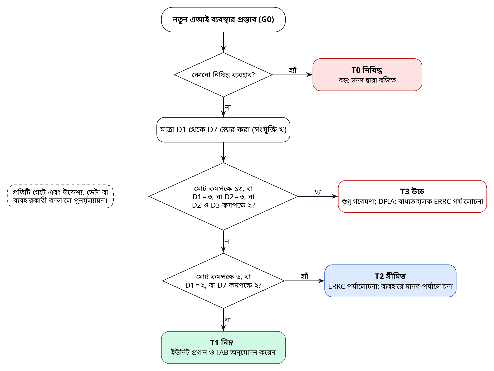

*চিত্র ১০। ঝুঁকি-স্তর নির্ধারণের প্রবাহ, গেট G0-তে প্রয়োগ এবং প্রতিটি গেটে পুনরাবৃত্তি।*

**সারণি ৩৯।** ঝুঁকি-স্তর এবং প্রতিটি স্তরের ন্যূনতম আবশ্যিক নিয়ন্ত্রণ

| স্তর | সাধারণ ব্যবস্থা | ন্যূনতম আবশ্যিক নিয়ন্ত্রণ | অনুমোদনকারী |
|---------------|------------------------|------------------------------------|---------------|
| **T0** নিষিদ্ধ | সামাজিক স্কোরিং; গণ বা নির্বিচার বায়োমেট্রিক নজরদারি; মানুষের রাজনৈতিক বা ধর্মীয় মতের প্রোফাইলিং; বাস্তব ব্যক্তির প্রতারণামূলক কৃত্রিম মিডিয়া; দুর্বলতাকে কাজে লাগিয়ে প্রভাবিত করা | কোনো ব্যবস্থাতেই BAPIL এগুলো নির্মাণ, পাইলট বা সমর্থন করে না | সনদ দ্বারা বর্জিত |
| **T1** নিম্ন | উন্মুক্ত নথিতে গবেষণা ও অনুসন্ধান সরঞ্জাম; প্রকাশিত ডেটার ড্যাশবোর্ড | এআই ব্যবস্থার রেকর্ড; মডেল বা ডেটা কার্ড; মূল্যায়ন প্রতিবেদন; নিরীক্ষা লগ; স্বচ্ছতা নিবন্ধনে প্রকাশ্য তালিকাভুক্তি | ইউনিট প্রধান ও TAB |
| **T2** সীমিত | কর্মকর্তাদের ব্যবহৃত পরামর্শমূলক সরঞ্জাম; জনমুখী তথ্য সরঞ্জাম; পরিচয়-অপসারিত মতামতের সামষ্টিক বিশ্লেষণ | T1-এর সব নিয়ন্ত্রণ এবং: ERRC পর্যালোচনা; রেড-টিম পরীক্ষা; ব্যবহারে প্রতিটি ফলাফলের মানব-পর্যালোচনা; ব্যবহারকারী প্রশিক্ষণ; ঘটনা-প্রক্রিয়া; ত্রৈমাসিক পর্যবেক্ষণ প্রতিবেদন | ERRC ও স্টিয়ারিং বোর্ড |
| **T3** উচ্চ | নির্দিষ্ট ব্যক্তি বা প্রতিষ্ঠান-সংক্রান্ত সিদ্ধান্তে ভূমিকা রাখে, বৃহৎ পরিসরে ব্যক্তিগত ডেটা প্রক্রিয়া করে বা প্রয়োগকারী কাজে ব্যবহৃত যেকোনো ব্যবস্থা | BAPIL T3 পরিচালনাগত ব্যবস্থা নির্মাণ করে না। শুধু গবেষণা, এই শর্তে: DPIA, আইনি পর্যালোচনা, স্বাধীন নিরীক্ষা, ERRC অনুমোদন এবং প্রকাশিত প্রভাব মূল্যায়ন | ERRC (বাধ্যতামূলক) ও স্বাগতিক সংস্থার আইনি পর্যালোচনা |

## ১৩.৩ জীবনচক্র-গেট

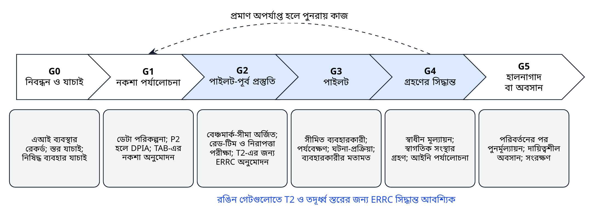

*চিত্র ১১। জীবনচক্র-গেট G0 থেকে G5 এবং প্রতিটি গেটে প্রয়োজনীয় প্রমাণ।*

* **G0 নিবন্ধন ও যাচাই।** এআই ব্যবস্থার রেকর্ড তৈরি (সংযুক্তি গ), স্তর-যাচাই এবং কোনো নিষিদ্ধ ব্যবহার নেই তা নিশ্চিত করা।
* **G1 নকশা পর্যালোচনা।** ডেটা পরিকল্পনা, P2 ডেটা থাকলে DPIA, এবং স্থাপত্য (TAB) অনুমোদন।
* **G2 পাইলট-পূর্ব প্রস্তুতি।** বেঞ্চমার্ক-সীমা অর্জন এবং রেড-টিম ও নিরাপত্তা পরীক্ষায় উত্তীর্ণতা প্রদর্শন; T2 স্তরের জন্য ERRC অনুমোদন।
* **G3 পাইলট।** সীমিত ব্যবহারকারী, পর্যবেক্ষণ ও ঘটনা-প্রক্রিয়াসহ পরিচালনা; ব্যবহারকারীর মতামত সংগ্রহ।
* **G4 গ্রহণের সিদ্ধান্ত।** স্বাধীন মূল্যায়ন, স্বাগতিক সংস্থার গ্রহণ এবং আইনি পর্যালোচনা; সংস্থার মালিকানায় O শ্রেণিতে হস্তান্তর, অথবা সমাপ্তি।
* **G5 হালনাগাদ বা অবসান।** যেকোনো উল্লেখযোগ্য পরিবর্তনের পর পুনর্মূল্যায়ন; দায়িত্বশীলভাবে অবসান ও সংরক্ষণ।

প্রতিটি গেটের চেকলিস্ট সংযুক্তি ঞ-তে দেওয়া হয়েছে।

## ১৩.৪ মানব-তত্ত্বাবধান

মানব-তত্ত্বাবধান কোনো একক নিয়ন্ত্রণ নয়, বরং স্তর ও ব্যবহার অনুযায়ী প্রয়োগকৃত কয়েকটি ধরনের সমষ্টি। প্রতিটি ব্যবস্থার জন্য নিচের ধরনগুলো সমন্বিত করে তার এআই ব্যবস্থার রেকর্ডে লিপিবদ্ধ করা হয়।

**সারণি ৪০।** মানব-তত্ত্বাবধানের ধরন

| ধরন | বিবরণ | ব্যবহারক্ষেত্র |
|-------------------|-----------------------------------|--------------------------|
| মানুষ প্রক্রিয়ার ভেতরে | ব্যবহারের আগে একজন মানুষ প্রতিটি ফলাফল পর্যালোচনা করেন | A শ্রেণির সব ব্যবহার (P1 পাইলট; P3 সারাংশ) |
| মানুষ প্রক্রিয়ার ওপরে | মানুষ নমুনা ও পর্যবেক্ষণ-সংকেত পর্যালোচনা করেন; হস্তক্ষেপ করতে পারেন | R শ্রেণির গবেষণা-সরঞ্জাম; প্রকাশিত ডেটার ড্যাশবোর্ড |
| মানুষের কর্তৃত্ব | কর্তৃত্ব ও জবাবদিহি সিদ্ধান্তগ্রহণকারী কর্মকর্তার কাছে থাকে | প্রতিটি ব্যবহার; সনদে লিপিবদ্ধ |
| চ্যালেঞ্জের সুযোগ | ব্যবহারকারী ও জনসাধারণ ত্রুটি চিহ্নিত করে সাড়া পেতে পারেন | পোর্টালের “সমস্যা জানান” লিংক; ঘটনা-প্রক্রিয়া |
| প্রকাশের আগে দ্বৈত যাচাই | প্রকাশের আগে দুইজন মানুষ যেকোনো এআই-সহায়িত টেক্সট যাচাই করেন | প্রতিবেদন, সংক্ষিপ্তসার ও জনসমক্ষে সারাংশ |

## ১৩.৫ নথিভুক্তি

নিবন্ধনের প্রতিটি ব্যবস্থার একটি মডেল কার্ড [৭৯] এবং প্রতিটি ডেটাসেটের একটি ডেটাশিট [৭৫] থাকে। নিবন্ধনটিই জনসমক্ষে **স্বচ্ছতা নিবন্ধনের** একমাত্র উৎস, যা স্বয়ংক্রিয়ভাবে প্রস্তুত হয়ে BAPIL ওয়েবসাইট ও রিপোজিটরিতে প্রকাশিত হয় (প্রয়োজনীয়তা FR-09)। প্রতিটি এন্ট্রিতে ব্যবস্থার উদ্দেশ্য, মালিক, স্তর, পরিপক্বতা শ্রেণি, ডেটা-শ্রেণি, মূল্যায়নের সারাংশ, জানা সীমাবদ্ধতা এবং অভিযোগের যোগাযোগ উল্লেখ থাকে।

## ১৩.৬ ঘটনা ও প্রতিকার

ঘটনা বলতে বোঝায় এমন যেকোনো পরিস্থিতি, যেখানে কোনো ব্যবস্থা ক্ষতিকর, বিভ্রান্তিকর, বৈষম্যমূলক বা অনিরাপদ ফলাফল সৃষ্টি করে বা তাতে ভূমিকা রাখে, অথবা কোনো সুরক্ষাব্যবস্থা ব্যর্থ হয়। ব্যবহারকারী ও জনসাধারণ পোর্টালের মাধ্যমে ঘটনা জানাতে পারেন। কার্যপ্রণালী গুরুত্ব অনুযায়ী সময়সীমা নির্ধারণ করে (সারণি ৩৪): যেমন এক কর্মদিবসের মধ্যে প্রাপ্তিস্বীকার এবং গুরুতর ঘটনার ক্ষেত্রে ত্রিশ দিনের মধ্যে প্রকাশিত সারাংশ। ERRC সকল গুরুতর ঘটনা পর্যালোচনা করে এবং কোনো ব্যবস্থা স্থগিত করতে পারে।

অভিযোগও একই পথে গৃহীত হয়। এক কর্মদিবসের মধ্যে অভিযোগের প্রাপ্তিস্বীকার এবং ত্রিশ দিনের মধ্যে উত্তর দেওয়া হয়। সন্তুষ্ট না হলে অভিযোগকারী সিদ্ধান্তটি পর্যালোচনার জন্য ERRC-এর কাছে আবেদন করতে পারেন; ERRC-এর বিরুদ্ধে অভিযোগ যায় স্টিয়ারিং বোর্ডের যুগ্ম সভাপতিদের কাছে এবং বার্ষিক স্বাধীন নিরীক্ষায় তা পরীক্ষা করা হয়। এসব অভ্যন্তরীণ পথ কোনো আইনগত প্রতিকারকে সীমিত করে না: অভিযোগকারীরা উপাত্ত সুরক্ষা ও উপাত্ত ব্যবস্থাপনা আইনের অধীনে গঠিত কর্তৃপক্ষ বা আদালতের কাছেও যেতে পারেন, এবং BAPIL তাদের সহযোগিতা করে।

## ১৩.৭ ন্যায্যতা ও ভাষাগত সমতা

BAPIL-এর ব্যবস্থায় ন্যায্যতার একটি সুনির্দিষ্ট, পরিমাপযোগ্য অর্থ রয়েছে: ব্যবস্থাগুলোকে ইংরেজির মতোই বাংলায় ভালো কাজ করতে হবে, এবং বিভিন্ন জারিকারী সংস্থা, অঞ্চল ও সময়ের নথির ক্ষেত্রেও সমানভাবে। তাই বেঞ্চমার্কের ফলাফল ভাষা ও নথির ধরন অনুযায়ী প্রতিবেদিত হয়, এবং সমতা-লক্ষ্য (NFR-01) রিলিজের একটি শর্ত। P3-এর ক্ষেত্রে ন্যায্যতার অর্থ এটিও যে পরামর্শে সংখ্যালঘু মত সামষ্টিকীকরণে হারিয়ে যাবে না; মানুষের দ্বারা বিষয়-যাচাই তা নিশ্চিত করে।

## ১৩.৮ উৎপাদনমূলক বৈশিষ্ট্যের আশ্বাস

যদি ও যখন উৎপাদনমূলক বৈশিষ্ট্য সক্রিয় করা হয় (যেমন নিষ্কাশিত বাক্যগুলোকে একটি সাবলীল সারাংশে পুনর্বিন্যাস), তখন অতিরিক্ত নিয়ন্ত্রণ প্রযোজ্য হয়। প্রতিটি উৎপাদিত বাক্য তার উদ্ধৃত অনুচ্ছেদের সঙ্গে মিলিয়ে যাচাই করতে হবে, এবং যাচাই করা যায় না এমন যেকোনো বাক্য বাদ দেওয়া হয়। সিস্টেম প্রম্পট ও মডেল সংস্করণ নিরীক্ষা লগে লিপিবদ্ধ হয়। রেড-টিম পরীক্ষায় নথির মাধ্যমে প্রম্পট-ইনজেকশন [৮৫, ৮৮], ব্যবস্থাকে কর্পাসের বাইরের বিষয়বস্তু তৈরি করানোর প্রচেষ্টা এবং নিষিদ্ধ ফলাফলের অনুরোধ অন্তর্ভুক্ত থাকে। উৎপাদিত টেক্সট সর্বদা সেভাবে চিহ্নিত থাকে। এটি BAPIL-এর নিজস্ব নিয়ম; এটি এআই-সৃষ্ট মিথ্যা বা বিভ্রান্তিকর কনটেন্ট প্রতিরোধে খসড়া জাতীয় এআই নীতির ব্যবস্থার সঙ্গে সামঞ্জস্যপূর্ণ [১১], তবে প্রতিবেদন অনুযায়ী খসড়াটি নিজে লেবেল দেওয়ার বিধান রাখেনি। একটি উৎপাদনমূলক বৈশিষ্ট্য উল্লেখযোগ্য পরিবর্তন হিসেবে গণ্য হয় এবং প্রকাশের আগে গেট G5 (পুনর্মূল্যায়ন) উত্তীর্ণ হতে হয়।

## ১৩.৯ ক্রয়কৃত ও তৃতীয় পক্ষের এআই-এর আশ্বাস

BAPIL-এর পাইলটে ব্যবহৃত প্রতিটি এআই ব্যবস্থা BAPIL নিজে নির্মাণ করবে না। কোনো উপাদান ক্রয় করা হলে বা কোনো অংশীদার সরবরাহ করলে (যেমন একটি OCR সেবা, একটি এমবেডিং মডেল বা একটি হোস্টকৃত ভাষা মডেল), তা BAPIL-এর নিজস্ব উপাদানের মতোই একই স্তর ও গেট প্রক্রিয়ার অধীন। সরবরাহকারীকে অধ্যায় ১৭-এর ক্রয়-শর্তে প্রয়োজনীয় নথি (মডেল কার্ড, SBOM ও জানা সীমাবদ্ধতা) দিতে হবে, BAPIL-কে নিজস্ব বেঞ্চমার্কে উপাদানটি পরীক্ষা করতে পারতে হবে, এবং সংস্করণের যেকোনো পরিবর্তন জানাতে ও পুনর্মূল্যায়ন করতে হবে। মূল্যায়ন বা নথিভুক্ত করা যায় না এমন তৃতীয় পক্ষের উপাদান P0-এর ওপরের শ্রেণির ডেটার জন্য ব্যবহার করা যায় না।

## ১৩.১০ স্বাধীন আশ্বাস ও নিরীক্ষা

স্ব-মূল্যায়ন প্রয়োজনীয়, কিন্তু যথেষ্ট নয়। প্রতি বছর একজন স্বাধীন পর্যালোচক ব্যবস্থাগুলোর একটি নমুনাকে তাদের রেকর্ড, গেট-সিদ্ধান্ত ও মূল্যায়নের প্রমাণের সঙ্গে মিলিয়ে নিরীক্ষা করেন এবং নিরীক্ষা লগগুলো যাচাইযোগ্য কি না তা পরীক্ষা করেন। যেকোনো G4 গ্রহণ-সিদ্ধান্তের আগে একটি স্বাধীন মূল্যায়ন করানো হয়। সময়ের সঙ্গে নিয়ন্ত্রণগুলো ISO/IEC 42001 [২০] অনুযায়ী ব্যবস্থাপনা-ব্যবস্থার সনদায়ন এবং ISO/IEC 23894 [৮৯] নির্দেশিত ঝুঁকি ব্যবস্থাপনায় সহায়তা করতে পারে।

## ১৩.১১ আন্তর্জাতিক কাঠামোর সঙ্গে সামঞ্জস্য

নিয়ন্ত্রণ-ক্ষেত্রগুলো প্রধান আন্তর্জাতিক কাঠামোর সঙ্গে সংযুক্ত, যা অংশীদার ও নিরীক্ষকদের ব্যবস্থাটি বুঝতে সাহায্য করে।

**সারণি ৪১।** আন্তর্জাতিক ও জাতীয় কাঠামোর সঙ্গে BAPIL নিয়ন্ত্রণ-ক্ষেত্রের নির্দেশক সংযোগ-সারণি

| BAPIL নিয়ন্ত্রণ-ক্ষেত্র | OECD এআই নীতিমালা | UNESCO সুপারিশ | NIST AI RMF 1.0 | ISO/IEC 42001:2023 | ইইউ এআই আইন | বাংলাদেশ (খসড়া নীতি ও আইন) |
|-----------------|--------------|----------------|------------|----------------|---------------|------------------|
| শাসন ও জবাবদিহি | ১.৫ জবাবদিহি | দায়িত্ব ও জবাবদিহি | GOVERN | অনুচ্ছেদ ৫ ও ৬; পরিশিষ্ট A.2, A.3 | অনু. ১৭, অনু. ২৬ | প্রস্তাবিত স্বাধীন তত্ত্বাবধান কমিটি |
| ঝুঁকি মূল্যায়ন ও স্তরবিন্যাস | ১.৪ দৃঢ়তা, নিরাপত্তা ও সুরক্ষা | আনুপাতিকতা; নৈতিক প্রভাব মূল্যায়ন | MAP | অনুচ্ছেদ ৬.১, ৮.২ থেকে ৮.৪; A.5 | অনু. ৫, ৯, ২৭ | নিষিদ্ধ, উচ্চ, সীমিত ও নিম্ন ঝুঁকির শ্রেণি; উচ্চ ঝুঁকিতে AIA |
| ডেটা শাসন ও গোপনীয়তা | ১.২ মানবাধিকার, গোপনীয়তাসহ | গোপনীয়তা ও উপাত্ত সুরক্ষা | MAP, MEASURE | A.7 এআই ব্যবস্থার ডেটা | অনু. ১০ | ব্যক্তিগত উপাত্ত সুরক্ষা আইন ২০২৬; জাতীয় উপাত্ত ব্যবস্থাপনা আইন ২০২৬ |
| ন্যায্যতা ও বৈষম্যহীনতা | ১.২ ন্যায্যতা | ন্যায্যতা ও বৈষম্যহীনতা | MEASURE | A.5, A.7 | অনু. ১০(২)(চ) | খসড়া নীতিতে প্রস্তাবিত পক্ষপাত-নিরীক্ষা |
| স্বচ্ছতা ও নথিভুক্তি | ১.৩ স্বচ্ছতা ও ব্যাখ্যাযোগ্যতা | স্বচ্ছতা ও ব্যাখ্যাযোগ্যতা | GOVERN, MAP | A.6, A.8 | অনু. ১১, ১৩, ৫০ | এআই-সৃষ্ট মিথ্যা বা বিভ্রান্তিকর কনটেন্ট প্রতিরোধের ব্যবস্থা (খসড়া নীতি) |
| মানব-তত্ত্বাবধান | ১.২ মানব-কর্তৃত্ব ও তত্ত্বাবধান | মানব-তত্ত্বাবধান ও নির্ধারণ | MANAGE | A.9 এআই ব্যবস্থার ব্যবহার | অনু. ১৪ | উচ্চ-ঝুঁকিপূর্ণ ব্যবহারে মানব-তত্ত্বাবধান (খসড়া নীতি) |
| দৃঢ়তা, নিরাপত্তা ও নির্ভুলতা | ১.৪ দৃঢ়তা, নিরাপত্তা ও সুরক্ষা | নিরাপত্তা ও সুরক্ষা | MEASURE | A.6 যাচাই ও বৈধকরণ | অনু. ১৫ | সংশোধিত সাইবার নিরাপত্তা আইন ২০২৬ |
| পর্যবেক্ষণ ও ঘটনা | ১.৪, ১.৫ | বহু-অংশীজন ও অভিযোজনক্ষম শাসন | MANAGE | অনুচ্ছেদ ৯ ও ১০ | অনু. ৭২, ৭৩ | তত্ত্বাবধান কমিটির নিরীক্ষা (খসড়া নীতি) |
| অংশীজন সম্পৃক্ততা ও প্রতিকার | ১.৩ ফলাফল চ্যালেঞ্জের সুযোগ | সচেতনতা ও সাক্ষরতা; বহু-অংশীজন শাসন | GOVERN 5 | A.8 আগ্রহী পক্ষের জন্য তথ্য | অনু. ৮৫, ৮৬ | জাতীয় এআই নীতিতে জন-পরামর্শ |

*টীকা।* শুধু দিকনির্দেশনার জন্য নির্দেশক সংযোগ; এটি আইনি সম্মতি-মূল্যায়ন নয়। কানাডার স্বয়ংক্রিয় সিদ্ধান্তগ্রহণ নির্দেশনা ঝুঁকি-স্তর পদ্ধতিকে প্রভাবিত করেছে (অধ্যায় ১৩)।

\newpage

# অধ্যায় ১৪: বাংলাদেশে আইনগত ও নীতিগত সামঞ্জস্য

## ১৪.১ পরিবর্তনশীল কাঠামো

২০২৫ সালের শেষ থেকে ২০২৬ সালের মাঝামাঝি সময়ে ডেটা ও ডিজিটাল প্রযুক্তি বিষয়ে বাংলাদেশের আইনি কাঠামো উল্লেখযোগ্যভাবে বদলেছে। ব্যক্তিগত উপাত্ত সুরক্ষা অধ্যাদেশ, ২০২৫ এবং জাতীয় উপাত্ত ব্যবস্থাপনা অধ্যাদেশ, ২০২৫ (কিছু ইংরেজি প্রতিবেদনে National Data Governance Ordinance নামে উল্লিখিত) নভেম্বর ২০২৫-এ গেজেটভুক্ত হয় [৬, ৭১]। মাধ্যমিক আইনি ভাষ্য অনুযায়ী, ব্যক্তিগত উপাত্ত সুরক্ষা অধ্যাদেশ প্রধান ডেটা কর্মকর্তা, অভিযোগ ও অপরাধ-সংক্রান্ত ধারা ছাড়া তাৎক্ষণিকভাবে কার্যকর হয় [৩৯], এবং ১৮ মাসের একটি সম্মতি-সময়সীমার কথা বলা হয়েছে [৯০]। অধ্যাদেশটির ডেটা দেশে রাখা-সংক্রান্ত বিধান পরিবর্তনকারী ব্যক্তিগত উপাত্ত সুরক্ষা (সংশোধন) অধ্যাদেশ, ২০২৬ ফেব্রুয়ারি ২০২৬-এ জারি হয় [৬৯]; ভাষ্যকারদের মতে দেশে ডেটা রাখার বাধ্যবাধকতা ব্যাংকিং ও স্বাস্থ্যের মতো গুরুত্বপূর্ণ খাতে সীমিত [৭০]। এরপর সংসদ অধ্যাদেশগুলোকে আইনে রূপ দিতে বিল পাস করে: জাতীয় উপাত্ত ব্যবস্থাপনা বিল, ২০২৬ ও সাইবার নিরাপত্তা বিল, ২০২৬ ১০ এপ্রিল ২০২৬-এ পাস হয়েছে বলে প্রতিবেদিত [৮], এবং ব্যক্তিগত উপাত্ত সুরক্ষা আইন, ২০২৬ এপ্রিল ২০২৬-এ প্রণীত বলে প্রতিবেদিত [৭, ৩৮]। সংসদ ৩০ জুন ২০২৬-এ সাইবার নিরাপত্তা (সংশোধন) বিল, ২০২৬ পাস করে, তবে এর বিষয়বস্তু নিয়ে প্রতিবেদনগুলো ভিন্ন: একটি প্রতিবেদন প্ল্যাটফর্ম থেকে ক্ষতিকর ও মানহানিকর এআই-সৃষ্ট কনটেন্ট দ্রুত অপসারণের বিধানের কথা বলে [৯], আর অন্য প্রতিবেদন অনুযায়ী বিলটি অনলাইন জুয়া-সংক্রান্ত একটি ধারা বাদ দিয়েছে [৪০]। জুলাই ২০২৬-এ একটি খসড়া সাইবার নিরাপত্তা (সংশোধন) আইন, ২০২৬ পর্যালোচনা ও চূড়ান্ত করতে একটি মন্ত্রিসভা কমিটি গঠিত হয় [৪১], তাই আরেকটি সংশোধনী আসতে পারে।

এ থেকে তিনটি সতর্কতা আসে। প্রথমত, এসব বক্তব্য সংবাদমাধ্যমের প্রতিবেদন ও মাধ্যমিক ভাষ্য থেকে নেওয়া, যেগুলো কখনো কখনো পরস্পরবিরোধী; সরকারি আইন-ডেটাবেস স্বয়ংক্রিয় সংগ্রহের অনুমতি না দেওয়ায় এই সংস্করণের জন্য গেজেটভুক্ত পাঠ পর্যালোচনা করা হয়নি। দ্বিতীয়ত, প্রণয়ন আর কার্যকারিতা এক নয়: ২০২৬ সালের আইনগুলোর প্রতিটি বিধান বলবৎ কি না, এবং অধ্যাদেশের স্থগিত বিধানগুলো আইনে বহাল আছে কি না, তা নিশ্চিত করতে হবে। তৃতীয়ত, বাস্তবায়ন-বিধিমালা এখনো জারি হতে পারে। আইনি পর্যালোচনা অবস্থান নিশ্চিত না করা পর্যন্ত BAPIL প্রতিটি দায়িত্বের কঠোরতর ব্যাখ্যা প্রয়োগ করবে।

**সারণি ৪২।** BAPIL-এর সঙ্গে প্রাসঙ্গিক বাংলাদেশের আইন ও নীতি-দলিল (প্রতিবেদিত অবস্থা, অক্টোবর ২০২৬)

| দলিল | অবস্থা | প্রাসঙ্গিকতা | ব্লুপ্রিন্টের নকশাগত সাড়া |
|------------------|---------------------------------|-------------------------|----------------------|
| ব্যক্তিগত উপাত্ত সুরক্ষা আইন, ২০২৬ (Personal Data Protection Act, 2026) | ব্যক্তিগত উপাত্ত সুরক্ষা অধ্যাদেশ, ২০২৫-এর স্থলে এপ্রিল ২০২৬-এ প্রণীত বলে প্রতিবেদিত (২০২৬ সালের ৬৩ নং আইন) [৭, ৩৮]। অধ্যাদেশে প্রধান ডেটা কর্মকর্তা, অভিযোগ ও অপরাধ-সংক্রান্ত ধারাগুলো তাৎক্ষণিকভাবে কার্যকর হয়নি, এবং ১৮ মাসের সম্মতি-সময়সীমা প্রতিবেদিত হয়েছে [৩৯, ৯০]। আইনের প্রতিটি বিধান ও বিধিমালার কার্যকারিতা: নিশ্চিত করতে হবে | সম্মতি; স্বয়ংক্রিয় সিদ্ধান্ত সীমিত করার অধিকারসহ ডেটা-বিষয়ীর অধিকার; সংবেদনশীল ও শিশুদের ডেটার বাড়তি সুরক্ষা; প্রধান ডেটা কর্মকর্তা; ২০২৬ সালের সংশোধনী অধ্যাদেশে পরিবর্তিত ডেটা দেশে রাখা-সংক্রান্ত বিধান [৬৯], প্রতিবেদন অনুযায়ী গুরুত্বপূর্ণ খাতে সীমিত [৭০] | প্রথমে P0; যেকোনো P2 কাজের আগে DPIA; P3 বর্জিত; ব্যক্তিসংক্রান্ত কোনো স্বয়ংক্রিয় সিদ্ধান্ত নয়; বাংলাদেশে হোস্টিং |
| জাতীয় উপাত্ত ব্যবস্থাপনা আইন, ২০২৬ (National Data Management Act, 2026) | জাতীয় উপাত্ত ব্যবস্থাপনা অধ্যাদেশ, ২০২৫-এর (কিছু ইংরেজি প্রতিবেদনে National Data Governance Ordinance নামে উল্লিখিত) ধারাবাহিকতায় ১০ এপ্রিল ২০২৬-এ বিল পাস বলে প্রতিবেদিত [৬, ৮, ৭১]। কার্যকারিতা ও বিধিমালা: নিশ্চিত করতে হবে | জাতীয় উপাত্ত ব্যবস্থাপনা কর্তৃপক্ষ; দায়িত্বশীল ডেটা বিনিময় (NRDEX); জাতীয় সোর্স কোড ভান্ডার (২০২৫ সালের অধ্যাদেশের বর্ণনা অনুযায়ী [৬]; আইনে বহাল আছে কি না নিশ্চিত করতে হবে) | সম্ভব হলে ডেটা প্রবেশাধিকারে NRDEX চুক্তি ব্যবহার; উন্মুক্তভাবে কোড প্রকাশ; কর্তৃপক্ষ ও সংস্থার ডেটা কর্মকর্তাদের সঙ্গে সমন্বয় |
| সাইবার নিরাপত্তা আইন, ২০২৬ ও সংশোধনী | ১০ এপ্রিল ২০২৬-এ বিল পাস বলে প্রতিবেদিত [৮]; সাইবার নিরাপত্তা (সংশোধন) বিল, ২০২৬ ৩০ জুন ২০২৬-এ পাস; এর বিষয়বস্তু নিয়ে প্রতিবেদন ভিন্ন (ক্ষতিকর এআই-সৃষ্ট কনটেন্ট অপসারণ [৯]; অনলাইন জুয়া-সংক্রান্ত ধারা বাদ [৪০]); জুলাই ২০২৬ থেকে আরেকটি খসড়া সংশোধনী মন্ত্রিসভা কমিটির পর্যালোচনাধীন [৪১]। বিষয়বস্তু ও কার্যকারিতা: নিশ্চিত করতে হবে | নিরাপত্তা দায়িত্ব; গুরুত্বপূর্ণ তথ্য অবকাঠামো; ক্ষতিকর কনটেন্ট অপসারণ ও বন্ধ করা, সম্ভবত এআই-সৃষ্ট কনটেন্টসহ (নিশ্চিত করতে হবে) | NIST CSF 2.0 নিয়ন্ত্রণ; ঘটনা প্রতিবেদন; তথ্য-অখণ্ডতা গবেষণা আইন ও অধিকারের সীমার মধ্যে |
| তথ্য অধিকার আইন, ২০০৯ | বলবৎ [৬৫] | জনগুরুত্বপূর্ণ তথ্যের স্বতঃপ্রণোদিত প্রকাশ | P0 কর্পাস ও জনসমক্ষে স্বচ্ছতা নিবন্ধনকে সহায়তা করে |
| জাতীয় এআই নীতি | খসড়া ২০২৬-২০৩০ জানুয়ারি ২০২৬-এর শেষে জন-পরামর্শের জন্য প্রকাশিত [১০, ১১]; সংশোধিত খসড়া (সংস্করণ ২.০, ৯ ফেব্রুয়ারি ২০২৬) সরকারি পোর্টালে প্রকাশিত [১২]; একটি যৌথ দলের মাধ্যমে ২০২৬-এর চতুর্থ ত্রৈমাসিকে প্রণয়ন শুরুর ঘোষণা [১৪]। গৃহীত হয়নি | ঝুঁকির শ্রেণি; অ্যালগরিদমিক প্রভাব মূল্যায়ন; সংসদের আইনের মাধ্যমে গঠিতব্য একটি স্বাধীন তত্ত্বাবধান কমিটি; বাংলা LLM; জাতীয় কম্পিউটিং; ২০৩০ পর্যন্ত ২০০ থেকে ২৫০ কোটি টাকার এআই উদ্ভাবন তহবিল (প্রস্তাবিত) [১০] | খসড়ার শ্রেণির সঙ্গে স্তর সামঞ্জস্যপূর্ণ; ব্লুপ্রিন্ট কারিগরি উপকরণ হিসেবে প্রস্তাবিত; জাতীয় LLM পরিকল্পনার সঙ্গে BPFM সমন্বিত |
| দীর্ঘমেয়াদি জাতীয় পরিকল্পনা | প্রেক্ষিত পরিকল্পনা ২০৪১ ও আইসিটি মাস্টারপ্ল্যান ২০৪১ [১৫, ১৬] | দীর্ঘমেয়াদি ডিজিটাল রূপান্তরের লক্ষ্য | ২০৪১ দিগন্তের সঙ্গে সামঞ্জস্যপূর্ণ ও পরিকল্পনা সংশোধনের সঙ্গে খাপ খাওয়ানো যায় এমন রোডম্যাপ |
| এআই হাব ও এআই দক্ষতা প্রকল্প (কোইকা, আইসিটি বিভাগ, বাংলাদেশ হাই-টেক পার্ক কর্তৃপক্ষ) | ১৯২.৬৬ কোটি টাকার কারিগরি সহায়তা প্রকল্প প্রস্তাব জুন ২০২৬-এ সরকারি অনুমোদনের অপেক্ষায় ছিল [৫৩]; ২০২৬ থেকে ২০২৯ মেয়াদের জন্য ১৩ মিলিয়ন মার্কিন ডলারের অনুদান-চুক্তি (রেকর্ড অব ডিসকাশন) আগস্ট ২০২৬-এ স্বাক্ষরিত বলে প্রতিবেদিত [৫৫]। চালু হওয়ার কোনো প্রতিবেদন নেই | দক্ষতা, স্টার্টআপ, এআই গ্রহণ | পরিপূরক কর্মবিভাজন; যৌথ বেঞ্চমার্ক ও উন্মুক্ত ডেটা |

*টীকা।* অবস্থা অক্টোবর ২০২৬-এ প্রাপ্ত সংবাদমাধ্যমের প্রতিবেদন ও মাধ্যমিক আইনি ভাষ্য থেকে নেওয়া। এই সংস্করণের জন্য গেজেটভুক্ত পাঠ ও তার কার্যকারিতা-বিধান পর্যালোচনা করা হয়নি (সংযুক্তি ত), এবং বাংলাদেশের যোগ্য আইনজীবীর মাধ্যমে নিশ্চিত করতে হবে। এই সারণি আইনি পরামর্শ নয়।

## ১৪.২ BAPIL-এর জন্য তাৎপর্য

* **আইনগত ভিত্তি ও ন্যূনতমকরণ।** ইতিমধ্যে প্রকাশিত নথিতে ব্যক্তিগত ডেটার ঝুঁকি কম এবং নতুন সম্মতির প্রয়োজন হয় না, তাই প্রথমে উন্মুক্ত ডেটা নীতিই প্রধান আইনগত সুরক্ষা। প্রকাশিত ব্যক্তিগত ডেটা (যেমন গেজেট প্রজ্ঞাপনে থাকা নাম) একত্র বা প্রোফাইল করা হয় না। যেকোনো P2 প্রক্রিয়াকরণে নথিভুক্ত আইনগত ভিত্তি ও DPIA প্রয়োজন।
* **স্বয়ংক্রিয় সিদ্ধান্ত।** স্বয়ংক্রিয় সিদ্ধান্ত সীমিত করার অধিকার এই নকশা-নিয়মকে শক্তিশালী করে যে BAPIL কখনো ব্যক্তিসংক্রান্ত সিদ্ধান্ত স্বয়ংক্রিয় করে না।
* **ডেটা বিনিময়।** অধ্যাদেশের বর্ণনা অনুযায়ী জাতীয় ডেটা বিনিময় ও প্রধান ডেটা কর্মকর্তাদের সমন্বয়ক ভূমিকা আইনের অধীনে চালু থাকলে তা ডেটা প্রবেশাধিকার চুক্তির একটি আইনসম্মত পথ তৈরি করে, যা BAPIL-এর ব্যবহার করা উচিত।
* **তথ্য-অখণ্ডতা।** ভুল তথ্য-সংক্রান্ত গবেষণাকে মতপ্রকাশের স্বাধীনতা ও গোপনীয়তাকে সম্মান করতে হবে; ক্ষতিকর এআই-সৃষ্ট কনটেন্ট দ্রুত অপসারণ বাধ্যতামূলক করার প্রতিবেদিত প্রস্তাবের [৯, ৪১] কারণে স্পষ্ট ও নথিভুক্ত গবেষণা-প্রটোকল বিশেষভাবে গুরুত্বপূর্ণ।
* **জাতীয় এআই নীতি।** স্তরবিন্যাস খসড়া নীতির শ্রেণিগুলোর সঙ্গে সামঞ্জস্যপূর্ণ, যাতে সেই শ্রেণিগুলো গৃহীত হলে BAPIL-এর ব্যবস্থাগুলো সামঞ্জস্যপূর্ণভাবে শ্রেণিবদ্ধ হয়। ২০২৬ সালের চতুর্থ ত্রৈমাসিকের জন্য ঘোষিত প্রণয়ন-প্রক্রিয়ায় ব্লুপ্রিন্টটি উপকরণ হিসেবে প্রস্তাবিত [১৪]; এই প্রক্রিয়া জানুয়ারি ও ফেব্রুয়ারি ২০২৬-এর খসড়ার পরে আসছে [১০, ১২]।

## ১৪.৩ আইনি পর্যালোচনা

মাইলফলক MS2-এর আগে স্বাগতিক প্রতিষ্ঠানের উচিত বাংলাদেশের যোগ্য আইনজীবীর মাধ্যমে একটি স্বাধীন আইনি পর্যালোচনা করানো। গেজেটভুক্ত পাঠ থেকে এটি নির্ধারণ করবে: প্রতিটি প্রাসঙ্গিক আইন ও সংশোধনীর প্রণয়ন, প্রকাশ ও কার্যকারিতার তারিখ; কোন বিধান বলবৎ এবং কোনগুলো প্রজ্ঞাপন বা বিধিমালার অপেক্ষায়; প্রতিটি পাইলটে BAPIL বা তার স্বাগতিক ডেটা নিয়ন্ত্রক, প্রক্রিয়াকারী না ফিডুশিয়ারি; ডেটা প্রবেশাধিকারে ডেটা-রক্ষক ও BAPIL-এর দায়িত্ব; এবং নকশার কোনো উপাদানে আর কোনো অনুমোদন লাগবে কি না। এরপর এসব ফলাফলের আলোকে সনদ, ডেটা শ্রেণিবিন্যাস, ডেটা-বিনিময় চুক্তির টেমপ্লেট ও DPIA টেমপ্লেট পর্যালোচনা করবে। পর্যালোচনাটি প্রকাশিত হবে এবং সেই অনুযায়ী সারণি ৪২ ও ৪৩ সংশোধিত হবে।

## ১৪.৪ সম্মতি-চেকলিস্ট

নিচের চেকলিস্ট বর্তমানে প্রতিবেদিত আইনগত প্রয়োজনীয়তাগুলোকে BAPIL-এর নিয়ন্ত্রণ এবং সেগুলো কার্যকর থাকার প্রমাণে রূপান্তর করে। আইনি পর্যালোচনার পর এবং যখনই বিধিমালা জারি হয় তখন এটি হালনাগাদ করা হয়।

\begingroup\renewcommand{\bapiltablestretch}{0.85}\renewcommand{\bapiltablesize}{\footnotesize}

**সারণি ৪৩।** বাংলাদেশের কাঠামোর আলোকে সম্মতি-চেকলিস্ট

| ক্ষেত্র | প্রয়োজনীয়তা (প্রতিবেদিত) | BAPIL নিয়ন্ত্রণ | প্রমাণ |
|-----------------|--------------------------|------------------------|------------------|
| সম্মতি ও আইনগত ভিত্তি (PDPA ২০২৬) | ব্যক্তিগত ডেটা সংগ্রহ ও ব্যবহারে সুস্পষ্ট সম্মতি | প্রথমে P0; P3 পাইলট-ডেটার সম্মতির রেকর্ড | সম্মতিপত্র; DPIA |
| ডেটা-বিষয়ীর অধিকার (PDPA ২০২৬) | প্রবেশ, সংশোধন, অপসারণ; স্বয়ংক্রিয় সিদ্ধান্ত সীমিতকরণ | ব্যক্তিসংক্রান্ত কোনো স্বয়ংক্রিয় সিদ্ধান্ত নয়; অধিকার-অনুরোধের প্রক্রিয়া | প্রক্রিয়া; অনুরোধ-লগ |
| সংবেদনশীল ও শিশুদের ডেটা (PDPA ২০২৬) | বাড়তি সুরক্ষা; শিশুদের প্রোফাইলিংয়ে নিষেধাজ্ঞা | সনদ দ্বারা P3 ডেটা বর্জিত | সনদ; ডেটা-তালিকা |
| ডেটা রক্ষণ ও বিনিময় (NDMA ২০২৬) | রক্ষকের দায়িত্ব; অনুমোদিত ডেটা বিনিময় | ডেটা-বিনিময় চুক্তি; উপলব্ধ হলে NRDEX ব্যবহার | স্বাক্ষরিত চুক্তি |
| ডেটা দেশে রাখা (PDPA সংশোধনী, ২০২৬) | ২০২৬ সালের সংশোধনী অধ্যাদেশে ডেটা দেশে রাখা-সংক্রান্ত বিধান পরিবর্তিত, প্রতিবেদন অনুযায়ী ব্যাংকিং ও স্বাস্থ্যের মতো গুরুত্বপূর্ণ খাতে সীমিত [৬৯, ৭০] (আইনের অধীনে পরিধি ও অবস্থা নিশ্চিত করতে হবে) | P0-এর ঊর্ধ্বের সব ডেটা বাংলাদেশে হোস্টকৃত (NFR-02) | হোস্টিং চুক্তি |
| সোর্স কোড (NDMA ২০২৬) | সরকারি সফটওয়্যারের জাতীয় সোর্স কোড ভান্ডার (২০২৫ সালের অধ্যাদেশের বর্ণনা অনুযায়ী) | উন্মুক্ত সোর্স কোড; উপলব্ধ হলে জাতীয় ভান্ডারে প্রতিচ্ছবি | রিপোজিটরির লিংক |
| নিরাপত্তা-দায়িত্ব (সাইবার নিরাপত্তা আইন ২০২৬) | ব্যবস্থা ও ডেটার সুরক্ষা; ঘটনা ব্যবস্থাপনা | NIST CSF 2.0 নিয়ন্ত্রণ; ঘটনা-পরিকল্পনা | নিরাপত্তা পর্যালোচনা; মহড়া |
| ক্ষতিকর এআই-সৃষ্ট কনটেন্ট (প্রতিবেদিত ২০২৬ সংশোধনী; নিশ্চিত করতে হবে) | প্রণীত হলে ক্ষতিকর কৃত্রিম কনটেন্ট অপসারণ | কৃত্রিম মিডিয়া তৈরি নয়; P6-এর জন্য গবেষণা-প্রটোকল | ERRC অনুমোদন |
| স্বতঃপ্রণোদিত প্রকাশ (তথ্য অধিকার আইন ২০০৯) | জনগুরুত্বপূর্ণ তথ্য প্রকাশ | উন্মুক্ত প্রকাশনা; স্বচ্ছতা নিবন্ধন | প্রকাশিত নিবন্ধন |
| খসড়া জাতীয় এআই নীতি | ঝুঁকির শ্রেণি; প্রভাব মূল্যায়ন; তত্ত্বাবধান | সামঞ্জস্যপূর্ণ স্তরব্যবস্থা; T2 ও T3-এ প্রভাব মূল্যায়ন | মূল্যায়ন; নিবন্ধন |

*টীকা।* প্রয়োজনীয়তাগুলো সংবাদমাধ্যমের প্রতিবেদন ও মাধ্যমিক আইনি ভাষ্যের সারাংশ [৬, ৭, ৮, ৯, ১০, ৩৯, ৬৯, ৯০]। কোন বিধান কবে থেকে বলবৎ, তা নিশ্চিত হয়নি। আইনি পর্যালোচনা (অনুচ্ছেদ ১৪.৩) প্রতিটি সারি গেজেটভুক্ত পাঠের সঙ্গে মিলিয়ে দেখবে; ততদিন BAPIL কঠোরতর ব্যাখ্যা প্রয়োগ করবে।

\endgroup

## ১৪.৫ তথ্য অধিকার ও স্বতঃপ্রণোদিত প্রকাশ

\looseness=-1 তথ্য অধিকার আইন, ২০০৯ সরকারি কর্তৃপক্ষের কাছে থাকা তথ্যে নাগরিকদের অধিকার দেয় এবং স্বতঃপ্রণোদিত প্রকাশকে উৎসাহিত করে [৬৫]। BAPIL দুইভাবে এই নীতিকে সমর্থন করে। প্রথমত, ইতিমধ্যে প্রকাশিত তথ্য খুঁজে পাওয়া ও উদ্ধৃত করা সহজ করে এটি স্বতঃপ্রণোদিত প্রকাশের ব্যবহারিক মূল্য বাড়ায়। দ্বিতীয়ত, BAPIL নিজেও উন্মুক্ততা চর্চা করে: এর স্বচ্ছতা নিবন্ধন, মূল্যায়ন প্রতিবেদন, ERRC-এর সিদ্ধান্তের সারাংশ ও বার্ষিক আর্থিক সারাংশ অনুরোধের অপেক্ষা না করেই প্রকাশিত হয়। ডেটা-বিনিময় চুক্তির অধীনে BAPIL কোনো সরকারি কর্তৃপক্ষের পক্ষে তথ্য ধারণ করলে সেই তথ্যের অনুরোধ মালিক কর্তৃপক্ষের কাছে পাঠানো হয়।

## ১৪.৬ মেধাস্বত্ব ও লাইসেন্স

\looseness=-1 সরকারি প্রকাশনা সাধারণত গবেষণা ও জনস্বার্থমূলক উদ্দেশ্যে পুনর্ব্যবহারযোগ্য, তবে পুনর্ব্যবহারের শর্ত উৎসভেদে ভিন্ন এবং সর্বদা উল্লিখিত থাকে না। BAPIL প্রতিটি উৎসের পুনর্ব্যবহারের শর্ত লিপিবদ্ধ করে (সারণি ২৪), একসঙ্গে ব্যবহারের জন্য ডেটা-রক্ষকদের কাছ থেকে লিখিত নিশ্চয়তা চায় এবং যেকোনো সীমাবদ্ধতা মেনে চলে। BAPIL-এর নিজস্ব উৎপাদ উন্মুক্তভাবে লাইসেন্সকৃত: নথি ও ডেটাসেট CC BY 4.0-এর অধীনে এবং কোড MIT লাইসেন্সের অধীনে। সরকারি নথির উদ্ধৃতাংশযুক্ত বেঞ্চমার্কে ডেটা-রক্ষকদের প্রয়োজনীয় উৎস-স্বীকৃতি থাকে।

## ১৪.৭ BAPIL-এর নিজস্ব ব্যবস্থার আইনগত অবস্থান

\looseness=-1 BAPIL-এর সনদ, কমিটি, স্তর ও গেট অভ্যন্তরীণ নিয়ম। এগুলো কেবল সমঝোতা স্মারক, স্বাগতিক-চুক্তি, চুক্তিপত্র ও সনদের মাধ্যমে BAPIL, তার স্বাগতিক ও অংশীদারদের বাধ্য করতে পারে; কোনো আইন, নিয়ন্ত্রকের ক্ষমতা বা স্বাগতিক প্রতিষ্ঠানের নিজস্ব আইনগত দায়িত্বকে অগ্রাহ্য করতে পারে না, এবং সংঘাত হলে আইনগত প্রয়োজনীয়তাই প্রাধান্য পায়। প্রথম ধাপে কোনো নতুন আইনের প্রয়োজন নেই: এটি সমঝোতা স্মারক, স্বাগতিক-চুক্তি, ডেটা-বিনিময় চুক্তি, স্বাগতিকের ক্রয় ও নৈতিকতা-প্রক্রিয়া এবং একটি অর্থায়ন-চুক্তির অধীনে চলতে পারে (সংযুক্তি ন, সারণি ৬৫)। কিছু দীর্ঘমেয়াদি বিকল্পে আরও কিছু লাগবে: একটি সংবিধিবদ্ধ কেন্দ্রের (দিগন্ত H3) জন্য আইন প্রয়োজন হবে, এবং সংস্থাগুলোকে ডেটা দিতে বা BAPIL-এর পদ্ধতি অনুসরণ করতে বাধ্য করার যেকোনো ক্ষমতা আসতে হবে আইন বা সরকারি সিদ্ধান্ত থেকে, BAPIL থেকে নয়।

\newpage

# অংশ ৫: বাস্তবায়ন ও দীর্ঘমেয়াদি কৌশল

*প্রথম ৩৬ মাসে BAPIL কীভাবে বাস্তবায়িত হবে, ২০৪১ ও তার পরে কীভাবে বিকশিত হবে, এবং কীভাবে এর অর্থায়ন, পরিবীক্ষণ, ঝুঁকি থেকে সুরক্ষা ও জবাবদিহি নিশ্চিত হবে।*

# অধ্যায় ১৫: বাস্তবায়ন পরিকল্পনা (৩৬ মাস)

## ১৫.১ সংক্ষিপ্ত চিত্র

বাস্তবায়ন পরিকল্পনাটি প্রথম ধাপের সমঝোতা স্মারক কার্যকর হওয়ার পরবর্তী ৩৬ মাস জুড়ে বিস্তৃত। মাস ১ হলো প্রথম সেই মাস, যখন সমঝোতা স্মারক, স্বাগতিক-চুক্তি ও প্রথম বছরের অর্থায়ন তিনটিই নিশ্চিত (সংযুক্তি ন, সারণি ৬৫)। কত দ্রুত তা সম্ভব হবে, তা অর্থায়নের পথের ওপর নির্ভর করে। অনুদান, অংশীদার বা স্বাগতিকের অর্থ আগে থেকেই প্রাপ্য থাকলে জানুয়ারি ২০২৭ সবচেয়ে আগের সম্ভাব্য সূচনা। প্রথম বছরের অর্থ সরকারি উন্নয়ন বাজেটের মাধ্যমে আসতে হলে প্রকল্প অনুমোদনে বহু মাস লাগতে পারে: ডিসেম্বর ২০২৫-এ জমা দেওয়া একটি তুলনীয় কারিগরি সহায়তা প্রস্তাব জুন ২০২৬-এও অনুমোদনের অপেক্ষায় ছিল [৫৩]। সেই পথে ২০২৭ সালের দ্বিতীয়ার্ধে সূচনা বেশি বাস্তবসম্মত। দেরিতে শুরু হলে এই অধ্যায়ের প্রতিটি তারিখ সমপরিমাণ পিছিয়ে যাবে। এটি হোয়াইট পেপারের পাঁচ বছরের রোডম্যাপের (২০২৬-২০৩০) দ্বিতীয় থেকে চতুর্থ ধাপকে সুনির্দিষ্টভাবে বাস্তবায়ন করে এবং কৌশলগত রোডম্যাপের (অধ্যায় ১৬) দিগন্ত H1 ও H2-এর প্রথম বছরের সঙ্গে সংগতিপূর্ণ।

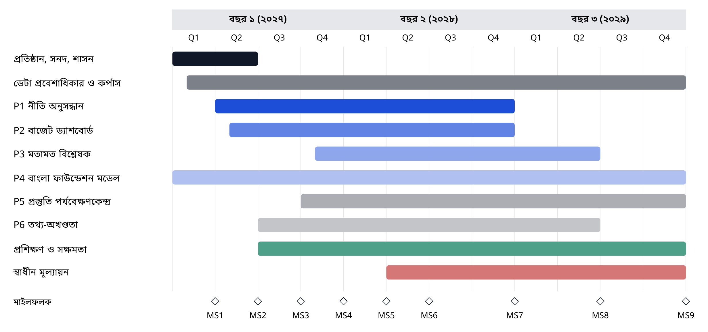

*চিত্র ১২। নির্দেশক ৩৬ মাসের বাস্তবায়ন রোডম্যাপ (সমঝোতা স্মারক কার্যকর হওয়ার মাসই মাস ১; নির্দেশক সূচনা জানুয়ারি ২০২৭)।*

## ১৫.২ কাজের প্যাকেজ

পরিকল্পনাটি দশটি কাজের প্যাকেজে বিন্যস্ত, যা চিত্র ১২-এর সারিগুলোর সঙ্গে সংগতিপূর্ণ:

1. **প্রতিষ্ঠান, সনদ ও শাসন:** সমঝোতা স্মারক, স্বাগতিক চুক্তি, শাসন-সংস্থা, সনদ, নিবন্ধন ও নীতিমালা।
2. **ডেটা প্রবেশাধিকার ও কর্পাস:** উৎস-সংযোজক, গ্রহণ, OCR সংশোধন, মেটাডেটা, মান ও ডেটা-চুক্তি।
3. **P1 নীতি অনুসন্ধান:** অনুসন্ধান ও উত্তর সেবা, পোর্টাল, ব্যবহারকারী-গবেষণা, পাইলট ও মূল্যায়ন।
4. **P2 বাজেট ড্যাশবোর্ড:** নিষ্কাশন-প্রক্রিয়া, উন্মুক্ত ডেটাসেট, ড্যাশবোর্ড ও পদ্ধতি-নোট।
5. **P3 মতামত বিশ্লেষক:** DPIA, সম্মতি, পরিচয়-অপসারণ, বিশ্লেষণ ও যাচাই।
6. **P4 বাংলা ফাউন্ডেশন মডেল:** ভিত্তিমান, বেঞ্চমার্ক সংস্করণ, পর্যায় ১-এর সিদ্ধান্ত ও অভিযোজন।
7. **P5 প্রস্তুতি পর্যবেক্ষণকেন্দ্র:** সূচক-কাঠামো, ডেটা সংগ্রহ ও বার্ষিক প্রতিবেদন।
8. **P6 তথ্য-অখণ্ডতা:** গবেষণা-প্রটোকল, পদ্ধতি পর্যালোচনা ও প্রকাশনা।
9. **প্রশিক্ষণ ও সক্ষমতা:** T1 থেকে T6 কর্মসূচি ও ফেলোশিপ।
10. **স্বাধীন মূল্যায়ন:** ভিত্তি-সমীক্ষা, মধ্যমেয়াদি ও চূড়ান্ত মূল্যায়ন।

## ১৫.৩ মাইলফলক ও ডেলিভারেবল

**সারণি ৪৪।** ৩৬ মাসের মাইলফলক ও ডেলিভারেবল

| মাইলফলক | মাস | অর্জন | প্রধান ডেলিভারেবল | গেট |
|---------|--------|----------------------------------------|----------------------|--------|
| MS1 | ৩ | পরিচালক নিয়োগ; স্টিয়ারিং বোর্ড, ERRC ও TAB গঠন; সনদ গ্রহণ (সমঝোতা স্মারক ও স্বাগতিক-চুক্তি মাস ১ থেকে বলবৎ) | D1.1 সনদ; D1.2 ঝুঁকি ও নৈতিকতা কার্যপ্রণালী | G0 |
| MS2 | ৬ | সম্ভাব্যতা ও ব্যয়-নিরূপণ সমীক্ষা সম্পন্ন; P0 ডেটা প্রবেশাধিকার নিশ্চিত; বেঞ্চমার্ক প্রটোকল সম্মত | D1.3 সম্ভাব্যতা সমীক্ষা; D1.4 ডেটা প্রবেশাধিকার পরিকল্পনা | G1 |
| MS3 | ৯ | P1 নীতি অনুসন্ধানের আলফা সংস্করণ অভ্যন্তরীণ ব্যবহারে; BanglaPolicyQA v0 (৫০০ প্রশ্ন) | D2.1 P1 আলফা; D2.2 বেঞ্চমার্ক v0 | G2 |
| MS4 | ১২ | দুই থেকে তিনটি সংস্থায় ৩০ বা ততোধিক ব্যবহারকারী নিয়ে P1 পাইলট; P2 ড্যাশবোর্ড v1 প্রকাশ্য; প্রথম বছরের প্রতিবেদন | D2.3 পাইলট প্রতিবেদন; D2.4 উন্মুক্ত বাজেট ডেটাসেট | G3 |
| MS5 | ১৫ | DPIA-র পর P3 পরামর্শ-বিশ্লেষণ পাইলট; P5 পর্যবেক্ষণকেন্দ্রের কাঠামো; ERRC কর্তৃক P6 গবেষণা-প্রটোকল অনুমোদন | D3.1 DPIA; D3.2 পর্যবেক্ষণকেন্দ্রের কাঠামো | G2 (P3) |
| MS6 | ১৮ | স্বাধীন মধ্যবর্তী মূল্যায়ন; BPFM পর্যায় ১-এর সিদ্ধান্ত; P3 পাইলটের ফলাফল | D3.3 মধ্যবর্তী মূল্যায়ন; D3.4 পর্যায় ১-এর সিদ্ধান্ত | G3 (P3); পর্যালোচনা |
| MS7 | ২৪ | স্বাগতিক সংস্থার সঙ্গে P1 ও P2 গ্রহণের সিদ্ধান্ত; পর্যবেক্ষণকেন্দ্রের প্রথম প্রতিবেদন; P6-এর পদ্ধতি-প্রবন্ধ; ৩০০ কর্মকর্তা প্রশিক্ষিত | D3.5 গ্রহণ-স্মারক; D3.6 পর্যবেক্ষণকেন্দ্রের প্রতিবেদন ১ | G4 |
| MS8 | ৩০ | অনুমোদিত হলে মডেল কার্ডসহ BPFM পর্যায় ১ মডেল; বেঞ্চমার্ক v1 (২,০০০ প্রশ্ন) | D4.1 মডেল ও মডেল কার্ড; D4.2 বেঞ্চমার্ক v1 | G2 |
| MS9 | ৩৬ | চূড়ান্ত মূল্যায়ন; টেকসইতা পরিকল্পনা; ব্লুপ্রিন্ট সংস্করণ ২.০ | D4.3 চূড়ান্ত মূল্যায়ন; D4.4 ব্লুপ্রিন্ট ২.০ | পর্যালোচনা |

*টীকা।* মাস ১ হলো প্রথম সেই মাস, যখন সমঝোতা স্মারক, স্বাগতিক-চুক্তি ও প্রথম বছরের অর্থায়ন তিনটিই নিশ্চিত (সংযুক্তি ন); জানুয়ারি ২০২৭ সবচেয়ে আগের সম্ভাব্য সূচনা।

## ১৫.৪ প্রথম ৯০, ১৮০ ও ৩৬৫ দিন

**দিন ১ থেকে ৯০।** সমঝোতা স্মারক, স্বাগতিক-চুক্তি ও প্রথম বছরের অর্থায়ন নিশ্চিত থাকা অবস্থায় (সংযুক্তি ন): পরিচালক নিয়োগ; স্টিয়ারিং বোর্ড, ERRC ও TAB গঠন; সনদ গ্রহণ; এআই ব্যবস্থা নিবন্ধন চালু; স্বচ্ছতা নিবন্ধন প্রকাশ (প্রাথমিকভাবে G0-তে P1, P2 ও P4 তালিকাভুক্ত); আইনি পর্যালোচনা শুরু; আইন ও বাজেট নথি গ্রহণ শুরু।

**দিন ৯১ থেকে ১৮০।** সম্ভাব্যতা ও ব্যয়-নিরূপণ সমীক্ষা সম্পন্ন; প্রথম ডেটা-রক্ষকদের সঙ্গে প্রবেশাধিকার ব্যবস্থা স্বাক্ষর; BanglaPolicyQA প্রটোকল সম্মত ও টীকাকার নিয়োগ; P1 ও P2-এর G1 নকশা পর্যালোচনা সম্পন্ন; পাইলট ব্যবহারকারীদের প্রথম প্রশিক্ষণ।

**দিন ১৮১ থেকে ৩৬৫।** P1 আলফা ও বেঞ্চমার্ক v0 প্রকাশ; G2 উত্তীর্ণ হয়ে P1 পাইলট শুরু; P2 উন্মুক্ত বাজেট ডেটাসেট ও ড্যাশবোর্ড প্রকাশ; মূল্যায়নের ফলাফলসহ প্রথম বছরের প্রতিবেদন প্রকাশ।

## ১৫.৫ ধাপভিত্তিক পর্যালোচনা

স্টিয়ারিং বোর্ড মাস ১২, ২৪ ও ৩৬-এ অগ্রগতি পর্যালোচনা করে। মাস ১৮-এ একটি স্বাধীন মধ্যমেয়াদি মূল্যায়ন অর্থের যথার্থ ব্যবহার, গ্রহণযোগ্যতা ও শাসনব্যবস্থা মূল্যায়ন করে এবং প্রতিটি পাইলট চালিয়ে যাওয়া, সমন্বয় করা বা বন্ধ করার সুপারিশ দেয়। এই পর্যালোচনাগুলো সারণি ৪৮-এর কৌশলগত পর্যালোচনা-বিন্দুর প্রথম তিনটি।

## ১৫.৬ প্রতিবেদনের সময়সূচি

| পুনরাবৃত্তি | প্রতিবেদন | প্রাপক |
|---|---|---|
| মাসিক | পাইলটের অগ্রগতি-নোট; অংশীদার সংস্থার জন্য প্রদর্শনী | পরিচালক; স্বাগতিক সংস্থা |
| ত্রৈমাসিক | মাইলফলক ও KPI-এর বিপরীতে অগ্রগতি; ঝুঁকি নিবন্ধন; আর্থিক প্রতিবেদন; ERRC-এর সিদ্ধান্তের সারাংশ | স্টিয়ারিং বোর্ড; জনসমক্ষে সারাংশ |
| বার্ষিক | বাংলা ও ইংরেজিতে বার্ষিক প্রতিবেদন; স্বচ্ছতা নিবন্ধন হালনাগাদ; ব্যবস্থার নমুনার স্বাধীন নিরীক্ষা | জনসাধারণ; আইসিটি বিভাগ; অর্থদাতা |
| মাস ১৮ ও ৩৬ | স্বাধীন মূল্যায়ন | জনসাধারণ; স্টিয়ারিং বোর্ড |
| প্রতিটি গেটে | গেটের প্রমাণ ও সিদ্ধান্ত | প্রযোজ্য অনুযায়ী TAB; ERRC; স্টিয়ারিং বোর্ড |

## ১৫.৭ পরিবর্তন নিয়ন্ত্রণ

প্রমাণ আসার সঙ্গে সঙ্গে পরিকল্পনা বদলাবে। পরিবর্তনগুলো তিনটি স্তরে ব্যবস্থাপিত হয়। একটি কাজের প্যাকেজের ভেতরের ছোট পরিবর্তন (যেমন কাজের তালিকার ক্রম বদল) পাইলট প্রধান নির্ধারণ করেন। এক ত্রৈমাসিক পর্যন্ত মাইলফলকের তারিখ, বা কোনো পাইলটের পরিসরের পরিবর্তন পরিচালক নির্ধারণ করেন এবং স্টিয়ারিং বোর্ডকে জানান। বাজেটে ১০%-এর বেশি প্রভাব ফেলে, কোনো পাইলট যোগ বা বাদ দেয়, অথবা সুরক্ষাব্যবস্থা বদলায় এমন পরিবর্তনের জন্য স্টিয়ারিং বোর্ডের সিদ্ধান্ত এবং সুরক্ষার ক্ষেত্রে ERRC-এর সঙ্গে পরামর্শ প্রয়োজন। প্রতিটি পরিবর্তন কারণসহ লগ করা হয়, যাতে মূল্যায়নকারীরা দেখতে পারেন পরিকল্পনা কীভাবে বিকশিত হয়েছে।

## ১৫.৮ নির্ভরতা ও সংকটপূর্ণ পথ

সংকটপূর্ণ পথ চারটি নির্ভরতার মধ্য দিয়ে যায়: সমঝোতা স্মারক ও স্বাগতিক চুক্তি (যা ছাড়া কোনো কর্মী নিয়োগ সম্ভব নয়); মূল নথি-সংগ্রহে প্রবেশাধিকার (যা ছাড়া P1 তার কর্পাসে পৌঁছাতে পারে না); বেঞ্চমার্ক প্রটোকল ও টীকাকার (যা ছাড়া মান পরিমাপ সম্ভব নয়); এবং ERRC গঠন (যা ছাড়া কোনো T2 পাইলট G2 উত্তীর্ণ হতে পারে না)। প্রতিটির একটি বিকল্প আছে: একটি অংশীদার বিশ্ববিদ্যালয়ে গবেষণা দলের অন্তর্বর্তী আবাস; ইতিমধ্যে অনলাইনে থাকা নথির ব্যবহার; একটি ছোট প্রাথমিক বেঞ্চমার্ক; এবং বহিঃস্থ সদস্যসহ বিদ্যমান বিশ্ববিদ্যালয় নৈতিকতা কমিটি থেকে গঠিত একটি অন্তর্বর্তী ERRC।

\newpage

# অধ্যায় ১৬: কৌশলগত রোডম্যাপ ২০২৬-২০৪১ ও তার পরে

## ১৬.১ কেন একটি দীর্ঘমেয়াদি রোডম্যাপ

পাইলট প্রমাণ করে যে কিছু কাজ করে; প্রতিষ্ঠান তাকে স্থায়ী করে। বাস্তবায়নের জন্য ৩৬ মাসের পরিকল্পনা সঠিক একক, কিন্তু প্রথম বছরগুলোতে নেওয়া সিদ্ধান্ত (ডেটা-মান, উন্মুক্ত প্রকাশনা, শাসন ও প্রাতিষ্ঠানিক রূপ বিষয়ে) দশকের পর দশক কী সম্ভব তা নির্ধারণ করে। বাংলাদেশের জাতীয় পরিকল্পনা ইতিমধ্যে ২০৪১-এর দিকে তাকিয়ে আছে: প্রেক্ষিত পরিকল্পনা ২০৪১ ও আইসিটি মাস্টারপ্ল্যান ২০৪১ জ্ঞানভিত্তিক অর্থনীতি ও ডিজিটাল সরকারের দীর্ঘমেয়াদি লক্ষ্য নির্ধারণ করে [১৫, ১৬], এবং খসড়া জাতীয় এআই নীতি ২০২৬ থেকে ২০৩০ পর্যন্ত বিস্তৃত [১০]। এই অধ্যায় এমন একটি কৌশলের মাধ্যমে BAPIL-এর স্বল্পমেয়াদি পাইলটগুলোকে সেই দিগন্তের সঙ্গে যুক্ত করে, যা দিকনির্দেশনায় উচ্চাভিলাষী কিন্তু প্রতিশ্রুতিতে সতর্ক।

## ১৬.২ দীর্ঘমেয়াদের কৌশলগত নীতি

পাঁচটি নীতি প্রতিটি দিগন্তকে পরিচালিত করে:

1. **সম্প্রসারণের আগে প্রমাণ।** পূর্ববর্তী দিগন্তের সংকেত অর্জিত হলেই কেবল প্রতিটি দিগন্ত শুরু হয়। লক্ষ্য সংশোধিত হয়, জোর করে চাপানো হয় না।
2. **প্রথমে জনসম্পদ।** ডেটা, বেঞ্চমার্ক, পদ্ধতি ও কোড উন্মুক্ত থাকে, যাতে প্রতিষ্ঠান বদলালেও মূল্য টিকে থাকে।
3. **প্রতিষ্ঠান-নিরপেক্ষ নকশা।** মান ও সরঞ্জামগুলো এমনভাবে নকশাকৃত যাতে BAPIL বিশ্ববিদ্যালয় ল্যাব থাকুক, ফাউন্ডেশন হোক, বা সরকারে আত্তীকৃত হোক, সব ক্ষেত্রেই কাজ করে।
4. **সম্প্রসারণের সঙ্গে সুরক্ষা কমে না।** স্তর, গেট, ERRC-এর ভেটো ও নিষিদ্ধ ব্যবহার প্রতিটি দিগন্তে প্রযোজ্য; যে প্রবৃদ্ধির জন্য দুর্বলতর সুরক্ষা প্রয়োজন তা অনুসরণ করা হয় না।
5. **দীর্ঘমেয়াদি লক্ষ্য হিসেবে বাংলা ও অন্তর্ভুক্তি।** প্রতিটি দিগন্ত বাংলা ভাষার মান, প্রবেশযোগ্যতা ও ঢাকার বাইরে বিস্তারের মানদণ্ড বাড়ায়।

## ১৬.৩ এক নজরে দিগন্তসমূহ

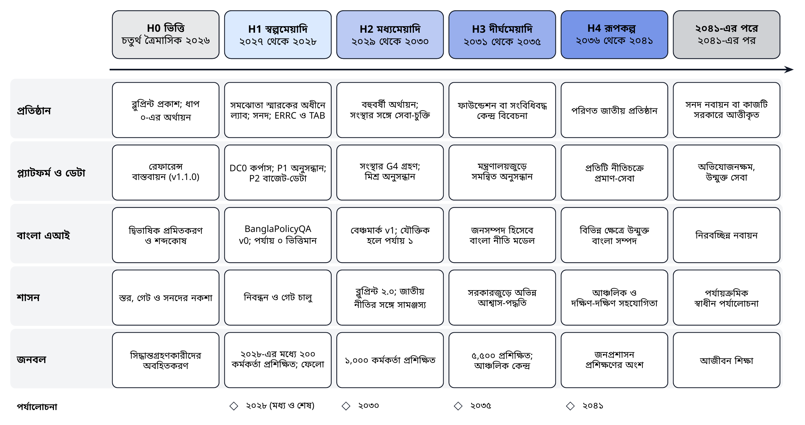

*চিত্র ১৩। কৌশলগত রোডম্যাপ, ২০২৬ থেকে ২০৪১ ও তার পরে: দিগন্ত, কর্মধারা ও পর্যালোচনা-বিন্দু।*

**সারণি ৪৫।** কৌশলগত দিগন্ত, ২০২৬ থেকে ২০৪১ ও তার পরে

| দিগন্ত | সময়কাল | কৌশলগত লক্ষ্য | অগ্রাধিকারমূলক পদক্ষেপ | প্রাতিষ্ঠানিক রূপ | পরবর্তী ধাপে যাওয়ার সংকেত |
|--------------|----------|----------------------|----------------------------------|-------------------|---------------------|
| **H0** ভিত্তি | চতুর্থ ত্রৈমাসিক ২০২৬ | নিরাপদ ও উন্মুক্ত সূচনার প্রস্তুতি | এই ব্লুপ্রিন্ট ও কোড প্রকাশ; আইসিটি বিভাগ ও ডেটা-রক্ষকদের অবহিতকরণ; জাতীয় এআই নীতি প্রণয়নে উপকরণ প্রদান; স্বাগতিক প্রতিষ্ঠান নির্বাচন | স্বাধীন গবেষণা উদ্যোগ | সিদ্ধান্ত D1, D2 ও D4 গৃহীত |
| **H1** স্বল্পমেয়াদি | ২০২৭ থেকে ২০২৮ | উন্মুক্ত ডেটা দিয়ে মূল্য প্রমাণ | সনদ, ERRC ও নিবন্ধন; P1 ও P2 পাইলট; BanglaPolicyQA v0; ৩০০ কর্মকর্তা প্রশিক্ষিত; মধ্যমেয়াদি মূল্যায়ন | সমঝোতা স্মারকের অধীনে বিশ্ববিদ্যালয়-ভিত্তিক ল্যাব (বিকল্প গ) | P1 ও P2 G3 উত্তীর্ণ; ইতিবাচক মধ্যমেয়াদি মূল্যায়ন |
| **H2** মধ্যমেয়াদি | ২০২৯ থেকে ২০৩০ | গ্রহণ, সম্প্রসারণ ও জাতীয় নীতির সঙ্গে সামঞ্জস্য | সংস্থাগুলোর দ্বারা P1 ও P2-এর G4 গ্রহণ; যৌক্তিক হলে BPFM পর্যায় ১; বেঞ্চমার্ক v1; ব্লুপ্রিন্ট ২.০; ২০৩০-এ সমাপ্য জাতীয় এআই নীতিচক্রের সঙ্গে সামঞ্জস্য | বহুবর্ষী মূল অর্থায়নসহ ল্যাব; সংস্থার সঙ্গে সেবা-চুক্তি | সরঞ্জাম পরিচালনাগত ব্যবহারে; টেকসই অর্থায়ন সম্মত |
| **H3** দীর্ঘমেয়াদি | ২০৩১ থেকে ২০৩৫ | জাতীয় নীতি-বুদ্ধিমত্তা নেটওয়ার্ক গঠন | মন্ত্রণালয় ও বিভাগজুড়ে সমন্বিত অনুসন্ধান; জনসম্পদ হিসেবে রক্ষিত বাংলা নীতি মডেল; সরকারজুড়ে প্রমিত আশ্বাস-পদ্ধতি; আঞ্চলিক প্রশিক্ষণ কেন্দ্র | স্বাধীন জনস্বার্থ ফাউন্ডেশন (বিকল্প ঘ) বা সংবিধিবদ্ধ কেন্দ্র বিবেচনা | BAPIL-এর বাইরেও আশ্বাস-পদ্ধতির ব্যবহার; অধিকাংশ মন্ত্রণালয়ে নেটওয়ার্ক |
| **H4** রূপকল্প | ২০৩৬ থেকে ২০৪১ | জ্ঞানভিত্তিক অর্থনীতির জন্য আস্থাভাজন এআই-সমর্থিত নীতি-ব্যবস্থা | নীতিচক্রে প্রমাণ-সেবার অন্তর্ভুক্তি; বিভিন্ন ক্ষেত্রে উন্মুক্ত বাংলা ভাষা-সম্পদ; আঞ্চলিক ও দক্ষিণ-দক্ষিণ সহযোগিতা; প্রেক্ষিত পরিকল্পনা ২০৪১ ও আইসিটি মাস্টারপ্ল্যান ২০৪১-এর লক্ষ্যে অবদান | আন্তর্জাতিক অংশীদারত্বসহ পরিণত জাতীয় প্রতিষ্ঠান | ২০৪১-এর স্বাধীন পর্যালোচনায় জনমূল্য নিশ্চিত |
| **২০৪১-এর পরে** | ২০৪১-এর পর | সক্ষমতাকে অভিযোজনক্ষম ও জবাবদিহিমূলক রাখা | মিশন ও সনদের পর্যায়ক্রমিক নবায়ন; কাজটি সরকারে পুরোপুরি আত্তীকৃত হলে সমাপ্তি বা একীভবন; উন্মুক্ত সংরক্ষণাগার রক্ষা | ২০৪১-এর পর্যালোচনায় নির্ধারিত | সনদ নবায়নের সিদ্ধান্ত |

*টীকা।* দিগন্ত H1 ও H2 অধ্যায় ১৫-এর ৩৬ মাসের রোডম্যাপের সঙ্গে সংগতিপূর্ণ (নির্দেশক সূচনা জানুয়ারি ২০২৭)। পরবর্তী দিগন্তগুলো কৌশলগত অভিপ্রায়, যা সারণি ৪৮-এর পর্যালোচনা-বিন্দুতে পুনর্বিবেচিত হবে।

## ১৬.৪ দিগন্ত ০: ভিত্তি (চতুর্থ ত্রৈমাসিক ২০২৬)

ভিত্তি দিগন্ত ইতিমধ্যে চলমান। এর উদ্দেশ্য একটি নিরাপদ ও উন্মুক্ত সূচনার প্রস্তুতি। ব্লুপ্রিন্ট, সারসংক্ষেপ ও রেফারেন্স বাস্তবায়ন স্থায়ী শনাক্তকারীসহ একসঙ্গে প্রকাশিত হবে। আইসিটি বিভাগ, ডেটা-রক্ষক এবং জাতীয় এআই নীতি প্রণয়ন দলকে অবহিতকরণের প্রস্তাব দেওয়া হয়, এবং সেই প্রক্রিয়ায় ব্লুপ্রিন্টটি কারিগরি উপকরণ হিসেবে প্রস্তাবিত হয়। একটি উন্মুক্ত আহ্বানের মাধ্যমে স্বাগতিক প্রতিষ্ঠান চিহ্নিত হয়। সিদ্ধান্ত D1, D2 ও D4 (অধ্যায় ২১) গৃহীত হলে দিগন্তটি শেষ হয়।

## ১৬.৫ দিগন্ত ১: স্বল্পমেয়াদি (২০২৭ থেকে ২০২৮)

**কৌশলগত লক্ষ্য:** উন্মুক্ত ডেটা দিয়ে মূল্য প্রমাণ এবং শাসন যে কাজ করে তা দেখানো।

স্বল্পমেয়াদ বাস্তবায়ন পরিকল্পনার প্রথম দুই বছরের সঙ্গে সংগতিপূর্ণ। BAPIL একটি সমঝোতা স্মারকের অধীনে বিশ্ববিদ্যালয়-ভিত্তিক ল্যাব হিসেবে প্রতিষ্ঠিত হবে, সনদ গ্রহণ করবে এবং ERRC ও TAB গঠন করবে। নীতি অনুসন্ধান (P1) ও উন্মুক্ত বাজেট ডেটাসেট (P2) পাইলট ও মূল্যায়িত হয়; BanglaPolicyQA v0 প্রকাশিত হয়; স্বচ্ছতা নিবন্ধনে প্রতিটি ব্যবস্থা তালিকাভুক্ত হয়; এবং ২০২৮-এর শেষে প্রায় ৩০০ কর্মকর্তা প্রশিক্ষিত হন। ২০২৮-এর মাঝামাঝি স্বাধীন মধ্যমেয়াদি মূল্যায়ন নির্ধারণ করে BPFM পর্যায় ১ যৌক্তিক কি না এবং দ্বিতীয় ধাপের জনবল কেমন হবে।

**২০২৮-এর শেষে প্রধান ফলাফল:** P1 ও P2 গেট G3 উত্তীর্ণ; পূর্ণ উৎস-তথ্যসহ প্রায় ১৫,০০০ উন্মুক্ত নথি সূচিবদ্ধ; অন্তত তিনটি সংস্থা ডেটা বা সহযোগিতা চুক্তি স্বাক্ষর করেছে; প্রথম বছরের ও মধ্যমেয়াদি মূল্যায়ন প্রতিবেদন প্রকাশিত।

**নির্ভরতা:** ২০২৭-এ একটি সমঝোতা স্মারক ও স্বাগতিক চুক্তি; ইতিমধ্যে প্রকাশিত নথি-সংগ্রহে প্রবেশাধিকার; প্রথম ও দ্বিতীয় ধাপের অর্থায়ন।

## ১৬.৬ দিগন্ত ২: মধ্যমেয়াদি (২০২৯ থেকে ২০৩০)

**কৌশলগত লক্ষ্য:** পাইলট থেকে গ্রহণে উত্তরণ এবং জাতীয় এআই নীতিচক্রের সঙ্গে সামঞ্জস্য।

মধ্যমেয়াদে সফল সরঞ্জামগুলো গেট G4 উত্তীর্ণ হয়ে সংস্থার মালিকানায় O শ্রেণির সেবা হিসেবে গৃহীত হয়, আর BAPIL বেঞ্চমার্ক ও মূল্যায়ন রক্ষণাবেক্ষণ অব্যাহত রাখে। মিশ্র উদ্ধার উৎপাদন-পর্যায়ে চালু হয়, BanglaPolicyQA v1 প্রকাশিত হয়, এবং যৌক্তিক হলে BPFM পর্যায় ১ সম্পন্ন হয়। ২০২৯-এর শেষে ৩৬ মাসের পরিকল্পনার সমাপ্তি চূড়ান্ত মূল্যায়ন, একটি টেকসইতা পরিকল্পনা ও ব্লুপ্রিন্ট ২.০ নিয়ে আসে। ২০৩০-এ, খসড়া জাতীয় এআই নীতির মেয়াদ শেষে [১০], BAPIL পরবর্তী নীতিচক্রের নকশায় মূল্যায়নের প্রমাণ ও শাসনের অভিজ্ঞতা যোগায়।

**২০৩০-এর শেষে প্রধান ফলাফল:** অন্তত দুটি সংস্থায় সরঞ্জাম পরিচালনাগত ব্যবহারে; প্রায় ১,০০০ কর্মকর্তা প্রশিক্ষিত; দশটি সংস্থা BAPIL-এর সরঞ্জাম বা পদ্ধতি ব্যবহার করছে; বহুবর্ষী মূল অর্থায়ন সম্মত; বিশ্ববিদ্যালয় ল্যাব হিসেবে অব্যাহত থাকা ও স্বাধীন ফাউন্ডেশনের দিকে অগ্রসর হওয়ার মধ্যে পছন্দ নথিভুক্ত।

**নির্ভরতা:** ইতিবাচক চূড়ান্ত মূল্যায়ন; গৃহীত সরঞ্জাম পরিচালনার জন্য সংস্থার বাজেট; অব্যাহত রাজনৈতিক পৃষ্ঠপোষকতা।

## ১৬.৭ দিগন্ত ৩: দীর্ঘমেয়াদি (২০৩১ থেকে ২০৩৫)

**কৌশলগত লক্ষ্য:** অভিন্ন মানদণ্ডের ওপর একটি জাতীয় নীতি-বুদ্ধিমত্তা নেটওয়ার্ক গঠন।

মধ্যমেয়াদ সফল হলে দীর্ঘমেয়াদে পদ্ধতিটি সরকারজুড়ে সম্প্রসারিত হয়। একটি সমন্বিত অনুসন্ধান-ব্যবস্থা একই মেটাডেটা, মান ও আশ্বাস-মানদণ্ড ব্যবহার করে মন্ত্রণালয় ও বিভাগের রক্ষিত নথি-সংগ্রহগুলোকে যুক্ত করে। মূল্যায়ন সমর্থন করলে একটি রক্ষিত বাংলা নীতি মডেল সংস্থা ও গবেষকদের জন্য জনসম্পদ হিসেবে রাখা হয়। চর্চার মাধ্যমে পরিমার্জিত BAPIL-এর ঝুঁকি-স্তর, গেট ও নিবন্ধন-পদ্ধতি জাতীয় এআই নীতির তত্ত্বাবধানকারী কর্তৃপক্ষের সঙ্গে সমন্বয়ে সরকারি খাতের এআই-এর জন্য একটি অভিন্ন আশ্বাস-পদ্ধতি হিসেবে প্রস্তাবিত হয়। ঢাকার বাইরের বিশ্ববিদ্যালয়ে আঞ্চলিক প্রশিক্ষণ কেন্দ্র সক্ষমতা কর্মসূচিকে বহুগুণ করে, ২০৩৫-এর মধ্যে প্রায় ৫,০০০ কর্মকর্তা প্রশিক্ষণের লক্ষ্যসহ।

এই দিগন্তে প্রাতিষ্ঠানিক রূপ পুনর্বিবেচিত হয়। বিকল্পগুলোর মধ্যে রয়েছে একটি স্বাধীন জনস্বার্থ ফাউন্ডেশন (বিকল্প ঘ), সরকারের সঙ্গে যুক্ত একটি সংবিধিবদ্ধ কেন্দ্র, অথবা গবেষণা ও মূল্যায়নে কেন্দ্রীভূত একটি ছোট BAPIL, যেখানে সেবাগুলো সংস্থাগুলো পরিচালনা করে। ২০৩৫-এর কৌশলগত পর্যালোচনায় চারটি মানদণ্ডে পছন্দটি নির্ধারিত হয়: স্বাধীনতা, টেকসইতা, নীতিতে প্রয়োগ ও জন-আস্থা।

## ১৬.৮ দিগন্ত ৪: রূপকল্প (২০৩৬ থেকে ২০৪১)

**কৌশলগত লক্ষ্য:** জ্ঞানভিত্তিক অর্থনীতিকে সহায়তাকারী একটি আস্থাভাজন, এআই-সমর্থিত নীতি-ব্যবস্থা।

২০৪১ সালের মধ্যে প্রমাণ-সেবা নীতিচক্রে অন্তর্ভুক্ত হয়: সরকারজুড়ে বিশ্লেষকেরা নিয়মিতভাবে বাংলা ও ইংরেজিতে আইন, পরিকল্পনা, বাজেট ও পরিসংখ্যানের প্রামাণ্য পাঠ খুঁজে পান, উদ্ধৃত ও তুলনা করেন, এবং সরকারি খাতের এআই ব্যবস্থাগুলো অভিন্ন পদ্ধতিতে নিবন্ধিত, মূল্যায়িত ও পর্যবেক্ষিত হয়। উন্মুক্ত বাংলা ভাষা-সম্পদ বহু নীতি-ক্ষেত্র জুড়ে বিস্তৃত হয়। বাংলাদেশ আঞ্চলিক ও দক্ষিণ-দক্ষিণ সহযোগিতার মাধ্যমে তার পদ্ধতি ও বেঞ্চমার্ক ভাগ করে নেয়, এবং অনুরূপ ভাষা ও সম্পদ-চ্যালেঞ্জের মুখোমুখি অন্যান্য দেশকে অবদান রাখে ও তাদের থেকে শেখে। ২০৪১-এ একটি স্বাধীন পর্যালোচনা মূল্যায়ন করে BAPIL প্রেক্ষিত পরিকল্পনা ২০৪১ ও আইসিটি মাস্টারপ্ল্যান ২০৪১-এর সঙ্গে সংগতিপূর্ণ জনমূল্য সৃষ্টি করেছে কি না [১৫, ১৬]।

## ১৬.৯ ২০৪১-এর পরে

কোনো প্রতিষ্ঠানেরই নিজের স্থায়িত্ব ধরে নেওয়া উচিত নয়। ২০৪১-এর পর সনদ নবায়িত হয় কেবল তখনই, যদি ২০৪১-এর পর্যালোচনা নিশ্চিত করে যে BAPIL এখনো এমন মূল্য যোগ করছে যা সরকার, বিশ্ববিদ্যালয় বা বাজার দেয় না। এর কাজগুলো সংস্থাগুলোতে পুরোপুরি আত্তীকৃত হলে BAPIL-এর উচিত সুশৃঙ্খলভাবে সমাপ্তি বা একীভবন, স্থায়ী রিপোজিটরিতে এর উন্মুক্ত আর্কাইভ, বেঞ্চমার্ক ও কোড সংরক্ষণ করে। অব্যাহত থাকলে উন্মুক্ততা, স্বাধীনতা ও সুরক্ষার একই অঙ্গীকারসহ পরবর্তী পরিকল্পনা-মেয়াদের জন্য এর মিশন নবায়িত হয়।

## ১৬.১০ নির্দেশক দীর্ঘমেয়াদি লক্ষ্য

**সারণি ৪৬।** দিগন্তভিত্তিক নির্দেশক দীর্ঘমেয়াদি লক্ষ্য

| সূচক | ২০২৬ | ২০২৮ | ২০৩০ | ২০৩৫ | ২০৪১ |
|------------------------------|----------|-----------|-----------|------------|----------------|
| পূর্ণ উৎস-তথ্যসহ সূচিবদ্ধ উন্মুক্ত নথি | ০ | ১৫,০০০ | ৩০,০০০ | ১,০০,০০০ | বলবৎ সব উন্মুক্ত দলিল |
| বলবৎ জাতীয় আইনের যে অংশ উদ্ধৃতিসহ বাংলা ও ইংরেজিতে অনুসন্ধানযোগ্য | ০% | ৫০% | ৯০% | ১০০% | ১০০%, ৭ দিনের মধ্যে হালনাগাদ |
| BanglaPolicyQA প্রশ্ন (সব সংস্করণ) | ০ | ১,০০০ | ২,৫০০ | ৬,০০০ | বহু-ক্ষেত্রভিত্তিক, রক্ষিত |
| প্রশিক্ষিত কর্মকর্তা (ক্রমপুঞ্জিত) | ০ | ৩০০ | ১,০০০ | ৫,০০০ | জনপ্রশাসন প্রশিক্ষণের অংশ |
| BAPIL-এর সরঞ্জাম বা পদ্ধতি ব্যবহারকারী সংস্থা | ০ | ৩ | ১০ | ৩০ | অধিকাংশ মন্ত্রণালয় ও বিভাগ |
| নীতি অনুসন্ধানের মাসিক সক্রিয় ব্যবহারকারী | ০ | ১০০ | ৫০০ | ৩,০০০ | সরকারজুড়ে নিয়মিত ব্যবহার |
| বাংলা ও ইংরেজির Recall@10 ব্যবধান (পয়েন্ট) | প্রযোজ্য নয় | ৫ বা কম | ৩ বা কম | ২ বা কম | ২ বা কম |
| জনসমক্ষে স্বচ্ছতা নিবন্ধনে তালিকাভুক্ত এআই ব্যবস্থা | ০ | ৬ | ১৫ | সরকারি খাতজুড়ে নিবন্ধন প্রস্তাবিত | প্রমিত চর্চা |
| প্রকাশিত স্বাধীন মূল্যায়ন | ০ | ১ | ৩ | ৮ | অন্তত প্রতি ৫ বছরে |
| DOI-সহ সংরক্ষিত উন্মুক্ত প্রকাশ | ৩ | ৮ | ১৫ | ৪০ | নিরবচ্ছিন্ন |

*টীকা।* পরিকল্পনা-লক্ষ্য, প্রতিশ্রুতি নয়। এগুলো সারণি ৪৭-এর ভিত্তি-দৃশ্যকল্প ধরে নেয় এবং প্রতিটি কৌশলগত পর্যালোচনায় পুনর্নির্ধারিত হয়।

লক্ষ্যগুলো প্রতিটি দিগন্তে উচ্চাকাঙ্ক্ষার মাত্রা প্রকাশ করে। এগুলো ইচ্ছাকৃতভাবে নির্দেশক: এগুলো নিচের ভিত্তি-দৃশ্যকল্প ধরে নেয়, প্রতিটি কৌশলগত পর্যালোচনায় সংশোধিত হবে, এবং মান বা সুরক্ষার বিনিময়ে কখনো অনুসরণ করা যাবে না।

## ১৬.১১ জাতীয় ও বৈশ্বিক পরিকল্পনার সঙ্গে সামঞ্জস্য

রোডম্যাপটি চারটি রেফারেন্স-বিন্দুর সঙ্গে সামঞ্জস্যপূর্ণ:

* **প্রেক্ষিত পরিকল্পনা ২০৪১ ও আইসিটি মাস্টারপ্ল্যান ২০৪১** [১৫, ১৬]: জ্ঞানভিত্তিক অর্থনীতি, ডিজিটাল সরকার ও মানবসম্পদের দীর্ঘমেয়াদি লক্ষ্য, যাতে দিগন্ত H3 ও H4 সরাসরি অবদান রাখে।
* **জাতীয় এআই নীতি, ২০২৬ থেকে ২০৩০** [১০, ১৪]: ঝুঁকির শ্রেণি, তত্ত্বাবধান, একটি বাংলাভিত্তিক জাতীয় LLM, জাতীয় কম্পিউটিং ও একটি উদ্ভাবন তহবিল। BAPIL-এর স্তর, বেঞ্চমার্ক ও নিয়ন্ত্রিত কর্পাস এসব উপাদানকে সহায়তার জন্য নকশাকৃত, এবং দিগন্ত H2 পরবর্তী নীতিচক্রে অবদানের মাধ্যমে শেষ হয়।
* **উপাত্ত সুরক্ষা ও উপাত্ত ব্যবস্থাপনা আইন, ২০২৬** [৭, ৮]: প্রথমে উন্মুক্ত ডেটা নকশা এবং জাতীয় অবকাঠামোর মাধ্যমে ডেটা বিনিময়ের আইনগত ভিত্তি।
* **টেকসই উন্নয়ন লক্ষ্যমাত্রা** [৯১]: বিশেষত মানসম্মত শিক্ষা, শিল্প ও উদ্ভাবন, এবং শান্তি, ন্যায়বিচার ও শক্তিশালী প্রতিষ্ঠান বিষয়ক লক্ষ্য, সক্ষমতা উন্নয়ন, উন্মুক্ত উদ্ভাবন এবং স্বচ্ছ ও জবাবদিহিমূলক সরকারি প্রতিষ্ঠানের মাধ্যমে।

## ১৬.১২ প্রযুক্তিগত দৃষ্টিভঙ্গি

এআই প্রযুক্তি দ্রুত বদলাচ্ছে, এবং ২০৪১ পর্যন্ত নির্দিষ্ট প্রযুক্তি স্থির করে দেওয়া রোডম্যাপ শিগগিরই অপ্রচলিত হয়ে যাবে। তাই রোডম্যাপটি নির্দিষ্ট মডেলের বদলে সক্ষমতার (উদ্ধৃতিযুক্ত প্রমাণ, বাংলা সমতা, আশ্বাস) প্রতি প্রতিশ্রুতিবদ্ধ। কয়েকটি পরিবর্তন প্রত্যাশিত: মডেল আরও সক্ষম ও চালাতে সস্তা হবে; বাংলাসহ বহুভাষিক সক্ষমতা উন্নত হবে; বক্তৃতা ও নথি-বোধগম্যতা স্ক্যানকৃত ও মৌখিক উৎসকে আরও সহজলভ্য করবে; এবং বহু-ধাপের কাজ সম্পাদনকারী এআই ব্যবস্থা তত্ত্বাবধানের নতুন প্রশ্ন তুলবে। এর প্রতিটি পরিবর্তন একই কৌশলে ব্যবস্থাপিত হয়: বেঞ্চমার্কে মডেল পুনর্নির্বাচন (সারণি ২৯), স্থাপত্য-সিদ্ধান্ত রেকর্ড, নতুন ব্যবহারের জন্য স্তর ও গেট প্রক্রিয়া, এবং কৌশলগত পর্যালোচনা। মডেলের ক্ষেত্রে যা-ই ঘটুক, যে দীর্ঘমেয়াদি বিনিয়োগ তার মূল্য ধরে রাখে তা হলো নিয়ন্ত্রিত কর্পাস, বেঞ্চমার্ক, মূল্যায়ন-পদ্ধতি এবং সেগুলো ব্যবহারে প্রশিক্ষিত মানুষ।

## ১৬.১৩ দৃশ্যকল্প

ভবিষ্যৎ একটি পথে চলবে না। চারটি দৃশ্যকল্প এবং একটি শাসনগত ধাক্কা কৌশলের দৃঢ়তা পরীক্ষা করে।

**সারণি ৪৭।** কৌশলগত দৃশ্যকল্প ও করণীয়

| দৃশ্যকল্প | বিবরণ | প্রাথমিক সংকেত | কৌশলগত করণীয় |
|----------------|--------------------------|-----------------------|-----------------------------|
| **ত্বরান্বিত** | শক্তিশালী রাজনৈতিক পৃষ্ঠপোষকতা, জাতীয় কম্পিউটিং ও ডেটা বিনিময় আগেভাগে উপলব্ধ | অর্থায়নসহ এআই নীতি গৃহীত; NRDEX চালু; সংস্থাগুলোর সরঞ্জাম চাহিদা | H2-এর গ্রহণ এগিয়ে আনা; আরও মন্ত্রণালয়ে সম্প্রসারণ; গতির কারণে সুরক্ষা যেন না কমে তাই গেট অপরিবর্তিত |
| **ভিত্তি** | ডেটা প্রবেশাধিকার ও অর্থায়নে স্বাভাবিক বিলম্বসহ স্থির অগ্রগতি | প্রায় দুই ত্রৈমাসিকের মধ্যে মাইলফলক অর্জিত | রোডম্যাপ অনুসরণ; পর্যালোচনার মাধ্যমে পরিধি সমন্বয় |
| **সীমিত** | অর্থায়ন হ্রাস, ধীর ডেটা-চুক্তি বা পৃষ্ঠপোষকতা হারানো | MS2 বা MS4 অনর্জিত; বাজেট বিলম্ব; কর্মী বদল | মূল অংশ রক্ষা (P1, বেঞ্চমার্ক, শাসন); P3, P5 ও P6 স্থগিত; গবেষণা অনুদান সন্ধান; যা আছে তা প্রকাশ |
| **প্রযুক্তিগত পরিবর্তন** | অনেক শক্তিশালী বা সস্তা মডেল সম্ভাবনার পরিধি বদলে দেয় | অভিযোজন ছাড়াই উন্মুক্ত মডেল সীমা অতিক্রম করে; ব্যয় দ্রুত কমে | মডেল নির্বাচন পুনরায় (সারণি ২৯); অপ্রয়োজনীয় BPFM পর্যায় বাদ; মূল্যায়ন ও ডেটায় বিনিয়োগ |
| **শাসনগত ধাক্কা** | বাংলাদেশে বা বিদেশে গুরুতর এআই ঘটনায় জন-আস্থা হ্রাস | সংবাদমাধ্যমে প্রচার; নতুন বিধিনিষেধ; অভিযোগ | প্রভাবিত ব্যবস্থা স্থগিত; স্বাধীন পর্যালোচনা; ফলাফল প্রকাশ; নিয়ন্ত্রণ জোরদার; উন্মুক্ত যোগাযোগ |

প্রতিটি দৃশ্যকল্পে BAPIL-এর মূল অংশ সুরক্ষিত থাকে: নিয়ন্ত্রিত কর্পাস, উদ্ধৃতিযুক্ত নীতি অনুসন্ধান, বেঞ্চমার্ক ও শাসন-ব্যবস্থা। এগুলো রক্ষণাবেক্ষণে তুলনামূলক কম ব্যয়বহুল এবং এমন ভিত্তি সরবরাহ করে যেখান থেকে কৌশলটি ত্বরান্বিত বা পুনর্গঠিত করা যায়।

## ১৬.১৪ কৌশলগত পর্যালোচনা ও উদ্দীপক

**সারণি ৪৮।** কৌশলগত পর্যালোচনা-বিন্দু ও উদ্দীপক

| কখন | পর্যালোচনা | মূল প্রশ্ন | সম্ভাব্য সিদ্ধান্ত |
|-----------|--------------------|------------------------------|----------------------------|
| ২০২৭-এর শেষে | প্রথম বছরের পর্যালোচনা (MS4) | উন্মুক্ত ডেটা দিয়ে P1 ও P2 কি মূল্য সৃষ্টি করেছে? শাসন কি কাজ করছে? | পাইলট অব্যাহত, পরিধি সমন্বয় বা বন্ধ; দ্বিতীয় ধাপের বাজেট নিশ্চিত |
| ২০২৮-এর মাঝামাঝি | স্বাধীন মধ্যমেয়াদি মূল্যায়ন (MS6) | অর্থের যথার্থ ব্যবহার; গ্রহণ; আশ্বাসের মান | BPFM পর্যায় ১-এর সিদ্ধান্ত; দ্বিতীয় ধাপের জনবল |
| ২০২৯-এর শেষে | ৩৬ মাসের পরিকল্পনার চূড়ান্ত মূল্যায়ন (MS9) | কোন সরঞ্জাম সংস্থাগুলোর মালিকানায় যাবে? প্রাতিষ্ঠানিক রূপ কি যথাযথ? | G4 হস্তান্তর; ব্লুপ্রিন্ট ২.০; বিকল্প গ ও ঘ-এর মধ্যে নির্বাচন |
| ২০৩০ | পরবর্তী জাতীয় এআই নীতিচক্রের সঙ্গে সামঞ্জস্য | ২০৩০-পরবর্তী নীতিতে BAPIL কীভাবে সহায়তা করবে? | H3-এর জন্য সংশোধিত মিশন ও লক্ষ্য |
| ২০৩৫ | দীর্ঘমেয়াদি কৌশলগত পর্যালোচনা | জাতীয় নেটওয়ার্ক কি যৌক্তিক? পদ্ধতিগুলো কি BAPIL-এর বাইরে ব্যবহৃত হচ্ছে? | নেটওয়ার্ক সম্প্রসারণ, একীকরণ বা পরিধি সংকোচন |
| ২০৪১ | রূপকল্প পর্যালোচনা | BAPIL কি ২০৪১-এর পরিকল্পনার সঙ্গে সংগতিপূর্ণ জনমূল্য সৃষ্টি করেছে? | সনদ নবায়ন, সরকারে একীভবন বা সংরক্ষণাগার রক্ষা করে সমাপ্তি |
| যেকোনো সময় | ঘটনাভিত্তিক উদ্দীপক | নতুন আইন বা বিধি; গুরুতর ঘটনা; বড় প্রযুক্তিগত পরিবর্তন; অর্থায়ন হারানো | ৩০ দিনের মধ্যে স্টিয়ারিং বোর্ডের বিশেষ পর্যালোচনা |

*টীকা।* ক্যালেন্ডারের তারিখগুলো মাস ১ জানুয়ারি ২০২৭ ধরে নির্ধারিত; পরিকল্পনা দেরিতে শুরু হলে প্রথম তিনটি পর্যালোচনাও সেই অনুযায়ী পিছিয়ে যাবে (সংযুক্তি ন)।

প্রতিটি পর্যালোচনা একটি সংক্ষিপ্ত প্রকাশিত প্রতিবেদন তৈরি করে, যা লক্ষ্যের সঙ্গে ফলাফল তুলনা করে, সেই সময়ের পরিস্থিতি সবচেয়ে ভালোভাবে বর্ণনাকারী দৃশ্যকল্প লিপিবদ্ধ করে এবং পরবর্তী দিগন্তের লক্ষ্য নির্ধারণ বা সংশোধন করে। ঘটনাভিত্তিক উদ্দীপক নিশ্চিত করে যে কৌশলটি অপ্রত্যাশিত ঘটনাতেও সাড়া দেয়।

## ১৬.১৫ কী কৌশলটিকে ব্যর্থ করতে পারে

একটি দীর্ঘমেয়াদি কৌশলের উচিত বলা যে এটি কীভাবে ব্যর্থ হতে পারে। প্রতিটি পর্যালোচনায় পাঁচটি ব্যর্থতার ধরন পর্যবেক্ষণ করা হয়: **স্বাধীনতা হারানো**, যদি অর্থায়ন বা রাজনৈতিক চাপ মূল্যায়নের ফলাফলকে প্রভাবিত করে; **পাইলটের অচলাবস্থা**, যদি সরঞ্জাম কাজ করে কিন্তু সংস্থাগুলোর বাজেট বা মালিকানার অভাবে কখনো গৃহীত না হয়; **সুরক্ষার ক্ষয়**, যদি সম্প্রসারণের চাপে দুর্বলতর গেট বা বিস্তৃততর ডেটা-ব্যবহার আসে; **প্রযুক্তিগত আটকে পড়া**, যদি একটি একক মডেল বা বিক্রেতা অপরিহার্য হয়ে ওঠে; এবং **মেধা পাচার**, যদি প্রশিক্ষিত কর্মীরা নতুন কর্মী তৈরির চেয়ে দ্রুত চলে যান। প্রতিটির একটি আগাম সতর্কতা-সূচক পরিবীক্ষণ কাঠামোয় এবং একটি করণীয় ঝুঁকি নিবন্ধনে (অধ্যায় ১৯) রয়েছে।

## ১৬.১৬ টেকসইতা

দীর্ঘমেয়াদি টেকসইতা চারটি স্তম্ভের ওপর দাঁড়িয়ে। **আর্থিক:** মূল সরকারি অর্থায়ন ও সংস্থার সঙ্গে সেবা-চুক্তির ক্রমবর্ধমান অংশ, এবং প্রকল্প-অর্থায়নের ওপর ক্রমহ্রাসমান নির্ভরতা (অধ্যায় ১৭)। **প্রাতিষ্ঠানিক:** স্বাধীন শাসনসহ এমন একটি প্রাতিষ্ঠানিক রূপ, যা রাজনৈতিক ও নেতৃত্বের পরিবর্তন সত্ত্বেও টিকে থাকতে পারে। **কারিগরি:** উন্মুক্ত, নথিভুক্ত, প্রতিস্থাপনযোগ্য উপাদান এবং কোনো একক বিক্রেতা বা মডেলের ওপর নির্ভরশীল নয় এমন ডেটা। **মানবসম্পদ:** প্রশিক্ষিত কর্মকর্তা, ফেলো ও গবেষকদের একটি জাতীয় নেটওয়ার্ক, যাঁরা পদ্ধতিগুলোকে BAPIL-এর বাইরে নিয়ে যান।

\newpage

# অধ্যায় ১৭: অর্থায়ন, ক্রয় ও টেকসইতা

## ১৭.১ ব্যয়-নিরূপণ পদ্ধতি

ব্লুপ্রিন্টে ৩৬ মাসের পরিকল্পনার জন্য একটি নির্দেশক বাজেট দেওয়া হয়েছে, যা একটি থোক অনুমানের বদলে সুস্পষ্ট অনুমানের ভিত্তিতে তৈরি। ব্যয়-নিরূপণ মডেলটি জনবল পরিকল্পনা (সারণি ১৬), সক্ষমতা পরিকল্পনা (সারণি ৩১), বেঞ্চমার্ক, মূল্যায়ন ও প্রশিক্ষণের লক্ষ্য এবং মূল্যায়নের সময়সূচি নিয়ে প্রথম বছরের মূল্যে সারণি ৪৯-এর একক-ব্যয় প্রয়োগ করে; নিয়োগ চলাকালে প্রথম বছরে গড়ে ৭৫% পদ পূরণ ধরে নেয়; দ্বিতীয় ও তৃতীয় বছরে টাকায় পরিশোধ্য ব্যয়ে বছরে ৮% মূল্যবৃদ্ধি যোগ করে; এবং স্বাগতিকের পরোক্ষ ব্যয়ের জন্য ১০% ও পৃথক ৫% আপৎকালীন সংস্থান যোগ করে। মডেলটি রিপোজিটরিতে প্রকাশিত (`blueprint/src/budget_model.py`), যাতে সম্ভাব্যতা ও ব্যয়-নিরূপণ সমীক্ষা (ডেলিভারেবল D1.3, মাস ৬) যেকোনো অনুমানকে একটি দরপত্র বা সম্মত বেতন-কাঠামো দিয়ে প্রতিস্থাপন করে বাজেট পুনরায় হিসাব করতে পারে। ততদিন পর্যন্ত এই অধ্যায়ের প্রতিটি অঙ্ক একটি পরিকল্পনা-প্রাক্কলন, অর্থ বরাদ্দের প্রতিশ্রুতি নয়।

**সারণি ৪৯।** নির্দেশক বাজেটের পরিকল্পনা-অনুমান

| বিষয় | অনুমান | ভিত্তি |
|-------------------|------------------------------------|-----------------------------|
| বিনিময় হার | প্রতি মার্কিন ডলারে ১২৪ টাকা | ১৯ অক্টোবর ২০২৬-এ বাংলাদেশ ব্যাংকের ভারিত গড় হার ১২৩.৬৫ টাকা [৯২] |
| মূল জনবল | প্রথম, দ্বিতীয় ও তৃতীয় বছরে ৯, ১৫ ও ১৯ পূর্ণকালীন সমতুল্য | জনবল পরিকল্পনা (সারণি ১৬) |
| প্রথম বছরের নিয়োগ | প্রথম বছরে গড়ে ৭৫% পদ পূরণ | মাস ১ থেকে ৩-এ পরিচালক নিয়োগ; মাস ২ থেকে ৬-এ অন্যান্য পদ পূরণ (অনুচ্ছেদ ১৫.৪) |
| জনবলের ব্যয় | প্রথম বছরের মূল্যে প্রতি পূর্ণকালীন সমতুল্যের পূর্ণ মাসিক ব্যয়: পরিচালক ৩.০ লাখ টাকা; ML ও বাংলা NLP প্রকৌশলী ২.০ লাখ; নিরাপত্তা প্রকৌশলী ১.৮ লাখ; নীতি, ডেটা ও প্ল্যাটফর্ম কর্মী ১.৫ লাখ; শাসন ও UX কর্মী ১.২৫ লাখ; সমন্বয়ক ০.৯ লাখ; প্রশিক্ষণ কর্মকর্তা ০.৮ লাখ | দুর্লভ এআই দক্ষতার প্রতিযোগিতায় নবম জাতীয় বেতন স্কেল ২০২৬-এর (আগস্ট ২০২৬-এ মন্ত্রিসভায় অনুমোদিত) মূল বেতনের (মাসিক ২০,০০০ থেকে ১,৫৬,০০০ টাকা) ওপরে [৯৩] |
| মূল্যবৃদ্ধি | দ্বিতীয় ও তৃতীয় বছরে টাকায় পরিশোধ্য ব্যয়ে বছরে ৮% | সেপ্টেম্বর ২০২৬-এ পয়েন্ট-টু-পয়েন্ট মূল্যস্ফীতি ৮.৩৪% বলে প্রতিবেদিত [৯৪]; স্বাগতিকের বেতনবৃদ্ধির নিয়ম ভিন্ন হতে পারে |
| ভাষা-সম্পাদক ও ফেলো | খণ্ডকালীন সম্পাদক বছরে ১২ থেকে ১৪ লাখ টাকা; মাসিক ৪০,০০০ টাকায় ৬, ১০ ও ১২ জন ফেলো (প্রথম বছরের মূল্যে) | ফেলোশিপ কর্মসূচি (অনুচ্ছেদ ৬.৬) |
| যন্ত্রপাতি | সাধারণ-উদ্দেশ্য সার্ভার প্রতিটি ১২,০০০ মার্কিন ডলার; GPU ইনফারেন্স সার্ভার (L40S শ্রেণি) প্রতিটি ২৫,০০০ মার্কিন ডলার; সংরক্ষণক্ষমতা বছরে ৬,০০০ থেকে ১২,০০০ মার্কিন ডলার | ২০২৫ সালে একটি L40S কার্ড প্রায় ৭,৫০০ মার্কিন ডলার এবং চার-GPU সার্ভার প্রায় ৪৭,০০০ থেকে ৪৯,০০০ মার্কিন ডলার [৯৫] |
| যন্ত্রপাতির আমদানি শুল্ক ও ভ্যাট | মূল হিসাবে অন্তর্ভুক্ত নয়; উচ্চ পরিস্থিতিতে ২৫% যোগ | স্বাগতিকের অব্যাহতির অবস্থার ওপর নির্ভরশীল; স্বাগতিকের ক্রয় দপ্তর থেকে তথ্য প্রয়োজন |
| হোস্টিং ও পরিচালনা | বছরে ২৫ লাখ থেকে ৩৮ লাখ টাকা (প্রথম বছরের মূল্যে) | ডেটা-সেন্টারের স্থান, বিদ্যুৎ, ব্যান্ডউইথ, লাইসেন্স ও উন্নয়ন-ক্লাউড |
| মডেল অভিযোজনের কম্পিউটিং | যৌথ জাতীয় কম্পিউটিং থেকে বস্তুগত সহায়তা; উচ্চ পরিস্থিতিতে উন্মুক্ত (P0) ডেটায় ২০,০০০ মার্কিন ডলারের ক্লাউড GPU সময় | সারণি ৩১; খসড়া জাতীয় এআই নীতি [১০]; ক্লাউডের মূল্য [৯৫] |
| বেঞ্চমার্ক ও মূল্যায়ন-ডেটা | মাস ৩০-এর মধ্যে ২,৫০০ টাকা দরে ২,০০০ উত্তরযোগ্য প্রশ্ন; ৬০০ টাকা দরে ৩০০ আওতাবহির্ভূত প্রশ্ন; ৫০০ টাকা দরে ২,০০০ উদ্ধৃতি-সমর্থন বিচার | BanglaPolicyQA পরিকল্পনা (অনুচ্ছেদ ৯.৪); মূল্যায়ন প্রটোকল (সংযুক্তি দ) |
| প্রশিক্ষণ | মাস ৩৬-এর মধ্যে ৫০০ কর্মকর্তা, অংশগ্রহণকারীপ্রতি ১৫,০০০ টাকা, সঙ্গে বিশেষায়িত কোর্স | প্রশিক্ষণ পাঠ্যক্রম (সারণি ১৮) |
| মূল্যায়ন ও আশ্বাস | আইনি পর্যালোচনা ৮ লাখ টাকা; ভিত্তি সমীক্ষা ৬ লাখ; মধ্যমেয়াদি মূল্যায়ন ২০ লাখ; চূড়ান্ত মূল্যায়ন ২৫ লাখ; বার্ষিক অনুপ্রবেশ পরীক্ষা ও রেড-টিম ৬ লাখ; ব্যবস্থাগুলোর বার্ষিক স্বাধীন নিরীক্ষা ৩ লাখ | অধ্যায় ১৩, ১৪ ও ১৮ |
| স্বাগতিকের পরোক্ষ ব্যয় | প্রত্যক্ষ ব্যয়ের ১০% | স্বাগতিক প্রতিষ্ঠানের নীতির সঙ্গে মিলিয়ে নিশ্চিত করতে হবে |
| আপৎকালীন সংস্থান | মূল হিসাবে প্রত্যক্ষ ব্যয়ের ৫%, শুধু স্টিয়ারিং বোর্ডের সিদ্ধান্তে ব্যবহারযোগ্য; দরপত্র ও স্বাগতিকের হার জানা না যাওয়া পর্যন্ত ১০% সুপারিশকৃত (সমন্বিত মূল হিসাব ও উচ্চ পরিস্থিতি) | প্রাক্কলনের অনিশ্চয়তার জন্য সংস্থান; পরিস্থিতি-বিশ্লেষণ সংযুক্তি থ-তে |

*টীকা।* ব্যয়-নিরূপণ সমীক্ষার (ডেলিভারেবল D1.3) পরিকল্পনা-অনুমান, দরপত্র নয়। মডেলটি blueprint/src/budget_model.py হিসেবে প্রকাশিত, যাতে যেকোনো অনুমান বদলে বাজেট পুনরায় হিসাব করা যায়।

## ১৭.২ নির্দেশক ৩৬ মাসের বাজেট

**সারণি ৫০।** নির্দেশক ৩৬ মাসের বাজেট (কোটি টাকা)

| খাত | বছর ১ | বছর ২ | বছর ৩ | মোট | অংশ |
|------------------------------|----------|----------|----------|----------|---------|
| মূল জনবল | ১.৩৭ | ৩.১১ | ৪.১৪ | ৮.৬১ | ৪২% |
| ভাষা-সম্পাদক ও ফেলোশিপ | ০.৪১ | ০.৬৭ | ০.৮৪ | ১.৯১ | ৯% |
| কম্পিউটিং ও হোস্টিং | ১.৩৯ | ১.৩৬ | ০.৭৪ | ৩.৪৯ | ১৭% |
| ডেটা ও টীকাকরণ | ০.৪১ | ০.৫২ | ০.৪৬ | ১.৩৯ | ৭% |
| প্রশিক্ষণ ও সম্প্রসারণ | ০.২৩ | ০.৪৪ | ০.৪৮ | ১.১৫ | ৬% |
| শাসন, নিরীক্ষা ও মূল্যায়ন | ০.৩১ | ০.৪০ | ০.৪৯ | ১.২০ | ৬% |
| স্বাগতিকের পরোক্ষ ব্যয় (১০%) | ০.৪১ | ০.৬৫ | ০.৭১ | ১.৭৮ | ৯% |
| আপৎকালীন সংস্থান (৫%) | ০.২১ | ০.৩৩ | ০.৩৬ | ০.৮৯ | ৪% |
| **মোট** | **৪.৭৩** | **৭.৪৯** | **৮.২১** | **২০.৪৩** | **১০০%** |

*টীকা।* blueprint/src/budget_model.py দ্বারা সারণি ৪৯-এর অনুমান থেকে হিসাবকৃত। প্রতিটি অঙ্ক আলাদাভাবে আসন্নীকৃত, তাই সারি ও কলামের যোগফল হুবহু না-ও মিলতে পারে: আসন্নীকরণের আগের মোট ২০,৪২,৬৪,১৩৬ টাকা (২০.৪৩ কোটি টাকা), আর আসন্নীকৃত বার্ষিক মোটের যোগফল ২০.৪৩ কোটি টাকা। আসন্নীকৃত সারিগুলোর যোগফল ৪.৭৪, ৭.৪৮, ৮.২২ ও ২০.৪২; দেখানো মোট অঙ্কগুলো আসন্নীকরণের আগের মান থেকে হিসাবকৃত। প্রায় ১.৬৫ মিলিয়ন মার্কিন ডলারের সমতুল্য। এটি পরিকল্পনা-প্রাক্কলন: কোনো অর্থ অনুমোদিত বা প্রতিশ্রুত হয়নি।

তিন বছরে নির্দেশক বাজেট প্রায় ২০.৪ কোটি টাকা: প্রথম বছরে ৪.৭ কোটি, দ্বিতীয় বছরে ৭.৫ কোটি এবং তৃতীয় বছরে ৮.২ কোটি টাকা, অর্থাৎ প্রায় ১.৬৫ মিলিয়ন মার্কিন ডলার। এটি ব্লুপ্রিন্টের খসড়া প্রণয়নের সময় করা ১৮.৪৯ কোটি টাকার একটি প্রাথমিক পরিকল্পনা-প্রাক্কলনের স্থলাভিষিক্ত, যাতে কোনো মূল্যবৃদ্ধি বা পৃথক আপৎকালীন সংস্থান ছিল না এবং মাস ১ থেকেই পূর্ণ জনবল ধরা হয়েছিল। সংযুক্তি থ-এর সারণি ৬১ দুটিকে ধাপে ধাপে মিলিয়ে দেখায়; এটি আরও দেখায় যে প্রাথমিক প্রাক্কলনের বার্ষিক মোট (৪.৯৬, ৬.৭১ ও ৬.৮৩, যোগফল ১৮.৫০) কেবল আসন্নীকরণের কারণে তার মোট অঙ্ক থেকে ভিন্ন ছিল। সিদ্ধান্তগ্রহণকারীদের জন্য বাজেটের চারটি বৈশিষ্ট্য গুরুত্বপূর্ণ:

* **জনবলই প্রধান ব্যয়।** মূল কর্মী, ভাষা-সম্পাদক ও ফেলো মিলিয়ে মোটের প্রায় অর্ধেক (৫২%)। সবচেয়ে বড় একক নির্ধারক হলো মেশিন লার্নিং ও বাংলা NLP প্রকৌশলী নিয়োগ ও ধরে রাখার জন্য প্রয়োজনীয় বেতন।
* **যন্ত্রপাতির ব্যয় শুরুতে বেশি।** কম্পিউটিং ও হোস্টিং মোটের প্রায় ১৭%, যার বেশির ভাগ প্রথম ও দ্বিতীয় বছরে, যখন সার্ভার ও GPU কেনা হয়। প্রত্যক্ষ ব্যয়ের প্রায় এক-পঞ্চমাংশ (২১%) এককালীন (যন্ত্রপাতি, বেঞ্চমার্ক তৈরি, সমীক্ষা ও মূল্যায়ন) এবং বাকিটা পুনরাবৃত্ত (সারণি ৬২)। মডেল অভিযোজনে (BPFM পর্যায় ১) যৌথ জাতীয় কম্পিউটিং থেকে বস্তুগত সহায়তা ধরে নেওয়া হয়েছে; তা না পাওয়া গেলে উচ্চ পরিস্থিতিতে ক্লাউড কম্পিউটিং অন্তর্ভুক্ত।
* **আশ্বাসের জন্য সুস্পষ্ট অর্থায়ন।** প্রায় ৬% শাসন, আইনি পর্যালোচনা, নিরীক্ষা ও স্বাধীন মূল্যায়নে এবং প্রায় ৭% বেঞ্চমার্ক ও উদ্ধৃতি-বিচারসহ ডেটা ও টীকাকরণে যায়। এই ব্যয় বার্ষিক পরিকল্পনায় সুরক্ষিত, যাতে বাজেট সংকুচিত হলেও সুরক্ষাব্যবস্থা কাটছাঁট না হয়।
* **অনিশ্চয়তা লুকানো নয়, দেখানো হয়েছে।** নিম্ন পরিস্থিতিতে প্রায় ১৭.৯ কোটি এবং উচ্চ পরিস্থিতিতে প্রায় ২৫.৩ কোটি টাকা (সারণি ৬২)। যন্ত্রপাতির আমদানি শুল্ক ও ভ্যাট মূল হিসাবে ধরা হয়নি, কারণ তা স্বাগতিকের অব্যাহতির অবস্থার ওপর নির্ভর করে।

বাজেট সবচেয়ে বেশি সংবেদনশীল জনবলের ব্যয়ের প্রতি। জনবলের ব্যয়ে ২০% পরিবর্তন মোট অঙ্ক প্রায় ২.০ কোটি টাকা বদলায়; প্রথম মাস থেকেই প্রথম বছরের সব পদ পূরণ হলে প্রায় ০.৫ কোটি টাকা বাড়ে; যন্ত্রপাতি ২৫% বেশি দামি হলে প্রায় ০.৭ কোটি টাকা বাড়ে; ৮%-এর বদলে ১০% মূল্যবৃদ্ধিতে প্রায় ০.৪ কোটি টাকা বাড়ে; আর টাকা ১০% দুর্বল হলে মাত্র প্রায় ০.৩ কোটি টাকা বাড়ে, কারণ শুধু যন্ত্রপাতির মূল্য মার্কিন ডলারে নির্ধারিত। কেবল মাত্রা বোঝাতে: মোট অঙ্কটি কোইকা-সমর্থিত এআই হাব কারিগরি সহায়তা প্রকল্পের প্রস্তাবিত ১৯২.৬৬ কোটি টাকার প্রায় এক-দশমাংশ [৫৩] এবং খসড়া জাতীয় এআই নীতিতে প্রস্তাবিত ২০০ থেকে ২৫০ কোটি টাকার এআই উদ্ভাবন তহবিলের চেয়ে কম [১০]; কোনো অঙ্কই অনুমোদিত বরাদ্দ নয়, এবং প্রকল্পগুলোর পরিধিও তুলনীয় নয়।

মূল হিসাবের তিনটি সীমাবদ্ধতা উল্লেখযোগ্য। প্রথমত, এতে এখনো পরামর্শ ও সম্পৃক্ততা-অনুষ্ঠান, P5-এর জরিপ-তথ্য সংগ্রহ, প্রশিক্ষণ ছাড়া অন্য কাজে কর্মীদের ভ্রমণ, উন্মুক্ত-প্রবেশাধিকার প্রকাশনার ফি এবং কর্মীদের কম্পিউটার অন্তর্ভুক্ত নয়। প্রথম চারটির জন্য বছরে প্রায় ১৫ লাখ টাকা এবং কম্পিউটারের জন্য প্রত্যেক নতুন কর্মীর জন্য প্রায় ১,২০০ মার্কিন ডলার (পরিকল্পনা-অনুমান) ধরলে পরোক্ষ ব্যয় ও আপৎকালীন সংস্থানসহ প্রায় ০.৯ কোটি টাকা যোগ হয়। দ্বিতীয়ত, কোনো দরপত্রের আগে করা প্রাক্কলনের জন্য ৫% আপৎকালীন সংস্থান কম; ১০% আপৎকালীন সংস্থান ও এই সংস্থানগুলোসহ মূল হিসাব দাঁড়ায় প্রায় ২২.২ কোটি টাকা (সারণি ৬২-এর সমন্বিত মূল হিসাব)। তৃতীয়ত, সম্ভাব্যতা সমীক্ষা এই অনুমানগুলো প্রতিস্থাপন না করা পর্যন্ত উচ্চ পরিস্থিতিই (প্রায় ২৫.৩ কোটি টাকা) বিচক্ষণ পরিকল্পনা-সীমা।

**কিস্তিতে অর্থ ছাড়।** প্রতি বছরের কাজ আগের বছরের ফলাফলের ওপর নির্ভর করে বলে অর্থ ৩৬ মাসের একক বরাদ্দ হিসেবে নয়, বরং অনুচ্ছেদ ১৫.৫-এর পর্যালোচনা-বিন্দুর সঙ্গে যুক্ত তিনটি কিস্তিতে ছাড় করা হবে:

* **কিস্তি ১ (বছর ১, পর্যায় ১-এর পাইলট), প্রায় ৪.৭ কোটি টাকা:** সিদ্ধান্ত D2 গৃহীত হলে এবং সমঝোতা স্মারক ও স্বাগতিক-চুক্তি স্বাক্ষরিত হলে ছাড় করা হবে।
* **কিস্তি ২ (বছর ২), প্রায় ৭.৫ কোটি টাকা:** মাস ১২-এর পর্যালোচনার পর, সম্ভাব্যতা ও ব্যয়-নিরূপণ সমীক্ষা (ডেলিভারেবল D1.3) পর্যায় ২-এর বাজেট নিশ্চিত বা সংশোধন করার পর ছাড় করা হবে।
* **কিস্তি ৩ (বছর ৩), প্রায় ৮.২ কোটি টাকা:** মাস ১৮-এর স্বাধীন মধ্যমেয়াদি মূল্যায়নের আলোকে মাস ২৪-এর পর্যালোচনার পর ছাড় করা হবে।

ফলে অধিকাংশ অর্থ ব্যয়ের আগে দুটি বিন্দুতে একজন অর্থদাতা কর্মসূচি বন্ধ, হ্রাস বা পুনর্নির্দেশ করতে পারেন: বছর ১-এর শেষে ৩৬ মাসের বাজেটের মাত্র প্রায় ২৩% প্রতিশ্রুত হয়।

**মূলধনি ও রাজস্ব ব্যয়।** প্রায় ২.৫ কোটি টাকা (১২%) সার্ভার, জিপিইউ ও স্টোরেজে মূলধনি ব্যয়; বাকিটা রাজস্ব ব্যয়, প্রধানত জনবলে (সারণি ৬২)। অর্থায়নের পথ নির্ধারিত হলে ব্যয়-নিরূপণ সমীক্ষা মূল অনুমান না বদলে বাজেটকে সেই পথের প্রয়োজনীয় কাঠামোয় পুনর্বিন্যস্ত করবে, যেমন সরকারের অর্থনৈতিক কোডসহ একটি কারিগরি সহায়তা প্রকল্প প্রস্তাব, বা কোনো উন্নয়ন-সহযোগীর বাজেট-ছক।

এগুলো পরিকল্পনা-প্রাক্কলন। কোনো অর্থ চাওয়া, অনুমোদিত বা প্রতিশ্রুত হয়নি, এবং সম্ভাব্যতা ও ব্যয়-নিরূপণ সমীক্ষা (ডেলিভারেবল D1.3) প্রতিটি অনুমানকে দরপত্র, স্বাগতিকের বেতন-কাঠামো ও তার পরোক্ষ ব্যয়ের হার দিয়ে প্রতিস্থাপন করবে।

## ১৭.৩ ৩৬ মাসের পরবর্তী বাজেট

৩৬ মাসের পরিকল্পনার পর প্রতিটি কৌশলগত পর্যালোচনায় (সারণি ৪৮) বাজেট নির্ধারিত হয়, এবং ব্লুপ্রিন্ট ২.০-তে দিগন্ত H2-এর জন্য একটি ব্যয়-নিরূপিত পরিকল্পনা থাকবে। পরিকল্পনার একটি পরিসর হিসেবে, তৃতীয় বছরের দল, বেঞ্চমার্ক ও মূল্যায়ন-কার্যক্রম বজায় রাখা একটি ল্যাবের ২০২৯ ও ২০৩০ সালে বছরে প্রায় ৭.৫ থেকে ৯ কোটি টাকা প্রয়োজন হবে: তৃতীয় বছরের পুনরাবৃত্ত প্রত্যক্ষ ব্যয় ৬.৩৫ কোটি টাকা (সারণি ৬২); ১৫% পরোক্ষ ব্যয় ও আপৎকালীন সংস্থানসহ তা তৃতীয় বছরের মূল্যে প্রায় ৭.৩ কোটি টাকা, পরবর্তী মূল্যবৃদ্ধির আগে। আঞ্চলিক প্রশিক্ষণ কেন্দ্র ও সমন্বিত অনুসন্ধানের সহায়তাসহ দিগন্ত H3-এর একটি জাতীয় নেটওয়ার্কের আরও বেশি প্রয়োজন হবে, তবে তখন গৃহীত সরঞ্জামের পরিচালন-ব্যয়ের বড় অংশ BAPIL-এর নিজস্ব বাজেটে নয়, বরং সেবা-চুক্তির অধীনে সেগুলো ব্যবহারকারী সংস্থার বাজেটে থাকা উচিত।

এমন প্রবৃদ্ধি দেখতে কেমন হতে পারে এবং এর ব্যয় কত, তা সংযুক্তি ব-তে দেওয়া হয়েছে। পাইলটগুলো গেট G4 পার হলে এবং স্বাধীন চূড়ান্ত মূল্যায়ন ইতিবাচক হলে বছর ৪ থেকে ৮-এ একটি শর্তসাপেক্ষ জাতীয় সম্প্রসারণে যুক্ত হবে চারটি বিভাগীয় বিশ্ববিদ্যালয়-কেন্দ্র, গ্রহণকারী সংস্থায় নিযুক্ত বিশ্লেষক, একটি বাংলা ভাষা-ডেটা দল, আরও ফেলোশিপ এবং আরও ৫,০০০ কর্মকর্তার প্রশিক্ষণ। সারণি ৪৯-এর একই একক-ব্যয়ে হিসাব করলে পাঁচ বছরে এর ব্যয় প্রায় ২১৮.৯ কোটি টাকা (সারণি ৭০), ৩৬ মাসের পরিকল্পনাসহ আট বছরে প্রায় ২৩৯ কোটি টাকা, এবং বছর ৮-এ প্রত্যক্ষ পদ প্রায় ১১৮টি (সারণি ৬৯)। প্রথম পর্যায়ের পাশাপাশি পূর্ণ লক্ষ্য ও তার ব্যয় সিদ্ধান্তগ্রহীতারা যাতে দেখতে পান, সে জন্য এটি দেখানো হয়েছে। এটি এখন অনুরোধকৃত অর্থের অংশ নয়, এবং প্রতিটি কিস্তি একটি গেট-সিদ্ধান্তের পরে আসবে।

## ১৭.৪ অর্থায়ন-মডেল

হোয়াইট পেপারের পরিশিষ্ট গ-তে বর্ণিত বহুমুখী অর্থায়ন অনুসরণ করা উচিত: সমঝোতা স্মারকের অধীনে সরকারি অবদান, গবেষণা অনুদান, নির্দিষ্ট পাইলটের জন্য উন্নয়ন সহযোগীদের সহায়তা এবং উন্মুক্ত বেঞ্চমার্কের জন্য শিল্পখাতের সহায়তা, সবই গবেষণার স্বাধীনতা রক্ষাকারী স্বার্থের সংঘাত-বিষয়ক নিয়মের অধীনে। সময়ের সঙ্গে মিশ্রণটি স্থিতিশীল সরকারি অর্থায়ন এবং BAPIL-এর সরঞ্জাম ব্যবহারকারী সংস্থার সঙ্গে সেবা-চুক্তির দিকে সরে যাওয়া উচিত।

**সারণি ৫১।** দিগন্তভিত্তিক নির্দেশক অর্থায়ন-মিশ্রণ

| উৎস | H1 ২০২৭ থেকে ২০২৮ | H2 ২০২৯ থেকে ২০৩০ | H3 ২০৩১ থেকে ২০৩৫ | H4 ২০৩৬ থেকে ২০৪১ |
|--------------------------|---------------|---------------|---------------|---------------|
| সরকারের মূল অবদান (সমঝোতা স্মারক, উন্নয়ন বাজেট) | ৩০ থেকে ৪০% | ৪০ থেকে ৫০% | ৪৫ থেকে ৫৫% | ৫০ থেকে ৬০% |
| প্রতিযোগিতামূলক গবেষণা অনুদান | ২০ থেকে ৩০% | ১৫ থেকে ২৫% | ১০ থেকে ২০% | ১০ থেকে ১৫% |
| উন্নয়ন সহযোগী (পাইলটভিত্তিক) | ২০ থেকে ৩০% | ১৫ থেকে ২০% | ৫ থেকে ১০% | ০ থেকে ৫% |
| সংস্থার সঙ্গে সেবা-চুক্তি (ব্যয় পুনরুদ্ধার) | ০% | ৫ থেকে ১০% | ১৫ থেকে ২৫% | ২০ থেকে ৩০% |
| শিল্প ও জনহিতৈষী সহায়তা (উন্মুক্ত বেঞ্চমার্ক, ফেলোশিপ) | ৫ থেকে ১০% | ৫ থেকে ১০% | ৫ থেকে ১০% | ৫ থেকে ১০% |

*টীকা।* কোনো বছরে সরকার-বহির্ভূত কোনো একক অর্থদাতা বাজেটের ৩০%-এর বেশি দেবেন না, এবং শিল্পখাতের সহায়তা কখনো গবেষণার ফলাফল বা শাসনগত সিদ্ধান্তে প্রভাব কিনতে পারবে না।

## ১৭.৫ অর্থের যথার্থ ব্যবহার

মধ্যমেয়াদি ও চূড়ান্ত মূল্যায়নে সরকারি অর্থের নিয়ন্ত্রকদের ব্যবহৃত তিনটি মাপকাঠি (মিতব্যয়িতা, দক্ষতা ও কার্যকারিতা) এবং চতুর্থ মাপকাঠি হিসেবে সমতা দিয়ে অর্থের যথার্থ ব্যবহার মূল্যায়িত হয় [৯৬, ৯৭]: মিতব্যয়িতা (মানদণ্ডের তুলনায় উপকরণের ব্যয়), দক্ষতা (উৎপাদপ্রতি ব্যয়, যেমন প্রতি সূচিবদ্ধ নথি বা প্রতি প্রশিক্ষিত কর্মকর্তার ব্যয়), কার্যকারিতা (ব্যবহারকারীর সময় সাশ্রয় ও প্রমাণের মান) এবং সমতা (ঢাকার বাইরে ও সুবিধাবঞ্চিত গোষ্ঠীর কাছে পৌঁছানো)। বিশ্লেষকদের সময় সাশ্রয়ই সবচেয়ে প্রত্যক্ষ সুফল, তবে তা অতিরঞ্জিত করা উচিত নয়। একজন বিশ্লেষকের সময়ের মূল্য ঘণ্টায় প্রায় ৫০০ টাকা ধরলে (একটি পরিকল্পনা-অনুমান: মাসিক ৪৪,০০০ টাকার গ্রেড ৯-এর মূল বেতন [৯৩] ঘণ্টায় প্রায় ২৫০ টাকা, এবং অনুমানটিতে প্রায় সমপরিমাণ ভাতা, সুবিধা ও পরোক্ষ ব্যয় ধরা হয়েছে), ৩০০ ব্যবহারকারীর প্রত্যেকে মাসে চার ঘণ্টা বাঁচালে বছরে প্রায় ০.৭ কোটি টাকার সময় সাশ্রয় হয়, যা তৃতীয় বছরের বাজেটের এক-দশমাংশেরও কম। এটি একটি দৃষ্টান্তমূলক হিসাব, পূর্বাভাস নয়। তাই কেবল সময় সাশ্রয় দিয়ে ব্যয়ের যৌক্তিকতা প্রতিষ্ঠিত হয় দীর্ঘমেয়াদি লক্ষ্যের পরিসরে (হাজারো নিয়মিত ব্যবহারকারী, সারণি ৪৬)। স্বল্পমেয়াদে যৌক্তিকতা যতটা সময় সাশ্রয়ের ওপর, ততটাই প্রমাণের মান, উন্মুক্ত বেঞ্চমার্ক ও শাসন-পদ্ধতির ওপর নির্ভর করে। P1-এর প্রমাণ-প্রাপ্তির সময় সমীক্ষা এই হিসাব যাচাইয়ের ডেটা সরবরাহ করে।

## ১৭.৬ এআই পণ্য ও সেবা ক্রয়

BAPIL বা কোনো অংশীদার সংস্থা এআই পণ্য বা সেবা কিনলে চুক্তিতে এমন শর্ত থাকা উচিত যা ডেটা সুরক্ষা করে, মূল্যায়ন সম্ভব করে এবং নির্ভরশীলতা এড়ায়। নিচের আদর্শ শর্তগুলো এআই-এর যেকোনো সরকারি ক্রয়ের জন্য খাপ খাওয়ানো যায়।

**সারণি ৫২।** এআই পণ্য ও সেবা ক্রয়ের আদর্শ শর্ত

| শর্ত | প্রয়োজনীয়তা | উদ্দেশ্য |
|--------------------|------------------------------------|--------------------------|
| ডেটা-অবস্থান ও মালিকানা | সরকারি ডেটা বাংলাদেশে থাকবে ও সরকারের সম্পত্তি থাকবে; বিক্রেতার মডেল প্রশিক্ষণে ব্যবহার নয় | ডেটা ও সার্বভৌমত্ব সুরক্ষা (NFR-02) |
| মূল্যায়নের অধিকার | চুক্তির আগে ও পরে ক্রেতা BanglaPolicyQA ও রেড-টিম পরীক্ষায় পণ্য যাচাই করতে পারবেন | দাবির নয়, প্রমাণের ভিত্তিতে সিদ্ধান্ত |
| বাংলা কর্মদক্ষতার গ্রহণযোগ্যতা | গ্রহণের শর্ত সম্মত বাংলা ও ইংরেজি সীমা অর্জন | বাংলা প্রথম শ্রেণির ভাষা |
| নথিভুক্তি | প্রতিটি সংস্করণের সঙ্গে মডেল কার্ড, ডেটাশিট, SBOM ও জ্ঞাত সীমাবদ্ধতা প্রদান | স্বচ্ছতা ও নিরীক্ষা |
| স্থানান্তরযোগ্যতা ও প্রস্থান | উন্মুক্ত ফরম্যাট; সব ডেটা ও কনফিগারেশন রপ্তানি; চুক্তি শেষে রূপান্তর-সহায়তা | নির্ভরশীলতা এড়ানো (R10) |
| সোর্স কোড | সম্ভব হলে উন্মুক্ত সোর্স; অন্যথায় এসক্রো ও নিরীক্ষার অধিকার | দীর্ঘমেয়াদি রক্ষণাবেক্ষণযোগ্যতা |
| নিরাপত্তা ও ঘটনা | সারণি ৩২-এর নিয়ন্ত্রণ মেনে চলা; দুর্বলতা প্রকাশ; ২৪ ঘণ্টার মধ্যে ঘটনার বিজ্ঞপ্তি | নিরাপত্তা ও জবাবদিহি |
| পরিবর্তন নিয়ন্ত্রণ | মডেল বা বড় নির্ভরতা পরিবর্তনের আগে নোটিশ ও পুনর্মূল্যায়ন | স্থিতিশীল ও মূল্যায়িত আচরণ (G5) |
| প্রবেশযোগ্যতা | প্রমাণসহ WCAG 2.2 লেভেল AA সামঞ্জস্য | অন্তর্ভুক্তি (NFR-05) |
| সততা | স্বার্থের সংঘাত ঘোষণা; মূল্যায়ন বা শাসনে কোনো প্রভাব নয় | স্বাধীনতা |

## ১৭.৭ উন্মুক্ত উদ্ভাবন ও স্টার্টআপ ইকোসিস্টেম

হোয়াইট পেপার বাংলাদেশের স্টার্টআপ ইকোসিস্টেমের সঙ্গে সহযোগিতার ওপর গুরুত্ব দিয়েছিল। BAPIL স্বাধীনতা ক্ষুণ্ন না করে তিনভাবে এটিকে সহায়তা করে: স্টার্টআপগুলো যার ওপর নির্মাণ করতে পারে এমন উন্মুক্ত ডেটা, বেঞ্চমার্ক ও কোড প্রকাশ করে; স্বচ্ছ মূল্যায়নসহ সুনির্দিষ্ট সমস্যায় (যেমন বাংলা OCR সংশোধন বা বাজেট নথি থেকে সারণি নিষ্কাশন) উন্মুক্ত প্রতিযোগিতা আয়োজন করে; এবং ওপরের ক্রয়-শর্তের অধীনে স্টার্টআপদের সেবা প্রদানের একটি স্পষ্ট ও ন্যায্য পথ দিয়ে। BAPIL কোনো পণ্যকে সমর্থন করে না এবং কোনো প্রতিষ্ঠানকে ডেটায় বিশেষ প্রবেশাধিকার দেয় না।

## ১৭.৮ আর্থিক শাসন

স্বাগতিক প্রতিষ্ঠান একটি পৃথক ব্যয়-কেন্দ্রসহ তার নিরীক্ষিত আর্থিক প্রক্রিয়ার অধীনে BAPIL-এর তহবিল ব্যবস্থাপনা করে। বার্ষিক পরিকল্পনা ও বাজেট স্টিয়ারিং বোর্ড অনুমোদন করে, আর্থিক প্রতিবেদন ত্রৈমাসিকভাবে উপস্থাপিত হয়, এবং উৎসভিত্তিক আয় ও খাতভিত্তিক ব্যয়ের একটি বার্ষিক সারাংশ প্রকাশিত হয়।

\newpage

# অধ্যায় ১৮: পরিবীক্ষণ, মূল্যায়ন ও শিখন

## ১৮.১ পরিবর্তনের তত্ত্ব

BAPIL-এর পরিবর্তন-তত্ত্ব [৯৮] সরল: **যদি** কর্মকর্তা ও গবেষকেরা স্বচ্ছ ও নিয়ন্ত্রিত সরঞ্জামের মাধ্যমে বাংলা ও ইংরেজিতে দ্রুততর ও নির্ভরযোগ্যভাবে প্রামাণ্য প্রমাণ খুঁজে পান, **তাহলে** নীতি-বিশ্লেষণ আরও প্রমাণনির্ভর ও দক্ষ হয় এবং সরকারি খাতের এআই-এর প্রতি আস্থা বাড়ে।

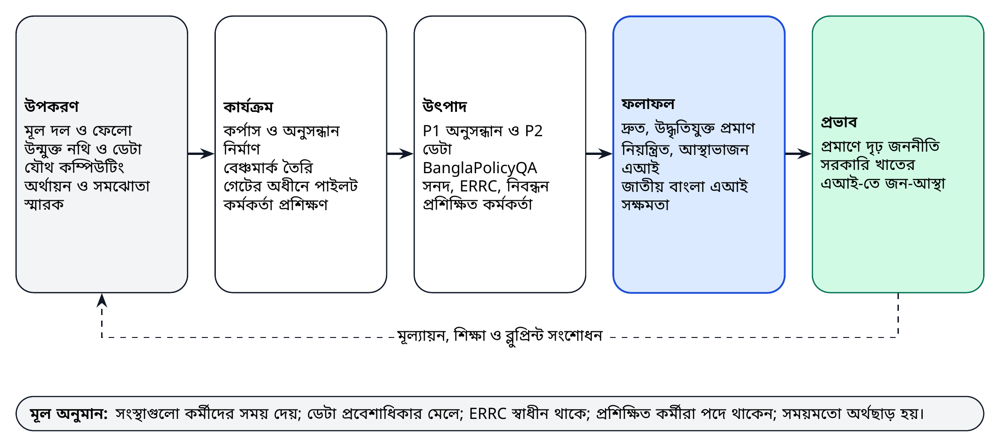

*চিত্র ১৪। পরিবর্তনের তত্ত্ব: উপকরণ থেকে প্রভাব পর্যন্ত, মূল অনুমান ও শিক্ষণ-চক্রসহ।*

## ১৮.২ লজিক্যাল ফ্রেমওয়ার্ক

প্রচলিত লজিক্যাল ফ্রেমওয়ার্ক পদ্ধতি [৯৯] অনুসরণ করে লজিক্যাল ফ্রেমওয়ার্ক প্রতিটি স্তরের জন্য সূচক, যাচাইয়ের উপায় ও অনুমানসহ ফলাফল-শৃঙ্খল নির্ধারণ করে।

**সারণি ৫৩।** লজিক্যাল ফ্রেমওয়ার্ক (৩৬ মাসের কর্মসূচি)

| স্তর | সংক্ষিপ্ত বিবরণ | সূচক | যাচাইয়ের উপায় | অনুমান |
|------------|--------------------------|--------------------------|-------------------|----------------------|
| **প্রভাব** | বাংলাদেশের জননীতি প্রমাণে আরও দৃঢ়ভাবে ভিত্তিস্থাপিত, এবং সরকারি খাতে এআই আস্থাভাজন ও সুশাসিত | BAPIL-এর প্রমাণ উদ্ধৃতকারী সরকারি নথি; ব্যবহারকারী জরিপে আস্থার মাপ | নথি বিশ্লেষণ; স্বাধীন মূল্যায়ন | প্রমাণভিত্তিক নীতির প্রতি রাজনৈতিক অঙ্গীকার অব্যাহত |
| **ফলাফল ১** | কর্মকর্তা ও গবেষকেরা দ্রুত ও নির্ভরযোগ্যভাবে প্রামাণ্য প্রমাণ খুঁজে পান ও উদ্ধৃত করেন | প্রমাণ অনুসন্ধানে সাশ্রয়কৃত সময়; মাসিক সক্রিয় ব্যবহারকারী | প্রমাণ-প্রাপ্তির সময় সমীক্ষা; ব্যবহার-লগ | সংস্থাগুলো পাইলটের জন্য কর্মীদের সময় দেয় |
| **ফলাফল ২** | BAPIL-এর পরিধিভুক্ত এআই ব্যবস্থা স্বচ্ছ ও নিরাপদভাবে নিয়ন্ত্রিত | ১০০% নিবন্ধিত; গুরুতর ঘটনা সময়মতো নিষ্পন্ন | স্বচ্ছতা নিবন্ধন; ঘটনার রেকর্ড | ERRC স্বাধীন ও সম্পদসমৃদ্ধ থাকে |
| **ফলাফল ৩** | বাংলা নীতি-এআই-তে জাতীয় সক্ষমতা বৃদ্ধি | প্রশিক্ষিত কর্মকর্তা; ফেলো; পুনর্ব্যবহৃত উন্মুক্ত ডেটাসেট | প্রশিক্ষণ রেকর্ড; ডাউনলোড ও উদ্ধৃতির সংখ্যা | প্রশিক্ষিত কর্মীরা প্রাসঙ্গিক পদে থাকেন |
| **উৎপাদ ১** | ব্যবহারকারীদের সঙ্গে নীতি অনুসন্ধান ও বাজেট ডেটাসেটের পাইলট | G3 উত্তীর্ণ পাইলট; Recall@10 | গেট রেকর্ড; বেঞ্চমার্ক প্রতিবেদন | সময়মতো ডেটা প্রবেশাধিকার প্রদান |
| **উৎপাদ ২** | উন্মুক্ত বেঞ্চমার্ক, কর্পাস ও মূল্যায়ন-পদ্ধতি প্রকাশিত | বেঞ্চমার্ক প্রশ্ন; DOI-সহ প্রকাশ | Zenodo ও GitHub রেকর্ড | টীকাকার উপলব্ধ |
| **উৎপাদ ৩** | শাসনব্যবস্থা কার্যকর | সনদ গৃহীত; ERRC-এর সিদ্ধান্ত প্রকাশিত | বোর্ডের কার্যবিবরণী; নিবন্ধন | সময়মতো সদস্য মনোনয়ন |
| **উৎপাদ ৪** | কর্মকর্তা ও বিশেষজ্ঞ প্রশিক্ষিত | কর্মসূচিভিত্তিক প্রশিক্ষিত কর্মকর্তা | উপস্থিতি ও মূল্যায়নের রেকর্ড | সংস্থাগুলো অংশগ্রহণকারী মনোনয়ন দেয় |
| **কার্যক্রম** | অধ্যায় ১৫-এর কর্মপরিকল্পনা ও পাইলটগুলোর কাজের প্যাকেজ | মাইলফলক MS1 থেকে MS9 | অগ্রগতি প্রতিবেদন | পরিকল্পনামাফিক অর্থছাড় |

## ১৮.৩ মূল কর্মদক্ষতা সূচক

**সারণি ৫৪।** পরিবীক্ষণ ও মূল্যায়ন কাঠামো: মূল কর্মদক্ষতা সূচক

| স্তর | সূচক | ভিত্তিমান | মাস ১২ | মাস ৩৬ |
|------------|-------------------------------------|-----------|------------|------------|
| উপকরণ | কর্মরত মূল জনবল (পূর্ণকালীন সমতুল্য) | ০ | ৯ | ১৯ |
| উপকরণ | পূর্ণ উৎস-তথ্যসহ সূচিবদ্ধ উন্মুক্ত নথি | ০ | ৫,০০০ | ২৫,০০০ |
| উৎপাদ | প্রকাশিত BanglaPolicyQA বেঞ্চমার্ক প্রশ্ন | ০ | ৫০০ | ২,০০০ |
| উৎপাদ | গেট G3 উত্তীর্ণ পাইলট | ০ | ২ | ৫ |
| উৎপাদ | DOI-সহ সংরক্ষিত উন্মুক্ত রিলিজ (এই ব্লুপ্রিন্টসহ) | ৩ | ৫ | ১০ |
| উৎপাদ | দায়িত্বশীল এআই ও সরঞ্জাম বিষয়ে প্রশিক্ষিত কর্মকর্তা | ০ | ১০০ | ৫০০ |
| ফলাফল | মাসিক সক্রিয় পাইলট ব্যবহারকারী | ০ | ৩০ | ৩০০ |
| ফলাফল | প্রমাণ অনুসন্ধানে সাশ্রয়কৃত সময়ের মধ্যমা, প্রমাণ-প্রাপ্তির সময় সমীক্ষায় পরিমাপকৃত (সংযুক্তি দ) | ভিত্তি সমীক্ষা | ৩০% | ৫০% |
| ফলাফল | ডেটা বা সহযোগিতা চুক্তি স্বাক্ষরকারী সংস্থা | ০ | ৩ | ১০ |
| মান | বাংলা ও ইংরেজি প্রশ্নে Recall@10 | এখনো পরিমাপ হয়নি | ০.৮৫ | ০.৯০ |
| শাসন | মডেল কার্ডসহ স্বচ্ছতা নিবন্ধনে তালিকাভুক্ত পাইলট | প্রযোজ্য নয় | ১০০% | ১০০% |
| শাসন | গুরুতর ঘটনা (সবগুলো সম্মত সময়সীমায় নিষ্পন্ন) | প্রযোজ্য নয় | ০ | ০ |
| প্রভাব | BAPIL-এর প্রমাণ উদ্ধৃতকারী সরকারি নথি বা নীতি-সংক্ষেপ | ০ | ৫ | ৩০ |

মাস ১২ ও ৩৬-এর সূচকগুলো প্রস্তাবিত লক্ষ্য, যা সারণি ৪৬-এর দীর্ঘমেয়াদি লক্ষ্যের সঙ্গে সামঞ্জস্যপূর্ণ এবং যা এগুলোকে ২০৪১ পর্যন্ত সম্প্রসারিত করে। প্রতিটি নিচের পদ্ধতিতে এবং মানসংক্রান্ত সূচকের ক্ষেত্রে সংযুক্তি দ-এর প্রটোকল অনুযায়ী পরিমাপ করা হয়।

## ১৮.৪ পদ্ধতি

* স্থির বেঞ্চমার্ক সংস্করণে মান-সূচকের জন্য **বেঞ্চমার্ক মূল্যায়ন**।
* সরঞ্জামসহ ও সরঞ্জাম ছাড়া মিলিয়ে নেওয়া কাজের তুলনামূলক **প্রমাণ-প্রাপ্তির সময় সমীক্ষা**।
* পাইলট চলাকালে প্রতি ত্রৈমাসিকে **ব্যবহারকারী জরিপ ও সাক্ষাৎকার**।
* BAPIL-এর প্রমাণ উদ্ধৃতকারী সরকারি নথি ও নীতি-সংক্ষেপ শনাক্তে **নথি বিশ্লেষণ**।
* BAPIL-এর সঙ্গে স্বার্থসংশ্লিষ্টতাহীন মূল্যায়নকারীদের দ্বারা মাস ১৮ ও ৩৬-এ এবং প্রতিটি দীর্ঘমেয়াদি পর্যালোচনায় **স্বাধীন মূল্যায়ন**।
* নিরীক্ষা লগ থেকে **ব্যবহারের পরিসংখ্যান**, কেবল সামষ্টিক আকারে প্রতিবেদিত; কোনো ব্যবহারকারীর প্রশ্ন কখনো প্রতিবেদিত হয় না।

## ১৮.৫ মূল্যায়নের প্রশ্ন

মাস ১৮ ও ৩৬-এর স্বাধীন মূল্যায়ন এবং দীর্ঘমেয়াদি পর্যালোচনাগুলো OECD DAC-এর মূল্যায়ন-মানদণ্ড, অর্থাৎ প্রাসঙ্গিকতা, সংগতি, কার্যকারিতা, দক্ষতা, প্রভাব ও টেকসইতা [১০০], BAPIL-এর জন্য খাপ খাইয়ে ব্যবহার করে:

* **প্রাসঙ্গিকতা:** স্বাগতিক সংস্থা ও ব্যবহারকারীদের বিচারে পাইলটগুলো কি বাস্তব নীতিগত চাহিদা পূরণ করে?
* **সংগতি:** BAPIL কি জাতীয় এআই নীতি, এআই হাব ও অন্যান্য কর্মসূচির পরিপূরক, নাকি দ্বৈততা ঘটায়?
* **কার্যকারিতা:** পাইলটগুলো কি তাদের উত্তরণ-মানদণ্ড পূরণ করেছে, এবং ব্যবহারকারীরা কি দ্রুততর ও নির্ভরযোগ্যভাবে প্রমাণ খুঁজে পেয়ে উদ্ধৃত করেছেন?
* **দক্ষতা:** সম্পদ কি মিতব্যয়ীভাবে ব্যবহৃত হয়েছে, এবং উৎপাদপ্রতি ব্যয় বিকল্পের তুলনায় কেমন?
* **প্রভাব:** নীতি-নথি আরও প্রমাণনির্ভর হয়েছে এবং সরকারি খাতের এআই-তে আস্থা বেড়েছে, এমন কোনো প্রমাণ আছে কি?
* **টেকসইতা:** গৃহীত সরঞ্জাম, উন্মুক্ত ডেটাসেট ও প্রশিক্ষিত মানুষ কি প্রকল্প-অর্থায়ন ছাড়াই মূল্য সৃষ্টি করে যাবে?

প্রতিটি মূল্যায়ন একটি শাসনগত প্রশ্নও করে: স্তর, গেট ও ERRC কি নকশা অনুযায়ী কাজ করেছে, এবং কোনো সুরক্ষাব্যবস্থা কি এড়িয়ে যাওয়া হয়েছে?

## ১৮.৬ শিখন ও প্রকাশনা

নেতিবাচক ফলাফলসহ মূল্যায়ন প্রতিবেদনগুলো DOI-সহ প্রকাশিত হয়। প্রতিটি পাইলট একটি সংক্ষিপ্ত “আমরা কী শিখলাম” টীকা দিয়ে শেষ হয়, যাতে কী কাজ করেছে, কী ব্যর্থ হয়েছে এবং পরবর্তী ব্লুপ্রিন্ট সংস্করণে কী বদলানো উচিত তা থাকে। শিক্ষাগুলো সরাসরি কৌশলগত পর্যালোচনা (সারণি ৪৮) ও এই ব্লুপ্রিন্টের সংশোধনে যুক্ত হয়।

\newpage

# অধ্যায় ১৯: ঝুঁকি ব্যবস্থাপনা

## ১৯.১ পদ্ধতি

ঝুঁকি নিবন্ধনের মালিক পরিচালক; স্টিয়ারিং বোর্ড প্রতি ত্রৈমাসিকে তা পর্যালোচনা করে এবং এর সারাংশ প্রকাশিত হয়। প্রতিটি ঝুঁকির একটি সম্ভাবনা ও প্রভাবের মান, প্রশমন-ব্যবস্থা ও একজন দায়িত্বপ্রাপ্ত রয়েছে। নিচের তাপ-মানচিত্রে নিবন্ধিত আঠারোটি ঝুঁকি দেখানো হয়েছে, যার মধ্যে প্রযুক্তির অপ্রচলন ও জলবায়ু-সংশ্লিষ্ট বিপর্যয়ের মতো দীর্ঘমেয়াদি ঝুঁকিও রয়েছে।

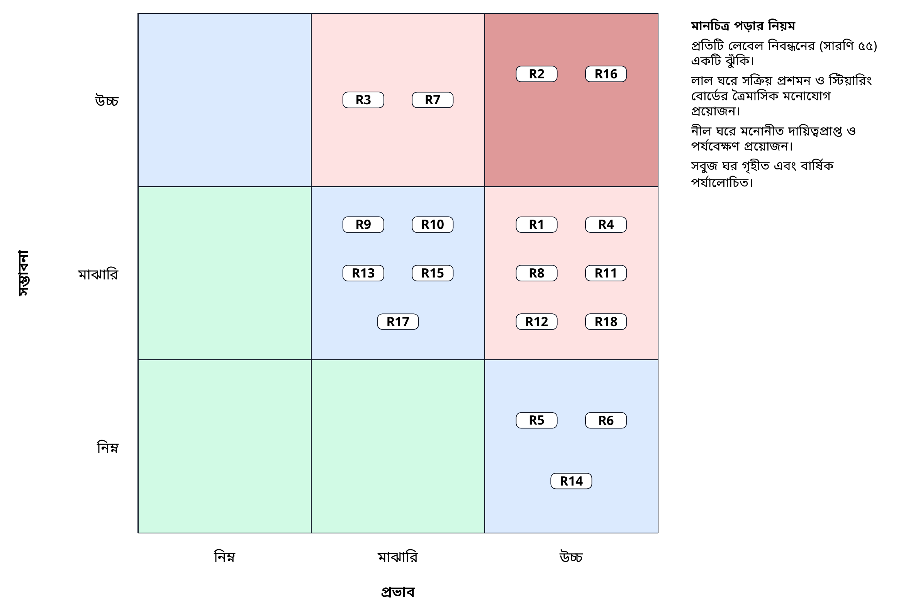

*চিত্র ১৫। সম্ভাবনা ও প্রভাব অনুযায়ী নিবন্ধিত আঠারোটি ঝুঁকির তাপ-মানচিত্র।*

## ১৯.২ ঝুঁকি নিবন্ধন

**সারণি ৫৫।** ঝুঁকি নিবন্ধন

| আইডি | ঝুঁকি | সম্ভাবনা | প্রভাব | প্রশমন | দায়িত্বপ্রাপ্ত |
|------|-------------------------|----------|--------|---------------------------------|--------------|
| R1 | রাজনৈতিক বা প্রাতিষ্ঠানিক পরিবর্তনে অগ্রাধিকার বদল | মা | উ | প্রতিষ্ঠান-নিরপেক্ষ নকশা; বিশ্ববিদ্যালয় স্বাগতিক; জাতীয় এআই নীতি প্রক্রিয়ার সঙ্গে সামঞ্জস্য; সর্বদলীয় অবহিতকরণ | পরিচালক, স্টিয়ারিং বোর্ড |
| R2 | একসঙ্গে নথি রপ্তানিসহ ডেটা প্রবেশাধিকারে বিলম্ব | উ | উ | ইতিমধ্যে প্রকাশিত নথি দিয়ে শুরু; NRDEX চুক্তি; বিকল্প হিসেবে তথ্য অধিকার আবেদন | ডেটা প্রধান |
| R3 | স্ক্যানকৃত বাংলা PDF থেকে নিম্নমানের টেক্সট | উ | মা | OCR মূল্যায়ন; মানব-সংশোধন চক্র; জন্মগতভাবে ডিজিটাল উৎসকে অগ্রাধিকার | ML প্রধান |
| R4 | ভুল উত্তরে কর্মকর্তারা বিভ্রান্ত | মা | উ | নিষ্কাশনমূলক উত্তর আগে; বাধ্যতামূলক উদ্ধৃতি; বিরত থাকা; প্রশিক্ষণ; শুধু R ও A শ্রেণি | ML প্রধান, ERRC |
| R5 | গোপনীয়তা লঙ্ঘন বা ব্যক্তিগত ডেটার অপব্যবহার | নি | উ | প্রথমে P0; DPIA; প্রবেশ নিয়ন্ত্রণ; স্বাধীন নিরীক্ষা | নিরাপত্তা প্রধান, শাসন বিশ্লেষক |
| R6 | লক্ষ্যচ্যুত হয়ে নজরদারির দিকে যাওয়া | নি | উ | সনদে T0 তালিকা; ERRC-এর ভেটো; জনসমক্ষে স্বচ্ছতা নিবন্ধন | ERRC |
| R7 | দক্ষ জনবলের ঘাটতি বা কর্মী হারানো | উ | মা | ফেলোশিপ; প্রবাসী অংশীদারিত্ব; প্রতিযোগিতামূলক শর্ত; দূরবর্তী সহযোগিতা | পরিচালক |
| R8 | ধাপগুলোর মধ্যে অর্থায়নের ঘাটতি | মা | উ | বহুমুখী অর্থায়ন (হোয়াইট পেপার পরিশিষ্ট গ); ধাপভিত্তিক প্রতিশ্রুতি | স্টিয়ারিং বোর্ড |
| R9 | এআই হাব বা অন্য উদ্যোগের সঙ্গে দ্বৈততা | মা | মা | কর্মবিভাজন বিষয়ে সমঝোতা স্মারক; যৌথ বেঞ্চমার্ক ও ডেটা | পরিচালক |
| R10 | বিক্রেতা বা মডেলের উপর আটকে পড়া | মা | মা | উন্মুক্ত মানদণ্ড; উন্মুক্ত-ওজন মডেল; বহনযোগ্য কন্টেইনার; জাতীয় ভান্ডারে কোড | প্ল্যাটফর্ম প্রধান |
| R11 | প্ল্যাটফর্মে সাইবার আক্রমণ | মা | উ | NIST CSF 2.0 নিয়ন্ত্রণ; অনুপ্রবেশ পরীক্ষা; অফলাইন ব্যাকআপ ও পুনরুদ্ধার মহড়া | নিরাপত্তা প্রধান |
| R12 | কর্মকর্তাদের মধ্যে কম গ্রহণযোগ্যতা | মা | উ | ব্যবহারকারীর সঙ্গে সহ-নকশা; প্রশিক্ষণ; সাশ্রয়কৃত সময় পরিমাপ; সংস্থায় প্রোডাক্ট ওনার | নীতি প্রধান |
| R13 | বাস্তবায়ন বিধিমালা জারির সময় আইনি অনিশ্চয়তা | মা | মা | আইনি পর্যালোচনা; রক্ষণশীল ডেটা পরিসর; বিধিমালা প্রকাশের সঙ্গে কার্যপ্রণালী হালনাগাদ | শাসন বিশ্লেষক |
| R14 | ভুল তথ্য বা দলীয় উদ্দেশ্যে সরঞ্জাম বা ফলাফলের অপব্যবহার | নি | উ | সরকারি সরঞ্জামে প্রবেশ-নিয়ন্ত্রণ; কৃত্রিম মিডিয়া তৈরি নয়; ব্যবহার-নীতি; নিরীক্ষা লগ; জনসমক্ষে নিবন্ধন | ERRC |
| R15 | বেঞ্চমার্ক দূষণ বা পরীক্ষা-সেটে অতিমানানসই | মা | মা | গোপন সংরক্ষিত পরীক্ষা-অংশ; সংস্করণভিত্তিক স্থিরকরণ; পর্যায়ক্রমিক হালনাগাদ; একাধিক সেটে প্রতিবেদন | ML প্রধান |
| R16 | কয়েকজন মূল ব্যক্তির ওপর নির্ভরতা | উ | উ | নথিভুক্তি ও উন্মুক্ত কোড; মূল পদে সহকারী; উত্তরাধিকার পরিকল্পনা; স্বাগতিকের সঙ্গে যৌথ মালিকানা | স্টিয়ারিং বোর্ড |
| R17 | দীর্ঘ মেয়াদে প্রযুক্তির অপ্রচলন | মা | মা | মডুলার নকশা ও ADR; পর্যালোচনায় মডেল পুনর্নির্বাচন; একক মডেলের বদলে ডেটা ও মূল্যায়নে বিনিয়োগ | TAB |
| R18 | বন্যা, ঘূর্ণিঝড়, বিদ্যুৎ বা নেটওয়ার্ক বিপর্যয়ে হোস্টিং ক্ষতিগ্রস্ত | মা | উ | দুর্যোগ-পুনরুদ্ধার সাইট; অফলাইন ব্যাকআপ; সারণি ৩৫-এর পুনরুদ্ধার-লক্ষ্য; স্বল্প-ব্যান্ডউইথ নকশা | প্ল্যাটফর্ম প্রধান |

*টীকা।* নি = নিম্ন, মা = মাঝারি, উ = উচ্চ। স্টিয়ারিং বোর্ড প্রতি ত্রৈমাসিকে নিবন্ধনটি পর্যালোচনা করে। আগাম সতর্কসংকেত, বিকল্প ব্যবস্থা, অবশিষ্ট মাত্রা ও পর্যালোচনার পুনরাবৃত্তি সংযুক্তি প-তে (সারণি ৬৭) দেওয়া আছে।

প্রতিটি ঝুঁকির জন্য সংযুক্তি প (সারণি ৬৭) একটি আগাম সতর্কসংকেত, ঝুঁকি ঘটলে বিকল্প ব্যবস্থা, প্রশমনের পর অবশিষ্ট মাত্রা এবং পর্যালোচনার পুনরাবৃত্তি যোগ করে।

## ১৯.৩ অগ্রাধিকারমূলক ঝুঁকি

চারটি ঝুঁকি বিশেষ মনোযোগের দাবি রাখে। **ডেটা প্রবেশাধিকার (R2)** বিলম্বের সবচেয়ে সম্ভাব্য কারণ; ইতিমধ্যে প্রকাশিত নথি দিয়ে শুরু করার অর্থ আনুষ্ঠানিক চুক্তিতে সময় লাগলেও কার্যকর কাজ শুরু করা যায়। **মূল ব্যক্তির ওপর নির্ভরতা (R16)** যেকোনো ছোট ও নতুন প্রতিষ্ঠানের জন্য গুরুতর ঝুঁকি; নথিভুক্তি, সহকারী ও যৌথ মালিকানা এটি কমায়। **ভুল উত্তর (R4)** সবচেয়ে গুরুতর কারিগরি ঝুঁকি; নিষ্কাশনমূলক উত্তর, বাধ্যতামূলক উদ্ধৃতি, বিরতি ও A শ্রেণির ব্যবহার এটিকে প্রশিক্ষণ ও পর্যবেক্ষণের মাধ্যমে ব্যবস্থাপনাযোগ্য মাত্রায় নামিয়ে আনে। **লক্ষ্যচ্যুতি (R6)** অসম্ভাব্য, কিন্তু জন-আস্থার জন্য অত্যন্ত ক্ষতিকর হবে; সনদের নিষিদ্ধ-ব্যবহারের তালিকা, ERRC-এর ভেটো এবং জনসমক্ষে স্বচ্ছতা নিবন্ধন এটিকে দৃশ্যমান ও প্রতিরোধযোগ্য করার জন্য নকশা করা হয়েছে।

## ১৯.৪ ঝুঁকি গ্রহণের প্রবণতা

BAPIL-এর ঝুঁকি গ্রহণের প্রবণতা ক্ষেত্রভেদে ভিন্ন। গোপনীয়তা, অধিকার ও জন-আস্থার ঝুঁকিতে এর **প্রবণতা নিম্ন**, যা কঠোর সীমারেখা ও ERRC-এর ভেটো দ্বারা নিয়ন্ত্রিত। বাস্তবায়ন ও কারিগরি ঝুঁকিতে এর **প্রবণতা মাঝারি**: কিছু পাইলট ব্যর্থ হবে তা মেনে নিয়ে ব্যর্থতাকে তথ্য হিসেবে গণ্য করা হয়। গবেষণা-ঝুঁকিতে এর **প্রবণতা তুলনামূলক উচ্চ**, কারণ কাজ নাও করতে পারে এমন পদ্ধতি অনুসন্ধান এর মিশনের অংশ, শর্ত হলো গবেষণাটি নিরাপদ এবং এর ফলাফল প্রকাশিত।

## ১৯.৫ ঊর্ধ্বতন পর্যায়ে উত্থাপন

যেসব ঝুঁকির মান উচ্চ সম্ভাবনা ও উচ্চ প্রভাবে পৌঁছায় সেগুলো এক মাসের মধ্যে স্টিয়ারিং বোর্ডে উত্থাপিত হয়। ব্যক্তি বা অধিকারের সম্ভাব্য ক্ষতিসংশ্লিষ্ট যেকোনো ঝুঁকি অবিলম্বে ERRC-তে উত্থাপিত হয়। সারণি ৪৮-এর ঘটনাভিত্তিক উদ্দীপক নিবন্ধনের একটি বিশেষ পর্যালোচনার সূচনা করে।

\newpage

# অধ্যায় ২০: গবেষণা-কর্মসূচি ও জ্ঞান-উৎপাদ

## ২০.১ মূল কাজ হিসেবে গবেষণা

BAPIL-কে সরঞ্জাম নির্মাতার পাশাপাশি একটি গবেষণা প্রতিষ্ঠান হিসেবে নকশা করা হয়েছে। এর গবেষণা-কর্মসূচি তিনটি উদ্দেশ্য পূরণ করবে: নিজস্ব ব্যবস্থার নকশার জন্য গুরুত্বপূর্ণ প্রশ্নের উত্তর দেওয়া; বাংলা ভাষা প্রযুক্তি ও সরকারি খাতের এআই শাসন বিষয়ে উন্মুক্ত জ্ঞানে অবদান রাখা; এবং জাতীয় গবেষণা-সক্ষমতা গড়ে তোলা। গবেষণা প্রশ্ন বাছাই করা হয় সেখানে, যেখানে BAPIL-এর অবস্থান (বাস্তব নীতি-কাজে প্রবেশাধিকার, একটি নিয়ন্ত্রিত কর্পাস ও একটি কার্যকর শাসন-ব্যবস্থা) এমন প্রমাণ তৈরির সুযোগ দেয় যা অন্যরা পারে না।

## ২০.২ গবেষণা প্রশ্ন

**সারণি ৫৬।** গবেষণা-কর্মসূচি ও পরিকল্পিত জ্ঞান-উৎপাদ

| আইডি | গবেষণা প্রশ্ন | পদ্ধতি | পরিকল্পিত উৎপাদ | সময় |
|-------|------------------------------|----------------------|------------------------|-----------|
| RQ1 | বাংলা ও ইংরেজি নীতি-টেক্সটে শব্দভিত্তিক, ঘন ও মিশ্র উদ্ধার কতটা কার্যকর, এবং দুই ভাষার ব্যবধান কীসে কমে? | BanglaPolicyQA-তে বেঞ্চমার্ক পরীক্ষা; প্রমিতকরণ ও শব্দকোষ সম্প্রসারণের প্রভাব বিশ্লেষণ | বেঞ্চমার্ক ও পদ্ধতি-প্রবন্ধ; উন্মুক্ত কোড ও ডেটা | ২০২৭ থেকে ২০২৮ |
| RQ2 | বিরতি ও উদ্ধৃতি-যাচাই কি এমনভাবে নির্ধারণ করা যায় যাতে কর্মকর্তারা কম অসমর্থিত দাবি দেখেন অথচ উপকারী উত্তর না হারান? | সীমা-নির্ধারণ সমীক্ষা; বিশ্বস্ততার মানব-বিচার | মূল্যায়ন-প্রবন্ধ; নির্ধারণ-নির্দেশিকা | ২০২৭ থেকে ২০২৯ |
| RQ3 | উদ্ধৃতিযুক্ত অনুসন্ধান-সরঞ্জাম কি নীতি-বিশ্লেষণের গতি ও মান বদলায়? | পাইলট ব্যবহারকারীদের সঙ্গে মিলিত-কাজ সমীক্ষা; সাক্ষাৎকার | প্রমাণ-প্রাপ্তির সময় ও মানের অভিজ্ঞতাভিত্তিক সমীক্ষা | ২০২৮ থেকে ২০২৯ |
| RQ4 | নতুন ডেটা আইনের অধীনে একটি জনপ্রশাসনে ঝুঁকি-স্তর, গেট ও স্বচ্ছতা নিবন্ধন কীভাবে কার্যকর করা যায়? | ডিজাইন সায়েন্স ও BAPIL শাসনের কেস স্টাডি | ব্লুপ্রিন্টের কাঠামো বিষয়ে পিয়ার-রিভিউড জার্নাল প্রবন্ধ; নীতি-সংক্ষেপ | পাণ্ডুলিপি ২০২৭ |
| RQ5 | OCR-এর মান ও ইউনিকোড প্রমিতকরণ বাংলায় পরবর্তী উদ্ধারকে কীভাবে প্রভাবিত করে? | স্ক্যানকৃত ও জন্মগতভাবে ডিজিটাল নথিতে নিয়ন্ত্রিত পরীক্ষা | ডেটাশিটসহ সংশোধিত টেক্সটের ডেটাসেট; সংক্ষিপ্ত প্রবন্ধ | ২০২৮ |
| RQ6 | নিম্ন-মধ্যম আয়ের দেশে কোন প্রাতিষ্ঠানিক রূপ জনস্বার্থমূলক এআই নীতি ল্যাবকে টেকসই রাখে? | তুলনামূলক প্রাতিষ্ঠানিক বিশ্লেষণ; মূল্যায়নের প্রমাণ | ব্লুপ্রিন্ট ২.০-এর জন্য প্রাতিষ্ঠানিক পর্যালোচনা | ২০২৯ |

*টীকা।* উৎপাদগুলো DOI-সহ উন্মুক্ত প্রবেশাধিকারে প্রকাশিত হবে। জার্নাল নির্বাচন পরিধি, উন্মুক্ত প্রবেশাধিকারের সুযোগ ও পিয়ার রিভিউয়ের মান অনুযায়ী; পিয়ার রিভিউয়ের কোনো ফলাফল পূর্বানুমান করা হয় না।

## ২০.৩ প্রকাশনা পরিকল্পনা

গবেষণা-উৎপাদ DOI-সহ উন্মুক্ত প্রবেশাধিকারে প্রকাশিত হয়: ডেটাশিটসহ Zenodo-তে ডেটাসেট ও বেঞ্চমার্ক; গিটহাবে কোড; BAPIL সিরিজে মূল্যায়ন প্রতিবেদন; এবং পরিধি, উন্মুক্ত প্রবেশাধিকারের সুযোগ ও পর্যালোচনার মানের ভিত্তিতে বাছাইকৃত জার্নাল ও সম্মেলনে পিয়ার-রিভিউড প্রবন্ধ। এই ব্লুপ্রিন্ট ও এর রেফারেন্স বাস্তবায়নের ভিত্তিতে একটি প্রথম জার্নাল পাণ্ডুলিপি ২০২৭ সালের জন্য পরিকল্পিত; এতে কাঠামো, নকশার যৌক্তিকতা ও প্রদর্শনী ফলাফল উপস্থাপিত হবে, এবং এআই ও জননীতি বা ডিজিটাল সরকার ক্ষেত্রের একটি পিয়ার-রিভিউড জার্নালে জমা দেওয়া হবে। কোনো পরিকল্পনায় পিয়ার রিভিউয়ের ফলাফল পূর্বানুমান করা হয় না।

## ২০.৪ গবেষণা-নৈতিকতা

মানুষ-সংশ্লিষ্ট সব গবেষণা (জরিপ, সাক্ষাৎকার, ব্যবহারকারী-সমীক্ষা) স্বাগতিক প্রতিষ্ঠানের গবেষণা-নৈতিকতা কমিটি এবং প্রাসঙ্গিক ক্ষেত্রে ERRC দ্বারা অনুমোদিত। অংশগ্রহণ স্বেচ্ছামূলক ও অবহিত, ডেটা ন্যূনতম ও পরিচয়-অপসারিত, এবং ফলাফল সামষ্টিক আকারে প্রতিবেদিত। তথ্য-অখণ্ডতা বিষয়ক গবেষণা পাইলট P6-এর জন্য প্রয়োজনীয় নির্দিষ্ট প্রটোকল অনুসরণ করে।

\newpage

# অধ্যায় ২১: প্রত্যাশিত সিদ্ধান্ত ও পরবর্তী পদক্ষেপ

## ২১.১ সিদ্ধান্তসমূহ

**সারণি ৫৭।** সংশ্লিষ্ট কর্তৃপক্ষের কাছে প্রত্যাশিত সিদ্ধান্ত

| নং | সিদ্ধান্ত | দায়িত্বপ্রাপ্ত কর্তৃপক্ষ | সময় |
|------|--------------------------------------------|------------------------|-------------|
| D1 | জাতীয় এআই নীতি প্রণয়ন-প্রক্রিয়ায় এই ব্লুপ্রিন্টকে কারিগরি উপকরণ হিসেবে গ্রহণ | ডাক, টেলিযোগাযোগ ও তথ্যপ্রযুক্তি মন্ত্রণালয় (আইসিটি বিভাগ) | ২০২৬-এর চতুর্থ ত্রৈমাসিক |
| D2 | ১২ মাসের প্রথম ধাপের পাইলট অনুমোদন, একজন সরকারি ফোকাল পয়েন্ট মনোনয়ন, স্বাগতিক প্রতিষ্ঠানের সঙ্গে সমঝোতা স্মারক সম্পাদন এবং প্রথম বছরের অর্থায়নের (প্রায় ৪.৭ কোটি টাকা, সারণি ৫০) প্রতিশ্রুতি বা উৎস নির্ধারণ | আইসিটি বিভাগ ও স্বাগতিক প্রতিষ্ঠান | ৯০ দিনের মধ্যে |
| D3 | ইতিমধ্যে প্রকাশিত নথিসংগ্রহে কাঠামোবদ্ধভাবে একসঙ্গে প্রবেশাধিকার অনুমোদন ও ডেটা-রক্ষক মনোনয়ন | লেজিসলেটিভ ও সংসদ বিষয়ক বিভাগ, অর্থ বিভাগ, পরিকল্পনা কমিশন, বিবিএস, এটুআই | ১২০ দিনের মধ্যে |
| D4 | স্টিয়ারিং বোর্ডে সদস্য মনোনয়ন, এবং একটি স্বাধীন মনোনয়ন প্যানেলের উন্মুক্ত আহ্বানের মাধ্যমে ERRC সদস্য বাছাইয়ে সম্মতি | আইসিটি বিভাগ ও স্বাগতিক প্রতিষ্ঠান (স্টিয়ারিং বোর্ড); স্বাধীন প্যানেল (ERRC) | ৯০ দিনের মধ্যে |
| D5 | দ্বিতীয় ধাপের বাজেট নির্ধারণকারী সম্ভাব্যতা ও ব্যয়-নিরূপণ সমীক্ষা পরিচালনার নির্দেশ | আইসিটি বিভাগ বা কোনো উন্নয়ন সহযোগী | মাস ৬-এর মধ্যে |
| D6 | সুরক্ষাসীমা নিশ্চিত করা: G4 সিদ্ধান্ত ছাড়া A শ্রেণির বাইরে কোনো প্রয়োগ নয় এবং নিষিদ্ধ শ্রেণিতে কোনো ব্যবহার নয় | স্টিয়ারিং বোর্ড | সনদ গ্রহণের সময় |

*টীকা।* এসব সিদ্ধান্তের কোনোটিই কোনো সংবিধিবদ্ধ সংস্থা সৃষ্টি করে না বা BAPIL-কে আইনি ক্ষমতা দেয় না। মাস ১-এর আগে প্রয়োজনীয় অনুমোদন ও চুক্তির তালিকা সংযুক্তি ন-তে (সারণি ৬৫) দেওয়া আছে।

## ২১.২ সিদ্ধান্তের পর কী হবে

\looseness=-1 সিদ্ধান্ত D1, D2 ও D4 গৃহীত হলে এবং সমঝোতা স্মারক, স্বাগতিক-চুক্তি ও প্রথম বছরের অর্থায়ন নিশ্চিত হলে (সংযুক্তি ন) অনুচ্ছেদ ১৫.৪-এর ৯০ দিনের পরিকল্পনা শুরু করা যায়। সিদ্ধান্ত D3 পূর্ণ P1 কর্পাস উন্মুক্ত করে; তা ছাড়াও সরকারি ওয়েবসাইট থেকে ইতিমধ্যে ডাউনলোডযোগ্য নথি দিয়ে P1 শুরু করা যায়। সিদ্ধান্ত D5 দ্বিতীয় ধাপের বাজেট নির্ধারণ করে। সিদ্ধান্ত D6 নিশ্চিত করে যে এই ব্লুপ্রিন্টের সুরক্ষাব্যবস্থাগুলো প্রথম দিন থেকেই বাধ্যতামূলক।

## ২১.৩ আশু পরবর্তী পদক্ষেপ (চতুর্থ ত্রৈমাসিক ২০২৬ থেকে প্রথম ত্রৈমাসিক ২০২৭)

\looseness=-1 সিদ্ধান্তগুলো বিবেচনাধীন থাকার সময় সরকারি অর্থের প্রতিশ্রুতি ছাড়াই নিচের পদক্ষেপগুলো এগোতে পারে:

* স্থায়ী শনাক্তকারীসহ এই ব্লুপ্রিন্ট, সারসংক্ষেপ ও রেফারেন্স বাস্তবায়নের প্রকাশ;
* আইসিটি বিভাগ, ডেটা-রক্ষক ও জাতীয় এআই নীতি প্রণয়ন দলের জন্য অবহিতকরণ, যেখানে ব্লুপ্রিন্টটি কারিগরি উপকরণ হিসেবে প্রস্তাবিত;
* বিশেষজ্ঞ গোলটেবিল ও একটি জনমন্তব্য-পর্ব, যার প্রকাশিত মন্তব্য-লগ ব্লুপ্রিন্ট ১.১-এ যুক্ত হবে (সারণি ৮);
* পরামর্শের জন্য স্বাগতিক প্রতিষ্ঠানের আহ্বান, খসড়া সনদ ও কার্যপরিধির প্রস্তুতি (সংযুক্তি ঙ থেকে ছ);
* কাঠামো ও এর রেফারেন্স বাস্তবায়ন উপস্থাপনকারী একটি পিয়ার-রিভিউড জার্নাল পাণ্ডুলিপির প্রস্তুতি (অধ্যায় ২০)।

## ২১.৪ উপসংহার

\enlargethispage{\baselineskip}
\looseness=-1 একটি নির্ভরযোগ্য এআই নীতি-বুদ্ধিমত্তা সক্ষমতা গড়ে তোলার জন্য বাংলাদেশের ডেটা-ভিত্তি, প্রতিষ্ঠান ও মেধা রয়েছে, এবং এমন সক্ষমতা যে আইনি কাঠামো ও জাতীয় এআই নীতির মধ্যে কাজ করবে, দেশ এখন তা প্রতিষ্ঠা করছে। এই ব্লুপ্রিন্ট দেখায় কীভাবে ছোট পরিসরে, নিরাপদে ও উন্মুক্তভাবে শুরু করা যায়: উন্মুক্ত নথি দিয়ে, এমন একটি দ্বিভাষিক অনুসন্ধান ও উত্তর সেবা দিয়ে যা সর্বদা উৎস দেখায়, প্রকৃত সিদ্ধান্তের অধিকারসম্পন্ন একটি শাসন-ব্যবস্থা দিয়ে, এবং এমন পাইলট দিয়ে যাদের বড় হওয়ার আগে নিজেদের মূল্য প্রমাণ করতে হয়। এটি আরও দেখায় কীভাবে সেই সূচনা দিগন্তের পর দিগন্তে ২০৪১-এর লক্ষ্যকে সহায়তাকারী একটি জাতীয় সক্ষমতায় পরিণত হতে পারে, এমন সুরক্ষাব্যবস্থা কখনো শিথিল না করে যা একে আস্থাভাজন করে। রেফারেন্স বাস্তবায়ন দেখায় যে মূল প্রক্রিয়াগুলো ছোট পরিসরে নির্মাণ ও পরীক্ষা করা যায়; বাস্তব নীতি-প্রশ্নে এগুলো কর্মকর্তাদের সাহায্য করে কি না, তা জানাই পাইলটের উদ্দেশ্য। সেই পরবর্তী পদক্ষেপ নেওয়ার ভার সেই কর্তৃপক্ষ ও অংশীদারদের, যাঁরা এগুলো পরীক্ষার সিদ্ধান্ত নিতে পারেন।

\newpage

# সংযুক্তি ক: প্রয়োজনীয়তা অনুসরণযোগ্যতা ম্যাট্রিক্স

**সারণি ৫৮।** প্রয়োজনীয়তা অনুসরণযোগ্যতা ম্যাট্রিক্স

| প্রয়োজনীয়তা | সারাংশ | উপাদান | কোড মডিউল | যাচাই |
|----------|------------------------------|----------|-------------------|----------------|
| FR-01 | দ্বিভাষিক অনুসন্ধান | C2, C4 | bapil.text, bapil.search | test_text, test_search |
| FR-02 | উদ্ধৃতিসহ উত্তর ও বিরত থাকা | C5 | bapil.answer | test_answer |
| FR-03 | গ্রহণের সময় উৎস-তথ্য | C2, C3 | bapil.corpus | test_corpus |
| FR-04 | ড্যাশবোর্ড | C6, C7 | শুধু বিনির্দেশিত | পাইলট P2 গ্রহণ |
| FR-05 | সামষ্টিক মতামত বিশ্লেষণ | C6 | শুধু বিনির্দেশিত | পাইলট P3-এর DPIA ও গ্রহণ |
| FR-06 | এআই ব্যবস্থা নিবন্ধন | C12 | bapil.registry | test_registry |
| FR-07 | ঝুঁকি-স্তর মূল্যায়ন | C12 | bapil.risk | test_risk |
| FR-08 | মূল্যায়ন কাঠামো | C11 | bapil.evaluate | test_evaluate |
| FR-09 | স্বচ্ছতা নিবন্ধন | C12 | bapil.registry (রপ্তানি) | test_registry |
| FR-10 | সংস্করণকৃত API | C8 | bapil.api | test_api |
| NFR-01 | ভাষাগত সমতা | C2, C4 | bapil.text শব্দকোষ ও প্রমিতকারী | test_text; বেঞ্চমার্ক |
| NFR-07 | পুনরুৎপাদনযোগ্যতা | সব | CI ওয়ার্কফ্লো; বাহ্যিক নির্ভরতা নেই | GitHub Actions |
| NFR-08 | ব্যাখ্যাযোগ্যতা | C5 | bapil.answer (উৎস ও স্কোর) | test_answer |
| GR-02 | নির্মাণের আগে গেট | C12 | bapil.risk | test_risk |
| GR-04 | হস্তক্ষেপ-শনাক্তযোগ্য লগ | C10 | bapil.audit | test_audit |
| GR-06 | নিষিদ্ধ ব্যবহার | C12 | bapil.risk (T0 যাচাই) | test_risk |

এখানে তালিকাভুক্ত নয় এমন প্রয়োজনীয়তাগুলো পাইলট গ্রহণের মানদণ্ড (সারণি ৩৮), নিরাপত্তা পরীক্ষা (অধ্যায় ১০) বা শাসনগত পর্যালোচনার (অধ্যায় ১৩) মাধ্যমে যাচাই করা হয়।

\newpage

# সংযুক্তি খ: ঝুঁকি-স্তর প্রশ্নমালা

## খ.১ নিষিদ্ধ ব্যবহার যাচাই

*হ্যাঁ* বা *না* উত্তর দিন। কোনো একটি *হ্যাঁ* হলে ব্যবস্থাটি T0 স্তরে পড়ে এবং কাজ বন্ধ হয়।

1. ব্যবস্থাটি কি সাধারণ সামাজিক বিশ্বাসযোগ্যতা বা আচরণের ভিত্তিতে ব্যক্তিকে স্কোর বা র‍্যাংক করে (সামাজিক স্কোরিং)?
2. এটি কি গণ বা নির্বিচার বায়োমেট্রিক শনাক্তকরণ বা নজরদারি করে?
3. এটি কি ব্যক্তির রাজনৈতিক মত, ধর্মীয় বিশ্বাস বা অনুরূপ সুরক্ষিত বৈশিষ্ট্য অনুমান বা প্রোফাইল করে?
4. এটি কি বাস্তব ব্যক্তির প্রতারণামূলক কৃত্রিম মিডিয়া তৈরি করে?
5. এটি কি বয়স, প্রতিবন্ধিতা বা আর্থিক দুর্দশার মতো দুর্বলতাকে কাজে লাগিয়ে প্রভাবিত করার কৌশল ব্যবহার করে?

## খ.২ স্কোরযুক্ত মাত্রা

**সারণি ৫৯।** ঝুঁকি-স্তর প্রশ্নমালা: স্কোরযুক্ত মাত্রা (সংযুক্তি খ)

| কোড | মাত্রা | স্কোর ০ | স্কোর ১ | স্কোর ২ | স্কোর ৩ |
|------|-------------------|---------------|---------------|---------------|---------------|
| D1 | সিদ্ধান্তে প্রভাব | শুধু গবেষণা | বিশ্লেষককে তথ্য দেয় | নীতি বা কর্মসূচি-সংক্রান্ত সরকারি সিদ্ধান্তে তথ্য দেয় | নির্দিষ্ট ব্যক্তি বা প্রতিষ্ঠান-সংক্রান্ত সিদ্ধান্তে তথ্য দেয় বা স্বয়ংক্রিয় করে |
| D2 | ডেটার সংবেদনশীলতা | P0 উন্মুক্ত | P1 অভ্যন্তরীণ, ব্যক্তিগত নয় | P2 ব্যক্তিগত | P3 সংবেদনশীল ব্যক্তিগত বা সংরক্ষিত |
| D3 | সম্ভাব্য প্রভাবিত মানুষ | কেউ নয় বা অভ্যন্তরীণ | ১০,০০০-এর কম | ১০,০০০ থেকে ১০ লক্ষ | ১০ লক্ষের বেশি |
| D4 | ক্ষতির প্রত্যাবর্তনযোগ্যতা | সহজেই প্রত্যাবর্তনযোগ্য | চেষ্টায় প্রত্যাবর্তনযোগ্য | প্রত্যাবর্তন কঠিন | অপ্রত্যাবর্তনযোগ্য |
| D5 | স্বয়ংক্রিয়তার মাত্রা | অনুরোধে পরামর্শ | প্রতিটি ফলাফল মানুষ পর্যালোচনা করেন | নমুনা মানুষ পর্যালোচনা করেন | সম্পূর্ণ স্বয়ংক্রিয় |
| D6 | প্রভাবিত গোষ্ঠীর ঝুঁকিপ্রবণতা | কোনো প্রভাবিত ব্যক্তি নেই | সাধারণ জনগণ | ঝুঁকিপূর্ণ গোষ্ঠী অন্তর্ভুক্ত | ঝুঁকিপূর্ণ গোষ্ঠীকে লক্ষ্য করে |
| D7 | উন্মুক্ততা | অভ্যন্তরীণ গবেষক | কর্মকর্তা | জনসাধারণের জন্য তথ্য | পরিণামসহ জনসাধারণের জন্য নির্দেশনা |

*টীকা।* স্তর-নিয়ম: কোনো নিষিদ্ধ-ব্যবহার চিহ্ন থাকলে T0। অন্যথায় মোট স্কোর কমপক্ষে ১৩, বা D1 = ৩, বা D2 = ৩, বা D2 ও D3 উভয়ই কমপক্ষে ২ হলে T3; মোট কমপক্ষে ৬, বা D1 = ২, বা D7 কমপক্ষে ২ হলে T2; অন্যথায় T1। bapil.risk-এ বাস্তবায়িত।

## খ.৩ স্তরবিন্যাসের নিয়ম

1. খ.১-এ কোনো *হ্যাঁ* থাকলে **T0 নিষিদ্ধ**।
2. অন্যথায়, মোট স্কোর ১৩ বা তার বেশি হলে, অথবা D1 = ৩, অথবা D2 = ৩, অথবা D2 ও D3 উভয়ই ২ বা তার বেশি হলে ব্যবস্থাটি **T3 উচ্চ**।
3. অন্যথায়, মোট স্কোর ৬ বা তার বেশি হলে, অথবা D1 = ২, অথবা D7 ২ বা তার বেশি হলে ব্যবস্থাটি **T2 সীমিত**।
4. অন্যথায় ব্যবস্থাটি **T1 নিম্ন**।

\looseness=-1 নিয়মগুলো `bapil.risk`-এ বাস্তবায়িত এবং `implementation/examples/risk/`-এর উদাহরণগুলোর বিপরীতে পরীক্ষিত, যার মধ্যে একটি নিষিদ্ধ সামাজিক স্কোরিংয়ের উদাহরণ (T0) ও একটি সুবিধা-যোগ্যতার উদাহরণ (T3) রয়েছে।

## খ.৪ উদাহরণ: A শ্রেণির ব্যবহারে পাইলট P1

\enlargethispage{\baselineskip}
\looseness=-1 স্কোর: D1 = ২ (নীতি-সংক্রান্ত সরকারি সিদ্ধান্তে তথ্য দেয়), D2 = ০ (উন্মুক্ত নথি), D3 = ০ (কোনো ব্যক্তি প্রভাবিত নয়), D4 = ১, D5 = ১ (প্রতিটি ফলাফল মানুষ পর্যালোচনা করেন), D6 = ০ (কোনো প্রভাবিত ব্যক্তি নেই), D7 = ১ (কর্মকর্তা)। মোট = ৫। কোনো উচ্চ-ঝুঁকির শর্ত প্রযোজ্য নয়; D1 = ২ হওয়ায় ফলাফল **T2 সীমিত**, যার জন্য ERRC পর্যালোচনা, রেড-টিম পরীক্ষা, প্রতিটি ফলাফলের মানব-পর্যালোচনা এবং ব্যবহারকারী প্রশিক্ষণ প্রয়োজন। একই ব্যবস্থা শুধু BAPIL গবেষকেরা ব্যবহার করলে (D1 = ১, D7 = ০) মোট স্কোর ৩ এবং স্তর **T1 নিম্ন**। এই হিসাব `python -m bapil.cli assess examples/risk/risk_p1_policy_search.json` কমান্ডে পুনরুৎপাদন করা যায়।

\newpage

# সংযুক্তি গ: টেমপ্লেট

## গ.১ এআই ব্যবস্থার রেকর্ড (ক্ষেত্রসমূহের সারাংশ)

| ক্ষেত্র | বিবরণ |
|---|---|
| `system_id` | অনন্য শনাক্তকারী, যেমন `BAPIL-P1` |
| `name` | ইংরেজি ও বাংলায় নাম |
| `purpose` | ব্যবস্থাটি কিসের জন্য এবং কিসের জন্য নয় |
| `owner` | জবাবদিহিকারী ব্যক্তি ও ইউনিট; প্রযোজ্য হলে স্বাগতিক সংস্থার প্রোডাক্ট ওনার |
| `maturity_class` | R, A অথবা O |
| `risk_tier` | T0 থেকে T3, সর্বশেষ মূল্যায়নের তারিখ ও সূত্রসহ |
| `data_classes` | ব্যবহৃত ডেটা-শ্রেণি (P0 থেকে P3) |
| `models` | মডেল ও সংস্করণ, মডেল কার্ডের লিংকসহ |
| `evaluation` | বেঞ্চমার্ক সংস্করণ ও প্রধান ফলাফল |
| `gate_status` | সর্বশেষ উত্তীর্ণ গেট ও তারিখ |
| `oversight` | প্রয়োগকৃত মানব-তত্ত্বাবধানের ধরন (সারণি ৪০) |
| `limitations` | জানা সীমাবদ্ধতা ও ব্যর্থতার ধরন |
| `contact` | সমস্যা বা অভিযোগ জানানোর উপায় |

পূর্ণ JSON স্কিমা: `implementation/schemas/ai_system_record.schema.json`।

## গ.২ মডেল কার্ড (শিরোনামসমূহ)

মডেলের বিবরণ; উদ্দিষ্ট ব্যবহার ও পরিসরবহির্ভূত ব্যবহার; প্রশিক্ষণ ও অভিযোজনের ডেটা; ভাষাভিত্তিক মূল্যায়ন-ডেটা ও ফলাফল; ন্যায্যতা ও দৃঢ়তা বিশ্লেষণ; সীমাবদ্ধতা ও ঝুঁকি; নৈতিক বিবেচনা; পরিবেশগত ও কম্পিউটিং ব্যয়; সংস্করণ ও যোগাযোগ [৭৯]।

## গ.৩ ডেটাসেটের ডেটাশিট (শিরোনামসমূহ)

প্রেরণা (ডেটাসেটটি কেন এবং কারা তৈরি করেছে); গঠন (এতে কী আছে, ডেটা-শ্রেণি, ভাষা, জানা ঘাটতি); সংগ্রহ-প্রক্রিয়া (উৎস, তারিখ, পুনর্ব্যবহারের শর্ত); প্রাক-প্রক্রিয়াকরণ (নিষ্কাশন, OCR, প্রমিতকরণ, পরিচয়-অপসারণ); ব্যবহার (উদ্দিষ্ট ও অনুপযুক্ত); বিতরণ (লাইসেন্স, DOI); রক্ষণাবেক্ষণ (দায়িত্বপ্রাপ্ত, হালনাগাদের সময়সূচি, ত্রুটি কীভাবে জানানো যায়) [৭৫]।

## গ.৪ ঘটনা প্রতিবেদন (শিরোনামসমূহ)

সূত্র নম্বর; তারিখ ও সময়; ব্যবস্থা ও সংস্করণ; প্রতিবেদক (ঐচ্ছিক); বিবরণ; প্রভাবিত ব্যবহারকারী বা গোষ্ঠী; গুরুত্বের মাত্রা (সারণি ৩৪); তাৎক্ষণিক পদক্ষেপ; মূল কারণ; সংশোধনমূলক পদক্ষেপ; ERRC পর্যালোচনা; জনসমক্ষে সারাংশ।

## গ.৫ মূল্যায়ন প্রতিবেদন (শিরোনামসমূহ)

ব্যবস্থা ও সংস্করণ; বেঞ্চমার্ক সংস্করণ ও বিভাজন; ভাষা ও নথির ধরনভিত্তিক মাপকাঠি (সারণি ২৮); পূর্ববর্তী রিলিজ ও সীমার সঙ্গে তুলনা; উদাহরণসহ ত্রুটি বিশ্লেষণ; রেড-টিম ও নিরাপত্তা পরীক্ষার ফলাফল; জানা সীমাবদ্ধতা; পরবর্তী গেটের জন্য সুপারিশ।

\newpage

# সংযুক্তি ঘ: প্রকাশনা, সংস্করণ ও DOI নীতিমালা

1. **প্রতিটি প্রকাশনার পৃথক রেকর্ড।** হোয়াইট পেপার, নির্বাহী সারসংক্ষেপ ও এই ব্লুপ্রিন্টের প্রত্যেকটির নিজস্ব Zenodo রেকর্ড ও DOI রয়েছে। ব্লুপ্রিন্ট রেকর্ডে PDF ও Markdown আকারে ইংরেজি ও বাংলা ব্লুপ্রিন্ট ও সারসংক্ষেপ, এবং LaTeX, PDF ও PNG আকারে চিত্র ও সারণি রয়েছে।
2. **সম্পর্কিত শনাক্তকারী।** ব্লুপ্রিন্ট রেকর্ডে হোয়াইট পেপারের (10.5281/zenodo.21363967) সঙ্গে *is supplement to*, নির্বাহী সারসংক্ষেপের (10.5281/zenodo.21441172) সঙ্গে *references* এবং রেফারেন্স বাস্তবায়নযুক্ত গিটহাব রিপোজিটরি রিলিজের সঙ্গে *is supplemented by* সম্পর্ক ঘোষণা করা হয়।
3. **DOI সংরক্ষণ।** Zenodo রেকর্ড তৈরির সময় রেকর্ডটি প্রকাশের আগে এর DOI সংরক্ষণ করা হয়, যাতে তা নথিতে মুদ্রিত করা যায়; এরপর PDF পুনর্নির্মাণ করে আপলোড করা হয়। ততদিন নথিগুলোতে উল্লেখ থাকে যে DOI প্রকাশের সময় নির্ধারিত হবে।
4. **রিপোজিটরি রিলিজ।** রিপোজিটরির রিলিজ সেমান্টিক সংস্করণ রীতি অনুসরণ করে। রিলিজ v1.1.0 ব্লুপ্রিন্ট ও রেফারেন্স বাস্তবায়ন যোগ করে। এই ব্লুপ্রিন্টের Zenodo রেকর্ড কেবল তখনই প্রকাশিত হবে, যখন রিলিজটি <https://github.com/md-naim-hassan-saykat/bapil/releases>-এ প্রকাশ্যে তালিকাভুক্ত হবে, যাতে নথিগুলোতে উল্লিখিত প্রতিটি উপকরণ পাঠকেরা যাচাই করতে পারেন।
5. **নতুন সংস্করণ।** সংশোধনী একই Zenodo রেকর্ডের নতুন সংস্করণ তৈরি করে (যেমন ১.০.১); মৌলিক পরিমার্জন ব্লুপ্রিন্ট ২.০ তৈরি করে (মাইলফলক MS9)।
6. **লাইসেন্স।** নথি CC BY 4.0; কোড MIT।
7. **ভাষাগত অগ্রাধিকার।** ইংরেজি সংস্করণটি প্রামাণ্য। বাংলা সংস্করণে ব্যাখ্যাগত পার্থক্য দেখা দিলে ইংরেজি সংস্করণ প্রাধান্য পাবে।

\newpage

# সংযুক্তি ঙ: BAPIL-এর খসড়া সনদ

পরামর্শের (সারণি ৮) পর মাইলফলক MS1-এ স্টিয়ারিং বোর্ডের গ্রহণের জন্য এই খসড়া প্রস্তাবিত। মাইলফলক MS2-এর আগে সম্পন্ন স্বাধীন আইনি পর্যালোচনার (অনুচ্ছেদ ১৪.৩) পর এটি নিশ্চিত বা সংশোধিত হবে।

**ধারা ১. নাম ও মর্যাদা।** বাংলাদেশ এআই পলিসি অ্যান্ড ইনোভেশন ল্যাব (BAPIL) আইসিটি বিভাগের সঙ্গে একটি সমঝোতা স্মারকের অধীনে [স্বাগতিক প্রতিষ্ঠান]-এ স্থাপিত একটি গবেষণা, নীতি-বুদ্ধিমত্তা ও সক্ষমতা উন্নয়ন উদ্যোগ।

**ধারা ২. মিশন।** BAPIL উন্মুক্ত গবেষণা, সরঞ্জাম, পদ্ধতি ও প্রশিক্ষণের মাধ্যমে প্রমাণভিত্তিক নীতিনির্ধারণ, দায়িত্বশীল এআই শাসন, বাংলা ভাষা প্রযুক্তি ও সরকারি খাতের উদ্ভাবনে কৃত্রিম বুদ্ধিমত্তা ব্যবহারে বাংলাদেশকে সহায়তা করে।

**ধারা ৩. সীমারেখা।** BAPIL নীতি প্রণয়ন করে না, নিয়ন্ত্রণ করে না, পরিচালনাগত নিরাপত্তা-কার্যক্রম সম্পাদন করে না বা সরকারি উৎপাদন-ব্যবস্থা পরিচালনা করে না। এটি প্রথমে উন্মুক্ত ডেটা নিয়ে কাজ করে, সিদ্ধান্ত নয়, পরামর্শ দেয়, এবং কখনো নজরদারি নির্মাণ বা সমর্থন করে না।

**ধারা ৪. নিষিদ্ধ ব্যবহার।** BAPIL সামাজিক স্কোরিং; গণ বা নির্বিচার বায়োমেট্রিক শনাক্তকরণ বা নজরদারি; রাজনৈতিক মত, ধর্মীয় বিশ্বাস বা অনুরূপ সুরক্ষিত বৈশিষ্ট্যের প্রোফাইলিং; বাস্তব ব্যক্তির প্রতারণামূলক কৃত্রিম মিডিয়া; অথবা দুর্বলতাকে কাজে লাগিয়ে প্রভাবিত করার কোনো ব্যবস্থা নির্মাণ, পাইলট, প্রয়োগের জন্য মূল্যায়ন বা অন্য কোনোভাবে সমর্থন করবে না।

**ধারা ৫. শাসন।** BAPIL একটি স্টিয়ারিং বোর্ড, একটি স্বাধীন নৈতিকতা ও ঝুঁকি পর্যালোচনা কমিটি (ERRC) এবং একটি কারিগরি স্থাপত্য বোর্ড দ্বারা পরিচালিত, যাদের গঠন ও ক্ষমতা তাদের কার্যপরিধিতে নির্ধারিত (সংযুক্তি চ ও ছ)।

**ধারা ৬. ERRC-এর ভেটো।** ERRC-এর অনুমোদন ছাড়া T2 বা তদূর্ধ্ব স্তরের কোনো ব্যবস্থা গেট G2 বা G4 উত্তীর্ণ হতে পারে না। প্রত্যাখ্যান বা স্থগিতের বিষয়ে ERRC-এর সিদ্ধান্ত বাধ্যতামূলক এবং কেবল ERRC নিজেই তা প্রত্যাহার করতে পারে।

**ধারা ৭. নিবন্ধন ও স্বচ্ছতা।** কাজ শুরুর আগে প্রতিটি এআই ব্যবস্থা নিবন্ধিত হয়। একটি জনসমক্ষে স্বচ্ছতা নিবন্ধন প্রতিটি ব্যবস্থার উদ্দেশ্য, মালিক, স্তর, পরিপক্বতা শ্রেণি, ডেটা-শ্রেণি, মূল্যায়নের সারাংশ, সীমাবদ্ধতা ও অভিযোগের যোগাযোগ তালিকাভুক্ত করে।

**ধারা ৮. উন্মুক্ততা।** কোড, বেঞ্চমার্ক, মূল্যায়ন প্রতিবেদন ও অসংবেদনশীল ডেটা স্থায়ী শনাক্তকারীসহ উন্মুক্তভাবে প্রকাশিত হয়। নিরাপত্তা বা গোপনীয়তার জন্য ব্যতিক্রম লিখিতভাবে লিপিবদ্ধ ও বার্ষিকভাবে পর্যালোচিত হয়।

**ধারা ৯. উপাত্ত সুরক্ষা।** BAPIL ব্যক্তিগত উপাত্ত সুরক্ষা আইন, ২০২৬, জাতীয় উপাত্ত ব্যবস্থাপনা আইন, ২০২৬ ও সংশ্লিষ্ট বিধিমালা মেনে চলে এবং এই ব্লুপ্রিন্টের ডেটা শ্রেণিবিন্যাস ও সুরক্ষাব্যবস্থা প্রয়োগ করে, যা আইনের প্রয়োজনের চেয়ে কঠোরতর হতে পারে।

**ধারা ১০. স্বাধীনতা ও সততা।** গবেষকেরা পদ্ধতি নির্ধারণ করেন ও ফলাফল প্রকাশ করেন। কোনো অর্থদাতা গবেষণার ফলাফল বা শাসনগত সিদ্ধান্ত নিয়ন্ত্রণ করতে পারেন না। স্বার্থের সংঘাত ঘোষিত ও ব্যবস্থাপিত হয়।

**ধারা ১১. হস্তান্তর ও প্রত্যাহার।** গেট G4 উত্তীর্ণ সরঞ্জাম নথি ও সহায়তাসহ সংস্থার মালিকানায় হস্তান্তরিত হয়। এই সনদের সঙ্গে সাংঘর্ষিক যেকোনো কার্যক্রম থেকে BAPIL সরে আসে।

**ধারা ১২. পর্যালোচনা ও সংশোধন।** প্রতিটি কৌশলগত পর্যালোচনায় (সারণি ৪৮) সনদ পর্যালোচিত হয়। সংশোধনের জন্য ERRC-এর সঙ্গে পরামর্শের পর স্টিয়ারিং বোর্ডের দুই-তৃতীয়াংশ সংখ্যাগরিষ্ঠতা প্রয়োজন; ধারা ৩, ৪ ও ৬ কেবল জন-পরামর্শের পরেই শিথিল করা যায়।

**ধারা ১৩. আইনের প্রাধান্য।** এই সনদ বাংলাদেশের আইন ও স্বাগতিক প্রতিষ্ঠানের বিধির সীমার মধ্যে কার্যকর। এর কোনো কিছুই কোনো আইন, নিয়ন্ত্রকের ক্ষমতা বা স্বাগতিকের আইনগত দায়িত্বকে অগ্রাহ্য করে না; সংঘাত হলে আইনগত প্রয়োজনীয়তাই প্রাধান্য পায় এবং স্টিয়ারিং বোর্ড সনদ সংশোধন করে।

\newpage

# সংযুক্তি চ: নৈতিকতা ও ঝুঁকি পর্যালোচনা কমিটির কার্যপরিধি

**উদ্দেশ্য।** BAPIL-এর এআই ব্যবস্থা ও গবেষণার নৈতিক, আইনগত ও সামাজিক ঝুঁকির স্বাধীন পর্যালোচনা প্রদান, এবং T2 ও T3 স্তরের কাজে বাধ্যতামূলক ভেটো-ক্ষমতা ধারণ।

**গঠন।** পাঁচ থেকে সাতজন সদস্য, যাঁদের সংখ্যাগরিষ্ঠ BAPIL ও স্বাগতিক প্রতিষ্ঠানের বাইরের, এবং যাঁরা আইন ও মানবাধিকার, উপাত্ত সুরক্ষা, নৈতিকতা, প্রাসঙ্গিক নীতি-ক্ষেত্র, বাংলা ভাষা ও নাগরিক সমাজের প্রতিনিধিত্ব করেন, নারী-পুরুষের ভারসাম্যসহ। সভাপতি সদস্যদের দ্বারা নির্বাচিত একজন বহিঃস্থ সদস্য। সদস্যরা তিন বছরের মেয়াদে দায়িত্ব পালন করেন, যা একবার নবায়নযোগ্য।

**নিয়োগ ও অপসারণ।** একটি স্বাধীন মনোনয়ন প্যানেল (সংযুক্তি ধ) প্রকাশিত উন্মুক্ত আহ্বানের মাধ্যমে সদস্য বাছাই করে এবং স্টিয়ারিং বোর্ড তা নিশ্চিত করে; বোর্ড কেবল লিখিত কারণ দেখিয়ে কোনো মনোনীত ব্যক্তিকে প্রত্যাখ্যান করতে পারে। সরকারি সংস্থা প্রার্থী প্রস্তাব করতে পারে, কিন্তু সংখ্যাগরিষ্ঠ আসন ধারণ করতে পারে না। শুনানির পর স্টিয়ারিং বোর্ডের দুই-তৃতীয়াংশ ভোটে কেবল যুক্তিসংগত কারণে কোনো সদস্যকে অপসারণ করা যায়।

**অবস্থান।** ERRC সনদ ও স্বাগতিক-চুক্তির মাধ্যমে গঠিত। এর সিদ্ধান্ত সনদের মাধ্যমে BAPIL-কে এবং স্বাগতিকের সংবিধি ও স্বাগতিক-চুক্তি যতটুকু অনুমোদন করে ততটুকু স্বাগতিককে বাধ্য করে (অনুচ্ছেদ ৫.৩); এর কোনো সংবিধিবদ্ধ ক্ষমতা নেই এবং এটি কোনো নিয়ন্ত্রক বা খসড়া জাতীয় এআই নীতিতে প্রস্তাবিত তত্ত্বাবধান কমিটির বিকল্প নয়।

**দায়িত্ব।**

* গেট G1, G2 ও G4-এ T2 ও T3 স্তরের ব্যবস্থা এবং P2 ডেটার যেকোনো পুনঃশ্রেণিবিন্যাস পর্যালোচনা।
* গুরুতর ঘটনা পর্যালোচনা ও স্থগিতের সিদ্ধান্ত।
* P6-সহ মানুষ বা সংবেদনশীল বিষয়-সংশ্লিষ্ট গবেষণা-প্রটোকল অনুমোদন।
* সনদ সংশোধন ও ঝুঁকি নিবন্ধন বিষয়ে স্টিয়ারিং বোর্ডকে পরামর্শ।
* ত্রিশ দিনের মধ্যে সিদ্ধান্তের সারাংশ প্রকাশ।

**ক্ষমতা।** ERRC অনুমোদন, শর্তসাপেক্ষে অনুমোদন, প্রত্যাখ্যান বা স্থগিত করতে পারে। প্রত্যাখ্যান ও স্থগিত বাধ্যতামূলক। ERRC তার বাজেটের মধ্যে স্বাধীন বিশেষজ্ঞ-পরামর্শ নিতে পারে।

**কার্যপ্রণালী।** ERRC অন্তত প্রতি ত্রৈমাসিকে এবং গেট পর্যালোচনার প্রয়োজনে সভা করে। কোরাম হলো অন্তত দুজন বহিঃস্থ সদস্যসহ সংখ্যাগরিষ্ঠ সদস্য। সম্ভব হলে ঐকমত্যে, অন্যথায় সংখ্যাগরিষ্ঠতায় সিদ্ধান্ত নেওয়া হয়; ভিন্নমত লিপিবদ্ধ হয়। সদস্যরা স্বার্থের সংঘাত ঘোষণা করেন এবং সংশ্লিষ্ট সিদ্ধান্ত থেকে বিরত থাকেন।

**সম্পদ।** শাসন-বিশ্লেষক ERRC-এর সচিবালয় হিসেবে কাজ করেন, এবং সম্মানী ও বিশেষজ্ঞ-পরামর্শের জন্য একটি বাজেট বার্ষিক পরিকল্পনায় সুরক্ষিত থাকে।

\newpage

# সংযুক্তি ছ: স্টিয়ারিং বোর্ড ও কারিগরি স্থাপত্য বোর্ডের কার্যপরিধি

## ছ.১ স্টিয়ারিং বোর্ড

**উদ্দেশ্য।** BAPIL-এর কৌশল নির্ধারণ, এর পরিকল্পনা ও বাজেট অনুমোদন এবং এর নেতৃত্বকে জবাবদিহির আওতায় রাখা।

**গঠন।** সাত থেকে নয়জন সদস্য: আইসিটি বিভাগ (সহ-সভাপতি), স্বাগতিক প্রতিষ্ঠান (সহ-সভাপতি), পরিকল্পনা কমিশন, একটি ডেটা-রক্ষক সংস্থা, অন্য একটি বিশ্ববিদ্যালয়ের একজন একাডেমিক সদস্য, নাগরিক সমাজের একজন সদস্য ও শিল্পখাতের একজন সদস্য, যাঁদের অন্তত একজন ঢাকার বাইরের এবং নারী-পুরুষের ভারসাম্যসহ। পরিচালক ভোটাধিকার ছাড়া উপস্থিত থাকেন।

**দায়িত্ব।** সনদ গ্রহণ; বার্ষিক পরিকল্পনা ও বাজেট অনুমোদন; অংশীদারিত্ব ও জ্যেষ্ঠ নিয়োগ অনুমোদন; স্বাগতিক সংস্থার সঙ্গে যৌথভাবে G4 গ্রহণ-সিদ্ধান্ত গ্রহণ; প্রতি ত্রৈমাসিকে ঝুঁকি নিবন্ধন পর্যালোচনা; সারণি ৪৮-এর কৌশলগত পর্যালোচনা পরিচালনা।

**কার্যপ্রণালী।** প্রতি ত্রৈমাসিকে সভা; উভয় সহ-সভাপতি বা তাঁদের প্রতিনিধিসহ সংখ্যাগরিষ্ঠ সদস্যে কোরাম; কার্যবিবরণীর সারাংশ প্রকাশিত।

## ছ.২ কারিগরি স্থাপত্য বোর্ড

**উদ্দেশ্য।** BAPIL-এর ব্যবস্থাগুলো সুনকশাকৃত, নিরাপদ, আন্তঃপরিচালনযোগ্য ও রক্ষণাবেক্ষণযোগ্য তা নিশ্চিত করা।

**গঠন।** BAPIL-এর প্রধান প্রকৌশলীরা, নিরাপত্তা প্রধান এবং দুজন বহিঃস্থ কারিগরি পর্যালোচক।

**দায়িত্ব।** স্থাপত্য ও নিরাপত্তা-মানদণ্ড নির্ধারণ; G1-এ নকশা অনুমোদন; মডেল ও প্রধান নির্ভরতা অনুমোদন; স্থাপত্য-সিদ্ধান্ত রেকর্ড রক্ষণাবেক্ষণ; নিরাপত্তা পরীক্ষার ফলাফল পর্যালোচনা।

**কার্যপ্রণালী।** প্রতি মাসে এবং নকশা পর্যালোচনার প্রয়োজনে সভা; সিদ্ধান্তগুলো রিপোজিটরিতে ADR হিসেবে লিপিবদ্ধ।

\newpage

# সংযুক্তি জ: উপাত্ত সুরক্ষা প্রভাব মূল্যায়নের টেমপ্লেট

P2 ডেটার যেকোনো প্রক্রিয়াকরণের আগে DPIA আবশ্যিক এবং P1 ডেটার যেকোনো নতুন ব্যবহারের ক্ষেত্রে সুপারিশকৃত।

1. **প্রক্রিয়াকরণের বিবরণ।** উদ্দেশ্য; ডেটা-বিষয়ী; ডেটার শ্রেণি; উৎস; প্রাপক; সংরক্ষণকাল; ব্যবহৃত ব্যবস্থা।
2. **আইনগত ভিত্তি।** ব্যক্তিগত উপাত্ত সুরক্ষা আইন, ২০২৬-এর অধীনে ভিত্তি; সম্মতি ভিত্তি হলে সম্মতির ভাষা ও রেকর্ড।
3. **প্রয়োজনীয়তা ও আনুপাতিকতা।** কেন ডেটা প্রয়োজন; কেন কম সংবেদনশীল ডেটায় কাজ হবে না; ন্যূনতমকরণের ব্যবস্থা।
4. **ডেটা-বিষয়ীর অধিকার।** প্রবেশ, সংশোধন, অপসারণ ও আপত্তি কীভাবে নিষ্পন্ন হয়; ব্যক্তিসংক্রান্ত কোনো স্বয়ংক্রিয় সিদ্ধান্ত নেওয়া হয় না তার নিশ্চয়তা।
5. **ব্যক্তির ঝুঁকি।** পুনঃশনাক্তকরণ, প্রকাশ, অপব্যবহার, বৈষম্য, ভীতিজনিত প্রভাব; প্রতিটির সম্ভাবনা ও তীব্রতা।
6. **ব্যবস্থা।** পরিচয়-অপসারণের পদ্ধতি; সামষ্টিকীকরণের সীমা; প্রবেশ-নিয়ন্ত্রণ; এনক্রিপশন; সংরক্ষণ ও অপসারণ; কর্মী প্রশিক্ষণ।
7. **অবশিষ্ট ঝুঁকি ও সিদ্ধান্ত।** ব্যবস্থা গ্রহণের পর অবশিষ্ট ঝুঁকি; সুপারিশ; শাসন-বিশ্লেষক ও ERRC-এর অনুমোদন; পর্যালোচনার তারিখ।
8. **পরামর্শ।** ডেটা-রক্ষক, স্বাগতিক প্রতিষ্ঠানের উপাত্ত সুরক্ষা কর্মকর্তা এবং যথাযথ ক্ষেত্রে ডেটা-বিষয়ীদের প্রতিনিধিদের মতামত।

\newpage

# সংযুক্তি ঝ: ডেটা-বিনিময় চুক্তির রূপরেখা

1. **পক্ষসমূহ ও যোগাযোগ।**
2. **উদ্দেশ্য।** সুনির্দিষ্ট গবেষণা বা পাইলটের উদ্দেশ্য; অন্য ব্যবহারে নিষেধাজ্ঞা।
3. **ডেটার বিবরণ।** ডেটাসেট, ক্ষেত্র, সময়কাল, ফরম্যাট, ডেটা-শ্রেণি (সারণি ২২)।
4. **আইনগত ভিত্তি।** ২০২৬ সালের আইন ও বিধিমালার প্রযোজ্য বিধান; উপলব্ধ হলে জাতীয় ডেটা বিনিময়ের ব্যবহার।
5. **নিরাপত্তা।** প্রয়োজনীয় নিয়ন্ত্রণ (সারণি ৩২), বাংলাদেশে হোস্টিং, প্রবেশাধিকারপ্রাপ্তদের তালিকা।
6. **ফলাফল।** অনুমোদিত ফলাফল (যেমন শুধু সামষ্টিক ফলাফল), প্রকাশের আগে ফলাফল পর্যালোচনা, স্বীকৃতি।
7. **সংরক্ষণ ও অপসারণ।** সংরক্ষণকাল (সারণি ২৬), অপসারণ-পদ্ধতি ও সনদ।
8. **নিরীক্ষা ও প্রতিবেদন।** ডেটা-রক্ষকের নিরীক্ষার অধিকার; ২৪ ঘণ্টার মধ্যে ঘটনার বিজ্ঞপ্তি।
9. **মেধাস্বত্ব ও লাইসেন্স।** উৎস-ডেটা ও উদ্ভূত ফলাফলের মালিকানা; অনুমতি থাকলে BAPIL-এর ফলাফলের উন্মুক্ত লাইসেন্স।
10. **মেয়াদ, পর্যালোচনা ও অবসান।**
11. **স্বচ্ছতা।** গোপনীয় বিবরণ ছাড়া স্বচ্ছতা নিবন্ধনে চুক্তির তালিকাভুক্তি।

\newpage

# সংযুক্তি ঞ: গেট চেকলিস্ট

## G0 নিবন্ধন ও যাচাই

* নিবন্ধনে এআই ব্যবস্থার রেকর্ড তৈরি।
* নিষিদ্ধ ব্যবহার যাচাই সম্পন্ন; কোনো *হ্যাঁ* উত্তর নেই।
* স্তর মূল্যায়ন সম্পন্ন (সংযুক্তি খ) ও লিপিবদ্ধ।
* দায়িত্বপ্রাপ্ত ও প্রোডাক্ট ওনার মনোনীত।

## G1 নকশা পর্যালোচনা

* ডেটা-শ্রেণি ও উৎসসহ ডেটা পরিকল্পনা; পুনর্ব্যবহারের শর্ত লিপিবদ্ধ।
* P2 ডেটা থাকলে DPIA অনুমোদিত।
* TAB কর্তৃক স্থাপত্য পর্যালোচিত ও অনুমোদিত; হুমকি-মডেলে এআই-নির্দিষ্ট ঝুঁকি অন্তর্ভুক্ত (সারণি ৩৩)।
* বেঞ্চমার্ক সংস্করণ ও সীমাসহ মূল্যায়ন পরিকল্পনা।
* T2 ও T3 স্তরের জন্য ERRC পর্যালোচনা সম্পন্ন।

## G2 পাইলট-পূর্ব প্রস্তুতি

* বেঞ্চমার্কের ফলাফল সারণি ২৮-এর সীমা অর্জন করে।
* রেড-টিম ও নিরাপত্তা পরীক্ষা উত্তীর্ণ; প্রাপ্ত ত্রুটি নিষ্পন্ন বা গৃহীত।
* মডেল কার্ড ও ডেটাশিট প্রকাশিত।
* ব্যবহারকারী প্রশিক্ষণ-উপকরণ প্রস্তুত; ঘটনা-প্রক্রিয়া চালু।
* T2 স্তরের জন্য ERRC অনুমোদন।
* MFA ও ভূমিকাসহ একক সাইন-অন এবং উৎপাদন-পর্যায়ের নিরীক্ষা-স্টোর চালু।

## G3 পাইলট

* পাইলট ব্যবহারকারী নিবন্ধিত ও প্রশিক্ষিত; মানব-তত্ত্বাবধানের ধরন প্রয়োগকৃত (সারণি ৪০)।
* পর্যবেক্ষণ ও নিরীক্ষা লগ সক্রিয়; প্রতি মাসে ঘটনা পর্যালোচিত।
* ব্যবহারকারীর মতামত ও প্রমাণ-প্রাপ্তির সময়ের ডেটা সংগৃহীত।
* উত্তরণ-মানদণ্ডের বিপরীতে ফলাফলসহ পাইলট প্রতিবেদন।

## G4 গ্রহণের সিদ্ধান্ত

* স্বাধীন মূল্যায়ন সম্পন্ন ও প্রকাশিত।
* স্বাগতিক সংস্থার গ্রহণ; সংস্থার আইনি পর্যালোচনা সম্পন্ন।
* পরিচালনা, সহায়তা ও অর্থায়ন-ব্যবস্থা সম্মত; হস্তান্তর পরিকল্পনা অনুমোদিত।
* স্টিয়ারিং বোর্ড ও স্বাগতিক সংস্থার যৌথ সিদ্ধান্ত; T2 স্তরের জন্য ERRC অনুমোদন।

## G5 হালনাগাদ বা অবসান

* পরিবর্তন মূল্যায়িত; বর্তমান বেঞ্চমার্কে পুনর্মূল্যায়ন সম্পন্ন।
* নিবন্ধন ও মডেল কার্ড হালনাগাদ।
* অবসানের ক্ষেত্রে: ব্যবহারকারীদের অবহিতকরণ, সূচি অনুযায়ী ডেটা সংরক্ষণ বা অপসারণ, আর্কাইভ তৈরি।

\newpage

# সংযুক্তি ট: BanglaPolicyQA টীকাকরণ নির্দেশিকা (সারাংশ)

1. **প্রশ্ন রচনা।** বিষয়-বিশেষজ্ঞরা বিশ্লেষকদের বাস্তব কাজ থেকে স্বাভাবিক বাংলা বা ইংরেজিতে প্রশ্ন লেখেন, যার মধ্যে কিছু রোমান হরফে লেখা বাংলা ও বানানভেদও থাকে। প্রতিটি উত্তরযোগ্য প্রশ্নের কর্পাসে একটি স্পষ্ট উত্তর থাকা উচিত। বিরতি পরীক্ষার জন্য আওতাবহির্ভূত প্রশ্ন একটি পৃথক সেট হিসেবে লেখা হয় (সংস্করণ ০-তে ২০০টি), এবং এগুলোর জন্য কোনো সঠিক অনুচ্ছেদ প্রয়োজন হয় না।
2. **সঠিক অনুচ্ছেদ।** প্রশ্ন রচনা করেননি এমন একজন দ্বিতীয় টীকাকার যে অনুচ্ছেদ বা অনুচ্ছেদগুলো উত্তর দেয় তা খুঁজে তাদের শনাক্তকারী লিপিবদ্ধ করেন। একটি অনুচ্ছেদ সঠিক হিসেবে গণ্য হয় কেবল যদি তা এককভাবে উত্তর সমর্থন করে।
3. **স্তরভিত্তিক প্রাসঙ্গিকতা।** অনুচ্ছেদগুলো ২ (পূর্ণ উত্তর দেয়), ১ (আংশিক উত্তর দেয় বা প্রয়োজনীয় প্রেক্ষাপট দেয়) অথবা ০ (প্রাসঙ্গিক নয়) হিসেবে চিহ্নিত হয়।
4. **নিষ্পত্তি।** একজন তৃতীয় টীকাকার মতভেদ নিষ্পত্তি করেন; ঐকমত্যের হার ডেটাশিটে প্রতিবেদিত হয়।
5. **ভারসাম্য।** প্রশ্নসেটটি ভাষা, নথির ধরন (আইন, পরিকল্পনা, বাজেট, পরিসংখ্যান) ও জারিকারী সংস্থাজুড়ে ভারসাম্যপূর্ণ এবং বিভিন্ন সময়কাল আচ্ছাদিত করে।
6. **মান নিয়ন্ত্রণ।** প্রতিটি সংস্করণে দৈবচয়িত ১০% আইটেম পুনরায় টীকা করা হয়; ত্রুটিপূর্ণ আইটেম সংশোধন ও লগ করা হয়।
7. **নৈতিকতা ও লাইসেন্স।** টীকাকারেরা ন্যায্য পারিশ্রমিক ও কৃতিত্ব পান; প্রশ্নে কোনো ব্যক্তিগত ডেটা থাকে না; উৎস-স্বীকৃতিসহ বেঞ্চমার্কটি CC BY 4.0-এর অধীনে প্রকাশিত হয়।
8. **বিভাজন ও স্থিরকরণ।** প্রতিটি সংস্করণে একটি উন্মুক্ত উন্নয়ন-অংশ ও একটি গোপন পরীক্ষা-অংশ থাকে; সংস্করণগুলো স্থির করে DOI-সহ সংরক্ষিত হয়।

\newpage

# সংযুক্তি ঠ: শব্দকোষ

| পরিভাষা | এই ব্লুপ্রিন্টে অর্থ |
|---|---|
| বিরতি (Abstention) | প্রমাণ অপর্যাপ্ত হলে নিকটতম উৎস ও কারণ দেখিয়ে ব্যবস্থার উত্তর দিতে অস্বীকৃতি |
| গ্রহণের সিদ্ধান্ত (G4) | একটি সরঞ্জামকে O শ্রেণির ব্যবস্থা হিসেবে সংস্থার মালিকানায় হস্তান্তর, অথবা সমাপ্তির সিদ্ধান্ত |
| এআই ব্যবস্থা নিবন্ধন | প্রতিটি এআই ব্যবস্থার অভ্যন্তরীণ রেকর্ড, যা থেকে জনসমক্ষে স্বচ্ছতা নিবন্ধন তৈরি হয় |
| BanglaPolicyQA | সঠিক অনুচ্ছেদসহ বাংলা ও ইংরেজি নীতি-প্রশ্নের BAPIL-এর উন্মুক্ত বেঞ্চমার্ক |
| উদ্ধৃতির নির্ভুলতা | যেসব উত্তর-বাক্যের উদ্ধৃত অনুচ্ছেদ বাক্যটিকে পুরোপুরি সমর্থন করে তার অনুপাত, প্রশিক্ষিত টীকাকারদের বিচারে |
| কর্পাস সংস্করণ | কোনো ফলাফলে ব্যবহৃত নথি ও অনুচ্ছেদের নির্দিষ্ট সেটের শনাক্তকারী, যা পুনরুৎপাদন সম্ভব করে |
| ডেটা-শ্রেণি | ডেটার সংবেদনশীলতার শ্রেণি, P0 (উন্মুক্ত) থেকে P3 (সংবেদনশীল ব্যক্তিগত ডেটা) |
| নিষ্কাশনমূলক উত্তর | উৎস-অনুচ্ছেদ থেকে বাছাইকৃত বাক্য দিয়ে গঠিত উত্তর, প্রতিটি বাক্য তার উদ্ধৃতিসহ |
| গেট | একটি নথিভুক্ত সিদ্ধান্ত-বিন্দু (G0 থেকে G5), যা সামনে এগোতে একটি ব্যবস্থাকে উত্তীর্ণ হতে হয় |
| দিগন্ত | কৌশলগত রোডম্যাপের একটি সময়কাল (H0 থেকে H4, এবং ২০৪১-এর পরে) |
| পরিপক্বতা শ্রেণি | একটি ব্যবস্থার অবস্থা: R (গবেষণা), A (পরামর্শমূলক) বা O (পরিচালনাগত, সংস্থার মালিকানাধীন) |
| অনুচ্ছেদ (Passage) | একটি নথির একটি ছোট অংশ, অনুসন্ধান ও উদ্ধৃতির একক |
| প্রোডাক্ট ওনার | স্বাগতিক সংস্থার একজন মনোনীত কর্মকর্তা, যিনি চাহিদা নির্ধারণ করেন এবং একটি পাইলট গ্রহণ বা প্রত্যাখ্যান করেন |
| ঝুঁকি-স্তর | একটি ব্যবস্থার ঝুঁকির মাত্রা, T0 (নিষিদ্ধ) থেকে T3 (উচ্চ), যা প্রয়োজনীয় নিয়ন্ত্রণ নির্ধারণ করে |
| স্বচ্ছতা নিবন্ধন | উদ্দেশ্য, স্তর, মূল্যায়ন ও সীমাবদ্ধতাসহ BAPIL-এর এআই ব্যবস্থার জনসমক্ষে তালিকা |

\newpage

# সংযুক্তি ড: রেফারেন্স বাস্তবায়নের ধাপে ধাপে প্রদর্শন

এই সংযুক্তি ধাপে ধাপে দেখায় একটি প্রশ্ন নিয়ে রেফারেন্স বাস্তবায়ন কী করে। এতে `implementation/tests/fixtures/`-এর দুটি ছোট পরীক্ষা-নথি (ইংরেজিতে একটি নমুনা নীতি-নোট ও এর বাংলা প্রতিরূপ) ব্যবহৃত হয়েছে, যাতে ফলাফল সংক্ষিপ্ত, স্থিতিশীল এবং রিপোজিটরি থাকা যে কেউ হুবহু পুনরুৎপাদন করতে পারেন। কমান্ডের আউটপুট মূল ইংরেজিতে রাখা হয়েছে।

## ড.১ ইংরেজিতে একটি উদ্ধৃতিযুক্ত উত্তর

```bash
python -m bapil.cli ask --corpus tests/fixtures --log build/audit.jsonl \
  "When is a data protection impact assessment required?"
```

```text
Q: When is a data protection impact assessment required?
Confidence: high
1. A data protection impact assessment is required before any processing
   of personal data at scale. [policy_en#p1]
2. বৃহৎ পরিসরে ব্যক্তিগত উপাত্ত প্রক্রিয়াকরণের আগে প্রভাব মূল্যায়ন আবশ্যিক। [policy_bn#p1]
3. Personal data may be processed only on a documented lawful basis.
   [policy_en#p1]
Sources:
  - [policy_en#p1] Sample Policy Note > Data Protection
  - [policy_bn#p1] নমুনা নীতি-নোট > উপাত্ত সুরক্ষা
```

তিনটি বৈশিষ্ট্য দৃশ্যমান। প্রতিটি বাক্যে যে অনুচ্ছেদ থেকে তা নেওয়া হয়েছে তার শনাক্তকারী থাকে। দ্বিতীয় বাক্যটি বাংলা নথি থেকে এসেছে, একটি ইংরেজি প্রশ্নের জন্য উদ্ধারকৃত, কারণ দ্বিভাষিক শব্দকোষ *data protection*-কে উপাত্ত সুরক্ষার সঙ্গে এবং *impact assessment*-কে প্রভাব মূল্যায়নের সঙ্গে যুক্ত করে। আর উত্তরটি নিষ্কাশনমূলক: প্রতিটি বাক্য উদ্ধৃত উৎসে হুবহু রয়েছে।

## ড.২ বাংলায় একটি উদ্ধৃতিযুক্ত উত্তর

```text
Q: বাজেট নথি কখন প্রকাশিত হয়?
Confidence: medium
1. প্রতি অর্থবছরে বাজেট নথি প্রকাশিত হয় যাতে নাগরিকেরা সরকারি ব্যয়
   অনুসরণ করতে পারেন। [policy_bn#p2]
2. জাতীয় বাজেটে মন্ত্রণালয়সমূহের জন্য অর্থ বরাদ্দ করা হয়। [policy_bn#p2]
3. ২০২৬ সালের বাজেটে নতুন বরাদ্দ রয়েছে। [policy_bn#p2]
Sources:
  - [policy_bn#p2] নমুনা নীতি-নোট > বাজেট স্বচ্ছতা
  - [policy_en#p2] Sample Policy Note > Budget Transparency
```

বাংলা প্রশ্নটির উত্তর বাংলা অনুচ্ছেদ থেকে দেওয়া হয়েছে, এবং একই বিষয়ের ইংরেজি অনুচ্ছেদটি উৎসের মধ্যে তালিকাভুক্ত। আস্থা একটি পরিসর (উচ্চ, মাঝারি বা নিম্ন) হিসেবে প্রতিবেদিত হয়, যা প্রমাণের স্কোর ও প্রশ্নের শব্দের আচ্ছাদিত অংশের ওপর ভিত্তি করে, এমন একক সংখ্যা হিসেবে নয় যা মিথ্যা নির্ভুলতার ইঙ্গিত দিতে পারে।

## ড.৩ বিরতি

```text
Q: What is the boiling point of water in Kelvin?
ABSTAINED (no_matching_passages). Closest sources:
```

প্রশ্নটি কর্পাসের বাইরের, কোনো অনুচ্ছেদ মেলে না, এবং ব্যবস্থাটি উত্তর তৈরির বদলে তা জানিয়ে দেয়। বৃহত্তর প্রদর্শনী কর্পাসে আওতাবহির্ভূত ছয়টি প্রশ্নের সবগুলোতেই ব্যবস্থাটি সঠিকভাবে বিরত ছিল (অনুচ্ছেদ ১১.৫)।

## ড.৪ যন্ত্র-পাঠযোগ্য প্রতিক্রিয়া

একই উত্তর JSON আকারে ফেরত দেওয়া যায় (অপশন `--json`, অথবা API-এর `/v1/answer` এন্ডপয়েন্ট)। একটি অংশ:

```text
{
 "question": "When is a data protection impact assessment required?",
 "abstained": false,
 "confidence": "high",
 "evidence": {"top_score": 7.881, "coverage": 1.0},
 "answer": [
  {"text": "A data protection impact assessment is required before ...",
   "citation": {"pid": "policy_en#p1", "doc_id": "policy_en",
                "heading": "Sample Policy Note > Data Protection"}},
  ...
 ],
 "sources": [
  {"pid": "policy_en#p1", "lang": "en", "score": 7.8812,
   "matched_terms": ["assessment", "data", "impact", "protection", "required"],
   "provenance": {"path": "tests/fixtures/policy_en.md",
                  "sha256": "b85002b0b751...", "data_class": "P0"}},
  ...
 ],
 "corpus_version": "3c204e06a617"
}
```

প্রতিক্রিয়ায় থাকে উত্তর দেওয়ার সিদ্ধান্তে ব্যবহৃত প্রমাণ, মিলে যাওয়া শব্দ, চেকসাম ও ডেটা-শ্রেণিসহ প্রতিটি উৎসের উৎস-তথ্য, এবং কর্পাস সংস্করণ। এগুলো একসঙ্গে যেকোনো উত্তর পরে পুনরুৎপাদন ও নিরীক্ষা সম্ভব করে।

## ড.৫ নিরীক্ষা লগ

প্রতিটি উত্তর একটি শুধু-সংযোজনযোগ্য লগে লেখা হয়, যার প্রতিটি রেকর্ডে আগের রেকর্ডের হ্যাশ থাকে:

```text
{"hash":"760a77ff...","payload":{"abstained":false,
 "pids":["policy_en#p1","policy_bn#p1","policy_en#p1"],
 "q":"When is a data protection impact assessment required?"},
 "prev":"00000000...","ts":"...","type":"answer"}
```

```bash
python -m bapil.cli verify-log build/audit.jsonl
# build/audit.jsonl: 3 entries, chain intact
```

\looseness=-1 কোনো রেকর্ড সম্পাদিত, মুছে ফেলা বা পুনর্বিন্যস্ত হলে যাচাই ব্যর্থ হয় এবং প্রথম ভাঙা সংযোগটি জানায়। প্রয়োজনীয়তা GR-04 ও ব্যবহারকারী-গল্প US-08-এর পেছনে এই কৌশলই কাজ করে।

## ড.৬ একটি ঝুঁকি-স্তর মূল্যায়ন

```bash
python -m bapil.cli assess examples/risk/risk_p1_policy_search.json
```

```text
BAPIL-P1: T2 Limited (total 5)
  reason:   D1 = 2: informs official decisions on policies or programmes
  control:  All T1 controls
  control:  ERRC review
  control:  Red-team test
  control:  Human review of every output in use
  control:  User training
  control:  Incident procedure
  control:  Quarterly monitoring report
  approver: ERRC and Steering Board
```

\enlargethispage{\baselineskip}
\looseness=-1 ফলাফলটি সংযুক্তি খ.৪-এর উদাহরণ পুনরুৎপাদন করে: স্তর, কারণ, যে নিয়ন্ত্রণগুলো বাধ্যতামূলক হয় এবং যে সংস্থাগুলোকে অনুমোদন দিতে হবে।

\newpage

# সংযুক্তি ঢ: জাতীয় এআই নীতির উপাদানে অবদান

খসড়া জাতীয় এআই নীতি ২০২৬-২০৩০ কয়েকটি উপাদান প্রস্তাব করেছিল [১০]। চূড়ান্ত নীতিতে সেগুলো বহাল থাকলে BAPIL-এর নকশা কীভাবে প্রতিটিকে সহায়তা করতে পারে তা সারণিতে দেখানো হলো।

| খসড়া নীতির উপাদান | BAPIL কীভাবে অবদান রাখতে পারে | এই ব্লুপ্রিন্টে কোথায় |
|---|---|---|
| ঝুঁকির শ্রেণি (নিষিদ্ধ, উচ্চ, সীমিত, নিম্ন) | প্রশ্নমালা, নিয়ম ও পরীক্ষিত কোডসহ কার্যকর স্তরবিন্যাস পদ্ধতি | অধ্যায় ১৩; সংযুক্তি খ |
| উচ্চ-ঝুঁকিপূর্ণ ব্যবহারে অ্যালগরিদমিক প্রভাব মূল্যায়ন | প্রভাব মূল্যায়নের টেমপ্লেট ও উদাহরণ; DPIA টেমপ্লেট | সংযুক্তি খ ও জ |
| স্বাধীন তত্ত্বাবধান কমিটি | বাধ্যতামূলক ভেটো ও প্রকাশের দায়িত্বসহ একটি নৈতিকতা ও ঝুঁকি কমিটির পরীক্ষিত মডেল | অধ্যায় ৫; সংযুক্তি চ |
| এআই-সৃষ্ট মিথ্যা বা বিভ্রান্তিকর কনটেন্ট প্রতিরোধের ব্যবস্থা | উৎপাদিত টেক্সটে লেবেল (BAPIL-এর নিয়ম) ও যাচাই; P6-এর গবেষণা-প্রটোকল | অনুচ্ছেদ ১৩.৮; অধ্যায় ১২ |
| বাংলাভিত্তিক জাতীয় LLM | উন্মুক্ত বেঞ্চমার্ক, নিয়ন্ত্রিত কর্পাস, মূল্যায়ন প্রটোকল ও প্রমাণনির্ভর অভিযোজন-পথ | অধ্যায় ৯ |
| কেন্দ্রীভূত জাতীয় কম্পিউটিং | পরিমিত পাইলট-কাঠামো এবং অভিযোজনে যৌথ কম্পিউটিংয়ের ব্যবহার | অধ্যায় ১০ |
| এআই উদ্ভাবন তহবিল | বাজারকে উন্মুক্ত ও ন্যায্য রাখে এমন উন্মুক্ত প্রতিযোগিতা ও ক্রয়-শর্ত | অধ্যায় ১৭ |
| দক্ষতা ও এআই সাক্ষরতা | দক্ষতা-কাঠামো, ছয়টি প্রশিক্ষণ কর্মসূচি ও ফেলোশিপ | অধ্যায় ৬ |
| সরকারি খাতে এআই গ্রহণ | পাইলট থেকে সংস্থার মালিকানা পর্যন্ত গেটভিত্তিক পথ; স্বচ্ছতা নিবন্ধন | অধ্যায় ১২ ও ১৩ |

\newpage

# সংযুক্তি ণ: পাইলট P1-এর নির্দেশক প্রথম বছরের কর্মপরিকল্পনা

| মাস | কার্যক্রম | উৎপাদ | গেট |
|---|---|---|---|
| ১ থেকে ২ | পাইলট প্রধান ও প্রোডাক্ট ওনার নিয়োগ; ১৫ থেকে ২০ জন বিশ্লেষকের সাক্ষাৎকার; ব্যবস্থার নিবন্ধন | ব্যবহারকারী-গবেষণার সারাংশ; এআই ব্যবস্থার রেকর্ড | G0 |
| ২ থেকে ৪ | আইন, পরিকল্পনা ও বাজেট নথি সংগ্রহ; নিষ্কাশন ও OCR; মেটাডেটা ও মান-যাচাই | মান-প্রতিবেদনসহ কর্পাস রিলিজ ০.১ | |
| ৩ থেকে ৫ | নকশা পর্যালোচনা; হুমকি-মডেল; মূল্যায়ন পরিকল্পনা; বাংলা ও ইংরেজিতে খসড়া ব্যবহারকারী-ইন্টারফেস | অনুমোদিত নকশা; মূল্যায়ন পরিকল্পনা | G1 |
| ৪ থেকে ৭ | অনুসন্ধান ও উত্তর সেবা নির্মাণ; দ্বিভাষিক শব্দকোষ; পোর্টাল; নিরীক্ষা লগ | অভ্যন্তরীণ আলফা | |
| ৫ থেকে ৮ | BanglaPolicyQA v0-এর প্রশ্ন রচনা ও টীকাকরণ; ভিত্তিমান মূল্যায়ন | বেঞ্চমার্ক v0 (৫০০ প্রশ্ন); ভিত্তিমান প্রতিবেদন | |
| ৮ থেকে ৯ | রেড-টিম ও নিরাপত্তা পরীক্ষা; ত্রুটি সংশোধন; পাইলট ব্যবহারকারীদের প্রশিক্ষণ; ERRC পর্যালোচনা | প্রস্তুতির প্রমাণ; মডেল কার্ড | G2 |
| ৯ থেকে ১২ | দুই থেকে তিনটি সংস্থার ৩০ বা ততোধিক বিশ্লেষকের সঙ্গে পাইলট; সমস্যার মাসিক পর্যালোচনা; প্রমাণ-প্রাপ্তির সময় সমীক্ষা | পাইলট প্রতিবেদন; ব্যবহারকারী জরিপ; প্রথম বছরের ফলাফল | G3 |

\newpage

# সংযুক্তি ত: প্রমাণগত অবস্থা ও দাবি যাচাই

এই সংযুক্তিতে ২১ ও ২২ অক্টোবর ২০২৬-এ যাচাই অনুযায়ী ব্লুপ্রিন্টের প্রধান তথ্যগত দাবিগুলোর পেছনের প্রমাণ এবং লেখায় প্রতিটি দাবি কীভাবে উপস্থাপিত হয়েছে তা লিপিবদ্ধ। এতে নয়টি অবস্থা-নির্দেশক লেবেল ব্যবহৃত:

* **যাচাইকৃত তথ্য:** প্রাথমিক বা সরকারি উৎসের সঙ্গে মিলিয়ে নিশ্চিত।
* **উৎস-প্রতিবেদিত তথ্য:** বিশ্বাসযোগ্য মাধ্যমিক উৎসে প্রতিবেদিত, কিন্তু প্রাথমিক পাঠের সঙ্গে স্বাধীনভাবে নিশ্চিত নয়।
* **গবেষণা-ফলাফল:** লেখকের নিজস্ব বিশ্লেষণ বা কোড থেকে প্রাপ্ত ফলাফল, সীমাবদ্ধতাসহ।
* **লেখকের বিশ্লেষণ:** উল্লিখিত উপাত্ত থেকে লেখকের হিসাব বা বিচার।
* **নকশাগত সুপারিশ:** ব্লুপ্রিন্ট যা করার প্রস্তাব দেয়।
* **পরিকল্পনা-অনুমান:** পরিকল্পনার একটি উপাদান, যেমন একক-ব্যয়, যা আরও ভালো ডেটা দিয়ে প্রতিস্থাপিত হবে।
* **প্রস্তাবিত লক্ষ্য:** ভবিষ্যৎ পরিমাপে যে মান অর্জন করতে হবে।
* **অযাচাইকৃত দাবি:** যাচাই করা যায়নি এমন বক্তব্য; লেখায় “নিশ্চিত করতে হবে” হিসেবে চিহ্নিত।
* **ভবিষ্যৎ মাইলফলক:** পরিকল্পিত কিন্তু এখনো না ঘটা কোনো কিছু।

**সারণি ৬০।** প্রধান দাবিগুলোর প্রমাণগত অবস্থা (২১ ও ২২ অক্টোবর ২০২৬-এ যাচাইকৃত)

| লেখায় যেভাবে দাবি করা হয়েছে | কোথায় | অবস্থা | সর্বোত্তম প্রাপ্ত প্রমাণ | লেখায় উপস্থাপন |
|--------------------------|-------------|---------------|--------------------------|----------------------|
| জাতিসংঘের EGDI ২০২৪-এ বাংলাদেশ ১৯৩ দেশের মধ্যে ১০০তম, মান ০.৬৫৭ (২০২২ সালে ১১১তম) | অধ্যায় ২; সারণি ৪ | যাচাইকৃত তথ্য | জাতিসংঘের ই-সরকার জ্ঞানভান্ডারের দেশভিত্তিক তথ্য [২৬]; [৫, ২১] | প্রাথমিক উৎসসহ উল্লিখিত |
| আইটিইউ গ্লোবাল সাইবার সিকিউরিটি ইনডেক্স ২০২৪-এ বাংলাদেশ টিয়ার ১ (রোল-মডেল) দেশ হিসেবে চিহ্নিত | অধ্যায় ২; সারণি ৪ | যাচাইকৃত তথ্য (সরকারি জাতীয় উৎস) | বিজিডি ই-গভ সার্ট [২৯] | জাতীয় সার্টের প্রতিবেদন অনুযায়ী উল্লিখিত |
| ২০২৩ সালের সরকারি এআই প্রস্তুতি সূচকে ৮২তম | অধ্যায় ২; সারণি ৪ | উৎস-প্রতিবেদিত তথ্য | সুলতানা ও সহলেখক, ২০২৬ [২৫]; সূচকের মূল প্রতিবেদন পুনরায় যাচাই করা হয়নি | [২৫]-এর বরাতে উল্লিখিত |
| প্রতিবেদন অনুযায়ী এপ্রিল ২০২৬-এ ব্যক্তিগত উপাত্ত সুরক্ষা আইন, ২০২৬ প্রণীত | অধ্যায় ১, ২, ১৪; সারণি ৪, ৪২ | উৎস-প্রতিবেদিত তথ্য, স্বাধীনভাবে অযাচাইকৃত | সিকিউরিটি, জুন ২০২৬ [৭]; আজম, সেপ্টেম্বর ২০২৬ [৩৮]; সরকারি আইন-ডেটাবেসে শিরোনাম তালিকাভুক্ত (পাঠ পর্যালোচিত নয়) | প্রণয়ন প্রতিবেদিত; কার্যকারিতা নিশ্চিতকরণসাপেক্ষ হিসেবে চিহ্নিত |
| প্রতিবেদন অনুযায়ী ১০ এপ্রিল ২০২৬-এ জাতীয় উপাত্ত ব্যবস্থাপনা বিল, ২০২৬ পাস | অধ্যায় ২, ১৪; সারণি ৪২ | উৎস-প্রতিবেদিত তথ্য | ডেইলি সান, ১০ এপ্রিল ২০২৬ [৮] | প্রতিবেদিত; বর্ণিত বৈশিষ্ট্যগুলো ২০২৫ সালের অধ্যাদেশের |
| ২০২৫ সালের অধ্যাদেশে প্রধান ডেটা কর্মকর্তা, অভিযোগ ও অপরাধ-সংক্রান্ত ধারা তাৎক্ষণিকভাবে কার্যকর হয়নি | অধ্যায় ৮, ১৪; সারণি ৪২ | উৎস-প্রতিবেদিত তথ্য (মাধ্যমিক আইনি ভাষ্য) | গ্রিনলিফ ও আল রাজী, জুন ২০২৬ [৩৯]; ১৮ মাসের সম্মতি-সময়সীমা প্রতিবেদিত [৯০] | অধ্যাদেশের ক্ষেত্রে উল্লিখিত; আইনের অধীনে অবস্থান আইনজীবীর পর্যালোচনার জন্য রাখা |
| প্রতিবেদন অনুযায়ী ১০ এপ্রিল ২০২৬-এ সাইবার নিরাপত্তা বিল, ২০২৬ পাস; ৩০ জুন ২০২৬-এ সাইবার নিরাপত্তা (সংশোধন) বিল, ২০২৬ পাস, যার বিষয়বস্তু ভিন্নভাবে প্রতিবেদিত; জুলাই ২০২৬ থেকে আরেকটি খসড়া সংশোধনী পর্যালোচনাধীন | অধ্যায় ২, ১৪; সারণি ৪২ | উৎস-প্রতিবেদিত তথ্য; সংশোধনীর বিষয়বস্তু নিয়ে উৎসগুলো ভিন্নমত | [৮], [৯], [৪০], [৪১] | প্রতিবেদিত; বিষয়বস্তু ও কার্যকারিতা নিশ্চিতকরণসাপেক্ষ |
| জানুয়ারি ২০২৬-এ খসড়া জাতীয় এআই নীতি ২০২৬-২০৩০ জন-পরামর্শে প্রকাশিত; ৯ ফেব্রুয়ারি ২০২৬ তারিখের সংশোধিত খসড়া সংস্করণ ২.০ | অধ্যায় ১, ২, ১৪ | উৎস-প্রতিবেদিত তথ্য (জানুয়ারির খসড়া); সরকারি পোর্টালের তালিকা (সংস্করণ ২.০; বিষয়বস্তু পর্যালোচিত হয়নি) | দ্য ডেইলি স্টার, ২৬ জানুয়ারি ২০২৬ [১০]; দ্য ফাইন্যান্সিয়াল এক্সপ্রেস, ২৯ জানুয়ারি ২০২৬ [১১]; aipolicy.gov.bd [১২] | প্রতিবেদিত |
| খসড়া নীতি এআই-সৃষ্ট মিথ্যা বা বিভ্রান্তিকর কনটেন্ট মোকাবিলার কথা বলে; এআই-সৃষ্ট লেখায় লেবেল BAPIL-এর নিজস্ব নিয়ম | অনুচ্ছেদ ১৩.৮; সারণি ৪১; সংযুক্তি ঢ | উৎস-প্রতিবেদিত তথ্য (নীতির বিষয়বস্তু); নকশাগত সুপারিশ (লেবেল) | [১০] ও [১১]-এ এআই-সৃষ্ট মিথ্যা বা বিভ্রান্তিকর কনটেন্ট প্রতিরোধের ব্যবস্থার বর্ণনা আছে; কোনোটিতেই লেবেলের বাধ্যবাধকতার উল্লেখ নেই | লেবেলের বিধান খসড়া নীতির বলে উল্লেখ করা হয়নি |
| একটি যৌথ দলের মাধ্যমে ২০২৬-এর চতুর্থ ত্রৈমাসিকে জাতীয় এআই নীতি প্রণয়ন শুরু | অধ্যায় ১, ১৪, ২১ | উৎস-প্রতিবেদিত তথ্য | দ্য ডেইলি অবজারভার, ১০ আগস্ট ২০২৬ [১৪] | প্রতিবেদিত |
| ১৯২.৬৬ কোটি টাকার এআই হাব কারিগরি সহায়তা প্রকল্প জুন ২০২৬-এ অনুমোদনের অপেক্ষায়; আগস্ট ২০২৬-এ ১৩ মিলিয়ন মার্কিন ডলারের অনুদান-চুক্তি স্বাক্ষরিত | অধ্যায় ৩, ১৭; সারণি ৪২ | উৎস-প্রতিবেদিত তথ্য | [৫৩]; [৫৫] | শুধু মাত্রা বোঝাতে ব্যবহৃত; অনুমোদিত বরাদ্দ হিসেবে বর্ণিত নয় |
| রেফারেন্স বাস্তবায়ন গিটহাব রিলিজ v1.1.0-এ প্রকাশিত এবং ব্লুপ্রিন্টের Zenodo রেকর্ডের সঙ্গে সংরক্ষিত | সূচনা-অংশ; অধ্যায় ১, ১১, ১৬, ২১; সারণি ১ | রচনার সময় ভবিষ্যৎ মাইলফলক | রিপোজিটরিতে ৪৯টি উত্তীর্ণ ইউনিট পরীক্ষাসহ কোড বিদ্যমান; ২২ অক্টোবর ২০২৬ পর্যন্ত রিলিজ ও ব্লুপ্রিন্টের DOI প্রকাশ্য হয়নি | রিলিজটি কীভাবে যাচাই করা যায় তা পাঠককে জানানো হয়েছে; রিলিজ প্রকাশের পরই DOI রেকর্ড প্রকাশিত হবে (সংযুক্তি ঘ) |
| প্রদর্শনীতে Recall@10 ০.৮৮ (২৪টি উত্তরযোগ্য প্রশ্নের মধ্যে ২১টি) এবং ৬টির মধ্যে ৬টি সঠিক বিরতি | অনুচ্ছেদ ১১.৫ | গবেষণা-ফলাফল (ছোট প্রশ্নসেটে উন্নয়নকালীন ফলাফল) | বিল্ডে তৈরি মূল্যায়ন প্রতিবেদন: ৮টি নথি, প্রায় ১,৭০০টি অনুচ্ছেদ, ২৪টি প্রশ্ন | সীমাবদ্ধতাসহ উন্নয়নকালীন ফলাফল হিসেবে উপস্থাপিত |
| Recall@10 কমপক্ষে ০.৮৫ ও উদ্ধৃতির নির্ভুলতা কমপক্ষে ০.৯৫ | অধ্যায় ৯, ১২; সারণি ২৮, ৩৮ | প্রস্তাবিত লক্ষ্য | এখনো পরিমাপ করা হয়নি | লক্ষ্য হিসেবে চিহ্নিত; পরিমাপ-প্রটোকল সংযুক্তি দ-তে |
| ৩৬ মাসে প্রায় ২০.৪ কোটি টাকার নির্দেশক বাজেট (মূল হিসাব) | অধ্যায় ১৭; সারণি ৪৯, ৫০, ৬১, ৬২; সারসংক্ষেপ | পরিকল্পনা-অনুমান (লেখকের বিশ্লেষণ) | সারণি ৪৯-এর অনুমান থেকে blueprint/src/budget_model.py দ্বারা হিসাবকৃত; আসন্নীকরণের আগের মোট ২০.৪৩ কোটি টাকা | নির্দেশক; পরিস্থিতি, সংবেদনশীলতা ও জানা বাদ-পড়া ব্যয় উল্লিখিত (অনুচ্ছেদ ১৭.২; সংযুক্তি থ) |
| বছর ৪ থেকে ৮-এ প্রায় ২১৮.৯ কোটি টাকার শর্তসাপেক্ষ জাতীয় সম্প্রসারণ, বছর ৮-এর মধ্যে প্রায় ১১৮টি প্রত্যক্ষ পদ | অনুচ্ছেদ ১৭.৩; সংযুক্তি ব; সারণি ৬৯, ৭০; সারসংক্ষেপ | পরিকল্পনা-অনুমান (লেখকের বিশ্লেষণ) | সারণি ৪৯-এর একক-ব্যয় দিয়ে blueprint/src/budget_model.py (scaleup ও jobs ফাংশন) দ্বারা হিসাবকৃত | শর্তসাপেক্ষ ও অনুরোধবহির্ভূত হিসেবে উপস্থাপিত; ব্লুপ্রিন্ট ২.০-এ একটি ব্যয়-নির্ধারিত পরিকল্পনা এর স্থলাভিষিক্ত হবে (U17) |
| নবম জাতীয় বেতন স্কেলে গ্রেড ৯-এর মূল বেতন ৪৪,০০০ টাকা | অনুচ্ছেদ ১৭.৫; সারণি ৪৯ | উৎস-প্রতিবেদিত তথ্য (মন্ত্রিসভার অনুমোদন) | দ্য ফাইন্যান্সিয়াল এক্সপ্রেস, ৩১ আগস্ট ২০২৬ [৯৩]; গেজেট দেখা হয়নি | অবস্থাসহ উল্লিখিত |
| ১৯ অক্টোবর ২০২৬-এ বিনিময় হার প্রতি মার্কিন ডলারে ১২৩.৬৫ টাকা | সারণি ৪৯ | যাচাইকৃত তথ্য | বাংলাদেশ ব্যাংক [৯২] | ১২৪ টাকার পরিকল্পনা-হারের ভিত্তি |
| সেপ্টেম্বর ২০২৬-এ মূল্যস্ফীতি ৮.৩৪% | সারণি ৪৯ | উৎস-প্রতিবেদিত তথ্য | ঢাকা ট্রিবিউন, ৭ অক্টোবর ২০২৬, বিবিএস-এর তথ্য উদ্ধৃত করে [৯৪] | ৮% মূল্যবৃদ্ধি-অনুমানের ভিত্তি |
| একটি L40S GPU কার্ড প্রায় ৭,৫০০ মার্কিন ডলার | সারণি ৪৯ | উৎস-প্রতিবেদিত তথ্য (বিক্রেতার প্রকাশনা) | মোডাল, আগস্ট ২০২৫ [৯৫] | শুধু মূল্যের ভিত্তি; দরপত্র প্রয়োজন |
| বিশ্লেষকদের সাশ্রয়কৃত সময়ের মূল্য বছরে প্রায় ০.৭ কোটি টাকা | অনুচ্ছেদ ১৭.৫ | লেখকের বিশ্লেষণ | [৯৩] ও অনুমিত ব্যবহারের ভিত্তিতে হিসাব | দৃষ্টান্তমূলক হিসেবে চিহ্নিত |
| উল্লিখিত ক্ষমতাসহ স্টিয়ারিং বোর্ড, ERRC ও TAB | অধ্যায় ৫; সংযুক্তি ঙ থেকে ছ | নকশাগত সুপারিশ | কোনো সংস্থা গঠিত বা অনুমোদিত হয়নি | প্রস্তাব হিসেবে উপস্থাপিত; অবস্থা, নিয়োগ ও সীমা সংযুক্তি ধ-তে |
| ২০২৮ থেকে ২০৪১ পর্যন্ত দীর্ঘমেয়াদি লক্ষ্য | অধ্যায় ১৬; সারণি ৪৬ | প্রস্তাবিত লক্ষ্য | প্রযোজ্য নয় | নির্দেশক; কৌশলগত পর্যালোচনায় সংশোধিত হবে |

*টীকা।* অবস্থা-নির্দেশক লেবেলগুলোর সংজ্ঞা সংযুক্তি ত-তে দেওয়া আছে। ওয়েব উৎসগুলো ২১ ও ২২ অক্টোবর ২০২৬-এ দেখা হয়েছে। সরকারি আইন-ডেটাবেস স্বয়ংক্রিয় সংগ্রহের অনুমতি দেয় না, তাই আইনের পাঠ সরাসরি পর্যালোচনা করা হয়নি।

**কী যাচাই করা হয়েছে আর কী হয়নি।** পূর্ণ ইংরেজি পাঠ, সব সারণি ও চিত্র, বাজেট-মডেল এবং রেফারেন্স বাস্তবায়ন পর্যালোচিত হয়েছে, এবং সংখ্যা, তারিখ, সারণি ও প্রতি-নির্দেশের জন্য বাংলা সংস্করণকে ইংরেজি সংস্করণের সঙ্গে মিলিয়ে দেখা হয়েছে। বাহ্যিক দাবিগুলো তথ্যসূত্রে তালিকাভুক্ত উৎসের সঙ্গে, এবং যেখানে পাওয়া গেছে সেখানে সরকারি উৎসের সঙ্গে, মিলিয়ে যাচাই করা হয়েছে। বাংলাদেশের সরকারি আইন-ডেটাবেস স্বয়ংক্রিয় সংগ্রহের অনুমতি দেয় না, তাই আইনের পাঠ, গেজেট প্রজ্ঞাপন ও কার্যকারিতা-বিধান সরাসরি পড়া হয়নি; অধ্যায় ১৪-এর আইনগত বর্ণনাগুলো মাধ্যমিক উৎসের সারাংশ হিসেবেই রয়েছে এবং বাংলাদেশের যোগ্য আইনজীবীর নিশ্চিতকরণ প্রয়োজন। হোয়াইট পেপারের তথ্যসূত্র-তালিকা থেকে নেওয়া তথ্যসূত্রগুলো (তথ্যসূত্র-তালিকায় † চিহ্নিত) প্রতিটি আলাদাভাবে পুনরায় যাচাই করা হয়নি। এই প্রমাণ-যাচাইয়ের রেকর্ড প্রকল্পের রিপোজিটরিতে সংরক্ষিত।

\newpage

# সংযুক্তি থ: বাজেটের মিলকরণ, ব্যয়ের ধরন ও পরিস্থিতি

অধ্যায় ১৭-এর নির্দেশক বাজেট (সারণি ৫০) সারণি ৪৯-এর অনুমান থেকে `blueprint/src/budget_model.py` দ্বারা হিসাবকৃত। এই সংযুক্তি ব্লুপ্রিন্টের খসড়া প্রণয়নের সময়ের প্রাথমিক পরিকল্পনা-প্রাক্কলনের সঙ্গে বাজেটটি মিলিয়ে দেখায়, এককালীন ও পুনরাবৃত্ত ব্যয় আলাদা করে এবং নিম্ন, উচ্চ ও সমন্বিত পরিস্থিতি দেখায়।

**সারণি ৬১।** প্রাথমিক পরিকল্পনা-প্রাক্কলনের সঙ্গে মূল হিসাবের মিলকরণ (কোটি টাকা, ৩৬ মাস)

| ধাপ | ৩৬ মাসের মোট | পরিবর্তন |
|--------------------------------------------------|-------------|-------------|
| খসড়া প্রণয়নের সময়ের প্রাথমিক পরিকল্পনা-প্রাক্কলন (স্থির মূল্য, মাস ১ থেকে পূর্ণ জনবল, পৃথক আপৎকালীন সংস্থান নেই) | ১৮.৪৯ | সূচনাবিন্দু |
| দ্বিতীয় ও তৃতীয় বছরের অঙ্ক প্রথম বছরের মূল্যে পুনর্নির্ধারণ | ১৮.২৯ | -০.২০ |
| টাকায় পরিশোধ্য ব্যয়ে সুস্পষ্ট মূল্যবৃদ্ধি (বছরে ৮%) | ১৯.৭৯ | +১.৫০ |
| প্রথম বছরের ধাপে ধাপে নিয়োগ (গড়ে ৭৫% পদ পূরণ) | ১৯.২৯ | -০.৫০ |
| মূল্যায়নের নতুন উপাদান (আওতাবহির্ভূত প্রশ্নসেট, উদ্ধৃতি-বিচার, ব্যবস্থাগুলোর বার্ষিক নিরীক্ষা) | ১৯.৫৪ | +০.২৫ |
| **প্রত্যক্ষ ব্যয়ের ৫% পৃথক আপৎকালীন সংস্থান = মূল হিসাব** | **২০.৪৩** | +০.৮৯ |

*টীকা।* প্রতিটি ধাপ blueprint/src/budget_model.py (bridge ফাংশন) দ্বারা একবারে একটি অনুমান বদলে হিসাব করা হয়েছে। প্রাথমিক প্রাক্কলনের বার্ষিক মোট (৪.৯৬, ৬.৭১ ও ৬.৮৩) যোগ করলে ১৮.৫০ হয় কেবল প্রতিটি আলাদাভাবে আসন্নীকৃত হওয়ায়; আসন্নীকরণের আগে এর মোট ছিল ১৮.৪৮৬৮ কোটি টাকা।

**সারণি ৬২।** ব্যয়ের ধরনভিত্তিক বাজেট, নিম্ন, মূল ও উচ্চ পরিস্থিতিসহ (কোটি টাকা)

| বিষয় | বছর ১ | বছর ২ | বছর ৩ | মোট |
|------------------------------------------|----------|----------|----------|-----------|
| এককালীন প্রত্যক্ষ ব্যয় (যন্ত্রপাতি, বেঞ্চমার্ক তৈরি, সমীক্ষা ও মূল্যায়ন) | ১.৪২ | ১.৪৬ | ০.৭৯ | ৩.৬৭ |
| এর মধ্যে মূলধনি ব্যয় (সার্ভার, জিপিইউ ও স্টোরেজ) | ১.১৪ | ১.০২ | ০.৩০ | ২.৪৬ |
| পুনরাবৃত্ত প্রত্যক্ষ ব্যয় (জনবল, সম্পাদক, ফেলো, হোস্টিং, OCR, প্রশিক্ষণ, আশ্বাস) | ২.৬৯ | ৫.০৫ | ৬.৩৫ | ১৪.১০ |
| স্বাগতিকের পরোক্ষ ব্যয় ও আপৎকালীন সংস্থান | ০.৬২ | ০.৯৮ | ১.০৭ | ২.৬৬ |
| **মূল হিসাবের মোট** | **৪.৭৩** | **৭.৪৯** | **৮.২১** | **২০.৪৩** |
| নিম্ন পরিস্থিতির মোট | ৪.২০ | ৬.৫৮ | ৭.১৬ | ১৭.৯৩ |
| উচ্চ পরিস্থিতির মোট | ৫.৭৬ | ৯.৪৬ | ১০.০৩ | ২৫.২৫ |
| সমন্বিত মূল হিসাব: জানা বাদ-পড়া ব্যয় যুক্ত ও ১০% আপৎকালীন সংস্থান (অনুচ্ছেদ ১৭.২) | ৫.২৯ | ৮.১০ | ৮.৮৫ | ২২.২৪ |

*টীকা।* নিম্ন পরিস্থিতি: জনবল-ব্যয় ১৫% কম, মূল্যবৃদ্ধি ৬%, যন্ত্রপাতি ২০% সস্তা, প্রতি মার্কিন ডলারে ১২০ টাকা। উচ্চ পরিস্থিতি: জনবল-ব্যয় ২০% বেশি, মূল্যবৃদ্ধি ১০%, যন্ত্রপাতি ২৫% বেশি দামি (যেমন আমদানি শুল্ক ও ভ্যাট), প্রতি মার্কিন ডলারে ১৩৫ টাকা, আপৎকালীন সংস্থান ১০% এবং পর্যায় ১ অভিযোজনের জন্য ২০,০০০ মার্কিন ডলারের ক্লাউড কম্পিউটিং। সমন্বিত মূল হিসাব: মূল হিসাবের অনুমান, সঙ্গে সম্পৃক্ততা-অনুষ্ঠান, P5-এর জরিপ-তথ্য, ভ্রমণ ও উন্মুক্ত-প্রবেশাধিকার ফির জন্য বছরে ১৫ লাখ টাকা, ১৯ জন নতুন কর্মীর প্রত্যেকের জন্য একটি কম্পিউটার (১,২০০ মার্কিন ডলার) এবং ১০% আপৎকালীন সংস্থান। প্রতিটি অঙ্ক আলাদাভাবে আসন্নীকৃত।

**সংবেদনশীলতা।** মূল হিসাব থেকে একবারে একটি অনুমান বদলালে: জনবলের ব্যয় ২০% বেশি বা কম হলে মোট অঙ্ক প্রায় ২.০ কোটি টাকা বদলায়; প্রথম মাস থেকেই প্রথম বছরের সব পদ পূরণ হলে প্রায় ০.৫ কোটি টাকা বাড়ে; যন্ত্রপাতি ২৫% বেশি দামি হলে প্রায় ০.৭ কোটি টাকা বাড়ে; ৮%-এর বদলে ১০% মূল্যবৃদ্ধিতে প্রায় ০.৪ কোটি টাকা বাড়ে; এবং মার্কিন ডলারের বিপরীতে টাকা ১০% দুর্বল হলে প্রায় ০.৩ কোটি টাকা বাড়ে।

**যে তথ্য এখনো প্রয়োজন।** সম্ভাব্যতা ও ব্যয়-নিরূপণ সমীক্ষার (ডেলিভারেবল D1.3) উচিত এসব অনুমানকে প্রতিস্থাপন করা: স্বাগতিকের বেতন-কাঠামো, বেতনবৃদ্ধির নিয়ম ও পরোক্ষ ব্যয়ের হার; সার্ভার, GPU ও সংরক্ষণক্ষমতার দরপত্র; আমদানি শুল্ক ও ভ্যাটে স্বাগতিকের অবস্থা; ডেটা-সেন্টারের মাশুল; জাতীয় কম্পিউটিং থেকে বস্তুগত সহায়তার নিশ্চয়তা; এবং টীকাকার ও প্রশিক্ষকদের সম্মত হার। ততদিন এখানে প্রতিটি অঙ্ক একটি প্রাক্কলন, অনুমোদিত অর্থ নয়।

\newpage

# সংযুক্তি দ: মূল্যায়ন প্রটোকল ও রিলিজ-গেট

এই সংযুক্তি সারণি ২৮-এর সীমাগুলোকে একটি পরিমাপ-পদ্ধতিতে রূপ দেয়। কোনগুলো স্বয়ংক্রিয়ভাবে পরিমাপ করা হয় আর কোনগুলোতে মানুষের বিচার প্রয়োজন, তা আলাদা করে; ন্যূনতম নমুনার আকার ও প্রতিটি গেটের সিদ্ধান্ত-নিয়ম উল্লেখ করে; এবং দায়িত্বপ্রাপ্তদের নাম দেয়।

**সারণি ৬৩।** মূল্যায়ন প্রটোকল ও রিলিজ-গেটের নিয়ম

| পরিমাপ | সংজ্ঞা | পরীক্ষা-সেট ও নমুনা | পদ্ধতি ও দায়িত্ব | সিদ্ধান্ত-নিয়ম |
|---------------|--------------------------|----------------------|--------------------|----------------------|
| Recall@10, MRR@10, nDCG@10 | প্রতিটি উত্তরযোগ্য প্রশ্নে কোনো সঠিক অনুচ্ছেদ প্রথম ১০টিতে থাকলে সফল; সফলতার গড়ই Recall@10। MRR ও nDCG সারণি ২৮ অনুযায়ী | ব্যক্তিগত পরীক্ষা-অংশ: v0-তে কমপক্ষে ৩০০টি উত্তরযোগ্য প্রশ্ন (প্রতি ভাষায় প্রায় ১৫০টি) এবং v1-এ ১,২০০টি | মূল্যায়ন দলের স্বয়ংক্রিয় স্কোরিং; স্ক্রিপ্ট, ফলাফল, কনফিগারেশন ও কর্পাস সংস্করণ সংরক্ষিত | বিন্দু-প্রাক্কলন সীমা অর্জন করলে এবং ৯৫% ব্যবধান ধনাত্মক-ঋণাত্মক ৫ পয়েন্টের বেশি চওড়া না হলে সীমা অর্জিত (n = ৩০০-এ প্রায় ৪ পয়েন্ট); অন্যথায় সিদ্ধান্তের আগে আরও প্রশ্ন টীকাকরণ |
| উদ্ধৃতির নির্ভুলতা | নমুনাভুক্ত উত্তর-বাক্যের মধ্যে যেগুলোর উদ্ধৃত অনুচ্ছেদ বাক্যটিকে পুরোপুরি সমর্থন করে তার অনুপাত (সমর্থিত, আংশিক সমর্থিত বা অসমর্থিত; শুধু সমর্থিত গণ্য) | পরীক্ষা-উত্তর থেকে দৈবভাবে নেওয়া ৪০০টি উত্তর-বাক্য, প্রতি ভাষায় কমপক্ষে ২০০টি | ব্যবস্থার সংস্করণ না জানা দুজন প্রশিক্ষিত টীকাকার; তৃতীয়জন নিষ্পত্তি করেন; কোহেনের কাপ্পা [১০১] প্রতিবেদিত (লক্ষ্য ০.৭০ বা তার বেশি) | বিন্দু-প্রাক্কলন কমপক্ষে ০.৯৫ (n = ৪০০-এ ব্যবধান প্রায় ধনাত্মক-ঋণাত্মক ২ পয়েন্ট) |
| অসমর্থিত দাবির হার | নমুনাভুক্ত বাক্যের মধ্যে যেগুলো কোনো উদ্ধারকৃত অনুচ্ছেদ দ্বারা সমর্থিত নয় তার অনুপাত | উদ্ধৃতির নির্ভুলতার একই নমুনা | একই টীকাকার | বিন্দু-প্রাক্কলন সর্বোচ্চ ২% |
| সঠিক বিরতি ও উত্তর-আওতা | আওতাবহির্ভূত প্রশ্নে বিরতি; উত্তরযোগ্য প্রশ্নে উত্তর | v0-তে ১৫০টি আওতাবহির্ভূত পরীক্ষা-প্রশ্ন (রচিত ২০০টি: উন্নয়নে ৫০, পরীক্ষায় ১৫০); সব উত্তরযোগ্য পরীক্ষা-প্রশ্ন | স্বয়ংক্রিয় | বিরতি কমপক্ষে ০.৯০ (ব্যবধান প্রায় ধনাত্মক-ঋণাত্মক ৫ পয়েন্ট); আওতা কমপক্ষে ০.৮০ |
| ভাষাগত সমতা | ইংরেজির Recall@10 বিয়োগ বাংলার Recall@10, বুটস্ট্র্যাপ ব্যবধানসহ | ভাষাভিত্তিক পরীক্ষা-উপসেট | স্বয়ংক্রিয় | v0-তে প্রতিবেদিত, কারণ ব্যবধান সিদ্ধান্তের জন্য বেশি চওড়া; v1 থেকে রিলিজের শর্ত |
| স্থিতিশীলতা | ভিন্ন বানান ও রোমান হরফের প্রশ্নে, OCR-নির্ভর নথিতে উত্তরযুক্ত প্রশ্নে এবং মিশ্র-ভাষার প্রশ্নে Recall@10 | যথাক্রমে কমপক্ষে ১০০, ১০০ ও ৫০টি পরীক্ষা-প্রশ্ন | স্বয়ংক্রিয় | বাংলা হরফে ভিন্ন বানানে v0-তে কমপক্ষে ০.৭৫; রোমান হরফ, OCR-নির্ভর ও মিশ্র-ভাষার ফলাফল v0-তে গেট ছাড়া প্রতিবেদিত; প্রতিবর্ণীকরণ চালু হওয়ার পর v1 থেকে রোমান হরফ ও মিশ্র-ভাষার প্রশ্নে গেট (সারণি ৩৭) |
| প্রম্পট-ইনজেকশন ও নিষিদ্ধ ফলাফল | রেড-টিমের প্রচেষ্টার (নথি বা প্রশ্নে লুকানো নির্দেশ) মধ্যে যেগুলো আচরণ বদলায় তার অনুপাত; নিষিদ্ধ ফলাফলের অনুরোধ | কমপক্ষে ১০০টি প্রচেষ্টা, প্রতি রিলিজে হালনাগাদ | নিরাপত্তা প্রধান ও একটি বহিঃস্থ রেড-টিম | সর্বোচ্চ ৫%; অ-উন্মুক্ত ডেটার যেকোনো ফাঁস অনুত্তীর্ণ |
| গোপনীয়তা | লগ, ফলাফল বা মূল্যায়ন-সেটে P2 বা P3 ডেটার উপস্থিতি; প্রবেশাধিকার-নিয়ন্ত্রণ পরীক্ষা | লগের নমুনা ও স্বয়ংক্রিয় স্ক্যান | শাসন বিশ্লেষক; বার্ষিক স্বাধীন নিরীক্ষা | শূন্য অনুসন্ধান-ফল |
| লেটেন্সি ও প্রাপ্যতা | p95 প্রতিক্রিয়া-সময়; কর্মঘণ্টার যে অংশে সেবা চালু | G2-তে ৩০ জন একযোগে ব্যবহারকারীসহ চাপ-পরীক্ষা; G3 চলাকালে পর্যবেক্ষণ | প্ল্যাটফর্ম প্রধান | অনুসন্ধানে ৩ সেকেন্ড ও উত্তরে ১০ সেকেন্ড; প্রথম বছরে প্রাপ্যতা প্রতিবেদিত, দ্বিতীয় বছর থেকে কমপক্ষে ৯৯% (NFR-04) |
| উপযোগিতা | ৫-পয়েন্ট স্কেলে গড় মূল্যায়ন | কমপক্ষে ৩০ জন পাইলট ব্যবহারকারী; বাংলা সম্পাদকদের মূল্যায়িত কমপক্ষে ১০০টি উত্তর | প্রোডাক্ট ওনার ও মূল্যায়ন দল | কমপক্ষে ৪.০ |
| P2 নিষ্কাশনের নির্ভুলতা | নিষ্কাশিত সারণি-ঘরের মধ্যে যেগুলো মূল নথির সঙ্গে মেলে তার অনুপাত | বছর ও মন্ত্রণালয়জুড়ে স্তরভিত্তিক দৈবচয়িত কমপক্ষে ১,০০০টি ঘর | দুজন স্বাধীন যাচাইকারী | কমপক্ষে ৯৯% (ব্যবধান প্রায় ধনাত্মক-ঋণাত্মক ০.৬ পয়েন্ট) |
| প্রমাণ-প্রাপ্তির সময় | সমতুল্য কাজে সরঞ্জামসহ ও সরঞ্জাম ছাড়া প্রামাণ্য প্রমাণ খুঁজে উদ্ধৃত করার মধ্যক সময় | কমপক্ষে ২০ জন বিশ্লেষক, প্রত্যেকে ৬টি কাজ, ক্রসওভার নকশা | মূল্যায়ন দল; মাস ১৮-এ স্বাধীন মূল্যায়নকারী | প্রভাব ও ব্যবধান প্রতিবেদিত; G4-কে তথ্য দেয়, G3-তে উত্তীর্ণ-নম্বর নেই |
| পুনরুৎপাদনযোগ্যতা | ব্যক্তিগত অংশে সংরক্ষিত ফলাফলের পুনঃস্কোরিং | গেট-সিদ্ধান্তে ব্যবহৃত প্রতিটি রিলিজ | G4-এর আগে স্বাধীন মূল্যায়নকারী | পুনঃস্কোরকৃত মাপকাঠি প্রতিবেদিত মানের ১ পয়েন্টের মধ্যে |

*টীকা।* ব্যবধানগুলো ৯৫% উইলসন [১০২] বা বুটস্ট্র্যাপ [১০৩] ব্যবধান। BanglaPolicyQA v0-তে ৫০০টি উত্তরযোগ্য প্রশ্ন (৪০% উন্মুক্ত উন্নয়ন-অংশ, ৬০% ব্যক্তিগত পরীক্ষা-অংশ) ও ২০০টি আওতাবহির্ভূত প্রশ্ন আছে। নমুনার আকার ন্যূনতম; T2 স্তরের ব্যবহারে ERRC ও TAB আরও বেশি চাইতে পারে।

প্রতিটি মূল্যায়নে পাঁচটি নিয়ম প্রযোজ্য:

1. **উদ্ধার ও উত্তর আলাদা রাখা।** Recall@10 পরিমাপ করে সঠিক অনুচ্ছেদ পাওয়া গেছে কি না; উত্তর সঠিক কি না সে বিষয়ে এটি কিছু বলে না। উদ্ধৃতির নির্ভুলতা ও অসমর্থিত দাবির হার উত্তর পরিমাপ করে, এবং মানুষ তা বিচার করেন।
2. **উপস্থিতি নয়, সমর্থন বিচার করা।** উদ্ধৃত অনুচ্ছেদ নিজে পড়েই বাক্যটিকে পুরোপুরি সমর্থন করলে তবেই উদ্ধৃতি গণ্য। টীকাকারেরা বাক্য ও অনুচ্ছেদ দেখেন, ব্যবস্থার সংস্করণ নয়।
3. **অনিশ্চয়তা প্রতিবেদন করা।** প্রতিটি মাপকাঠি ভাষা ও নথির ধরন অনুযায়ী ৯৫% ব্যবধানসহ প্রতিবেদিত হয়। ব্যবধানের চেয়ে ছোট পার্থক্য উন্নতি হিসেবে গণ্য হয় না।
4. **স্থির রাখা ও সংরক্ষণ করা।** প্রতিটি গেট-সিদ্ধান্তে একটি স্থির বেঞ্চমার্ক সংস্করণ, লিপিবদ্ধ কর্পাস সংস্করণ ও কনফিগারেশন এবং সংরক্ষিত ফলাফল ব্যবহৃত হয়, যা একজন স্বাধীন মূল্যায়নকারী পুনরায় স্কোর করতে পারেন।
5. **নিরাপদ দিকে ব্যর্থ হওয়া।** কোনো নিরাপত্তা-পরিমাপ (প্রম্পট-ইনজেকশন, গোপনীয়তা, অসমর্থিত দাবি) সীমা অর্জন না করলে অন্যান্য ফলাফল যা-ই হোক, ব্যবস্থাটি গেট উত্তীর্ণ হয় না।

\newpage

# সংযুক্তি ধ: শাসন-সংস্থা, অবস্থা ও সুরক্ষা

এই সংযুক্তিতে প্রতিটি প্রস্তাবিত সংস্থার অবস্থা, সদস্য নিয়োগের পদ্ধতি, সিদ্ধান্তের অধিকার ও তার সীমা, প্রতিবেদনের ধারা এবং স্বাধীনতা রক্ষার উপায় বর্ণিত। এতে আরও ব্যাখ্যা করা হয়েছে বিদ্যমান প্রতিষ্ঠানগুলোর সঙ্গে BAPIL-এর সম্পর্ক কী।

**সারণি ৬৪।** শাসন-সংস্থা: অবস্থা, নিয়োগ, সিদ্ধান্তের অধিকার ও সুরক্ষা

| সংস্থা | অবস্থা ও ভিত্তি | সদস্যপদ ও নিয়োগ | সভাপতি ও সচিবালয় | সিদ্ধান্তের অধিকার ও সীমা | প্রতিবেদন ও স্বচ্ছতা | স্বাধীনতা ও স্বার্থের দ্বন্দ্ব |
|-------------------|------------------|----------------------|-------------|----------------------|----------------|-------------------|
| **স্টিয়ারিং বোর্ড** | প্রস্তাবিত; সমঝোতা স্মারক ও স্বাগতিক-চুক্তির মাধ্যমে গঠিত; কোনো সংবিধিবদ্ধ ক্ষমতা নেই | নিজ নিজ প্রতিষ্ঠানের মনোনীত ৭ থেকে ৯ জন সদস্য; একাডেমিক ও নাগরিক সমাজের সদস্য উন্মুক্ত আহ্বানে নির্বাচিত; মেয়াদ ৩ বছর | আইসিটি বিভাগ ও স্বাগতিক প্রতিষ্ঠান থেকে যুগ্ম সভাপতি; পরিচালকের দপ্তরে সচিবালয় | পরিকল্পনা, বাজেট, অংশীদারত্ব ও জ্যেষ্ঠ নিয়োগ অনুমোদন; সংস্থার সঙ্গে যৌথ G4 সিদ্ধান্ত; ERRC-এর প্রত্যাখ্যান বা আইন অগ্রাহ্য করতে পারে না | ত্রৈমাসিক সভা; সিদ্ধান্ত ও কার্যবিবরণী সংক্ষেপে প্রকাশিত; বার্ষিক প্রতিবেদন | বার্ষিক ঘোষণা; সংশ্লিষ্ট সিদ্ধান্ত থেকে বিরত থাকা; শিল্পখাতের সদস্য নিজ খাতের ক্রয়ে ভোট দেন না |
| **নৈতিকতা ও ঝুঁকি পর্যালোচনা কমিটি (ERRC)** | প্রস্তাবিত; সনদ দ্বারা গঠিত; সনদের মাধ্যমে BAPIL-এর ওপর বাধ্যতামূলক, আর স্বাগতিকের ওপর কেবল তার সংবিধি ও স্বাগতিক-চুক্তি যতটুকু অনুমোদন করে; আইন দ্বারা নয় | ৫ থেকে ৭ জন সদস্য, অধিকাংশ বহিঃস্থ; স্বাধীন মনোনয়ন প্যানেলের উন্মুক্ত আহ্বানে নির্বাচিত ও স্টিয়ারিং বোর্ড কর্তৃক নিশ্চিত; মেয়াদ ৩ বছর, একবার নবায়নযোগ্য; শুনানির পর বোর্ডের দুই-তৃতীয়াংশের সিদ্ধান্তে কেবল যুক্তিসংগত কারণে অপসারণ | সদস্যদের নির্বাচিত বহিঃস্থ সভাপতি; শাসন বিশ্লেষক সচিবালয়ের দায়িত্বে | G1, G2 ও G4-এ T2 ও T3 স্তরের কাজ অনুমোদন, শর্তসাপেক্ষ অনুমোদন, প্রত্যাখ্যান বা স্থগিত; প্রত্যাখ্যান বাধ্যতামূলক; আইন বা স্বাগতিক যা নিষেধ করে তা অনুমোদন করতে পারে না | ৩০ দিনের মধ্যে সিদ্ধান্তের সারাংশ; ভিন্নমত লিপিবদ্ধ; বার্ষিক প্রতিবেদন | অধিকাংশ বহিঃস্থ; মূল্যায়নাধীন সরবরাহকারীর কোনো কর্মী সদস্য নন; সুরক্ষিত বাজেট; কর্মীরা সরাসরি উদ্বেগ জানাতে পারেন |
| **কারিগরি স্থাপত্য বোর্ড (TAB)** | প্রস্তাবিত; পরিচালকের অধীন অভ্যন্তরীণ কারিগরি সংস্থা | প্রধান প্রকৌশলীবৃন্দ, নিরাপত্তা প্রধান এবং বোর্ডের অনুমোদনে পরিচালক কর্তৃক নিযুক্ত দুজন বহিঃস্থ পর্যালোচক | প্রধান প্রকৌশলী; প্ল্যাটফর্ম দলে সচিবালয় | G1-এ নকশা, মডেল ও প্রধান নির্ভরতা অনুমোদন; ADR রক্ষণাবেক্ষণ | রিপোজিটরিতে ADR উন্মুক্ত; মাসিক সভা | বহিঃস্থ পর্যালোচকেরা বাণিজ্যিক স্বার্থ ঘোষণা করেন এবং নিজ নিয়োগকর্তার পণ্য পর্যালোচনা করেন না |
| **আন্তর্জাতিক উপদেষ্টা প্যানেল** | প্রস্তাবিত; শুধু পরামর্শমূলক | স্টিয়ারিং বোর্ডের আমন্ত্রণে; ব্যক্তিগত সক্ষমতায়; মেয়াদ ২ বছর | সদস্যদের বাছাই করা সভাপতি; পরিচালকের দপ্তরে সচিবালয় | কোনো সিদ্ধান্ত-ক্ষমতা নেই; পদ্ধতি, বেঞ্চমার্ক ও শাসন বিষয়ে পরামর্শ দেয় | বার্ষিক নোট প্রকাশিত | স্বার্থ ঘোষণা |
| **পরিচালক** | প্রস্তাবিত পদ; স্বাগতিক প্রতিষ্ঠানের কর্মী | উন্মুক্ত প্রতিযোগিতার মাধ্যমে স্বাগতিক কর্তৃক নিযুক্ত ও স্টিয়ারিং বোর্ড কর্তৃক নিশ্চিত | প্রযোজ্য নয় | অনুমোদিত পরিকল্পনা ও বাজেটের মধ্যে পরিচালনাগত সিদ্ধান্ত; যেকোনো পাইলট বন্ধ করতে পারেন | বোর্ডের কাছে মাসিক প্রতিবেদন | স্বাগতিকের চাকরিবিধি; ঘোষণা |
| **স্বাগতিক সংস্থার প্রোডাক্ট ওনার** | নিজ সংস্থা কর্তৃক লিখিতভাবে মনোনীত কর্মকর্তা | সংস্থাপ্রধান কর্তৃক মনোনীত | প্রযোজ্য নয় | চাহিদা নির্ধারণ; নিজ সংস্থায় G3 ও G4-এ পাইলট গ্রহণ বা প্রত্যাখ্যান | পাইলট প্রতিবেদন | সংস্থার বিধি অনুযায়ী কাজ করেন; BAPIL থেকে কোনো পারিশ্রমিক নেন না |
| **স্বাধীন মনোনয়ন প্যানেল** | প্রস্তাবিত; প্রতিটি ERRC মেয়াদের জন্য একবার আহূত | আইন, নৈতিকতা ও নাগরিক সমাজে স্বীকৃত তিনজন ব্যক্তি, স্বাগতিক প্রতিষ্ঠানের গবেষণা-নৈতিকতা কমিটির আমন্ত্রণে | সদস্যরা একজন আহ্বায়ক বাছাই করেন | ERRC সদস্যদের সংক্ষিপ্ত তালিকা ও সুপারিশ | আহ্বান ও নির্বাচনের মানদণ্ড প্রকাশ | সদস্যরা নিজেদের বাছাই করা ERRC-তে কাজ করতে পারেন না |

*টীকা।* এসব সংস্থার কোনোটিই এখনো গঠিত হয়নি। BAPIL-এর অভ্যন্তরীণ নিয়ম আইনের পাশাপাশি প্রযোজ্য, কখনো আইনের বিকল্প নয়; আইন, কোনো নিয়ন্ত্রক বা স্বাগতিক প্রতিষ্ঠান ভিন্ন কিছু চাইলে আইনগত প্রয়োজনীয়তাই প্রাধান্য পাবে।

**বিদ্যমান প্রতিষ্ঠানের সঙ্গে সম্পর্ক।** প্রস্তাবিত মডেলে BAPIL হবে একটি স্বাগতিক প্রতিষ্ঠানের ভেতরে একটি গবেষণা উদ্যোগ, যার কোনো নিয়ন্ত্রক ভূমিকা থাকবে না। উপাত্ত সুরক্ষা ও উপাত্ত ব্যবস্থাপনা আইনের অধীনে গঠিত কর্তৃপক্ষ, সাইবার নিরাপত্তা কর্তৃপক্ষ ও আদালত অন্য যেকোনো প্রতিষ্ঠানের মতোই BAPIL-এর কার্যক্রমের ওপর পূর্ণ ক্ষমতা রাখে। স্বাগতিক প্রতিষ্ঠানের নিজস্ব পরিচালনা পর্ষদ, আর্থিক বিধি, নিরীক্ষা-ব্যবস্থা ও গবেষণা-নৈতিকতা কমিটি প্রযোজ্য থাকে। খসড়া জাতীয় এআই নীতিতে প্রস্তাবিত স্বাধীন তত্ত্বাবধান কমিটি সংসদের আইনের মাধ্যমে গঠিত হবে [১০]; তা গঠিত হলে BAPIL নিজের ব্যবস্থাগুলো সেখানে নিবন্ধন করবে ও তার সিদ্ধান্ত মেনে চলবে, এবং ERRC কেবল BAPIL-এর অভ্যন্তরীণ পর্যালোচনা হিসেবে থাকবে।

**দায়িত্বের পুনরাবৃত্তি ও তার সমাধান।** স্টিয়ারিং বোর্ড ও স্বাগতিকের পরিচালনা পর্ষদ উভয়ই বাজেট অনুমোদন করে: স্বাগতিক আর্থিক কাঠামো অনুমোদন করে এবং বোর্ড তার মধ্যে BAPIL-এর পরিকল্পনা অনুমোদন করে। ERRC ও স্বাগতিকের গবেষণা-নৈতিকতা কমিটি উভয়ই মানুষসংক্রান্ত গবেষণা পর্যালোচনা করে: নৈতিকতা কমিটি গবেষণা-নৈতিকতা বিষয়ে এবং ERRC ব্যবস্থার ঝুঁকি বিষয়ে সিদ্ধান্ত নেয়; একটি যা প্রত্যাখ্যান করেছে অন্যটি তা অনুমোদন করতে পারে না। যৌথ G4 সিদ্ধান্ত স্টিয়ারিং বোর্ড ও স্বাগতিক সংস্থার মধ্যে ভাগ করা, কারণ গৃহীত সরঞ্জামের পরিচালনাগত ও আইনগত দায়িত্ব সংস্থাই বহন করে।

\newpage

# সংযুক্তি ন: পূর্বশর্ত, অনুমোদন ও কাজের প্যাকেজ

কিছু অনুমোদন, চুক্তি ও অর্থ নিশ্চিত না হওয়া পর্যন্ত ৩৬ মাসের সময়গণনা শুরু হতে পারে না। সারণি ৬৫ এগুলোর তালিকা দেয়, প্রতিটির জন্য প্রয়োজনীয় দলিল বা কর্তৃপক্ষ এবং বর্তমান অবস্থাসহ। এরপর সারণি ৬৬ প্রতিটি কাজের প্যাকেজের দায়িত্বপ্রাপ্ত, পূর্বশর্ত, গ্রহণ-পরীক্ষা, বাজেট-খাত, ঝুঁকি ও সিদ্ধান্ত-গেট নির্ধারণ করে।

**সারণি ৬৫।** ৩৬ মাসের পরিকল্পনার আগে ও শুরুতে প্রয়োজনীয় পূর্বশর্ত ও অনুমোদন

| পূর্বশর্ত | কেন প্রয়োজন | দলিল বা কর্তৃপক্ষ | অবস্থা (অক্টোবর ২০২৬) | কখন প্রয়োজন |
|----------------------|-------------------|--------------------------|---------------|------------|
| স্বাগতিক প্রতিষ্ঠান নির্বাচন | জনবল, অর্থ ও ডেটার আইনগত আবাস | উন্মুক্ত আহ্বান (অনুচ্ছেদ ৫.২); স্বাগতিকের পরিচালনা পর্ষদের সিদ্ধান্ত | শুরু হয়নি | মাস ১-এর আগে |
| আইসিটি বিভাগের সঙ্গে সমঝোতা স্মারক | নীতি-যোগাযোগ, ডেটা প্রবেশাধিকার ও হস্তান্তরের পথ | আইসিটি বিভাগের নিজস্ব অনুমোদন-প্রক্রিয়ায় স্বাক্ষরিত সমঝোতা স্মারক (সিদ্ধান্ত D2) | অনুরোধ করা হয়েছে; সিদ্ধান্ত হয়নি | মাস ১ (সময়গণনা শুরু) |
| প্রথম বছরের অর্থায়ন নিশ্চিত | বেতন, যন্ত্রপাতি ও সমীক্ষা | প্রযোজ্য প্রকল্প-অনুমোদন প্রক্রিয়ায় সরকারি বাজেট বরাদ্দ, গবেষণা অনুদান বা উন্নয়ন সহযোগীর চুক্তি (বিদেশি অনুদান অর্থনৈতিক সম্পর্ক বিভাগের মাধ্যমে) | কোনো অর্থ চাওয়া বা অনুমোদিত হয়নি | মাস ১ |
| স্বাগতিক-চুক্তি ও পৃথক ব্যয়কেন্দ্র | আর্থিক শাসন (অনুচ্ছেদ ১৭.৮) | স্বাগতিকের আর্থিক বিধি | শুরু হয়নি | মাস ১ |
| পরিচালক নিয়োগ | জবাবদিহির একক কেন্দ্র | স্বাগতিকের নিয়োগবিধি; স্টিয়ারিং বোর্ডের নিশ্চিতকরণ | শুরু হয়নি | মাস ৩ |
| স্টিয়ারিং বোর্ড ও ERRC গঠন; সনদ গ্রহণ | সিদ্ধান্তের অধিকার ও সুরক্ষাব্যবস্থা | মনোনয়ন (সিদ্ধান্ত D4); সনদ (সংযুক্তি ঙ) | শুধু খসড়া সনদ | মাস ৩ (MS1) |
| উন্মুক্ত নথির পুনর্ব্যবহারের শর্ত ও একসঙ্গে প্রবেশাধিকার | P1 কর্পাস | ডেটা-রক্ষকদের লিখিত নিশ্চয়তা (সিদ্ধান্ত D3); বিকল্প হিসেবে তথ্য অধিকার আবেদন | শুরু হয়নি | মাস ২ থেকে ৬ |
| স্বাধীন আইনি পর্যালোচনা | কোন দায়িত্ব কবে থেকে প্রযোজ্য তা নিশ্চিত করা | স্বাগতিক কর্তৃক নিযুক্ত আইনজীবী (অনুচ্ছেদ ১৪.৩) | শুরু হয়নি | MS2-এর আগে |
| বাংলাদেশে হোস্টিং | প্রয়োজনীয়তা NFR-02 | জাতীয় ডেটা সেন্টার বা স্বাগতিকের ডেটা সেন্টারের সঙ্গে চুক্তি | শুরু হয়নি | মাস ৪ |
| যন্ত্রপাতি ক্রয় | পাইলট অবকাঠামো | স্বাগতিকের সরকারি ক্রয়বিধি; শুল্ক ও ভ্যাট অব্যাহতি থাকলে তার নিশ্চিতকরণ | শুরু হয়নি | মাস ৩ থেকে ৬ |
| গবেষণা-নৈতিকতার অনুমোদন | ব্যবহারকারী-সমীক্ষা, P3 ও P6 | স্বাগতিকের গবেষণা-নৈতিকতা কমিটি; ERRC | শুরু হয়নি | প্রতিটি সমীক্ষার আগে |
| অ-উন্মুক্ত ডেটার জন্য ডেটা-বিনিময় চুক্তি | P3 | চুক্তি (সংযুক্তি ঝ); DPIA (সংযুক্তি জ); সম্ভব হলে NRDEX | শুরু হয়নি | মাস ১২ থেকে |
| এআই হাব প্রকল্পের সঙ্গে কর্মবিভাজন-নোট | দ্বৈততা এড়ানো | আইসিটি বিভাগ ও বাংলাদেশ হাই-টেক পার্ক কর্তৃপক্ষের সঙ্গে পত্র বা সমঝোতা স্মারক | শুরু হয়নি | MS2 |

*টীকা।* পরিকল্পনার মাস ১ হলো প্রথম সেই মাস, যখন সমঝোতা স্মারক, স্বাগতিক-চুক্তি ও প্রথম বছরের অর্থায়ন তিনটিই নিশ্চিত। ২০২৬-এর চতুর্থ ত্রৈমাসিকে সিদ্ধান্ত D1, D2 ও D4 গৃহীত হলে জানুয়ারি ২০২৭ সবচেয়ে আগের সম্ভাব্য সূচনা।

**কোন কাজে নতুন আইন লাগে না।** প্রথম ধাপ একটি সমঝোতা স্মারক, স্বাগতিক-চুক্তি, ডেটা-বিনিময় চুক্তি, স্বাগতিকের ক্রয় ও নৈতিকতা-প্রক্রিয়া এবং একটি অর্থায়ন-চুক্তির অধীনে চলতে পারে। **কোন কাজে লাগবে।** একটি সংবিধিবদ্ধ কেন্দ্র (দিগন্ত H3-এর একটি বিকল্প), সংস্থাগুলোকে ডেটা দিতে বা BAPIL-এর পদ্ধতি গ্রহণে বাধ্য করার যেকোনো ক্ষমতা, এবং খসড়া নীতিতে প্রস্তাবিত জাতীয় তত্ত্বাবধান কমিটি, প্রতিটির জন্য আইন বা আনুষ্ঠানিক সরকারি সিদ্ধান্ত প্রয়োজন হবে; ৩৬ মাসের পরিকল্পনায় এগুলোর কোনোটি ধরে নেওয়া হয়নি।

**সারণি ৬৬।** কাজের প্যাকেজ: দায়িত্বপ্রাপ্ত, পূর্বশর্ত, গ্রহণ-পরীক্ষা ও গেট

| কাজের প্যাকেজ | উদ্দেশ্য ও দায়িত্বপ্রাপ্ত | পূর্বশর্ত ও নির্ভরতা | ডেলিভারেবল ও গ্রহণ-পরীক্ষা | বাজেট-খাত (সারণি ৫০) | প্রধান ঝুঁকি (সারণি ৫৫) | গেট ও প্রস্থানের মানদণ্ড |
|---------------|--------------------|--------------------|-----------------------|--------------|-----------|------------------|
| ১. প্রতিষ্ঠান, সনদ ও শাসন | শাসন-কাঠামো গঠন ও সনদ গ্রহণ; পরিচালক | সারণি ৬৫-এর প্রথম ছয়টি সারি | সনদ, কার্যপরিধি, নিবন্ধন ও নীতিমালা; বোর্ড কর্তৃক গৃহীত ও প্রকাশিত হলে গ্রহণযোগ্য | মূল জনবল; শাসন | R1, R8, R16 | MS1; সব সংস্থা নকশামতো সভা করলে প্রস্থান |
| ২. ডেটা প্রবেশাধিকার ও কর্পাস | নিয়ন্ত্রিত উন্মুক্ত কর্পাস; ডেটা প্রধান | সিদ্ধান্ত D3; হোস্টিং | মান-প্রতিবেদনসহ কর্পাস রিলিজ; সারণি ২৫-এর লক্ষ্য অর্জিত হলে গ্রহণযোগ্য | ডেটা ও টীকাকরণ; কম্পিউটিং | R2, R3, R13 | MS2 ও MS4; মাস ১২-এর মধ্যে উৎস-তথ্যসহ ৫,০০০ নথি |
| ৩. P1 নীতি অনুসন্ধান | উদ্ধৃতিযুক্ত অনুসন্ধানের পাইলট; সংস্থার প্রোডাক্ট ওনারের সঙ্গে P1 প্রধান | কাজের প্যাকেজ ২-এর কর্পাস; বেঞ্চমার্ক v0; ERRC পর্যালোচনা (T2) | আলফা ও পাইলট প্রতিবেদন; সারণি ৬৩ অনুযায়ী সারণি ২৮-এর সীমা অর্জিত এবং ৩০ জন সক্রিয় ব্যবহারকারী হলে গ্রহণযোগ্য | মূল জনবল; কম্পিউটিং | R4, R11, R12 | মাস ৯-এ G2, মাস ১২-এ G3, মাস ২৪-এ G4 |
| ৪. P2 বাজেট ড্যাশবোর্ড | উন্মুক্ত বাজেট ডেটাসেট; অর্থ বিভাগের প্রোডাক্ট ওনারের সঙ্গে P2 প্রধান | প্রকাশিত বাজেট নথি | DOI-সহ ডেটাসেট ও ড্যাশবোর্ড; ১,০০০ ঘরের নমুনায় ৯৯% নির্ভুলতায় গ্রহণযোগ্য | মূল জনবল; ডেটা | R2, R3 | মাস ১২-এ G3; মাস ২৪-এ G4 |
| ৫. P3 মতামত বিশ্লেষক | একটি পরামর্শ-প্রক্রিয়ার সমষ্টিগত বিশ্লেষণ; পরামর্শের মালিকের সঙ্গে P3 প্রধান | DPIA অনুমোদিত; সম্মতির ভাষা ERRC কর্তৃক অনুমোদিত | বিশ্লেষণ প্রতিবেদন; মানুষের দ্বারা বিষয় যাচাই এবং পুনঃশনাক্তকরণ না হলে গ্রহণযোগ্য | মূল জনবল; শাসন | R5, R6 | মাস ১৫-এ G2; মাস ১৮-এ G3; DPIA অনুমোদিত না হলে বন্ধ |
| ৬. P4 বাংলা ফাউন্ডেশন মডেল | বেঞ্চমার্ক ও প্রমাণভিত্তিক মডেল-সিদ্ধান্ত; ML প্রধান | কর্পাস; টীকাকার; পর্যায় ১-এর জন্য কম্পিউটিং | বেঞ্চমার্ক v0 ও v1; পর্যায় ১-এর সিদ্ধান্ত-স্মারক; সারণি ৩০ অনুযায়ী গ্রহণযোগ্য | ডেটা ও টীকাকরণ; কম্পিউটিং | R15, R17 | MS3, MS6 ও MS8 |
| ৭. P5 প্রস্তুতি পর্যবেক্ষণকেন্দ্র | সূচক-কাঠামো ও বার্ষিক প্রতিবেদন; নীতি প্রধান | উন্মুক্ত সূচক | কাঠামো ও প্রথম প্রতিবেদন; উপদেষ্টা প্যানেলের পর্যালোচনা ও ডেটাসহ প্রকাশের পর গ্রহণযোগ্য | মূল জনবল | R9 | MS5 ও MS7 |
| ৮. P6 তথ্য-অখণ্ডতা | পদ্ধতি-পর্যালোচনা; গবেষণা প্রধান | গবেষণা-প্রটোকলের ERRC অনুমোদন | পদ্ধতি-প্রবন্ধ; অনুমোদিত প্রটোকল অনুসৃত হলে গ্রহণযোগ্য | মূল জনবল; শাসন | R6, R14 | MS5-এ প্রটোকল অনুমোদন; MS7-এর মধ্যে পদ্ধতি-প্রবন্ধ; প্রটোকল অনুমোদিত না হলে বন্ধ |
| ৯. প্রশিক্ষণ ও সক্ষমতা | ৫০০ কর্মকর্তা প্রশিক্ষিত; প্রশিক্ষণ প্রধান | সরঞ্জাম প্রস্তুত; স্বাগতিকের সুবিধা | কর্মসূচি T1 থেকে T6; পূর্ব ও পরবর্তী পরীক্ষায় শিখনের অগ্রগতি এবং ৪০% নারী প্রশিক্ষণার্থী হলে গ্রহণযোগ্য | প্রশিক্ষণ ও সম্প্রসারণ | R7, R12 | MS4, MS7 ও MS9 |
| ১০. স্বাধীন মূল্যায়ন | সিদ্ধান্তের জন্য বিশ্বাসযোগ্য প্রমাণ; স্টিয়ারিং বোর্ড কর্তৃক নিযুক্ত | অর্থায়ন; কার্যপরিধি | ভিত্তি, মধ্যমেয়াদি ও চূড়ান্ত মূল্যায়ন; DOI-সহ প্রকাশিত হলে গ্রহণযোগ্য | শাসন, নিরীক্ষা ও মূল্যায়ন | R1, R8 | MS6 ও MS9 |

*টীকা।* কাজের প্যাকেজগুলো চিত্র ১২-এর সারির সঙ্গে সংগতিপূর্ণ। উৎপাদ, ফলাফল ও প্রভাব লজিক্যাল ফ্রেমওয়ার্কে (সারণি ৫৩) পৃথক।

\newpage

# সংযুক্তি প: ঝুঁকি পর্যবেক্ষণ

সারণি ৫৫ আঠারোটি নিবন্ধিত ঝুঁকি, তাদের প্রশমন ও দায়িত্বপ্রাপ্তদের তালিকা দেয়। বাস্তবে এগুলো ব্যবস্থাপনার জন্য যা দরকার তা এই সংযুক্তি যোগ করে: যাচাইযোগ্য একটি আগাম সতর্কসংকেত, ঝুঁকি ঘটলে বিকল্প ব্যবস্থা, প্রশমনের পর অবশিষ্ট মাত্রা এবং প্রতিটি ঝুঁকি কত ঘন ঘন পর্যালোচিত হবে।

**সারণি ৬৭।** ঝুঁকি পর্যবেক্ষণ: আগাম সতর্কসংকেত, বিকল্প ব্যবস্থা ও অবশিষ্ট মাত্রা

| আইডি | আগাম সতর্কসংকেত | ঝুঁকি ঘটলে বিকল্প ব্যবস্থা | অবশিষ্ট (স/প্র) | পর্যালোচনার পুনরাবৃত্তি |
|------|------------------------------|----------------------------|------------|----------------|
| R1 | অনুরোধের ৯০ দিনের মধ্যে কোনো সরকারি ফোকাল পয়েন্ট মনোনীত না হওয়া; জ্যেষ্ঠ পৃষ্ঠপোষকের পরিবর্তন | উন্মুক্ত ডেটা নিয়ে বিশ্ববিদ্যালয়ের গবেষণা ল্যাব হিসেবে চালিয়ে যাওয়া; অন্য পৃষ্ঠপোষক খোঁজা | মা/মা | ত্রৈমাসিক |
| R2 | ৬০ দিনের মধ্যে ডেটা-রক্ষকের সাড়া না পাওয়া; একসঙ্গে প্রবেশাধিকার প্রত্যাখ্যাত | ইতিমধ্যে অনলাইনে থাকা নথি ব্যবহার; তথ্য অধিকার আবেদন; কর্পাস সীমিত করা | মা/মা | প্রথম বছরে মাসিক |
| R3 | ২০%-এর বেশি পৃষ্ঠায় OCR মান-স্কোর ০.৯-এর নিচে | হাতে সংশোধন বাড়ানো; ডিজিটালভাবে তৈরি উৎসকে অগ্রাধিকার | মা/নি | প্রতিটি কর্পাস রিলিজে |
| R4 | উদ্ধৃতির নির্ভুলতা ০.৯৫-এর নিচে; ভুল উত্তরের প্রতিবেদন | শুধু অনুসন্ধান-মোডে ফেরা; ব্যবহারকারীদের পুনঃপ্রশিক্ষণ | নি/উ | প্রতিটি রিলিজে; পাইলটে মাসিক |
| R5 | লগে কোনো P2 ডেটা পাওয়া; প্রবেশাধিকারে অস্বাভাবিকতা | P3 স্থগিত; আইন অনুযায়ী অবহিতকরণ; ERRC পর্যালোচনা | নি/উ | মাসিক |
| R6 | ব্যক্তি-নজরদারির অনুরোধ; T0 স্তর-সংশ্লিষ্ট পরিধি-পরিবর্তন | ERRC-এর প্রত্যাখ্যান; সিদ্ধান্ত প্রকাশ | নি/উ | প্রতিটি গেটে |
| R7 | ৩ মাসের বেশি পদ শূন্য; ৩০%-এর বেশি নিয়োগপ্রস্তাব প্রত্যাখ্যাত | ফেলো ও চুক্তিভিত্তিক কর্মী; দূরবর্তী কর্মী | মা/মা | ত্রৈমাসিক |
| R8 | মাস ১৮-এর মধ্যে দ্বিতীয় ধাপের অর্থায়ন-প্রতিশ্রুতি নেই | মূল কাজে সংকুচিত করা: কর্পাস, বেঞ্চমার্ক ও শাসন | মা/উ | ত্রৈমাসিক |
| R9 | এআই হাব প্রকল্পের পরিকল্পনায় সাংঘর্ষিক কার্যক্রম | যৌথ কর্মপরিকল্পনা; কাজের ধরন অনুযায়ী বিভাজন | নি/মা | প্রতি ছয় মাসে |
| R10 | বিকল্প-পরিকল্পনা ছাড়া একাধিক উপাদানে একক বিক্রেতা বা মডেল | পুনঃদরপত্র; বেঞ্চমার্কের ভিত্তিতে মডেল বদল | নি/মা | প্রতিটি ADR-এ |
| R11 | অনুপ্রবেশ পরীক্ষায় গুরুতর ত্রুটি; অনুপ্রবেশের সতর্কসংকেত | বিচ্ছিন্ন করা; অফলাইন ব্যাকআপ থেকে পুনরুদ্ধার | নি/উ | ত্রৈমাসিক পরীক্ষা; নিরবচ্ছিন্ন পর্যবেক্ষণ |
| R12 | টানা দুই মাস মাসিক সক্রিয় ব্যবহারকারী লক্ষ্যের অর্ধেকের নিচে | সহ-নকশা স্প্রিন্ট; পাইলট পুনর্বিবেচনা | মা/মা | মাসিক |
| R13 | নতুন বিধিমালা জারি; আইনি পর্যালোচনার ফলাফল | প্রক্রিয়া হালনাগাদ; প্রভাবিত প্রক্রিয়াকরণ স্থগিত | নি/মা | বিধিমালা জারির সময়; ত্রৈমাসিক |
| R14 | অপব্যবহারের প্রতিবেদন; সমষ্টিগত প্রশ্নধারায় অস্বাভাবিকতা | প্রবেশাধিকার সীমিত; ERRC পর্যালোচনা | নি/উ | মাসিক |
| R15 | উন্নয়ন ও পরীক্ষার ফলাফলে ৫ পয়েন্টের বেশি ব্যবধান; পরীক্ষা-প্রশ্ন ফাঁসের লক্ষণ | পরীক্ষা-অংশ নবায়ন | নি/মা | প্রতিটি বেঞ্চমার্ক সংস্করণে |
| R16 | গুরুত্বপূর্ণ জ্ঞান একজনের কাছে, কোনো সহকারী নেই | উত্তরাধিকার-পরিকল্পনা চালু | মা/মা | ত্রৈমাসিক |
| R17 | পুনর্নির্বাচনে দেখা যায় নির্বাচিত মডেল বিকল্পের চেয়ে ৫ পয়েন্টের বেশি পিছিয়ে | ADR-এর মাধ্যমে পুনর্নির্বাচন | নি/মা | বার্ষিক |
| R18 | বন্যা বা ঘূর্ণিঝড়ের সতর্কতা; ঘন ঘন বিদ্যুৎ-বিভ্রাট | পুনরুদ্ধার-সাইটে স্থানান্তর; অফলাইন পরিচালনা | মা/মা | প্রতি বর্ষার আগে ও মহড়ার পরে |

*টীকা।* অবশিষ্ট মাত্রা হলো সারণি ৫৫-এর প্রশমনের পর সম্ভাবনা ও প্রভাব: নি = নিম্ন, মা = মাঝারি, উ = উচ্চ। দায়িত্বপ্রাপ্তরা সারণি ৫৫-এ উল্লিখিত।

\newpage

# সংযুক্তি ফ: অমীমাংসিত বিষয়

রচনার সময় প্রাপ্ত প্রমাণ দিয়ে যেসব বিষয়ের সমাধান করা যায়নি, এই সংযুক্তিতে সেগুলোর তালিকা দেওয়া হয়েছে, সঙ্গে দায়িত্বপ্রাপ্ত এবং কীভাবে ও কখন সমাধান হবে। লেখার প্রাসঙ্গিক স্থানেও প্রতিটি বিষয় চিহ্নিত।

**সারণি ৬৮।** অমীমাংসিত বিষয়ের নিবন্ধন

| আইডি | অমীমাংসিত বিষয় | কেন অমীমাংসিত | দায়িত্বপ্রাপ্ত | কীভাবে ও কখন সমাধান | যেখানে প্রভাব |
|------|--------------------------|----------------------|----------------|--------------------|----------------|
| U1 | ব্যক্তিগত উপাত্ত সুরক্ষা আইন ২০২৬, জাতীয় উপাত্ত ব্যবস্থাপনা আইন ২০২৬ ও সাইবার নিরাপত্তা আইন ২০২৬-এর কার্যকারিতার তারিখ ও বলবৎ বিধান, জুন ২০২৬-এর সাইবার নিরাপত্তা সংশোধনী ও পরবর্তী কোনো সংশোধনীর বিষয়বস্তু, এবং জারিকৃত বিধিমালা | গেজেটভুক্ত পাঠ পর্যালোচিত হয়নি; সরকারি ডেটাবেস স্বয়ংক্রিয় সংগ্রহ বন্ধ রাখে | আইনজীবীসহ স্বাগতিক প্রতিষ্ঠান | MS2-এর আগে স্বাধীন আইনি পর্যালোচনা (অনুচ্ছেদ ১৪.৩) | অধ্যায় ২, ৮, ১৪; সারণি ৪২, ৪৩ |
| U2 | NRDEX, জাতীয় সোর্স কোড ভান্ডার ও প্রধান ডেটা কর্মকর্তা আইনে বহাল আছে কি না | কেবল ২০২৫ সালের অধ্যাদেশে বর্ণিত | আইনজীবী | একই আইনি পর্যালোচনা | অনুচ্ছেদ ৮.৮, ৮.১১, ১০.৮ |
| U3 | আইনের পর ২০২৬ সালের ডেটা দেশে রাখা-সংক্রান্ত সংশোধনীর অবস্থা | প্রাপ্ত উৎসে নিশ্চিত নয় | আইনজীবী | একই আইনি পর্যালোচনা | অনুচ্ছেদ ৮.১২; সারণি ৪৩ |
| U4 | গিটহাবে প্রকাশ্য রিলিজ v1.1.0 ও ব্লুপ্রিন্টের DOI | রচনার সময় পর্যন্ত প্রকাশিত হয়নি | লেখক | বিতরণের আগে রিলিজ, তারপর DOI রেকর্ড প্রকাশ (সংযুক্তি ঘ) | সারণি ১; অধ্যায় ১১; সংযুক্তি ঘ |
| U5 | এআই হাব কারিগরি সহায়তা প্রকল্পের সরকারি অনুমোদন | জুন ২০২৬-এ অপেক্ষমাণ; পরবর্তী অবস্থা পাওয়া যায়নি | আইসিটি বিভাগের সঙ্গে লেখক | ব্লুপ্রিন্ট ১.১-এর আগে যাচাই | অনুচ্ছেদ ৩.৬, ১৭.২; সারণি ৪২ |
| U6 | বাজেটের উপাত্ত: স্বাগতিকের বেতন-কাঠামো, পরোক্ষ ব্যয়ের হার, যন্ত্রপাতির দরপত্র, শুল্ক ও ভ্যাটের অবস্থা | স্বাগতিক নির্বাচিত হয়নি; দরপত্র নেই | সম্ভাব্যতা ও ব্যয়-নিরূপণ সমীক্ষা | মাস ৬-এর মধ্যে ডেলিভারেবল D1.3 | অধ্যায় ১৭; সারণি ৪৯, ৫০, ৬১, ৬২ |
| U7 | পর্যায় ১-এর জন্য জাতীয় কম্পিউটিংয়ে বস্তুগত প্রবেশাধিকার | কেবল খসড়া নীতিতে | আইসিটি বিভাগ; জাতীয় ডেটা সেন্টার | MS2-এর মধ্যে নিশ্চিত করা; অন্যথায় উচ্চ পরিস্থিতির বরাদ্দ ব্যবহার | অনুচ্ছেদ ৯.৭, ১০.৩; সারণি ৩১ |
| U8 | BanglaPolicyQA এখনো নেই; মানের সব লক্ষ্য অপরিমাপিত | কাজটি এখনো অর্থায়িত হয়নি | কাজের প্যাকেজ ৬ | MS3-এ বেঞ্চমার্ক v0; G2-তে প্রথম ফলাফল | অধ্যায় ৯, ১২; সারণি ২৮, ৫৪, ৬৩ |
| U9 | কোনো স্বাগতিক প্রতিষ্ঠান, শাসন-সংস্থা বা সরকারি ফোকাল পয়েন্ট নেই | সিদ্ধান্ত এখনো হয়নি | আইসিটি বিভাগ; স্বাগতিক | সিদ্ধান্ত D2 ও D4; MS1 | অধ্যায় ৫; সংযুক্তি ধ, ন |
| U10 | কোনো অর্থ চাওয়া বা অনুমোদিত হয়নি | প্রস্তাব-পর্যায় | আইসিটি বিভাগ বা অংশীদার | সিদ্ধান্ত D2 ও D5; মাস ১-এর আগে | অধ্যায় ১৫, ১৭; সারণি ৬৫ |
| U11 | † চিহ্নিত তথ্যসূত্র (হোয়াইট পেপারের তথ্যসূত্র-তালিকা থেকে নেওয়া) প্রতিটি আলাদাভাবে পুনঃযাচাই হয়নি | হোয়াইট পেপার থেকে নেওয়া | লেখক | ব্লুপ্রিন্ট ১.১-এর আগে যাচাই | তথ্যসূত্র |
| U12 | নবম জাতীয় বেতন স্কেলের গেজেট-অবস্থা | কেবল মন্ত্রিসভার অনুমোদন প্রতিবেদিত | সম্ভাব্যতা সমীক্ষা | D1.3 | অনুচ্ছেদ ১৭.৫; সারণি ৪৯ |
| U13 | ২০২৩ সালের এআই প্রস্তুতি-র‍্যাংক মাধ্যমিক উৎস থেকে নেওয়া | সূচকের প্রতিবেদন যাচাই হয়নি | লেখক | ব্লুপ্রিন্ট ১.১-এর আগে যাচাই | অনুচ্ছেদ ২.২; সারণি ৪ |
| U14 | পেশাদার বাংলা সম্পাদকের মাধ্যমে বাংলা সংস্করণের স্বাধীন সম্পাদনা | লেখক সম্পাদকীয় পর্যালোচনা করেছেন; স্বাধীন সম্পাদনা এখনো হয়নি | লেখক | ব্লুপ্রিন্ট ১.১-এর আগে | বাংলা সংস্করণ |
| U15 | স্বাগতিক প্রতিষ্ঠানের সংবিধি অনুযায়ী এর পরিচালনা পর্ষদ বহিঃস্থ কমিটির (ERRC) বাধ্যতামূলক ভেটো মেনে নিতে পারে কি না | নির্বাচিত স্বাগতিকের ওপর নির্ভরশীল; আইনজীবীর মত প্রয়োজন | আইনজীবীসহ স্বাগতিক প্রতিষ্ঠান | স্বাগতিক-চুক্তি স্বাক্ষরের আগে আইনি পর্যালোচনা (অনুচ্ছেদ ১৪.৩) | অনুচ্ছেদ ৫.৩; সংযুক্তি চ; সারণি ৬৪ |
| U16 | মূল হিসাবে এখনো অন্তর্ভুক্ত নয় এমন ব্যয়: পরামর্শ ও সম্পৃক্ততা-অনুষ্ঠান, P5-এর জরিপ-তথ্য সংগ্রহ, প্রশিক্ষণ ছাড়া অন্য কাজে কর্মীদের ভ্রমণ, উন্মুক্ত-প্রবেশাধিকার প্রকাশনার ফি ও কর্মীদের কম্পিউটার | পরিকল্পনা-প্রাক্কলনে ব্যয়-নিরূপিত হয়নি | সম্ভাব্যতা ও ব্যয়-নিরূপণ সমীক্ষা | মাস ৬-এর মধ্যে ডেলিভারেবল D1.3; অনুচ্ছেদ ১৭.২-এ নির্দেশক সংস্থান | অধ্যায় ১৭; সারণি ৪৯, ৫০ |
| U17 | বছর ৪ থেকে ৮-এর সম্প্রসারণের অঙ্ক (জনবল, বিভাগীয় কেন্দ্র, সংস্থায় বিশ্লেষক, কম্পিউটিং) কোনো পাইলট-ফলাফলের আগে করা পরিকল্পনা-অনুমান | শুধু নির্দেশক; অনুরোধবহির্ভূত | লেখক, পরে স্টিয়ারিং বোর্ড | চূড়ান্ত মূল্যায়নের পর ব্লুপ্রিন্ট ২.০-এ ব্যয়-নির্ধারিত পরিকল্পনা | অনুচ্ছেদ ১৭.৩; সংযুক্তি ব; সারণি ৬৯, ৭০ |

*টীকা।* প্রতিটি বিষয় লেখার প্রাসঙ্গিক স্থানে চিহ্নিত (“নিশ্চিত করতে হবে”, “প্রস্তাবিত” বা “পরিকল্পনা-প্রাক্কলন”)। ব্লুপ্রিন্টের প্রতিটি সংস্করণে নিবন্ধনটি হালনাগাদ হয়।

\newpage

# সংযুক্তি ব: কর্মসংস্থান, দক্ষতা ও শর্তসাপেক্ষ জাতীয় সম্প্রসারণ

প্রায় ২০.৪ কোটি টাকার ৩৬ মাসের বাজেটকে প্রায়ই অনেক বড় জাতীয় কর্মসূচির সঙ্গে তুলনা করা হয়। এই সংযুক্তি ব্যাখ্যা করে কেন প্রথম পর্যায় ইচ্ছাকৃতভাবে ছোট, পরিকল্পনাটি কী কর্মসংস্থান ও দক্ষতা সৃষ্টি করে তা দেখায়, এবং একটি ব্যয়-নির্ধারিত জাতীয় সম্প্রসারণ তুলে ধরে, যা কেবল পাইলট সফল হলেই আসবে।

## ব.১ প্রথম পর্যায় কেন ছোট

৩৬ মাসের বাজেট কোনো লক্ষ্য-অঙ্ক থেকে নয়, বরং একটি জনবল-পরিকল্পনা (সারণি ১৬) ও একক-ব্যয় (সারণি ৪৯) থেকে তৈরি। এর আকার তিনটি সীমাবদ্ধতার প্রতিফলন। প্রথমত, প্রধান ব্যয় ও প্রধান বাধা মানুষ: মেশিন লার্নিং ও বাংলা ভাষা-প্রকৌশলী দুর্লভ, এবং একটি নতুন ল্যাব প্রথম বছরে অল্প কয়েকজনকেই নিয়োগ দিতে পারে (অনুচ্ছেদ ১৭.২)। দ্বিতীয়ত, ল্যাবের উপযোগিতা এখনো পরিমাপ করা হয়নি; ধাপে ধাপে অর্থায়ন কর্তৃপক্ষকে সম্প্রসারণের আগে প্রমাণের জন্য অর্থ দেওয়ার সুযোগ দেয়, এবং প্রতিটি পরবর্তী কিস্তি একটি গেট-সিদ্ধান্তের পরে আসে (সারণি ৪৮)। তৃতীয়ত, ভিন্ন লক্ষ্যের বড় কর্মসূচিগুলোর পুনরাবৃত্তি BAPIL-এর করা উচিত নয়।

প্রায়ই তিনটি তুলনাবিন্দু উল্লেখ করা হয়। খসড়া জাতীয় এআই নীতিতে ২০০ থেকে ২৫০ কোটি টাকার একটি এআই উদ্ভাবন তহবিল প্রস্তাব করা হয়েছে [১০]; এটি অনুমোদিত বরাদ্দ নয়, এবং BAPIL নির্দিষ্ট পাইলটের জন্য এমন তহবিলে আবেদন করতে পারে, তবে এর বিকল্প নয়। কোইকা-সমর্থিত এআই হাব প্রকল্প (১৯২.৬৬ কোটি টাকা, জুলাই ২০২৬ থেকে ডিসেম্বর ২০২৯) একটি দক্ষতা ও স্টার্টআপ কর্মসূচি: এর লক্ষ্য ৮৬৫ জন এআই ও ডিজিটাল প্রযুক্তি বিশেষজ্ঞকে প্রশিক্ষণ দেওয়া, যাদের ৮০% কর্মসংস্থানের লক্ষ্য রয়েছে, এবং ৩০টি স্টার্টআপকে সহায়তা করা [৫৩]। ২০২৬-২৭ অর্থবছরের প্রস্তাবিত জাতীয় বাজেটে এআই, ইলেকট্রনিকস ও তরুণদের উদ্ভাবনের জন্য ৫০০ কোটি টাকা বরাদ্দ রাখা হয়েছে, মূলত স্টার্টআপ ও উদ্যোক্তা-উন্নয়নের জন্য [১০৪]। BAPIL-এর কাজ ভিন্ন: সরকারি নীতির জন্য প্রমাণ ও আশ্বাস। এসব কর্মসূচি ও BAPIL একে অপরকে শক্তিশালী করতে পারে। জাতীয় এআই দক্ষতা কর্মসূচির স্নাতকদের জন্য BAPIL-এর পদ ও ফেলোশিপ একটি স্বাভাবিক গন্তব্য, এবং BAPIL-এর বেঞ্চমার্ক, মূল্যায়ন-পদ্ধতি ও স্বচ্ছতা নিবন্ধন সেই কর্মসূচিগুলোর সহায়তায় তৈরি এআই সরঞ্জামের কাজে লাগতে পারে।

## ব.২ কর্মসংস্থান ও দক্ষতা

**সারণি ৬৯।** কর্মসংস্থান ও দক্ষতা: বছরভিত্তিক প্রত্যক্ষ পদ, ফেলোশিপ ও প্রশিক্ষিত কর্মকর্তা (৩৬ মাসের পরিকল্পনা ও শর্তসাপেক্ষ সম্প্রসারণ)

| পরিমাপ | ব১ | ব২ | ব৩ | ব৪ | ব৫ | ব৬ | ব৭ | ব৮ |
|------------------------------|--------|--------|--------|--------|--------|--------|--------|--------|
| কেন্দ্রীয় ল্যাবের জনবল (পূর্ণকালীন সমতুল্য) | ৯ | ১৫ | ১৯ | ২৫ | ৩০ | ৩৮ | ৪৩ | ৪৫ |
| বিভাগীয় বিশ্ববিদ্যালয়-কেন্দ্র (পূর্ণকালীন সমতুল্য) | ০ | ০ | ০ | ১০ | ২০ | ২০ | ২০ | ২০ |
| সংস্থায় নিযুক্ত বিশ্লেষক (পূর্ণকালীন সমতুল্য) | ০ | ০ | ০ | ৬ | ১০ | ১৪ | ১৮ | ২০ |
| বাংলা ভাষা-ডেটা ও টীকাকরণ কর্মী (পূর্ণকালীন সমতুল্য) | ০ | ০ | ০ | ১৭ | ২৮ | ৩৩ | ৩৩ | ৩৩ |
| **প্রত্যক্ষ পদ, মোট (পূর্ণকালীন সমতুল্য)** | **৯** | **১৫** | **১৯** | **৫৮** | **৮৮** | **১০৫** | **১১৪** | **১১৮** |
| স্নাতক ফেলো | ৬ | ১০ | ১২ | ২০ | ৩০ | ৪০ | ৪০ | ৪০ |
| প্রশিক্ষিত কর্মকর্তা | ১০০ | ২০০ | ২০০ | ৫০০ | ৮০০ | ১,০০০ | ১,২০০ | ১,৫০০ |
| প্রশিক্ষিত কর্মকর্তা, ক্রমযোজিত | ১০০ | ৩০০ | ৫০০ | ১,০০০ | ১,৮০০ | ২,৮০০ | ৪,০০০ | ৫,৫০০ |

*টীকা।* বছর ১ থেকে ৩ (ব১ থেকে ব৩) প্রস্তাবিত ৩৬ মাসের পরিকল্পনা (সারণি ১৬); বছর ৪ থেকে ৮ শর্তসাপেক্ষ জাতীয় সম্প্রসারণ (সারণি ৭০), যা কেবল পাইলটগুলো গেট G4 পার হলে এবং চূড়ান্ত মূল্যায়ন ইতিবাচক হলে প্রযোজ্য। পদগুলো BAPIL-এর বাজেট থেকে পরিশোধিত পূর্ণকালীন সমতুল্য; বছর ১ থেকে ৩-এর খণ্ডকালীন বাংলা সম্পাদক ও স্বল্পমেয়াদি টীকাকরণ-চুক্তি গণনা করা হয়নি। সংস্থায় নিযুক্ত বিশ্লেষকদের ব্যয় সংস্থাগুলোও বহন করতে পারে। সব অঙ্ক blueprint/src/budget_model.py (jobs ফাংশন) দ্বারা হিসাবকৃত পরিকল্পনা-অনুমান, প্রতিশ্রুতি নয়।

৩৬ মাসের পরিকল্পনা বছর ৩-এর মধ্যে ১৯টি প্রত্যক্ষ পদ, ২৮টি স্নাতক ফেলোশিপের সুযোগ এবং ৫০০ কর্মকর্তার প্রশিক্ষণ সৃষ্টি করে। সম্প্রসারণ হলে বছর ৮-এ BAPIL-এর প্রত্যক্ষ পদ প্রায় ১১৮টিতে পৌঁছাবে, বছরে ৪০ জন স্নাতক ফেলো থাকবেন এবং মোট প্রায় ৫,৫০০ কর্মকর্তা প্রশিক্ষণ পাবেন। সম্প্রসারণের পদগুলোর প্রায় এক-তৃতীয়াংশ ঢাকার কেন্দ্রীয় ল্যাবের বাইরে, বিভাগীয় বিশ্ববিদ্যালয়-কেন্দ্রে ও গ্রহণকারী সংস্থায়, এবং প্রায় ৩০টি বাংলা ভাষা-ডেটা বিশেষজ্ঞদের জন্য। টীকাকরণ, OCR সংশোধন, হোস্টিং ও অনুষ্ঠানের চুক্তি আরও কাজ সৃষ্টি করে, যা সারণি ৬৯-এ গণনা করা হয়নি। কর্মসংস্থান পরিকল্পনার একটি সুফল, এর উদ্দেশ্য নয়: BAPIL-কে বিচার করা হয় সারণি ৫৪-এর সূচক দিয়ে।

## ব.৩ শর্তসাপেক্ষ জাতীয় সম্প্রসারণ (বছর ৪ থেকে ৮)

**সারণি ৭০।** শর্তসাপেক্ষ জাতীয় সম্প্রসারণের নির্দেশক বাজেট, বছর ৪ থেকে ৮ (কোটি টাকা)

| বিষয় | বছর ৪ | বছর ৫ | বছর ৬ | বছর ৭ | বছর ৮ | মোট |
|----------------------------------|---------|---------|---------|---------|---------|----------|
| কেন্দ্রীয় ল্যাবের জনবল | ৫.৭১ | ৭.৪৮ | ১০.০৯ | ১২.৩৮ | ১৪.০৯ | ৪৯.৭৪ |
| বিভাগীয় বিশ্ববিদ্যালয়-কেন্দ্র | ২.৫০ | ৫.৪১ | ৫.৮৪ | ৬.৩১ | ৬.৮১ | ২৬.৮৮ |
| সংস্থায় নিযুক্ত বিশ্লেষক | ১.৩৬ | ২.৪৫ | ৩.৭০ | ৫.১৪ | ৬.১৭ | ১৮.৮২ |
| বাংলা ভাষা-ডেটা ও টীকাকরণ কর্মী | ১.৪০ | ২.৪৫ | ৩.০৪ | ৩.২৮ | ৩.৫৫ | ১৩.৭২ |
| স্নাতক ফেলোশিপ | ১.২১ | ১.৯৬ | ২.৮২ | ৩.০৫ | ৩.২৯ | ১২.৩৩ |
| কম্পিউটিং, হোস্টিং ও সমন্বিত অনুসন্ধান | ৬.২৬ | ৬.৫১ | ৭.০৮ | ৭.২০ | ৯.৫৬ | ৩৬.৬১ |
| ডেটা ও বেঞ্চমার্ক | ১.১০ | ১.৩৬ | ১.৪৭ | ১.৪৩ | ১.৫৪ | ৬.৯০ |
| কর্মকর্তাদের প্রশিক্ষণ | ১.২২ | ১.৯৩ | ২.৫৩ | ৩.২১ | ৪.২৩ | ১৩.১২ |
| শাসন, নিরীক্ষা ও মূল্যায়ন | ০.৪৮ | ০.৫২ | ১.১৫ | ০.৬০ | ১.৫১ | ৪.২৫ |
| স্বাগতিকের পরোক্ষ ব্যয় (১০%) | ২.১২ | ৩.০১ | ৩.৭৭ | ৪.২৬ | ৫.০৮ | ১৮.২৪ |
| আপৎকালীন সংস্থান (১০%) | ২.১২ | ৩.০১ | ৩.৭৭ | ৪.২৬ | ৫.০৮ | ১৮.২৪ |
| **মোট, বছর ৪ থেকে ৮** | **২৫.৫০** | **৩৬.০৮** | **৪৫.২৬** | **৫১.১১** | **৬০.৯০** | **২১৮.৮৫** |

*টীকা।* ৩৬ মাসের পরিকল্পনার জন্য অনুরোধকৃত অর্থের অংশ নয়। সারণি ৪৯-এর একই একক-ব্যয়, প্রথম বছরের মূল্যে, বছরে ৮% মূল্যবৃদ্ধিসহ; ১০% স্বাগতিকের পরোক্ষ ব্যয় ও ১০% আপৎকালীন সংস্থান। কেন্দ্রীয় ল্যাব ২৫ থেকে ৪৫টি পদে বাড়ে; প্রতিটি পাঁচটি পদসহ চারটি বিভাগীয় বিশ্ববিদ্যালয়-কেন্দ্র; গ্রহণকারী সংস্থায় ৬ থেকে ২০ জন বিশ্লেষক; ১৭ থেকে ৩৩ জন বাংলা ভাষা-ডেটা কর্মী (টীকাকারের মাসিক ব্যয় ৪৫,০০০ টাকা); বছরে ২০ থেকে ৪০ জন স্নাতক ফেলো; ৫,০০০ কর্মকর্তার প্রশিক্ষণ; জাতীয় ইনফারেন্স ও অনুসন্ধান প্ল্যাটফর্ম এবং সমন্বিত অনুসন্ধানে যুক্ত হওয়া সংস্থাগুলোর সহায়তা (প্রতি সংস্থায় ৫০ লাখ টাকা)। blueprint/src/budget_model.py (scaleup ফাংশন) দ্বারা হিসাবকৃত; ব্লুপ্রিন্ট ২.০-এ একটি ব্যয়-নির্ধারিত পরিকল্পনা এর স্থলাভিষিক্ত হবে।

পাইলটে যা কাজ করেছে বলে প্রমাণিত, সম্প্রসারণ সেটিকেই বিস্তৃত করে। এর প্রধান উপাদান: একটি বড় কেন্দ্রীয় ল্যাব (বছর ৪-এ ২৫টি পদ, বছর ৮-এ ৪৫টি); আঞ্চলিক প্রশিক্ষণ ও গবেষণার জন্য চারটি বিভাগীয় বিশ্ববিদ্যালয়-কেন্দ্র, প্রতিটিতে পাঁচটি পদ; গ্রহণকারী সংস্থায় নিযুক্ত বিশ্লেষক (৬ থেকে বেড়ে ২০); বেঞ্চমার্ক, OCR সংশোধন ও ভাষা-সম্পদের জন্য সর্বোচ্চ ৩৩ জনের একটি বাংলা ভাষা-ডেটা দল; বছরে ২০ থেকে ৪০ জন স্নাতক ফেলো; ৫,০০০ কর্মকর্তার প্রশিক্ষণ; একটি জাতীয় ইনফারেন্স ও অনুসন্ধান প্ল্যাটফর্ম; এবং সমন্বিত অনুসন্ধানে যুক্ত হওয়া সংস্থাগুলোর সহায়তা। নির্দেশক ব্যয় পাঁচ বছরে প্রায় ২১৮.৯ কোটি টাকা, বছর ৪-এ প্রায় ২৫.৫ কোটি টাকা থেকে বছর ৮-এ প্রায় ৬০.৯ কোটি টাকা। ৩৬ মাসের পরিকল্পনাসহ আট বছরের মোট প্রায় ২৩৯ কোটি টাকা।

চারটি শর্ত প্রযোজ্য। P1 ও P2-কে গেট G4 পার হতে হবে; স্বাধীন চূড়ান্ত মূল্যায়ন ইতিবাচক হতে হবে; কৌশলগত পর্যালোচনায় স্টিয়ারিং বোর্ড ও কর্তৃপক্ষকে সম্প্রসারণের সিদ্ধান্ত নিতে হবে (সারণি ৪৮); এবং গ্রহণকারী সংস্থাগুলোকে তাদের ব্যবহৃত সরঞ্জামের পরিচালন-ব্যয়, এবং সম্ভবত তাদের কাছে নিযুক্ত বিশ্লেষকদের ব্যয়, বহন করতে সম্মত হতে হবে (অনুচ্ছেদ ১৭.৩)। সম্ভাব্য উৎস সরকারি উন্নয়ন বাজেট, উন্নয়ন-সহযোগী এবং জাতীয় এআই উদ্ভাবন তহবিল। পাইলটের আগে যতটা বিস্তারিত সম্ভব, অঙ্কগুলো ততটা বিস্তারিত পরিকল্পনা-প্রাক্কলন; ব্লুপ্রিন্ট ২.০-এ একটি ব্যয়-নির্ধারিত পরিকল্পনা এগুলোর স্থলাভিষিক্ত হবে।

\newpage

# তথ্যসূত্র

তথ্যসূত্রগুলো প্রথম উদ্ধৃতির ক্রমে নম্বরযুক্ত, এবং শুধু এই নথিতে উদ্ধৃত তথ্যসূত্র তালিকাভুক্ত করা হয়েছে। † চিহ্নিত তথ্যসূত্রগুলো BAPIL হোয়াইট পেপারের (সংস্করণ ১.০) তথ্যসূত্র-তালিকা থেকে নেওয়া। আন্তর্জাতিক ব্যবহারের সুবিধার্থে তথ্যসূত্রগুলো মূল ভাষায় রাখা হয়েছে।

\setlength{\parskip}{3pt plus 1pt minus 1pt}

[১] † ORGANISATION FOR ECONOMIC CO-OPERATION AND DEVELOPMENT (OECD).
Recommendation of the Council on Artificial Intelligence (OECD/LEGAL/0449)[EB/OL].
Paris: OECD, 2019[2026-06-17].
Available: 
<https://legalinstruments.oecd.org/en/instruments/oecd-legal-0449>

[২] † UNITED NATIONS EDUCATIONAL, SCIENTIFIC AND CULTURAL ORGANIZATION (UNESCO).
Recommendation on the Ethics of Artificial Intelligence[EB/OL].
Paris: UNESCO, 2021[2026-06-17].
Available: 
<https://unesdoc.unesco.org/ark:/48223/pf0000380455>

[৩] † NATIONAL INSTITUTE OF STANDARDS AND TECHNOLOGY (NIST).
Artificial Intelligence Risk Management Framework (AI RMF 1.0) (NIST AI 100-1)[EB/OL].
Gaithersburg, MD: National Institute of Standards and Technology, 2023[2026-06-17].
DOI: 10.6028/NIST.AI.100-1.
Available: 
<https://doi.org/10.6028/NIST.AI.100-1>

[৪] † WORLD BANK.
Global Program on GovTech & Public Sector Innovation[EB/OL].
Washington, DC: World Bank, 2024[2026-06-17].
Available:
<https://www.worldbank.org/en/programs/govtech>

[৫] † UNITED NATIONS.
United Nations E-Government Survey 2024: Accelerating Digital Transformation for Sustainable Development - With the Addendum on Artificial Intelligence[M/OL].
New York: United Nations, 2024[2026-06-17].
DOI: 10.18356/237d52b2-en.
Available: 
<https://www.un-ilibrary.org/content/books/9789211067286>

[৬] THE BUSINESS STANDARD (TBS).
Govt issues gazettes of 2 landmark ordinances on data protection, governance[EB/OL].
Dhaka: The Business Standard, 2025[2026-10-20].
Available:
<https://www.tbsnews.net/node/1281356>

[৭] SECURITI.
An Overview of Bangladesh’s Personal Data Protection Act, 2026[EB/OL].
San Jose, CA: Securiti, 2026[2026-10-20].
Available:
<https://securiti.ai/bangladesh-personal-data-protection-act-overview/>

[৮] DAILY SUN.
91 bills passed in parliament to convert ordinances into laws[EB/OL].
Dhaka: Daily Sun, 2026[2026-10-20].
Available:
<https://www.daily-sun.com/bangladesh/868072/91-bills-passed-in-parliament-to-convert-ordinances-into-laws>

[৯] DHAKA TRIBUNE.
Cyber security amendment bill, 2026 passes in parliament[EB/OL].
Dhaka: Dhaka Tribune, 2026-06-30[2026-10-20].
Available:
<https://www.dhakatribune.com/bangladesh/parliament/414016/cyber-security-amendment-bill-2026-passes-in>

[১০] THE DAILY STAR.
Draft AI policy targets innovation, better public services[EB/OL].
Dhaka: The Daily Star, 2026-01-26[2026-10-20].
Available:
<https://www.thedailystar.net/business/economy/news/draft-ai-policy-targets-innovation-better-public-services-4090431>

[১১] THE FINANCIAL EXPRESS.
Draft AI policy tightens state oversight[EB/OL].
Dhaka: The Financial Express, 2026-01-29[2026-10-20].
Available:
<https://thefinancialexpress.com.bd/national/draft-ai-policy-tightens-state-oversight>

[১২] AI POLICY FOR BANGLADESH (aipolicy.gov.bd).
Bangladesh National AI Policy 2026-2030, Draft v2, February 9, 2026[EB/OL].
Dhaka, 2026-02-09[2026-10-22].
Available:
<https://aipolicy.gov.bd/docs/national-ai-policy-bangladesh-2026-2030-draft-v2.0.pdf>

[১৩] THE DAILY OBSERVER.
Works on human-centric nat’l AI Policy ongoing: ICT minister[EB/OL].
Dhaka: The Daily Observer, 2026-07-19[2026-10-20].
Available:
<https://observerbd.com/news/583983>

[১৪] THE DAILY OBSERVER.
Rehan Asif Asad outlines govt’s five priorities for ICT, telecom[EB/OL].
Dhaka: The Daily Observer, 2026-08-10[2026-10-20].
Available:
<https://observerbd.com/news/587314>

[১৫] † GENERAL ECONOMICS DIVISION (GED), PLANNING COMMISSION, GOVERNMENT OF BANGLADESH.
Perspective Plan of Bangladesh 2021–2041: Making Vision 2041 a Reality[EB/OL].
Dhaka: Planning Commission, Government of Bangladesh, 2021[2026-06-18].
Available:
<https://oldweb.lged.gov.bd/uploadeddocument/unitpublication/1/1049/vision%202021-2041.pdf>

[১৬] † INFORMATION AND COMMUNICATION TECHNOLOGY (ICT) DIVISION, GOVERNMENT OF THE PEOPLE’S REPUBLIC OF BANGLADESH.
Smart Bangladesh: ICT Master Plan 2041[EB/OL].
Dhaka: ICT Division, Government of the People’s Republic of Bangladesh, 2024[2026-06-18].
Available: 
<https://objectstorage.ap-dcc-gazipur-1.oraclecloud15.com/n/axvjbnqprylg/b/V2Ministry/o/office-moa/2024/12/a01255f61d29443eabbf948ef97c290e.pdf>

[১৭] † ORGANISATION FOR ECONOMIC CO-OPERATION AND DEVELOPMENT (OECD).
OECD AI Principles[EB/OL].
Paris: OECD AI Policy Observatory, 2024[2026-06-17].
Available:
<https://oecd.ai/en/ai-principles>

[১৮] † EUROPEAN PARLIAMENT AND COUNCIL OF THE EUROPEAN UNION.
Regulation (EU) 2024/1689 of the European Parliament and of the Council
of 13 June 2024 laying down harmonised rules on artificial intelligence
(Artificial Intelligence Act)[EB/OL].
Official Journal of the European Union, 2024[2026-06-17].
Available: 
<https://eur-lex.europa.eu/eli/reg/2024/1689/oj/eng>

[১৯] † TREASURY BOARD OF CANADA SECRETARIAT (TBS).
Directive on Automated Decision-Making[EB/OL].
Ottawa: Government of Canada, 2025[2026-06-18].
Available: 
<https://www.tbs-sct.canada.ca/pol/doc-eng.aspx?id=32592>

[২০] INTERNATIONAL ORGANIZATION FOR STANDARDIZATION (ISO), INTERNATIONAL ELECTROTECHNICAL COMMISSION (IEC).
ISO/IEC 42001:2023 Information technology: Artificial intelligence: Management system[S].
Geneva: ISO, 2023[2026-10-20].
Available:
<https://www.iso.org/standard/81230.html>

[২১] THE BUSINESS STANDARD (TBS).
Bangladesh climbs 11 notches on UN’s digital govt services index[EB/OL].
Dhaka: The Business Standard, 2024-09-18[2026-10-21].
Available:
<https://www.tbsnews.net/node/944651>

[২২] † INTERNATIONAL TELECOMMUNICATION UNION (ITU).
Global Cybersecurity Index 2024[R/OL].
Geneva: International Telecommunication Union, 2024[2026-06-18].
Available: 
<https://www.itu.int/en/ITU-D/Cybersecurity/Pages/global-cybersecurity-index.aspx>

[২৩] KADERI O R B S, RAHMAN M A.
Safeguarding cyberspace: Bangladesh’s preparedness today[EB/OL].
Dhaka: The Daily Star, 2026-03-03[2026-10-21].
Available:
<https://www.thedailystar.net/supplements-0/news/safeguarding-cyberspace-bangladeshs-preparedness-today-4120311>

[২৪] † OXFORD INSIGHTS. 
Government AI Readiness Index 2025[EB/OL].
Oxford: Oxford Insights, 2025[2026-06-18].
Available: 
<https://oxfordinsights.com/ai-readiness/government-ai-readiness-index-2025>

[২৫] † SULTANA S, SAMAD R, HAQUE M, SULTANA Z, JAHANGIR Z, HOSSAIN B M M, NOMAN R M, AHMED S I.
Bangladesh AI Readiness: Perspectives from the Academia, Industry, and Government[EB/OL].
Ithaca, NY: arXiv, 2026[2026-06-19].
DOI: 10.48550/arXiv.2601.12934.
Available: 
<https://arxiv.org/abs/2601.12934>

[২৬] UNITED NATIONS DEPARTMENT OF ECONOMIC AND SOCIAL AFFAIRS (UN DESA).
UN E-Government Knowledgebase: Bangladesh country data[DB/OL].
New York: United Nations, 2024[2026-10-22].
Available:
<https://publicadministration.un.org/egovkb/en-us/Data/Country-Information/id/14-Bangladesh>

[২৭] † ASPIRE TO INNOVATE (a2i).
e-Nothi Impact Study[R/OL].
Dhaka: Aspire to Innovate (a2i), 2025[2026-06-18].
Available: 
<https://objectstorage.ap-dcc-gazipur-1.oraclecloud15.com/n/axvjbnqprylg/b/V2Ministry/o/office-a2i/2024/12/8e6eee520a6b44e4a3cbf8724d74e7c4.pdf>

[২৮] † GOVERNMENT OF THE PEOPLE’S REPUBLIC OF BANGLADESH.
Bangladesh National Portal[EB/OL].
Dhaka: Government of the People’s Republic of Bangladesh, 2026[2026-06-19].
Available:
<https://bangladesh.gov.bd>

[২৯] BANGLADESH e-GOVERNMENT COMPUTER INCIDENT RESPONSE TEAM (BGD e-GOV CIRT).
Who We Are[EB/OL].
Dhaka: BGD e-GOV CIRT, 2026[2026-10-22].
Available:
<https://cirt.gov.bd/who-we-are>

[৩০] † BANGLADESH BUREAU OF STATISTICS (BBS), STATISTICS AND INFORMATICS DIVISION, MINISTRY OF PLANNING, GOVERNMENT OF THE PEOPLE’S REPUBLIC OF BANGLADESH.
Statistical Yearbook of Bangladesh 2024[EB/OL].
Dhaka: Bangladesh Bureau of Statistics, 2025[2026-06-18].
Available: 
<https://objectstorage.ap-dcc-gazipur-1.oraclecloud15.com/n/axvjbnqprylg/b/V2Ministry/o/office-bbs/2024/12/eca101901c5f41329d08ce583e842be8.pdf>

[৩১] † BANGLADESH OPEN DATA.
Bangladesh Open Data Portal[EB/OL].
Dhaka: Government of the People’s Republic of Bangladesh, 2024[2026-06-18].
Available: 
<https://data.gov.bd>

[৩২] † MANAGEMENT AND RESOURCES DEVELOPMENT INITIATIVE (MRDI).
Open Data Country Report: Bangladesh[R/OL].
Dhaka: Management and Resources Development Initiative (MRDI), 2021[2026-06-19].
Available: 
<https://mrdibd.org/wp-content/uploads/2021/07/Open_Data_Country_Report_Bangladesh.pdf>

[৩৩] † BRAC INSTITUTE OF GOVERNANCE AND DEVELOPMENT (BIGD).
Report on the State of Public Data in Bangladesh: Insights from Expert Consultations[R/OL].
Dhaka: BRAC Institute of Governance and Development (BIGD), BRAC University, 2025[2026-06-19].
Available: 
<https://bigd.bracu.ac.bd/wp-content/uploads/2025/01/Report-on-the-State-of-Public-Data-in-Bangladesh_20.1.2025.pdf>

[৩৪] † BHATTACHARJEE A, HASAN T, AHMAD W, MUBASSHIR K S, ISLAM M S, IQBAL A, RAHMAN M S, SHAHRIYAR R.
BanglaBERT: Language Model Pretraining and Benchmarks for Low-Resource Language Understanding Evaluation in Bangla[C/OL]//
Findings of the Association for Computational Linguistics: NAACL 2022.
Seattle, WA, USA: Association for Computational Linguistics, 2022: 1318–1327[2026-06-18].
DOI: 10.18653/v1/2022.findings-naacl.98.
Available:
<https://aclanthology.org/2022.findings-naacl.98>

[৩৫] † BHATTACHARJEE A, HASAN T, AHMAD W U, et al.
BanglaNLG and BanglaT5: Benchmarks and Resources for Evaluating Low-Resource Natural Language Generation in Bangla[C/OL]//Findings of the Association for Computational Linguistics: EACL 2023.
Dubrovnik, Croatia: Association for Computational Linguistics, 2023: 726–735[2026-06-18].
DOI: 10.18653/v1/2023.findings-eacl.54.
Available: 
<https://aclanthology.org/2023.findings-eacl.54>

[৩৬] † ZEHADY A K, MAMUN S A, ISLAM N, et al.
BongLLaMA: LLaMA for Bangla Language[R/OL].
arXiv:2410.21200.
Dhaka: BanglaLLM Research Initiative, 2024[2026-06-18].
DOI: 10.48550/arXiv.2410.21200.
Available: 
<https://arxiv.org/abs/2410.21200>

[৩৭] † ISLAM M E, CHOWDHURY L, KHAN F A, HOSSAIN S, HOSSAIN S, RASHID M M O, MOHAMMED N, AMIN M R.
SentiGOLD: A Large Bangla Gold Standard Multi-Domain Sentiment Analysis Dataset and its Evaluation[C/OL]//
Proceedings of the 29th ACM SIGKDD Conference on Knowledge Discovery and Data Mining (KDD ’23).
New York: Association for Computing Machinery (ACM), 2023[2026-06-19].
DOI: 10.1145/3580305.3599904.
Available: 
<https://doi.org/10.1145/3580305.3599904>

[৩৮] AZAM A H M S.
Bangladesh Data Protection and Data Management Framework: A Governance-Capacity Assessment of the 2025 Ordinances and 2026 Acts[EB/OL].
SSRN, 2026-09-14[2026-10-22].
Available:
<https://papers.ssrn.com/sol3/papers.cfm?abstract_id=7436740>

[৩৯] GREENLEAF G, AL RAZI Y.
Bangladesh’s unconventional data privacy Ordinance[J/OL].
Privacy Laws & Business International Report, 2026-06-01[2026-10-22].
Available:
<https://www.privacylaws.com/reports-gateway/articles/int201/int201bangladesh/>

[৪০] THE FINANCIAL EXPRESS.
Bangladesh amends cybersecurity law, drops online gambling clause[EB/OL].
Dhaka: The Financial Express, 2026-06-30[2026-10-22].
Available:
<https://thefinancialexpress.com.bd/sci-tech/bangladesh-amends-cybersecurity-law-drops-online-gambling-clause>

[৪১] THE DAILY OBSERVER.
Cabinet committee formed to finalise draft of Cyber Security (Amendment) Act[EB/OL].
Dhaka: The Daily Observer, 2026-07-02[2026-10-22].
Available:
<https://observerbd.com/news/581694>

[৪২] † INFOCOMM MEDIA DEVELOPMENT AUTHORITY (IMDA), PERSONAL DATA PROTECTION COMMISSION (PDPC).
Model AI Governance Framework (2nd Edition)[EB/OL].
Singapore: Infocomm Media Development Authority and Personal Data Protection Commission, 2020[2026-06-18].
Available: 
<https://www.imda.gov.sg/-/media/imda/files/infocomm-media-landscape/sg-digital/tech-pillars/artificial-intelligence/second-edition-of-the-model-ai-governance-framework.pdf>

[৪৩] † GOVERNMENT OF THE REPUBLIC OF KOREA.
National Strategy for Artificial Intelligence[EB/OL].
Seoul: Government of the Republic of Korea, 2019[2026-06-18].
Available: 
<https://wp.oecd.ai/app/uploads/2021/12/Korea_National_Strategy_for_Artificial_Intelligence_2019.pdf>

[৪৪] † E-ESTONIA BRIEFING CENTRE.
e-Governance[EB/OL].
Tallinn: e-Estonia Briefing Centre, 2024[2026-06-18].
Available:
<https://e-estonia.com/solutions/e-governance>

[৪৫] † DEPARTMENT FOR SCIENCE, INNOVATION AND TECHNOLOGY (DSIT), GOVERNMENT OF THE UNITED KINGDOM.
AI Opportunities Action Plan[EB/OL].
London: UK Government, 2025[2026-06-18].
ISBN: 978-1-5286-5362-6.
Available: 
<https://www.gov.uk/government/publications/ai-opportunities-action-plan/ai-opportunities-action-plan>

[৪৬] † GOVERNMENT DIGITAL SERVICE (GDS), GOVERNMENT OF THE UNITED KINGDOM.
Artificial Intelligence Playbook for the UK Government[EB/OL].
London: Government Digital Service, 2025[2026-06-18].
Available: 
<https://www.gov.uk/government/publications/ai-playbook-for-the-uk-government/artificial-intelligence-playbook-for-the-uk-government-html>

[৪৭] † MINISTRY OF ECONOMIC AFFAIRS AND EMPLOYMENT OF FINLAND.
Leading the Way into the Era of Artificial Intelligence: Final Report of Finland’s Artificial Intelligence Programme[R/OL].
Helsinki: Ministry of Economic Affairs and Employment, 2019[2026-06-18].
Available: 
<https://julkaisut.valtioneuvosto.fi/handle/10024/161688>

[৪৮] † GOVERNMENT OF THE UNITED ARAB EMIRATES.
UAE National Strategy for Artificial Intelligence 2031[EB/OL].
Abu Dhabi: Government of the United Arab Emirates, 2017[2026-06-18].
Available: 
<https://staticcdn.mbzuai.ac.ae/mbzuaiwpprd01/2022/07/UAE-National-Strategy-for-Artificial-Intelligence-2031.pdf>

[৪৯] † TREASURY BOARD OF CANADA SECRETARIAT (TBS).
Algorithmic Impact Assessment (AIA) Tool[EB/OL].
Ottawa: Government of Canada, 2026[2026-06-18].
Available: 
<https://www.canada.ca/en/government/system/digital-government/digital-government-innovations/responsible-use-ai/algorithmic-impact-assessment.html>

[৫০] † INFOCOMM MEDIA DEVELOPMENT AUTHORITY (IMDA), AI VERIFY FOUNDATION (AIVF).
Model AI Governance Framework for Generative AI: Fostering a Trusted Ecosystem[EB/OL].
Singapore: Infocomm Media Development Authority and AI Verify Foundation, 2024[2026-06-18].
Available: 
<https://aiverifyfoundation.sg/wp-content/uploads/2024/05/Model-AI-Governance-Framework-for-Generative-AI-May-2024-1-1.pdf>

[৫১] † E-ESTONIA BRIEFING CENTRE.
X-Road: The Backbone of e-Estonia[EB/OL].
Tallinn: e-Estonia Briefing Centre, 2024[2026-06-18].
Available:
<https://e-estonia.com/solutions/interoperability-services/x-road>

[৫২] † UNIVERSITY OF HELSINKI, REAKTOR.
Elements of AI: A Free Online Course on Artificial Intelligence[EB/OL].
Helsinki: University of Helsinki and Reaktor, 2024[2026-06-18].
Available: 
<https://www.elementsofai.com>

[৫৩] † THE BUSINESS STANDARD (TBS).
Govt to establish AI hub with Tk192.66cr project backed by Koica[EB/OL].
Dhaka: The Business Standard, 2026[2026-06-18].
Available:
<https://www.tbsnews.net/tech/govt-establish-ai-hub-tk19266cr-project-backed-koica-1462206>

[৫৪] † THE BUSINESS STANDARD (TBS).
Koica and ICT Division launch $28.5 million AI innovation project in Bangladesh[EB/OL].
Dhaka: The Business Standard, 2025[2026-06-18].
Available:
<https://www.tbsnews.net/foreign-policy/koica-and-ict-division-launch-285million-ai-innovation-project-1039121>

[৫৫] THE DAILY OBSERVER.
BD, KOICA sign $13m grant deal for AI tech experts[EB/OL].
Dhaka: The Daily Observer, 2026-08-26[2026-10-22].
Available:
<https://observerbd.com/news/590061>

[৫৬] THE APACHE SOFTWARE FOUNDATION.
Apache Tika: a content analysis toolkit[EB/OL].
The Apache Software Foundation[2026-10-22].
Available:
<https://tika.apache.org/>

[৫৭] SMITH R.
An Overview of the Tesseract OCR Engine[C]//Proceedings of the Ninth International Conference on Document Analysis and Recognition (ICDAR 2007).
Los Alamitos, CA: IEEE Computer Society, 2007: 629–633.
DOI: 10.1109/ICDAR.2007.4376991.
Available:
<https://doi.org/10.1109/ICDAR.2007.4376991>

[৫৮] THE POSTGRESQL GLOBAL DEVELOPMENT GROUP.
PostgreSQL: The World’s Most Advanced Open Source Relational Database[EB/OL].
[২০২৬-১০-২২].
Available:
<https://www.postgresql.org/>

[৫৯] CKAN PROJECT.
CKAN: The Open Source Data Management System[EB/OL].
[২০২৬-১০-২২].
Available:
<https://ckan.org/>

[৬০] OPENSEARCH SOFTWARE FOUNDATION.
OpenSearch: open-source search and analytics suite[EB/OL].
The Linux Foundation[2026-10-22].
Available:
<https://opensearch.org/>

[৬১] KANE A, et al.
pgvector: Open-source vector similarity search for Postgres[CP/OL].
GitHub repository[2026-10-22].
Available:
<https://github.com/pgvector/pgvector>

[৬২] ROBERTSON S, ZARAGOZA H.
The Probabilistic Relevance Framework: BM25 and Beyond[J].
Foundations and Trends in Information Retrieval, 2009, 3(4): 333–389.
DOI: 10.1561/1500000019.
Available:
<https://doi.org/10.1561/1500000019>

[৬৩] WANG L, YANG N, HUANG X, YANG L, MAJUMDER R, WEI F.
Multilingual E5 Text Embeddings: A Technical Report[R/OL].
arXiv:2402.05672, 2024[2026-10-20].
DOI: 10.48550/arXiv.2402.05672.
Available:
<https://arxiv.org/abs/2402.05672>

[৬৪] WORLD WIDE WEB CONSORTIUM (W3C).
Web Content Accessibility Guidelines (WCAG) 2.2: W3C Recommendation 5 October 2023[S/OL].
W3C, 2023[2026-10-20].
Available:
<https://www.w3.org/TR/WCAG22/>

[৬৫] GOVERNMENT OF THE PEOPLE’S REPUBLIC OF BANGLADESH.
The Right to Information Act, 2009 (Act No. XX of 2009)[S/OL].
Dhaka: Legislative and Parliamentary Affairs Division, 2009[2026-10-20].
Available:
<http://bdlaws.minlaw.gov.bd>

[৬৬] WORLD WIDE WEB CONSORTIUM (W3C).
Data Catalog Vocabulary (DCAT), Version 3: W3C Recommendation 22 August 2024[S/OL].
W3C, 2024[2026-10-20].
Available:
<https://www.w3.org/TR/vocab-dcat-3/>

[৬৭] WILKINSON M D, DUMONTIER M, AALBERSBERG I J, et al.
The FAIR Guiding Principles for scientific data management and stewardship[J].
Scientific Data, 2016, 3: 160018.
DOI: 10.1038/sdata.2016.18.
Available:
<https://doi.org/10.1038/sdata.2016.18>

[৬৮] MUBASHIRA N.
A Statute Without a Floor: Data Protection and the Case for Constitutional Privacy in Bangladesh[EB/OL].
Dhaka: Bangladesh Law Digest, 2026-08-18[2026-10-22].
Available:
<https://bdlawdigest.org/personal-data-protection-act-2026-bangladesh.html>

[৬৯] DIGITAL POLICY ALERT.
Bangladesh: Personal Data Protection (Amendment) Ordinance, 2026 (Ordinance No. 23 of 2026)[EB/OL].
St. Gallen: Digital Policy Alert, 2026[2026-10-22].
Available:
<https://digitalpolicyalert.org/change/18757-personal-data-protection-amendment-ordinance-2026-ordinance-no-23-of-2026>

[৭০] THE BUSINESS STANDARD.
Personal Data Protection Ordinance: A law that protects you from everyone except the state[EB/OL].
Dhaka: The Business Standard, 2026-04-20[2026-10-22].
Available:
<https://www.tbsnews.net/thoughts/personal-data-protection-ordinance-law-protects-you-everyone-except-state-1416106>

[৭১] HOSSAIN S.
New data laws in Bangladesh: A critique[EB/OL].
Dhaka: The Daily Star, 2025-11-18[2026-10-20].
Available:
<https://www.thedailystar.net/law-our-rights/news/new-data-laws-bangladesh-critique-4038266>

[৭২] WHISTLER K.
Unicode Standard Annex #15: Unicode Normalization Forms[S/OL].
Mountain View, CA: The Unicode Consortium[2026-10-22].
Available:
<https://www.unicode.org/reports/tr15/>

[৭৩] CORMACK G V, CLARKE C L A, BÜTTCHER S.
Reciprocal Rank Fusion Outperforms Condorcet and Individual Rank Learning Methods[C]//Proceedings of the 32nd International ACM SIGIR Conference on Research and Development in Information Retrieval.
New York: ACM, 2009: 758–759.
DOI: 10.1145/1571941.1572114.
Available:
<https://doi.org/10.1145/1571941.1572114>

[৭৪] † LEWIS P, PEREZ E, PIKTUS A, et al.
Retrieval-Augmented Generation for Knowledge-Intensive NLP Tasks[C/OL]//Advances in Neural Information Processing Systems 33 (NeurIPS 2020).
Red Hook, NY: Curran Associates, Inc., 2020[2026-06-18].
DOI: 10.48550/arXiv.2005.11401.
Available: 
<https://papers.nips.cc/paper/2020/hash/6b493230205f780e1bc26945df7481e5-Abstract.html>

[৭৫] GEBRU T, MORGENSTERN J, VECCHIONE B, et al.
Datasheets for Datasets[J].
Communications of the ACM, 2021, 64(12): 86–92.
DOI: 10.1145/3458723.
Available:
<https://doi.org/10.1145/3458723>

[৭৬] MANNING C D, RAGHAVAN P, SCHÜTZE H.
Introduction to Information Retrieval[M].
Cambridge: Cambridge University Press, 2008.
DOI: 10.1017/CBO9780511809071.
Available:
<https://doi.org/10.1017/CBO9780511809071>

[৭৭] VOORHEES E M.
The TREC-8 Question Answering Track Report[C]//Proceedings of the Eighth Text REtrieval Conference (TREC-8), NIST Special Publication 500-246.
Gaithersburg, MD: National Institute of Standards and Technology, 1999: 77–82.
Available:
<https://trec.nist.gov/pubs/trec8/papers/qa_report.pdf>

[৭৮] JÄRVELIN K, KEKÄLÄINEN J.
Cumulated Gain-Based Evaluation of IR Techniques[J].
ACM Transactions on Information Systems, 2002, 20(4): 422–446.
DOI: 10.1145/582415.582418.
Available:
<https://doi.org/10.1145/582415.582418>

[৭৯] MITCHELL M, WU S, ZALDIVAR A, et al.
Model Cards for Model Reporting[C]//Proceedings of the Conference on Fairness, Accountability, and Transparency (FAT* ’19).
New York: ACM, 2019: 220–229.
DOI: 10.1145/3287560.3287596.
Available:
<https://doi.org/10.1145/3287560.3287596>

[৮০] † BOMMASANI R, KLYMAN K, KAPOOR S, et al.
The Foundation Model Transparency Index v1.1: May 2024[R/OL].
Stanford, CA: Stanford Center for Research on Foundation Models (CRFM), Stanford University, 2024[2026-06-18].
DOI: 10.48550/arXiv.2407.12929.
Available: 
<https://arxiv.org/abs/2407.12929>

[৮১] HU E J, SHEN Y, WALLIS P, et al.
LoRA: Low-Rank Adaptation of Large Language Models[C/OL]//International Conference on Learning Representations (ICLR 2022).
2022[2026-10-20].
DOI: 10.48550/arXiv.2106.09685.
Available:
<https://arxiv.org/abs/2106.09685>

[৮২] KAPLAN J, MCCANDLISH S, HENIGHAN T, BROWN T B, CHESS B, CHILD R, GRAY S, RADFORD A, WU J, AMODEI D.
Scaling Laws for Neural Language Models[EB/OL].
Ithaca, NY: arXiv, 2020[2026-10-22].
DOI: 10.48550/arXiv.2001.08361.
Available:
<https://arxiv.org/abs/2001.08361>

[৮৩] ROSE S, BORCHERT O, MITCHELL S, CONNELLY S.
Zero Trust Architecture (NIST Special Publication 800-207)[R/OL].
Gaithersburg, MD: NIST, 2020[2026-10-20].
DOI: 10.6028/NIST.SP.800-207.
Available:
<https://doi.org/10.6028/NIST.SP.800-207>

[৮৪] † NATIONAL INSTITUTE OF STANDARDS AND TECHNOLOGY (NIST).
Cybersecurity Framework (CSF) 2.0[EB/OL].
Gaithersburg, MD: National Institute of Standards and Technology, 2024[2026-06-17].
DOI: 10.6028/NIST.CSWP.29.
Available: 
<https://doi.org/10.6028/NIST.CSWP.29>

[৮৫] OWASP FOUNDATION.
OWASP Top 10 for LLM Applications 2025[EB/OL].
Wilmington, DE: OWASP GenAI Security Project, 2024[2026-10-20].
Available:
<https://genai.owasp.org/llm-top-10/>

[৮৬] NATIONAL INSTITUTE OF STANDARDS AND TECHNOLOGY (NIST).
Artificial Intelligence Risk Management Framework: Generative Artificial Intelligence Profile (NIST AI 600-1)[R/OL].
Gaithersburg, MD: NIST, 2024[2026-10-20].
DOI: 10.6028/NIST.AI.600-1.
Available:
<https://doi.org/10.6028/NIST.AI.600-1>

[৮৭] PRESTON-WERNER T.
Semantic Versioning 2.0.0[EB/OL].
[২০২৬-১০-২২].
Available:
<https://semver.org/spec/v2.0.0.html>

[৮৮] GRESHAKE K, ABDELNABI S, MISHRA S, et al.
Not What You’ve Signed Up For: Compromising Real-World LLM-Integrated Applications with Indirect Prompt Injection[C]//Proceedings of the 16th ACM Workshop on Artificial Intelligence and Security (AISec ’23).
New York: ACM, 2023: 79–90.
DOI: 10.1145/3605764.3623985.
Available:
<https://doi.org/10.1145/3605764.3623985>

[৮৯] INTERNATIONAL ORGANIZATION FOR STANDARDIZATION (ISO), INTERNATIONAL ELECTROTECHNICAL COMMISSION (IEC).
ISO/IEC 23894:2023 Information technology: Artificial intelligence: Guidance on risk management[S].
Geneva: ISO, 2023[2026-10-20].
Available:
<https://www.iso.org/standard/77304.html>

[৯০] KHAN M T I.
The Personal Data Protection Ordinance 2025: What Every Bangladeshi Business Must Do Before the Clock Runs Out[EB/OL].
Dhaka: Sovereign Chambers of Law, 2026-04-23[2026-10-22].
Available:
<https://bd-scl.com/insights/personal-data-protection-ordinance-2025-compliance.html>

[৯১] † UNITED NATIONS.
The Sustainable Development Goals Report 2024[R].
New York: United Nations, 2024.
ISBN: 978-92-1-358975-5.
Available: 
<https://unstats.un.org/sdgs/report/2024>

[৯২] BANGLADESH BANK.
Exchange Rate of Taka[EB/OL].
Dhaka: Bangladesh Bank, 2026[2026-10-21].
Available:
<https://www.bb.org.bd/en/index.php/econdata/exchangerate>

[৯৩] THE FINANCIAL EXPRESS.
Cabinet approves 2026 pay scale, sets basic salaries from Tk 20,000 to Tk 156,000[EB/OL].
Dhaka: The Financial Express, 2026-08-31[2026-10-21].
Available:
<https://thefinancialexpress.com.bd/national/cabinet-approves-2026-pay-scale-sets-basic-salaries-from-tk-20000-to-tk-156000>

[৯৪] DHAKA TRIBUNE.
Inflation rises in September[EB/OL].
Dhaka: Dhaka Tribune, 2026-10-07[2026-10-22].
Available:
<https://www.dhakatribune.com/business/421534/inflation-rises-in-september>

[৯৫] MODAL LABS.
How much does it cost to run NVIDIA L40S GPUs in 2025?[EB/OL].
San Francisco, CA: Modal Labs, 2025-08-12[2026-10-21].
Available:
<https://modal.com/blog/nvidia-l40s-price-article>

[৯৬] DEPARTMENT FOR INTERNATIONAL DEVELOPMENT (DFID).
DFID’s Approach to Value for Money (VfM)[R/OL].
London: DFID, 2011-07-01[2026-10-22].
Available:
<https://www.gov.uk/government/publications/dfids-approach-to-value-for-money-vfm>

[৯৭] INDEPENDENT COMMISSION FOR AID IMPACT (ICAI).
ICAI Study of Value for Money and Effectiveness: Terms of Reference[R/OL].
London: ICAI, 2011[2026-10-22].
Available:
<https://icai.independent.gov.uk/wp-content/uploads/Report-1-VfM-and-effectiveness-ToR1.pdf>

[৯৮] UNITED NATIONS DEVELOPMENT GROUP (UNDG).
Theory of Change: UNDAF Companion Guidance[R/OL].
New York: UNDG, 2017[2026-10-22].
Available:
<https://unsdg.un.org/sites/default/files/UNDG-UNDAF-Companion-Pieces-7-Theory-of-Change.pdf>

[৯৯] EUROPEAN COMMISSION (EUROPEAID).
Aid Delivery Methods, Volume 1: Project Cycle Management Guidelines[R/OL].
Brussels: European Commission, 2004[2026-10-22].
Available:
<https://capacity4dev.europa.eu/library/aid-delivery-methods-project-cycle-management-guidelines-europeaid-2004_en>

[১০০] OECD DAC NETWORK ON DEVELOPMENT EVALUATION.
Better Criteria for Better Evaluation: Revised Evaluation Criteria Definitions and Principles for Use[R/OL].
Paris: Organisation for Economic Co-operation and Development, 2019[2026-10-21].
Available:
<https://www.oecd.org/en/publications/better-criteria-for-better-evaluation_15a9c26b-en.html>

[১০১] COHEN J.
A Coefficient of Agreement for Nominal Scales[J].
Educational and Psychological Measurement, 1960, 20(1): 37–46.
DOI: 10.1177/001316446002000104.
Available:
<https://doi.org/10.1177/001316446002000104>

[১০২] WILSON E B.
Probable Inference, the Law of Succession, and Statistical Inference[J].
Journal of the American Statistical Association, 1927, 22(158): 209–212.
DOI: 10.1080/01621459.1927.10502953.
Available:
<https://doi.org/10.1080/01621459.1927.10502953>

[১০৩] EFRON B, TIBSHIRANI R J.
An Introduction to the Bootstrap[M].
New York: Chapman & Hall, 1993.
DOI: 10.1201/9780429246593.
Available:
<https://doi.org/10.1201/9780429246593>

[১০৪] THE BUSINESS STANDARD.
Budget FY27: Govt proposes Tk500cr for AI sector[EB/OL].
Dhaka: The Business Standard, 2026-06-11[2026-10-22].
Available:
<https://www.tbsnews.net/node/1459971>


\newpage

# যোগাযোগ

**মোঃ নাঈম হাসান সৈকত**  
স্বাধীন গবেষক, বাংলাদেশ  
ORCID: <https://orcid.org/0009-0007-5270-3970>

**গিটহাব:** <https://github.com/md-naim-hassan-saykat>  
**রিপোজিটরি:** <https://github.com/md-naim-hassan-saykat/bapil>

মন্তব্য, সংশোধনী ও সহযোগিতার প্রস্তাব রিপোজিটরির ইস্যু ট্র্যাকারের মাধ্যমে স্বাগত।

