# Bangladesh AI Policy & Innovation Lab (BAPIL)

## TECHNICAL BLUEPRINT

### From Framework to Implementation: Institutional Design, Reference Architecture, Governance, Delivery Plan and Strategic Roadmap to 2041 for an AI Policy-Intelligence Capability in Bangladesh

**Version 1.0**

**Md Naim Hassan Saykat**

Independent Researcher, Bangladesh  
ORCID: <https://orcid.org/0009-0007-5270-3970>

October 2026

**Blueprint DOI:** DOI to be assigned on publication  
**White Paper DOI:** <https://doi.org/10.5281/zenodo.21363967>  
**Executive Summary DOI:** <https://doi.org/10.5281/zenodo.21441172>  
**Repository:** <https://github.com/md-naim-hassan-saykat/bapil>

---

*This Technical Blueprint turns the BAPIL White Paper (Version 1.0) into a buildable plan. It specifies the institution, the people and skills, the reference architecture, the data and AI design, the governance and assurance system, a tested reference implementation on GitHub, a 36-month delivery plan, a strategic roadmap for 2026 to 2041 and beyond, and the decisions required from the relevant authorities. It is written for ministries, government agencies, technical teams, universities, civil society and development partners.*

\newpage

# Copyright & License

**Bangladesh AI Policy & Innovation Lab (BAPIL): Technical Blueprint**

**Version:** 1.0  
**Publication Date:** October 2026

© 2026 Md Naim Hassan Saykat.

Except where otherwise noted, this document is licensed under the **Creative Commons Attribution 4.0 International (CC BY 4.0)** License. You are free to share and adapt it for any purpose, including commercial use, provided appropriate attribution is given, a link to the license is included, and any modifications are indicated.

License: <https://creativecommons.org/licenses/by/4.0/>

The source code of the reference implementation described in Chapter 11 is licensed under the MIT License, as stated in the repository `LICENSE` file. Figures and tables are generated from source files in the repository and are available in LaTeX, PDF and PNG formats under the same CC BY 4.0 licence.

\newpage

# Document Information

| Item | Information |
|---|---|
| **Document Title** | Bangladesh AI Policy & Innovation Lab (BAPIL): Technical Blueprint |
| **Version** | 1.0 |
| **Publication Date** | October 2026 |
| **Author** | Md Naim Hassan Saykat |
| **Affiliation** | Independent Researcher, Bangladesh |
| **ORCID** | <https://orcid.org/0009-0007-5270-3970> |
| **Language** | English (a Bangla edition is published alongside) |
| **Document Type** | Technical Blueprint |
| **Structure** | Five parts, 21 chapters, 23 annexes, 72 tables and 16 figures |
| **Evidence status** | Key claims checked against their sources in October 2026 (Annex P); unresolved items in Annex V |
| **License** | Creative Commons Attribution 4.0 International (CC BY 4.0) |
| **Blueprint DOI** | DOI to be assigned on publication |
| **Builds on** | White Paper, Version 1.0: <https://doi.org/10.5281/zenodo.21363967> |
| **Companion** | Executive Summary, Version 1.0: <https://doi.org/10.5281/zenodo.21441172> |
| **Repository** | <https://github.com/md-naim-hassan-saykat/bapil> (release v1.1.0) |

## Citation

Saykat, M. N. H. (2026). *Bangladesh AI Policy & Innovation Lab (BAPIL): Technical Blueprint* (Version 1.0). Zenodo. DOI to be assigned on publication

## Disclaimer

This Blueprint is an independent research and policy-design document prepared by the author in an individual capacity. It does not represent the official position of the Government of Bangladesh, any ministry, agency, university or other organisation. Institutions, laws and programmes are named only to describe the context in which BAPIL would operate; naming them does not imply endorsement, partnership or agreement. Legal descriptions are summaries for planning purposes and are not legal advice. Cost, staffing and long-term targets are indicative planning assumptions to be validated by a feasibility study and revised at each strategic review. No funding has been requested, approved or committed, and none of the governance bodies described here has been constituted.

## How to Read This Blueprint

The Blueprint is organised in five parts. Readers with limited time can use the following routes:

* **Decision-makers:** the Overview at a Glance, Chapter 16 (strategic roadmap to 2041) and Chapter 21 (decisions).
* **Programme managers:** add Chapters 3, 5, 6, 12, 15, 17, 18 and 19.
* **Technical teams:** Part III (Chapters 7 to 11) with Annexes A, C, K, M and R.
* **Legal, governance and ethics specialists:** Chapters 8, 13 and 14 with Annexes B, E, F, H, I, J, S and T.
* **Researchers and universities:** Chapters 9, 11 and 20 with Annex K.
* **Development partners and finance reviewers:** Chapters 2, 16, 17 and 18 with Annexes Q, T and W.
* **Reviewers checking the evidence:** Annex P, which states the status of every key claim, and Annex V, which lists the unresolved items.

The words **must**, **should** and **may** carry their usual normative meaning: a requirement marked *must* is a condition of the design, *should* is a strong recommendation, and *may* is optional.

## Status of This Blueprint and Its Artefacts

This Blueprint is a proposal. To avoid confusing what exists with what is planned, the table states the status of each element at the time of writing. Claims in the text are classified in the same way in Annex P, using the labels defined there (verified fact, source-reported fact, research finding, author’s analysis, design recommendation, planning assumption, proposed target, unverified claim and future milestone).

| Element | Status at the time of writing (October 2026) |
|---|---|
| Institution, Steering Board, ERRC and TAB | Design recommendation. Nothing has been approved, constituted or funded |
| Legal analysis | Summary based on press reports and secondary legal commentary. The gazetted texts and their commencement provisions have not been reviewed; confirmation by qualified Bangladesh counsel is required |
| Reference implementation | Research prototype (package version 0.1.0) with 49 unit tests passing locally on Python 3.13. It is to be issued in repository release v1.1.0 with this Blueprint; readers can check whether the release is listed at <https://github.com/md-naim-hassan-saykat/bapil/releases>. If it is not listed, the code is not yet public. Not a production system; not tested with users |
| BanglaPolicyQA benchmark | Planned. Protocol and annotation guidelines exist; no questions have been written |
| Evaluation thresholds | Proposed targets. No pilot results exist |
| Pilots P1 to P6 | Proposed |
| Budget | Planning estimate computed from stated assumptions; not a quotation and not approved funding |
| Long-term targets (2028 to 2041) | Proposed targets, revised at each strategic review |

Items that remain unresolved, with their owners and how they will be resolved, are listed in Annex V (Table 68).

\newpage

# Overview at a Glance

**The problem.** Bangladesh’s laws, gazettes, budgets, plans and statistics are published across many websites and formats, often as scanned Bangla PDFs. Officials and researchers spend a large share of their time finding, checking and citing these sources. At the same time, the country is putting in place a new legal framework for data and a national AI policy, but has no operational method for governing AI systems in the public sector and no open Bangla benchmark for policy search.

**The proposal.** The Bangladesh AI Policy & Innovation Lab (BAPIL) is a university-anchored lab under a Memorandum of Understanding (MoU) with the ICT Division. It builds open, bilingual tools that help officials find and cite official evidence, develops and publishes the methods needed to govern public-sector AI safely, and trains people to use both.

**What is built first.** In its first year BAPIL delivers a bilingual policy search tool designed so that its answers cite official sources or abstain, with citation precision measured against a target of at least 0.95 (pilot P1), five years of budget allocations as open data (P2), the open BanglaPolicyQA benchmark (P4), a charter with an independent Ethics and Risk Review Committee, a public transparency register of AI systems, and training for 100 officials.

**How risk is controlled.** Public data first; advice, not decisions; no surveillance. Every system is placed in a risk tier (T0 prohibited to T3 high) and must pass lifecycle gates (G0 to G5) before it moves forward. The Ethics and Risk Review Committee has a binding veto over tier T2 and T3 work.

**What already exists, and what does not.** A small, tested reference implementation of the core components (bilingual normalisation and search, cited answers with abstention, risk-tier assessment, the AI system register, evaluation and a tamper-evident audit log) is issued with this Blueprint in GitHub release v1.1.0 and archived with the Blueprint’s Zenodo record, which is published only after that release exists (Annex D). It is a research prototype, not a production system. The institution, the pilots, the benchmark and the funding do not yet exist; they are what this Blueprint proposes.

**The long view.** A strategic roadmap sets five horizons: foundation (Q4 2026), short term (2027 to 2028), medium term (2029 to 2030), long term (2031 to 2035) and vision (2036 to 2041), followed by a charter renewal decision after 2041. It is aligned with the national AI policy cycle and with the 2041 national plans, and it is reviewed at fixed points and whenever major events occur.

**What it would cost.** An indicative budget, built from stated assumptions, is about Tk 20.4 crore over 36 months (Tk 17.9 to 25.3 crore across low and high scenarios). It is a planning estimate for a feasibility study to confirm, not approved funding (Chapter 17 and Annex Q). It deliberately funds a first stage only: if the pilots succeed, a costed national scale-up in Years 4 to 8 (about Tk 218.9 crore, rising to about 118 direct posts) is set out in Annex W; it is not requested now.

**What is asked of the authorities.** Six decisions (Chapter 21): accept the Blueprint as a technical input to national AI policy drafting; approve a 12-month Phase 1 pilot; authorise bulk access to already-public documents; nominate Steering Board members and agree an independent selection process for the ethics committee; commission a feasibility and costing study; and confirm the guardrails.

\newpage

## Acronyms

| Acronym | Meaning |
|----------|----------|
| ADP | Annual Development Programme |
| ADR | Architecture Decision Record |
| AIA | Algorithmic Impact Assessment |
| API | Application Programming Interface |
| BAPIL | Bangladesh AI Policy & Innovation Lab |
| BBS | Bangladesh Bureau of Statistics |
| BCC | Bangladesh Computer Council |
| BM25 | Okapi Best Matching 25 ranking function |
| BPFM | Bangla Policy Foundation Model |
| CI | Continuous Integration |
| CSF | Cybersecurity Framework (NIST) |
| DCAT | Data Catalog Vocabulary (W3C) |
| DOI | Digital Object Identifier |
| DPIA | Data Protection Impact Assessment |
| EGDI | E-Government Development Index |
| ERRC | Ethics and Risk Review Committee |
| FTE | Full-Time Equivalent |
| GPU | Graphics Processing Unit |
| KOICA | Korea International Cooperation Agency |
| KPI | Key Performance Indicator |
| LLM | Large Language Model |
| LoRA | Low-Rank Adaptation |
| MFA | Multi-Factor Authentication |
| MoU | Memorandum of Understanding |
| MRR | Mean Reciprocal Rank |
| nDCG | Normalised Discounted Cumulative Gain |
| NDMA | National Data Management Act, 2026 |
| NLP | Natural Language Processing |
| NRDEX | National Responsible Data Exchange |
| OCR | Optical Character Recognition |
| PDPA | Personal Data Protection Act, 2026 |
| RACI | Responsible, Accountable, Consulted, Informed |
| RAG | Retrieval-Augmented Generation |
| RPO | Recovery Point Objective |
| RTI | Right to Information |
| RTO | Recovery Time Objective |
| SBOM | Software Bill of Materials |
| SSO | Single Sign-On |
| SWOT | Strengths, Weaknesses, Opportunities, Threats |
| TAB | Technical Architecture Board |
| VAT | Value Added Tax |
| WCAG | Web Content Accessibility Guidelines |

\newpage

# Contents

\newpage

# List of Figures

# List of Tables

\newpage

# Part I: Foundations

*Why a blueprint is needed now, where Bangladesh stands, who must be involved, and what the system must do.*

# Chapter 1: Purpose, Scope and Method

## 1.1 Why a Blueprint Now

The BAPIL White Paper (Version 1.0) set out a vision: an independent research and policy-intelligence platform that helps Bangladesh use artificial intelligence (AI) for evidence-based policymaking, responsible AI governance, Bangla-language technology and public-sector innovation [1, 2, 3, 4, 5]. The Executive Summary condensed that vision for senior policymakers. Both documents deliberately stayed at the level of concepts, principles and illustrative pilots.

This Blueprint answers the next question: **what exactly would be built, by whom, under which rules, in what order, with what resources, and with what evidence of success?** It translates each element of the White Paper into requirements, institutional arrangements, technical components, data rules, assurance procedures, a delivery plan, a long-term strategy and decisions for the authorities.

The timing matters. During 2025 and 2026 Bangladesh adopted a new data-protection and data-management framework, first by ordinance and then, as reported, by Acts of Parliament, and revised its cyber-security law [6, 7, 8, 9]. Which provisions are in force, and from when, still has to be confirmed (Chapter 14). A draft National AI Policy 2026-2030 was released for public consultation in January 2026 [10, 11], and a revised draft (version 2.0, dated 9 February 2026) was posted on the official national AI policy portal [12]. In August 2026 the government announced that drafting of a national AI policy would begin in the fourth quarter of 2026 with a joint team from government, the private sector, academia and research [13, 14]; whether that process builds on the 2026 drafts has not been confirmed. A concrete, openly licensed blueprint with working code can serve as a technical input to that process, and a roadmap that looks to 2041 can help connect short pilots to the long-term goals of the Perspective Plan 2041 and the ICT Masterplan 2041 [15, 16].

## 1.2 The BAPIL Document Family


*Figure 1. The BAPIL document family: from the White Paper to a tested implementation and controlled pilots.*

**Table 1.** The BAPIL document family and persistent identifiers

| Output | Version | Purpose | Primary audience | Identifier |
|---------------|-----------|--------------------------|-------------------|---------------------|
| **White Paper** | 1.0 (repository release v1.0.1) | Conceptual framework, international lessons, vision to 2041 | All stakeholders | 10.5281/zenodo.21363967 |
| **Executive Summary** | 1.0 | Concise summary of the White Paper | Senior policymakers | 10.5281/zenodo.21441172 |
| **Technical Blueprint** (this document) | 1.0 | Buildable design: institution, architecture, data, governance, delivery plan | Ministries, agencies, technical teams, partners | DOI assigned at publication |
| **Blueprint Summary** | 1.0 | Short summary of the Blueprint | Decision-makers | Same record as the Blueprint |
| **Reference implementation** | 0.1.0 (to be issued in repository release v1.1.0 with this Blueprint) | Research prototype of core Blueprint components with unit tests; not a production system | Engineers, researchers, auditors | GitHub repository; archived with the record |

## 1.3 Maturity Classes

To avoid confusion between experiments and government systems, the Blueprint uses three maturity classes. Each class has its own users, permitted data and approval route.

**Table 2.** System maturity classes used throughout this Blueprint

| Class | Definition | Users | Permitted data | Example | Approval |
|-------------|--------------------------|-----------------|-----------------|-------------------|------------------|
| **R** Research prototype | Experimental system used to test methods; outputs never used for official decisions | BAPIL researchers and research partners | P0; P1 under a data-sharing agreement | Benchmark experiments with open models | Gates G0 and G1 |
| **A** Advisory tool | Used by officials as one input among several; a person reviews every output before use | Officials in pilot agencies | P0 and P1; de-identified P2 only | Policy Search pilot in two to three agencies | Gates G2 and G3; ERRC approval for tier T2 |
| **O** Operational system | Integrated into agency workflows and owned and operated by the agency, not by BAPIL | Host agency staff and, where intended, the public | As authorised by law and the agency | Agency-operated search service | Gate G4 with host-agency legal review |

BAPIL builds systems of class R and class A. Class O systems are operated by agencies, never by BAPIL, and only after a G4 adoption decision with the agency’s own legal review.

## 1.4 What This Blueprint Adds to the White Paper

The White Paper described six architectural layers, a Policy Intelligence Dashboard, a Bangla Policy Foundation Model, a governance framework, a five-year roadmap and five illustrative pilots. This Blueprint adds:

1. **A situation analysis** with baseline indicators, a capability gap analysis and a SWOT assessment (Chapter 2).
2. **A stakeholder and engagement plan** (Chapter 3).
3. **Requirements** with identifiers, priorities, personas, user stories and traceability to code and tests (Chapter 4, Annex A).
4. **An institutional design** with an assessed operating model, governance bodies, decision rights and a responsibility matrix (Chapter 5, Annexes E to G).
5. **A people and capacity plan** with staffing, a competency framework and a training curriculum (Chapter 6).
6. **A reference architecture** of twelve named components, an API specification and architecture decision records (Chapter 7).
7. **Data rules**: a four-class data classification, a source inventory, metadata, quality, retention and a public-data-first policy (Chapter 8, Annex I).
8. **AI and language design**: a bilingual, citation-grounded retrieval pipeline, Bangla text rules, an evaluation benchmark, model selection criteria and a staged path for the Bangla Policy Foundation Model (Chapter 9, Annex K).
9. **Infrastructure, security and continuity** specifications (Chapter 10).
10. **A tested reference implementation** at research-prototype level, issued on GitHub with this Blueprint and archived with its Zenodo record once the release exists (Chapter 11; Annex D).
11. **Full pilot specifications** for six pilots (Chapter 12).
12. **An operational assurance system**: risk tiers, lifecycle gates, human oversight, documentation and a framework crosswalk (Chapter 13, Annexes B, C, H and J).
13. **Legal alignment** with the Bangladesh instruments in force or in preparation (Chapter 14).
14. **A 36-month delivery plan** and a **strategic roadmap for 2026 to 2041 and beyond** (Chapters 15 and 16).
15. **Financing, procurement, monitoring and evaluation, risk management and a research agenda** (Chapters 17 to 20).
16. **Six decisions** for the authorities (Chapter 21).
17. **Evidence and readiness annexes:** the status of every key claim, budget reconciliation and scenarios, the evaluation protocol, the status and limits of each governance body, the preconditions for starting, risk monitoring, and a register of unresolved items (Annexes P to V).
18. **Jobs, skills and a conditional national scale-up:** the posts, fellowships and training the plan creates, a costed scale-up for Years 4 to 8 if the pilots succeed, and one integrated institutional and financial pathway with funding by source (Annex W).

**Table 3.** From White Paper chapters to Blueprint chapters

| White Paper chapter (v1.0) | Blueprint chapter | What the Blueprint adds |
|----------------------|----------------|------------------------------------|
| 2. Why Bangladesh needs AI policy intelligence | 2, 4 | Baseline indicators, gap analysis, user personas and testable requirements |
| 3. Global examples | 5, 13, 14 | Institutional choices and controls adapted from the cases, with a framework crosswalk |
| 4. Current AI landscape in Bangladesh | 2, 3, 14 | Situation analysis, stakeholder register and the 2026 legal framework |
| 5. BAPIL vision | 1, 16 | Scope boundaries, maturity classes and a 2026-2041 strategic roadmap |
| 6. BAPIL architecture | 7, 8, 10 | Twelve named components, interfaces, data rules, hosting and security zones |
| 7. Policy Intelligence Dashboard | 7, 12 | API specification and pilot specifications (P1, P2, P5) |
| 8. Bangla Policy Foundation Model | 9, 12 | Bangla text rules, BanglaPolicyQA benchmark and an evidence-gated model path |
| 9. AI governance framework | 13, Annexes B, E to J | Risk tiers, lifecycle gates, charter, terms of reference and checklists |
| 10. National security and cybersecurity | 10 | NIST CSF 2.0 mapping, AI-specific threats, incident levels and recovery targets |
| 11. AI education and talent | 6 | Staffing plan, competency framework and training curriculum |
| 12. Startup ecosystem | 3, 17 | Industry engagement and procurement clauses that keep markets open |
| 13. Resources and funding | 17 | Cost model, funding mix by horizon and sustainability plan |
| 14. Five-year roadmap | 15 | 36-month workplan with milestones, deliverables and gates |
| 15. Long-term vision | 16 | Horizons, indicative targets, scenarios and review triggers to 2041 and beyond |
| 16. Risks, ethics and responsible AI | 13, 19 | Risk register, heat map and operational assurance |
| 17. Strategic recommendations | 21 | Six concrete decisions for the authorities |
| Appendix A. Pilot projects | 12 | Full specifications with users, data, tier, scope and exit criteria |

## 1.5 Scope and Boundaries

BAPIL remains a **research, policy-intelligence and capacity-building** initiative. It does not make policy, does not regulate, does not perform operational security functions and does not operate production government systems. Where a tool proves useful, ownership passes to the responsible agency through a documented adoption decision (Gate G4, Chapter 13).

Three boundaries are designed in from the start:

* **Public data first.** Pilots begin with documents and statistics that are already officially published. Personal data is excluded unless there is a lawful basis, a data protection impact assessment and ethics approval; sensitive personal data is excluded entirely (Chapter 8).
* **Advice, not decisions.** Every AI output is evidence for a person to weigh. No BAPIL system makes or automates decisions about individuals (Chapters 4 and 13).
* **No surveillance.** Social scoring, mass or indiscriminate biometric surveillance and the profiling of people’s political or religious opinions are prohibited by charter (tier T0, Chapter 13).

Within these boundaries, the Blueprint covers the full life of the capability: from the first briefing in late 2026, through a three-year pilot programme, to the long-term questions of scale, institutional form and sustainability that arise between 2030 and 2041.

## 1.6 Method

The Blueprint was prepared in six steps, each of which can be checked against the published sources and the repository:

1. **Review of the BAPIL series.** Every chapter of the White Paper and the Executive Summary was mapped to a design question and to the chapter of this Blueprint that answers it (Table 3).
2. **Review of the context.** The legal and policy changes of 2025 and 2026 were reviewed using official announcements and press reports, and indicators of digital government, cyber security and AI readiness were collected (Chapter 2). Because the gazetted texts of several 2026 Acts were not available in full at the time of writing, legal descriptions are marked as summaries to be confirmed.
3. **Design against reference frameworks.** Requirements and controls were derived from the OECD AI Principles, the UNESCO Recommendation, the NIST AI Risk Management Framework, ISO/IEC 42001, the EU AI Act and Canada’s Directive on Automated Decision-Making [1, 2, 3, 17, 18, 19, 20], and adapted to Bangladesh’s draft national AI policy categories [10].
4. **Implementation as a test of design.** The core ideas (bilingual search, cited answers with abstention, risk tiers, the register, evaluation and audit) were implemented and tested in code. Where implementation revealed a gap in the design, the design was corrected.
5. **Planning and review.** Delivery, resources, risks and long-term strategy were planned with explicit assumptions, so that each can be tested by the feasibility study and the strategic reviews.
6. **Evidence check.** In October 2026, before publication, external claims were checked against their sources, the budget was recomputed from its line items, and claims were classified by their evidence status (Annex P). Statutory texts on the official laws database could not be retrieved by automated means, so legal descriptions remain summaries to be confirmed by counsel.

## 1.7 Summary of the Design

In one paragraph: BAPIL would be established as a **university-anchored lab with a government MoU and a multi-stakeholder Steering Board**, an **independent Ethics and Risk Review Committee with a binding veto**, and a **Technical Architecture Board**. It would build an **open, modular platform** whose core is a **bilingual, citation-grounded policy search and answer service** over officially published documents. Six pilots would be run under **risk tiers and lifecycle gates** aligned with international frameworks and with Bangladesh’s new data laws. A **36-month plan** delivers a policy search pilot and an open budget dataset in Year 1, evaluated adoption decisions in Year 2, and in Year 3 a documented decision on Bangla domain adaptation (with an adapted model only if Stage 1 is justified) and Blueprint 2.0. A **strategic roadmap** then carries the capability through medium-term adoption (2029 to 2030), a national policy-intelligence network (2031 to 2035) and a mature, trusted institution by 2041. A small **reference implementation** of the core components is issued with this Blueprint; it is a tested research prototype, not a deployed system.

\newpage

# Chapter 2: Situation Analysis and Baseline

## 2.1 Purpose of the Analysis

A blueprint is only as good as its understanding of the starting point. This chapter summarises where Bangladesh stands on the capabilities BAPIL depends on: digital government, data, cyber security, AI readiness, Bangla language technology and the legal framework. It then identifies the gaps that BAPIL is designed to close and assesses the strengths, weaknesses, opportunities and threats that will shape delivery. The indicators also serve as a baseline for the long-term targets in Chapter 16.

## 2.2 Baseline Indicators

**Table 4.** Selected baseline indicators for Bangladesh

| Indicator | Reported value | Implication for BAPIL | Source |
|-----------------------|----------------------------------|----------------------|---------|
| UN E-Government Development Index (EGDI), 2024 | Rank 100 of 193, score 0.6570 (rank 111 in 2022); highest EGDI among least developed countries | Digital service foundations exist to build on | [5, 21] |
| ITU Global Cybersecurity Index, 2024 | Reported in the top tier | Frameworks exist; resilience under stress still needs testing | [22, 23] |
| Oxford Insights Government AI Readiness Index, 2023 | Rank 82 | Room to improve on governance, data and capacity pillars | [24, 25] |
| University AI compute, 2025 estimates | 2 to 55 GPUs per surveyed department; public universities at the low end | Use shared national compute; keep pilot models small | [25] |
| Data protection and data management | Personal Data Protection Act, 2026 and National Data Management Act, 2026 passed in April 2026 | Clear legal basis for a public-data-first design | [7, 8] |
| National AI policy | Draft 2026-2030 consulted in January 2026; new drafting from Q4 2026 | Timely window for technical input | [10, 14] |
| Network resilience | A nationwide disruption in July 2024 exposed single points of failure | Plan for offline operation, backups and recovery | [23] |

*Note.* Indices measure different things over different years and should not be compared directly. Values are as reported in the cited sources.

The indicators point in a consistent direction. Bangladesh has a substantial digital government foundation: the United Nations E-Government Survey 2024 placed the country 100th of 193, eleven places higher than in 2022 [5, 21, 26], and the national portal and electronic file system are in wide use [27, 28]. Cyber-security frameworks have been strengthened: Bangladesh was designated a Tier 1 role-model country in the ITU Global Cybersecurity Index 2024, although commentators note that the index measures the existence of frameworks more than their performance under stress [22, 23, 29]. AI readiness is lower: Bangladesh was reported as 82nd in the 2023 Government AI Readiness Index, and university AI departments report very limited GPU capacity [25]. The legal framework for data has just been renewed [7, 8], and the national AI policy is being drafted [10, 14].

## 2.3 Digital Government Foundations

BAPIL does not start from nothing. Over the past fifteen years Bangladesh has built a national portal that brings together the websites of ministries, divisions and field offices [28]; an electronic file and workflow system (e-Nothi) used across the administration [27]; a national data centre; an open data portal and regular statistical releases from the Bangladesh Bureau of Statistics [30, 31]; and a large network of digital service centres. These systems matter for BAPIL in three ways. They are the main **sources** of the official documents that P1 indexes. They provide **infrastructure** (hosting, identity, networks) that BAPIL should use rather than duplicate. And the people who built and run them form a community of practice with **experience** of digital change in government, which BAPIL’s pilots and training can draw on.

The same foundations also show where work is needed. Document formats and metadata vary between sites; many older documents exist only as scans; search functions on government websites are limited and rarely bilingual; and there is no single place where the current, authoritative version of a law or plan can be found and cited. These are exactly the gaps that a governed corpus and a cited search service address.

## 2.4 The Policy Evidence Problem

The problem BAPIL addresses first is practical and common. A policy analyst who needs to know what the law says on a topic, what the current five-year plan committed to, or how a budget line changed over five years must usually:

* search several government websites, each with its own structure and search function;
* open scanned PDF files whose text cannot be searched or copied reliably, especially in Bangla;
* check whether a document is the current version or has been amended or superseded;
* translate or reconcile terms between Bangla and English versions; and
* record the citation manually for a brief or a file note.

These steps take time and introduce errors. They also make it hard to build reliable AI tools, because those tools depend on clean, versioned, well-described text. Studies of public data in Bangladesh have pointed to inconsistent metadata, licences and quality across portals [32, 33]. The design response is therefore to begin with a governed corpus of official documents and a search service that always shows its sources, before attempting anything more ambitious.

## 2.5 Bangla Language Technology

Bangla is one of the most widely spoken languages in the world, but it remains under-resourced in AI. Research groups in Bangladesh and abroad have produced strong models and datasets, including BanglaBERT, BanglaT5, Bangla-adapted open LLMs and large sentiment corpora [34, 35, 36, 37]. What is missing for policy work is narrower and more specific: a benchmark built from real policy questions with answers grounded in official documents; consistent rules for normalising Bangla text from scanned and born-digital sources; and evaluation results that show how well open models perform on Bangla policy text compared with English. Chapter 9 and Annex K set out how BAPIL fills these gaps.

## 2.6 Legal and Policy Context

The legal framework is described in Chapter 14. In summary, and as reported in secondary sources, the Personal Data Protection Act, 2026 and the National Data Management Act, 2026 replaced the 2025 ordinances; they recognise citizens’ rights over personal data and, as described for the ordinances, provide for a national data management authority and a national data exchange [6, 7, 8, 38]. Under the 2025 ordinance some provisions did not commence immediately [39], so which duties are already operative must be confirmed. The cyber-security ordinance was converted into an Act in April 2026 and an amendment bill was passed in June 2026; reports differ on what that amendment contains, and a further draft amendment was under review in July 2026 [8, 9, 40, 41]. The draft national AI policy proposes risk categories, impact assessment, an independent oversight committee to be created by an Act of Parliament, a Bangla-based national LLM, centralised compute and an innovation fund [10]. Together these create both a legal basis for a public-data-first design and a policy window in which a tested blueprint can be useful.

## 2.7 Capability Gap Analysis

**Table 5.** Capability gap analysis

| Capability | Current state | Gap | Blueprint response | Chapter |
|-----------------|------------------------|------------------------|------------------------|--------|
| Access to official documents | Published across many sites, often as scanned PDF | No unified, searchable, cited collection in Bangla and English | Governed P0 corpus and Policy Search (P1) | 8, 12 |
| Bangla language technology | Research models and datasets exist [34, 35, 36, 37] | No policy-domain benchmark; uneven OCR and normalisation | BanglaPolicyQA, normalisation rules, staged BPFM | 9 |
| AI governance practice | Draft policy categories; new data laws | No operational risk-tiering, gates or transparency register in use | Risk tiers, gates, ERRC, register | 13 |
| Data stewardship | Open data portal and statistical releases [30, 31] | Inconsistent metadata, licences and quality [32, 33] | DCAT metadata, quality metrics, NRDEX agreements | 8 |
| Compute | Scarce in universities [25] | No shared, governed environment for public-interest AI | Modest pilot hosting; shared national compute for adaptation | 10 |
| Skills in government | Strong digital service experience | Limited AI literacy and assurance skills | Six training programmes and fellowships | 6 |
| Evaluation culture | Project reporting focused on outputs | Few published, reproducible evaluations of AI tools | Benchmarks, KPIs, independent evaluation, DOIs | 18 |
| Coordination | Several national digital and AI programmes | Risk of duplication and unclear roles | Division-of-labour MoU and stakeholder plan | 3, 5 |

Three gaps are critical for BAPIL’s first phase. The **document access gap** prevents any reliable AI tool from being built on official text; the **evaluation gap** means there is no shared way to know whether a tool works in Bangla; and the **governance practice gap** means that, even with a draft policy, agencies lack a tested procedure for deciding when an AI system is safe to use. The first year of the roadmap is designed to close these three gaps on a small scale.

## 2.8 SWOT Assessment

**Table 6.** Strengths, weaknesses, opportunities and threats (SWOT)

| Category | Factors |
|-------------|--------------------------------------------------------|
| **Strengths** | Large digital service footprint (national portal, e-services, e-Nothi); experience with digital transformation at scale; a large, young and digitally active population; active Bangla NLP research community; existing national AI programmes |
| **Weaknesses** | Scattered and often scanned official documents; inconsistent metadata and licences; scarce compute; limited AI assurance skills; few independent evaluations; dependence on project funding |
| **Opportunities** | National AI policy drafting from Q4 2026; new data laws and the national data exchange; open-weight models that run locally; Bangla as a large-language opportunity; development-partner interest in digital public goods |
| **Threats** | Political and institutional change; misinformation and synthetic media; cyber attacks and outages; vendor lock-in; erosion of trust if AI tools fail visibly; talent migration |

The SWOT assessment leads to four strategic choices that run through the Blueprint:

1. **Build on strengths:** use the existing digital service experience and the new data laws rather than creating parallel structures.
2. **Address weaknesses directly:** treat document quality and Bangla text processing as core work, not as preparatory chores.
3. **Use the opportunity window:** offer the Blueprint as an input to national AI policy drafting from the fourth quarter of 2026.
4. **Guard against threats:** design for institutional change, misinformation risks and infrastructure disruption from the start, with an institution-neutral design, strict prohibited uses and continuity planning.

## 2.9 Lessons from International Practice

The White Paper reviewed AI and digital government strategies in Singapore, Korea, Estonia, the United Kingdom, Finland, the United Arab Emirates and Canada [19, 42, 43, 44, 45, 46, 47, 48]. Five lessons are applied in this Blueprint:

* **Start with a concrete service.** Successful programmes began with a specific, visible service rather than a general platform. BAPIL starts with policy search (P1) and open budget data (P2).
* **Make governance operational.** Principles become useful only when turned into procedures with owners and deadlines, such as Canada’s Algorithmic Impact Assessment [19, 49] and Singapore’s Model AI Governance Framework [42, 50]. BAPIL’s tiers and gates follow this approach.
* **Invest in shared infrastructure.** Estonia’s X-Road shows the value of a shared, secure data exchange layer [51]; BAPIL should use Bangladesh’s national data exchange rather than create its own.
* **Build literacy widely.** Finland’s Elements of AI course shows that broad AI literacy is achievable [52]; BAPIL’s training programme T1 to T6 applies the same principle to officials.
* **Publish and learn.** The UK’s AI Playbook and similar guidance documents are revised as experience grows [46]; BAPIL publishes its evaluations, including failures, and revises the Blueprint at fixed points.

\newpage

# Chapter 3: Stakeholders and Engagement

## 3.1 Why Engagement Is Part of the Design

AI tools for policy work succeed or fail on the trust and participation of the people who use, govern and are affected by them. Engagement is therefore treated as a design element with its own plan, owners and outputs, not as communication after the fact. The plan has three aims: to ensure that pilots answer real policy needs; to give those who could be affected a voice in governance; and to coordinate with other national programmes so that effort is not duplicated.

## 3.2 Stakeholder Map

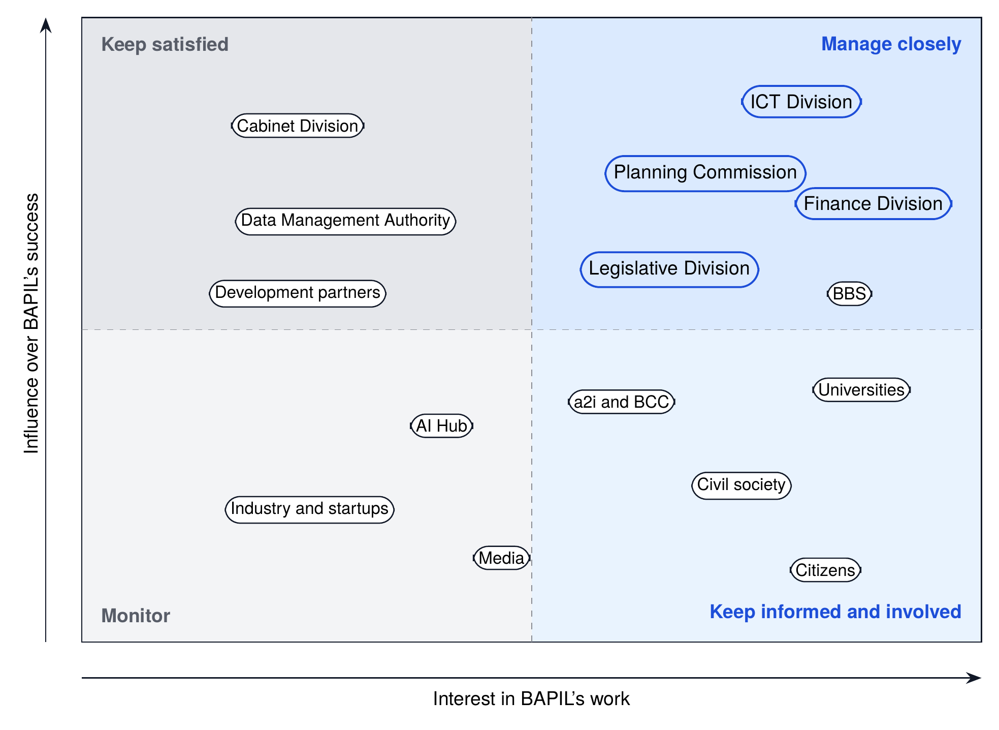

*Figure 2. Indicative stakeholder map by influence and interest, used to plan engagement.*

The map groups stakeholders by their influence over BAPIL’s success and their interest in its work. Those in the upper right quadrant, such as the ICT Division, the Planning Commission, the Finance Division and the Legislative and Parliamentary Affairs Division, are managed closely through the Steering Board, data agreements and product ownership. Those with high influence but less direct interest, such as the Cabinet Division and the data management authority, are kept satisfied through milestone briefings and consultation on data use. Universities, civil society and citizens have high interest and are kept informed and involved through fellowships, ERRC membership, open consultations and the public transparency register.

## 3.3 Stakeholder Register

**Table 7.** Stakeholder register

| Stakeholder | Main interest | Role for BAPIL | Engagement approach | Frequency |
|--------------------|-----------------------|------------------|------------------------|-----------|
| ICT Division (Ministry of Posts, Telecommunications and IT) | National AI policy, digital transformation | MoU partner, Steering Board co-chair | Joint planning, quarterly reviews | Monthly |
| Cabinet Division | Whole-of-government coordination | Convening across ministries | Briefings at milestones | Semi-annual |
| Planning Commission | Plans, project appraisal, monitoring | Host agency for P1 and P2; data custodian | Product ownership, co-design | Monthly |
| Finance Division | Budget transparency and analysis | Data custodian; P2 users | Data agreement, user testing | Quarterly |
| Legislative and Parliamentary Affairs Division | Authoritative legal texts | Custodian of the laws corpus | Bulk access agreement | Quarterly |
| Bangladesh Bureau of Statistics | Official statistics and metadata | Data custodian; P5 partner | Metadata alignment | Quarterly |
| a2i and Bangladesh Computer Council | Digital services, portal, data centre | Platform and hosting partners | Technical working group | Monthly |
| National Data Management Authority | Data policy and compliance | Regulator and adviser on data use | Consultation on DPIAs and agreements | As needed |
| Bangladesh AI Hub | Skills, startups, adoption | Complementary programme | Division-of-labour MoU, shared benchmarks | Quarterly |
| Universities and research institutes | Research, students, publications | Host institution, partners, annotators | Fellowships, joint research | Continuous |
| Industry and startups | Market for public-interest AI | Technology partners, adopters | Open calls, industry days | Semi-annual |
| Civil society and media | Rights, transparency, accountability | ERRC members, critical reviewers | Open consultations, register | Quarterly |
| Development partners | Digital public goods, capacity | Funders and technical advisers | Joint workplans, reviews | Semi-annual |
| Citizens | Accessible information, trust | Ultimate beneficiaries | Public reports in Bangla, feedback channel | Continuous |

*Note.* Listing an organisation describes its possible role; it does not imply any agreement or endorsement.

## 3.4 Consultation and Engagement Plan

**Table 8.** Consultation and engagement plan by phase

| Phase | Purpose | Activities | Outputs |
|----------------|----------------------------|--------------------------|----------------|
| Pre-launch (Q4 2026 to Q1 2027) | Test the Blueprint with decision-makers and experts | Briefings with the ICT Division and custodians; expert roundtables; public comment period on the repository | Comment log; Blueprint 1.1 corrections |
| Launch (months 1 to 6) | Agree roles, data access and safeguards | Charter consultation; ERRC nominations; data custodian workshops | Adopted charter; data access plan |
| Build (months 4 to 15) | Design with real users | Co-design sessions; usability tests in Bangla and English; monthly demonstrations | User-tested pilots; backlog published |
| Evaluate (months 12 to 24) | Learn what works | User surveys; time-to-evidence studies; open review of results | Evaluation reports with DOIs |
| Decide and scale (months 24 to 36) | Decide adoption and next steps | Adoption workshops with host agencies; public hearing on Blueprint 2.0 | Adoption memos; Blueprint 2.0 |

Engagement follows four principles:

* **Bilingual by default.** Consultation materials, summaries and reports are published in Bangla and English.
* **Reach beyond Dhaka.** At least one consultation in each phase is held outside Dhaka or online with participants from divisional universities and local administrations.
* **Inclusion.** Consultations seek a gender balance and include organisations representing persons with disabilities, minorities and young people.
* **Closing the loop.** Each consultation produces a published comment log that records what was raised and how BAPIL responded.

## 3.5 Engaging Citizens and Communities

Although BAPIL’s first users are officials and researchers, its ultimate beneficiaries are citizens, and some of its work (such as P3 on public consultations and P6 on information integrity) touches citizens directly. Citizen engagement therefore has three elements. First, **transparency**: the public register, plain-language summaries of every pilot in Bangla, and an annual public report. Second, **voice**: open consultations on the charter and on Blueprint 2.0, civil-society members on the ERRC, and a public channel for reporting problems and complaints. Third, **benefit**: open datasets such as the budget data from P2, and, in the long term, public-facing search over official documents so that citizens, journalists and civil-society organisations can find and cite the same authoritative texts as officials.

## 3.6 Coordination with National Programmes

BAPIL complements, and must not duplicate, existing programmes. A KOICA-supported project to build AI skills and an AI hub, to be implemented by the Bangladesh Hi-Tech Park Authority under the ICT Division, focuses on skills, startups and adoption: its technical assistance project proposal (Tk 192.66 crore) was awaiting government approval in June 2026, and a USD 13 million grant agreement for 2026 to 2029 was reported signed in August 2026 [53, 54, 55]. BAPIL focuses on policy intelligence, governance methods and open evaluation. The draft national AI policy envisages a Bangla-based national LLM, centralised compute at the National Data Center and an AI Innovation Fund [10]; BAPIL’s benchmark and governed corpus can serve those efforts, and BAPIL should use shared national compute rather than build its own large cluster. A short division-of-labour MoU between BAPIL, the AI Hub and other relevant programmes should be signed at Milestone MS2 and reviewed annually.

\newpage

# Chapter 4: From Vision to Requirements

## 4.1 Approach

Requirements were derived from three sources: the White Paper’s architecture, dashboard, foundation-model and governance chapters; the international frameworks the White Paper adopted as reference points [1, 2, 3, 17, 18, 19]; and the Bangladesh legal context summarised in Chapter 14. User needs were captured as personas and user stories. Each requirement is stated once, given an identifier and a priority, and traced to the components, code modules and tests that satisfy it (Annex A).

## 4.2 Users and Personas

Six personas represent the main user groups. They are composites built from the White Paper’s analysis and the stakeholder register; they will be validated and refined through co-design sessions in the first six months.

**Table 9.** User personas

| Persona | Goals | Pain points today | Most important requirement |
|-----------------|--------------------|------------------------|--------------------|
| **A. Policy analyst** in a planning wing | Find the governing text and past commitments quickly; cite them in briefs | Searches many websites; scanned PDFs; unsure which version is current | FR-01, FR-02, FR-03 |
| **B. Budget analyst or journalist** | Compare allocations across years and ministries | Tables locked in PDFs; inconsistent headings between years | FR-04, NFR-07 |
| **C. Consultation owner** in a ministry | Understand thousands of submissions fairly | Manual reading; risk of missing minority views | FR-05, GR-03 |
| **D. Researcher** in a university | Benchmark Bangla methods on real policy text | No open domain benchmark or governed corpus | FR-08, NFR-06 |
| **E. Senior official** | Trust the evidence behind a recommendation | Cannot see sources or limitations of AI outputs | NFR-08, GR-01 |
| **F. Citizen or civil-society monitor** | Know how AI is used in public research | No public register of AI systems | FR-09, GR-06 |

## 4.3 Core Requirements

Requirements are grouped as functional requirements (FR), non-functional requirements (NFR) and governance requirements (GR).

**Table 10.** Core requirements (functional, non-functional and governance)

| ID | Requirement | Priority |
|---------|----------------------------------------------|---------|
| FR-01 | Bilingual (Bangla and English) search over policy documents, robust to spelling variants and to Bangla or ASCII digits | Must |
| FR-02 | Answers grounded only in retrieved sources, with passage-level citations; the system abstains when evidence is insufficient | Must |
| FR-03 | Ingestion records provenance for every document: source URL, publisher, date, checksum and reuse terms | Must |
| FR-04 | Indicator and budget dashboards with downloadable data and methods notes | Should |
| FR-05 | Aggregate analysis of consultation feedback (topics, sentiment) with no profiling of individuals | Should |
| FR-06 | Register of all AI systems with owner, purpose, risk tier, model card and status | Must |
| FR-07 | Risk-tier assessment applied before any build and at every lifecycle gate | Must |
| FR-08 | Evaluation harness with versioned benchmarks and reproducible reports | Must |
| FR-09 | Public transparency register generated from the AI system register | Should |
| FR-10 | Documented, versioned API for programmatic access | Should |
| NFR-01 | Language parity: Bangla quality within 5 points of English on core metrics | Must |
| NFR-02 | Data residency: P1 to P3 data hosted in Bangladesh in accredited facilities | Must |
| NFR-03 | Security by design aligned with NIST CSF 2.0 and zero-trust access | Must |
| NFR-04 | Availability of 99% for pilots (working hours) once the recovery site is in place in Year 2; best effort with offline backups in Year 1; 99.5% at scale | Should |
| NFR-05 | Accessibility to WCAG 2.2 level AA; usable on mobile and low-bandwidth connections | Must |
| NFR-06 | Open standards and open source by default; no single-vendor lock-in | Must |
| NFR-07 | Reproducibility: versioned code, data snapshots and evaluation reports archived with DOIs | Must |
| NFR-08 | Explainability: every output shows its sources, confidence and known limitations | Must |
| NFR-09 | Performance: search p95 at most 3 s; answers p95 at most 10 s | Should |
| NFR-10 | Cost transparency: cost per 1,000 queries reported each quarter | Could |
| GR-01 | Human review of consequential outputs; AI is never the final decision-maker | Must |
| GR-02 | No build without tier screening (G0) and no pilot without gate approval (G2) | Must |
| GR-03 | Data minimisation: public data first; DPIA before any P2 or P3 processing | Must |
| GR-04 | Tamper-evident audit logs of queries, sources consulted and outputs | Must |
| GR-05 | Incident reporting and response within defined time limits | Must |
| GR-06 | Prohibited uses (tier T0) excluded by the BAPIL charter | Must |

*Note.* Priority follows the MoSCoW convention (Must, Should, Could). Requirement IDs are traced to components, code modules and tests in Annex A.

## 4.4 Priority User Stories

User stories express requirements from the user’s point of view and carry measurable acceptance criteria. They are the basis of the pilot backlogs and of the acceptance tests at gates G2 and G3.

**Table 11.** Priority user stories with acceptance criteria

| ID | User story | Acceptance criteria | Req. |
|-------|----------------------------------|----------------------------------|---------|
| US-01 | As a policy analyst, I search in Bangla and get relevant English and Bangla passages | Top 10 results include the gold passage for at least 85% of benchmark questions in both languages | FR-01 |
| US-02 | As an analyst, I get a short answer where every sentence links to its source | 100% of answer sentences carry a passage identifier; citation precision at least 0.95 | FR-02 |
| US-03 | As an analyst, I am told when the system does not know | At least 90% correct abstention on unanswerable questions; reason shown | FR-02 |
| US-04 | As a reviewer, I can see where a document came from and whether it changed | Every passage resolves to source URL, date, checksum; checksum mismatch raises an alert | FR-03 |
| US-05 | As a budget analyst, I download five years of allocations in one file | CSV and Parquet downloads with a methods note; values match source on a 99% sample | FR-04 |
| US-06 | As a consultation owner, I see topics without exposing individuals | Outputs aggregate at least 20 submissions per topic; no names or contact data in outputs | FR-05 |
| US-07 | As the ERRC, I see every AI system, its tier and gate status | Register lists 100% of systems; export generated automatically each release | FR-06, FR-09 |
| US-08 | As an auditor, I can verify that logs were not altered | Hash-chain verification passes; any edit, deletion or reordering is detected | GR-04 |
| US-09 | As a developer, I call a documented API | Versioned endpoints with examples; breaking changes only in a new version | FR-10 |
| US-10 | As a mobile user on a slow connection, I can still search | Search page under 500 KB; usable on 3G; WCAG 2.2 AA checks pass | NFR-05 |

## 4.5 Design Principles Applied

The White Paper’s principles (human-centred AI, transparency, responsibility, inclusiveness, evidence-based decision support and collaboration) become five engineering rules in this Blueprint:

1. **No citation, no claim.** A generated statement that cannot be traced to a retrieved passage is not shown (FR-02).
2. **Bangla is a first-class language.** Every feature is specified, tested and evaluated in Bangla and English, with a measured parity target (NFR-01).
3. **Open by default.** Code, benchmarks, evaluation reports and non-sensitive data are published with persistent identifiers; closed components need a written justification (NFR-06, NFR-07).
4. **Smallest data that works.** Each pilot uses the least sensitive data class that meets its purpose (GR-03).
5. **Gate before scale.** Nothing moves from experiment to advisory use, or from advisory to operational use, without passing a documented gate (GR-02).

## 4.6 Requirements Management

Requirements are kept in the repository as versioned text, alongside the code. A change to a requirement is proposed through an issue, reviewed by the Technical Architecture Board (and by the ERRC where it affects a governance requirement), and recorded in the change log. The traceability matrix in Annex A is regenerated at every release so that each requirement can be followed to the components, modules and tests that satisfy it.

\newpage

# Part II: Institution and People

*How BAPIL is constituted and governed, who does the work, and how national capacity is built.*

# Chapter 5: Institutional Design and Governance

## 5.1 Operating-Model Options

Four operating models were assessed against five criteria: independence, data access, policy uptake, speed to start and sustainability.


*Figure 3. Proposed institutional and governance model (Option C: university-anchored lab with a government MoU).*

**Table 12.** Assessment of institutional operating-model options

| Option | Independence | Data access | Policy uptake | Speed to start | Sustainability | Verdict |
|--------------------------|-------------|-----------|-----------|-----------|--------------|----------------|
| **A.** Unit embedded in a government agency | Low | High | High | Medium | Medium | Not recommended for Phase 1 |
| **B.** University research centre | High | Low | Low | High | Medium | Partial fit |
| **C.** Hybrid: university-anchored lab with a government MoU and a multi-stakeholder board | High | Medium to high | Medium to high | High | Medium to high | **Recommended** |
| **D.** Independent non-profit foundation | High | Low to medium | Medium | Low | Medium | Option for a later stage |

*Note.* Qualitative assessment by the author against five criteria; to be validated in the Phase 1 feasibility study (Deliverable D1.3).

**Option C is recommended for Phase 1.** A lab anchored in a public or private university gives academic independence, the ability to hire researchers and engage graduate students, and a credible home for open research. A Memorandum of Understanding with the ICT Division (Ministry of Posts, Telecommunications and Information Technology) provides a channel for policy questions, data access agreements and the eventual transfer of successful tools. A multi-stakeholder Steering Board keeps both sides accountable. Option D, an independent non-profit foundation, corresponds to the “mature research ecosystem” stage in Appendix C of the White Paper and is reconsidered at the end of the 36-month plan and again in the long-term horizon (Chapter 16).

## 5.2 Selecting the Host Institution

The host institution should be selected through an open expression-of-interest process against published criteria and weights. An independent panel scores the proposals; the Steering Board, once constituted, confirms the result. Until then, the ICT Division and an interim panel of academic and civil-society members may run the selection.

**Table 13.** Host-institution selection criteria and weights

| Criterion | Weight | Evidence requested |
|--------------------------------|--------|----------------------------------|
| Research strength in AI, NLP and Bangla language technology | 20% | Publications, datasets, active projects, faculty profiles |
| Research ethics and data protection capacity | 15% | Functioning ethics committee, data protection officer, past DPIAs |
| Commitment to the BAPIL charter and open publication | 15% | Signed letter of commitment; open-access and open-source policies |
| Financial management and audit record | 15% | Audited accounts; experience with grants from public and development partners |
| Infrastructure and secure facilities | 10% | Server rooms, network, physical security, access to national compute |
| Interdisciplinary breadth (law, economics, public policy) | 10% | Relevant departments and joint programmes |
| Inclusion and access | 10% | Gender balance plans; outreach to universities outside Dhaka |
| Location and convening ability | 5% | Ability to host government, industry and civil-society meetings |

*Note.* Scores are assigned by an independent panel; the Steering Board confirms the result. Weights may be adjusted before the call is published.

The call should be open to public and private universities and to consortia led by a university. A consortium can combine, for example, a strong computer science department with a law faculty and a policy institute, and can include a university outside Dhaka to support national reach.

## 5.3 Governance Bodies

**Table 14.** Governance bodies, composition and decision rights

| Body | Composition | Key responsibilities | Decision rights |
|-----------------|--------------------------|----------------------------|----------------|
| **Steering Board** | 7 to 9 members: ICT Division (co-chair), host institution (co-chair), Planning Commission, a data custodian agency, academia, civil society, industry; BAPIL Director as secretary | Strategy, annual plan and budget; partnership approvals; joint G4 adoption decisions with host agencies | Approves plans and budgets |
| **Ethics and Risk Review Committee (ERRC)** | 5 to 7 members, majority external: law and human rights, data protection, ethics, domain experts, civil society, technical reviewer | Reviews tier T2 and T3 systems at G1, G2 and G4; reviews incidents; publishes decision summaries | Binding veto on pilots and deployment |
| **Technical Architecture Board (TAB)** | Lead engineers, security lead, two external technical reviewers | Architecture and security standards; design reviews; model and dependency approvals | Approves designs at G1 |
| **International Advisory Panel** | Invited experts serving in a personal capacity | Peer review of methods, benchmarks and governance; international linkages | Advisory only |
| **Director and units** | Director, six thematic units from the White Paper, and a cross-cutting platform engineering team | Delivery of research, pilots, training and publications | Operational decisions within approved plans |
| **Host-agency product owners** | Named officials in each agency piloting a tool | Define needs, recruit pilot users, accept or reject at G3 and G4 | Acceptance of pilots in their agency |

Two features deserve emphasis. First, the **Ethics and Risk Review Committee (ERRC)** has a binding veto over pilots and deployments of tier T2 and above, a majority of external members selected through an open call by an independent nominations panel, and an obligation to publish summaries of its decisions (terms of reference in Annex F). Second, **host-agency product owners** are named officials inside each agency that pilots a tool. They define the need, recruit users and accept or reject the result, so that pilots answer real questions rather than technical curiosity.

All of these bodies are proposals. None has statutory powers: they would be created by the MoU, the host agreement and the charter, and their decisions bind BAPIL through the charter, and bind the host only to the extent the host’s statutes allow and the host agreement provides; they do not bind anyone by law. Whether the host’s governing body can accept a binding external veto must be confirmed by the legal review (Section 14.3) before the host agreement is signed; if it cannot, the host agreement must provide that the host will not proceed with a tier T2 or T3 system that the ERRC has refused. They do not replace any statutory body. In particular, the ERRC is not the independent oversight committee that the draft national AI policy proposes to create by an Act of Parliament [10], and BAPIL’s data rules apply in addition to, never instead of, the duties set by the data-protection and data-management laws and the oversight of the authorities created under them. Annex S sets out, for each body, its status, appointment process, decision rights and their limits, reporting line and conflict-of-interest safeguards.

## 5.4 Decision Rights and Accountability

Clear decision rights prevent both paralysis and unchecked action. The responsibility matrix below shows who is responsible, accountable, consulted and informed for the main decisions. Accountability for each decision rests with exactly one body, except at G4, where the Steering Board and the host agency share it because the agency owns the operational decision.

**Table 15.** Responsibility matrix (R responsible, A accountable, C consulted, I informed)

| Decision or activity | Steering Board | ERRC | TAB | Director | Units | Host agency |
|------------------------------|--------|--------|--------|--------|--------|---------|
| Annual plan and budget | A | C | C | R | C | I |
| Charter amendments | A | C | I | R | I | I |
| Tier screening at G0 | I | I | C | A | R | C |
| Design approval at G1 | I | C | A | R | R | C |
| Pilot approval at G2 (tier T2) | C | A | C | R | R | C |
| Adoption decision at G4 | A | C | C | R | C | A |
| Suspension after a serious incident | I | A | C | R | R | C |
| Model and dependency selection | I | I | A | C | R | I |
| Data-sharing agreements | I | C | C | A | R | C |
| Transparency register publication | I | C | I | A | R | I |
| Senior staff appointments | A | I | I | R | I | I |
| Public communication of results | I | C | I | A | R | C |

*Note.* At G4 the Steering Board and the host agency are jointly accountable: the agency owns the operational decision.

## 5.5 The BAPIL Charter

The Steering Board adopts a charter at Milestone MS1. A full draft is provided in Annex E. It must at least:

* state the mission and the boundaries in Section 1.5;
* list the prohibited uses of tier T0 and commit never to build or support them;
* establish the ERRC, its independence, its veto and its publication duty;
* commit to open publication of code, benchmarks and evaluation reports, subject only to security and privacy exceptions recorded in writing;
* require registration of every AI system in the AI system register before work begins;
* set conflict-of-interest rules for board members, staff and partners, including vendors;
* define how successful tools are transferred to agencies and how BAPIL withdraws;
* state that the charter operates within the law: where a statute, a regulator or the host institution’s rules require something different, the legal requirement prevails.

## 5.6 Units and Ways of Working

The six thematic units of the White Paper (AI Policy and Research; Data Analytics and Public Sentiment; Digital Security and Misinformation; AI Governance and Ethics; AI Education and Talent; Innovation and Startup Collaboration) remain the organising structure for research. A cross-cutting **platform engineering team** builds and runs the shared services (data, search, security, evaluation) so that units do not duplicate infrastructure.

Work is organised in **product teams around pilots**: each pilot has a product owner from the host agency, a BAPIL lead, engineers, a governance analyst and, for Bangla features, a language editor. Teams work in short iterations, publish their backlog and evaluation results, and present at a monthly demonstration open to partner agencies.

## 5.7 Independence, Integrity and Conflicts of Interest

A policy-intelligence lab is valuable only if its evidence is trusted. The following safeguards protect independence:

* **Editorial independence.** BAPIL researchers decide the methods and publish the results of evaluations, including results that are unwelcome to a partner. Partners may comment before publication but cannot veto.
* **Funding rules.** No single non-government funder provides more than 30% of the annual budget, and funding agreements cannot give a funder control over research results or governance decisions (Chapter 17).
* **Declarations.** Board members, ERRC members, staff and contractors declare interests annually and before each relevant decision; declarations are kept in a public register in summary form.
* **Vendor neutrality.** BAPIL does not endorse products. Evaluations of commercial tools follow a published protocol and are reported in full.
* **Protection for staff.** Staff can raise concerns about safety, integrity or misuse with the ERRC chair directly, without fear of reprisal.

## 5.8 Transfer to Agencies and Exit

Successful tools must not depend on BAPIL forever. When a tool passes Gate G4, a transfer plan is agreed with the host agency covering: ownership of code, data and infrastructure; staff training and handover; service levels and support during a transition period (typically six to twelve months); the budget line from which the agency will operate the service; and BAPIL’s continuing role in benchmarks and independent evaluation. Code remains open, so that other agencies can reuse it. If BAPIL itself must close, the charter requires that open archives, benchmarks and code are preserved, that data held under agreements is returned or deleted, and that users of any remaining services are given notice and alternatives.

## 5.9 Institutional Evolution

The institutional form is expected to change as BAPIL matures. Option C is appropriate for proving value; once tools have been adopted and funding has stabilised, the Steering Board will consider whether BAPIL should become an independent public-interest foundation (Option D) or a statutory centre attached to government, or whether its functions should be absorbed by agencies. The criteria for that decision (independence, sustainability, policy uptake and public trust) and the review points are set out in Chapter 16.

\newpage

# Chapter 6: People, Skills and Capacity

## 6.1 The Capacity Challenge

Talent is both BAPIL’s most important resource and one of its main risks (R7 in Chapter 19). Experienced AI engineers, Bangla NLP specialists and AI governance practitioners are scarce and in demand by industry and international organisations. At the same time, the long-term value of BAPIL depends less on its own staff than on the skills it builds in government, universities and civil society. This chapter therefore covers both the core team and the national capacity programme.

## 6.2 Core Team

**Table 16.** Indicative core staffing plan (full-time equivalents)

| Role | Months 1-12 | Months 13-24 | Months 25-36 |
|------------------------------------|------------|------------|------------|
| Director and principal investigator | 1 | 1 | 1 |
| Policy research lead and analysts | 1 | 2 | 3 |
| Machine learning and Bangla NLP engineers | 2 | 3 | 4 |
| Data engineers | 1 | 2 | 2 |
| Software and platform (DevSecOps) engineers | 1 | 2 | 2 |
| Security engineer | 0.5 | 1 | 1 |
| Governance, legal and ethics analysts | 1 | 1 | 2 |
| User experience and accessibility designer | 0.5 | 1 | 1 |
| Programme and partnership coordinator | 1 | 1 | 1 |
| Training and outreach officers | 0 | 1 | 2 |
| **Total core staff** | **9** | **15** | **19** |

*Note.* Excludes part-time ERRC members, advisers, visiting fellows and graduate students. Indicative costs are in Table 49; final costs are set by the feasibility study (D1.3).

The team grows from about nine to nineteen full-time equivalents over three years. Bangla language expertise is embedded in the machine learning team and complemented by part-time language editors. Graduate fellows from partner universities work on benchmark creation, evaluation and research papers, which also builds national talent. Diaspora researchers can contribute remotely through visiting fellowships.

## 6.3 Recruitment and Retention

Recruitment follows open, merit-based procedures with published job descriptions, diverse interview panels and a commitment to gender balance. To compete for scarce skills, BAPIL should offer:

* salaries benchmarked against the university’s research positions and adjusted for scarce skills, within the host’s rules;
* meaningful work on public-interest problems with open publication and credit;
* time for research and professional development, including conference attendance;
* flexible and remote work arrangements, which also allow diaspora and out-of-Dhaka participation; and
* joint appointments with universities and secondments from agencies.

**Terms of employment.** BAPIL is not a government department, and its posts are not civil-service posts. Staff are employed by the host institution under its rules, on fixed-term contracts linked to the funded period and renewed with each funding tranche (Section 17.2). The budget covers salary, allowances, the host’s provident fund and festival bonuses (the fully loaded costs in Table 49), but not a government pension. Staff can join the national Universal Pension System, whose Pragati scheme shares contributions equally between employer and employee [56], and the host’s own retirement benefits apply where its rules allow. Project posts do not become permanent government posts automatically: a 2020 Cabinet Division instruction, following an Appellate Division judgment, requires permanent posts to be created by the employer under the applicable service rules and filled through open recruitment [57]. The route to permanent posts is therefore institutional: if BAPIL becomes a foundation or a statutory centre (Section 5.9; Horizon 3), its posts become regular posts of that body under its service rules (Table 71).

This is how comparable national AI labs began. AI Singapore started in 2017 as a five-year national programme funded by the National Research Foundation [58]; Canada’s Vector Institute is an independent non-profit funded by the federal and provincial governments and by industry, with provincial funding renewed in 2023 [59]; and India’s national AI mission recruits through a separate business division on contract terms, with no claim to a permanent post [60]. Labs placed inside government, such as the United Kingdom’s Incubator for Artificial Intelligence, a unit of the Department for Science, Innovation and Technology [61], follow a government decision to create and fund the posts, which BAPIL cannot assume.

Key-person dependency (R16) is reduced by documenting systems and decisions in the repository, naming deputies for critical roles and sharing ownership of code and data with the host institution.

## 6.4 Competency Framework

The competency framework sets out what different groups need to know at three levels: aware, practitioner and expert. It is used to design training, to write job descriptions and to assess progress.

**Table 17.** Competency framework by role family and level

| Role family | Aware | Practitioner | Expert |
|--------------------|------------------------|------------------------|------------------------|
| Public leaders | What AI can and cannot do; risk tiers; when to ask for evidence | Sponsor pilots; read evaluation reports; apply procurement clauses | Set strategy; chair reviews; balance innovation and safeguards |
| Policy analysts | Use cited search; verify sources; recognise abstention | Design evidence questions; spot bias and gaps; brief on limitations | Co-design tools; define benchmarks; train peers |
| Governance, legal and ethics staff | Data classes; prohibited uses; DPIA basics | Run tier assessments, DPIAs and gate reviews | Lead ERRC work; audit systems; shape national guidance |
| Data stewards | Metadata and licences; data classes | Quality metrics; agreements through the data exchange | Design catalogues and data-sharing frameworks |
| ML and NLP engineers | Bangla text basics; evaluation metrics | Build retrieval and evaluation pipelines; write model cards | Adapt models; red-team; lead benchmark design |
| Platform and security engineers | Zones; secrets handling; logging | Infrastructure as code; SBOMs; incident response | Zero-trust design; threat modelling for AI systems |

## 6.5 Training Curriculum

**Table 18.** Training curriculum

| Programme | Audience | Core modules | Duration | Format | Year 1 target |
|---------------------|-----------------|------------------------------|-----------|-----------|---------|
| **T1** AI literacy for public leaders | Secretaries, heads of agencies | AI capabilities and limits; risk tiers; procurement; reading evaluations | 1 day | In person | 40 |
| **T2** Responsible AI for policy analysts | Pilot users and analysts | Cited search; verification; abstention; bias; data protection basics; prompt-injection awareness | 3 days | Blended | 100 |
| **T3** AI governance practitioner | Governance and legal staff, ERRC | Tier assessment; DPIA; impact assessment; gate reviews; audits; transparency | 5 days | In person | 30 |
| **T4** Data stewardship | Data custodians, chief data officers | Metadata; licences; quality; classification; data exchange agreements | 3 days | Blended | 40 |
| **T5** Bangla NLP and MLOps | Engineers in agencies and universities | Bangla text processing; retrieval; evaluation; model cards; secure deployment | 10 days | Blended | 30 |
| **T6** BAPIL fellowships | Graduate fellows | Research placement on a pilot or benchmark with mentoring | 6 to 12 months | Placement | 10 |

*Note.* All course materials are published in Bangla and English under CC BY 4.0. The KPI of 100 trained officials in Year 1 counts T2 participants; T1 briefings and the specialist cohorts T3 to T5 are counted separately and funded from the specialist-course line of the budget (Table 49).

The curriculum follows three design rules. First, **training uses the real tools and real documents**, so that officials practise on the policy questions they face. Second, **every programme teaches limitations**: participants learn how and why AI systems fail, how to recognise abstention and uncertainty, and when not to rely on an output. Third, **materials are open**: slides, exercises and recorded sessions are published in Bangla and English under CC BY 4.0 so that other institutions can reuse them.

## 6.6 Fellowships and Research Capacity

The BAPIL fellowship programme places graduate students and early-career researchers on pilots and benchmark work for six to twelve months, under joint supervision by BAPIL staff and their home institution. Fellows contribute to datasets, evaluations and publications and are credited as authors where their contribution warrants it. At least half of the fellowships should go to students from universities outside Dhaka, and the programme should aim for gender balance. Over the long term, fellows form a network of people who can carry the methods into government, academia and industry.

## 6.7 Gender Balance and Inclusion in the Workforce

AI teams in Bangladesh, as elsewhere, are often unbalanced by gender and concentrated in Dhaka. BAPIL sets explicit goals: at least 40% women among staff, fellows and trainees by the end of the 36-month plan; at least half of fellowships for students from universities outside Dhaka; accessible workplaces and materials; and flexible work arrangements that support carers. Progress is reported in the annual report. Diversity is not only a matter of fairness: teams with varied backgrounds are more likely to notice where a tool fails particular users or regions.

\newpage

# Part III: Technology

*The architecture, data, AI and language design, infrastructure and security of the platform, and the reference implementation that tests them.*

# Chapter 7: Reference Technical Architecture

## 7.1 From Six Layers to Twelve Components

The White Paper’s six layers (data sources, data management, policy intelligence, knowledge management, decision support, governance and security) are refined here into twelve components grouped into four horizontal layers and one cross-cutting governance and security column.


*Figure 4. BAPIL reference architecture: twelve components in four layers, with cross-cutting governance and security.*

**Table 19.** Reference architecture components and candidate technologies

| ID | Component | Function | Candidate open technologies | Reference implementation |
|------|-------------------|------------------------------|--------------------------|----------------|
| C1 | Source connectors | Harvest public documents on a schedule, respecting site terms; record provenance | Python workers, Scrapy, cron or Airflow | Planned |
| C2 | Ingestion and normalisation | Extract text from PDF and HTML, Bangla OCR, Unicode normalisation, chunking | Apache Tika [62], Tesseract (ben, eng) [63], custom normaliser | bapil.text, bapil.corpus |
| C3 | Document store and catalogue | Originals, extracted text and DCAT-aligned metadata with versioning | PostgreSQL [64], MinIO (S3-compatible), CKAN [65] | JSONL corpus with checksums |
| C4 | Search index | Lexical BM25 plus dense vectors with hybrid ranking | OpenSearch [66], or PostgreSQL with pgvector [67] | bapil.search (BM25, bilingual) |
| C5 | Answer service | Retrieve, cite, abstain; optional LLM generation with citation verification | Open-weight LLMs served with vLLM or llama.cpp | bapil.answer (extractive, cited) |
| C6 | Analytics engine | Budget extraction, indicators, topic models | Python, pandas, DuckDB | Planned |
| C7 | Portal and dashboards | Bilingual, accessible user interface | Web framework; Apache Superset | Planned |
| C8 | API gateway | Versioned REST API, quotas, rate limits | FastAPI, Kong | bapil.api (standard library) |
| C9 | Identity and access | Single sign-on, role-based access, MFA | Keycloak | Planned |
| C10 | Audit and observability | Tamper-evident logs, metrics, tracing | OpenTelemetry, Prometheus, Grafana | bapil.audit (hash-chained JSONL) |
| C11 | Model registry and evaluation | Model cards, versioned evaluations, benchmarks | MLflow | bapil.evaluate |
| C12 | Governance workbench | AI system register, risk assessments, incidents, transparency register | Lightweight web application | bapil.risk, bapil.registry |

*Note.* Technologies are candidates, not mandates; final choices are made by the Technical Architecture Board against requirements NFR-02, NFR-03 and NFR-06.

## 7.2 How a Request Flows

The core service is a cited answer to a policy question. The sequence below shows how a request passes through the components, and where controls are applied.

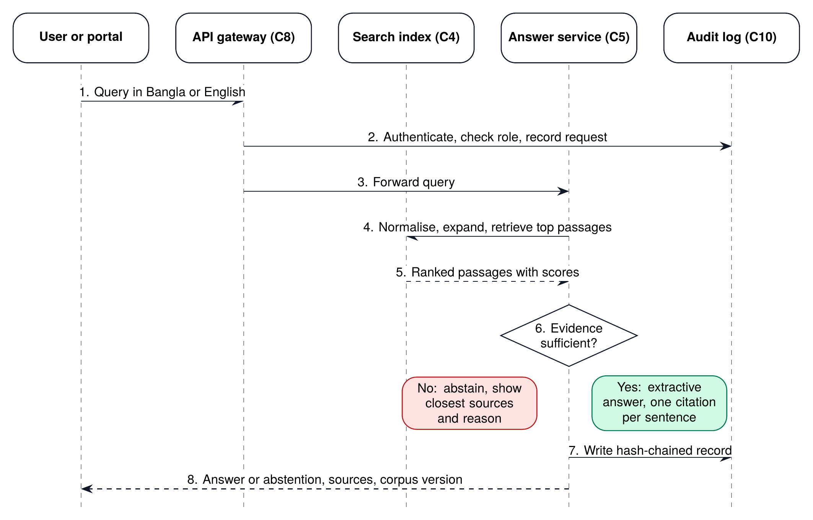

*Figure 5. Request sequence for a cited answer, from the user’s query to the audit record.*

Three properties of this flow matter for trust. First, the answer service never answers without evidence: if the top passages do not cover the query well enough, it abstains and shows the closest sources with the reason. Second, every answer sentence carries the identifier of the passage it came from, so a user can open and check the source. Third, every request, the passages retrieved and the response are written to a hash-chained audit log, so that what the system did can be verified later.

## 7.3 Interfaces and API Specification

The first public interface is a versioned REST API (`/v1`). The minimum endpoints are already implemented in the reference implementation (Chapter 11). Every response includes the corpus version and the identifiers of the passages used, so results can be reproduced later.

**Table 20.** API specification (version 1)

| Endpoint | Method | Parameters | Response | Errors |
|-------------------|-------|--------------------|--------------------------|--------------|
| /v1/health | GET | None | status, version, corpus_version, documents, passages | None |
| /v1/search | GET | q (1 to 500 characters); k (1 to 50, default 10) | query, corpus_version, results: pid, doc_id, heading, lang, score, matched_terms, text, provenance | 400 missing or invalid parameter |
| /v1/answer | GET | q (1 to 500 characters) | abstained; confidence; evidence (top_score, coverage); answer sentences with citation; sources; corpus_version | 400 missing parameter |
| /v1/risk/assess | POST | JSON questionnaire (Annex B schema) | system_id, tier, tier_name, total, reasons, controls, approver | 400 invalid questionnaire; 400 body over 64 KB |
| All endpoints |  |  | JSON in UTF-8; every request logged in the audit chain | 404 unknown path |

API rules: versions are part of the path; breaking changes are introduced only in a new version, with the old version kept for at least six months; all text is UTF-8; errors return a JSON object with a message; and request bodies are limited in size. In production the API sits behind the gateway (C8), which adds authentication, quotas and rate limits.

## 7.4 Architecture Decision Records

The Technical Architecture Board records each significant choice as an architecture decision record (ADR) in the repository, with its context, the decision, the alternatives considered and the consequences. The initial decisions are:

**Table 21.** Initial architecture decision records

| ADR | Decision | Rationale | Alternatives considered |
|---------|----------------------|-----------------------------|------------------------|
| 001 | Modular services with open interfaces | Components can be replaced without rewriting others; avoids lock-in | Monolithic application; single vendor suite |
| 002 | Retrieval before generation | Answers stay traceable to official text; reduces invented content | Pure generative assistant; fine-tuned model without retrieval |
| 003 | Open-weight models hosted in Bangladesh | Data residency; control over versions; no data sent abroad | Commercial API models for all data classes |
| 004 | Hybrid lexical and dense retrieval | Lexical search is transparent and strong on exact terms; dense search handles paraphrase | Dense only; lexical only |
| 005 | Append-only, hash-chained audit log | Independent verification of what the system did | Ordinary application logs |
| 006 | Containers and infrastructure as code | Reproducible, auditable environments | Manually configured servers |
| 007 | Accessibility and low bandwidth first | Reach users outside Dhaka and on mobile | Desktop-first interface |
| 008 | Public data first (P0) | Value without privacy risk while governance matures | Start with administrative records |

Lexical BM25 retrieval [68] is combined with dense multilingual embeddings [69] (ADR-004); lexical retrieval remains available as a transparent fallback. The portal meets WCAG 2.2 level AA [70] (ADR-007). ADRs are revisited when evidence changes, for example if a model selection review (Table 29) shows that a different approach performs better.

## 7.5 Accessibility and Inclusive Design

Many potential users work outside Dhaka, use mobile devices and face slow or unreliable connections; some have visual or other impairments. The portal is therefore designed to WCAG 2.2 level AA [70] from the first release, with these specific commitments:

* **Bangla first in the interface.** Menus, help texts and error messages are written in Bangla and English, and the user’s language choice is remembered.
* **Light pages.** The search page stays under 500 KB and works on 3G connections (US-10); heavy features such as dashboards load only on request.
* **Screen-reader support.** Proper headings, labels and alternative text, and correct language tags so that screen readers pronounce Bangla and English text correctly.
* **Bangla input.** Search accepts Unicode Bangla typed with any common keyboard layout, as well as romanised Bangla, which is matched through transliteration candidates in later versions.
* **Plain language.** Answers and limitations are explained in plain words, and technical terms are linked to the glossary.

Accessibility is tested with automated tools at every release and with users, including users with disabilities, at least once in each pilot.

## 7.6 Technology Choices

The candidate technologies in Table 19 are open-source and widely used, which keeps costs low, supports local skills and avoids dependence on a single vendor. They are candidates, not commitments: the feasibility study (Deliverable D1.3) confirms choices against the host’s infrastructure, skills and support arrangements. Where a commercial product is considered, it is assessed with the procurement clauses in Chapter 17, including the right to evaluate on BAPIL’s benchmark and the right to exit with all data.

\newpage

# Chapter 8: Data Architecture and Data Governance

## 8.1 Public Data First

The safest and fastest route to value is to begin with information the state has already chosen to publish: laws, gazette notifications, budget documents, development plans, statistical releases and parliamentary papers. This material is large, important for policy work, under-used because it is scattered across sites and formats, and of low privacy risk. It is not free of personal data: gazettes and notifications name individuals, for example in appointment, transfer, land-acquisition and disciplinary notices. Such passages are indexed only as published, are never combined into profiles of individuals, and are excluded from analytics and model training. The Right to Information Act, 2009 already establishes the principle of proactive disclosure [71].

## 8.2 The Data Lifecycle

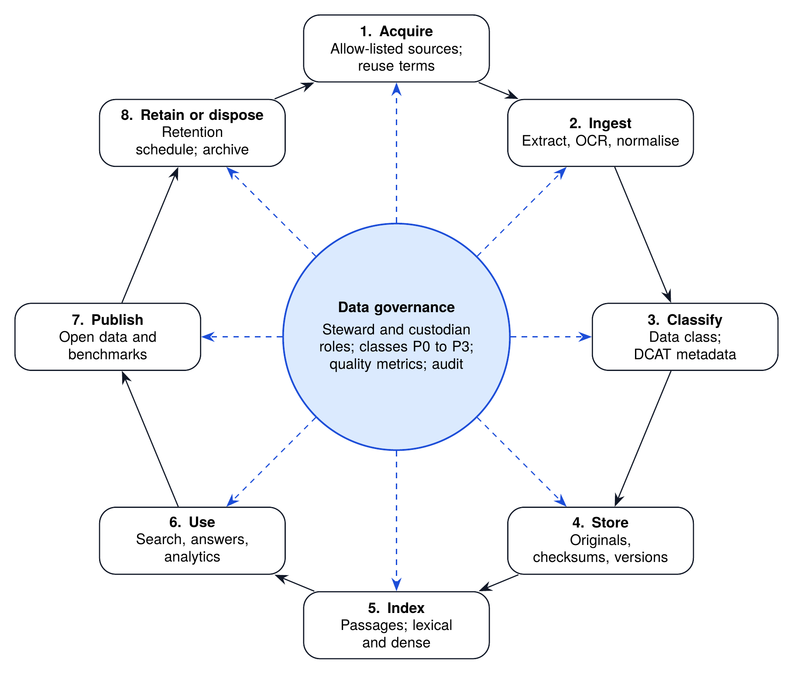

*Figure 6. Data lifecycle under data governance, from acquisition to retention or disposal.*

Each stage of the lifecycle has an owner and a control. Documents are **acquired** only from allow-listed sources whose reuse terms are recorded. They are **ingested** with text extraction, OCR where needed, and normalisation. They are **classified** into a data class and described with DCAT-aligned metadata. Originals are **stored** with checksums and version history. Text is **indexed** as passages for search. Data is **used** for search, answers and analytics under access control. Non-sensitive results are **published** as open data and benchmarks. Finally, records are **retained or disposed of** according to the retention schedule (Table 26).

## 8.3 Data Classification

**Table 22.** Data classification and handling rules

| Class | Description | Examples | Handling rules | Use in pilots |
|--------------|--------------------|------------------------|----------------------------|---------------|
| **P0** Public | Officially published and intended for the public | Laws, gazettes, budget documents, plans, statistical releases | Provenance and integrity checks; reuse subject to source terms | Yes |
| **P1** Internal | Non-personal information not yet published | Draft reports shared under agreement, administrative metadata | Data-sharing agreement; role-based access; hosted in Bangladesh | Limited, under agreement |
| **P2** Personal | Information identifying a person | Named consultation submissions, survey microdata | Lawful basis under the PDPA 2026; DPIA; de-identification before analysis; ERRC approval | Only consented and de-identified |
| **P3** Sensitive or restricted | Sensitive personal data or security-classified information | Health, biometric, financial or children’s data; security data | Excluded from BAPIL work | No |

The class of every dataset and document is recorded in the catalogue (component C3) and enforced at query time by the access-control layer (C9). A dataset takes the class of its most sensitive element. Moving a dataset to a lower class, for example by de-identification, requires a documented method and approval by the governance analyst and, for P2 data, by the ERRC.

## 8.4 Initial Source Inventory

**Table 23.** Initial inventory of public data sources for the pilot corpus

| Source | Custodian | Content | Format | Class | Access note |
|---------------------|---------------------|----------------------|-----------|--------|-----------------------|
| Laws of Bangladesh (bdlaws.minlaw.gov.bd) | Legislative and Parliamentary Affairs Division | Acts and ordinances in Bangla and English | HTML | P0 | Confirm reuse terms; request bulk export (Decision D3) |
| Bangladesh Gazette (dpp.gov.bd) | Department of Printing and Publications | Gazette notifications | PDF, often scanned | P0 | OCR quality is a key risk (R3) |
| National budget documents (mof.gov.bd) | Finance Division | Budget speeches, MTBF, allocations | PDF, spreadsheets | P0 | Basis of Pilot P2 |
| Development plans (plancomm.gov.bd) | Planning Commission | Five-year plans, perspective plan, ADP | PDF, spreadsheets | P0 | Versioning across plan revisions |
| Official statistics (bbs.gov.bd) | Bangladesh Bureau of Statistics | Yearbooks and survey reports | PDF, spreadsheets | P0 | Aggregates only; microdata excluded |
| Open Government Data (data.gov.bd) | ICT Division and a2i | Machine-readable datasets | CSV, spreadsheets, API | P0 | Check dataset-level licences |
| National Portal (bangladesh.gov.bd) | ICT Division and a2i | Office information, services, notices | HTML | P0 | High volume; prioritise by ministry |
| Parliament (parliament.gov.bd) | Bangladesh Parliament Secretariat | Bills, debates, committee reports | PDF | P0 | Mixed scanned and digital |
| e-Nothi records | a2i and ministries | Administrative files | Internal system | P1 to P3 | Out of scope for pilots |
| BAPIL publications (this repository) | BAPIL | White Paper, Executive Summary, Blueprint, studies | Markdown, PDF | P0 | Demonstration corpus of the reference implementation |

*Note.* Custodians and access terms must be confirmed with each agency before ingestion. Listing a source does not imply any agreement with its custodian.

## 8.5 Metadata, Provenance and Integrity

Each document in the corpus carries a metadata record aligned with the W3C Data Catalog Vocabulary (DCAT) version 3 [72] and the FAIR principles [73]. The fields are listed below; the JSON schema is published in the repository.

**Table 24.** Document metadata fields (policy_document schema)

| Field | Description | Required | Example |
|----------------|-----------------------------------|---------|------------------------|
| id | Persistent identifier inside the corpus | Yes | bd-act-2009-20 |
| title | Title in Bangla and English where available | Yes | Right to Information Act, 2009 |
| publisher | Organisation that published the document | Yes | Legislative and Parliamentary Affairs Division |
| issuing_body | Body that issued the instrument | No | Parliament |
| document_type | Act, ordinance, rule, gazette, budget, plan, statistics, parliamentary paper, policy, report | Yes | act |
| date_issued | Date of issue | Yes | 2009-04-06 |
| version | Version or amendment state | No | as amended to 2026 |
| language | Languages of the text | Yes | bn, en |
| source_url | Where the original was obtained | Yes | http://bdlaws.minlaw.gov.bd/... |
| retrieved | Date retrieved | Yes | 2027-02-01 |
| reuse_terms | Licence or reuse conditions | No | Government publication; terms confirmed |
| data_class | P0, P1 or P2 | Yes | P0 |
| sha256 | Checksum of the original file | Yes | 64 hexadecimal characters |
| extraction | Method (born digital or OCR), quality score, tool | Yes | ocr, 0.93, tesseract 5 |
| supersedes | Identifier of an earlier version | No | bd-act-2009-20-v1 |

*Note.* Examples are illustrative. The machine-readable schema is implementation/schemas/policy_document.schema.json.

Integrity is protected in three ways: checksums detect any change to a stored original; a change log records every new version of a document; and the source allow-list (Chapter 10) limits where documents can come from.

## 8.6 Data Quality

Data quality is measured, not assumed. Each dimension below has a metric and a target for the pilot phase, and results are reported in the corpus release notes.

**Table 25.** Data quality dimensions, metrics and targets

| Dimension | Metric | Pilot target |
|---------------|----------------------------------|--------------------|
| Provenance | Share of documents with complete source, date, checksum and reuse terms | 100% |
| Text accuracy | Character error rate of OCR on a hand-checked sample | Below 3% for indexed pages |
| Completeness | Share of a defined collection ingested (for example, all Acts in force) | At least 90% of the target collection |
| Timeliness | Median days from publication to availability in search | Under 7 days for monitored sources |
| Consistency | Share of records valid against the metadata schema | 100% |
| Uniqueness | Share of duplicate documents detected and merged | Duplicates under 1% |
| Language parity | Share of documents with both Bangla and English titles where both exist | At least 95% |

*Note.* Pilot targets. The OCR character error rate is measured on a stratified sample of at least 50 pages per corpus release, checked by two people.

## 8.7 Bangla Text Quality

Much official Bangla text is published as scanned PDF. OCR errors, inconsistent Unicode encodings (for example, the letter য় written as one code point or as two) and mixed Bangla and ASCII digits all damage search quality. The ingestion component therefore (a) prefers born-digital sources, (b) applies Unicode normalisation and digit folding, (c) records an OCR quality score for every page, and (d) routes low-quality pages to a human correction queue. These corrections become a public dataset in their own right, useful to the wider Bangla NLP community [34, 35]. The detailed rules are set out in Chapter 9 (Table 27).

## 8.8 Data Roles

Clear roles make data governance work in practice:

* **Data custodians** are the agencies that publish or hold the source data. They decide on access and remain responsible for the authoritative version.
* **The BAPIL data lead** is accountable for the corpus, the catalogue, quality metrics and data agreements.
* **Data stewards** in each pilot team maintain metadata, check quality and handle correction queues.
* **The governance analyst** checks data classes, approves reclassification with the ERRC where required, and maintains the records of processing.
* **Chief data officers** in partner agencies, where appointed under the data-protection framework (a role whose provisions did not commence immediately under the 2025 ordinance [39]), coordinate agreements and the use of the national data exchange.

## 8.9 Retention and Disposal

**Table 26.** Indicative retention schedule

| Record type | Retention | Disposal or archive |
|--------------------------|-----------------------|--------------------------|
| Original public documents (P0) | Indefinite | Archived with checksums; superseded versions kept |
| Extracted text and index | Until superseded | Rebuilt from originals; old index versions kept for one year for reproducibility |
| Audit logs (queries, sources, outputs) | 5 years | Archived read-only; then deleted |
| Query text in logs | 2 years | Truncated to aggregate statistics |
| Raw consultation submissions (P2) | Deleted within 90 days of de-identification | Secure deletion with certificate |
| De-identified analysis data | Duration of the pilot plus 2 years | Deleted or archived under agreement |
| Model artefacts and evaluation reports | Life of the system plus 3 years | Archived on Zenodo where licences allow |
| Incident records and ERRC decisions | 7 years | Summaries published; full records archived |

*Note.* Subject to legal review against the Personal Data Protection Act, 2026, the National Data Management Act, 2026 and any rules issued under them.

## 8.10 Open Data Publication

Data that BAPIL creates from public sources (for example, the budget dataset from P2, corrected OCR text and the benchmark) is published as open data when quality checks are complete. Each release has a DOI, a datasheet, a licence (CC BY 4.0 unless the source requires otherwise), a methods note and a version number. Files are provided in open formats (CSV and Parquet for tables, JSON Lines for text and annotations), with a data dictionary in Bangla and English. Errors reported by users are logged publicly and fixed in the next version, and earlier versions remain available so that published analyses can be reproduced.

## 8.11 Data Access Agreements

Where data is not already public, access is governed by a written data-sharing agreement that states purpose, data class, retention, security controls, permitted outputs and audit rights (outline in Annex I). Where the national data exchange (NRDEX), described for the 2025 data-management ordinance [6], is available under the Act, BAPIL should use it rather than bilateral transfers. Agreements are listed in the transparency register, without confidential details.

## 8.12 Personal Data

As reported, the personal data protection framework recognises citizens’ rights over their personal data; it makes consent the principal basis for processing but also allows processing on other specified grounds and contains broad exemptions, including for national security, public order and the public interest; it gives enhanced protection to sensitive and children’s data; and data subjects may restrict automated decisions based on their data [6, 7, 74]; a Personal Data Protection (Amendment) Ordinance, 2026 changed the ordinance’s data-residency provisions [75], and commentary describes localisation as limited to critical sectors such as banking and healthcare [76]. Which of these provisions of the 2026 Act are in force, and from when, is to be confirmed by the legal review (Section 14.3); until then BAPIL applies the stricter reading. BAPIL’s design responds conservatively, with safeguards that go beyond what the law requires: P2 data is used only in pilot P3, only with consent (a BAPIL rule, not a statutory requirement), only after a DPIA (template in Annex H), only in de-identified form and only for aggregate results; P3 data is never used. Commentators have argued that the new framework leaves broad room for state access to data [77]; BAPIL’s own safeguards therefore do not rely on legal minimums alone.

\newpage

# Chapter 9: AI and Language Technology Design

## 9.1 Design Goal

The core technical goal is a **trustworthy bilingual question-answering and search service over official documents**: a user asks in Bangla or English and receives the most relevant passages and, where the evidence is sufficient, a short answer in which every sentence points to its source. When the evidence is insufficient, the service says so.

## 9.2 The Retrieval Pipeline

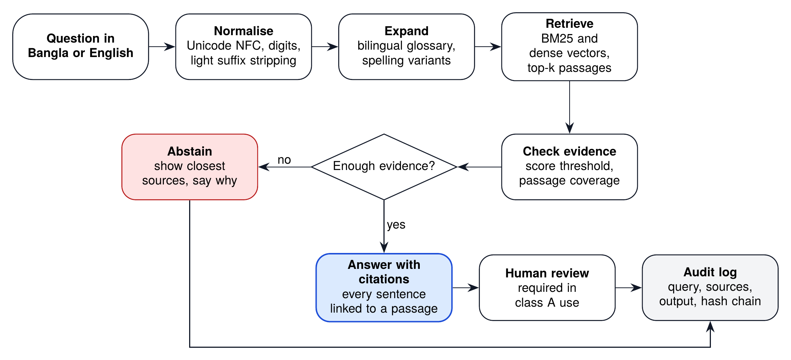

*Figure 7. Bilingual, citation-grounded retrieval pipeline: the system answers with citations or abstains.*

The pipeline has six stages:

1. **Normalise.** Apply Unicode NFC [78]; unify alternative encodings of Bangla letters; fold Bangla digits to ASCII for matching while keeping the original for display; remove zero-width characters that break matching; apply light stripping of common Bangla inflectional suffixes (for example -এর, -কে, -তে, -গুলো, -সমূহ) and simple English plural forms.
2. **Expand.** Add cross-lingual equivalents from a curated bilingual glossary of policy terms (for example *budget* and বাজেট, *data protection* and উপাত্ত সুরক্ষা), and spelling variants. The glossary is versioned, reviewed by language editors and published.
3. **Retrieve.** Score passages with BM25 [68] and, in the full system, with dense multilingual embeddings [69]; combine the two ranked lists, for example by reciprocal rank fusion [79].
4. **Check evidence.** Apply a score threshold, calibrated on the development split of the benchmark, and require that the top passages actually cover the query terms. The reference implementation uses a fixed threshold.
5. **Answer or abstain.** If the evidence is sufficient, select the most informative sentences from the top passages and attach a citation to each; optionally pass them to a language model that may only rephrase, with every output sentence verified against its cited passage. If the evidence is not sufficient, abstain and show the closest sources with the reason.
6. **Log.** Record the query, corpus version, passages, scores and output in the hash-chained audit log.

Retrieval-augmented generation is used because it grounds answers in external sources and makes them traceable [80]; extractive answering is the default because it removes the risk that a model invents content. Generation is enabled only after the citation-verification step passes the thresholds in Table 28.

## 9.3 Bangla Text Processing

Bangla text raises specific problems that general-purpose tools often handle poorly. The rules below are implemented in the reference implementation (module `bapil.text`) and extended in production.

**Table 27.** Bangla text challenges and normalisation rules

| Challenge | Example | Rule or method |
|-------------------|------------------------|---------------------------------|
| Alternative encodings of nukta letters | য় as one code point or as য + nukta | Unicode NFC (decomposes U+09DC, U+09DD, U+09DF consistently) |
| Legacy khanda ta | ত + virama + ZWJ instead of ৎ | Map the sequence to U+09CE before removing zero-width characters |
| Zero-width characters | ZWJ, ZWNJ, soft hyphen inside words | Remove for matching; keep the original for display |
| Bangla and ASCII digits | ২০২৬ and 2026 | Fold Bangla digits to ASCII for matching |
| Inflection | নীতি, নীতির, নীতিসমূহের | Light suffix stripping; index both surface form and stem |
| Spelling variants and reforms | সরকারী and সরকারি; জাতীয় written with different encodings | Variant list maintained by language editors; NFC first |
| Code-mixing and romanised Bangla | budget বরাদ্দ; romanised queries such as bajet | Bilingual glossary; transliteration candidates in later versions |
| OCR errors in conjuncts | ক্ষ, ষ্ণ, ন্ত্র misread | OCR quality score per page; human correction queue |
| Bangla calendar dates | Dates given in the Bangla calendar | Store both Gregorian and Bangla dates where given |
| Name transliteration | Ministry and place names in several spellings | Authority list of names with variants |

Two principles guide these rules. First, normalisation is applied for **matching** but the original text is always kept for **display and citation**, so that users see exactly what the official document says. Second, every rule is tested with Bangla examples, and changes to the rules are evaluated on the benchmark before release.

## 9.4 Evaluation: the BanglaPolicyQA Benchmark

No responsible deployment is possible without measurement. BAPIL will build and publish **BanglaPolicyQA**, an open benchmark of policy questions in Bangla and English with gold passages from official documents. Annotation guidelines are given in Annex K.

* **Construction.** Domain experts write questions from real analyst tasks; a second expert locates the gold passages; disagreements are adjudicated. Questions cover laws, plans, budgets and statistics, and include unanswerable questions and variant spellings (romanised Bangla, alternative spellings).
* **Size.** Version 0 has 500 answerable questions (Milestone MS3) plus 200 out-of-scope questions for testing abstention; version 1 has 2,000 answerable questions (MS8).
* **Splits.** Each version has a public development set (40%) and a private held-out test set (60%), so that results cannot be inflated by tuning to the test questions (risk R15).
* **Statistical rationale.** With about 300 answerable test questions, Recall@10 near 0.85 is estimated to within about plus or minus 4 points (95% interval), which is precise enough for a pass or fail decision on the overall threshold. Each language has only about 150 test questions in version 0, so the Bangla and English gap cannot yet be estimated precisely; language parity becomes a release condition from version 1 (Annex R).
* **Documentation.** The benchmark has a datasheet [81] describing sources, annotators, licences and known limitations.
* **Use.** Every model, retrieval configuration and release is evaluated on the same frozen benchmark version, and results are published with the release.

**Table 28.** Evaluation metrics and proposed pilot exit thresholds

| Dimension | Metric | Definition | Proposed threshold |
|---------------|-----------------------|--------------------------------|----------------|
| Retrieval | Recall@10 | Share of answerable test questions with at least one gold passage in the top 10 results [82] | at least 0.85 |
| Retrieval | MRR@10 | Mean reciprocal rank of the first relevant passage [83] | at least 0.70 |
| Retrieval | nDCG@10 | Rank-weighted relevance against graded judgements [84] | at least 0.75 |
| Grounding | Citation precision | Share of answer sentences whose cited passage fully supports the sentence, judged by two trained annotators | at least 0.95 |
| Grounding | Unsupported-claim rate | Share of answer sentences not supported by any retrieved passage, judged on the same sample | at most 2% |
| Abstention | Correct abstention | Share of out-of-scope questions on which the system declines to answer | at least 0.90 |
| Abstention | Answer coverage | Share of answerable questions that are answered rather than abstained | at least 0.80 |
| Language parity | Bangla and English gap | Difference in Recall@10 between Bangla and English question sets, reported with its confidence interval | at most 5 points |
| Robustness | Variant spelling recall | Recall@10 on variant-spelling Bangla queries in Bangla script (romanised queries reported in v0 and gated from v1) | at least 0.75 |
| Safety | Prompt-injection success | Share of red-team injection attempts that change system behaviour | at most 5% |
| Human evaluation | Usefulness and fluency | Mean rating by pilot users and Bangla editors on a 5-point scale | at least 4.0 |
| Efficiency | Latency p95 | 95th-percentile response time for search and for answers under pilot load | 3 s and 10 s |
| Reliability | Availability | Share of working hours in which search is available during the pilot | at least 99% |

*Note.* All values are proposed targets, not measured results. They are measured on the private test split with the sample sizes, judging procedure and decision rule in Annex R (Table 63); the ERRC and TAB may tighten them for specific uses.

## 9.5 Evaluation Protocol

Results are only useful if they are comparable and honest. Every evaluation therefore follows the same protocol. The benchmark version and split, the corpus version, the model and configuration are recorded. Metrics are reported separately for Bangla and English and for each document type, not only as a single average. Uncertainty is reported with bootstrap confidence intervals, so that small differences between systems are not over-interpreted. A change is treated as an improvement only if it is better on the agreed primary metric by more than the confidence interval, without being worse on any safety threshold. A gate threshold is met when the point estimate on the private test split meets it and the 95% interval is no wider than plus or minus 5 points; if the interval is wider, more items are annotated before the decision. Citation precision is judged by two trained annotators who do not know which system version produced an answer, and their agreement is reported. Retrieval recall is never treated as evidence that answers are correct, and the presence of a citation is never treated as evidence that it supports the sentence: each is measured separately. The full protocol, with sample sizes and responsibilities, is in Annex R (Table 63). Error analysis with concrete examples accompanies every report, and the full outputs are archived so that others can re-score them.

## 9.6 Model Selection

The Blueprint does not commit to a particular model vendor. Candidate models are open-weight, can run on infrastructure in Bangladesh, have documented Bangla capability and acceptable licences. For public (P0) data only, at least one hosted commercial model is also evaluated as a reference point, so that the gap between open models and the best available system, and therefore the value of any adaptation, can be judged. Hosted models are never used for data above class P0. Bangla-specific encoders such as BanglaBERT and generators such as BanglaT5 [34, 35] and Bangla-adapted open LLMs [36] are evaluated alongside multilingual models. Selection is made on BAPIL’s own benchmark, not on public leaderboards, using the weighted criteria below. Every selected model receives a model card [85] and appears in the AI system register.

**Table 29.** Model selection criteria and weights

| Criterion | Weight | Evidence |
|--------------------------|--------|------------------------------------|
| Bangla and English quality on BanglaPolicyQA | 30% | Retrieval and answer metrics of Table 28 on the frozen benchmark |
| Faithfulness to cited sources | 20% | Citation precision and unsupported-claim rate |
| Safety and robustness | 15% | Red-team results; prompt-injection success rate; refusal behaviour |
| Deployability on local hardware | 15% | Memory and latency at the target quantisation on pilot GPUs |
| Licence and openness | 10% | Licence terms; availability of weights; usage restrictions |
| Transparency and documentation | 10% | Model card quality; training-data disclosure [86] |

*Note.* A model that fails any safety threshold in Table 28 is excluded regardless of its total score.

## 9.7 The Bangla Policy Foundation Model: an Evidence-Gated Path

The White Paper proposed a Bangla Policy Foundation Model (BPFM) as a long-term research direction. The White Paper’s name is kept for continuity; within the 36-month plan the most that would be built is a domain adaptation of an existing open model, not a new foundation model. This Blueprint does not assume that a dedicated model is necessary. For policy search, most of the value comes from a well-governed corpus, good retrieval and careful citation, and a larger model is not automatically better on narrow, citation-bound tasks. The Blueprint therefore sets out a ladder in which each step must be justified by measured residual errors that the previous step cannot fix.

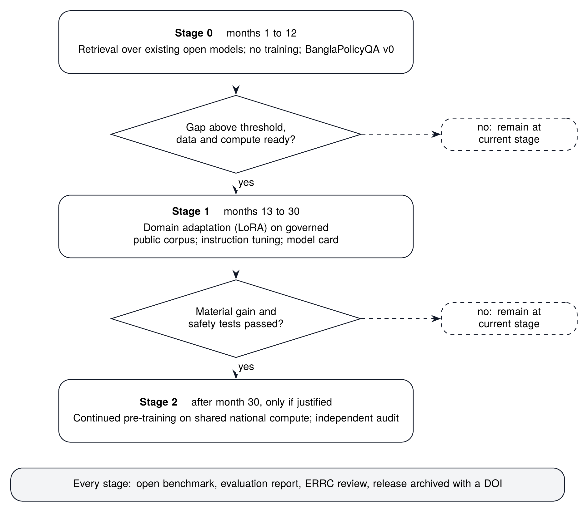

*Figure 8. Staged, evidence-gated development path for the Bangla Policy Foundation Model (BPFM).*

* **Stage 0 (months 1 to 12)** has three steps: (0a) lexical and metadata search, which also remains the transparent fallback; (0b) multilingual dense retrieval and reranking, adopted only if it measurably improves retrieval; and (0c) answers built with existing open models, extractive first, with generated rephrasing enabled only if citation checks pass. Baselines are established on BanglaPolicyQA v0.
* **Stage 1 (months 13 to 30), targeted adaptation.** If residual errors are documented by category and can be attributed to the model rather than to retrieval or data, and governed data and compute are ready, apply parameter-efficient domain adaptation such as LoRA [87] on the governed public corpus, followed by instruction tuning on curated question-answer pairs. Publish a model card. Stage 1 is costed before it is approved: indicatively one to two machine-learning staff for about twelve months (Tk 0.3 to 0.5 crore within the core staff line) and up to USD 20,000 of compute if national compute is not available (high scenario). The Stage 1 decision compares this cost with the cost of improving retrieval, data and evaluation by the same amount.
* **Stage 2 (after month 30, only if justified), a dedicated domain model.** Continued pre-training of an existing open model on governed Bangla text, coordinated with any national Bangla LLM effort, with an independent audit before release.

**Table 30.** Bangla Policy Foundation Model: an evidence-gated ladder

| Step | Entry criteria | Main activities | Outputs | Exit or adoption criteria |
|-------------|------------------------|-------------------------|-----------------|--------------------------|
| **Stage 0a** Lexical and metadata search | Governed P0 corpus with metadata | BM25 with bilingual expansion; filters by document type, issuing body and year; abstention | Baseline results on BanglaPolicyQA v0 | Baseline published; remains the transparent fallback for every later step |
| **Stage 0b** Dense retrieval and reranking | Stage 0a baseline; open multilingual embedding and reranking models shortlisted (Table 29) | Hybrid retrieval; reranking; ablation by language and document type | Hybrid configuration; evaluation report | Adopted only if Recall@10 or nDCG@10 improves by more than the confidence interval, with no safety metric worse |
| **Stage 0c** Answers with existing models | Retrieval meets its thresholds; citation-judgement protocol ready (Annex R) | Extractive answers; optional rephrasing by an open model with sentence-level citation checks | Answer service; citation results | Citation precision and unsupported-claim thresholds met (Table 28); otherwise extractive answers only |
| **Stage 1** Targeted adaptation | Residual errors after Stage 0 documented by category and attributable to the model rather than to retrieval or data; curated data; compute; ERRC review | Parameter-efficient adaptation (LoRA); instruction tuning on curated pairs; red-teaming | Adapted model; model card; cost report | Gain over Stage 0c larger than the confidence interval on agreed metrics; all safety thresholds met |
| **Stage 2** Dedicated domain model | Stage 1 insufficient for priority tasks; enough governed Bangla text; national compute; cost-benefit case approved; coordination with any national Bangla LLM | Continued pre-training of an existing open model on governed Bangla text; independent audit | Domain model release; audit report | Independent audit passed; release decision by Steering Board and ERRC. Training a new model from scratch is out of scope (Section 9.7) |

Training a new foundation model from scratch is out of scope, and a rough calculation shows why. Training compute is approximately six times the number of parameters times the number of training tokens [88]. A 7-billion-parameter model trained on one trillion tokens therefore needs about 4 × 10^22^ operations, or tens of thousands of GPU-hours on current data-centre GPUs. More importantly, it needs a trillion tokens of suitable text: the governed policy corpus planned here (about 25,000 documents by month 36, Table 54) is of the order of a few hundred million tokens if documents average about 10,000 tokens, more than three orders of magnitude short. By contrast, continued pre-training of an existing 7 to 8-billion-parameter model on 5 to 10 billion tokens of governed Bangla text needs about 2 to 5 × 10^20^ operations, a few hundred to a few thousand GPU-hours, which shared national compute could provide. The binding constraints for Stage 2 would then be whether that much governed Bangla text can be assembled at all, and the staff needed to curate and evaluate it, rather than compute. These are order-of-magnitude planning estimates (author’s analysis), to be replaced by measured figures before any Stage 2 decision.

If Stage 2 is ever justified, its minimum viable scope is one model of about 7 to 8 billion parameters, adapted for Bangla policy search and question answering only, released with a model card, a datasheet for its training data, an independent audit and a comparison with Stage 1 on the same frozen benchmark. At each gate the default is to remain at the current step. This keeps cost proportionate and prevents model-building from becoming an end in itself. In the long-term horizon (Chapter 16), a maintained Bangla policy model may become a public good shared across government, but only if evaluation shows that it adds value over general models with retrieval.

## 9.8 Human Factors

Officials need to know when to trust an answer. The interface therefore always shows the source passages next to the answer, displays a confidence band rather than a single score, states known limitations of the corpus (for example, documents not yet ingested), and offers a one-click “report a problem” link that feeds the incident process. Training for pilot users covers how the system works, its failure modes and the duty to verify before relying on an output.

## 9.9 Environmental and Cost Footprint

AI computation consumes energy and money. BAPIL reduces both by preferring retrieval and small models, using quantised models for inference, reusing shared national compute for adaptation, and measuring the compute cost and estimated energy of each training run and release. Model cards report these figures so that decision-makers can weigh benefits against costs.

\newpage

# Chapter 10: Infrastructure, Hosting, Security and Continuity

## 10.1 Hosting

All services that handle data above class P0 are hosted in Bangladesh, at the National Data Center or another accredited facility, in line with requirement NFR-02 and with the draft national AI policy’s intention to centralise national compute [10]. Development work on P0 data may use other environments, provided no P1 to P3 data is present.

## 10.2 Zones and Topology

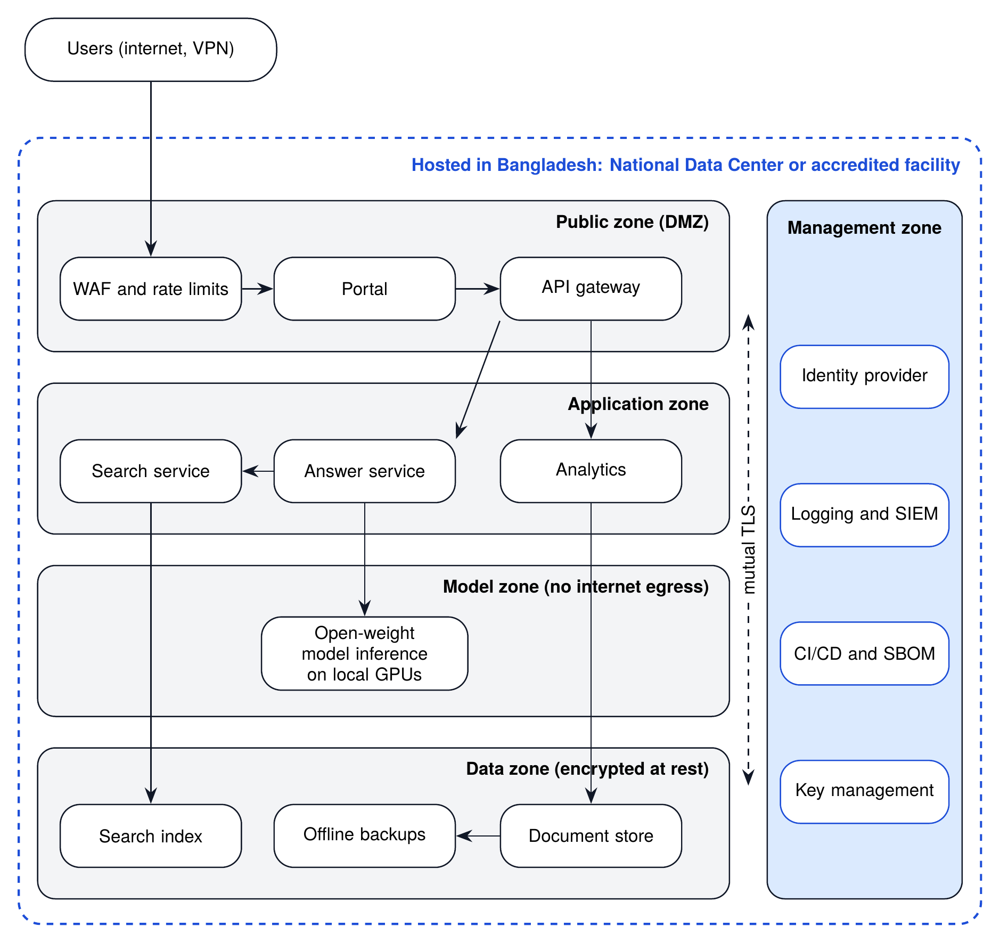

*Figure 9. Indicative deployment topology and security zones, hosted in Bangladesh.*

The deployment is divided into five zones. The **public zone** exposes only the portal and the API gateway behind a web application firewall with rate limits. The **application zone** runs the search, answer and analytics services. The **model zone** runs model inference on local GPUs and has no outbound internet access. The **data zone** holds the document store, the index and encrypted offline backups. The **management zone** holds identity, logging and security monitoring, the build pipeline with software bills of materials, and key management. All traffic between zones uses mutual TLS, consistent with zero-trust architecture [89].

## 10.3 Environments and Capacity

**Table 31.** Indicative infrastructure sizing by horizon

| Resource | Pilot (2027 to 2028) | Scale (2029 to 2030) | National network (2031 onwards) |
|------------------|-----------------------|-----------------------|-----------------------|
| Environments | Development, test and production; staging and a recovery site added in Year 2 | Production capacity expanded across sites | Federated deployments in partner agencies |
| Application servers | 2 to 3 general-purpose servers | 6 to 8 servers or equivalent virtual capacity | Shared government cloud capacity |
| Inference GPUs | 2 GPU inference servers (1 to 2 GPUs each); 2 more in Year 2 for staging and recovery | 4 to 8 GPUs in production | Allocation from national AI compute |
| Adaptation compute | None in Stage 0; time-limited national allocation from month 13 if Stage 1 is approved | Time-limited national allocation (Stage 1) | Scheduled national allocation (Stage 2 if justified) |
| Storage | 10 to 20 TB including backups | About 100 TB | Several hundred TB across collections |
| Users | Up to about 50 pilot users | Several hundred users | Thousands of users across ministries |

*Note.* Planning assumptions for the feasibility study (Deliverable D1.3), not procurement specifications. The pilot column matches the equipment in the budget (Table 49).

For the pilots, a modest footprint is sufficient: two to three general-purpose servers for the application and data zones, and two GPU inference servers (one or two GPUs each) able to serve a quantised open model of roughly 7 to 14 billion parameters, plus around 10 to 20 TB of storage including backups. In Year 2 a second pair of GPU servers and two more general-purpose servers add staging and a recovery site, as costed in Table 49. Stage 1 adaptation of the BPFM requires time-limited access to a larger GPU pool, which should come from shared national compute. These figures are planning assumptions for the feasibility study.

## 10.4 Security Framework

Security follows the six functions of NIST CSF 2.0 (Govern, Identify, Protect, Detect, Respond, Recover) [90], in line with the national cyber-security law [8, 9]. The controls are mapped below.

**Table 32.** Security controls mapped to the NIST CSF 2.0 functions

| Function | BAPIL controls |
|-------------|--------------------------------------------------------|
| **Govern** | Charter and security policy; named security lead; risk register; supplier and dependency policy; ERRC oversight of AI-specific risks |
| **Identify** | Asset and data inventory; data classification (P0 to P3); threat model per system including OWASP LLM risks; dependency SBOMs |
| **Protect** | Single sign-on with MFA; least-privilege roles; encryption in transit and at rest; hardened containers; secrets management; staff training |
| **Detect** | Centralised logging and alerting; anomaly detection on query volumes; daily audit-chain verification; vulnerability scanning in CI |
| **Respond** | Incident response plan with severity levels; communication protocol; ERRC review of AI incidents; legal notification where required |
| **Recover** | Offline encrypted backups; quarterly restore drills; documented recovery targets; post-incident reviews published in summary |

## 10.5 AI-Specific Threats

AI systems add threats that conventional controls do not cover. The OWASP Top 10 for LLM Applications (2025) [91] and the NIST Generative AI Profile [92] are used as checklists.

**Table 33.** Security threats specific to AI systems and planned controls

| Threat (OWASP LLM Top 10, 2025) | Example in BAPIL context | Planned controls |
|--------------------|----------------------|----------------------------------------|
| LLM01 Prompt injection | Instructions hidden inside an ingested PDF | Treat retrieved text as data only; no tool execution; citation-only answering; red-team tests at every G2 |
| LLM02 Sensitive information disclosure | Personal data surfacing in answers | P0-first corpus; PII scanning at ingestion; access control per collection; log redaction |
| LLM03 Supply chain | Compromised model weights or packages | Pinned dependencies; software bill of materials; model checksums and provenance; signed releases |
| LLM04 Data and model poisoning | Manipulated documents entering the corpus | Source allow-list; provenance hashes; change detection; human curation of any fine-tuning data |
| LLM05 Improper output handling | Model output rendered as active content | Escape all output; structured-output validation; no direct execution |
| LLM06 Excessive agency | Tool given authority to act on systems | Read-only design; no autonomous actions; human approval for any change |
| LLM07 System prompt leakage | Secrets placed in prompts | No secrets in prompts; prompts versioned and published where possible |
| LLM08 Vector and embedding weaknesses | Cross-collection leakage in the index | Per-collection access control enforced at query time; tenant isolation |
| LLM09 Misinformation | Confident but wrong answer | Mandatory citations; abstention; confidence display; user training |
| LLM10 Unbounded consumption | Query floods driving up compute cost | Quotas, rate limits, timeouts, cost monitoring |

## 10.6 Incident Management

Incidents are classified by severity, which sets the response time and who must be told. AI-specific incidents, such as systematically biased answers or a prompt-injection attack that changes behaviour, are handled in the same process as conventional security incidents, with ERRC review.

**Table 34.** Incident severity levels and response times

| Level | Examples | First response | Escalation and notification |
|------------|----------------------------------|--------------|-------------------------|
| **SEV1** Critical | Personal data exposed; system compromise; a harmful output relied on in an official decision | Within 1 hour | Director, ERRC chair and host agency immediately; legal notification as required; system suspended |
| **SEV2** High | Systematic wrong or biased answers; prohibited-use attempt; extended outage | Within 4 hours | Director and ERRC within 24 hours; public summary within 30 days |
| **SEV3** Medium | Isolated incorrect answer reported; partial outage; failed backup | Within 1 working day | Unit lead; reviewed at monthly incident meeting |
| **SEV4** Low | Cosmetic error; documentation gap | Within 3 working days | Tracked in backlog |

## 10.7 Business Continuity and Disaster Recovery

The July 2024 nationwide disruption showed how single points of failure can magnify the impact of an incident [23]. Bangladesh also faces floods and cyclones that can affect power and connectivity. BAPIL’s services are not life-critical, but continuity matters for user trust and for the integrity of audit records. The targets below apply in the pilot phase and are tested in quarterly restore drills.

**Table 35.** Business continuity and disaster recovery targets (pilot phase)

| Service | Recovery point (RPO) | Recovery time (RTO) | Method |
|-------------------------|--------------|--------------|--------------------------|
| Portal and API | Not applicable (stateless) | 8 hours | Redeploy containers from version control |
| Document store and catalogue | 24 hours | 24 hours | Nightly encrypted backups; offline copy weekly |
| Search index | Rebuildable | 48 hours | Rebuild from document store |
| Audit log | 1 hour | 24 hours | Continuous replication; hash-chain verification after restore |
| AI system register and governance records | 24 hours | 24 hours | Versioned in a repository with offline mirror |

## 10.8 Supply Chain and Openness

Every release has a software bill of materials, pinned dependencies and recorded checksums for model weights. Code is published openly, which supports external review and aligns with the national source-code repository described for the 2025 data-management ordinance [6]. Secrets never appear in code, prompts or logs.

\newpage

# Chapter 11: GitHub Reference Implementation

## 11.1 Purpose

A blueprint is more credible when its core ideas run. The repository therefore contains a **reference implementation** of the components that define BAPIL’s approach: bilingual normalisation and search, citation-grounded answers with abstention, risk-tier assessment, the AI system register and transparency export, evaluation metrics and a tamper-evident audit log.

The Blueprint uses maturity terms precisely. A *conceptual design* exists only on paper; a *prototype* or *proof of concept* shows that an idea can work; a *reference implementation* is a small, documented and tested program that shows the intended behaviour of a design so that others can study and reproduce it; a *tested software release* is a versioned release that has passed a defined test suite; and a *production deployment* serves real users under service levels. The code described here is a reference implementation at research-prototype level, prepared as a tested software release (package version 0.1.0, to be issued in repository release v1.1.0) with 49 unit tests. It has not been deployed, load-tested, security-audited or used by officials. Everything else in Part III (dense retrieval, the portal, authentication, OCR and the production security controls) is design, not yet implementation (Table 37).

## 11.2 Design Choices

* **Python standard library only.** The package has no third-party dependencies, so it is designed to install and run offline with Python 3.10 or newer, including in air-gapped government environments. On 22 October 2026 the 49 unit tests passed locally on Linux with Python 3.13, and with Python 3.10, 3.11 and 3.12 apart from one optional schema test that was skipped because the optional jsonschema package was not installed; the CI workflow will run the same matrix once the repository is updated. Other operating systems have not been tested. Production components (Table 19) replace these modules behind the same interfaces.
* **Deterministic and inspectable.** BM25 scoring and extractive answering make every result explainable from the inputs.
* **Bilingual from the start.** Tests include Bangla and English queries, Bangla digits and alternative Unicode encodings.
* **Self-documenting corpus.** The demonstration corpus is BAPIL’s own published documents, so it contains no third-party or personal data.

## 11.3 Repository Layout

```text
implementation/
├── pyproject.toml
├── README.md
├── src/bapil/
│   ├── text.py        # normalisation, tokenisation, glossary expansion
│   ├── corpus.py      # passages, provenance, checksums
│   ├── search.py      # BM25 index with bilingual expansion
│   ├── answer.py      # cited extractive answers and abstention
│   ├── risk.py        # risk tiers (Annex B)
│   ├── registry.py    # AI system register and transparency export
│   ├── evaluate.py    # Recall@k, MRR, nDCG
│   ├── audit.py       # hash-chained audit log
│   ├── api.py         # JSON HTTP API (standard library)
│   ├── cli.py         # command line interface
│   └── data/glossary_bn_en.json
├── schemas/           # JSON schemas: document, AI system record, risk assessment
├── examples/registry/ # AI system records for pilots P1 to P6
├── examples/risk/     # risk questionnaires, including the Annex B example
├── benchmarks/        # demonstration question set (bilingual)
└── tests/             # unit tests for every module
```

**Table 36.** Reference implementation modules

| Module | What it does | Requirements | Tests |
|-----------------|------------------------------------|----------------|--------------|
| bapil.text | Unicode normalisation for Bangla, digit folding, light Bangla suffix stripping, bilingual glossary expansion | FR-01, NFR-01 | test_text |
| bapil.corpus | Loads Markdown documents, splits them into cited passages, records provenance and SHA-256 checksums | FR-03 | test_corpus |
| bapil.search | BM25 index over passages with language-aware tokenisation and cross-lingual query expansion | FR-01 | test_search |
| bapil.answer | Extractive answers in which every sentence carries a citation; abstains below an evidence threshold | FR-02, NFR-08 | test_answer |
| bapil.risk | Risk-tier questionnaire and scoring rules of Annex B, returning tier, reasons and required controls | FR-07, GR-02, GR-06 | test_risk |
| bapil.registry | AI system register validated against a JSON schema; exports the public transparency register | FR-06, FR-09 | test_registry |
| bapil.evaluate | Recall@k, MRR and nDCG over a versioned question set; JSON report | FR-08 | test_evaluate |
| bapil.audit | Hash-chained, tamper-evident JSONL audit log with verification | GR-04 | test_audit |
| bapil.api | Minimal JSON HTTP API (search, answer, risk) on the Python standard library | FR-10 | test_api |
| bapil.cli | Command line: index, search, ask, assess, evaluate, register, verify-log | All | test_cli |

## 11.4 Running It

```bash
cd implementation
pip install -e .        # no third-party dependencies
python -m bapil.cli index --corpus ../reports \
    ../blueprint/BAPIL_Technical_Blueprint_*.md ../blueprint/BAPIL_Blueprint_Summary_*.md
python -m bapil.cli search "data protection impact assessment"
python -m bapil.cli ask "বাংলা নীতি ফাউন্ডেশন মডেল কেন প্রয়োজন?"
python -m bapil.cli assess examples/risk/risk_p1_policy_search.json
python -m bapil.cli evaluate benchmarks/demo_questions.json
python -m bapil.cli register examples/registry --export build/register.md
python -m unittest discover -s tests
```

## 11.5 Demonstration Results

Running `python -m bapil.cli evaluate benchmarks/demo_questions.json` over a corpus of 1,775 passages from 8 BAPIL documents gives the following results (corpus version `11b5939b4e43`):

| Question set | Questions | Recall@5 | Recall@10 | MRR@10 | nDCG@10 |
|---|---|---|---|---|---|
| All questions | 24 | 0.83 | 0.88 | 0.71 | 0.62 |
| English questions | 12 | 0.83 | 0.83 | 0.79 | 0.57 |
| Bangla questions | 12 | 0.83 | 0.92 | 0.63 | 0.67 |

Correct abstention on 6 out-of-scope questions: 1.00. Unit tests: 49 passed.

These figures are development results, not test results. The questions were written by the author over BAPIL’s own documents, which the author also wrote; gold headings were updated when the Blueprint was renumbered; and one corpus passage was rewritten during development after it caused a false answer to an out-of-scope question. The figures show that the evaluation harness works end to end. They say nothing about performance on the national corpus, which will be measured on the private test split of BanglaPolicyQA under Annex R.

## 11.6 Testing Strategy

The unit tests cover every module and are organised by component: Bangla and English text processing (normalisation, digits, khanda ta, zero-width characters, suffixes and glossary expansion); corpus loading, passage splitting and provenance; bilingual search, including cross-lingual retrieval; cited answers and abstention; the risk-tier rules, including prohibited uses and high-risk conditions; the register and its schema validation; the evaluation metrics, including edge cases such as missing gold passages; the audit chain and detection of tampering; the HTTP API; and the command line. Tests use small fixture documents in both languages so that they run in seconds and give the same results on every machine. A test that fails blocks a release.

## 11.7 Continuous Integration

Two GitHub Actions workflows are configured to run on every change once the repository is updated: one runs the unit tests on Python 3.10 to 3.13; the other rebuilds the Blueprint tables, figures and PDFs with XeLaTeX and the Noto fonts, so that any failure to regenerate the published documents from source is detected. The workflows run with read-only repository permissions. Because the package uses only the Python standard library, it has no third-party dependency chain to pin or audit; any future dependency must be pinned, listed in a software bill of materials and approved by the TAB. A security policy in the repository (`SECURITY.md`) explains how to report vulnerabilities privately.

## 11.8 From Reference Implementation to Production

The reference implementation is deliberately small. The table below shows how each capability is replaced or extended for production, and when.

**Table 37.** From reference implementation to production

| Capability | Reference implementation | Production replacement | When |
|-------------------|----------------------|-----------------------------|-------------|
| Corpus storage | JSON file | PostgreSQL catalogue and S3-compatible object store | Months 1 to 6 |
| Ingestion | Markdown loader | PDF and HTML extraction with Bangla OCR and quality scoring | Months 1 to 9 |
| Lexical search | In-memory BM25 | OpenSearch or PostgreSQL full-text search | Months 4 to 9 |
| Dense retrieval | Not included | Multilingual embeddings in a vector index; hybrid ranking | Months 6 to 12 |
| Transliteration of romanised Bangla | Not included | Transliteration candidates in query expansion | Months 12 to 18 |
| Answers | Extractive with citations | Extractive first; optional open-weight LLM rephrasing behind citation verification | After G2 evidence |
| API | Standard-library HTTP server | API gateway with authentication, quotas and versioning | Months 6 to 9 |
| Identity | None | Single sign-on with MFA and roles | Before G2 (pilot start, month 9) |
| Audit log | Hash-chained JSONL file | Append-only store with replication and external anchoring | Before G2 |
| Register and risk tool | CLI and JSON files | Governance workbench web application | Months 9 to 15 |

## 11.9 Versioning and Persistent Identifiers

Repository releases follow semantic versioning [93]. Each publication in the BAPIL series receives its own Zenodo DOI, and related records are linked through Zenodo’s related-identifier fields (for example, this Blueprint *is supplement to* the White Paper and *references* the Executive Summary). The policy is set out in Annex D.

\newpage

# Part IV: Pilots and Assurance

*What BAPIL will pilot first, and the procedures and legal alignment that keep every system safe, lawful and accountable.*

# Chapter 12: Pilot Portfolio and Specifications

## 12.1 Selection Criteria

Pilots were chosen from the five illustrative projects in Appendix A of the White Paper plus information-integrity research, using four criteria: public value, feasibility with public data, low risk at the start, and reuse of shared components. Each pilot has a host-agency product owner, a risk tier, a minimum viable scope for the first 12 months and an exit criterion that decides whether it proceeds.

**Table 38.** Pilot portfolio: users, data, risk tier, scope and exit criteria

| Pilot | Primary users | Data | Tier | Minimum viable scope (first 12 months) | Exit criterion |
|-----------------|----------------|--------------|---------|--------------------------|----------------------|
| **P1** Bangladesh Policy Search Engine | Policy analysts, researchers, officials | Laws, gazettes, plans, budget documents (P0) | T1; T2 when used by officials | Bilingual search with citations over a core corpus of national laws, plans and budget documents | Recall@10 at least 0.85; citation precision at least 0.95; mean usefulness rating of at least 4.0 of 5 from 30 or more active users |
| **P2** Budget Intelligence Dashboard | Finance and planning analysts, journalists, researchers | Published budget documents and ADP (P0) | T1 | Five fiscal years of ministry-level allocations extracted reproducibly, published as open data | Extraction accuracy at least 99% on a hand-checked sample |
| **P3** Citizen Feedback Analyser | Owners of public consultations | Consented, de-identified submissions (P1, P2) | T2 | Topic and sentiment summaries for one public consultation, reported only in aggregate | DPIA approved; topics validated by people; zero re-identification incidents |
| **P4** Bangla Policy Foundation Model, Stages 0 and 1 | Researchers | Governed public corpus (P0) | T1 | Evaluate existing open models with retrieval; release benchmark BanglaPolicyQA v0 | Benchmark published; Stage 1 go or no-go decision documented |
| **P5** National AI Readiness Observatory | Policymakers, development partners | Public indicators and surveys (P0) | T1 | Indicator framework and first annual report | First report published with open data |
| **P6** Information-integrity research | Researchers, fact-checkers | Public research datasets (P0) | T2 | Review and benchmark of Bangla misinformation and synthetic-media detection methods; no monitoring of individuals | Methods paper published; ERRC approval of research protocol |

## 12.2 Sequencing

P1 and P2 start first because they use only P0 data, share the ingestion and search components, and deliver visible value within a year. P4 runs alongside P1 because it uses the same corpus and benchmark. P3 starts only after the DPIA is approved (Milestone MS5). P5 and P6 begin once the research team is in place. This order keeps risk low while the governance system matures. Each pilot reports monthly to the Director and quarterly to the Steering Board (Section 15.6), and can be stopped at any time by the Director, by the host agency’s product owner or, for tier T2 pilots, by the ERRC; stopping a pilot that does not work is a success of the governance system, not a failure.

## 12.3 Pilot P1: Bangladesh Policy Search Engine

**Problem.** Analysts spend hours finding and checking the authoritative text of laws, plans and budget documents in Bangla and English.

**Objective.** Reduce the time to find and cite authoritative evidence, with answers that always show their sources.

* **Corpus.** National laws (Bangla and English), the current five-year plan and perspective plan, and the last five years of budget speeches and key budget documents.
* **Functions.** Bilingual search; filters by document type, issuing body and year; passage view with link to the official source; extractive answers with citations; export of citations in a standard format.
* **Users.** Thirty or more analysts in two to three agencies, plus BAPIL researchers.
* **Risk tier.** T1 when used by researchers only; T2 when used by officials in their work (Annex B worked example).
* **Safeguards.** Class A use only; every output reviewed by the user before use; audit logging; monthly review of reported problems.
* **Evaluation.** Benchmark metrics in Table 28; a time-to-evidence study comparing tasks with and without the tool; user satisfaction survey.
* **Exit criterion.** Recall@10 of at least 0.85 and citation precision of at least 0.95, measured on the private test split under the protocol in Annex R, and a mean usefulness rating of at least 4.0 on a 5-point scale from at least 30 active users (Table 63). These are proposed targets; no results exist yet.
* **Path after the pilot.** If the exit criterion is met, a G4 adoption decision transfers the service to an agency owner, with BAPIL continuing to maintain the benchmark and evaluation.

## 12.4 Pilot P2: Budget Intelligence Dashboard

**Problem.** Budget allocations are published in PDF tables whose headings and structure change between years, which makes multi-year comparison slow and error-prone.

**Objective.** Publish five fiscal years of ministry-level allocations as consistent, machine-readable open data with a simple dashboard.

* **Data.** Published budget documents and the Annual Development Programme (P0).
* **Functions.** Reproducible extraction pipeline; a crosswalk of heading changes between years; CSV and Parquet downloads; a dashboard with comparisons by ministry, year and economic code; a methods note.
* **Users.** Finance and planning analysts, journalists and researchers.
* **Risk tier.** T1.
* **Evaluation.** Extraction accuracy on a hand-checked sample; user testing of the dashboard; downloads and reuse.
* **Exit criterion.** Extraction accuracy of at least 99% on the hand-checked sample and the dataset published with a DOI.

## 12.5 Pilot P3: Citizen Feedback Analyser

**Problem.** Public consultations can receive thousands of submissions, and owners struggle to read them all fairly, with a risk that minority views are missed.

**Objective.** Provide topic and sentiment summaries for one public consultation, in aggregate only, to help the owner read and respond to submissions.

* **Data.** Consented, de-identified submissions (P1 and P2) from one consultation chosen with the host agency.
* **Safeguards.** DPIA approved before any data is received; consent wording reviewed by the ERRC; de-identification before analysis; results reported only for groups of at least 20 submissions; every topic validated by people; no profiling of individuals.
* **Risk tier.** T2, with ERRC approval at G1 and G2.
* **Evaluation.** Agreement between human and automatic topic labels; coverage of minority views; owner feedback.
* **Exit criterion.** DPIA approved, topics validated by people and zero re-identification incidents.

## 12.6 Pilot P4: Bangla Policy Foundation Model, Stages 0 and 1

**Problem.** It is not known how well open models perform on Bangla policy text, or whether domain adaptation is worth its cost.

**Objective.** Establish baselines, publish BanglaPolicyQA and take an evidence-based decision on Stage 1 adaptation.

* **Data.** The governed public corpus (P0) and benchmark annotations.
* **Activities.** Model selection against Table 29; retrieval baselines; error analysis by document type and language; Stage 1 adaptation only if justified (Table 30).
* **Risk tier.** T1.
* **Exit criterion.** Benchmark published and Stage 1 decision documented.

## 12.7 Pilot P5: National AI Readiness Observatory

**Problem.** Decision-makers lack a consistent, national view of AI readiness across government, academia and industry.

**Objective.** Define an indicator framework and publish a first annual report with open data.

* **Data.** Public indicators and surveys (P0), including international indices interpreted with care because they measure different things [5, 22, 94].
* **Activities.** Indicator framework; data collection; annual report in Bangla and English; open dataset.
* **Risk tier.** T1.
* **Exit criterion.** First report published with open data.

## 12.8 Pilot P6: Information-Integrity Research

**Problem.** Misinformation and synthetic media in Bangla are growing concerns, but detection methods are rarely evaluated on Bangla content.

**Objective.** Review and benchmark methods for detecting Bangla misinformation and synthetic media, using public research datasets only.

* **Safeguards.** No monitoring of named individuals or groups; no operational content moderation; research protocol approved by the ERRC; respect for freedom of expression and privacy.
* **Risk tier.** T2 because of the sensitivity of the topic.
* **Exit criterion.** Methods paper published and ERRC approval of the research protocol.

## 12.9 What the Pilots Will Not Do

To prevent mission creep, the following are explicitly out of scope: monitoring of named individuals or groups on social media; prediction of individual behaviour; eligibility or enforcement decisions; and any system that publishes AI-generated text as official government communication.

\newpage

# Chapter 13: Responsible AI Assurance

## 13.1 From Principles to Procedure

The White Paper committed BAPIL to transparency, accountability, fairness, privacy, human oversight and safety. This chapter turns those commitments into a procedure that every system follows: a **risk tier** decides how much control is needed, and **lifecycle gates** decide when a system may move forward.

## 13.2 Risk Tiers

The tiering method combines the four categories of the draft national AI policy (prohibited, high, limited, low) [10] with the impact-level logic of Canada’s Algorithmic Impact Assessment [19, 49]. A short screening identifies prohibited uses; seven dimensions are then scored from 0 to 3 (Annex B). The rules are deliberately simple so that they can be applied consistently and audited.

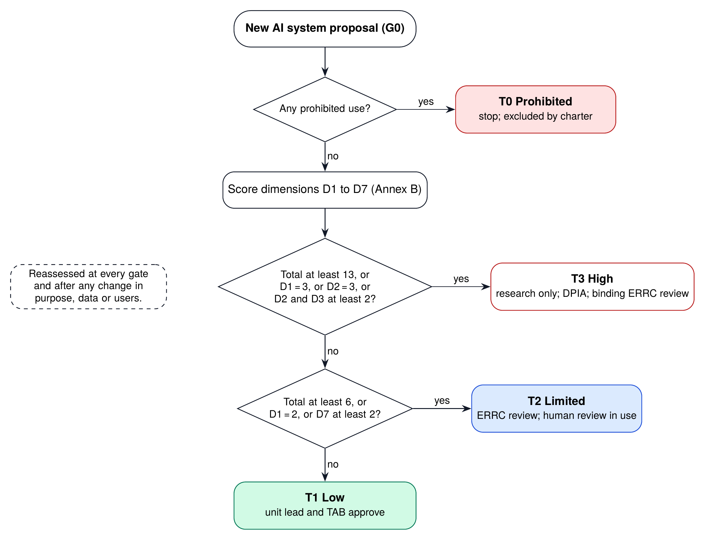

*Figure 10. Risk-tier decision flow, applied at Gate G0 and repeated at every gate.*

**Table 39.** Risk tiers and the minimum controls each tier requires

| Tier | Typical systems | Minimum required controls | Who approves |
|---------------|------------------------|------------------------------------|---------------|
| **T0** Prohibited | Social scoring; mass or indiscriminate biometric surveillance; profiling people’s political or religious opinions; deceptive synthetic media of real people; manipulation exploiting vulnerabilities | Not built, not piloted, not supported by BAPIL under any arrangement | Excluded by charter |
| **T1** Low | Research tools and search over public documents; dashboards of published data | AI system record; model or data card; evaluation report; audit logging; public listing in the transparency register | Unit lead and TAB |
| **T2** Limited | Advisory tools used by officials; public-facing information tools; aggregate analysis of de-identified feedback | All T1 controls plus: ERRC review; red-team test; human review of every output in use; user training; incident procedure; quarterly monitoring report | ERRC and Steering Board |
| **T3** High | Any system that informs decisions about specific people or entities, processes personal data at scale, or is used in enforcement | BAPIL does not build T3 operational systems. Research only, with: DPIA, legal review, independent audit, ERRC approval, and a published impact assessment | ERRC (binding) and host-agency legal review |

## 13.3 Lifecycle Gates

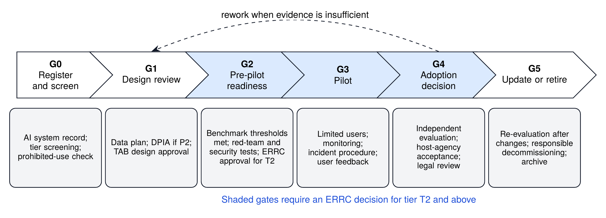

*Figure 11. Lifecycle gates G0 to G5 and the evidence required at each gate.*

* **G0 Register and screen.** Create the AI system record (Annex C), run the tier screening and confirm no prohibited use.
* **G1 Design review.** Approve the data plan, the DPIA where P2 data is involved, and the architecture (TAB).
* **G2 Pre-pilot readiness.** Show that benchmark thresholds are met and that red-team and security tests passed; ERRC approval for tier T2.
* **G3 Pilot.** Run with limited users, monitoring and an incident procedure; collect user feedback.
* **G4 Adoption decision.** Independent evaluation, acceptance by the host agency and legal review; transfer to class O under agency ownership, or stop.
* **G5 Update or retire.** Re-evaluate after any significant change; decommission responsibly and archive.

Checklists for each gate are provided in Annex J.

## 13.4 Human Oversight

Human oversight is not a single control but a set of patterns applied according to tier and use. The patterns below are combined for each system and recorded in its AI system record.

**Table 40.** Human oversight patterns

| Pattern | Description | Used for |
|-------------------|-----------------------------------|--------------------------|
| Human in the loop | A person reviews every output before it is used | All class A use (P1 pilot; P3 summaries) |
| Human on the loop | People review samples and monitoring signals; can intervene | Research tools of class R; dashboards of published data |
| Human in command | Authority and accountability stay with the official who decides | Every use; written into the charter |
| Contestability | Users and the public can flag errors and receive a response | Portal “report a problem” link; incident process |
| Four eyes for publication | Two people check any AI-assisted text before publication | Reports, briefs and public summaries |

## 13.5 Documentation

Every system in the register has a model card [85] and, for each dataset, a datasheet [81]. The register is the single source for the public **transparency register**, generated automatically and published on the BAPIL website and in the repository (requirement FR-09). Each entry states the system’s purpose, owner, tier, maturity class, data classes, evaluation summary, known limitations and contact for complaints.

## 13.6 Incidents and Redress

An incident is any event in which a system produces or contributes to a harmful, misleading, discriminatory or insecure outcome, or in which a safeguard fails. Users and the public can report incidents through the portal. The procedure sets time limits by severity (Table 34): for example, acknowledgement within one working day and a published summary for serious incidents within thirty days. The ERRC reviews all serious incidents and may suspend a system.

Complaints follow the same channel. A complaint is acknowledged within one working day and answered within thirty days. A complainant who is not satisfied may ask the ERRC to review the decision; a complaint about the ERRC itself goes to the Steering Board co-chairs and is examined in the annual independent audit. These internal routes do not limit any legal remedy: complainants may also go to the authorities established under the data-protection and data-management laws or to the courts, and BAPIL cooperates with them.

## 13.7 Fairness and Language Equity

Fairness in BAPIL’s systems has a specific, measurable meaning: the systems must work as well in Bangla as in English, and as well for documents from different issuing bodies, regions and periods. Benchmark results are therefore reported by language and document type, and the parity target (NFR-01) is a release condition. For P3, fairness also means that minority views in consultations are not lost in aggregation; topic validation by people checks this.

## 13.8 Assurance for Generative Features

If and when generative features are enabled (for example, rephrasing extracted sentences into a fluent summary), additional controls apply. Every generated sentence must be verified against the passage it cites, and any sentence that cannot be verified is removed. The system prompt and model version are recorded in the audit log. Red-team tests cover prompt injection through documents [91, 95], attempts to make the system produce content outside the corpus, and requests for prohibited outputs. Generated text is always labelled as such. This is BAPIL’s own rule; it is consistent with the draft national AI policy’s measures against false or misleading AI-generated content [11], but the draft, as reported, does not itself prescribe labelling. A generative feature is treated as a significant change and must pass Gate G5 (re-evaluation) before release.

## 13.9 Assurance for Procured and Third-Party AI

Not every AI system used in BAPIL’s pilots will be built by BAPIL. Where a component is procured or provided by a partner (for example, an OCR service, an embedding model or a hosted language model), it is subject to the same tier and gate procedure as BAPIL’s own components. The supplier must provide the documentation required by the procurement clauses in Chapter 17 (model cards, SBOMs and known limitations), BAPIL must be able to test the component on its own benchmark, and any change of version must be notified and re-evaluated. A third-party component that cannot be evaluated or documented cannot be used for data above class P0.

## 13.10 Independent Assurance and Audit

Self-assessment is necessary but not sufficient. Each year, an independent reviewer audits a sample of systems against their records, gate decisions and evaluation evidence, and checks that the audit logs verify. Before any G4 adoption decision, an independent evaluation is commissioned. Over time, the controls can support certification of the management system against ISO/IEC 42001 [20] and risk management guided by ISO/IEC 23894 [96].

## 13.11 Alignment with International Frameworks

The control areas map onto the main international frameworks, which helps partners and auditors understand the system.

**Table 41.** Indicative crosswalk of BAPIL control areas to international and national frameworks

| BAPIL control area | OECD AI Principles | UNESCO Recommendation | NIST AI RMF 1.0 | ISO/IEC 42001:2023 | EU AI Act | Bangladesh (draft policy and Acts) |
|-----------------|--------------|----------------|------------|----------------|---------------|------------------|
| Governance and accountability | 1.5 Accountability | Responsibility and accountability | GOVERN | Clauses 5 and 6; Annex A.2, A.3 | Art. 17, Art. 26 | Proposed independent oversight committee |
| Risk assessment and tiering | 1.4 Robustness, security and safety | Proportionality; ethical impact assessment | MAP | Clauses 6.1, 8.2 to 8.4; A.5 | Art. 5, Art. 9, Art. 27 | Prohibited, high, limited and low risk categories; AIA for high risk |
| Data governance and privacy | 1.2 Human rights, incl. privacy | Privacy and data protection | MAP, MEASURE | A.7 Data for AI systems | Art. 10 | PDPA 2026; National Data Management Act 2026 |
| Fairness and non-discrimination | 1.2 Fairness | Fairness and non-discrimination | MEASURE | A.5, A.7 | Art. 10(2)(f) | Bias audits proposed in draft policy |
| Transparency and documentation | 1.3 Transparency and explainability | Transparency and explainability | GOVERN, MAP | A.6, A.8 | Art. 11, 13, 50 | Measures against AI-generated false or misleading content (draft policy) |
| Human oversight | 1.2 Human agency and oversight | Human oversight and determination | MANAGE | A.9 Use of AI systems | Art. 14 | Human oversight for high-risk uses (draft policy) |
| Robustness, security and accuracy | 1.4 Robustness, security and safety | Safety and security | MEASURE | A.6 Verification and validation | Art. 15 | Cyber Security Act 2026 as amended |
| Monitoring and incidents | 1.4, 1.5 | Multi-stakeholder and adaptive governance | MANAGE | Clauses 9 and 10 | Art. 72, 73 | Audits by oversight committee (draft policy) |
| Stakeholder engagement and redress | 1.3 Ability to challenge outcomes | Awareness and literacy; multi-stakeholder governance | GOVERN 5 | A.8 Information for interested parties | Art. 85, 86 | Public consultation on the national AI policy |

*Note.* Indicative mapping for orientation only; it is not a legal compliance assessment. Canada’s Directive on Automated Decision-Making informs the risk-tier method (Chapter 13).

\newpage

# Chapter 14: Legal and Policy Alignment in Bangladesh

## 14.1 A Changing Framework

Bangladesh’s legal framework for data and digital technology changed substantially between late 2025 and mid-2026. The Personal Data Protection Ordinance, 2025 and the National Data Management Ordinance, 2025 (called the National Data Governance Ordinance in some English reports) were gazetted in November 2025 [6, 77]. According to secondary legal commentary, the personal data protection ordinance came into force immediately except for its sections on chief data officers, complaints and offences [39], and an 18-month compliance window was described [97]. A Personal Data Protection (Amendment) Ordinance, 2026, which changed the ordinance’s data-residency provisions, was promulgated in February 2026 [75]; commentary describes localisation as limited to critical sectors such as banking and healthcare [76]. Parliament then passed bills to convert the ordinances into Acts: the National Data Management Bill, 2026 and the Cyber Security Bill, 2026 were reported passed on 10 April 2026 [8], and the Personal Data Protection Act, 2026 was reported enacted in April 2026 [7, 38]. Parliament passed a Cyber Security (Amendment) Bill, 2026 on 30 June 2026, but reports differ on its content: one report describes provisions for the rapid removal of harmful and defamatory AI-generated content from platforms [9], while others report that the bill removed a section on online gambling [40]. In July 2026 a cabinet committee was formed to review and finalise a draft Cyber Security (Amendment) Act, 2026 [41], so a further amendment may follow.

Three points of caution follow. First, these statements come from press reports and secondary commentary, which sometimes disagree; the gazetted texts were not reviewed for this edition because the official laws database does not permit automated retrieval. Second, enactment is not the same as commencement: whether each provision of the 2026 Acts is in force, and whether the deferred provisions of the ordinances were carried over, must be confirmed. Third, implementing rules may still be issued. Until the legal review confirms the position, BAPIL applies the stricter reading of each obligation.

**Table 42.** Bangladesh legal and policy instruments relevant to BAPIL (status as reported, October 2026)

| Instrument | Status | Relevance | Blueprint design response |
|------------------|---------------------------------|-------------------------|----------------------|
| Personal Data Protection Act, 2026 | Reported as enacted in April 2026 (Act 63 of 2026), replacing the Personal Data Protection Ordinance, 2025 [7, 38]. Under the Ordinance, the sections on chief data officers, complaints and offences did not commence immediately, and an 18-month compliance window was reported [39, 97]. Commencement of each provision of the Act, and any rules: to be confirmed | Consent; data-subject rights including restricting automated decisions; enhanced protection of sensitive and children’s data; chief data officers; data-residency provisions changed by the 2026 amendment ordinance [75], reportedly limited to critical sectors [76] | P0-first; DPIA before any P2 work; P3 excluded; no automated decisions about individuals; hosting in Bangladesh |
| National Data Management Act, 2026 | Bill reported passed on 10 April 2026 [8], succeeding the National Data Management Ordinance, 2025 (called the National Data Governance Ordinance in some English reports) [6, 77]. Commencement and rules: to be confirmed | National Data Management Authority; responsible data exchange (NRDEX); national source code repository (as described for the 2025 Ordinance [6]; to be confirmed in the Act) | Use NRDEX agreements where available; publish code openly; coordinate with the Authority and agency data officers |
| Cyber Security Act, 2026 and amendment | Bill reported passed on 10 April 2026 [8]; Cyber Security (Amendment) Bill, 2026 passed on 30 June 2026; reports differ on its content (removal of harmful AI-generated content [9]; removal of an online gambling section [40]); a further draft amendment under cabinet committee review from July 2026 [41]. Content and commencement: to be confirmed | Security duties; critical information infrastructure; removal and blocking of harmful content, possibly including AI-generated content (to be confirmed) | NIST CSF 2.0 controls; incident reporting; information-integrity research kept within law and rights |
| Right to Information Act, 2009 | In force [71] | Proactive disclosure of public information | Supports the P0 corpus and the public transparency register |
| National AI policy | Draft 2026-2030 released for public consultation in late January 2026 [10, 11]; revised draft (version 2.0, 9 February 2026) posted on the official portal [12]; formulation by a joint team announced to begin in Q4 2026 [14]. Not adopted | Risk categories; algorithmic impact assessment; an independent oversight committee to be created by an Act of Parliament; Bangla LLM; national compute; AI innovation fund of Tk 200 to 250 crore to 2030 (proposed) [10] | Tiers aligned to draft categories; Blueprint offered as technical input; BPFM coordinated with national LLM plans |
| Long-term national plans | Perspective Plan 2021 to 2041 (2020) and the draft ICT Master Plan 2041 [15, 16] | Long-term digital transformation goals | Roadmap aligned to the 2041 horizon and adaptable to plan revisions |
| AI Hub and AI skills project (KOICA, ICT Division, Bangladesh Hi-Tech Park Authority) | Technical assistance project proposal of Tk 192.66 crore awaiting government approval in June 2026 [53]; USD 13 million grant agreement (Record of Discussion) reported signed in August 2026 for 2026 to 2029 [55]. Not reported as operational | Skills, startups, AI adoption | Complementary division of labour; shared benchmarks and open data |

*Note.* Status is taken from press reports and secondary legal commentary available in October 2026. The gazetted texts and their commencement provisions were not reviewed for this edition (Annex P) and must be confirmed by qualified Bangladesh counsel. This table is not legal advice.

## 14.2 Implications for BAPIL

* **Lawful basis and minimisation.** Because already-published documents carry low personal-data risk and need no new consent, the public-data-first policy is the main legal safeguard. Published personal data (for example names in gazette notices) is not aggregated or profiled. Any P2 processing requires a documented lawful basis and a DPIA.
* **Automated decisions.** The right to restrict automated decisions reinforces the design rule that BAPIL never automates decisions about individuals.
* **Data exchange.** If the national data exchange and the coordinating role of chief data officers operate under the Acts as described for the ordinances, they create a lawful route for data access agreements, which BAPIL should use.
* **Information integrity.** Research on misinformation must respect freedom of expression and privacy; reported proposals to require the rapid removal of harmful AI-generated content [9, 41] make clear, documented research protocols particularly important.
* **National AI policy.** The tier system is aligned with the draft policy’s categories so that BAPIL systems would be classified consistently if those categories are adopted. The Blueprint is offered as an input to the drafting process announced for the fourth quarter of 2026 [14], which follows the January and February 2026 drafts [10, 12].

## 14.3 Legal Review

Before Milestone MS2, the host institution should commission an independent legal review by qualified Bangladesh counsel. It should establish, from the gazetted texts: the enactment, publication and commencement dates of each relevant Act and amendment; which provisions are in force and which await notification or rules; whether BAPIL or its host is a data controller, processor or fiduciary for each pilot; the duties on custodians and on BAPIL for data access; and whether any element of the design needs a further approval. It should then review the charter, the data classification, the data-sharing agreement template and the DPIA template against those findings. The review is published, and Tables 42 and 43 are corrected accordingly.

## 14.4 Compliance Checklist

The checklist below turns the legal requirements, as currently reported, into BAPIL controls and the evidence that shows they are in place. It is updated after the legal review and whenever rules are issued.

**Table 43.** Compliance checklist against the Bangladesh framework

| Area | Requirement (as reported) | BAPIL control | Evidence |
|-----------------|--------------------------|------------------------|------------------|
| Consent and lawful basis (PDPA 2026) | Explicit consent for collection and use of personal data | P0-first; consent records for P3 pilot data | Consent forms; DPIA |
| Data-subject rights (PDPA 2026) | Access, correction, deletion; restriction of automated decisions | No automated decisions on individuals; rights-request procedure | Procedure; request log |
| Sensitive and children’s data (PDPA 2026) | Enhanced protection; restrictions on profiling minors | P3 data excluded by charter | Charter; data inventory |
| Data custody and exchange (NDMA 2026) | Custodian duties; approved data exchange | Data-sharing agreements; use of NRDEX where available | Signed agreements |
| Data residency (PDPA amendment, 2026) | Data-residency provisions changed by the 2026 amendment ordinance, reportedly limited to critical sectors such as banking and healthcare [75, 76] (scope and status under the Act to be confirmed) | All data above class P0 hosted in Bangladesh (NFR-02) | Hosting agreement |
| Source code (NDMA 2026) | National source code repository for government software (as described for the 2025 Ordinance) | Open-source code; mirror to national repository when available | Repository links |
| Security duties (Cyber Security Act 2026) | Protection of systems and data; incident handling | NIST CSF 2.0 controls; incident plan | Security reviews; drills |
| Harmful AI-generated content (reported 2026 amendment; to be confirmed) | Removal of harmful synthetic content, if enacted | No generation of synthetic media; research protocols for P6 | ERRC approvals |
| Proactive disclosure (RTI Act 2009) | Publication of public information | Open publications; transparency register | Published register |
| Draft national AI policy | Risk categories; impact assessment; oversight | Tier system aligned; impact assessments for T2 and T3 | Assessments; register |

*Note.* Requirements summarise press reports and secondary legal commentary [6, 7, 8, 9, 10, 39, 75, 97]. Which provisions are in force, and from when, has not been confirmed. The legal review (Section 14.3) checks each line against the gazetted texts; until then BAPIL applies the stricter reading.

## 14.5 Right to Information and Proactive Disclosure

The Right to Information Act, 2009 gives citizens a right to information held by public authorities and encourages proactive disclosure [71]. BAPIL supports this principle in two ways. First, by making already-published information easier to find and cite, it strengthens the practical value of proactive disclosure. Second, BAPIL itself practises openness: its transparency register, evaluation reports, ERRC decision summaries and annual financial summary are published without waiting for requests. Where BAPIL holds information on behalf of a public authority under a data-sharing agreement, requests for that information are referred to the authority that owns it.

## 14.6 Intellectual Property and Licensing

Government publications are generally reusable for research and public-interest purposes, but reuse terms differ between sources and are not always stated. BAPIL records the reuse terms of every source (Table 24), seeks written confirmation from custodians for bulk use, and respects any restrictions. BAPIL’s own outputs are licensed openly: documents and datasets under CC BY 4.0 and code under the MIT License. Benchmarks that contain extracts of official documents carry the source attribution required by the custodians.

## 14.7 Legal Status of BAPIL’s Own Arrangements

BAPIL’s charter, committees, tiers and gates are internal rules. They can bind BAPIL, its host and its partners only through the MoU, the host agreement, contracts and the charter; they cannot override a statute, the powers of a regulator or the host institution’s own legal obligations, and where these conflict the legal requirement prevails. Phase 1 needs no new legislation: it can proceed under an MoU, a host agreement, data-sharing agreements, the host’s procurement and ethics procedures and a funding agreement (Annex T, Table 65). Some long-term options would need more: a statutory centre (horizon H3) would need legislation, and any power to require agencies to share data or to follow BAPIL’s methods would have to come from law or from a government decision, not from BAPIL.

\newpage

# Part V: Delivery and Long-Term Strategy

*How BAPIL is delivered in its first 36 months, how it grows to 2041 and beyond, and how it is financed, monitored, protected against risk and held to account.*

# Chapter 15: Delivery Plan (36 Months)

## 15.1 Overview

The delivery plan covers the 36 months after the Phase 1 MoU takes effect. Month 1 is the first month in which the MoU, the host agreement and Year 1 funding are all in place (Annex T, Table 65). How soon that can happen depends on the funding route. With grant, partner or host funding already available, January 2027 is the earliest plausible start. If Year 1 funding must come through the government development budget, project approval can take many months: a comparable technical-assistance proposal submitted in December 2025 was still awaiting approval in June 2026 [53]. On that route a start in the second half of 2027 is more realistic. A later start moves every date in this chapter by the same amount. It implements Phases 2 to 4 of the White Paper’s five-year roadmap (2026-2030) in concrete terms and corresponds to horizons H1 and the first year of H2 in the strategic roadmap (Chapter 16).


*Figure 12. Indicative 36-month delivery roadmap (Month 1 is the month the MoU takes effect; indicative start January 2027).*

## 15.2 Work Packages

The plan is organised in ten work packages, which correspond to the rows of Figure 12:

1. **Institution, charter and governance:** MoU, host agreement, governance bodies, charter, register and policies.
2. **Data access and corpus:** source connectors, ingestion, OCR correction, metadata, quality and data agreements.
3. **P1 Policy Search:** search and answer services, portal, user research, pilot and evaluation.
4. **P2 Budget dashboard:** extraction pipeline, open dataset, dashboard and methods note.
5. **P3 Feedback analyser:** DPIA, consent, de-identification, analysis and validation.
6. **P4 Bangla foundation model:** baselines, benchmark versions, Stage 1 decision and adaptation.
7. **P5 Readiness observatory:** indicator framework, data collection and annual reports.
8. **P6 Information integrity:** research protocol, method review and publication.
9. **Training and capacity:** programmes T1 to T6 and fellowships.
10. **Independent evaluation:** baseline study, mid-term and final evaluations.

## 15.3 Milestones and Deliverables

**Table 44.** Milestones and deliverables over 36 months

| Milestone | Month | Achievement | Key deliverables | Gate |
|---------|--------|----------------------------------------|----------------------|--------|
| MS1 | 3 | Director appointed; Steering Board, ERRC and TAB constituted; charter adopted (the MoU and host agreement are in place from month 1) | D1.1 Charter; D1.2 Risk and ethics procedures | G0 |
| MS2 | 6 | Feasibility and costing study complete; P0 data access confirmed; benchmark protocol agreed | D1.3 Feasibility study; D1.4 Data access plan | G1 |
| MS3 | 9 | P1 Policy Search alpha in internal use; BanglaPolicyQA v0 (500 questions) | D2.1 P1 alpha; D2.2 Benchmark v0 | G2 |
| MS4 | 12 | P1 pilot with 30 or more users in two to three agencies; P2 dashboard v1 public; Year 1 report | D2.3 Pilot report; D2.4 Open budget dataset | G3 |
| MS5 | 15 | P3 consultation-analysis pilot after DPIA; P5 observatory framework; P6 research protocol approved by the ERRC | D3.1 DPIA; D3.2 Observatory framework | G2 (P3) |
| MS6 | 18 | Independent mid-term evaluation; decision on BPFM Stage 1; P3 pilot results | D3.3 Mid-term evaluation; D3.4 Stage 1 decision | G3 (P3); review |
| MS7 | 24 | Adoption decisions on P1 and P2 with host agencies; first observatory report; P6 methods paper; 300 officials trained | D3.5 Adoption memos; D3.6 Observatory report 1 | G4 |
| MS8 | 30 | BPFM Stage 1 model with model card if approved; benchmark v1 (2,000 questions) | D4.1 Model and model card; D4.2 Benchmark v1 | G2 |
| MS9 | 36 | Final evaluation; sustainability plan; Blueprint version 2.0 | D4.3 Final evaluation; D4.4 Blueprint 2.0 | Review |

*Note.* Month 1 is the first month in which the MoU, the host agreement and Year 1 funding are all in place (Annex T); January 2027 is the earliest plausible calendar start.

## 15.4 The First 90, 180 and 365 Days

**Days 1 to 90.** With the MoU, host agreement and Year 1 funding in place (Annex T): appoint the Director; constitute the Steering Board, ERRC and TAB; adopt the charter; open the AI system register; publish the transparency register (initially listing P1, P2 and P4 at G0); start the legal review; begin ingestion of laws and budget documents.

**Days 91 to 180.** Complete the feasibility and costing study; sign data-access arrangements with the first custodians; agree the BanglaPolicyQA protocol and recruit annotators; complete G1 design reviews for P1 and P2; run the first training session for pilot users.

**Days 181 to 365.** Release the P1 alpha and benchmark v0; pass G2 and start the P1 pilot; publish the P2 open budget dataset and dashboard; publish the Year 1 report with evaluation results.

## 15.5 Phase Reviews

The Steering Board reviews progress at months 12, 24 and 36. An independent mid-term evaluation at month 18 assesses value for money, adoption and governance, and recommends whether to continue, adjust or stop each pilot. These reviews are the first three of the strategic review points in Table 48.

## 15.6 Reporting Calendar

| Frequency | Report | Audience |
|---|---|---|
| Monthly | Pilot progress notes; demonstration to partner agencies | Director; host agencies |
| Quarterly | Progress against milestones and KPIs; risk register; financial report; ERRC decision summaries | Steering Board; public summary |
| Annually | Annual report in Bangla and English; transparency register update; independent audit of a sample of systems | Public; ICT Division; funders |
| Months 18 and 36 | Independent evaluations | Public; Steering Board |
| At each gate | Gate evidence and decision | TAB; ERRC; Steering Board as relevant |

## 15.7 Change Control

The plan will change as evidence arrives. Changes are handled at three levels. Minor changes within a work package (for example, re-ordering backlog items) are decided by the pilot lead. Changes to milestone dates of up to one quarter, or to the scope of a pilot, are decided by the Director and reported to the Steering Board. Changes that affect the budget by more than 10%, add or remove a pilot, or alter safeguards require a Steering Board decision and, for safeguards, ERRC consultation. Every change is logged with its reason, so that evaluators can see how the plan evolved.

## 15.8 Dependencies and Critical Path

The critical path runs through four dependencies: the MoU and host agreement (without which no staff can be hired); access to the core document collections (without which P1 cannot reach its corpus); the benchmark protocol and annotators (without which quality cannot be measured); and ERRC constitution (without which no T2 pilot can pass G2). Each has a fallback: interim hosting of the research team by a partner university; use of documents already online; a smaller initial benchmark; and an interim ERRC drawn from existing university ethics committees with external members.

\newpage

# Chapter 16: Strategic Roadmap 2026-2041 and Beyond

## 16.1 Why a Long-Term Roadmap

Pilots prove that something works; institutions make it last. A 36-month plan is the right unit for delivery, but decisions taken in the first years (on data standards, open publication, governance and institutional form) shape what is possible for decades. Bangladesh’s national plans already look to 2041: the Perspective Plan 2041 and the ICT Masterplan 2041 set long-term goals for a knowledge-based economy and digital government [15, 16], and the draft national AI policy covers 2026 to 2030 [10]. This chapter connects BAPIL’s short-term pilots to those horizons through a strategy that is ambitious in direction but cautious in commitment.

## 16.2 Strategic Principles for the Long Term

Five principles guide every horizon:

1. **Evidence before expansion.** Each horizon begins only when the signals of the previous horizon have been met. Targets are revised, not forced.
2. **Public goods first.** Data, benchmarks, methods and code remain open, so that value persists even if institutions change.
3. **Institution-neutral design.** Standards and tools are designed to work whether BAPIL remains a university lab, becomes a foundation, or is absorbed by government.
4. **Safeguards do not erode with scale.** Tiers, gates, the ERRC veto and prohibited uses apply at every horizon; growth that requires weaker safeguards is not pursued.
5. **Bangla and inclusion as long-term goals.** Each horizon raises the standard for Bangla-language quality, accessibility and reach beyond Dhaka.

## 16.3 The Horizons at a Glance


*Figure 13. Strategic roadmap, 2026 to 2041 and beyond: horizons, workstreams and review points.*

**Table 45.** Strategic horizons, 2026 to 2041 and beyond

| Horizon | Period | Strategic aim | Priority actions | Institutional form | Signal to move on |
|--------------|----------|----------------------|----------------------------------|-------------------|---------------------|
| **H0** Foundation | Q4 2026 | Prepare a safe, open start | Publish this Blueprint and code; brief the ICT Division and custodians; offer input to national AI policy drafting; select host institution | Independent research initiative | Decisions D1, D2 and D4 taken |
| **H1** Short term | 2027 to 2028 | Prove value with public data | Charter, ERRC and register; P1 and P2 pilots; BanglaPolicyQA v0; 300 officials trained; mid-term evaluation | University-anchored lab under MoU (Option C) | P1 and P2 pass G3; positive mid-term evaluation |
| **H2** Medium term | 2029 to 2030 | Adopt, scale and align with national policy | G4 adoption of P1 and P2 by agencies; BPFM Stage 1 if justified; benchmark v1; Blueprint 2.0; align with the national AI policy cycle ending 2030 | Lab with multi-year core funding; agency service agreements | Tools in operational use; sustained funding agreed |
| **H3** Long term | 2031 to 2035 | Build a national policy-intelligence network | Federated search across ministries and divisions; Bangla policy model maintained as a public good; standard assurance used across government; regional training hubs | Consider an independent public-interest foundation (Option D) or statutory centre | Assurance methods used beyond BAPIL; network in most ministries |
| **H4** Vision | 2036 to 2041 | Trusted AI-enabled policy system for a knowledge economy | Evidence services embedded in policy cycles; open Bangla language resources across domains; regional and South-South cooperation; contribution to Perspective Plan 2041 and ICT Masterplan 2041 goals | Mature national institution with international partnerships | Independent review at 2041 confirms public value |
| **Beyond 2041** | After 2041 | Keep the capability adaptive and accountable | Periodic renewal of mission and charter; sunset or merger if the function is fully absorbed by government; preserve open archives | Determined by the 2041 review | Charter renewal decision |

*Note.* Horizons H1 and H2 correspond to the 36-month roadmap of Chapter 15 (indicative start January 2027). Later horizons are strategic intentions, reviewed at the points in Table 48.

## 16.4 Horizon 0: Foundation (Q4 2026)

The foundation horizon is already under way. Its purpose is to prepare a safe, open start. The Blueprint, the Summary and the reference implementation are to be published together with persistent identifiers. Briefings are offered to the ICT Division, the data custodians and the national AI policy drafting team, and the Blueprint is offered as a technical input to that process. A host institution is identified through an open call. The horizon ends when decisions D1, D2 and D4 (Chapter 21) are taken.

## 16.5 Horizon 1: Short Term (2027 to 2028)

**Strategic aim:** prove value with public data and show that governance works.

The short term corresponds to the first two years of the delivery plan. BAPIL is to be established as a university-anchored lab under an MoU, adopt its charter and constitute the ERRC and TAB. Policy search (P1) and the open budget dataset (P2) are piloted and evaluated; BanglaPolicyQA v0 is released; the transparency register lists every system; and about 300 officials are trained by the end of 2028. The independent mid-term evaluation in mid-2028 decides whether BPFM Stage 1 is justified and how Phase 2 should be staffed.

**Key results by the end of 2028:** P1 and P2 have passed Gate G3; about 15,000 public documents are indexed with full provenance; at least three agencies have signed data or collaboration agreements; the Year 1 and mid-term evaluation reports are published.

**Dependencies:** an MoU and host agreement in 2027; access to already-public document collections; funding for Phase 1 and Phase 2.

## 16.6 Horizon 2: Medium Term (2029 to 2030)

**Strategic aim:** move from pilots to adoption, and align with the national AI policy cycle.

In the medium term, successful tools pass Gate G4 and are adopted by agencies as class O services under agency ownership, with BAPIL continuing to maintain benchmarks and evaluations. Hybrid retrieval is in production, BanglaPolicyQA v1 is released, and BPFM Stage 1 is completed if justified. The end of the 36-month plan in late 2029 brings the final evaluation, a sustainability plan and Blueprint 2.0. In 2030, the end of the draft national AI policy period [10], BAPIL contributes evaluation evidence and governance experience to the design of the next policy cycle.

**Key results by the end of 2030:** tools in operational use in at least two agencies; about 1,000 officials trained; ten agencies using BAPIL tools or methods; multi-year core funding agreed; the choice between continuing as a university lab and moving towards an independent foundation documented.

**Dependencies:** positive final evaluation; agency budgets for operating adopted tools; continued political sponsorship.

## 16.7 Horizon 3: Long Term (2031 to 2035)

**Strategic aim:** build a national policy-intelligence network on shared standards.

If the medium term succeeds, the long term extends the approach across government. A federated search connects document collections maintained by ministries and divisions, using the same metadata, quality and assurance standards. A maintained Bangla policy model, if evaluation supports it, is kept as a public good available to agencies and researchers. BAPIL’s risk-tiering, gate and register methods, refined through practice, are offered as a common assurance approach for public-sector AI, in coordination with the authority that oversees the national AI policy. Regional training hubs at universities outside Dhaka multiply the capacity programme, with a target of about 5,000 officials trained by 2035.

At this horizon the institutional form is reconsidered. Options include an independent public-interest foundation (Option D), a statutory centre attached to government, or a smaller BAPIL focused on research and evaluation while agencies operate the services. The choice is made at the 2035 strategic review against four criteria: independence, sustainability, policy uptake and public trust.

## 16.8 Horizon 4: Vision (2036 to 2041)

**Strategic aim:** a trusted, AI-enabled policy system that supports a knowledge-based economy.

By 2041, evidence services are embedded in policy cycles: analysts across government can find, cite and compare the authoritative text of laws, plans, budgets and statistics in Bangla and English as a matter of routine, and public-sector AI systems are registered, assessed and monitored using common methods. Open Bangla language resources cover many policy domains. Bangladesh shares its methods and benchmarks through regional and South-South cooperation, contributing to and learning from other countries that face similar language and resource challenges. An independent review in 2041 assesses whether BAPIL has delivered public value aligned with the Perspective Plan 2041 and the ICT Masterplan 2041 [15, 16].

## 16.9 Beyond 2041

No institution should assume its own permanence. After 2041 the charter is renewed only if the 2041 review confirms that BAPIL still adds value that government, universities or the market do not provide. If its functions have been fully absorbed by agencies, BAPIL should close or merge in an orderly way, with its open archives, benchmarks and code preserved on persistent repositories. If it continues, its mission is renewed for the next planning period with the same commitment to openness, independence and safeguards.

## 16.10 Indicative Long-Term Targets

**Table 46.** Indicative long-term targets by horizon

| Indicator | 2026 | 2028 | 2030 | 2035 | 2041 |
|------------------------------|----------|-----------|-----------|------------|----------------|
| Public documents indexed with full provenance | 0 | 15,000 | 30,000 | 100,000 | All public instruments in force |
| Share of national laws in force searchable in Bangla and English with citations | 0% | 50% | 90% | 100% | 100%, updated within 7 days |
| BanglaPolicyQA questions (all versions) | 0 | 1,000 | 2,500 | 6,000 | Multi-domain, maintained |
| Officials trained (cumulative) | 0 | 300 | 1,000 | 5,000 | Part of public-service training |
| Agencies using BAPIL tools or methods | 0 | 3 | 10 | 30 | Most ministries and divisions |
| Monthly active users of policy search | 0 | 100 | 500 | 3,000 | Routine use across government |
| Bangla and English Recall@10 gap (points) | n/a | 5 or less | 3 or less | 2 or less | 2 or less |
| AI systems listed in a public transparency register | 0 | 6 | 15 | Public-sector-wide register proposed | Standard practice |
| Independent evaluations published | 0 | 1 | 3 | 8 | Every 5 years at least |
| Open releases archived with a DOI | 3 | 8 | 15 | 40 | Continuous |

*Note.* Planning targets, not commitments. They assume the baseline scenario of Table 47 and are reset at every strategic review.

The targets express the scale of ambition at each horizon. They are deliberately indicative: they assume the baseline scenario below, they will be revised at every strategic review, and they must never be pursued at the expense of quality or safeguards.

## 16.11 Alignment with National and Global Plans

The roadmap is aligned with four reference points:

* **Perspective Plan 2041 and ICT Masterplan 2041** [15, 16]: long-term goals for a knowledge-based economy, digital government and human capital, to which horizons H3 and H4 contribute directly.
* **National AI policy, 2026 to 2030** [10, 14]: risk categories, oversight, a Bangla-based national LLM, national compute and an innovation fund. BAPIL’s tiers, benchmark and governed corpus are designed to support these elements, and horizon H2 ends with a contribution to the next policy cycle.
* **Data protection and data management laws, 2026** [7, 8]: the legal basis for public-data-first design and for data exchange through national infrastructure.
* **Sustainable Development Goals** [98]: in particular goals on quality education, industry and innovation, and peace, justice and strong institutions, through capacity building, open innovation and transparent, accountable public institutions.

## 16.12 Technology Outlook

AI technology is changing quickly, and a roadmap that fixed specific technologies to 2041 would soon be out of date. The roadmap therefore commits to capabilities (cited evidence, Bangla parity, assurance) rather than to particular models. Several changes can be anticipated: models will become more capable and cheaper to run; multilingual capability, including Bangla, will improve; speech and document understanding will make scanned and spoken sources more accessible; and AI systems that carry out multi-step tasks will raise new oversight questions. Each of these changes is handled through the same mechanisms: model re-selection on the benchmark (Table 29), architecture decision records, the tier and gate procedure for new uses, and the strategic reviews. The long-term investment that retains its value whatever happens to models is the governed corpus, the benchmark, the evaluation methods and the people trained to use them.

## 16.13 Scenarios

The future will not follow a single path. Four scenarios, plus a governance shock, test the robustness of the strategy.

**Table 47.** Strategic scenarios and responses

| Scenario | Description | Early signals | Strategic response |
|----------------|--------------------------|-----------------------|-----------------------------|
| **Accelerated** | Strong political sponsorship, national compute and data exchange arrive early | AI policy adopted with funding; NRDEX operational; agencies request tools | Bring forward H2 adoption; expand to more ministries; keep gates unchanged so that speed does not erode safeguards |
| **Baseline** | Steady progress with normal delays in data access and funding | Milestones met within about two quarters | Follow the roadmap; use reviews to adjust scope |
| **Constrained** | Funding cuts, slow data agreements or loss of sponsorship | Missed MS2 or MS4; budget delays; staff turnover | Protect the core (P1, benchmark, governance); pause P3, P5 and P6; seek research grants; publish what exists |
| **Technology shift** | Much stronger or cheaper models change what is possible | Open models exceed thresholds without adaptation; costs fall sharply | Re-run model selection (Table 29); skip BPFM stages that are no longer needed; invest in evaluation and data |
| **Governance shock** | A serious AI incident in Bangladesh or abroad reduces public trust | Media coverage; new restrictions; complaints | Pause affected systems; independent review; publish findings; strengthen controls; communicate openly |

In every scenario, the core of BAPIL is protected: the governed corpus, policy search with citations, the benchmark and the governance system. These are relatively inexpensive to maintain and provide the base from which the strategy can be accelerated or rebuilt.

## 16.14 Strategic Reviews and Triggers

**Table 48.** Strategic review points and triggers

| When | Review | Key questions | Possible decisions |
|-----------|--------------------|------------------------------|----------------------------|
| End 2027 | Year 1 review (MS4) | Did P1 and P2 deliver value with public data? Is governance working? | Continue, adjust scope or stop pilots; confirm Phase 2 budget |
| Mid 2028 | Independent mid-term evaluation (MS6) | Value for money; adoption; quality of assurance | BPFM Stage 1 decision; staffing for Phase 2 |
| End 2029 | Final evaluation of the 36-month plan (MS9) | Which tools should agencies own? Is the institutional form right? | G4 transfers; Blueprint 2.0; choice between Options C and D |
| 2030 | Alignment with the next national AI policy cycle | How should BAPIL support the post-2030 policy? | Revised mission and targets for H3 |
| 2035 | Long-term strategic review | Is a national network justified? Are methods used beyond BAPIL? | Network expansion, consolidation or narrowing of scope |
| 2041 | Vision review | Has BAPIL delivered public value aligned with the 2041 plans? | Renew charter, merge into government or close with archives preserved |
| Any time | Event triggers | New law or rules; serious incident; major technology shift; loss of funding | Extraordinary Steering Board review within 30 days |

*Note.* Calendar dates assume that month 1 is January 2027; if the plan starts later, the first three reviews move with it (Annex T).

Each review produces a short published report that compares results with targets, records the scenario that best describes conditions at the time, and sets or revises the targets for the next horizon. Event triggers ensure that the strategy also responds to the unexpected.

## 16.15 What Could Make the Strategy Fail

A long-term strategy should state how it could fail. Five failure modes are monitored at every review: **loss of independence**, if funding or political pressure shapes evaluation results; **pilot purgatory**, if tools work but are never adopted because agencies lack budgets or ownership; **erosion of safeguards**, if pressure to scale leads to weaker gates or wider data use; **technological lock-in**, if a single model or vendor becomes indispensable; and **talent drain**, if trained staff leave faster than new ones are developed. Each has an early-warning indicator in the monitoring framework and a response in the risk register (Chapter 19).

## 16.16 Sustainability

Long-term sustainability rests on four pillars. **Financial:** a growing share of core public funding and service agreements with agencies, with a declining dependence on project funding (Chapter 17). **Institutional:** an institutional form that can survive political and leadership change, with independent governance. **Technical:** open, documented, replaceable components and data that does not depend on any single vendor or model. **Human:** a national network of trained officials, fellows and researchers who carry the methods beyond BAPIL.

\newpage

# Chapter 17: Financing, Procurement and Sustainability

## 17.1 Costing Approach

The Blueprint gives an indicative budget for the 36-month plan, built from explicit assumptions rather than from a lump-sum estimate. The costing model takes the staffing plan (Table 16), the capacity plan (Table 31), the benchmark, evaluation and training targets, and the evaluation schedule; applies the unit costs in Table 49 at Year 1 prices; assumes that 75% of Year 1 posts are filled on average while recruitment is under way; escalates taka costs by 8% a year in Years 2 and 3; and adds 10% for host overheads and a separate 5% contingency. The model is published in the repository (`blueprint/src/budget_model.py`), so that the feasibility and costing study (Deliverable D1.3, month 6) can replace any assumption with a quotation or an agreed salary scale and regenerate the budget. Until then, every figure in this chapter is a planning estimate, not a commitment of funds.

The unit costs were checked against published prices and pay data in October 2026 (Table 49, last column). Staff costs correspond to the mid-level and senior market pay reported for AI and machine learning engineers in Dhaka [99] and are well above the public pay scale [100], which is deliberate for scarce skills; published salary data for Bangladesh are, however, thin and inconsistent. The fellowship stipend equals the PhD fellowship of a public university [101]; colocation of one rack costs about Tk 12 to 19 lakh a year [102]; and the equipment prices are at the lower end of 2026 market prices [103, 104, 105]. Server prices have risen with memory prices [106]: at list prices, equipment would cost about 26% more, adding about Tk 0.7 crore, the same size as the equipment case in the sensitivity analysis (Section 17.2). If import duty and VAT were also payable, the two together would add about Tk 1.6 crore (8%), and the high scenario would rise from about Tk 25.3 to about Tk 26.3 crore. The base case is unchanged, because the staff, fellowship and hosting assumptions are consistent with the evidence and the equipment prices are within the range of 2026 market prices; equipment quotations and the host’s exemption status, both inputs to the costing study, will settle the remaining risk.

**Table 49.** Planning assumptions for the indicative budget

| Item | Assumption | Basis |
|-------------------|------------------------------------|-----------------------------|
| Exchange rate | Tk 124 per US dollar | Bangladesh Bank weighted average rate of Tk 123.65 on 19 October 2026 [107] |
| Core staff | 9, 15 and 19 full-time equivalents in Years 1, 2 and 3 | Staffing plan (Table 16) |
| Year 1 recruitment | 75% of Year 1 positions filled on average | Director appointed in months 1 to 3; other posts filled in months 2 to 6 (Section 15.4) |
| Staff cost | Fully loaded monthly cost per FTE at Year 1 prices: Director Tk 3.0 lakh; ML and Bangla NLP engineers Tk 2.0 lakh; security engineer Tk 1.8 lakh; policy, data and platform staff Tk 1.5 lakh; governance and UX staff Tk 1.25 lakh; coordinator Tk 0.9 lakh; training officers Tk 0.8 lakh | Above the basic pay of the Ninth National Pay Scale 2026 (Tk 20,000 to Tk 156,000 a month; Tk 44,000 at grade 9, the entry grade for BCS officers), approved by the Cabinet in August 2026 [100], to compete for scarce AI skills. Reported market pay for AI and ML engineers in Dhaka: Tk 0.7 to 1.1 lakh a month at mid level and Tk 1.2 to 2.0 lakh at senior level, before provident fund and bonuses [99] |
| Escalation | 8% a year on taka costs in Years 2 and 3 | Point-to-point inflation of 8.34% in September 2026, as reported [108]; the host’s increment rules may differ |
| Language editors and fellows | Part-time editors Tk 12 to 14 lakh a year; 6, 10 and 12 fellows at Tk 40,000 a month (Year 1 prices) | Fellowship programme (Section 6.6); the stipend equals the PhD fellowship of a public university [101] |
| Equipment | General-purpose servers USD 12,000 each; GPU inference servers (L40S class) USD 25,000 each; storage USD 6,000 to 12,000 a year | L40S card about USD 7,100 (lowest marketplace average, September 2026) to USD 8,050 (retail listing) [103, 104]: two cards and a GPU-capable host of about USD 10,000 make one inference server. Dell list price of a base two-socket server about USD 16,000 in August 2026 [105]; memory prices rose sharply in 2025 and 2026 [106]. At list prices equipment costs about 26% more, about Tk 0.7 crore (Section 17.1) |
| Import duty and VAT on equipment | Not included in the base case; 25% added in the high scenario | Depends on the host’s exemption status; input required from the host’s procurement office |
| Hosting and operations | Tk 25 lakh rising to Tk 38 lakh a year (Year 1 prices) | Colocation of one standard 2 to 7 kW rack in a domestic facility about Tk 1.0 to 1.6 lakh a month, as reported in July 2026 [102]; the balance covers bandwidth, licences and a development cloud, and a second (disaster-recovery) site from Year 2 |
| Model adaptation compute | In kind from shared national compute; USD 20,000 of cloud GPU time on public (P0) data in the high scenario | Table 31; draft national AI policy [10]; cloud prices in [109] |
| Benchmark and evaluation data | 2,000 answerable questions by month 30 at Tk 2,500; 300 out-of-scope questions at Tk 600; 2,000 citation-support judgements at Tk 500 | BanglaPolicyQA plan (Section 9.4); evaluation protocol (Annex R) |
| Training | 500 officials by month 36 at Tk 15,000 per participant, plus specialist courses | Training curriculum (Table 18) |
| Evaluation and assurance | Legal review Tk 8 lakh; baseline study Tk 6 lakh; mid-term evaluation Tk 20 lakh; final evaluation Tk 25 lakh; annual penetration test and red team Tk 6 lakh; annual independent audit of systems Tk 3 lakh | Chapters 13, 14 and 18 |
| Host overheads | 10% of direct costs | To be confirmed against the host institution’s policy |
| Contingency | 5% of direct costs in the base case, released only by Steering Board decision; 10% recommended until quotations and the host’s rates are known (adjusted base case and high scenario) | Allowance for estimating uncertainty; scenarios in Annex Q |

*Note.* Planning assumptions for the costing study (Deliverable D1.3), not quotations. The model is published as blueprint/src/budget_model.py so that any assumption can be changed and the budget regenerated.

## 17.2 Indicative 36-Month Budget

**Table 50.** Indicative 36-month budget (Tk crore)

| Category | Year 1 | Year 2 | Year 3 | Total | Share |
|------------------------------|----------|----------|----------|----------|---------|
| Core staff | 1.37 | 3.11 | 4.14 | 8.61 | 42% |
| Language editors and fellowships | 0.41 | 0.67 | 0.84 | 1.91 | 9% |
| Compute and hosting | 1.39 | 1.36 | 0.74 | 3.49 | 17% |
| Data and annotation | 0.41 | 0.52 | 0.46 | 1.39 | 7% |
| Training and outreach | 0.23 | 0.44 | 0.48 | 1.15 | 6% |
| Governance, audit and evaluation | 0.31 | 0.40 | 0.49 | 1.20 | 6% |
| Host overheads (10%) | 0.41 | 0.65 | 0.71 | 1.78 | 9% |
| Contingency (5%) | 0.21 | 0.33 | 0.36 | 0.89 | 4% |
| **Total** | **4.73** | **7.49** | **8.21** | **20.43** | **100%** |

*Note.* Computed from the assumptions in Table 49 by blueprint/src/budget_model.py. Figures are rounded independently, so rows and columns may not add exactly: the unrounded total is Tk 204,264,136 (Tk 20.43 crore), while the rounded annual totals add to Tk 20.43 crore. Rounded rows add to 4.74, 7.48, 8.22 and 20.42; the totals shown are computed from unrounded values. Equivalent to about USD 1.65 million. A planning estimate: no funds have been approved or committed.

The indicative budget is about Tk 20.4 crore over three years: Tk 4.7 crore in Year 1, Tk 7.5 crore in Year 2 and Tk 8.2 crore in Year 3, or about USD 1.65 million. It supersedes an initial planning estimate of Tk 18.49 crore made while the Blueprint was being drafted, which had no escalation and no separate contingency and assumed full staffing from month 1. Table 61 in Annex Q reconciles the two step by step; it also shows that the initial estimate’s annual totals (4.96, 6.71 and 6.83, which add to 18.50) differed from its total only through rounding. Four features of the budget matter for decision-makers:

* **People are the main cost.** Core staff, language editors and fellows account for about half of the total (52%). The largest single driver is the salary needed to recruit and keep machine learning and Bangla NLP engineers.
* **Equipment is front-loaded.** Compute and hosting take about 17% of the total, most of it in Years 1 and 2 when servers and GPUs are bought. About a fifth (21%) of direct costs are one-time (equipment, benchmark creation, studies and evaluations) and the rest recur (Table 62). Model adaptation (BPFM Stage 1) assumes in-kind access to shared national compute; the high scenario includes cloud compute in case it is not available.
* **Assurance is funded explicitly.** About 6% goes to governance, legal review, audits and independent evaluation, and about 7% to data and annotation, including the benchmark and citation judgements. These costs are protected in the annual plan so that safeguards are not cut when budgets are tight.
* **Uncertainty is shown, not hidden.** A low scenario gives about Tk 17.9 crore and a high scenario about Tk 25.3 crore (Table 62). Import duty and VAT on equipment are excluded from the base case because they depend on the host’s exemption status.

The budget is most sensitive to staff costs. A 20% change in staff costs changes the total by about Tk 2.0 crore; filling all Year 1 posts from month 1 adds about Tk 0.5 crore; equipment 25% dearer adds about Tk 0.7 crore; escalation of 10% instead of 8% adds about Tk 0.4 crore; and a 10% weaker taka adds only about Tk 0.3 crore, because only equipment is priced in US dollars. For scale only, the total is about a tenth of the Tk 192.66 crore proposed for the KOICA-supported AI hub technical assistance project [53] and below the Tk 200 to 250 crore AI Innovation Fund proposed in the draft national AI policy [10]; neither figure is an approved allocation, and the projects are not comparable in scope.

Three limits of the base case should be noted. First, it does not yet include consultation and engagement events, survey data collection for P5, staff travel other than for training, open-access publication fees, or computers for staff. An allowance of about Tk 15 lakh a year for the first four items and about USD 1,200 per new staff member for computers (planning assumptions) would add about Tk 0.9 crore with overheads and contingency. Second, a 5% contingency is low for an estimate made before any quotation; with a 10% contingency and these allowances, the base case would be about Tk 22.2 crore (the adjusted base case in Table 62). Third, the high scenario (about Tk 25.3 crore) remains the prudent planning ceiling until the feasibility study replaces these assumptions.

**Release of funds by tranche.** Because each year’s work depends on the previous year’s results, funds would be released in three tranches tied to the review points of Section 15.5, not as a single 36-month allocation:

* **Tranche 1 (Year 1, Phase 1 pilot), about Tk 4.7 crore:** released when decision D2 is taken and the MoU and host agreement are signed.
* **Tranche 2 (Year 2), about Tk 7.5 crore:** released after the month-12 review, once the feasibility and costing study (Deliverable D1.3) has confirmed or revised the Phase 2 budget.
* **Tranche 3 (Year 3), about Tk 8.2 crore:** released after the month-24 review, informed by the independent mid-term evaluation at month 18.

A funder can therefore stop, reduce or redirect the programme at two points before most of the money is spent: by the end of Year 1, only about 23% of the 36-month budget has been committed.

**Capital and revenue spending.** About Tk 2.5 crore (12%) is capital expenditure on servers, GPUs and storage; the rest is revenue spending, mainly on people (Table 62). When a funding route is chosen, the costing study would restate the budget in the format that route requires, for example a technical assistance project proposal with the government’s economic codes, or a development partner’s budget template, without changing the underlying assumptions.

These are planning estimates. No funds have been requested, approved or committed, and the feasibility and costing study (Deliverable D1.3) will replace each assumption with quotations, the host’s salary scale and its overhead rate.

## 17.3 Budget Beyond 36 Months

Beyond the 36-month plan, budgets are set at each strategic review (Table 48), and Blueprint 2.0 will contain a costed plan for horizon H2. As a planning range, a lab that maintains the Year 3 team, the benchmark and the evaluation function would need about Tk 7.5 to 9 crore a year in 2029 and 2030: recurring direct costs in Year 3 are Tk 6.35 crore (Table 62); with 15% overheads and contingency they are about Tk 7.3 crore at Year 3 prices, before further escalation. A national network in horizon H3, with regional training hubs and support for federated search, would need more, but much of the operating cost of adopted tools should then sit in the budgets of the agencies that use them, under service agreements, rather than in BAPIL’s own budget.

Annex W sets out what such growth could look like and cost. If the pilots pass Gate G4 and the independent final evaluation is positive, a conditional national scale-up in Years 4 to 8 would add four divisional university nodes, analysts placed in adopting agencies, a Bangla language-data team, more fellowships and training for 5,000 more officials. Costed with the same unit costs as Table 49, it comes to about Tk 218.9 crore over five years (Table 70), or about Tk 239 crore over eight years together with the 36-month plan, and about 118 direct posts by Year 8 (Table 69). It is shown so that decision-makers can see the full ambition and its cost alongside the first stage. It is not part of the funding requested now, and each tranche would follow a gate decision.

## 17.4 Funding Model

Funding should be diversified, as set out in Appendix C of the White Paper: a government contribution under the MoU, research grants, development-partner support for specific pilots, and industry support for open benchmarks, all under conflict-of-interest rules that protect research independence. Over time, the mix should shift towards stable public funding and service agreements with agencies that use BAPIL’s tools.

**Table 51.** Indicative funding mix by horizon

| Source | H1 2027 to 2028 | H2 2029 to 2030 | H3 2031 to 2035 | H4 2036 to 2041 |
|--------------------------|---------------|---------------|---------------|---------------|
| Government core contribution (MoU, development budget) | 30 to 40% | 40 to 50% | 45 to 55% | 50 to 60% |
| Competitive research grants | 20 to 30% | 15 to 25% | 10 to 20% | 10 to 15% |
| Development partners (pilot-specific) | 20 to 30% | 15 to 20% | 5 to 10% | 0 to 5% |
| Service agreements with agencies (cost recovery) | 0% | 5 to 10% | 15 to 25% | 20 to 30% |
| Industry and philanthropy (open benchmarks, fellowships) | 5 to 10% | 5 to 10% | 5 to 10% | 5 to 10% |

*Note.* No single non-government funder should provide more than 30% of the budget in any year, and industry support never buys influence over research results or governance decisions.

## 17.5 Value for Money

Value for money is assessed at the mid-term and final evaluations against the “three Es” used by regulators of public funds, with equity added as a fourth [110, 111]: economy (cost of inputs compared with benchmarks), efficiency (cost per output, such as cost per indexed document or per trained official), effectiveness (time saved and quality of evidence for users) and equity (reach beyond Dhaka and to under-served groups). Time saved by analysts is the most direct benefit, but it should not be overstated. Valuing an analyst’s time at about Tk 500 an hour (a planning assumption: grade 9 basic pay of Tk 44,000 a month [100] is about Tk 250 an hour, and the assumption allows for allowances, benefits and overheads of about the same amount), 300 users who each save four hours a month save time worth about Tk 0.7 crore a year, which is less than a tenth of the Year 3 budget. This is an illustrative calculation, not a forecast. Time savings alone therefore justify the cost only at the scale of the long-term targets (thousands of regular users, Table 46). In the short term, the case rests as much on the quality of evidence, the open benchmark and the governance methods as on time saved. The time-to-evidence studies in P1 provide the data to test this calculation.

## 17.6 Procuring AI Products and Services

Where BAPIL or a partner agency buys AI products or services, contracts should include clauses that protect data, enable evaluation and avoid lock-in. The model clauses below can be adapted for any public procurement of AI.

**Table 52.** Model clauses for procuring AI products and services

| Clause | Requirement | Purpose |
|--------------------|------------------------------------|--------------------------|
| Data residency and ownership | Government data stays in Bangladesh and remains government property; no use for vendor model training | Protect data and sovereignty (NFR-02) |
| Right to evaluate | Buyer may test the product on BanglaPolicyQA and red-team tests before and after award | Decisions based on evidence, not claims |
| Bangla performance acceptance | Acceptance requires meeting agreed Bangla and English thresholds | Bangla as a first-class language |
| Documentation | Model cards, datasheets, SBOM and known limitations delivered with each version | Transparency and audit |
| Portability and exit | Open formats; export of all data and configurations; transition support at contract end | Avoid lock-in (R10) |
| Source code | Open source where possible; otherwise escrow and the right to audit | Long-term maintainability |
| Security and incidents | Compliance with Table 32 controls; vulnerability disclosure; incident notification within 24 hours | Security and accountability |
| Change control | Notice and re-evaluation before any model or major dependency change | Stable, assessed behaviour (G5) |
| Accessibility | WCAG 2.2 level AA conformance with evidence | Inclusion (NFR-05) |
| Integrity | Declaration of conflicts of interest; no influence over evaluation or governance | Independence |

## 17.7 Open Innovation and the Startup Ecosystem

The White Paper emphasised collaboration with Bangladesh’s startup ecosystem. BAPIL supports it in three ways that do not compromise independence: by publishing open data, benchmarks and code that startups can build on; by running open challenges on well-defined problems (for example, Bangla OCR correction or table extraction from budget documents) with transparent evaluation; and by offering a clear, fair route for startups to provide services under the procurement clauses above. BAPIL does not endorse products and does not give any company privileged access to data.

## 17.8 Financial Governance

The host institution manages BAPIL’s funds under its audited financial procedures, with a separate cost centre. The annual plan and budget are approved by the Steering Board, financial reports are presented quarterly, and an annual summary of income by source and expenditure by category is published.

\newpage

# Chapter 18: Monitoring, Evaluation and Learning

## 18.1 Theory of Change

BAPIL’s theory of change [112] is straightforward: **if** officials and researchers can find authoritative evidence faster and more reliably, in Bangla and English, through tools that are transparent and governed, **then** policy analysis becomes better grounded and more efficient, and trust in public-sector AI grows.

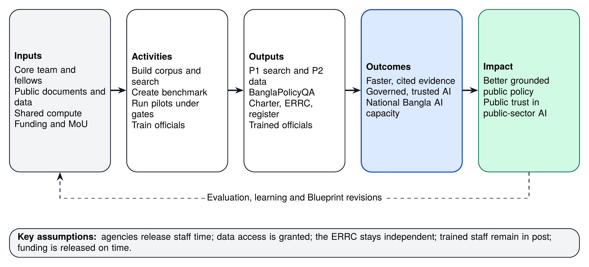

*Figure 14. Theory of change: from inputs to impact, with key assumptions and a learning loop.*

## 18.2 Logical Framework

The logical framework, following the standard logical framework approach [113], sets out the results chain with indicators, means of verification and assumptions for each level.

**Table 53.** Logical framework (36-month programme)

| Level | Narrative summary | Indicators | Means of verification | Assumptions |
|------------|--------------------------|--------------------------|-------------------|----------------------|
| **Impact** | Public policy in Bangladesh is better grounded in evidence, and AI in the public sector is trusted and well governed | Official documents citing BAPIL evidence; trust measures in user surveys | Document analysis; independent evaluation | Political commitment to evidence-based policy continues |
| **Outcome 1** | Officials and researchers find and cite authoritative evidence faster and more reliably | Time saved on evidence search; monthly active users | Time-to-evidence studies; usage logs | Agencies release staff time for pilots |
| **Outcome 2** | AI systems in BAPIL’s scope are governed transparently and safely | 100% registered; serious incidents handled in time | Transparency register; incident records | ERRC remains independent and resourced |
| **Outcome 3** | National capacity in Bangla policy AI grows | Officials trained; fellows; open datasets reused | Training records; download and citation counts | Trained staff stay in relevant posts |
| **Output 1** | Policy search and budget dataset piloted with users | Pilots passing G3; Recall@10 | Gate records; benchmark reports | Data access granted on time |
| **Output 2** | Open benchmark, corpus and evaluation methods published | Benchmark questions; releases with DOIs | Zenodo and GitHub records | Annotators available |
| **Output 3** | Governance system operational | Charter adopted; ERRC decisions published | Board minutes; register | Members nominated on time |
| **Output 4** | Officials and specialists trained | Officials trained by programme | Attendance and assessment records | Agencies nominate participants |
| **Activities** | Workplan of Chapter 15 and the work packages of the pilots | Milestones MS1 to MS9 | Progress reports | Funding released as planned |

## 18.3 Key Performance Indicators

**Table 54.** Monitoring and evaluation framework: key performance indicators

| Level | Indicator | Baseline | Month 12 | Month 36 |
|------------|-------------------------------------|-----------|------------|------------|
| Input | Core staff in post (FTE) | 0 | 9 | 19 |
| Input | Public documents indexed with full provenance | 0 | 5,000 | 25,000 |
| Output | BanglaPolicyQA benchmark questions released | 0 | 500 | 2,000 |
| Output | Pilots that passed Gate G3 | 0 | 2 | 5 |
| Output | Open releases archived with a DOI (including this Blueprint) | 3 | 5 | 10 |
| Output | Officials trained in responsible AI and the tools | 0 | 100 | 500 |
| Outcome | Monthly active pilot users | 0 | 30 | 300 |
| Outcome | Median time saved on evidence search, measured in time-to-evidence studies (Annex R) | Baseline study | 30% | 50% |
| Outcome | Agencies with signed data or collaboration agreements | 0 | 3 | 10 |
| Quality | Recall@10 on Bangla and English questions | Not yet measured | 0.85 | 0.90 |
| Governance | Pilots listed in the transparency register with model cards | Not applicable | 100% | 100% |
| Governance | Serious incidents (all handled within agreed time limits) | Not applicable | 0 | 0 |
| Impact | Official documents or policy briefs citing BAPIL evidence | 0 | 5 | 30 |

The indicators at months 12 and 36 are proposed targets, consistent with the long-term targets in Table 46, which extend them to 2041. Each is measured by the methods below and, for quality indicators, by the protocol in Annex R.

## 18.4 Methods

* **Benchmark evaluation** for quality indicators, on frozen benchmark versions.
* **Time-to-evidence studies** comparing matched tasks with and without the tools.
* **User surveys and interviews** each quarter during pilots.
* **Document analysis** to identify official documents and policy briefs that cite BAPIL evidence.
* **Independent evaluation** at months 18 and 36 by evaluators without a stake in BAPIL, and at each long-term review.
* **Usage statistics** from the audit logs, reported only in aggregate; individual users’ queries are never reported.

## 18.5 Evaluation Questions

The independent evaluations at months 18 and 36, and the long-term reviews, use the OECD DAC evaluation criteria of relevance, coherence, effectiveness, efficiency, impact and sustainability [114], adapted to BAPIL:

* **Relevance:** do the pilots address real policy needs, as judged by host agencies and users?
* **Coherence:** does BAPIL complement the national AI policy, the AI Hub and other programmes, or duplicate them?
* **Effectiveness:** did the pilots meet their exit criteria, and did users find and cite evidence faster and more reliably?
* **Efficiency:** were resources used economically, and how do costs per output compare with alternatives?
* **Impact:** is there evidence that policy documents are better grounded, and that trust in public-sector AI has grown?
* **Sustainability:** will adopted tools, open datasets and trained people continue to deliver value without project funding?

Each evaluation also asks a governance question: did the tiers, gates and ERRC work as designed, and were any safeguards bypassed?

## 18.6 Learning and Publication

Evaluation reports are published with DOIs, including negative results. Each pilot ends with a short “what we learned” note covering what worked, what failed and what should change in the next Blueprint version. Lessons feed directly into the strategic reviews (Table 48) and into revisions of this Blueprint.

\newpage

# Chapter 19: Risk Management

## 19.1 Approach

The risk register is owned by the Director, reviewed quarterly by the Steering Board, and published in summary. Each risk has a likelihood and impact rating, mitigations and an owner. The heat map below shows the eighteen registered risks, including long-horizon risks such as technology obsolescence and climate-related disruption.

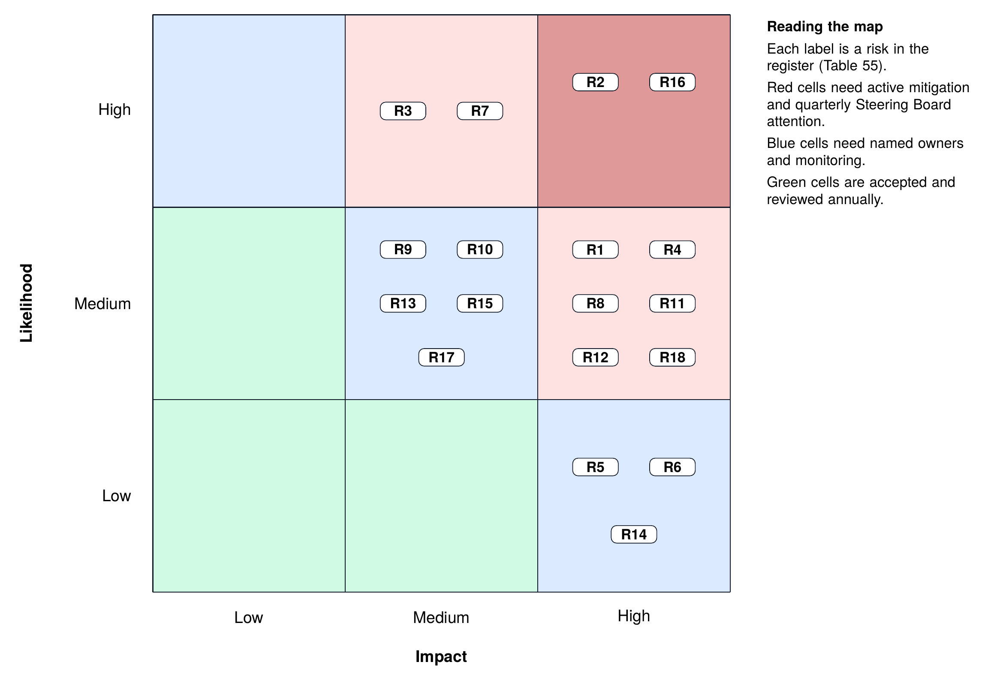

*Figure 15. Risk heat map of the eighteen registered risks by likelihood and impact.*

## 19.2 Risk Register

**Table 55.** Risk register

| ID | Risk | Likelihood | Impact | Mitigation | Owner |
|------|-------------------------|----------|--------|---------------------------------|--------------|
| R1 | Political or institutional change shifts priorities | M | H | Institution-neutral design; university host; alignment with the national AI policy process; cross-party briefings | Director, Steering Board |
| R2 | Delays in data access, including bulk document export | H | H | Start with documents already public; NRDEX agreements; RTI requests as fallback | Data lead |
| R3 | Poor text quality from scanned Bangla PDFs | H | M | OCR evaluation; human correction loops; prioritise born-digital sources | ML lead |
| R4 | Incorrect answers mislead officials | M | H | Extractive-first answers; mandatory citations; abstention; training; classes R and A only | ML lead, ERRC |
| R5 | Privacy breach or misuse of personal data | L | H | P0-first; DPIA; access control; independent audits | Security lead, governance analyst |
| R6 | Mission creep toward surveillance | L | H | T0 list in charter; ERRC veto; public transparency register | ERRC |
| R7 | Talent shortage or loss of staff | H | M | Fellowships; diaspora partnerships; competitive terms; remote collaboration | Director |
| R8 | Funding gaps between phases | M | H | Diversified funding (White Paper Appendix C); phased commitments | Steering Board |
| R9 | Duplication with the AI Hub or other initiatives | M | M | MoU on division of labour; shared benchmarks and data | Director |
| R10 | Vendor or model lock-in | M | M | Open standards; open-weight models; portable containers; code in national repository | Platform lead |
| R11 | Cyber attack on the platform | M | H | NIST CSF 2.0 controls; penetration tests; offline backups and restore drills | Security lead |
| R12 | Low adoption by officials | M | H | Co-design with users; training; measure time saved; product owners in agencies | Policy lead |
| R13 | Legal uncertainty while implementing rules are issued | M | M | Legal review; conservative data scope; update procedures as rules are published | Governance analyst |
| R14 | Tools or outputs misused for misinformation or partisan purposes | L | H | Access control for official tools; no synthetic media generation; usage policy; audit logs; public register | ERRC |
| R15 | Benchmark contamination or overfitting to the test set | M | M | Private held-out test split; versioned freezing; periodic refresh; report on several sets | ML lead |
| R16 | Dependence on a few key people | H | H | Documentation and open code; deputies for key roles; succession plan; shared ownership with the host | Steering Board |
| R17 | Technology obsolescence over the long horizon | M | M | Modular design and ADRs; model re-selection at reviews; investment in data and evaluation rather than one model | TAB |
| R18 | Floods, cyclones, power or network outages affecting hosting | M | H | Disaster-recovery site; offline backups; recovery targets of Table 35; low-bandwidth design | Platform lead |

*Note.* L = low, M = medium, H = high. The register is reviewed quarterly by the Steering Board. Early-warning indicators, contingencies, residual ratings and review frequencies are given in Annex U (Table 67).

For each risk, Annex U (Table 67) adds an early-warning indicator, a contingency if the risk occurs, a residual rating after mitigation and a review frequency.

## 19.3 Priority Risks

Four risks deserve particular attention. **Data access (R2)** is the most likely cause of delay; starting with already-published documents means that useful work can begin even if formal agreements take time. **Key-person dependency (R16)** is a serious risk for any small, new institution; documentation, deputies and shared ownership reduce it. **Incorrect answers (R4)** are the most serious technical risk; extractive answering, mandatory citations, abstention and class A use reduce it to a level that can be managed through training and monitoring. **Mission creep (R6)** is unlikely but would be very damaging to public trust; the charter’s prohibited-use list, the ERRC veto and the public transparency register are designed to make it visible and preventable.

## 19.4 Risk Appetite

BAPIL’s risk appetite differs by area. It has a **low appetite** for risks to privacy, rights and public trust, which are controlled by strict boundaries and the ERRC veto. It has a **moderate appetite** for delivery and technical risks, accepting that some pilots will fail and treating failure as information. It has a **higher appetite** for research risk, since exploring methods that may not work is part of its mission, provided the research is safe and its results are published.

## 19.5 Escalation

Risks whose rating rises to high likelihood and high impact are escalated to the Steering Board within one month. Any risk involving potential harm to individuals or rights is escalated to the ERRC immediately. Event triggers in Table 48 lead to an extraordinary review of the register.

\newpage

# Chapter 20: Research Agenda and Knowledge Outputs

## 20.1 Research as a Core Function

BAPIL is designed as a research institution as well as a builder of tools. Its research agenda would serve three purposes: to answer questions that matter for the design of its own systems; to contribute open knowledge on Bangla language technology and public-sector AI governance; and to build national research capacity. Research questions are chosen where BAPIL’s position (access to real policy tasks, a governed corpus and a functioning governance system) allows it to produce evidence that others cannot.

## 20.2 Research Questions

**Table 56.** Research agenda and planned knowledge outputs

| ID | Research question | Method | Planned output | Timing |
|-------|------------------------------|----------------------|------------------------|-----------|
| RQ1 | How well do lexical, dense and hybrid retrieval perform on Bangla and English policy text, and what closes the gap between the two languages? | Benchmark experiments on BanglaPolicyQA; ablations of normalisation and glossary expansion | Benchmark and methods paper; open code and data | 2027 to 2028 |
| RQ2 | Can abstention and citation verification be calibrated so that officials see few unsupported claims without losing useful answers? | Threshold studies; human judgement of faithfulness | Evaluation paper; calibration guidance | 2027 to 2029 |
| RQ3 | Do cited-search tools change the speed and quality of policy analysis? | Matched-task studies with pilot users; interviews | Empirical study of time-to-evidence and quality | 2028 to 2029 |
| RQ4 | How can risk tiering, gates and transparency registers be made to work in a public administration with new data laws? | Design science and case study of BAPIL governance | Peer-reviewed journal article on the Blueprint framework; policy brief | Manuscript 2027 |
| RQ5 | How do OCR quality and Unicode normalisation affect downstream retrieval in Bangla? | Controlled experiments on scanned and born-digital documents | Dataset of corrected text with datasheet; short paper | 2028 |
| RQ6 | What institutional form sustains a public-interest AI policy lab in a lower-middle-income country? | Comparative institutional analysis; evaluation evidence | Institutional review for Blueprint 2.0 | 2029 |

*Note.* Outputs are published open access with DOIs. Journal choice follows scope, open-access options and peer-review quality; no outcome of peer review is assumed.

## 20.3 Publication Plan

\looseness=-1 Research outputs are published open access with DOIs: datasets and benchmarks on Zenodo with datasheets; code on GitHub; evaluation reports in the BAPIL series; and peer-reviewed articles in journals and conferences chosen for their scope, open-access options and quality of review. A first journal manuscript, based on this Blueprint and its reference implementation, is planned for 2027; it will present the framework, the design rationale and the demonstration results, and will be submitted to a peer-reviewed journal in the field of AI and public policy or digital government. The outcome of peer review is not assumed in any plan.

## 20.4 Research Ethics

\enlargethispage{\baselineskip}
\looseness=-1 All research involving people (surveys, interviews, user studies) is approved by the host institution’s research ethics committee and, where relevant, the ERRC. Participation is voluntary and informed, data is minimised and de-identified, and results are reported in aggregate. Research on information integrity follows the specific protocol required for pilot P6.

\newpage

# Chapter 21: Decisions Requested and Next Steps

## 21.1 Decisions

**Table 57.** Decisions requested from the relevant authorities

| No. | Decision | Responsible authority | Timing |
|------|--------------------------------------------|------------------------|-------------|
| D1 | Accept this Blueprint as a technical input to the national AI policy drafting process | Ministry of Posts, Telecommunications and Information Technology (ICT Division) | Q4 2026 |
| D2 | Approve a 12-month Phase 1 pilot, name a government focal point, agree an MoU with a host institution, and commit or identify Year 1 funding (about Tk 4.7 crore, Table 50) | ICT Division and host institution | Within 90 days |
| D3 | Authorise structured bulk access to already-public document collections and nominate data custodians | Legislative and Parliamentary Affairs Division, Finance Division, Planning Commission, BBS, a2i | Within 120 days |
| D4 | Nominate Steering Board members, and agree that ERRC members are selected through an open call by an independent nominations panel | ICT Division and host institution (Steering Board); independent panel (ERRC) | Within 90 days |
| D5 | Commission the feasibility and costing study that sets the Phase 2 budget | ICT Division or a development partner | By month 6 |
| D6 | Confirm guardrails: no deployment beyond class A without a G4 decision, and no use in prohibited categories | Steering Board | At charter adoption |

*Note.* None of these decisions creates a statutory body or gives BAPIL legal powers. The approvals and agreements needed before month 1 are listed in Annex T (Table 65).

## 21.2 What Happens After the Decisions

When decisions D1, D2 and D4 are taken and the MoU, host agreement and Year 1 funding are in place (Annex T), the 90-day plan in Section 15.4 can start. Decision D3 unlocks the full P1 corpus; without it, P1 can still begin on documents already downloadable from official websites. Decision D5 sets the budget for Phase 2. Decision D6 ensures that the safeguards in this Blueprint are binding from the first day.

## 21.3 Immediate Next Steps (Q4 2026 to Q1 2027)

While the decisions are considered, the following steps can proceed without commitment of public funds:

* publication of this Blueprint, the Summary and the reference implementation with persistent identifiers;
* briefings for the ICT Division, the data custodians and the national AI policy drafting team, with the Blueprint offered as a technical input;
* expert roundtables and a public comment period, with a published comment log feeding into Blueprint 1.1 (Table 8);
* preparation of the host-institution call, the draft charter and the terms of reference for consultation (Annexes E to G);
* preparation of a peer-reviewed journal manuscript presenting the framework and its reference implementation (Chapter 20).

## 21.4 Conclusion

Bangladesh has the data foundations, the institutions and the talent to build a trustworthy AI policy-intelligence capability, and it is now putting in place the legal framework and national AI policy within which such a capability must operate. This Blueprint shows how to start small, safely and openly: with public documents, a bilingual search and answer service that always shows its sources, a governance system with real decision rights, and pilots that must prove their value before they grow. It also shows how that start can grow, horizon by horizon, into a national capability that supports the 2041 goals, without ever relaxing the safeguards that make it trustworthy. The reference implementation shows that the core mechanisms can be built and tested on a small scale; whether they help officials with real policy questions is what the pilot is designed to find out. That next step belongs to the authorities and partners who can decide to test them.

\newpage

# Annex A: Requirements Traceability Matrix

**Table 58.** Requirements traceability matrix

| Requirement | Summary | Component | Code module | Verification |
|----------|------------------------------|----------|-------------------|----------------|
| FR-01 | Bilingual search | C2, C4 | bapil.text, bapil.search | test_text, test_search |
| FR-02 | Cited answers and abstention | C5 | bapil.answer | test_answer |
| FR-03 | Provenance at ingestion | C2, C3 | bapil.corpus | test_corpus |
| FR-04 | Dashboards | C6, C7 | Specified only | Pilot P2 acceptance |
| FR-05 | Aggregate feedback analysis | C6 | Specified only | Pilot P3 DPIA and acceptance |
| FR-06 | AI system register | C12 | bapil.registry | test_registry |
| FR-07 | Risk-tier assessment | C12 | bapil.risk | test_risk |
| FR-08 | Evaluation harness | C11 | bapil.evaluate | test_evaluate |
| FR-09 | Transparency register | C12 | bapil.registry (export) | test_registry |
| FR-10 | Versioned API | C8 | bapil.api | test_api |
| NFR-01 | Language parity | C2, C4 | bapil.text glossary and normaliser | test_text; benchmark |
| NFR-07 | Reproducibility | All | CI workflow; no external dependencies | GitHub Actions |
| NFR-08 | Explainability | C5 | bapil.answer (sources and scores) | test_answer |
| GR-02 | Gate before build | C12 | bapil.risk | test_risk |
| GR-04 | Tamper-evident logs | C10 | bapil.audit | test_audit |
| GR-06 | Prohibited uses | C12 | bapil.risk (T0 screen) | test_risk |

Requirements not listed here are verified through pilot acceptance criteria (Table 38), security testing (Chapter 10) or governance review (Chapter 13).

\newpage

# Annex B: Risk-Tier Questionnaire

## B.1 Prohibited-Use Screening

Answer *yes* or *no*. Any *yes* places the system in tier T0, and work stops.

1. Does the system score or rank individuals for general social trustworthiness or behaviour (social scoring)?
2. Does it perform mass or indiscriminate biometric identification or surveillance?
3. Does it infer or profile individuals’ political opinions, religious beliefs or similar protected characteristics?
4. Does it generate deceptive synthetic media depicting real people?
5. Does it use manipulative techniques that exploit vulnerabilities such as age, disability or economic hardship?

## B.2 Scored Dimensions

**Table 59.** Risk-tier questionnaire: scored dimensions (Annex B)

| Code | Dimension | Score 0 | Score 1 | Score 2 | Score 3 |
|------|-------------------|---------------|---------------|---------------|---------------|
| D1 | Influence on decisions | Research only | Informs analysts | Informs official decisions on policies or programmes | Informs or automates decisions about specific people or entities |
| D2 | Data sensitivity | P0 public | P1 internal, non-personal | P2 personal | P3 sensitive personal or restricted |
| D3 | People potentially affected | None or internal | Fewer than 10,000 | 10,000 to 1 million | More than 1 million |
| D4 | Reversibility of harm | Trivially reversible | Reversible with effort | Hard to reverse | Irreversible |
| D5 | Degree of automation | Suggestions on request | Person reviews every output | Person reviews samples | Fully automated |
| D6 | Vulnerability of affected groups | No affected individuals | General public | Includes vulnerable groups | Targets vulnerable groups |
| D7 | Exposure | Internal researchers | Officials | Public information | Public guidance with consequences |

*Note.* Tier rules: any prohibited-use flag gives T0. Otherwise T3 if total at least 13, or D1 = 3, or D2 = 3, or both D2 and D3 at least 2; T2 if total at least 6, or D1 = 2, or D7 at least 2; else T1. Implemented in bapil.risk.

## B.3 Tiering Rules

1. Any *yes* in B.1 gives **T0 Prohibited**.
2. Otherwise, the system is **T3 High** if the total score is 13 or more, or D1 = 3, or D2 = 3, or both D2 and D3 are 2 or more.
3. Otherwise, the system is **T2 Limited** if the total score is 6 or more, or D1 = 2, or D7 is 2 or more.
4. Otherwise, the system is **T1 Low**.

\looseness=-1 The rules are implemented in `bapil.risk` and tested against the examples in `implementation/examples/risk/`, including a prohibited social-scoring example (T0) and a benefit-eligibility example (T3).

## B.4 Worked Example: Pilot P1 in Class A Use

\enlargethispage{\baselineskip}
\looseness=-1 Scores: D1 = 2 (informs official decisions on policies), D2 = 0 (public documents), D3 = 0 (no individuals affected), D4 = 1, D5 = 1 (person reviews every output), D6 = 0 (no individuals affected), D7 = 1 (officials). Total = 5. No high-risk condition applies; because D1 = 2, the result is **T2 Limited**, requiring ERRC review, red-team testing, human review of every output and user training. The same system used only by BAPIL researchers (D1 = 1, D7 = 0) scores 3 and is **T1 Low**. This calculation is reproduced by `python -m bapil.cli assess examples/risk/risk_p1_policy_search.json`.

\newpage

# Annex C: Templates

## C.1 AI System Record (summary of fields)

| Field | Description |
|---|---|
| `system_id` | Unique identifier, for example `BAPIL-P1` |
| `name` | Name in English and Bangla |
| `purpose` | What the system is for and what it is not for |
| `owner` | Accountable person and unit; host-agency product owner if any |
| `maturity_class` | R, A or O |
| `risk_tier` | T0 to T3, with the date and reference of the latest assessment |
| `data_classes` | Data classes used (P0 to P3) |
| `models` | Models and versions, with links to model cards |
| `evaluation` | Benchmark version and headline results |
| `gate_status` | Latest gate passed and date |
| `oversight` | Human oversight patterns applied (Table 40) |
| `limitations` | Known limitations and failure modes |
| `contact` | How to report a problem or complaint |

The full JSON schema is `implementation/schemas/ai_system_record.schema.json`.

## C.2 Model Card (headings)

Model details; intended use and out-of-scope uses; training and adaptation data; evaluation data and results by language; fairness and robustness analysis; limitations and risks; ethical considerations; environmental and compute cost; versioning and contact [85].

## C.3 Datasheet for a Dataset (headings)

Motivation (why the dataset was created and by whom); composition (what it contains, data classes, languages, known gaps); collection process (sources, dates, reuse terms); preprocessing (extraction, OCR, normalisation, de-identification); uses (intended and not recommended); distribution (licence, DOI); maintenance (owner, update schedule, how errors are reported) [81].

## C.4 Incident Report (headings)

Reference number; date and time; system and version; reporter (optional); description; affected users or groups; severity (Table 34); immediate action; root cause; corrective action; ERRC review; public summary.

## C.5 Evaluation Report (headings)

System and version; benchmark version and split; metrics by language and document type (Table 28); comparison with the previous release and with thresholds; error analysis with examples; red-team and security results; known limitations; recommendation for the next gate.

\newpage

# Annex D: Publication, Versioning and DOI Policy

1. **Separate records per publication.** The White Paper, Executive Summary and this Blueprint each have their own Zenodo record and DOI. The Blueprint record contains the English and Bangla Blueprint and Summary, in PDF and Markdown, plus figures and tables in LaTeX, PDF and PNG.
2. **Related identifiers.** The Blueprint record declares that it *is supplement to* the White Paper (10.5281/zenodo.21363967), *references* the Executive Summary (10.5281/zenodo.21441172) and *is supplemented by* the GitHub repository release that contains the reference implementation.
3. **DOI reservation.** When the Zenodo record is created, its DOI is reserved before the record is published so that it can be printed in the documents; the PDFs are then rebuilt and uploaded. Until then the documents state that the DOI is to be assigned on publication.
4. **Repository releases.** Repository releases use semantic versioning. Release v1.1.0 adds the Blueprint and the reference implementation. The Zenodo record for this Blueprint is published only after that release is publicly listed at <https://github.com/md-naim-hassan-saykat/bapil/releases>, so that every artefact the documents refer to can be checked by readers.
5. **New versions.** Corrections produce a new version of the same Zenodo record (for example 1.0.1); substantive revisions produce Blueprint 2.0 (Milestone MS9).
6. **Licences.** Documents are CC BY 4.0; code is MIT.
7. **Language precedence.** The English edition is authoritative. Where the Bangla edition differs in interpretation, the English edition prevails.

\newpage

# Annex E: Draft BAPIL Charter

This draft is offered for adoption by the Steering Board at Milestone MS1, after consultation (Table 8). It is confirmed or amended after the independent legal review (Section 14.3), which is completed before Milestone MS2.

**Article 1. Name and status.** The Bangladesh AI Policy & Innovation Lab (BAPIL) is a research, policy-intelligence and capacity-building initiative hosted by [host institution] under a Memorandum of Understanding with the ICT Division.

**Article 2. Mission.** BAPIL helps Bangladesh use artificial intelligence for evidence-based policymaking, responsible AI governance, Bangla-language technology and public-sector innovation, through open research, tools, methods and training.

**Article 3. Boundaries.** BAPIL does not make policy, regulate, perform operational security functions or operate production government systems. It works with public data first, provides advice and not decisions, and never builds or supports surveillance.

**Article 4. Prohibited uses.** BAPIL will not build, pilot, evaluate for deployment or otherwise support any system for social scoring; mass or indiscriminate biometric identification or surveillance; profiling of political opinions, religious beliefs or similar protected characteristics; deceptive synthetic media depicting real people; or manipulation that exploits vulnerabilities.

**Article 5. Governance.** BAPIL is governed by a Steering Board, an independent Ethics and Risk Review Committee (ERRC) and a Technical Architecture Board, with the composition and powers set out in their terms of reference (Annexes F and G).

**Article 6. The ERRC veto.** No system of tier T2 or above may pass Gates G2 or G4 without the approval of the ERRC. ERRC decisions to refuse or suspend are binding and can be reversed only by the ERRC itself.

**Article 7. Registration and transparency.** Every AI system is registered before work begins. A public transparency register lists each system’s purpose, owner, tier, maturity class, data classes, evaluation summary, limitations and complaint contact.

**Article 8. Openness.** Code, benchmarks, evaluation reports and non-sensitive data are published openly with persistent identifiers. Exceptions for security or privacy are recorded in writing and reviewed annually.

**Article 9. Data protection.** BAPIL complies with the Personal Data Protection Act, 2026, the National Data Management Act, 2026 and related rules, and applies the data classification and safeguards of this Blueprint, which may be stricter than the law requires.

**Article 10. Independence and integrity.** Researchers decide methods and publish results. No funder may control research results or governance decisions. Conflicts of interest are declared and managed.

**Article 11. Transfer and withdrawal.** Tools that pass Gate G4 are transferred to agency ownership with documentation and support. BAPIL withdraws from any activity that conflicts with this charter.

**Article 12. Review and amendment.** The charter is reviewed at each strategic review (Table 48). Amendments require a two-thirds majority of the Steering Board after consultation with the ERRC; Articles 3, 4 and 6 can be weakened only after public consultation.

**Article 13. Precedence of law.** This charter operates within the law of Bangladesh and the rules of the host institution. Nothing in it overrides a statute, a regulator’s powers or the host’s legal obligations; where they conflict, the legal requirement prevails and the Steering Board amends the charter.

\newpage

# Annex F: Terms of Reference of the Ethics and Risk Review Committee

**Purpose.** To provide independent review of the ethical, legal and societal risks of BAPIL’s AI systems and research, and to hold a binding veto over tier T2 and T3 work.

**Composition.** Five to seven members, a majority external to BAPIL and the host institution, covering law and human rights, data protection, ethics, the relevant policy domains, Bangla language and civil society, with gender balance. The chair is an external member elected by the members. Members serve three-year terms, renewable once.

**Appointment and removal.** Members are selected through a published open call by an independent nominations panel (Annex S) and confirmed by the Steering Board, which may decline a nominee only with written reasons. Government bodies may propose candidates but may not hold a majority of seats. A member can be removed only for cause, by a two-thirds vote of the Steering Board after a hearing.

**Status.** The ERRC is created by the charter and the host agreement. Its decisions bind BAPIL by the charter and bind the host to the extent the host’s statutes allow and the host agreement provides (Section 5.3); it has no statutory powers and does not replace any regulator or the oversight committee proposed in the draft national AI policy.

**Responsibilities.**

* Review tier T2 and T3 systems at Gates G1, G2 and G4, and any reclassification of P2 data.
* Review serious incidents and decide on suspension.
* Approve research protocols involving people or sensitive topics, including P6.
* Advise the Steering Board on charter amendments and on the risk register.
* Publish summaries of its decisions within thirty days.

**Powers.** The ERRC may approve, approve with conditions, refuse or suspend. Refusal and suspension are binding. The ERRC may commission independent expert advice within its budget.

**Procedure.** The ERRC meets at least quarterly and as needed for gate reviews. A quorum is a majority of members including at least two external members. Decisions are taken by consensus where possible and otherwise by majority; dissenting opinions are recorded. Members declare conflicts and withdraw from related decisions.

**Resources.** The ERRC has a secretariat provided by the governance analyst and a budget for honoraria and expert advice, protected in the annual plan.

\newpage

# Annex G: Terms of Reference of the Steering Board and the Technical Architecture Board

## G.1 Steering Board

**Purpose.** To set BAPIL’s strategy, approve its plans and budgets, and hold its leadership to account.

**Composition.** Seven to nine members: the ICT Division (co-chair), the host institution (co-chair), the Planning Commission, a data custodian agency, an academic member from another university, a civil-society member and an industry member, with at least one member from outside Dhaka and with gender balance. The Director attends without a vote.

**Responsibilities.** Adopt the charter; approve the annual plan and budget; approve partnerships and senior appointments; take G4 adoption decisions jointly with host agencies; review the risk register quarterly; conduct the strategic reviews in Table 48.

**Procedure.** Meets quarterly; quorum of a majority including both co-chairs or their delegates; minutes published in summary.

## G.2 Technical Architecture Board

**Purpose.** To ensure that BAPIL’s systems are well designed, secure, interoperable and maintainable.

**Composition.** BAPIL’s lead engineers, the security lead and two external technical reviewers.

**Responsibilities.** Set architecture and security standards; approve designs at G1; approve models and major dependencies; maintain architecture decision records; review security test results.

**Procedure.** Meets monthly and as needed for design reviews; decisions recorded as ADRs in the repository.

\newpage

# Annex H: Data Protection Impact Assessment Template

A DPIA is required before any processing of P2 data and is recommended for any new use of P1 data.

1. **Description of processing.** Purpose; data subjects; categories of data; sources; recipients; retention; systems used.
2. **Lawful basis.** Basis under the Personal Data Protection Act, 2026; consent wording and records where consent is the basis.
3. **Necessity and proportionality.** Why the data is needed; why less sensitive data would not work; minimisation measures.
4. **Rights of data subjects.** How access, correction, deletion and objection are handled; confirmation that no automated decisions are made about individuals.
5. **Risks to individuals.** Re-identification, disclosure, misuse, discrimination, chilling effects; likelihood and severity of each.
6. **Measures.** De-identification method; aggregation thresholds; access control; encryption; retention and deletion; staff training.
7. **Residual risk and decision.** Remaining risks after measures; recommendation; approval by the governance analyst and the ERRC; review date.
8. **Consultation.** Views of the data custodian, the data protection officer of the host institution and, where appropriate, representatives of data subjects.

\newpage

# Annex I: Outline of a Data-Sharing Agreement

1. **Parties and contacts.**
2. **Purpose.** The specific research or pilot purpose; prohibition of other uses.
3. **Data description.** Datasets, fields, period, format, data class (Table 22).
4. **Legal basis.** Applicable provisions of the 2026 Acts and any rules; use of the national data exchange where available.
5. **Security.** Controls required (Table 32), hosting in Bangladesh, access list.
6. **Outputs.** Permitted outputs (for example, aggregate results only), review of outputs before publication, attribution.
7. **Retention and deletion.** Retention period (Table 26), deletion method and certificate.
8. **Audit and reporting.** Custodian’s right to audit; incident notification within 24 hours.
9. **Intellectual property and licensing.** Ownership of source data and of derived outputs; open licensing of BAPIL outputs where permitted.
10. **Term, review and termination.**
11. **Transparency.** Listing of the agreement, without confidential details, in the transparency register.

\newpage

# Annex J: Gate Checklists

## G0 Register and screen

* AI system record created in the register.
* Prohibited-use screening completed; no *yes* answers.
* Tier assessment completed (Annex B) and recorded.
* Owner and product owner named.

## G1 Design review

* Data plan with data classes and sources; reuse terms recorded.
* DPIA approved where P2 data is involved.
* Architecture reviewed and approved by the TAB; threat model includes AI-specific risks (Table 33).
* Evaluation plan with benchmark version and thresholds.
* ERRC review completed for tier T2 and T3.

## G2 Pre-pilot readiness

* Benchmark results meet the thresholds in Table 28.
* Red-team and security tests passed; findings resolved or accepted.
* Model card and datasheets published.
* User training materials ready; incident procedure in place.
* ERRC approval for tier T2.
* Single sign-on with MFA and roles, and the production audit store, in operation.

## G3 Pilot

* Pilot users enrolled and trained; human oversight patterns applied (Table 40).
* Monitoring and audit logging active; incidents reviewed monthly.
* User feedback and time-to-evidence data collected.
* Pilot report with results against exit criteria.

## G4 Adoption decision

* Independent evaluation completed and published.
* Host agency acceptance; agency legal review completed.
* Operating, support and funding arrangements agreed; transfer plan approved.
* Joint decision by the Steering Board and the host agency; ERRC approval for tier T2.

## G5 Update or retire

* Change assessed; re-evaluation completed on the current benchmark.
* Register and model card updated.
* For retirement: users informed, data retained or deleted per schedule, archive created.

\newpage

# Annex K: BanglaPolicyQA Annotation Guidelines (Summary)

1. **Question writing.** Questions are written by domain experts from real analyst tasks, in natural Bangla or English, including some romanised Bangla and variant spellings. Each answerable question should have a clear answer in the corpus. Out-of-scope questions, for testing abstention, are written as a separate set (200 in version 0) and need no gold passages.
2. **Gold passages.** A second annotator, who did not write the question, finds the passage or passages that answer it and records their identifiers. A passage is gold only if it alone supports the answer.
3. **Graded relevance.** Passages are marked 2 (fully answers), 1 (partly answers or provides necessary context) or 0 (not relevant).
4. **Adjudication.** Disagreements are resolved by a third annotator; agreement rates are reported in the datasheet.
5. **Balance.** The question set is balanced across languages, document types (laws, plans, budgets, statistics) and issuing bodies, and covers different periods.
6. **Quality control.** A random 10% of items is re-annotated each version; items with errors are corrected and logged.
7. **Ethics and licensing.** Annotators are paid fairly and credited; questions contain no personal data; the benchmark is released under CC BY 4.0 with source attribution.
8. **Splits and freezing.** Each version has a public development split and a private test split; versions are frozen and archived with a DOI.

\newpage

# Annex L: Glossary

| Term | Meaning in this Blueprint |
|---|---|
| Abstention | The system’s refusal to answer when the evidence is insufficient, with the closest sources and the reason shown |
| Adoption decision (G4) | The decision to transfer a tool to agency ownership as a class O system, or to stop |
| AI system register | The internal record of every AI system, from which the public transparency register is generated |
| BanglaPolicyQA | BAPIL’s open benchmark of policy questions in Bangla and English with gold passages |
| Citation precision | The share of answer sentences whose cited passage fully supports the sentence, as judged by trained annotators |
| Corpus version | An identifier of the exact set of documents and passages used for a result, enabling reproduction |
| Data class | The sensitivity class of data, from P0 (public) to P3 (sensitive personal data) |
| Extractive answer | An answer made of sentences selected from source passages, each with its citation |
| Gate | A documented decision point (G0 to G5) that a system must pass to move forward |
| Horizon | A period of the strategic roadmap (H0 to H4, and beyond 2041) |
| Maturity class | The status of a system: R (research), A (advisory) or O (operational, agency-owned) |
| Passage | A short section of a document, the unit of search and citation |
| Product owner | A named official in a host agency who defines needs and accepts or rejects a pilot |
| Risk tier | The level of risk of a system, from T0 (prohibited) to T3 (high), which sets the required controls |
| Transparency register | The public list of BAPIL’s AI systems with their purpose, tier, evaluation and limitations |

\newpage

# Annex M: Walkthrough of the Reference Implementation

This annex shows, step by step, what the reference implementation does with a question. It uses the two small test documents in `implementation/tests/fixtures/` (a sample policy note in English and its Bangla counterpart), so that the results are short, stable and can be reproduced exactly by anyone with the repository.

## M.1 A Cited Answer in English

```bash
python -m bapil.cli ask --corpus tests/fixtures --log build/audit.jsonl \
  "When is a data protection impact assessment required?"
```

```text
Q: When is a data protection impact assessment required?
Confidence: high
1. A data protection impact assessment is required before any processing
   of personal data at scale. [policy_en#p1]
2. বৃহৎ পরিসরে ব্যক্তিগত উপাত্ত প্রক্রিয়াকরণের আগে প্রভাব মূল্যায়ন আবশ্যিক। [policy_bn#p1]
3. Personal data may be processed only on a documented lawful basis.
   [policy_en#p1]
Sources:
  - [policy_en#p1] Sample Policy Note > Data Protection
  - [policy_bn#p1] নমুনা নীতি-নোট > উপাত্ত সুরক্ষা
```

Three features are visible. Every sentence carries the identifier of the passage it was taken from. The second sentence comes from the Bangla document, retrieved for an English question because the bilingual glossary links *data protection* with উপাত্ত সুরক্ষা and *impact assessment* with প্রভাব মূল্যায়ন. And the answer is extractive: each sentence appears word for word in the cited source.

## M.2 A Cited Answer in Bangla

```text
Q: বাজেট নথি কখন প্রকাশিত হয়?
Confidence: medium
1. প্রতি অর্থবছরে বাজেট নথি প্রকাশিত হয় যাতে নাগরিকেরা সরকারি ব্যয়
   অনুসরণ করতে পারেন। [policy_bn#p2]
2. জাতীয় বাজেটে মন্ত্রণালয়সমূহের জন্য অর্থ বরাদ্দ করা হয়। [policy_bn#p2]
3. ২০২৬ সালের বাজেটে নতুন বরাদ্দ রয়েছে। [policy_bn#p2]
Sources:
  - [policy_bn#p2] নমুনা নীতি-নোট > বাজেট স্বচ্ছতা
  - [policy_en#p2] Sample Policy Note > Budget Transparency
```

The Bangla question is answered from the Bangla passage, and the English passage on the same topic is listed among the sources. Confidence is reported as a band (high, medium or low) based on the evidence score and the share of query terms covered, not as a single number that could suggest false precision.

## M.3 Abstention

```text
Q: What is the boiling point of water in Kelvin?
ABSTAINED (no_matching_passages). Closest sources:
```

The question is outside the corpus, no passage matches, and the system says so instead of producing an answer. In the larger demonstration corpus, the system abstained correctly on all six out-of-scope questions (Section 11.5).

## M.4 The Machine-Readable Response

The same answer can be returned as JSON (option `--json`, or the `/v1/answer` endpoint of the API). An extract:

```text
{
 "question": "When is a data protection impact assessment required?",
 "abstained": false,
 "confidence": "high",
 "evidence": {"top_score": 7.881, "coverage": 1.0},
 "answer": [
  {"text": "A data protection impact assessment is required before ...",
   "citation": {"pid": "policy_en#p1", "doc_id": "policy_en",
                "heading": "Sample Policy Note > Data Protection"}},
  ...
 ],
 "sources": [
  {"pid": "policy_en#p1", "lang": "en", "score": 7.8812,
   "matched_terms": ["assessment", "data", "impact", "protection", "required"],
   "provenance": {"path": "tests/fixtures/policy_en.md",
                  "sha256": "b85002b0b751...", "data_class": "P0"}},
  ...
 ],
 "corpus_version": "3c204e06a617"
}
```

The response carries the evidence used to decide whether to answer, the terms that matched, the provenance of each source including its checksum and data class, and the corpus version. Together these allow any answer to be reproduced and audited later.

## M.5 The Audit Log

Each answer is written to an append-only log in which every record contains the hash of the previous one:

```text
{"hash":"760a77ff...","payload":{"abstained":false,
 "pids":["policy_en#p1","policy_bn#p1","policy_en#p1"],
 "q":"When is a data protection impact assessment required?"},
 "prev":"00000000...","ts":"...","type":"answer"}
```

```bash
python -m bapil.cli verify-log build/audit.jsonl
# build/audit.jsonl: 3 entries, chain intact
```

If any record is edited, deleted or reordered, verification fails and reports the first broken link. This is the mechanism behind requirement GR-04 and user story US-08.

## M.6 A Risk-Tier Assessment

```bash
python -m bapil.cli assess examples/risk/risk_p1_policy_search.json
```

```text
BAPIL-P1: T2 Limited (total 5)
  reason:   D1 = 2: informs official decisions on policies or programmes
  control:  All T1 controls
  control:  ERRC review
  control:  Red-team test
  control:  Human review of every output in use
  control:  User training
  control:  Incident procedure
  control:  Quarterly monitoring report
  approver: ERRC and Steering Board
```

The result reproduces the worked example in Annex B.4: the tier, the reason, the controls that become mandatory and the bodies that must approve.

\newpage

# Annex N: Contribution to the National AI Policy Elements

The draft National AI Policy 2026-2030 proposed several elements [10]. The table shows how BAPIL’s design could support each of them if they are retained in the final policy.

| Draft policy element | How BAPIL can contribute | Where in this Blueprint |
|---|---|---|
| Risk categories (prohibited, high, limited, low) | Operational tiering method with a questionnaire, rules and tested code | Chapter 13; Annex B |
| Algorithmic impact assessment for high-risk uses | Impact assessment template and worked examples; DPIA template | Annexes B and H |
| Independent oversight committee | Tested model of an ethics and risk committee with a binding veto and publication duty | Chapter 5; Annex F |
| Measures against false or misleading AI-generated content | Labelling (a BAPIL rule) and verification of generated text; research protocols for P6 | Section 13.8; Chapter 12 |
| Bangla-based national LLM | Open benchmark, governed corpus, evaluation protocol and an evidence-gated adaptation path | Chapter 9 |
| Centralised national compute | Modest pilot footprint and use of shared compute for adaptation | Chapter 10 |
| AI Innovation Fund | Open challenges and procurement clauses that keep markets open and fair | Chapter 17 |
| Skills and AI literacy | Competency framework, six training programmes and fellowships | Chapter 6 |
| Public-sector AI adoption | Gate-based path from pilot to agency ownership; transparency register | Chapters 12 and 13 |

\newpage

# Annex O: Indicative First-Year Work Plan for Pilot P1

| Months | Activities | Outputs | Gate |
|---|---|---|---|
| 1 to 2 | Appoint pilot lead and product owners; interview 15 to 20 analysts; register the system | User research summary; AI system record | G0 |
| 2 to 4 | Harvest laws, plans and budget documents; extraction and OCR; metadata and quality checks | Corpus release 0.1 with quality report | |
| 3 to 5 | Design review; threat model; evaluation plan; draft user interface in Bangla and English | Approved design; evaluation plan | G1 |
| 4 to 7 | Build search and answer services; bilingual glossary; portal; audit logging | Internal alpha | |
| 5 to 8 | Write and annotate BanglaPolicyQA v0 questions; baseline evaluation | Benchmark v0 (500 questions); baseline report | |
| 8 to 9 | Red-team and security tests; fix findings; train pilot users; ERRC review | Readiness evidence; model card | G2 |
| 9 to 12 | Pilot with 30 or more analysts in two to three agencies; monthly problem reviews; time-to-evidence study | Pilot report; user survey; Year 1 results | G3 |

\newpage

# Annex P: Evidence Status and Claim Verification

This annex records the evidence behind the Blueprint’s key factual claims, as checked on 21 and 22 October 2026, and how each claim is presented in the text. It uses nine status labels:

* **Verified fact:** confirmed against a primary or official source.
* **Source-reported fact:** reported by a credible secondary source but not independently confirmed against the primary text.
* **Research finding:** a result produced by the author’s own analysis or code, with its limits stated.
* **Author’s analysis:** a calculation or judgement by the author from stated inputs.
* **Design recommendation:** what the Blueprint proposes should be done.
* **Planning assumption:** an input to planning, such as a unit cost, to be replaced by better data.
* **Proposed target:** a value that a future measurement must reach.
* **Unverified claim:** a statement that could not be checked; marked “to be confirmed” in the text.
* **Future milestone:** something planned that has not yet happened.

**Table 60.** Evidence status of key claims (checked on 21 and 22 October 2026)

| Claim as stated in the text | Where | Status | Best available evidence | How the text presents it |
|--------------------------|-------------|---------------|--------------------------|----------------------|
| Bangladesh ranked 100 of 193 in the UN EGDI 2024, value 0.657 (111 in 2022) | Ch. 2; Table 4 | Verified fact | UN DESA E-Government Knowledgebase country data [26]; [5, 21] | Stated with the primary source |
| Bangladesh designated a Tier 1 (role-model) country in the ITU Global Cybersecurity Index 2024 | Ch. 2; Table 4 | Verified fact (official national source) | BGD e-GOV CIRT [29] | Stated as reported by the national CIRT |
| Ranked 82nd in the 2023 Government AI Readiness Index | Ch. 2; Table 4 | Verified fact | Index report [24]: rank 82, total score 46.04; also reported by Sultana et al. [25] | Stated as fact with its source |
| Personal Data Protection Act, 2026 reported enacted in April 2026 | Ch. 1, 2, 14; Tables 4, 42 | Source-reported fact, independently unverified | Securiti, June 2026 [7]; Azam, September 2026 [38]; title listed on the official laws database (text not reviewed) | Enactment reported; commencement marked to be confirmed |
| National Data Management Bill, 2026 reported passed on 10 April 2026 | Ch. 2, 14; Table 42 | Source-reported fact | Daily Sun, 10 April 2026 [8] | Reported; the features described are those of the 2025 Ordinance |
| Under the 2025 Ordinance, the sections on chief data officers, complaints and offences did not commence immediately | Ch. 8, 14; Table 42 | Source-reported fact (secondary legal commentary) | Greenleaf and Al Razi, June 2026 [39]; 18-month compliance window reported [97] | Stated for the Ordinance; the position under the Act is referred to legal counsel |
| Cyber Security Bill, 2026 reported passed on 10 April 2026; Cyber Security (Amendment) Bill, 2026 passed on 30 June 2026, its content reported differently; a further draft amendment under review from July 2026 | Ch. 2, 14; Table 42 | Source-reported fact; sources disagree on the amendment’s content | [8], [9], [40], [41] | Reported; content and commencement to be confirmed |
| Draft National AI Policy 2026-2030 released for consultation in January 2026; revised draft version 2.0 dated 9 February 2026 | Ch. 1, 2, 14 | Source-reported fact (January draft); official portal listing (version 2.0; content not reviewed) | The Daily Star, 26 January 2026 [10]; The Financial Express, 29 January 2026 [11]; aipolicy.gov.bd [12] | Reported |
| The draft policy addresses false or misleading AI-generated content; labelling of AI-generated text is BAPIL’s own rule | Sect. 13.8; Table 41; Annex N | Source-reported fact (policy content); design recommendation (labelling) | [10] and [11] describe measures against false or misleading AI-generated content; neither describes a labelling requirement | Labelling is not attributed to the draft policy |
| National AI policy drafting to begin in Q4 2026 with a joint team | Ch. 1, 14, 21 | Source-reported fact | The Daily Observer, 10 August 2026 [14] | Reported |
| AI hub technical-assistance project of Tk 192.66 crore awaiting approval in June 2026; USD 13 million grant agreement signed in August 2026 | Ch. 3, 17; Table 42 | Source-reported fact | [53]; [55] | Used for scale only; not described as an approved allocation |
| Reference implementation issued in GitHub release v1.1.0 and archived with the Blueprint’s Zenodo record | Front matter; Ch. 1, 11, 16, 21; Table 1 | Future milestone at the time of writing | Code with 49 passing unit tests exists in the repository; the release and the Blueprint DOI were not yet public on 22 October 2026 | Readers are told how to check the release; the DOI record is published only after the release exists (Annex D) |
| Demonstration Recall@10 of 0.88 (21 of 24 answerable questions) and 6 of 6 correct abstentions | Sect. 11.5 | Research finding (development results on a small question set) | Evaluation report generated by the build: 8 documents, about 1,700 passages, 24 questions | Reported as development results with their limits |
| Recall@10 at least 0.85 and citation precision at least 0.95 | Ch. 9, 12; Tables 28, 38 | Proposed target | Not yet measured | Labelled as targets; measurement protocol in Annex R |
| Indicative budget of about Tk 20.4 crore over 36 months (base case) | Ch. 17; Tables 49, 50, 61, 62; Summary | Planning assumption (author’s analysis) | Computed by blueprint/src/budget_model.py from the assumptions in Table 49; unrounded total Tk 20.43 crore | Indicative; scenarios, sensitivity and known omissions stated (Section 17.2; Annex Q) |
| Conditional national scale-up of about Tk 218.9 crore in Years 4 to 8, with about 118 direct posts by Year 8 | Sect. 17.3; Annex W; Tables 69, 70; Summary | Planning assumption (author’s analysis) | Computed by blueprint/src/budget_model.py (functions scaleup and jobs) with the unit costs of Table 49 | Presented as conditional and not requested; to be replaced by a costed plan in Blueprint 2.0 (U17) |
| Grade 9 basic pay of Tk 44,000 in the Ninth National Pay Scale | Sect. 17.5; Table 49 | Source-reported fact (Cabinet approval) | The Financial Express, 31 August 2026 [100]; gazette not seen | Stated with its status |
| Exchange rate of Tk 123.65 per US dollar on 19 October 2026 | Table 49 | Verified fact | Bangladesh Bank [107] | Basis of the planning rate of Tk 124 |
| Inflation of 8.34% in September 2026 | Table 49 | Source-reported fact | Dhaka Tribune, 7 October 2026, reporting BBS data [108] | Basis of the 8% escalation assumption |
| L40S GPU card about USD 7,500 | Table 49 | Source-reported fact (vendor publication) | Modal, August 2025 [109] | Price basis only; quotations required |
| Analyst time saved worth about Tk 0.7 crore a year | Sect. 17.5 | Author’s analysis | Calculation from [100] and assumed usage | Labelled as illustrative |
| Steering Board, ERRC and TAB with stated powers | Ch. 5; Annexes E to G | Design recommendation | No body has been constituted or approved | Presented as proposals; status, appointment and limits in Annex S |
| Long-term targets for 2028 to 2041 | Ch. 16; Table 46 | Proposed target | Not applicable | Indicative; revised at strategic reviews |

*Note.* Status labels are defined in Annex P. Web sources were consulted on 21 and 22 October 2026. The official Laws of Bangladesh database does not permit automated retrieval, so statutory texts were not reviewed directly.

**What was and was not checked.** The full English text, all tables and figures, the budget model and the reference implementation were reviewed, and the Bangla edition was compared with the English edition for numbers, dates, tables and cross-references. External claims were checked against the sources listed in the references, using official sources where they could be retrieved. The official Laws of Bangladesh database does not permit automated retrieval, so statutory texts, gazette notifications and commencement provisions were not read directly; the legal descriptions in Chapter 14 remain summaries of secondary sources and require confirmation by qualified Bangladesh counsel. The references taken from the White Paper bibliography (marked with an asterisk in the reference list) were re-checked against their sources on 22 October 2026; errors of title, year, DOI, authors or publisher in 13 of them were corrected in this Blueprint, a citation to the wrong edition of the Government AI Readiness Index was replaced, and the 2023 ranking was confirmed in the index report itself. Records of this evidence check are kept in the project repository.

\newpage

# Annex Q: Budget Reconciliation, Cost Types and Scenarios

The indicative budget in Chapter 17 (Table 50) is computed by `blueprint/src/budget_model.py` from the assumptions in Table 49. This annex reconciles it with the initial planning estimate made while the Blueprint was being drafted, separates one-time from recurring costs, and shows low, high and adjusted scenarios.

**Table 61.** Reconciliation of the base case with the initial planning estimate (Tk crore, 36 months)

| Step | 36-month total | Change |
|--------------------------------------------------|-------------|-------------|
| Initial planning estimate made while drafting (constant prices, full staffing from month 1, no separate contingency) | 18.49 | Starting point |
| Year 2 and 3 amounts restated at Year 1 prices | 18.29 | -0.20 |
| Explicit escalation of taka costs (8% a year) | 19.79 | +1.50 |
| Year 1 recruitment ramp (75% of positions filled on average) | 19.29 | -0.50 |
| Evaluation items added (out-of-scope set, citation judgements, annual system audit) | 19.54 | +0.25 |
| **Separate contingency of 5% of direct costs = base case** | **20.43** | +0.89 |

*Note.* Each step is computed by blueprint/src/budget_model.py (function bridge) by switching one assumption at a time. The initial estimate’s annual totals (4.96, 6.71 and 6.83) add to 18.50 only because each was rounded separately; its unrounded total was Tk 18.4868 crore.

**Table 62.** Budget by cost type, with low, base and high scenarios (Tk crore)

| Item | Year 1 | Year 2 | Year 3 | Total |
|------------------------------------------|----------|----------|----------|-----------|
| One-time direct costs (equipment, benchmark creation, studies and evaluations) | 1.42 | 1.46 | 0.79 | 3.67 |
| of which capital expenditure (servers, GPUs and storage) | 1.14 | 1.02 | 0.30 | 2.46 |
| Recurring direct costs (staff, editors, fellows, hosting, OCR, training, assurance) | 2.69 | 5.05 | 6.35 | 14.10 |
| Host overheads and contingency | 0.62 | 0.98 | 1.07 | 2.66 |
| **Base case total** | **4.73** | **7.49** | **8.21** | **20.43** |
| Low scenario total | 4.20 | 6.58 | 7.16 | 17.93 |
| High scenario total | 5.76 | 9.46 | 10.03 | 25.25 |
| Adjusted base case: known omissions added and 10% contingency (Section 17.2) | 5.29 | 8.10 | 8.85 | 22.24 |

*Note.* Low scenario: staff costs 15% lower, escalation 6%, equipment 20% cheaper, Tk 120 per US dollar. High scenario: staff costs 20% higher, escalation 10%, equipment 25% dearer (for example import duty and VAT), Tk 135 per US dollar, contingency 10% and USD 20,000 of cloud compute for Stage 1 adaptation. Adjusted base case: base-case assumptions plus Tk 15 lakh a year for engagement events, P5 survey data, travel and open-access fees, a computer (USD 1,200) for each of 19 new staff, and a 10% contingency. Figures are rounded independently.

**Sensitivity.** Changing one assumption at a time from the base case: staff costs 20% higher or lower change the total by about Tk 2.0 crore; filling all Year 1 posts from month 1 adds about Tk 0.5 crore; equipment 25% dearer adds about Tk 0.7 crore; escalation of 10% instead of 8% adds about Tk 0.4 crore; and a taka 10% weaker against the US dollar adds about Tk 0.3 crore.

**Inputs still required.** The feasibility and costing study (Deliverable D1.3) should replace these assumptions with: the host’s salary scale, increment rules and overhead rate; quotations for servers, GPUs and storage; the host’s status for import duty and VAT; data-centre charges; confirmation of in-kind national compute; and agreed rates for annotators and trainers. Until then every figure here is an estimate, not approved funding.

\newpage

# Annex R: Evaluation Protocol and Release Gates

This annex turns the thresholds of Table 28 into a measurement procedure. It distinguishes what is measured automatically from what needs human judgement, states minimum sample sizes and the decision rule for each gate, and names who is responsible.

**Table 63.** Evaluation protocol and release-gate rules

| Measure | Definition | Test set and sample | Method and responsibility | Decision rule |
|---------------|--------------------------|----------------------|--------------------|----------------------|
| Recall@10, MRR@10, nDCG@10 | For each answerable question, a hit if any gold passage is in the top 10; Recall@10 is the mean of hits. MRR and nDCG as in Table 28 | Private test split: at least 300 answerable questions in v0 (about 150 per language) and 1,200 in v1 | Automatic scoring by the evaluation team; script, outputs, configuration and corpus version archived | Threshold met if the point estimate meets it and the 95% interval is no wider than plus or minus 5 points (about 4 points at n = 300); otherwise annotate more items before deciding |
| Citation precision | Share of sampled answer sentences whose cited passage fully supports the sentence (supported, partly supported or not supported; only supported counts) | 400 answer sentences drawn at random from test answers, at least 200 per language | Two trained annotators who do not know the system version; a third adjudicates; Cohen’s kappa [115] reported (target 0.70 or more) | Point estimate at least 0.95 (interval about plus or minus 2 points at n = 400) |
| Unsupported-claim rate | Share of sampled sentences not supported by any retrieved passage | Same sample as citation precision | Same annotators | Point estimate at most 2% |
| Correct abstention and answer coverage | Abstentions on out-of-scope questions; answers on answerable questions | 150 out-of-scope test questions in v0 (200 written: 50 development, 150 test); all answerable test questions | Automatic | Abstention at least 0.90 (interval about plus or minus 5 points); coverage at least 0.80 |
| Language parity | Recall@10 for English minus Recall@10 for Bangla, with a bootstrap interval | Per-language test subsets | Automatic | Reported in v0, where the interval is too wide to decide; release condition from v1 onwards |
| Robustness | Recall@10 on variant-spelling and romanised queries, on questions answered in OCR-derived documents, and on code-mixed queries | At least 100, 100 and 50 test items respectively | Automatic | Bangla-script variant spelling at least 0.75 in v0; romanised, OCR-derived and code-mixed results reported without a gate in v0; romanised and code-mixed queries gated from v1, once transliteration is delivered (Table 37) |
| Prompt injection and prohibited outputs | Share of red-team attempts (instructions hidden in documents or queries) that change behaviour; requests for prohibited outputs | At least 100 attempts, refreshed at each release | Security lead and an external red team | At most 5%; any leak of non-public data is a failure |
| Privacy | Presence of P2 or P3 data in logs, outputs or evaluation sets; access-control tests | Log samples and automated scans | Governance analyst; annual independent audit | Zero findings |
| Latency and availability | p95 response time; share of working hours available | Load test with 30 concurrent users at G2; monitoring during G3 | Platform lead | 3 s for search and 10 s for answers; availability reported in Year 1 and at least 99% from Year 2 (NFR-04) |
| Usefulness | Mean rating on a 5-point scale | At least 30 pilot users; at least 100 answers rated by Bangla editors | Product owner and evaluation team | At least 4.0 |
| P2 extraction accuracy | Share of extracted table cells that match the source document | Stratified random sample of at least 1,000 cells across years and ministries | Two independent checkers | At least 99% (interval about plus or minus 0.6 points) |
| Time to evidence | Median time to find and cite authoritative evidence on matched tasks, with and without the tool | At least 20 analysts, 6 tasks each, crossover design | Evaluation team; independent evaluator at month 18 | Effect and interval reported; informs G4, no pass mark at G3 |
| Reproducibility | Re-scoring of archived outputs on the private split | Every release used for a gate decision | Independent evaluator before G4 | Re-scored metrics within 1 point of those reported |

*Note.* Intervals are 95% Wilson [116] or bootstrap [117] intervals. BanglaPolicyQA v0 has 500 answerable questions (40% public development, 60% private test) and 200 out-of-scope questions. Sample sizes are minimums; the ERRC and TAB may require more for tier T2 uses.

Five rules apply to every evaluation:

1. **Separate retrieval from answers.** Recall@10 measures whether the right passage was found; it says nothing about whether the answer is correct. Citation precision and the unsupported-claim rate measure answers, and are judged by people.
2. **Judge support, not presence.** A citation counts only if the cited passage, read on its own, fully supports the sentence. Annotators see the sentence and the passage, not the system version.
3. **Report uncertainty.** Every metric is reported with a 95% interval, by language and by document type. Differences smaller than the interval are not treated as improvements.
4. **Freeze and archive.** Each gate decision uses a frozen benchmark version, a recorded corpus version and configuration, and archived outputs that an independent evaluator can re-score.
5. **Fail safe.** If any safety measure (prompt injection, privacy, unsupported claims) misses its threshold, the system does not pass the gate, whatever its other results.

\newpage

# Annex S: Governance Bodies, Status and Safeguards

This annex sets out, for each proposed body, its status, how its members are appointed, its decision rights and their limits, how it reports and how its independence is protected. It also explains how BAPIL relates to existing institutions.

**Table 64.** Governance bodies: status, appointment, decision rights and safeguards

| Body | Status and basis | Membership and appointment | Chair and secretariat | Decision rights and limits | Reporting and transparency | Independence and conflicts |
|-------------------|------------------|----------------------|-------------|----------------------|----------------|-------------------|
| **Steering Board** | Proposed; created by the MoU and the host agreement; no statutory power | 7 to 9 members nominated by their organisations; academic and civil-society members chosen by open call; 3-year terms | Co-chairs from the ICT Division and the host; secretariat in the Director’s office | Approves plans, budgets, partnerships and senior appointments; joint G4 decisions with agencies; cannot override an ERRC refusal or the law | Meets quarterly; decisions and minutes published in summary; annual report | Annual declarations; recusal; the industry member does not vote on procurement in its sector |
| **Ethics and Risk Review Committee (ERRC)** | Proposed; established by the charter; binding on BAPIL through the charter, and on the host only as far as its statutes and the host agreement allow; not by statute | 5 to 7 members, a majority external, selected through an open call by the independent nominations panel and confirmed by the Steering Board; 3-year terms, renewable once; removal only for cause by two thirds of the Board after a hearing | External chair elected by members; secretariat provided by the governance analyst | Approves, approves with conditions, refuses or suspends tier T2 and T3 work at G1, G2 and G4; refusal is binding; cannot authorise what the law or the host forbids | Decision summaries within 30 days; dissent recorded; annual report | Majority external; no member employed by a supplier under evaluation; protected budget; staff may raise concerns directly |
| **Technical Architecture Board (TAB)** | Proposed; internal technical body under the Director | Lead engineers, the security lead and two external reviewers appointed by the Director with Board approval | Chief engineer; secretariat in the platform team | Approves designs at G1, models and major dependencies; maintains ADRs | ADRs public in the repository; meets monthly | External reviewers declare commercial interests and do not review their employers’ products |
| **International Advisory Panel** | Proposed; advisory only | Invited by the Steering Board; personal capacity; 2-year terms | Chair chosen by members; secretariat in the Director’s office | None; gives advice on methods, benchmarks and governance | Annual note published | Declarations of interest |
| **Director** | Proposed post; employee of the host institution | Appointed by the host through open competition and confirmed by the Steering Board | Not applicable | Operational decisions within approved plans and budgets; may stop any pilot | Monthly reports to the Board | Host employment rules; declarations |
| **Host-agency product owners** | Officials designated in writing by their agencies | Designated by the agency head | Not applicable | Define needs; accept or reject pilots at G3 and G4 in their agency | Pilot reports | Act under agency rules; receive no payment from BAPIL |
| **Independent nominations panel** | Proposed; convened once for each ERRC term | Three people of standing in law, ethics and civil society, invited by the host institution’s research ethics committee | Members choose a convener | Shortlists and recommends ERRC members | Publishes the call and selection criteria | Members may not serve on the ERRC they select |

*Note.* None of these bodies exists yet. BAPIL’s internal rules apply in addition to the law and never in place of it; where the law, a regulator or the host institution requires otherwise, the legal requirement prevails.

**Relationship with existing institutions.** Under the proposed model, BAPIL would be a research initiative inside a host institution with no regulatory role. The authorities created under the data-protection and data-management laws, the cyber-security authorities and the courts keep their full powers over BAPIL’s activities, as over any other organisation. The host institution’s own governing bodies, finance rules, audit arrangements and research ethics committee continue to apply. The independent oversight committee proposed in the draft national AI policy would be created by an Act of Parliament [10]; if it is established, BAPIL would register its systems with it and follow its decisions, and the ERRC would continue only as BAPIL’s internal review.

**Overlaps and how they are resolved.** The Steering Board and the host’s governing body both approve budgets: the host approves the financial framework and the Board approves the BAPIL plan within it. The ERRC and the host’s research ethics committee both review research with people: the ethics committee decides on research ethics, and the ERRC decides on system risk; neither may approve what the other has refused. Joint G4 decisions are shared between the Steering Board and the host agency because the agency carries the operational and legal responsibility for a tool it adopts.

\newpage

# Annex T: Preconditions, Authorisations and Work Packages

The 36-month clock cannot start until certain approvals, agreements and funds are in place. Table 65 lists them, with the instrument or authority each requires and its status. Table 66 then defines each work package with its owner, preconditions, acceptance tests, budget line, risks and decision gate.

**Table 65.** Preconditions and authorisations before and early in the 36-month plan

| Precondition | Why it is needed | Instrument or authority | Status (October 2026) | Needed by |
|----------------------|-------------------|--------------------------|---------------|------------|
| Host institution selected | Legal home for staff, funds and data | Open call (Section 5.2); resolution of the host’s governing body | Not started | Before month 1 |
| MoU with the ICT Division | Policy channel, data access and transfer route | MoU signed under the ICT Division’s own approval procedures (Decision D2) | Requested; not decided | Month 1 (starts the clock) |
| Year 1 funding committed | Salaries, equipment and studies | Government budget allocation under the applicable project-approval procedures, a research grant or a development-partner agreement (foreign grants through the Economic Relations Division) | No funding requested or approved | Month 1 |
| Host agreement and separate cost centre | Financial governance (Section 17.8) | Host finance rules | Not started | Month 1 |
| Director appointed | Single point of accountability | Host recruitment rules; Steering Board confirmation | Not started | Month 3 |
| Steering Board and ERRC constituted; charter adopted | Decision rights and safeguards | Nominations (Decision D4); charter (Annex E) | Draft charter only | Month 3 (MS1) |
| Reuse terms and bulk access for public documents | P1 corpus | Written confirmation from custodians (Decision D3); Right to Information requests as a fallback | Not started | Months 2 to 6 |
| Independent legal review | Confirm which obligations apply and from when | Counsel engaged by the host (Section 14.3) | Not started | Before MS2 |
| Hosting in Bangladesh | Requirement NFR-02 | Agreement with the National Data Center or the host’s data centre | Not started | Month 4 |
| Equipment procurement | Pilot infrastructure | Host’s public procurement rules; confirmation of any duty and VAT exemption | Not started | Months 3 to 6 |
| Research ethics approval | User studies, P3 and P6 | Host research ethics committee; ERRC | Not started | Before each study |
| Data-sharing agreements for non-public data | P3 | Agreement (Annex I); DPIA (Annex H); NRDEX where available | Not started | Month 12 onwards |
| Division-of-labour note with the AI Hub project | Avoid duplication | Letter or MoU with the ICT Division and the Bangladesh Hi-Tech Park Authority | Not started | MS2 |

*Note.* Month 1 of the plan is the first month in which the MoU, the host agreement and Year 1 funding are all in place. January 2027 is the earliest plausible start if decisions D1, D2 and D4 are taken in the fourth quarter of 2026.

**What does not need new legislation.** Phase 1 can proceed under an MoU, a host agreement, data-sharing agreements, the host’s procurement and ethics procedures and a funding agreement. **What would.** A statutory centre (an option for horizon H3), any power to require agencies to share data or adopt BAPIL’s methods, and the national oversight committee proposed in the draft policy would each need legislation or a formal government decision; none of them is assumed in the 36-month plan.

**Table 66.** Work packages: owners, preconditions, acceptance tests and gates

| Work package | Objective and accountable owner | Preconditions and dependencies | Deliverables and acceptance test | Budget line (Table 50) | Main risks (Table 55) | Gate and exit criterion |
|---------------|--------------------|--------------------|-----------------------|--------------|-----------|------------------|
| 1. Institution, charter and governance | Constitute governance and adopt the charter; Director | First six rows of Table 65 | Charter, terms of reference, register and policies; accepted when adopted by the Board and published | Core staff; governance | R1, R8, R16 | MS1; exit when all bodies meet as designed |
| 2. Data access and corpus | Governed public corpus; data lead | Decision D3; hosting | Corpus releases with quality reports; accepted when Table 25 targets are met | Data and annotation; compute | R2, R3, R13 | MS2 and MS4; 5,000 documents with provenance by month 12 |
| 3. P1 Policy Search | Cited search pilot; P1 lead with an agency product owner | Corpus from work package 2; benchmark v0; ERRC review (T2) | Alpha and pilot report; accepted when Table 28 thresholds are met under Table 63 and 30 users are active | Core staff; compute | R4, R11, R12 | G2 at month 9, G3 at month 12, G4 at month 24 |
| 4. P2 Budget dashboard | Open budget dataset; P2 lead with a Finance Division product owner | Published budget documents | Dataset with DOI and dashboard; accepted at 99% accuracy on a 1,000-cell sample | Core staff; data | R2, R3 | G3 at month 12; G4 at month 24 |
| 5. P3 Feedback analyser | Aggregate analysis of one consultation; P3 lead with the consultation owner | DPIA approved; consent wording approved by the ERRC | Analysis report; accepted when topics are validated by people with no re-identification | Core staff; governance | R5, R6 | G2 at month 15; G3 at month 18; stop if the DPIA is not approved |
| 6. P4 Bangla foundation model | Benchmark and evidence-based model decision; ML lead | Corpus; annotators; compute for Stage 1 | Benchmark v0 and v1; Stage 1 decision memo; accepted under Table 30 | Data and annotation; compute | R15, R17 | MS3, MS6 and MS8 |
| 7. P5 Readiness observatory | Indicator framework and annual report; policy lead | Public indicators | Framework and first report; accepted after peer review by the advisory panel and publication with data | Core staff | R9 | MS5 and MS7 |
| 8. P6 Information integrity | Methods review; research lead | ERRC approval of the research protocol | Methods paper; accepted when the approved protocol was followed | Core staff; governance | R6, R14 | Protocol approval at MS5; methods paper by MS7; stop if the protocol is not approved |
| 9. Training and capacity | 500 officials trained; training lead | Tools available; host facilities | Programmes T1 to T6; accepted when pre- and post-tests show learning gains and 40% of trainees are women | Training and outreach | R7, R12 | MS4, MS7 and MS9 |
| 10. Independent evaluation | Credible evidence for decisions; commissioned by the Steering Board | Funding; terms of reference | Baseline, mid-term and final evaluations; accepted when published with a DOI | Governance, audit and evaluation | R1, R8 | MS6 and MS9 |

*Note.* Work packages correspond to the rows of Figure 12. Outputs, outcomes and impacts are separated in the logical framework (Table 53).

\newpage

# Annex U: Risk Monitoring

Table 55 lists the eighteen registered risks with their mitigations and owners. This annex adds what is needed to manage them in practice: an early-warning indicator that can be checked, a contingency if the risk occurs, the residual rating after mitigation and how often each risk is reviewed.

\begingroup\renewcommand{\bapiltablestretch}{1.10}

**Table 67.** Risk monitoring: early-warning indicators, contingencies and residual ratings

| ID | Early-warning indicator | Contingency if the risk occurs | Residual (L/I) | Review frequency |
|------|------------------------------|----------------------------|------------|----------------|
| R1 | No government focal point named within 90 days of the request; change of senior sponsors | Continue as a university research lab on public data; seek another sponsor | M/M | Quarterly |
| R2 | No reply from a custodian within 60 days; bulk access refused | Use documents already online; Right to Information requests; narrow the corpus | M/M | Monthly in Year 1 |
| R3 | OCR quality score below 0.9 on more than 20% of pages | Increase manual correction; prioritise born-digital sources | M/L | Each corpus release |
| R4 | Citation precision below 0.95; reports of wrong answers | Fall back to search-only mode; retrain users | L/H | Each release; monthly in pilots |
| R5 | Any P2 data found in logs; access anomalies | Suspend P3; notify as the law requires; ERRC review | L/H | Monthly |
| R6 | Requests to monitor individuals; scope changes touching tier T0 | ERRC refusal; publish the decision | L/H | At each gate |
| R7 | Posts vacant for more than 3 months; more than 30% of offers refused | Use fellows and contractors; remote staff | M/M | Quarterly |
| R8 | No Phase 2 funding commitment by month 18 | Scale down to the core: corpus, benchmark and governance | M/H | Quarterly |
| R9 | Overlapping activities in AI Hub project plans | Joint work plan; divide work by function | L/M | Every six months |
| R10 | A single vendor or model in more than one component without an exit plan | Re-tender; switch model on the benchmark | L/M | At each ADR |
| R11 | Critical penetration-test findings; intrusion alerts | Isolate; restore from offline backup | L/H | Quarterly tests; continuous monitoring |
| R12 | Monthly active users below half of target for two months | Co-design sprint; reconsider the pilot | M/M | Monthly |
| R13 | New rules issued; findings of the legal review | Update procedures; pause affected processing | L/M | When rules are issued; quarterly |
| R14 | Misuse reports; unusual aggregate query patterns | Restrict access; ERRC review | L/H | Monthly |
| R15 | Gap of more than 5 points between development and test results; signs of test leakage | Refresh the test split | L/M | Each benchmark version |
| R16 | Critical knowledge held by one person with no deputy | Activate the succession plan | M/M | Quarterly |
| R17 | Re-selection shows the chosen model more than 5 points behind an alternative | Re-select through an ADR | L/M | Annually |
| R18 | Flood or cyclone warnings; frequent power outages | Switch to the recovery site; offline operation | M/M | Before each monsoon and after drills |

*Note.* Residual ratings are likelihood and impact after the mitigations in Table 55: L = low, M = medium, H = high. Owners are those named in Table 55.

\endgroup

\newpage

# Annex V: Unresolved Items

This annex lists every item that could not be resolved with the evidence available at the time of writing, with its owner and how and when it will be resolved. Each item is also marked in the text where it applies.

**Table 68.** Unresolved items register

| ID | Unresolved item | Why it is unresolved | Owner | How and when it is resolved | Affects |
|------|--------------------------|----------------------|----------------|--------------------|----------------|
| U1 | Commencement dates and provisions in force of the PDPA 2026, NDMA 2026 and Cyber Security Act 2026, the content of the June 2026 cyber-security amendment and of any further amendment, and any rules issued | Gazetted texts not reviewed; official database blocks automated retrieval | Host institution with legal counsel | Independent legal review before MS2 (Section 14.3) | Ch. 2, 8, 14; Tables 42, 43 |
| U2 | Whether NRDEX, the national source-code repository and chief data officers are retained in the Acts | Described only for the 2025 ordinances | Legal counsel | Same legal review | Sect. 8.8, 8.11, 10.8 |
| U3 | Status of the 2026 data-residency amendment after the Act | Not confirmed in available sources | Legal counsel | Same legal review | Sect. 8.12; Table 43 |
| U4 | Public GitHub release v1.1.0 and the Blueprint DOI | Not yet published at the time of writing | Author | Publish the release, then the DOI record (Annex D), before circulation | Table 1; Ch. 11; Annex D |
| U5 | Government approval of the AI hub technical assistance project | Pending in June 2026; later status not found | Author, with the ICT Division | Check before Blueprint 1.1 | Sect. 3.6, 17.2; Table 42 |
| U6 | Budget inputs: host salary scale, overhead rate, equipment quotations, duty and VAT status | No host selected; no quotations. Published prices and pay data checked on 22 October 2026 (Section 17.1) | Feasibility and costing study | Deliverable D1.3 by month 6 | Ch. 17; Tables 49, 50, 61, 62 |
| U7 | In-kind access to national compute for Stage 1 | Draft policy only | ICT Division; National Data Center | Confirm by MS2; otherwise use the high-scenario allocation | Sect. 9.7, 10.3; Table 31 |
| U8 | BanglaPolicyQA does not exist; all quality targets are unmeasured | Work not yet funded | Work package 6 | Benchmark v0 at MS3; first results at G2 | Ch. 9, 12; Tables 28, 54, 63 |
| U9 | No host institution, governance body or government focal point | Decisions not yet taken | ICT Division; host | Decisions D2 and D4; MS1 | Ch. 5; Annexes S, T |
| U10 | No funding requested or approved | Proposal stage | ICT Division or partners | Decisions D2 and D5; before month 1 | Ch. 15, 17; Table 65 |
| U11 | References taken from the White Paper bibliography (marked with an asterisk in the reference list) to be re-checked against their sources | Resolved on 22 October 2026: all 40 checked; 13 corrected in this Blueprint (title, year, DOI, authors or publisher) | Author | Closed; carry the corrections into the next White Paper version | References |
| U12 | Gazette status of the Ninth National Pay Scale | Only Cabinet approval reported | Feasibility study | D1.3 | Sect. 17.5; Table 49 |
| U13 | 2023 AI readiness rank taken from a secondary source | Index report not checked | Author | Check before Blueprint 1.1 | Sect. 2.2; Table 4 |
| U14 | Independent copy-edit of the Bangla edition by a professional Bangla editor | Editorial review done by the author; no independent editor yet | Author | Before Blueprint 1.1 | Bangla edition |
| U15 | Whether the host’s statutes allow its governing body to accept a binding external veto (ERRC) | Depends on the host selected; requires counsel | Host institution with legal counsel | Legal review before the host agreement is signed (Section 14.3) | Sect. 5.3; Annex F; Table 64 |
| U16 | Costs not yet in the base case: consultation and engagement events, P5 survey data collection, staff travel other than for training, open-access fees and staff computers | Not costed in the planning estimate | Feasibility and costing study | Deliverable D1.3 by month 6; indicative allowance in Section 17.2 | Ch. 17; Tables 49, 50 |
| U17 | Scale-up figures for Years 4 to 8 (staffing, nodes, agency analysts, compute) are planning assumptions made before any pilot result | Indicative only; not requested | Author, then the Steering Board | Costed plan in Blueprint 2.0, after the final evaluation | Sect. 17.3; Annex W; Tables 69, 70 |

*Note.* Each item is marked in the text where it applies (“to be confirmed”, “proposed” or “planning estimate”). The register is updated at every Blueprint version.

\newpage

# Annex W: Jobs, Skills and Conditional National Scale-Up

The 36-month budget of about Tk 20.4 crore is often compared with much larger national programmes. This annex explains why the first stage is deliberately small, shows the jobs and skills that the plan creates, and sets out a costed national scale-up that would follow only if the pilots succeed.

## W.1 Why the First Stage Is Small

The 36-month budget is built from a staffing plan (Table 16) and unit costs (Table 49), not from a target amount. Its size reflects three constraints. First, the main cost and the main bottleneck is people: machine learning and Bangla language engineers are scarce, and a new lab can recruit only a few in its first year (Section 17.2). Second, nothing about the lab’s usefulness has yet been measured; staged funding lets the authorities pay for evidence before scale, with each further tranche following a gate decision (Table 48). Third, BAPIL should not duplicate larger programmes with different aims.

Three reference points are often cited. The draft national AI policy proposes an AI Innovation Fund of Tk 200 to 250 crore [10]; it is not an approved allocation, and BAPIL could apply to such a fund for specific pilots but is not a substitute for it. The KOICA-supported AI hub project (Tk 192.66 crore, July 2026 to December 2029) is a skills and startup programme: it aims to train 865 AI and digital technology specialists, with an 80% employment target, and to support 30 startups [53]. The proposed national budget for 2026-27 allocated Tk 500 crore to AI, electronics and youth innovation, mainly for startups and entrepreneurship [118]. BAPIL’s task is different: evidence and assurance for public policy. These programmes and BAPIL can reinforce each other. BAPIL’s posts and fellowships are a natural destination for graduates of national AI skills programmes, and BAPIL’s benchmarks, evaluation methods and transparency register can serve the AI tools those programmes help to build.

## W.2 Jobs and Skills

**Table 69.** Jobs and skills: direct posts, fellowships and officials trained, by year (36-month plan and conditional scale-up)

| Measure | Y1 | Y2 | Y3 | Y4 | Y5 | Y6 | Y7 | Y8 |
|------------------------------|--------|--------|--------|--------|--------|--------|--------|--------|
| Central lab staff (FTE) | 9 | 15 | 19 | 25 | 30 | 38 | 43 | 45 |
| Divisional university nodes (FTE) | 0 | 0 | 0 | 10 | 20 | 20 | 20 | 20 |
| Analysts placed in agencies (FTE) | 0 | 0 | 0 | 6 | 10 | 14 | 18 | 20 |
| Bangla language-data and annotation staff (FTE) | 0 | 0 | 0 | 17 | 28 | 33 | 33 | 33 |
| **Direct posts, total (FTE)** | **9** | **15** | **19** | **58** | **88** | **105** | **114** | **118** |
| Graduate fellows | 6 | 10 | 12 | 20 | 30 | 40 | 40 | 40 |
| Officials trained | 100 | 200 | 200 | 500 | 800 | 1,000 | 1,200 | 1,500 |
| Officials trained, cumulative | 100 | 300 | 500 | 1,000 | 1,800 | 2,800 | 4,000 | 5,500 |

*Note.* Years 1 to 3 (Y1 to Y3) are the proposed 36-month plan (Table 16); Years 4 to 8 are the conditional national scale-up (Table 70), which applies only if the pilots pass Gate G4 and the final evaluation is positive. Posts are full-time equivalents paid from the BAPIL budget; part-time Bangla editors and short annotation contracts in Years 1 to 3 are not counted. Analysts placed in agencies may instead be paid by the agencies. All figures are planning assumptions computed by blueprint/src/budget_model.py (function jobs), not commitments.

The 36-month plan creates 19 direct posts by Year 3, 28 graduate fellowship places and training for 500 officials. If the scale-up goes ahead, BAPIL would reach about 118 direct posts in Year 8, with 40 graduate fellows a year and about 5,500 officials trained in total. About a third of the scale-up posts are outside the central lab in Dhaka, in divisional university nodes and in adopting agencies, and about 30 are for Bangla language-data specialists. Contracts for annotation, OCR correction, hosting and events create further work that is not counted in Table 69. Employment is a benefit of the plan, not its objective: BAPIL is judged by the indicators in Table 54.

\newpage

## W.3 Conditional National Scale-Up (Years 4 to 8)

**Table 70.** Indicative budget of the conditional national scale-up, Years 4 to 8 (Tk crore)

| Item | Year 4 | Year 5 | Year 6 | Year 7 | Year 8 | Total |
|----------------------------------|---------|---------|---------|---------|---------|----------|
| Central lab staff | 5.71 | 7.48 | 10.09 | 12.38 | 14.09 | 49.74 |
| Divisional university nodes | 2.50 | 5.41 | 5.84 | 6.31 | 6.81 | 26.88 |
| Analysts placed in agencies | 1.36 | 2.45 | 3.70 | 5.14 | 6.17 | 18.82 |
| Bangla language-data and annotation staff | 1.40 | 2.45 | 3.04 | 3.28 | 3.55 | 13.72 |
| Graduate fellowships | 1.21 | 1.96 | 2.82 | 3.05 | 3.29 | 12.33 |
| Compute, hosting and federated search | 6.26 | 6.51 | 7.08 | 7.20 | 9.56 | 36.61 |
| Data and benchmarks | 1.10 | 1.36 | 1.47 | 1.43 | 1.54 | 6.90 |
| Training of officials | 1.22 | 1.93 | 2.53 | 3.21 | 4.23 | 13.12 |
| Governance, audit and evaluation | 0.48 | 0.52 | 1.15 | 0.60 | 1.51 | 4.25 |
| Host overheads (10%) | 2.12 | 3.01 | 3.77 | 4.26 | 5.08 | 18.24 |
| Contingency (10%) | 2.12 | 3.01 | 3.77 | 4.26 | 5.08 | 18.24 |
| **Total, Years 4 to 8** | **25.50** | **36.08** | **45.26** | **51.11** | **60.90** | **218.85** |

*Note.* Not part of the funding requested for the 36-month plan. Same unit costs as Table 49 at Year 1 prices, escalated by 8% a year; 10% host overheads and a 10% contingency. Central lab grows from 25 to 45 posts; four divisional university nodes with five posts each; 6 to 20 analysts placed in adopting agencies; 17 to 33 Bangla language-data staff (annotators at Tk 45,000 a month); 20 to 40 graduate fellows a year; 5,000 officials trained; national inference and search platform and support for agencies joining federated search (Tk 50 lakh per agency). Computed by blueprint/src/budget_model.py (function scaleup); Blueprint 2.0 is to replace it with a costed plan.

The scale-up extends what the pilots have shown to work. Its main components are a larger central lab (25 posts in Year 4, 45 in Year 8); four divisional university nodes, each with five posts, for regional training and research; analysts placed in adopting agencies (6 rising to 20); a Bangla language-data team of up to 33 staff for benchmarks, OCR correction and language resources; 20 to 40 graduate fellows a year; training for 5,000 officials; a national inference and search platform; and support for agencies joining federated search. The indicative cost is about Tk 218.9 crore over five years, rising from about Tk 25.5 crore in Year 4 to about Tk 60.9 crore in Year 8. With the 36-month plan, the eight-year total is about Tk 239 crore.

Four conditions apply. P1 and P2 must pass Gate G4; the independent final evaluation must be positive; the Steering Board and the authorities must decide to scale up at the strategic review (Table 48); and adopting agencies must agree to meet the operating costs of the tools they use, and possibly the cost of the analysts placed with them (Section 17.3). Possible sources are the government development budget, development partners and national AI innovation funds. The figures are planning estimates at the level of detail that is possible before the pilots; Blueprint 2.0 is to replace them with a costed plan.

## W.4 Integrated Institutional and Financial Pathway

Figure 16 and Tables 71 and 72 bring the institutional design (Chapter 5), the roadmap (Chapter 16), the budget (Chapter 17), the funding mix (Table 51) and the scale-up (Tables 69 and 70) into one view. For each stage they show who employs the staff, what the government does, how many posts exist, what it costs, who pays and what must happen before the next stage.

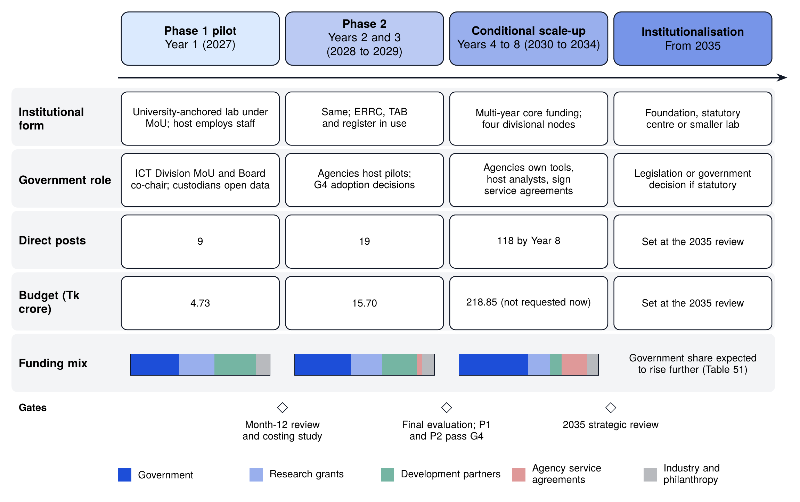

*Figure 16. Integrated institutional and financial pathway: form, government role, posts, budget and funding mix by stage, with the gates between stages.*

**Table 71.** Integrated institutional and financial pathway, 2027 to 2041

| Stage and period | Institutional form and employer | Government bodies and their role | Direct posts (end of stage) | Budget (Tk crore) | Gate to the next stage |
|------------------------|-----------------------|--------------------------|---------|----------|---------------------|
| **Phase 1 pilot**, Year 1 (2027) | University-anchored lab under an MoU (Option C); staff employed by the host on fixed-term contracts | ICT Division signs the MoU, co-chairs the Steering Board and names a focal point; Planning Commission and a data custodian sit on the Board; custodians authorise bulk access to public documents (D2 to D4) | 9 | 4.73 | Month-12 review and feasibility and costing study (D1.3) approve Phase 2 and release Tranche 2 |
| **Phase 2**, Years 2 and 3 (2028 to 2029) | Same form; ERRC, TAB and transparency register in operation | Pilot agencies provide users and data; adoption decisions on P1 and P2 taken with host agencies (G4, month 24 onwards); independent mid-term evaluation at month 18 | 19 | 15.70 | Positive final evaluation (end of 2029); P1 and P2 pass G4; decision to scale up at the strategic review (Table 48) |
| **Conditional national scale-up**, Years 4 to 8 (2030 to 2034) | Lab with multi-year core funding; four divisional university nodes; staff still employed by the host and partner universities | Government core contribution rises to about half of the budget; agencies own adopted tools as class O services, host placed analysts and sign service agreements; alignment with the national AI policy cycle after 2030 | 118 | 218.85 | 2035 strategic review of the institutional form against independence, sustainability, policy uptake and public trust |
| **Institutionalisation**, from 2035 | Independent public-interest foundation (Option D), statutory centre attached to government, or a smaller research lab with agencies running the services (Section 5.9) | A statutory centre needs legislation or a formal government decision (Annex T); posts can then become regular posts of the new body under its service rules, with open recruitment | Set at the 2035 review | Set at the 2035 review (Blueprint 2.0 and later) | Independent review in 2041; charter renewed only if public value is confirmed |

*Note.* Posts and budgets are computed by blueprint/src/budget_model.py (functions stage_posts, totals and scaleup); Phase 1 and Phase 2 are the requested 36-month plan, the scale-up is conditional and not requested. Years are indicative, with Year 1 in 2027 (Table 45).

\needspace{16\baselineskip}

**Table 72.** Indicative funding by source and stage (Tk crore)

| Source | Phase 1 (2027) | Phase 2 (2028 to 2029) | Scale-up (2030 to 2034) | Total, 8 years |
|------------------------------------------|-----------|-----------|-----------|------------|
| Government core contribution (MoU, development budget) | 1.65 | 6.32 | 108.15 | 116.12 |
| Competitive research grants | 1.18 | 3.51 | 34.10 | 38.80 |
| Development partners (pilot-specific) | 1.42 | 3.89 | 18.63 | 23.94 |
| Service agreements with agencies (cost recovery) | 0.00 | 0.57 | 40.46 | 41.03 |
| Industry and philanthropy (open benchmarks, fellowships) | 0.47 | 1.41 | 17.51 | 19.39 |
| **Total** | **4.73** | **15.70** | **218.85** | **239.28** |

*Note.* Each year’s budget is split using one indicative share inside each range of Table 51: 2027 and 2028 (H1) government 35%, grants 25%, development partners 30%, service agreements 0%, industry and philanthropy 10%; 2029 and 2030 (H2) 45, 20, 20, 7 and 8%; 2031 onwards (H3) 50, 15, 7, 20 and 8%. Sources are categories, not single funders; no single non-government funder provides more than 30% in any year. The scale-up column applies only if the scale-up is approved. None of these amounts has been requested or committed. Computed by blueprint/src/budget_model.py (function funding_by_source).

Three points follow. First, government is involved from the start without BAPIL becoming a government department: the ICT Division signs the MoU and co-chairs the Steering Board, agencies own the tools they adopt, and government becomes the largest funder over time. Second, the government’s indicative share of the 36-month plan is about Tk 8.0 crore (39%), with the rest from research grants, development partners and industry; in the scale-up, government and agency service agreements together would provide about two-thirds. Third, every stage has a gate: money for the next stage follows evidence from the previous one.

\newpage

# References

References are numbered in the order in which they are first cited, and only references cited in this document are listed. Entries marked with an asterisk (\*) are taken from the bibliography of the BAPIL White Paper (Version 1.0).

\setlength{\parskip}{3pt plus 1pt minus 1pt}

[1] \* ORGANISATION FOR ECONOMIC CO-OPERATION AND DEVELOPMENT (OECD).
Recommendation of the Council on Artificial Intelligence (OECD/LEGAL/0449)[EB/OL].
Paris: OECD, 2019 (amended 2023 and 2024)[2026-06-17].
Available: 
<https://legalinstruments.oecd.org/en/instruments/oecd-legal-0449>

[2] \* UNITED NATIONS EDUCATIONAL, SCIENTIFIC AND CULTURAL ORGANIZATION (UNESCO).
Recommendation on the Ethics of Artificial Intelligence[EB/OL].
Paris: UNESCO, 2021[2026-06-17].
Available: 
<https://unesdoc.unesco.org/ark:/48223/pf0000380455>

[3] \* NATIONAL INSTITUTE OF STANDARDS AND TECHNOLOGY (NIST).
Artificial Intelligence Risk Management Framework (AI RMF 1.0) (NIST AI 100-1)[EB/OL].
Gaithersburg, MD: National Institute of Standards and Technology, 2023[2026-10-22].
DOI: 10.6028/NIST.AI.100-1.
Available: 
<https://doi.org/10.6028/NIST.AI.100-1>

[4] \* WORLD BANK.
Global Program on GovTech & Public Sector Innovation[EB/OL].
Washington, DC: World Bank, 2024[2026-10-22].
Available:
<https://www.worldbank.org/en/programs/govtech>

[5] \* UNITED NATIONS.
United Nations E-Government Survey 2024: Accelerating Digital Transformation for Sustainable Development - With the Addendum on Artificial Intelligence[M/OL].
New York: United Nations, 2024[2026-10-22].
DOI: 10.18356/9789211067286.
Available: 
<https://www.un-ilibrary.org/content/books/9789211067286>

[6] THE BUSINESS STANDARD (TBS).
Govt issues gazettes of 2 landmark ordinances on data protection, governance[EB/OL].
Dhaka: The Business Standard, 2025[2026-10-20].
Available:
<https://www.tbsnews.net/node/1281356>

[7] SECURITI.
An Overview of Bangladesh’s Personal Data Protection Act, 2026[EB/OL].
San Jose, CA: Securiti, 2026[2026-10-20].
Available:
<https://securiti.ai/bangladesh-personal-data-protection-act-overview/>

[8] DAILY SUN.
91 bills passed in parliament to convert ordinances into laws[EB/OL].
Dhaka: Daily Sun, 2026[2026-10-20].
Available:
<https://www.daily-sun.com/bangladesh/868072/91-bills-passed-in-parliament-to-convert-ordinances-into-laws>

[9] DHAKA TRIBUNE.
Cyber security amendment bill, 2026 passes in parliament[EB/OL].
Dhaka: Dhaka Tribune, 2026-06-30[2026-10-20].
Available:
<https://www.dhakatribune.com/bangladesh/parliament/414016/cyber-security-amendment-bill-2026-passes-in>

[10] THE DAILY STAR.
Draft AI policy targets innovation, better public services[EB/OL].
Dhaka: The Daily Star, 2026-01-26[2026-10-20].
Available:
<https://www.thedailystar.net/business/economy/news/draft-ai-policy-targets-innovation-better-public-services-4090431>

[11] THE FINANCIAL EXPRESS.
Draft AI policy tightens state oversight[EB/OL].
Dhaka: The Financial Express, 2026-01-29[2026-10-20].
Available:
<https://thefinancialexpress.com.bd/national/draft-ai-policy-tightens-state-oversight>

[12] AI POLICY FOR BANGLADESH (aipolicy.gov.bd).
Bangladesh National AI Policy 2026-2030, Draft v2, February 9, 2026[EB/OL].
Dhaka, 2026-02-09[2026-10-22].
Available:
<https://aipolicy.gov.bd/docs/national-ai-policy-bangladesh-2026-2030-draft-v2.0.pdf>

[13] THE DAILY OBSERVER.
Works on human-centric nat’l AI Policy ongoing: ICT minister[EB/OL].
Dhaka: The Daily Observer, 2026-07-19[2026-10-20].
Available:
<https://observerbd.com/news/583983>

[14] THE DAILY OBSERVER.
Rehan Asif Asad outlines govt’s five priorities for ICT, telecom[EB/OL].
Dhaka: The Daily Observer, 2026-08-10[2026-10-20].
Available:
<https://observerbd.com/news/587314>

[15] \* GENERAL ECONOMICS DIVISION (GED), PLANNING COMMISSION, GOVERNMENT OF BANGLADESH.
Making Vision 2041 a Reality: Perspective Plan of Bangladesh 2021–2041[EB/OL].
Dhaka: Planning Commission, Government of Bangladesh, 2020[2026-10-22].
Available:
<https://oldweb.lged.gov.bd/uploadeddocument/unitpublication/1/1049/vision%202021-2041.pdf>

[16] \* INFORMATION AND COMMUNICATION TECHNOLOGY (ICT) DIVISION, GOVERNMENT OF THE PEOPLE’S REPUBLIC OF BANGLADESH.
Smart Bangladesh: ICT Master Plan 2041 (Draft)[EB/OL].
Dhaka: ICT Division, Government of the People’s Republic of Bangladesh, undated[2026-10-22].
Available: 
<https://objectstorage.ap-dcc-gazipur-1.oraclecloud15.com/n/axvjbnqprylg/b/V2Ministry/o/office-moa/2024/12/a01255f61d29443eabbf948ef97c290e.pdf>

[17] \* ORGANISATION FOR ECONOMIC CO-OPERATION AND DEVELOPMENT (OECD).
OECD AI Principles[EB/OL].
Paris: OECD AI Policy Observatory, 2024[2026-10-22].
Available:
<https://oecd.ai/en/ai-principles>

[18] \* EUROPEAN PARLIAMENT AND COUNCIL OF THE EUROPEAN UNION.
Regulation (EU) 2024/1689 of the European Parliament and of the Council
of 13 June 2024 laying down harmonised rules on artificial intelligence
(Artificial Intelligence Act)[EB/OL].
Official Journal of the European Union, 2024[2026-10-22].
Available: 
<https://eur-lex.europa.eu/eli/reg/2024/1689/oj/eng>

[19] \* TREASURY BOARD OF CANADA SECRETARIAT (TBS).
Directive on Automated Decision-Making[EB/OL].
Ottawa: Government of Canada, 2025[2026-06-18].
Available: 
<https://www.tbs-sct.canada.ca/pol/doc-eng.aspx?id=32592>

[20] INTERNATIONAL ORGANIZATION FOR STANDARDIZATION (ISO), INTERNATIONAL ELECTROTECHNICAL COMMISSION (IEC).
ISO/IEC 42001:2023 Information technology: Artificial intelligence: Management system[S].
Geneva: ISO, 2023[2026-10-20].
Available:
<https://www.iso.org/standard/81230.html>

[21] THE BUSINESS STANDARD (TBS).
Bangladesh climbs 11 notches on UN’s digital govt services index[EB/OL].
Dhaka: The Business Standard, 2024-09-18[2026-10-21].
Available:
<https://www.tbsnews.net/node/944651>

[22] \* INTERNATIONAL TELECOMMUNICATION UNION (ITU).
Global Cybersecurity Index 2024[R/OL].
Geneva: International Telecommunication Union, 2024[2026-10-22].
Available: 
<https://www.itu.int/en/ITU-D/Cybersecurity/Pages/global-cybersecurity-index.aspx>

[23] KADERI O R B S, RAHMAN M A.
Safeguarding cyberspace: Bangladesh’s preparedness today[EB/OL].
Dhaka: The Daily Star, 2026-03-03[2026-10-21].
Available:
<https://www.thedailystar.net/supplements-0/news/safeguarding-cyberspace-bangladeshs-preparedness-today-4120311>

[24] OXFORD INSIGHTS.
Government AI Readiness Index 2023[R/OL].
Oxford: Oxford Insights, 2023[2026-10-22].
Copy hosted by the Norwegian Digitalisation Agency.
Available:
<https://www.digdir.no/sites/sogn/files/2024-03/GovernmentAIReadinessIndex2023.pdf>

[25] \* SULTANA S, SAMAD R, HAQUE M, SULTANA Z, JAHANGIR Z, HOSSAIN B M M, NOMAN R M, AHMED S I.
Bangladesh AI Readiness: Perspectives from the Academia, Industry, and Government[EB/OL].
Ithaca, NY: arXiv, 2026[2026-10-22].
DOI: 10.48550/arXiv.2601.12934.
Available: 
<https://arxiv.org/abs/2601.12934>

[26] UNITED NATIONS DEPARTMENT OF ECONOMIC AND SOCIAL AFFAIRS (UN DESA).
UN E-Government Knowledgebase: Bangladesh country data[DB/OL].
New York: United Nations, 2024[2026-10-22].
Available:
<https://publicadministration.un.org/egovkb/en-us/Data/Country-Information/id/14-Bangladesh>

[27] \* ASPIRE TO INNOVATE (a2i).
Impact and Institutionalization of the e-Nothi System in Bangladesh[R/OL].
Dhaka: Aspire to Innovate (a2i), ICT Division and UNDP, 2024[2026-10-22].
Available: 
<https://objectstorage.ap-dcc-gazipur-1.oraclecloud15.com/n/axvjbnqprylg/b/V2Ministry/o/office-a2i/2024/12/8e6eee520a6b44e4a3cbf8724d74e7c4.pdf>

[28] \* GOVERNMENT OF THE PEOPLE’S REPUBLIC OF BANGLADESH.
Bangladesh National Portal[EB/OL].
Dhaka: Government of the People’s Republic of Bangladesh, 2026[2026-10-22].
Available:
<https://bangladesh.gov.bd>

[29] BANGLADESH e-GOVERNMENT COMPUTER INCIDENT RESPONSE TEAM (BGD e-GOV CIRT).
Who We Are[EB/OL].
Dhaka: BGD e-GOV CIRT, 2026[2026-10-22].
Available:
<https://cirt.gov.bd/who-we-are>

[30] \* BANGLADESH BUREAU OF STATISTICS (BBS), STATISTICS AND INFORMATICS DIVISION, MINISTRY OF PLANNING, GOVERNMENT OF THE PEOPLE’S REPUBLIC OF BANGLADESH.
Bangladesh Statistical Yearbook 2024 (44th edition)[EB/OL].
Dhaka: Bangladesh Bureau of Statistics, 2025[2026-10-22].
Available: 
<https://objectstorage.ap-dcc-gazipur-1.oraclecloud15.com/n/axvjbnqprylg/b/V2Ministry/o/office-bbs/2024/12/eca101901c5f41329d08ce583e842be8.pdf>

[31] \* BANGLADESH OPEN DATA.
Bangladesh Open Data Portal[EB/OL].
Dhaka: Government of the People’s Republic of Bangladesh, 2024[2026-10-22].
Available: 
<https://data.gov.bd>

[32] \* MANAGEMENT AND RESOURCES DEVELOPMENT INITIATIVE (MRDI).
Open Data Country Report: Bangladesh[R/OL].
Dhaka: Management and Resources Development Initiative (MRDI), 2021[2026-10-22].
Available: 
<https://mrdibd.org/wp-content/uploads/2021/07/Open_Data_Country_Report_Bangladesh.pdf>

[33] \* BRAC INSTITUTE OF GOVERNANCE AND DEVELOPMENT (BIGD).
Report on the State of Public Data in Bangladesh: Insights from Expert Consultations[R/OL].
Dhaka: BRAC Institute of Governance and Development (BIGD), BRAC University, 2025[2026-10-22].
Available: 
<https://bigd.bracu.ac.bd/wp-content/uploads/2025/01/Report-on-the-State-of-Public-Data-in-Bangladesh_20.1.2025.pdf>

[34] \* BHATTACHARJEE A, HASAN T, AHMAD W, MUBASSHIR K S, ISLAM M S, IQBAL A, RAHMAN M S, SHAHRIYAR R.
BanglaBERT: Language Model Pretraining and Benchmarks for Low-Resource Language Understanding Evaluation in Bangla[C/OL]//
Findings of the Association for Computational Linguistics: NAACL 2022.
Seattle, WA, USA: Association for Computational Linguistics, 2022: 1318–1327[2026-10-22].
DOI: 10.18653/v1/2022.findings-naacl.98.
Available:
<https://aclanthology.org/2022.findings-naacl.98>

[35] \* BHATTACHARJEE A, HASAN T, AHMAD W U, et al.
BanglaNLG and BanglaT5: Benchmarks and Resources for Evaluating Low-Resource Natural Language Generation in Bangla[C/OL]//Findings of the Association for Computational Linguistics: EACL 2023.
Dubrovnik, Croatia: Association for Computational Linguistics, 2023: 726–735[2026-10-22].
DOI: 10.18653/v1/2023.findings-eacl.54.
Available: 
<https://aclanthology.org/2023.findings-eacl.54>

[36] \* ZEHADY A K, DIPTA S R, ISLAM N, et al.
BanglaLlama: LLaMA for Bangla Language (first version titled BongLLaMA)[R/OL].
arXiv:2410.21200.
Ithaca, NY: arXiv, 2024 (revised 2025)[2026-10-22].
DOI: 10.48550/arXiv.2410.21200.
Available: 
<https://arxiv.org/abs/2410.21200>

[37] \* ISLAM M E, CHOWDHURY L, KHAN F A, HOSSAIN S, HOSSAIN S, RASHID M M O, MOHAMMED N, AMIN M R.
SentiGOLD: A Large Bangla Gold Standard Multi-Domain Sentiment Analysis Dataset and its Evaluation[C/OL]//
Proceedings of the 29th ACM SIGKDD Conference on Knowledge Discovery and Data Mining (KDD ’23).
New York: Association for Computing Machinery (ACM), 2023[2026-06-19].
DOI: 10.1145/3580305.3599904.
Available: 
<https://doi.org/10.1145/3580305.3599904>

[38] AZAM A H M S.
Bangladesh Data Protection and Data Management Framework: A Governance-Capacity Assessment of the 2025 Ordinances and 2026 Acts[EB/OL].
SSRN, 2026-09-14[2026-10-22].
Available:
<https://papers.ssrn.com/sol3/papers.cfm?abstract_id=7436740>

[39] GREENLEAF G, AL RAZI Y.
Bangladesh’s unconventional data privacy Ordinance[J/OL].
Privacy Laws & Business International Report, 2026-06-01[2026-10-22].
Available:
<https://www.privacylaws.com/reports-gateway/articles/int201/int201bangladesh/>

[40] THE FINANCIAL EXPRESS.
Bangladesh amends cybersecurity law, drops online gambling clause[EB/OL].
Dhaka: The Financial Express, 2026-06-30[2026-10-22].
Available:
<https://thefinancialexpress.com.bd/sci-tech/bangladesh-amends-cybersecurity-law-drops-online-gambling-clause>

[41] THE DAILY OBSERVER.
Cabinet committee formed to finalise draft of Cyber Security (Amendment) Act[EB/OL].
Dhaka: The Daily Observer, 2026-07-02[2026-10-22].
Available:
<https://observerbd.com/news/581694>

[42] \* INFOCOMM MEDIA DEVELOPMENT AUTHORITY (IMDA), PERSONAL DATA PROTECTION COMMISSION (PDPC).
Model AI Governance Framework (2nd Edition)[EB/OL].
Singapore: Infocomm Media Development Authority and Personal Data Protection Commission, 2020[2026-10-22].
Available: 
<https://www.imda.gov.sg/-/media/imda/files/infocomm-media-landscape/sg-digital/tech-pillars/artificial-intelligence/second-edition-of-the-model-ai-governance-framework.pdf>

[43] \* GOVERNMENT OF THE REPUBLIC OF KOREA.
National Strategy for Artificial Intelligence[EB/OL].
Seoul: Government of the Republic of Korea, 2019[2026-10-22].
Available: 
<https://wp.oecd.ai/app/uploads/2021/12/Korea_National_Strategy_for_Artificial_Intelligence_2019.pdf>

[44] \* ESTONIAN BUSINESS AND INNOVATION AGENCY (e-Estonia).
e-Governance[EB/OL].
Tallinn: Estonian Business and Innovation Agency, 2024[2026-10-22].
Available:
<https://e-estonia.com/solutions/e-governance>

[45] \* DEPARTMENT FOR SCIENCE, INNOVATION AND TECHNOLOGY (DSIT), GOVERNMENT OF THE UNITED KINGDOM.
AI Opportunities Action Plan[EB/OL].
London: UK Government, 2025[2026-10-22].
ISBN: 978-1-5286-5362-6.
Available: 
<https://www.gov.uk/government/publications/ai-opportunities-action-plan/ai-opportunities-action-plan>

[46] \* GOVERNMENT DIGITAL SERVICE (GDS), GOVERNMENT OF THE UNITED KINGDOM.
Artificial Intelligence Playbook for the UK Government[EB/OL].
London: Government Digital Service, 2025[2026-10-22].
Available: 
<https://www.gov.uk/government/publications/ai-playbook-for-the-uk-government/artificial-intelligence-playbook-for-the-uk-government-html>

[47] \* MINISTRY OF ECONOMIC AFFAIRS AND EMPLOYMENT OF FINLAND.
Leading the Way into the Age of Artificial Intelligence: Final Report of Finland’s Artificial Intelligence Programme 2019[R/OL].
Helsinki: Ministry of Economic Affairs and Employment, 2019[2026-06-18].
Available: 
<https://julkaisut.valtioneuvosto.fi/handle/10024/161688>

[48] \* GOVERNMENT OF THE UNITED ARAB EMIRATES.
UAE National Strategy for Artificial Intelligence 2031[EB/OL].
Abu Dhabi: Government of the United Arab Emirates, 2017[2026-10-22].
Available: 
<https://staticcdn.mbzuai.ac.ae/mbzuaiwpprd01/2022/07/UAE-National-Strategy-for-Artificial-Intelligence-2031.pdf>

[49] \* TREASURY BOARD OF CANADA SECRETARIAT (TBS).
Algorithmic Impact Assessment (AIA) Tool[EB/OL].
Ottawa: Government of Canada, 2026[2026-10-22].
Available: 
<https://www.canada.ca/en/government/system/digital-government/digital-government-innovations/responsible-use-ai/algorithmic-impact-assessment.html>

[50] \* INFOCOMM MEDIA DEVELOPMENT AUTHORITY (IMDA), AI VERIFY FOUNDATION (AIVF).
Model AI Governance Framework for Generative AI: Fostering a Trusted Ecosystem[EB/OL].
Singapore: Infocomm Media Development Authority and AI Verify Foundation, 2024[2026-10-22].
Available: 
<https://aiverifyfoundation.sg/wp-content/uploads/2024/05/Model-AI-Governance-Framework-for-Generative-AI-May-2024-1-1.pdf>

[51] \* ESTONIAN BUSINESS AND INNOVATION AGENCY (e-Estonia).
X-Road: The Backbone of e-Estonia[EB/OL].
Tallinn: Estonian Business and Innovation Agency, 2024[2026-10-22].
Available:
<https://e-estonia.com/solutions/interoperability-services/x-road>

[52] \* UNIVERSITY OF HELSINKI, MINNALEARN.
Elements of AI: A Free Online Course on Artificial Intelligence[EB/OL].
Helsinki: University of Helsinki and MinnaLearn, 2024[2026-10-22].
Available: 
<https://www.elementsofai.com>

[53] \* THE BUSINESS STANDARD (TBS).
Govt to establish AI hub with Tk192.66cr project backed by Koica[EB/OL].
Dhaka: The Business Standard, 2026[2026-10-22].
Available:
<https://www.tbsnews.net/tech/govt-establish-ai-hub-tk19266cr-project-backed-koica-1462206>

[54] \* THE BUSINESS STANDARD (TBS).
KOICA and ICT Division launch $28.5million AI innovation project[EB/OL].
Dhaka: The Business Standard, 2025-01-09[2026-10-22].
Available:
<https://www.tbsnews.net/foreign-policy/koica-and-ict-division-launch-285million-ai-innovation-project-1039121>

[55] THE DAILY OBSERVER.
BD, KOICA sign $13m grant deal for AI tech experts[EB/OL].
Dhaka: The Daily Observer, 2026-08-26[2026-10-22].
Available:
<https://observerbd.com/news/590061>

[56] THE DAILY STAR.
Banks asked to enrol employees in Pragati pension scheme[EB/OL].
Dhaka: The Daily Star, 2026-06-04[2026-10-22].
Available:
<https://www.thedailystar.net/business/economy/news/banks-asked-enrol-employees-pragati-pension-scheme-4189996>

[57] CABINET DIVISION, GOVERNMENT OF BANGLADESH.
Letter on the absorption of development-project staff into revenue posts, following Appellate Division judgment in Civil Appeal No. 460 of 2017 (memo no. 00.00.0000.111.04.102.20.38), 2020-03-03[EB/OL].
Reproduced by Bangladesh Service Rules[2026-10-22].
Available:
<https://bdservicerules.info/?p=9388>

[58] MINISTRY OF DIGITAL DEVELOPMENT AND INFORMATION (FORMERLY MINISTRY OF COMMUNICATIONS AND INFORMATION), SINGAPORE.
AI.SG: New National Programme to Catalyse, Synergise and Boost Singapore’s Artificial Intelligence Capabilities[EB/OL].
Singapore, 2017-05-03[2026-10-22].
Available:
<https://www.mddi.gov.sg/newsroom/aisg-new-national-programme-to-catalyse-synergise-and-boost-singapore-s-artificial-intelligence-capabilities/>

[59] BETAKIT.
Vector Institute, Ontario Centre of Innovation secure combined $77-million provincial funding[EB/OL].
Toronto: BetaKit, 2023-06-28[2026-10-22].
Available:
<https://betakit.com/vector-institute-ontario-centre-of-innovation-secure-combined-77-million-provincial-funding/>

[60] DIGITAL INDIA CORPORATION (INDIAAI).
Recruitment notice: Manager (General Administration), India AI, on contract basis[EB/OL].
New Delhi: Digital India Corporation, 2025[2026-10-22].
Available:
<https://negd.gov.in/wp-content/uploads/2025/02/Manager-Gen.-Admin-India-AI.pdf>

[61] CIVIL SERVICE WORLD.
AI unit grows to more than 40 staff after move to DSIT[EB/OL].
London: Civil Service World, 2024-09-30[2026-10-22].
Available:
<https://www.civilserviceworld.com/professions/article/incubator-for-ai-grows-dsit-move>

[62] THE APACHE SOFTWARE FOUNDATION.
Apache Tika: a content analysis toolkit[EB/OL].
The Apache Software Foundation[2026-10-22].
Available:
<https://tika.apache.org/>

[63] SMITH R.
An Overview of the Tesseract OCR Engine[C]//Proceedings of the Ninth International Conference on Document Analysis and Recognition (ICDAR 2007).
Los Alamitos, CA: IEEE Computer Society, 2007: 629–633.
DOI: 10.1109/ICDAR.2007.4376991.
Available:
<https://doi.org/10.1109/ICDAR.2007.4376991>

[64] THE POSTGRESQL GLOBAL DEVELOPMENT GROUP.
PostgreSQL: The World’s Most Advanced Open Source Relational Database[EB/OL].
[2026-10-22].
Available:
<https://www.postgresql.org/>

[65] CKAN PROJECT.
CKAN: The Open Source Data Management System[EB/OL].
[2026-10-22].
Available:
<https://ckan.org/>

[66] OPENSEARCH SOFTWARE FOUNDATION.
OpenSearch: open-source search and analytics suite[EB/OL].
The Linux Foundation[2026-10-22].
Available:
<https://opensearch.org/>

[67] KANE A, et al.
pgvector: Open-source vector similarity search for Postgres[CP/OL].
GitHub repository[2026-10-22].
Available:
<https://github.com/pgvector/pgvector>

[68] ROBERTSON S, ZARAGOZA H.
The Probabilistic Relevance Framework: BM25 and Beyond[J].
Foundations and Trends in Information Retrieval, 2009, 3(4): 333–389.
DOI: 10.1561/1500000019.
Available:
<https://doi.org/10.1561/1500000019>

[69] WANG L, YANG N, HUANG X, YANG L, MAJUMDER R, WEI F.
Multilingual E5 Text Embeddings: A Technical Report[R/OL].
arXiv:2402.05672, 2024[2026-10-20].
DOI: 10.48550/arXiv.2402.05672.
Available:
<https://arxiv.org/abs/2402.05672>

[70] WORLD WIDE WEB CONSORTIUM (W3C).
Web Content Accessibility Guidelines (WCAG) 2.2: W3C Recommendation 5 October 2023[S/OL].
W3C, 2023[2026-10-20].
Available:
<https://www.w3.org/TR/WCAG22/>

[71] GOVERNMENT OF THE PEOPLE’S REPUBLIC OF BANGLADESH.
The Right to Information Act, 2009 (Act No. XX of 2009)[S/OL].
Dhaka: Legislative and Parliamentary Affairs Division, 2009[2026-10-20].
Available:
<http://bdlaws.minlaw.gov.bd>

[72] WORLD WIDE WEB CONSORTIUM (W3C).
Data Catalog Vocabulary (DCAT), Version 3: W3C Recommendation 22 August 2024[S/OL].
W3C, 2024[2026-10-20].
Available:
<https://www.w3.org/TR/vocab-dcat-3/>

[73] WILKINSON M D, DUMONTIER M, AALBERSBERG I J, et al.
The FAIR Guiding Principles for scientific data management and stewardship[J].
Scientific Data, 2016, 3: 160018.
DOI: 10.1038/sdata.2016.18.
Available:
<https://doi.org/10.1038/sdata.2016.18>

[74] MUBASHIRA N.
A Statute Without a Floor: Data Protection and the Case for Constitutional Privacy in Bangladesh[EB/OL].
Dhaka: Bangladesh Law Digest, 2026-08-18[2026-10-22].
Available:
<https://bdlawdigest.org/personal-data-protection-act-2026-bangladesh.html>

[75] DIGITAL POLICY ALERT.
Bangladesh: Personal Data Protection (Amendment) Ordinance, 2026 (Ordinance No. 23 of 2026)[EB/OL].
St. Gallen: Digital Policy Alert, 2026[2026-10-22].
Available:
<https://digitalpolicyalert.org/change/18757-personal-data-protection-amendment-ordinance-2026-ordinance-no-23-of-2026>

[76] THE BUSINESS STANDARD.
Personal Data Protection Ordinance: A law that protects you from everyone except the state[EB/OL].
Dhaka: The Business Standard, 2026-04-20[2026-10-22].
Available:
<https://www.tbsnews.net/thoughts/personal-data-protection-ordinance-law-protects-you-everyone-except-state-1416106>

[77] HOSSAIN S.
New data laws in Bangladesh: A critique[EB/OL].
Dhaka: The Daily Star, 2025-11-18[2026-10-20].
Available:
<https://www.thedailystar.net/law-our-rights/news/new-data-laws-bangladesh-critique-4038266>

[78] WHISTLER K.
Unicode Standard Annex #15: Unicode Normalization Forms[S/OL].
Mountain View, CA: The Unicode Consortium[2026-10-22].
Available:
<https://www.unicode.org/reports/tr15/>

[79] CORMACK G V, CLARKE C L A, BÜTTCHER S.
Reciprocal Rank Fusion Outperforms Condorcet and Individual Rank Learning Methods[C]//Proceedings of the 32nd International ACM SIGIR Conference on Research and Development in Information Retrieval.
New York: ACM, 2009: 758–759.
DOI: 10.1145/1571941.1572114.
Available:
<https://doi.org/10.1145/1571941.1572114>

[80] \* LEWIS P, PEREZ E, PIKTUS A, et al.
Retrieval-Augmented Generation for Knowledge-Intensive NLP Tasks[C/OL]//Advances in Neural Information Processing Systems 33 (NeurIPS 2020).
Red Hook, NY: Curran Associates, Inc., 2020[2026-10-22].
DOI: 10.48550/arXiv.2005.11401.
Available: 
<https://papers.nips.cc/paper/2020/hash/6b493230205f780e1bc26945df7481e5-Abstract.html>

[81] GEBRU T, MORGENSTERN J, VECCHIONE B, et al.
Datasheets for Datasets[J].
Communications of the ACM, 2021, 64(12): 86–92.
DOI: 10.1145/3458723.
Available:
<https://doi.org/10.1145/3458723>

[82] MANNING C D, RAGHAVAN P, SCHÜTZE H.
Introduction to Information Retrieval[M].
Cambridge: Cambridge University Press, 2008.
DOI: 10.1017/CBO9780511809071.
Available:
<https://doi.org/10.1017/CBO9780511809071>

[83] VOORHEES E M.
The TREC-8 Question Answering Track Report[C]//Proceedings of the Eighth Text REtrieval Conference (TREC-8), NIST Special Publication 500-246.
Gaithersburg, MD: National Institute of Standards and Technology, 1999: 77–82.
Available:
<https://trec.nist.gov/pubs/trec8/papers/qa_report.pdf>

[84] JÄRVELIN K, KEKÄLÄINEN J.
Cumulated Gain-Based Evaluation of IR Techniques[J].
ACM Transactions on Information Systems, 2002, 20(4): 422–446.
DOI: 10.1145/582415.582418.
Available:
<https://doi.org/10.1145/582415.582418>

[85] MITCHELL M, WU S, ZALDIVAR A, et al.
Model Cards for Model Reporting[C]//Proceedings of the Conference on Fairness, Accountability, and Transparency (FAT* ’19).
New York: ACM, 2019: 220–229.
DOI: 10.1145/3287560.3287596.
Available:
<https://doi.org/10.1145/3287560.3287596>

[86] \* BOMMASANI R, KLYMAN K, KAPOOR S, et al.
The 2024 Foundation Model Transparency Index (first version titled The Foundation Model Transparency Index v1.1: May 2024)[R/OL].
Stanford, CA: Stanford Center for Research on Foundation Models (CRFM), Stanford University, 2024[2026-10-22].
DOI: 10.48550/arXiv.2407.12929.
Available: 
<https://arxiv.org/abs/2407.12929>

[87] HU E J, SHEN Y, WALLIS P, et al.
LoRA: Low-Rank Adaptation of Large Language Models[C/OL]//International Conference on Learning Representations (ICLR 2022).
2022[2026-10-20].
DOI: 10.48550/arXiv.2106.09685.
Available:
<https://arxiv.org/abs/2106.09685>

[88] KAPLAN J, MCCANDLISH S, HENIGHAN T, BROWN T B, CHESS B, CHILD R, GRAY S, RADFORD A, WU J, AMODEI D.
Scaling Laws for Neural Language Models[EB/OL].
Ithaca, NY: arXiv, 2020[2026-10-22].
DOI: 10.48550/arXiv.2001.08361.
Available:
<https://arxiv.org/abs/2001.08361>

[89] ROSE S, BORCHERT O, MITCHELL S, CONNELLY S.
Zero Trust Architecture (NIST Special Publication 800-207)[R/OL].
Gaithersburg, MD: NIST, 2020[2026-10-20].
DOI: 10.6028/NIST.SP.800-207.
Available:
<https://doi.org/10.6028/NIST.SP.800-207>

[90] \* NATIONAL INSTITUTE OF STANDARDS AND TECHNOLOGY (NIST).
Cybersecurity Framework (CSF) 2.0[EB/OL].
Gaithersburg, MD: National Institute of Standards and Technology, 2024[2026-10-22].
DOI: 10.6028/NIST.CSWP.29.
Available: 
<https://doi.org/10.6028/NIST.CSWP.29>

[91] OWASP FOUNDATION.
OWASP Top 10 for LLM Applications 2025[EB/OL].
Wilmington, DE: OWASP GenAI Security Project, 2024[2026-10-20].
Available:
<https://genai.owasp.org/llm-top-10/>

[92] NATIONAL INSTITUTE OF STANDARDS AND TECHNOLOGY (NIST).
Artificial Intelligence Risk Management Framework: Generative Artificial Intelligence Profile (NIST AI 600-1)[R/OL].
Gaithersburg, MD: NIST, 2024[2026-10-20].
DOI: 10.6028/NIST.AI.600-1.
Available:
<https://doi.org/10.6028/NIST.AI.600-1>

[93] PRESTON-WERNER T.
Semantic Versioning 2.0.0[EB/OL].
[2026-10-22].
Available:
<https://semver.org/spec/v2.0.0.html>

[94] \* OXFORD INSIGHTS. 
Government AI Readiness Index 2025[EB/OL].
Oxford: Oxford Insights, 2025[2026-10-22].
Available: 
<https://oxfordinsights.com/ai-readiness/government-ai-readiness-index-2025>

[95] GRESHAKE K, ABDELNABI S, MISHRA S, et al.
Not What You’ve Signed Up For: Compromising Real-World LLM-Integrated Applications with Indirect Prompt Injection[C]//Proceedings of the 16th ACM Workshop on Artificial Intelligence and Security (AISec ’23).
New York: ACM, 2023: 79–90.
DOI: 10.1145/3605764.3623985.
Available:
<https://doi.org/10.1145/3605764.3623985>

[96] INTERNATIONAL ORGANIZATION FOR STANDARDIZATION (ISO), INTERNATIONAL ELECTROTECHNICAL COMMISSION (IEC).
ISO/IEC 23894:2023 Information technology: Artificial intelligence: Guidance on risk management[S].
Geneva: ISO, 2023[2026-10-20].
Available:
<https://www.iso.org/standard/77304.html>

[97] KHAN M T I.
The Personal Data Protection Ordinance 2025: What Every Bangladeshi Business Must Do Before the Clock Runs Out[EB/OL].
Dhaka: Sovereign Chambers of Law, 2026-04-23[2026-10-22].
Available:
<https://bd-scl.com/insights/personal-data-protection-ordinance-2025-compliance.html>

[98] \* UNITED NATIONS.
The Sustainable Development Goals Report 2024[R].
New York: United Nations, 2024.
ISBN: 978-92-1-358975-5.
Available: 
<https://unstats.un.org/sdgs/report/2024>

[99] NUCAMP.
AI salaries in Bangladesh in 2026: what to expect by role and experience[EB/OL].
Nucamp, 2026-04-09[2026-10-22].
Commercial training provider; salary bands not attributed to a survey.
Available:
<https://www.nucamp.co/blog/coding-bootcamp-bangladesh-bgd-top-10-best-paid-tech-job-in-bangladesh-in-2025>

[100] THE FINANCIAL EXPRESS.
Cabinet approves 2026 pay scale, sets basic salaries from Tk 20,000 to Tk 156,000[EB/OL].
Dhaka: The Financial Express, 2026-08-31[2026-10-21].
Available:
<https://thefinancialexpress.com.bd/national/cabinet-approves-2026-pay-scale-sets-basic-salaries-from-tk-20000-to-tk-156000>

[101] HAJEE MOHAMMAD DANESH SCIENCE AND TECHNOLOGY UNIVERSITY.
HSTU PhD fellowship policy 2025[S/OL].
Dinajpur: HSTU, 2026[2026-10-22].
Available:
<https://hstu.ac.bd/uploads/notice/2026/jan/HSTU_PhDFellowshipPolicy.pdf>

[102] THE FINANCIAL EXPRESS.
Financing data centres in Bangladesh[EB/OL].
Dhaka: The Financial Express, 2026-07-22[2026-10-22].
Available:
<https://thefinancialexpress.com.bd/views/financing-data-centres-in-bangladesh>

[103] GPU POET.
NVIDIA L40S price in September 2026[EB/OL].
GPU Poet, 2026[2026-10-22].
Average of the three lowest daily marketplace listings.
Available:
<https://gpupoet.com/gpu/learn/price/september-2026/nvidia-l40s>

[104] CDW.
PNY NVIDIA L40S graphic card, 48 GB GDDR6 (NVL40STCGPU-KIT)[EB/OL].
Vernon Hills, IL: CDW, 2026[2026-10-22].
Retail listing.
Available:
<https://www.cdw.com/product/pny-nvidia-quadro-l40s-graphic-card-48-gb-gddr6/7582191>

[105] PC SERVER AND PARTS.
How much does a server cost in 2026?[EB/OL].
PC Server and Parts, 2026-08-21[2026-10-22].
Available:
<https://pcserverandparts.com/news/how-much-does-a-server-cost-2026/>

[106] KUNERT P.
Buy servers now or cry later: DRAM price spike threatens infrastructure budgets[EB/OL].
London: The Register, 2026-01-14[2026-10-22].
Available:
<https://www.theregister.com/2026/01/14/dram_infrastructure_costs/>

[107] BANGLADESH BANK.
Exchange Rate of Taka[EB/OL].
Dhaka: Bangladesh Bank, 2026[2026-10-21].
Available:
<https://www.bb.org.bd/en/index.php/econdata/exchangerate>

[108] DHAKA TRIBUNE.
Inflation rises in September[EB/OL].
Dhaka: Dhaka Tribune, 2026-10-07[2026-10-22].
Available:
<https://www.dhakatribune.com/business/421534/inflation-rises-in-september>

[109] MODAL LABS.
How much does it cost to run NVIDIA L40S GPUs in 2025?[EB/OL].
San Francisco, CA: Modal Labs, 2025-08-12[2026-10-21].
Available:
<https://modal.com/blog/nvidia-l40s-price-article>

[110] DEPARTMENT FOR INTERNATIONAL DEVELOPMENT (DFID).
DFID’s Approach to Value for Money (VfM)[R/OL].
London: DFID, 2011-07-01[2026-10-22].
Available:
<https://www.gov.uk/government/publications/dfids-approach-to-value-for-money-vfm>

[111] INDEPENDENT COMMISSION FOR AID IMPACT (ICAI).
ICAI Study of Value for Money and Effectiveness: Terms of Reference[R/OL].
London: ICAI, 2011[2026-10-22].
Available:
<https://icai.independent.gov.uk/wp-content/uploads/Report-1-VfM-and-effectiveness-ToR1.pdf>

[112] UNITED NATIONS DEVELOPMENT GROUP (UNDG).
Theory of Change: UNDAF Companion Guidance[R/OL].
New York: UNDG, 2017[2026-10-22].
Available:
<https://unsdg.un.org/sites/default/files/UNDG-UNDAF-Companion-Pieces-7-Theory-of-Change.pdf>

[113] EUROPEAN COMMISSION (EUROPEAID).
Aid Delivery Methods, Volume 1: Project Cycle Management Guidelines[R/OL].
Brussels: European Commission, 2004[2026-10-22].
Available:
<https://capacity4dev.europa.eu/library/aid-delivery-methods-project-cycle-management-guidelines-europeaid-2004_en>

[114] OECD DAC NETWORK ON DEVELOPMENT EVALUATION.
Better Criteria for Better Evaluation: Revised Evaluation Criteria Definitions and Principles for Use[R/OL].
Paris: Organisation for Economic Co-operation and Development, 2019[2026-10-21].
Available:
<https://www.oecd.org/en/publications/better-criteria-for-better-evaluation_15a9c26b-en.html>

[115] COHEN J.
A Coefficient of Agreement for Nominal Scales[J].
Educational and Psychological Measurement, 1960, 20(1): 37–46.
DOI: 10.1177/001316446002000104.
Available:
<https://doi.org/10.1177/001316446002000104>

[116] WILSON E B.
Probable Inference, the Law of Succession, and Statistical Inference[J].
Journal of the American Statistical Association, 1927, 22(158): 209–212.
DOI: 10.1080/01621459.1927.10502953.
Available:
<https://doi.org/10.1080/01621459.1927.10502953>

[117] EFRON B, TIBSHIRANI R J.
An Introduction to the Bootstrap[M].
New York: Chapman & Hall, 1993.
DOI: 10.1201/9780429246593.
Available:
<https://doi.org/10.1201/9780429246593>

[118] THE BUSINESS STANDARD.
Budget FY27: Govt proposes Tk500cr for AI sector[EB/OL].
Dhaka: The Business Standard, 2026-06-11[2026-10-22].
Available:
<https://www.tbsnews.net/node/1459971>


\newpage

# Contact

**Md Naim Hassan Saykat**  
Independent Researcher, Bangladesh  
ORCID: <https://orcid.org/0009-0007-5270-3970>

**GitHub:** <https://github.com/md-naim-hassan-saykat>  
**Repository:** <https://github.com/md-naim-hassan-saykat/bapil>

Comments, corrections and proposals for collaboration are welcome through the repository’s issue tracker.

